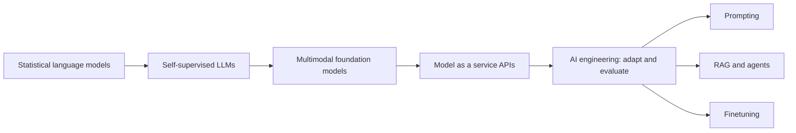

# From language models to foundation models

> **Before this lesson:** nothing about AI is assumed. This is the first lesson of the track. You need basic Python only: reading a `for` loop, a list and a `print` call. Every technical word is explained where it first appears and collected in the glossary at the end.

## In plain words

A **model**, in this track, is a computer program whose behaviour was not typed in by a programmer rule by rule. Instead it was *learned* from a very large pile of examples. A **language model** is a model that has read an enormous amount of text and learned one skill from it: given the start of a piece of text, guess what comes next. A **foundation model** is a very large model of this kind that is general enough to be reused for thousands of different jobs (writing, translating, answering questions, describing pictures) without being rebuilt for each one.

An everyday picture: the autocomplete on your phone keyboard suggests the next word as you type. A modern language model is the same idea grown a million times larger. It has read so much text that its guesses for "what comes next" can form a whole essay, a working program or a polite reply to a customer. Before foundation models, a company that wanted a spam filter and a translator had to build two separate programs from scratch, the way you would hire two specialists. A foundation model is closer to a well-read new employee: one hire, and you give them instructions for each job.

**AI engineering** is the craft of building useful products on top of these ready-made models. Almost every AI product launched since late 2022 sits on a model that somebody else trained, and that one fact is why the discipline appeared.

Why this matters for a job: "AI engineer" is now a common job title, and interviews for it open with exactly the questions this lesson answers. What is a token? Why did language models get so big? What is the difference between prompting, retrieval and finetuning? You need a clear picture of where these models came from, what made them so capable, and what people build with them. This lesson gives you that picture, and later modules go deep on each piece.

> [!NOTE]
> This track follows Chip Huyen's *AI Engineering* chapter by chapter. Transformer internals, hands-on Hugging Face and MCP/context engineering are covered in more depth in the **LLM Practice** track. Here we stay at the level an application builder needs.

## 1. Language models: predicting the next token

A **language model** stores statistical knowledge about one or more languages. "Statistical" means it deals in likelihoods, not certainties: it tells you how likely each possible word is to appear in a given **context** (the text that surrounds or precedes the gap). Given "My favorite color is ___", a model that knows English should rate "blue" far above "car".

Here is the smallest possible version of that idea. Suppose the model knows only four words that could fill the gap, and assigns each a **probability**, a number between 0 and 1 that says how likely it is, with all the numbers adding up to 1:

| Candidate | Probability |
|---|---|
| blue | 0.50 |
| green | 0.30 |
| red | 0.19 |
| car | 0.01 |

That table is called a **probability distribution**: a full list of the possible outcomes together with how likely each one is. Everything a language model does comes down to producing one of these tables, over its whole word list, for the next position in the text.

Language models are older than most people assume. Claude Shannon's 1951 paper "Prediction and Entropy of Printed English" already treated English as a probability distribution and measured its **entropy**, a number that says how unpredictable the next symbol is (low when the next letter is easy to guess, high when it is not). Those ideas are still how we evaluate language models today, and Module 3 builds them up from zero.

### Tokens

A language model does not read letters or whole words. Its basic unit is a **token**: a chunk of text that the model treats as one symbol. A token can be a single character, a whole word, or part of a word such as "-tion". **Tokenization** is the process of cutting text into tokens, the program that does the cutting is a **tokenizer**, and the set of all tokens a model knows is its **vocabulary**.

A small example. One common tokenizer cuts the sentence "I can't wait to build AI applications" into nine tokens:

`I` · ` can` · `'t` · ` wait` · ` to` · ` build` · ` AI` · ` applications` · (end)

Notice that "can't" became two tokens and that the space before a word usually travels with the word. Inside the computer each token is replaced by its position in the vocabulary, a whole number called a **token ID**, because a program can calculate with numbers but not with letters.

Huyen gives two concrete vocabulary sizes: the open model Mixtral 8x7B knows 32,000 tokens, and OpenAI's GPT-4 knows 100,256. For GPT-4 an average token is about three quarters of a word, so **100 tokens is roughly 75 words**. Worked the other way: a 1,500-word essay is about $1500 / 0.75 = 2000$ tokens.

Why tokens instead of words or characters?

1. Tokens split words into meaningful pieces. "cooking" can become "cook" + "ing", and both pieces carry meaning.
2. There are fewer unique tokens than unique words, so the vocabulary stays smaller and the model is more efficient.
3. Tokens cope with words the model has never seen. "chatgpting" can be split into "chatgpt" + "ing".

> [!TIP]
> Almost everything in AI engineering is counted in tokens: how much text a model can read at once (its **context window**), the price a provider charges, **latency** (how long a user waits, often quoted as time per output token), and **throughput** (how much work a system finishes per second). When someone quotes a number, check whether it means tokens, words or characters. The difference is often 25–35%.

### Masked and autoregressive models

There are two main kinds of language model. They differ in which gap they are trained to fill. A **masked** model is shown a sentence with a word hidden somewhere in the middle ("My favorite ___ is blue") and may look at the words on both sides. An **autoregressive** model is shown only the beginning ("My favorite color is ___") and must predict what follows. "Autoregressive" is a statistics word meaning "predicts the next value from its own earlier values": each token the model produces is added to the context and used to predict the one after it.

| Type | Predicts | Example | Typical use |
|---|---|---|---|
| **Masked** language model | a missing token anywhere, using context on *both* sides | BERT | classification, sentiment, code debugging, embeddings |
| **Autoregressive** language model | the *next* token, using only the tokens before it | GPT, Llama, Claude | text generation |

Some words in that table need unpacking. BERT is a well-known masked model released by Google in 2018. GPT (from OpenAI), Llama (from Meta) and Claude (from Anthropic) are families of autoregressive models. **Classification** means sorting an input into one of a fixed set of labels, for example "spam" or "not spam". **Sentiment** analysis is classification by mood: is this review positive or negative? An **embedding** is a list of numbers that stands for the meaning of a piece of text, so that texts with similar meanings get similar lists; Module 3 explains how that works.

Autoregressive models (also called *causal* language models, because each token depends only on what came before it) can generate text one token after another, which is why they became the default for generation. A model that can produce open-ended output, where the set of possible answers is not fixed in advance, is called **generative**. That is where the "gen" in "gen AI" comes from.

A language model is a **completion machine**. Give it "To be or not to be" and it continues with something like ", that is the question." Many tasks can be phrased as completion: translation ("How are you in French is …"), spam filtering ("Is this email spam? Here's the email: … Answer:"), and so on. But completion is not the same as conversation. A raw model asked "How do I make pizza?" may continue with more questions ("for a family of six?") instead of answering, because a list of questions is a perfectly plausible continuation of a question. A second stage of training, called post-training (Module 2), teaches it to answer.

## 2. Self-supervision: why language models scaled

First, what does it mean to **train** a model? Training is the process of showing a model a very large number of examples, each one an input paired with the answer we want, and nudging the model's internal numbers a little after each example so that its answer moves closer to the wanted one. The wanted answer attached to an example is its **label**. A photo with the note "cat" attached is a labeled example.

Why did language models, and not models that find objects in photos or recommend films, become the centre of the race to build ever larger models? Huyen's answer is **self-supervision**.

In **supervised** learning a person must attach a label to every training example, and labels cost money. Huyen notes that ImageNet, a famous collection of millions of labeled photos, was expensive to build, and in the example she gives (the labeling service Amazon SageMaker Ground Truth, priced in September 2024) labeling ran a few cents per image. A few cents sounds small, but multiply it by a billion examples and it is tens of millions of dollars. At internet scale those costs become prohibitive.

In **self-supervision** the labels come from the input data itself, so nobody has to write them. Take any piece of text, hide what comes after a certain point, and the hidden next token *is* the label. Every text sequence therefore gives you many training examples for free. Two special tokens mark the edges: `<BOS>` ("beginning of sequence") says a text is starting, and `<EOS>` ("end of sequence") says it is over. The sentence "I love street food." becomes:

| Input (context) | Output (next token) |
|---|---|
| `<BOS>` | I |
| `<BOS>`, I | love |
| `<BOS>`, I, love | street |
| `<BOS>`, I, love, street | food |
| `<BOS>`, I, love, street, food | . |
| `<BOS>`, I, love, street, food, . | `<EOS>` |

Because text is everywhere (books, the web, code, transcripts), language models could be trained on trillions of tokens. The end-of-sequence token `<EOS>` matters too. It teaches the model when to stop, which Huyen compares to a person knowing when to stop talking.

```python-run
# Turn one sentence into self-supervised (context -> next token) training pairs.
sentence = "I love street food ."
tokens = ["<BOS>"] + sentence.split() + ["<EOS>"]
for i in range(1, len(tokens)):
    print(f"{' '.join(tokens[:i]):35s} -> {tokens[i]}")
print(f"\n1 sentence of {len(sentence.split())} tokens gave {len(tokens)-1} labeled examples for free.")
```

**Reading this Python line by line**

- A line beginning with `#` is a comment: a note for the reader that Python ignores.
- `sentence = "I love street food ."` stores the text under the name `sentence`. The full stop is written with a space before it so that the next line can treat it as its own token.
- `sentence.split()` cuts the text at every space and returns the list `["I", "love", "street", "food", "."]`. Real tokenizers are cleverer than splitting at spaces; this is a stand-in. Adding `["<BOS>"]` in front and `["<EOS>"]` behind gives a list of seven tokens.
- `for i in range(1, len(tokens)):` repeats the indented line with `i` taking the values 1, 2, ... 6.
- `tokens[:i]` is "the first `i` tokens", the context. `tokens[i]` is the token right after them, the label. `' '.join(...)` glues the context back into one string, and `:35s` pads it to 35 characters so the arrows line up.
- Output: six lines, the first being `<BOS> -> I` and the last `<BOS> I love street food . -> <EOS>`, then a summary line. One five-token sentence produced six (context, next token) pairs, and no person had to label anything.

> [!NOTE]
> Self-supervision is different from *unsupervised* learning. In self-supervision the labels are inferred from the data (the next token). In unsupervised learning (such as clustering) there are no labels at all.

### "Large" keeps moving

A model's size is usually measured by its number of **parameters**. A parameter is one of the model's internal numbers, the ones that training adjusts. You can picture them as millions of tiny dials: before training they are set at random and the model's guesses are nonsense; training turns each dial a little at a time until the guesses are good. The finished settings *are* the model, which is why people also call the parameters the model's **weights**. A **large language model**, or **LLM**, is a language model with a very large number of them.

OpenAI's first GPT (2018) had 117 million parameters, which counted as large then. GPT-2 had 1.5 billion and GPT-3 had 175 billion. Today a 100M-parameter model (M for million) is called *small*. What counts as "large" keeps shifting.

Larger models need more data. That sounds backwards, but more dials means more capacity to learn, and you need enough examples to set them all sensibly. A huge model trained on a small pile of text is like a thousand-page notebook used to memorise one page: wasteful, and it learns to recite, not to generalise. Self-supervision is what makes the required data affordable.

## 3. From LLMs to foundation models

Humans perceive the world through many senses. To work in the real world, models need to handle more than text. A kind of data (text, images, audio, video, 3D shapes) is called a **modality**, and models that process several of them are called **multimodal**. A generative multimodal model is sometimes called an LMM (large multimodal model).

The term **foundation model** covers both. It reflects two ideas:

- These models are a *foundation* for many applications, not one task.
- They are general-purpose. The same model can do sentiment analysis, translation, code generation and image captioning.

To learn how pictures and words relate, a multimodal model needs (image, text) pairs. OpenAI's model CLIP used **natural language supervision**: it collected 400 million (image, caption) pairs that already existed on the web, such as a photo and the description published next to it, instead of paying people to label images. That is the same idea as self-supervision, applied across modalities. CLIP is an *embedding* model. It turns an image into a list of numbers and a piece of text into a list of numbers of the same length (such a list is called a **vector**), arranged so that a photo of a dog and the words "a photo of a dog" land close together. That shared "map of meanings" is the basis of the search-by-meaning (*semantic search*) you will meet in Module 6.

Before foundation models, you trained a specific model per task. Now you **adapt** a general model to your task. The text you send to a model, your instructions plus any material you include, is called a **prompt**. The adaptation toolbox is the backbone of this course:

- **Prompt engineering**: write detailed instructions and examples into the prompt (Module 5). The model itself is untouched.
- **Retrieval-augmented generation (RAG)**: before asking the model, look up relevant information in your own documents or database (that lookup is *retrieval*) and paste it into the prompt, so the model can answer from facts it was never trained on (Module 6).
- **Finetuning**: continue training the model on examples of your task, which changes its weights (Module 7).

Huyen's example: if you want a model that writes product descriptions in your brand voice, you can show a few examples in the prompt, retrieve similar existing descriptions, or finetune on many (product, description) pairs. Adapting an existing strong model is usually far cheaper than building one from scratch.

## 4. Why AI engineering took off

Huyen names three factors behind the growth of AI engineering:

1. **General-purpose capabilities.** Foundation models can do existing tasks better and can also do tasks that were never feasible before, such as producing illustrations for an online article in seconds. More tasks means more applications and more economic value.
2. **More investment.** Success brought money. Huyen points out that companies mentioning AI in earnings calls saw their share prices rise more than those that did not.
3. **A low barrier to entry.** An **API** (application programming interface) is a way for one program to ask another for a service over the internet: your code sends a request and gets a reply. The *model-as-a-service* approach puts powerful models behind an API, so you rent the model by the request and do not need to own or run any hardware. You can also give instructions in plain English, and AI can write the code. Open source tools such as LangChain, Ollama, AutoGPT and the Stable Diffusion web UI gained stars on GitHub (the site where most open source code lives; a star is a bookmark that signals popularity) faster than Bitcoin and are on pace with the hugely popular web frameworks React and Vue.

Here is what "a model behind an API" looks like in practice. This is a static example, not runnable here, because it needs an account and a network connection:

```python
from openai import OpenAI          # the provider's Python library
client = OpenAI()                  # reads your secret key from the environment
reply = client.chat.completions.create(
    model="gpt-4o-mini",           # which model to rent
    messages=[{"role": "user", "content": "Write a haiku about street food."}],
)
print(reply.choices[0].message.content)
```

Line by line: the first line loads the library; the second creates a `client`, an object that knows how to talk to the provider's servers; `create(...)` sends your prompt (the `messages` list) to the named model and waits; the last line pulls the generated text out of the reply and prints it. Five lines, no machine learning knowledge, and you have a working AI feature. That is the low barrier.

> [!INTERVIEW]
> **"Why is it called AI engineering and not ML engineering or LLMOps?"** Huyen's answer: building on foundation models differs from traditional ML in important ways (covered in the next lesson). "LLMOps" focuses on operations and only on LLMs, while the field also covers multimodal models and is about *building applications*. "AI engineering" captures adapting and evaluating general-purpose models.

## 5. What people build: use cases

Huyen sorted 205 open source applications (repositories with at least 500 GitHub stars) into eight groups. Each has consumer and enterprise versions:

| Category | Consumer examples | Enterprise examples |
|---|---|---|
| Coding | coding assistants | coding |
| Image and video production | photo/video editing, design | presentations, ad generation |
| Writing | email, social posts, blogs | copywriting, SEO, reports, memos |
| Education | tutoring, essay grading | onboarding, upskilling |
| Conversational bots | general chatbots, AI companions | customer support bots, product copilots |
| Information aggregation | summarization, talk-to-your-docs | summarization, market research |
| Data organization | image search, personal memex | knowledge management, document processing |
| Workflow automation | travel and event planning | data extraction, entry and annotation, lead generation |

A few patterns stand out:

- **Coding** is the most popular generative AI use case in survey after survey. Generated code has an advantage: you can check it by running it (*functional correctness*, Module 3). Tools range from code completion to converting screenshots or natural language into code, documentation and test writing.
- **Enterprises prefer lower risk.** Companies deploy *internal-facing* applications (used by their own staff, such as a search tool over internal documents) faster than *external-facing* ones (used by customers, such as a support chatbot). Internal apps let teams build expertise while limiting privacy, compliance and catastrophic-failure risk: a wrong answer shown to a colleague is an annoyance, while a wrong answer shown to a customer can be a headline.
- **Many applications are close-ended** even though the model is open-ended. A *close-ended* task has a fixed set of right answers; an *open-ended* one does not. Classification, intent detection (working out what a user wants, such as "refund" or "change address") and extraction (pulling fields like a date or a total out of a document) are close-ended, so they are easier to evaluate and their risk is easier to estimate.
- **Information aggregation and data organization** are AI strengths. Summarizing, extracting structured data from contracts or receipts, and "talk to your docs" are everywhere.
- **Workflow automation** leads naturally to *agents*, AI that can plan and use tools (Module 6).



> [!WARNING]
> The impressiveness of a demo says little about how easy the product will be. Many popular use cases, such as education and data organization, look small among open source repositories because they are built in-house or sold commercially. Lack of open source activity does not mean lack of demand.

## 6. Pitfalls and misconceptions

- **"Training" ≠ prompting.** Giving a model examples in its context is prompt engineering (in-context learning), not training. Training changes weights.
- **Parameter count is not everything.** A model's capability also depends on how much and how good its training data is (Module 2).
- **Tokens differ between models.** The same text can have a very different token count under different tokenizers, and non-English text often needs more tokens per word. That affects cost and context budgets.
- **Generative does not mean open-ended evaluation is easy.** The flexibility that makes foundation models useful is exactly what makes them hard to evaluate (Modules 3 and 4).

## Summary

- Language models predict tokens. Autoregressive models predict the *next* token and can therefore generate text.
- **Self-supervision**, where labels come from the data itself, let language models scale to trillions of tokens and became LLMs.
- Adding modalities through natural language supervision (as in CLIP) produced **foundation models**: general-purpose models you adapt rather than train.
- AI engineering grew because of general capabilities, investment, and a very low barrier to entry (model-as-a-service).
- Use cases cluster into coding, media production, writing, education, bots, information aggregation, data organization and workflow automation. Enterprises start with internal, lower-risk, often close-ended applications.

## Glossary

- **Model**: a program whose behaviour was learned from examples instead of being written as rules.
- **Language model**: a model that assigns probabilities to what text comes next (or fills a gap) given a context.
- **Probability distribution**: the full list of possible outcomes with a likelihood for each, adding up to 1.
- **Token**: the chunk of text a model treats as one symbol: a word, part of a word, or a character.
- **Tokenizer / tokenization**: the program that cuts text into tokens, and the act of doing so.
- **Vocabulary**: the complete set of tokens a model knows.
- **Context**: the text the model can see when it makes a prediction.
- **Masked language model**: one trained to fill a hidden token using the words on both sides (BERT).
- **Autoregressive language model**: one trained to predict the next token from the tokens before it (GPT, Llama, Claude).
- **Generative**: able to produce open-ended output such as free text or images.
- **Training**: adjusting a model's parameters over many examples so that its outputs approach the wanted ones.
- **Label**: the wanted answer attached to a training example.
- **Supervised learning**: training on examples that people labeled.
- **Self-supervision**: training where the label is taken from the data itself, such as the next token.
- **Parameter (weight)**: one of the internal numbers of a model that training adjusts.
- **LLM**: large language model.
- **Modality / multimodal**: a kind of data (text, image, audio); a model that handles more than one.
- **Foundation model**: a large general-purpose model that many applications are built on.
- **Embedding**: a list of numbers (a vector) representing the meaning of a text or image.
- **Prompt**: the text sent to a model: instructions, examples and any supporting material.
- **Prompt engineering**: adapting a model by writing better prompts, with no change to its weights.
- **RAG (retrieval-augmented generation)**: looking up relevant information and adding it to the prompt before the model answers.
- **Finetuning**: further training of an existing model on task-specific examples.
- **API**: an interface through which one program requests a service from another, here a hosted model.
- **AI engineering**: building applications on top of foundation models by adapting and evaluating them.

```quiz
[
  {"q": "What made it feasible to train language models on trillions of tokens?", "options": ["Cheaper human labeling services", "Self-supervision: the next token in raw text serves as the label", "Reinforcement learning from human feedback", "Unsupervised clustering of documents"], "answer": 1, "explain": "With self-supervision every text sequence yields many (context, next token) examples with no manual labeling, which removed the data-labeling bottleneck."},
  {"q": "Roughly how many words do 100 GPT-4 tokens correspond to?", "options": ["About 25", "About 75", "About 100", "About 150"], "answer": 1, "explain": "Huyen notes that an average GPT-4 token is about 3/4 of a word, so 100 tokens is about 75 words."},
  {"q": "Which statement about masked vs autoregressive language models is correct?", "options": ["Masked models predict only the next token", "Autoregressive models use context on both sides of the blank", "Autoregressive models predict the next token from preceding tokens and are the usual choice for generation", "Masked models cannot be used for classification"], "answer": 2, "explain": "Autoregressive (causal) models condition only on previous tokens, which suits generation. Masked models like BERT use both sides and are popular for non-generative tasks."},
  {"q": "How did CLIP obtain its 400 million (image, text) pairs?", "options": ["Paid annotators labeled them", "Natural language supervision: it mined image-caption pairs that already co-occur on the web", "It generated synthetic captions with GPT-3", "It used ImageNet labels"], "answer": 1, "explain": "Natural language supervision uses text that naturally accompanies images online, the multimodal counterpart of self-supervision."},
  {"q": "Why do enterprises tend to deploy internal-facing AI applications first?", "options": ["Internal apps need larger models", "They carry lower privacy, compliance and catastrophic-failure risk while teams build expertise", "External apps cannot use foundation models", "Regulations forbid customer-facing AI"], "answer": 1, "explain": "The a16z data Huyen cites shows faster deployment of internal knowledge management than customer chatbots, because the risk is lower."},
  {"q": "A writer feeds her old diary into ChatGPT so it can imitate her younger self. Technically, what is she doing?", "options": ["Pre-training", "Finetuning", "Prompt engineering / in-context learning", "Model distillation"], "answer": 2, "explain": "No weights change. Teaching the model through its context is prompt engineering, even though people often call it 'training'."},
  {"q": "Which of these is NOT one of Huyen's three factors behind the rise of AI engineering?", "options": ["General-purpose AI capabilities", "Increased AI investment", "Low barrier to entry via model APIs", "The end of Moore's law"], "answer": 3, "explain": "The three factors are general-purpose capabilities, increased investment, and a low entrance barrier."}
]
```

> **Source:** Huyen, *AI Engineering*, ch. 1 ("Introduction to Building AI Applications with Foundation Models": the rise of AI engineering, foundation model use cases).
