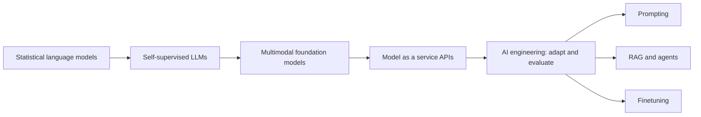

# From language models to foundation models

Almost every AI product launched since late 2022 sits on top of a model that somebody else trained. That one fact is why a new discipline, **AI engineering**, appeared. To work in it well you need a clear picture of where these models came from, what made them suddenly so capable, and what people are actually building with them. This lesson gives you that picture. Later modules go deep on each piece.

> [!NOTE]
> This track follows Chip Huyen's *AI Engineering* chapter by chapter. Transformer internals, hands-on Hugging Face and MCP/context engineering are covered in more depth in the **LLM Practice** track. Here we stay at the level an application builder needs.

## 1. Language models: predicting the next token

A **language model** stores statistical knowledge about one or more languages. Put simply, it tells you how likely a word is to appear in a given context. Given "My favorite color is ___", a model that knows English should rate "blue" far above "car".

Language models are older than most people assume. Claude Shannon's 1951 paper "Prediction and Entropy of Printed English" already treated English as a probability distribution and measured its entropy. Those ideas, entropy among them, are still how we evaluate language models today (see Module 3).

### Tokens

A language model's basic unit is a **token**. A token can be a character, a word, or part of a word such as "-tion". Tokenization is the process of splitting text into tokens, and the set of all tokens a model knows is its **vocabulary**. Huyen gives two concrete sizes: Mixtral 8x7B has a vocabulary of 32,000 tokens, and GPT-4's is 100,256. For GPT-4 an average token is about three quarters of a word, so **100 tokens is roughly 75 words**.

Why tokens instead of words or characters?

1. Tokens split words into meaningful pieces. "cooking" can become "cook" + "ing", and both pieces carry meaning.
2. There are fewer unique tokens than unique words, so the vocabulary stays smaller and the model is more efficient.
3. Tokens cope with words the model has never seen. "chatgpting" can be split into "chatgpt" + "ing".

> [!TIP]
> Almost everything in AI engineering is counted in tokens: context limits, API prices, latency (time per output token), and throughput. When someone quotes a number, check whether it means tokens, words or characters. The difference is often 25–35%.

### Masked and autoregressive models

There are two main kinds of language model:

| Type | Predicts | Example | Typical use |
|---|---|---|---|
| **Masked** language model | a missing token anywhere, using context on *both* sides | BERT | classification, sentiment, code debugging, embeddings |
| **Autoregressive** language model | the *next* token, using only the tokens before it | GPT, Llama, Claude | text generation |

Autoregressive models (also called *causal* language models) can generate text one token after another, which is why they became the default for generation. A model that can produce open-ended output is called **generative**. That is where the "gen" in "gen AI" comes from.

A language model is a **completion machine**. Give it "To be or not to be" and it continues with something like ", that is the question." Many tasks can be phrased as completion: translation ("How are you in French is …"), spam filtering ("Is this email spam? Here's the email: … Answer:"), and so on. But completion is not the same as conversation. A raw pre-trained model asked "How do I make pizza?" might just add more questions instead of answering. Post-training (Module 2) fixes this.

## 2. Self-supervision: why language models scaled

Why did language models, and not object detection or recommender models, become the centre of the scaling race? Huyen's answer is **self-supervision**.

In **supervised** learning every training example needs a label, and labels cost money. Huyen notes that ImageNet's millions of labeled images cost a lot, and in the example she gives (Amazon SageMaker Ground Truth, September 2024) labeling ran a few cents per image. At internet scale those costs become prohibitive.

In **self-supervision** the labels come from the input data itself. Any text sequence gives you many training examples for free. The sentence "I love street food." becomes:

| Input (context) | Output (next token) |
|---|---|
| `<BOS>` | I |
| `<BOS>`, I | love |
| `<BOS>`, I, love | street |
| `<BOS>`, I, love, street | food |
| `<BOS>`, I, love, street, food | . |
| `<BOS>`, I, love, street, food, . | `<EOS>` |

Because text is everywhere (books, the web, code, transcripts), language models could be trained on trillions of tokens. The end-of-sequence token `<EOS>` matters too. It teaches the model when to stop, which Huyen compares to a person knowing when to stop talking.

```python-run
# Turn one sentence into self-supervised (context -> next token) training pairs.
sentence = "I love street food ."
tokens = ["<BOS>"] + sentence.split() + ["<EOS>"]
for i in range(1, len(tokens)):
    print(f"{' '.join(tokens[:i]):35s} -> {tokens[i]}")
print(f"\n1 sentence of {len(sentence.split())} tokens gave {len(tokens)-1} labeled examples for free.")
```

> [!NOTE]
> Self-supervision is different from *unsupervised* learning. In self-supervision the labels are inferred from the data (the next token). In unsupervised learning (such as clustering) there are no labels at all.

### "Large" keeps moving

A model's size is usually measured by its number of **parameters**, the variables updated during training. OpenAI's first GPT (2018) had 117 million parameters, which counted as large then. GPT-2 had 1.5 billion and GPT-3 had 175 billion. Today a 100M-parameter model is called *small*. What counts as "large" keeps shifting.

Larger models need more data. That sounds backwards, but more capacity means more to learn, and you need enough data to fill it. Self-supervision is what makes that data affordable.

## 3. From LLMs to foundation models

Humans perceive the world through many senses. To work in the real world, models need to handle more than text. Models that process several data modalities (text, images, audio, video, 3D) are called **multimodal**. A generative multimodal model is sometimes called an LMM (large multimodal model).

The term **foundation model** covers both. It reflects two ideas:

- These models are a *foundation* for many applications, not one task.
- They are general-purpose. The same model can do sentiment analysis, translation, code generation and image captioning.

Multimodal models need (image, text) pairs. OpenAI's CLIP used **natural language supervision**: it mined 400 million (image, caption) pairs from the web instead of paying people to label images. That is the same idea as self-supervision, applied across modalities. CLIP is an *embedding* model. It maps images and text into the same vector space, which is the basis of the semantic search you will meet in Module 6.

Before foundation models, you trained a specific model per task. Now you **adapt** a general model to your task. The adaptation toolbox is the backbone of this course:

- **Prompt engineering**: give detailed instructions and examples (Module 5).
- **Retrieval-augmented generation (RAG)**: connect the model to a database of relevant information (Module 6).
- **Finetuning**: further train the model on task-specific data (Module 7).

Huyen's example: if you want a model that writes product descriptions in your brand voice, you can show a few examples in the prompt, retrieve similar existing descriptions, or finetune on many (product, description) pairs. Adapting an existing strong model is usually far cheaper than building one from scratch.

## 4. Why AI engineering took off

Huyen names three factors behind the growth of AI engineering:

1. **General-purpose capabilities.** Foundation models can do existing tasks better and can also do tasks that were never feasible before, such as producing illustrations for an online article in seconds. More tasks means more applications and more economic value.
2. **More investment.** Success brought money. Huyen points out that companies mentioning AI in earnings calls saw their share prices rise more than those that did not.
3. **A low barrier to entry.** The *model-as-a-service* approach puts powerful models behind an API. You do not need to host anything. You can also work in plain English, and AI can write the code. Open source tools such as LangChain, Ollama, AutoGPT and the Stable Diffusion web UI gained GitHub stars faster than Bitcoin and are on pace with React and Vue.

> [!INTERVIEW]
> **"Why is it called AI engineering and not ML engineering or LLMOps?"** Huyen's answer: building on foundation models differs from traditional ML in important ways (covered in the next lesson). "LLMOps" focuses on operations and only on LLMs, while the field also covers multimodal models and is about *building applications*. "AI engineering" captures adapting and evaluating general-purpose models.

## 5. What people build: use cases

Huyen sorted 205 open source applications (repositories with at least 500 GitHub stars) into eight groups. Each has consumer and enterprise versions:

| Category | Consumer examples | Enterprise examples |
|---|---|---|
| Coding | coding assistants | coding |
| Image and video production | photo/video editing, design | presentations, ad generation |
| Writing | email, social posts, blogs | copywriting, SEO, reports, memos |
| Education | tutoring, essay grading | onboarding, upskilling |
| Conversational bots | general chatbots, AI companions | customer support bots, product copilots |
| Information aggregation | summarization, talk-to-your-docs | summarization, market research |
| Data organization | image search, personal memex | knowledge management, document processing |
| Workflow automation | travel and event planning | data extraction, entry and annotation, lead generation |

A few patterns stand out:

- **Coding** is the most popular generative AI use case in survey after survey. Generated code has an advantage: you can check it by running it (*functional correctness*, Module 3). Tools range from code completion to converting screenshots or natural language into code, documentation and test writing.
- **Enterprises prefer lower risk.** Companies deploy *internal-facing* applications (internal knowledge management) faster than *external-facing* ones (customer support chatbots). Internal apps let teams build expertise while limiting privacy, compliance and catastrophic-failure risk.
- **Many applications are close-ended** even though the model is open-ended. Classification, intent detection and extraction are easier to evaluate, so their risk is easier to estimate.
- **Information aggregation and data organization** are AI strengths. Summarizing, extracting structured data from contracts or receipts, and "talk to your docs" are everywhere.
- **Workflow automation** leads naturally to *agents*, AI that can plan and use tools (Module 6).



> [!WARNING]
> The impressiveness of a demo says little about how easy the product will be. Many popular use cases, such as education and data organization, look small among open source repositories because they are built in-house or sold commercially. Lack of open source activity does not mean lack of demand.

## 6. Pitfalls and misconceptions

- **"Training" ≠ prompting.** Giving a model examples in its context is prompt engineering (in-context learning), not training. Training changes weights.
- **Parameter count is not everything.** A model's capability also depends on how much and how good its training data is (Module 2).
- **Tokens differ between models.** The same text can have a very different token count under different tokenizers, and non-English text often needs more tokens per word. That affects cost and context budgets.
- **Generative does not mean open-ended evaluation is easy.** The flexibility that makes foundation models useful is exactly what makes them hard to evaluate (Modules 3 and 4).

## Summary

- Language models predict tokens. Autoregressive models predict the *next* token and can therefore generate text.
- **Self-supervision**, where labels come from the data itself, let language models scale to trillions of tokens and became LLMs.
- Adding modalities through natural language supervision (as in CLIP) produced **foundation models**: general-purpose models you adapt rather than train.
- AI engineering grew because of general capabilities, investment, and a very low barrier to entry (model-as-a-service).
- Use cases cluster into coding, media production, writing, education, bots, information aggregation, data organization and workflow automation. Enterprises start with internal, lower-risk, often close-ended applications.

```quiz
[
  {"q": "What made it feasible to train language models on trillions of tokens?", "options": ["Cheaper human labeling services", "Self-supervision: the next token in raw text serves as the label", "Reinforcement learning from human feedback", "Unsupervised clustering of documents"], "answer": 1, "explain": "With self-supervision every text sequence yields many (context, next token) examples with no manual labeling, which removed the data-labeling bottleneck."},
  {"q": "Roughly how many words do 100 GPT-4 tokens correspond to?", "options": ["About 25", "About 75", "About 100", "About 150"], "answer": 1, "explain": "Huyen notes that an average GPT-4 token is about 3/4 of a word, so 100 tokens is about 75 words."},
  {"q": "Which statement about masked vs autoregressive language models is correct?", "options": ["Masked models predict only the next token", "Autoregressive models use context on both sides of the blank", "Autoregressive models predict the next token from preceding tokens and are the usual choice for generation", "Masked models cannot be used for classification"], "answer": 2, "explain": "Autoregressive (causal) models condition only on previous tokens, which suits generation. Masked models like BERT use both sides and are popular for non-generative tasks."},
  {"q": "How did CLIP obtain its 400 million (image, text) pairs?", "options": ["Paid annotators labeled them", "Natural language supervision: it mined image-caption pairs that already co-occur on the web", "It generated synthetic captions with GPT-3", "It used ImageNet labels"], "answer": 1, "explain": "Natural language supervision uses text that naturally accompanies images online, the multimodal counterpart of self-supervision."},
  {"q": "Why do enterprises tend to deploy internal-facing AI applications first?", "options": ["Internal apps need larger models", "They carry lower privacy, compliance and catastrophic-failure risk while teams build expertise", "External apps cannot use foundation models", "Regulations forbid customer-facing AI"], "answer": 1, "explain": "The a16z data Huyen cites shows faster deployment of internal knowledge management than customer chatbots, because the risk is lower."},
  {"q": "A writer feeds her old diary into ChatGPT so it can imitate her younger self. Technically, what is she doing?", "options": ["Pre-training", "Finetuning", "Prompt engineering / in-context learning", "Model distillation"], "answer": 2, "explain": "No weights change. Teaching the model through its context is prompt engineering, even though people often call it 'training'."},
  {"q": "Which of these is NOT one of Huyen's three factors behind the rise of AI engineering?", "options": ["General-purpose AI capabilities", "Increased AI investment", "Low barrier to entry via model APIs", "The end of Moore's law"], "answer": 3, "explain": "The three factors are general-purpose capabilities, increased investment, and a low entrance barrier."}
]
```

> **Source:** Huyen, *AI Engineering*, ch. 1 ("Introduction to Building AI Applications with Foundation Models": the rise of AI engineering, foundation model use cases).
