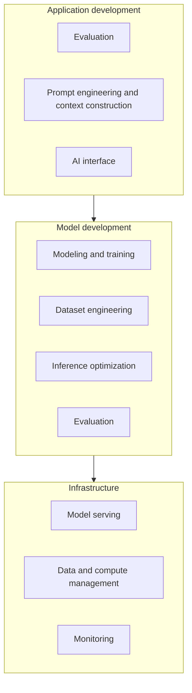

# Planning AI applications and the AI engineering stack

Huyen puts it bluntly: a cool demo built on a foundation model is easy, and a profitable product is hard. This lesson covers the two questions to answer before writing much code. First, **should you build this, and what does success look like?** Second, **which parts of the stack will you work on, and how does that differ from classical ML engineering?**

## 1. Use case evaluation: why build it?

Building an AI application is usually a response to a risk or an opportunity. Huyen orders the motivations from highest to lowest risk:

1. **Existential threat.** If competitors with AI can make you obsolete, AI must be top priority. This is common in document-heavy businesses (financial analysis, insurance, data processing) and creative work (advertising, web design, image production). In a 2023 Gartner study, 7% of respondents cited business continuity as their reason for adopting AI.
2. **Missed profit and productivity.** Most companies adopt AI for its opportunities: cheaper user acquisition through better copy, better retention through support and personalization, lead generation, market research.
3. **Fear of being left behind.** You do not know where AI fits yet, but waiting too long has sunk companies before (Huyen mentions Kodak, Blockbuster and BlackBerry). Exploring is reasonable if you can afford it.

Once you have a reason, decide **build vs buy**. If AI threatens your core business, keep it in-house rather than outsourcing it to a would-be competitor. If AI is a productivity booster, buying an existing solution may be cheaper and better.

### The role of AI in the product

Following Apple's human interface guidance, Huyen frames AI's role along three axes:

| Axis | One end | Other end | Implication |
|---|---|---|---|
| **Critical vs complementary** | Face ID cannot work without AI | Gmail works without Smart Compose | The more critical AI is, the more accurate and reliable it must be |
| **Reactive vs proactive** | a chatbot answers when asked | Google Maps traffic alerts appear unprompted | Reactive features usually need low latency. Proactive ones can be precomputed but need a *higher quality bar*, because unrequested low-quality output feels intrusive |
| **Dynamic vs static** | updated continually with user feedback (per-user personalization, memory) | updated periodically (shared model upgrades) | Dynamic features need feedback pipelines and per-user state |

### The role of humans

Will the AI support humans, decide directly, or both? For a support chatbot you could:

- show human agents suggested replies,
- answer only simple requests and route complex ones to humans, or
- answer everything directly.

Involving humans in AI's decisions is **human-in-the-loop**. Microsoft's **Crawl-Walk-Run** framework increases automation step by step: *crawl* means human involvement is mandatory, *walk* means AI interacts directly with internal employees, and *run* means more automation, possibly including direct interaction with external users. You move up a stage when evidence supports it. For example, if human agents use 95% of AI-suggested answers to simple requests verbatim, let customers talk to the AI directly for those requests.

### Defensibility

A low barrier to entry helps you and helps your competitors just as much. Two threats stand out:

- **The model provider absorbs your feature.** A PDF-parsing wrapper built because ChatGPT parsed PDFs poorly loses its reason to exist when ChatGPT improves. It might survive by targeting users who need self-hosted open models.
- **Big incumbents copy you.** A VC told Huyen that many startups' whole products could be a feature in Google Docs or Microsoft Office.

There are three classic moats: **technology, data, distribution**. With foundation models the technology is largely shared, and incumbents usually win on distribution. **Data** is the nuanced one. A startup that gets to market first and collects usage data can improve faster, and even when usage data cannot train models directly, it reveals user behaviour and product gaps. Many successful companies began as "a feature someone big overlooked" (Calendly, Mailchimp, Photoroom).

> [!INTERVIEW]
> **"How would you decide whether to build an AI feature?"** A strong answer covers: (1) the business motivation and its risk level, (2) build vs buy, (3) AI's role (critical/complementary, reactive/proactive, dynamic/static) and the human's role (human-in-the-loop, Crawl-Walk-Run), (4) defensibility (data flywheel, distribution), (5) measurable success criteria and a usefulness threshold, and (6) the last-mile and maintenance costs.

## 2. Setting expectations and milestones

### Success metrics

The most important metric is **business impact**. For a support chatbot, that means: what share of messages should be automated, how many more messages can be handled, how much faster responses get, and how much human labour is saved. Answering more messages does not guarantee happier users, so also track **customer satisfaction** and feedback.

Define a **usefulness threshold**, the bar a product must clear before it reaches users, across metric groups:

- **Quality**: how good responses are.
- **Latency**: TTFT (time to first token), TPOT (time per output token) and total latency. What is acceptable depends on the baseline. If humans currently answer in a median of one hour, anything faster may be good enough.
- **Cost**: per inference request.
- **Other**: interpretability, fairness.

### Milestones and the last mile

Start by evaluating off-the-shelf models. The stronger they are, the less you have to build. If your goal is to automate 60% of tickets and an existing model already handles 30%, you are halfway there. Evaluation can also show the goal is not worth pursuing.

Plan for the **last-mile challenge**. Huyen quotes the UltraChat paper's observation that going from 0 to 60 is easy and going from 60 to 100 is very hard. LinkedIn reported reaching 80% of the experience they wanted in one month, and then needing four more months to pass 95%, much of it spent on product kinks and hallucinations.

```python-run
# A toy illustration of the last-mile effect: effort grows sharply as quality approaches 100%.
# Model: each further step toward perfection costs as much as halving the remaining error.
import numpy as np
targets = [60, 80, 90, 95, 98, 99]
err0 = 40.0                         # error after the 'easy' first phase (quality 60%)
for t in targets:
    remaining = 100 - t
    halvings = max(0.0, np.log2(err0 / remaining))
    print(f"quality {t:>3}%  -> ~{1 + halvings:4.1f} units of effort")
```

### Maintenance

AI moves fast, and that has a cost:

- **Good changes still cause friction.** Prices fall and models improve. An in-house deployment that looked cheaper can become the expensive option when API prices halve three months later.
- **Swapping models is easier than it used to be** because APIs are converging, but each model has its own quirks. Without versioning and evaluation infrastructure, a switch is painful.
- **Regulation**: GDPR compliance was estimated to cost businesses \$9 billion. Export controls can change GPU availability overnight, and IP law around training data is still unsettled. Game studios, for example, hesitate over fears about IP ownership.

## 3. The AI engineering stack

Every AI application stack has three layers. You typically start at the top and move down only as needed.



- **Application development**: give a model good prompts and the necessary context, evaluate rigorously, and build good interfaces. This is where most of the activity has been.
- **Model development**: frameworks for modeling, training, finetuning and inference optimization, plus dataset engineering. It also needs rigorous evaluation.
- **Infrastructure**: model serving, data and compute management, and monitoring.

Huyen's March 2024 survey of 920 AI repositories with at least 500 stars showed tooling jumping in 2023 after Stable Diffusion and ChatGPT. Applications and application development grew most. Infrastructure grew least, because resource management, serving and monitoring needs stay largely the same.

Many ML principles still apply. You map business metrics to ML metrics, experiment systematically (now with models, prompts, retrieval algorithms and sampling variables instead of only hyperparameters), make models faster and cheaper, and keep feedback loops with production data.

## 4. AI engineering vs ML engineering

Huyen identifies three big differences:

1. **You adapt rather than train.** Someone else trained the model, so the focus moves from modeling and training to **model adaptation**.
2. **Models are bigger.** They use more compute and have higher latency, which puts more pressure on efficient training and inference optimization and creates more demand for people who can work with GPUs and large clusters.
3. **Outputs are open-ended.** That flexibility makes **evaluation** much harder and much more important.

In short, AI engineering is less about developing models and more about **adapting and evaluating** them.

### Two families of adaptation

| | Prompt-based (prompt engineering, context construction) | Finetuning |
|---|---|---|
| Updates weights? | No | Yes |
| Data needed | little | more |
| Ease of starting | easy, so you can try many models | harder, needs ML skill |
| Best for | most applications, fast iteration | quality, latency and cost gains; new tasks; strict formats |

### Training terminology

- **Pre-training**: training from randomly initialized weights. For LLMs this is usually text completion, and it is by far the most resource-intensive phase. For InstructGPT it took up to **98%** of compute and data resources.
- **Finetuning**: continuing to train an already-trained model.
- **Post-training**: conceptually the same as finetuning, but the term is usually used when *model developers* do it (for example, instruction-following training before release). *Application developers* finetune.
- **Quantization** changes weight values but is *not* training. **Prompt engineering is not training** either, even when people loosely call it that.

### How each layer changes

| Layer / task | Traditional ML | With foundation models |
|---|---|---|
| Modeling and training | ML knowledge required to build models | ML knowledge is nice to have. It helps with debugging and widens your toolset |
| Dataset engineering | feature engineering, mostly tabular, close-ended labels | deduplication, tokenization, context retrieval, quality control. Labeling open-ended outputs is much harder |
| Inference optimization | important | even more important: big autoregressive models have high latency and cost |
| Evaluation | important | *more* important: open-ended outputs, many adaptation techniques |
| Prompt engineering | not applicable | important |
| AI interface | less important | important |

Two notes from the book. On **evaluation**, the same model can score very differently depending on the prompting technique. When Gemini launched, Google reported 90.04% on MMLU using CoT@32 (32 examples), while GPT-4 was compared at 5-shot. With both at 5-shot, GPT-4 came out ahead. On **interfaces**, AI products ship as standalone apps (ChatGPT, Perplexity), plug-ins (Copilot in VS Code), browser extensions (Grammarly) and chat-app bots (Midjourney on Discord). Chat is the most common interface, but voice, embodied and other interfaces exist too.

### AI engineering vs full-stack engineering

Because application development and interfaces matter so much, AI engineering is moving closer to full-stack development. Many AI engineers come from web development and work in JavaScript frameworks (LangChain.js, Transformers.js, the OpenAI Node library, the Vercel AI SDK). The workflow also flips. Traditional ML often meant *data → model → product*. With foundation models you can go **product → data → model**: build a product first, and invest in data and models only once it shows promise.

> [!TIP]
> Start simple: an off-the-shelf model, good prompts, solid evaluation. Add RAG, finetuning or custom infrastructure only when evaluation shows you need them. The rest of this track follows that same order.

## Pitfalls

- Skipping use case evaluation and building a feature that the model provider or an incumbent will absorb.
- No usefulness threshold, so a half-ready product ships and erodes trust.
- Underestimating the last mile. A weekend demo can still need months of work to become a product.
- No versioning or evaluation infrastructure, which makes swapping models or prompts risky.
- Calling prompt engineering "training" and confusing teammates about what is actually changing.

## Summary

- Decide *why* (existential, opportunity or exploratory), *build vs buy*, AI's role (critical/complementary, reactive/proactive, dynamic/static) and the human's role (Crawl-Walk-Run).
- Moats come from technology, data and distribution. With foundation models, data flywheels and distribution matter most.
- Set business metrics and a usefulness threshold (quality, latency such as TTFT/TPOT, cost), plan for the last mile and for maintenance in a fast-moving field.
- The stack has three layers: application development, model development and infrastructure. AI engineering focuses on adaptation and evaluation rather than training models.

```quiz
[
  {"q": "A proactive AI feature (e.g., unsolicited suggestions) typically needs…", "options": ["Lower latency than reactive features", "A higher quality bar, since users did not ask for it", "No evaluation", "Per-user finetuning"], "answer": 1, "explain": "Proactive outputs can be precomputed so latency matters less, but low-quality unsolicited output feels intrusive, so the bar is higher."},
  {"q": "In Microsoft's Crawl-Walk-Run framework, what does 'walk' mean?", "options": ["Human involvement is mandatory", "AI interacts directly with internal employees", "AI interacts directly with external users", "The model is finetuned"], "answer": 1, "explain": "Crawl: humans mandatory. Walk: AI can interact directly with internal employees. Run: more automation, including external users."},
  {"q": "Which competitive advantage does Huyen consider most nuanced, and potentially a startup's moat?", "options": ["Technology", "Data", "Distribution", "Brand color"], "answer": 1, "explain": "Technology is largely shared and distribution favors incumbents. A startup that reaches the market first can build a data advantage from usage."},
  {"q": "LinkedIn reached 80% of its target experience in one month. What happened next?", "options": ["They launched immediately", "It took about four more months to pass 95%", "They abandoned the project", "They reached 100% in a week"], "answer": 1, "explain": "This is the last-mile challenge: each further 1% gets slower and harder, largely because of product kinks and hallucinations."},
  {"q": "Which is NOT one of the three big differences between AI engineering and traditional ML engineering?", "options": ["Using models someone else trained (adaptation over training)", "Bigger, more compute-hungry models", "Open-ended outputs that are harder to evaluate", "No need for any evaluation"], "answer": 3, "explain": "Evaluation becomes more important, not less, because of open-ended outputs."},
  {"q": "Quantizing a model's weights from FP16 to INT8 is best described as…", "options": ["Pre-training", "Post-training", "Not training, even though weight values change", "Finetuning"], "answer": 2, "explain": "Training always changes weights, but not every weight change is training. Quantization reduces precision without learning."},
  {"q": "Why can the same model report very different MMLU scores?", "options": ["MMLU is random", "Prompting technique (e.g., CoT@32 vs 5-shot) strongly affects performance", "Tokenizers change daily", "Only due to hardware differences"], "answer": 1, "explain": "The Gemini vs GPT-4 MMLU comparison used different prompting setups. Comparable evaluation needs the same prompts."},
  {"q": "The 'product → data → model' workflow means…", "options": ["Train a model first, then find a product", "Build and ship a product first, investing in data and models once it shows promise", "Never collect data", "Data teams own the product"], "answer": 1, "explain": "Foundation models let you prototype a product immediately and invest in data and model work only after it proves promising."}
]
```

> **Source:** Huyen, *AI Engineering*, ch. 1 ("Planning AI Applications", "The AI Engineering Stack", "AI Engineering Versus ML Engineering").
