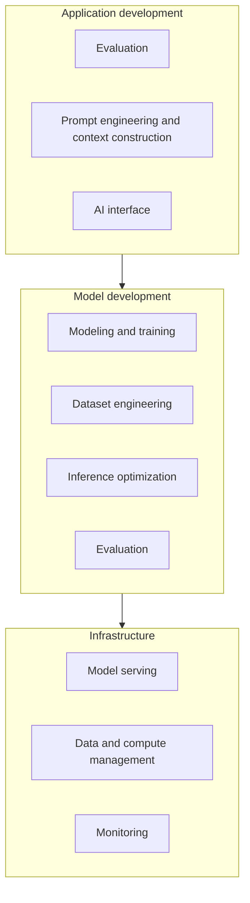

# Planning AI applications and the AI engineering stack

> **Before this lesson:** you should know what a foundation model, a token, a prompt, training and finetuning are. All of that is in the previous lesson, [From language models to foundation models](#/lesson/ai-eng/aie-rise). No programming beyond basic Python is needed.

## In plain words

Before a restaurant opens, somebody has to answer some unglamorous questions. Is there a reason to open it here? What will count as a good first year? Who cooks, who serves, who fixes the oven? Only after that does anyone argue about recipes. This lesson is the same conversation for an AI product. It is about **planning**: deciding whether an AI feature is worth building, what "good enough to ship" means in numbers, and how much of the work is yours and how much you rent from someone else.

It also introduces the **stack**. In software, a stack is the set of layers a product is built from, each resting on the one below, like the floors of a building: the part users touch on top, the machinery in the middle, the hardware and plumbing at the bottom. Knowing the layers of the AI stack tells you which jobs exist, which skills each needs, and where to start.

Why this matters for a job: interviewers for AI roles often ask "how would you decide whether to build this feature?" or "how is AI engineering different from machine learning engineering?" before they ask anything technical. A demo built on a foundation model is quick to make, and a profitable product is hard, as Huyen puts it bluntly. People who can explain the gap between the two are the ones trusted with real projects.

This lesson covers the two questions to answer before writing much code. First, **should you build this, and what does success look like?** Second, **which parts of the stack will you work on, and how does that differ from classical machine learning (ML) engineering**, the older practice of training your own models on your own data?

## 1. Use case evaluation: why build it?

A **use case** is one specific job a product does for a user, such as "answer billing questions" or "summarise a contract". Evaluating a use case means asking whether that job is worth doing with AI at all.

Building an AI application is usually a response to a risk or an opportunity. Huyen orders the motivations from highest to lowest risk:

1. **Existential threat.** If competitors with AI can make you obsolete, AI must be top priority. This is common in document-heavy businesses (financial analysis, insurance, data processing) and creative work (advertising, web design, image production). In a 2023 Gartner study, 7% of respondents cited business continuity as their reason for adopting AI.
2. **Missed profit and productivity.** Most companies adopt AI for its opportunities: cheaper user acquisition through better copy, better retention through support and personalization, lead generation, market research.
3. **Fear of being left behind.** You do not know where AI fits yet, but waiting too long has sunk companies before (Huyen mentions Kodak, Blockbuster and BlackBerry). Exploring is reasonable if you can afford it.

Once you have a reason, decide **build vs buy**: do you develop the AI capability with your own engineers (build), or pay for a finished product or service from another company (buy)? If AI threatens your core business, keep it in-house rather than outsourcing it to a would-be competitor. If AI is a productivity booster, buying an existing solution may be cheaper and better.

### The role of AI in the product

Following Apple's published advice on designing AI features, Huyen frames AI's role along three axes. An axis here is a scale with two ends; a feature sits somewhere between them. The examples in the table: Face ID is the iPhone feature that unlocks the phone by recognising your face; Smart Compose is Gmail's suggestion of how to finish the sentence you are typing.

| Axis | One end | Other end | Implication |
|---|---|---|---|
| **Critical vs complementary** | Face ID cannot work without AI | Gmail works without Smart Compose | The more critical AI is, the more accurate and reliable it must be |
| **Reactive vs proactive** | a chatbot answers when asked | Google Maps traffic alerts appear unprompted | Reactive features usually need low latency. Proactive ones can be precomputed but need a *higher quality bar*, because unrequested low-quality output feels intrusive |
| **Dynamic vs static** | updated continually with user feedback (per-user personalization, memory) | updated periodically (shared model upgrades) | Dynamic features need feedback pipelines and per-user state |

Reading the third column in plain terms. *Latency* is the delay between a request and its answer; a chatbot that takes twenty seconds feels broken, so reactive features must be quick. A proactive feature can do its thinking in advance (*precomputed*), but nobody asked for it, so a poor suggestion is an interruption. A *feedback pipeline* is the plumbing that collects what users did (accepted, edited, ignored) and feeds it back into the product, and *per-user state* is information stored separately for each person, such as their preferences.

### The role of humans

Will the AI support humans, decide directly, or both? For a support chatbot you could:

- show human agents suggested replies,
- answer only simple requests and route complex ones to humans, or
- answer everything directly.

Involving humans in AI's decisions is **human-in-the-loop**. Microsoft's **Crawl-Walk-Run** framework increases automation step by step: *crawl* means human involvement is mandatory, *walk* means AI interacts directly with internal employees, and *run* means more automation, possibly including direct interaction with external users. You move up a stage when evidence supports it. For example, if human agents use 95% of AI-suggested answers to simple requests verbatim, let customers talk to the AI directly for those requests.

### Defensibility

**Defensibility** is how hard it is for someone else to copy your product and take your customers. A low barrier to entry helps you and helps your competitors equally. Two threats stand out:

- **The model provider absorbs your feature.** A *wrapper* is a thin product that adds a little convenience around someone else's model. Imagine a wrapper that reads PDF files and hands the text to ChatGPT, built because ChatGPT handled PDFs poorly. It loses its reason to exist the day ChatGPT improves. It might survive by serving users who must run open models on their own machines (*self-hosting*) for privacy reasons.
- **Big incumbents copy you.** An *incumbent* is a large company already established in a market. A venture capitalist (an investor in young companies) told Huyen that many startups' whole products could be a single feature in Google Docs or Microsoft Office.

Business people call a lasting protection against competitors a **moat**, after the water-filled ditch around a castle. There are three classic moats: **technology, data, distribution**. With foundation models the technology is largely shared, since everyone can rent the same models. *Distribution* means already having the customers and the channels to reach them, and incumbents usually win there. **Data** is the nuanced one. A startup that gets to market first and collects usage data can improve faster, and even when usage data cannot train models directly, it reveals user behaviour and product gaps. This loop, where more users produce more data, which makes a better product, which attracts more users, is called a **data flywheel**. Many successful companies began as "a feature someone big overlooked" (Calendly, Mailchimp, Photoroom).

> [!INTERVIEW]
> **"How would you decide whether to build an AI feature?"** A strong answer covers: (1) the business motivation and its risk level, (2) build vs buy, (3) AI's role (critical/complementary, reactive/proactive, dynamic/static) and the human's role (human-in-the-loop, Crawl-Walk-Run), (4) defensibility (data flywheel, distribution), (5) measurable success criteria and a usefulness threshold, and (6) the last-mile and maintenance costs.

## 2. Setting expectations and milestones

### Success metrics

The most important metric is **business impact**. For a support chatbot, that means: what share of messages should be automated, how many more messages can be handled, how much faster responses get, and how much human labour is saved. Answering more messages does not guarantee happier users, so also track **customer satisfaction** and feedback.

A **metric** is a number you measure to judge how well something is going. Define a **usefulness threshold**, the bar a product must clear on its metrics before it reaches users, across these groups:

- **Quality**: how good responses are.
- **Latency**: how long the user waits. A model writes its answer one token at a time, so latency has two parts. **TTFT** (time to first token) is the wait before anything appears. **TPOT** (time per output token) is the gap between one token and the next once the answer is flowing. In words, total latency is the first wait plus one gap for every further token:

  $$\text{total latency} \approx \text{TTFT} + \text{TPOT} \times (\text{output tokens} - 1)$$

  Worked example: TTFT of 0.5 seconds, TPOT of 0.02 seconds, and a 201-token answer give $0.5 + 0.02 \times 200 = 4.5$ seconds. What is acceptable depends on the baseline. If humans currently answer in a median of one hour (median: the middle value when all waits are sorted), anything faster may be good enough.
- **Cost**: per **inference** request. Inference is the act of running a trained model to get an output, as opposed to training it; each question a user sends is one inference request.
- **Other**: *interpretability* (can you explain why the model answered as it did?) and *fairness* (does it treat different groups of people equally?).

### Milestones and the last mile

A **milestone** is a checkpoint on the way to the goal. Start by evaluating *off-the-shelf* models, meaning existing models used as they are, with no changes. The stronger they are, the less you have to build. If your goal is to automate 60% of support tickets and an existing model already handles 30%, you are halfway there. Evaluation can also show the goal is not worth pursuing.

Plan for the **last-mile challenge**: the final stretch of quality takes most of the work. Huyen quotes the UltraChat research paper's observation that going from 0 to 60 is easy and going from 60 to 100 is very hard. LinkedIn reported reaching 80% of the experience they wanted in one month, and then needing four more months to pass 95%, much of it spent on product kinks and **hallucinations**. A hallucination is a model output that sounds confident and fluent but is false or made up, such as a citation to a paper that does not exist.

The demo below turns that pattern into arithmetic with a toy rule: every time you cut the remaining errors in half, you pay one more unit of effort. In words, the effort to reach a target equals one unit for the easy first phase plus the number of halvings needed to shrink the starting error (40%) down to the error the target allows:

$$\text{effort} = 1 + \log_2\!\left(\frac{40}{100 - \text{target}}\right)$$

$\log_2(x)$ answers "how many times must I double 1 to reach $x$?". For a 95% target the allowed error is 5%, and $40 / 5 = 8 = 2 \times 2 \times 2$, so three halvings and $1 + 3 = 4$ units of effort.

```python-run
# A toy illustration of the last-mile effect: effort grows sharply as quality approaches 100%.
# Model: each further step toward perfection costs as much as halving the remaining error.
import numpy as np
targets = [60, 80, 90, 95, 98, 99]
err0 = 40.0                         # error after the 'easy' first phase (quality 60%)
for t in targets:
    remaining = 100 - t
    halvings = max(0.0, np.log2(err0 / remaining))
    print(f"quality {t:>3}%  -> ~{1 + halvings:4.1f} units of effort")
```

**Reading this Python line by line**

- `import numpy as np` loads NumPy, the standard Python library for numerical work, under the short name `np`.
- `targets = [60, 80, 90, 95, 98, 99]` is the list of quality levels to price, and `err0 = 40.0` is the error left after the easy phase (100 minus 60).
- Inside the loop, `remaining = 100 - t` is the error the target allows. `np.log2(err0 / remaining)` counts the halvings needed. `max(0.0, ...)` stops the count going negative.
- The `print` line formats the result: `{t:>3}` right-aligns the target in three characters and `{...:4.1f}` shows one decimal place.
- Output: 60% costs 1.0 unit, 80% costs 2.0, 90% costs 3.0, 95% costs 4.0, 98% costs about 5.3 and 99% about 6.3. Getting from 60 to 80 (twenty points) costs one unit; getting from 98 to 99 (one point) also costs one unit. That is the last mile: equal effort buys less and less visible progress.

### Maintenance

AI moves fast, and that has a cost:

- **Good changes still cause friction.** Prices fall and models improve. Running a model on your own servers (an in-house *deployment*) can look cheaper today and become the expensive option when API prices halve three months later.
- **Swapping models is easier than it used to be** because providers' APIs are becoming alike, but each model has its own quirks: a prompt tuned for one may work poorly on another. Without *versioning* (keeping numbered, retrievable copies of every prompt and configuration) and evaluation infrastructure (automated tests of output quality), a switch is painful.
- **Regulation**: complying with GDPR, the European Union's data-protection law, was estimated to cost businesses \$9 billion. A **GPU** (graphics processing unit) is the kind of chip that runs AI models fast, and government export controls can change who is allowed to buy them overnight. IP law (intellectual property: who owns a piece of text, art or code) around training data is still unsettled. Game studios, for example, hesitate because they fear they may not own what a model generates.

## 3. The AI engineering stack

Every AI application stack has three layers. You typically start at the top and move down only as needed.



- **Application development**: give a model good prompts and the necessary context, evaluate rigorously, and build good interfaces (the screen, chat box or voice channel a person uses). This is where most of the activity has been.
- **Model development**: the tools for *modeling* (choosing a model's design), training, finetuning and **inference optimization** (making a trained model answer faster and more cheaply), plus **dataset engineering** (collecting, cleaning and preparing the data a model learns from). It also needs rigorous evaluation.
- **Infrastructure**: **model serving** (keeping a model running on machines so it can answer requests), managing data and **compute** (the processing power, mostly GPUs, that models run on), and **monitoring** (watching a live system for failures and drops in quality).

Huyen's March 2024 survey of 920 AI code repositories with at least 500 GitHub stars showed tooling jumping in 2023, after the image generator Stable Diffusion and ChatGPT were released. Applications and application development grew most. Infrastructure grew least, because the needs of resource management, serving and monitoring stay largely the same whatever kind of model is on top.

Many ML principles still apply. You connect business metrics to model metrics, experiment systematically, make models faster and cheaper, and keep feedback loops with **production** data (production is the live system that real users touch, as opposed to your test setup). What you experiment with has changed. Classical ML tuned **hyperparameters**, settings chosen by the engineer before training such as how fast the model learns. Now you also vary which model you use, the prompt, the retrieval method, and the sampling settings that control how the model picks each token (Module 2).

## 4. AI engineering vs ML engineering

Huyen identifies three big differences:

1. **You adapt rather than train.** Someone else trained the model, so the focus moves from modeling and training to **model adaptation**.
2. **Models are bigger.** They use more compute and have higher latency, which puts more pressure on efficient training and inference optimization and creates more demand for people who can work with GPUs and large clusters.
3. **Outputs are open-ended.** That flexibility makes **evaluation** much harder and much more important.

In short, AI engineering is less about developing models and more about **adapting and evaluating** them.

### Two families of adaptation

| | Prompt-based (prompt engineering, context construction) | Finetuning |
|---|---|---|
| Updates weights? | No | Yes |
| Data needed | little | more |
| Ease of starting | easy, so you can try many models | harder, needs ML skill |
| Best for | most applications, fast iteration | quality, latency and cost gains; new tasks; strict formats |

### Training terminology

These four words are easy to mix up, and interviewers notice when you do.

- **Pre-training**: training from weights that start as random numbers. For LLMs the task is usually text completion (predict the next token), and it is by far the most resource-intensive phase. For InstructGPT, an early instruction-following model from OpenAI, it took up to **98%** of compute and data resources.
- **Finetuning**: continuing to train an already-trained model, usually on a much smaller, more specific set of examples.
- **Post-training**: conceptually the same as finetuning, but the term is usually used when *model developers* do it (for example, teaching a model to follow instructions before release). *Application developers* finetune.
- **Quantization** stores each weight with fewer bits, for example rounding a number kept to many decimal places down to one of 256 levels, so the model takes less memory. It changes weight values but is *not* training, because nothing is learned. **Prompt engineering is not training** either, even when people loosely call it that: the weights do not move at all.

### How each layer changes

| Layer / task | Traditional ML | With foundation models |
|---|---|---|
| Modeling and training | ML knowledge required to build models | ML knowledge is nice to have. It helps with debugging and widens your toolset |
| Dataset engineering | feature engineering, mostly tabular, close-ended labels | deduplication, tokenization, context retrieval, quality control. Labeling open-ended outputs is much harder |
| Inference optimization | important | even more important: big autoregressive models have high latency and cost |
| Evaluation | important | *more* important: open-ended outputs, many adaptation techniques |
| Prompt engineering | not applicable | important |
| AI interface | less important | important |

Some terms in that table: **feature engineering** is the classical-ML craft of hand-designing the input columns a model sees (for a loan model: income, age, number of late payments). *Tabular* data is data shaped like a spreadsheet. *Deduplication* is removing repeated copies of the same item. *Context retrieval* is finding the right documents to put in a prompt.

Two notes from the book. On **evaluation**, the same model can score very differently depending on the prompting technique. A **benchmark** is a standard public test used to compare models, and MMLU is a well-known one made of multiple-choice questions across many school and university subjects. "5-shot" means the prompt contained five solved example questions before the real one. "CoT" stands for chain-of-thought, a technique where the model is asked to reason step by step before answering (Module 5), and "CoT@32" is a more elaborate setup in which the model produces 32 reasoned answers per question and the most common one is taken. When Google launched its Gemini model, it reported 90.04% on MMLU using CoT@32 and set that beside GPT-4's 5-shot score. With both models at 5-shot, GPT-4 came out ahead. The lesson: a score means little unless you know how the test was run. On **interfaces**, AI products ship as standalone apps (ChatGPT, Perplexity), plug-ins (Copilot inside the code editor VS Code), browser extensions (Grammarly) and chat-app bots (Midjourney on Discord). Chat is the most common interface, but voice, embodied (a robot or device) and other interfaces exist too.

### AI engineering vs full-stack engineering

A **full-stack** engineer builds both the part of a web product users see and the server behind it. Because application development and interfaces matter so much, AI engineering is moving closer to full-stack development. Many AI engineers come from web development and work in JavaScript tools (LangChain.js, Transformers.js, the OpenAI Node library, the Vercel AI SDK). The workflow also flips. Traditional ML often meant *data → model → product*. With foundation models you can go **product → data → model**: build a product first, and invest in data and models only once it shows promise.

> [!TIP]
> Start simple: an off-the-shelf model, good prompts, solid evaluation. Add RAG, finetuning or custom infrastructure only when evaluation shows you need them. The rest of this track follows that same order.

## Pitfalls

- Skipping use case evaluation and building a feature that the model provider or an incumbent will absorb.
- No usefulness threshold, so a half-ready product ships and erodes trust.
- Underestimating the last mile. A weekend demo can still need months of work to become a product.
- No versioning or evaluation infrastructure, which makes swapping models or prompts risky.
- Calling prompt engineering "training" and confusing teammates about what is actually changing.

## Summary

- Decide *why* (existential, opportunity or exploratory), *build vs buy*, AI's role (critical/complementary, reactive/proactive, dynamic/static) and the human's role (Crawl-Walk-Run).
- Moats come from technology, data and distribution. With foundation models, data flywheels and distribution matter most.
- Set business metrics and a usefulness threshold (quality, latency such as TTFT/TPOT, cost), plan for the last mile and for maintenance in a fast-moving field.
- The stack has three layers: application development, model development and infrastructure. AI engineering focuses on adaptation and evaluation rather than training models.

## Glossary

- **Use case**: one specific job a product does for its users.
- **Build vs buy**: the choice between developing a capability in-house and paying for an existing one.
- **Human-in-the-loop**: a design where a person reviews or approves the AI's output before it takes effect.
- **Crawl-Walk-Run**: Microsoft's staged plan for raising automation as evidence of quality accumulates.
- **Defensibility / moat**: how well a product is protected from being copied; the classic sources are technology, data and distribution.
- **Data flywheel**: the loop in which usage produces data that improves the product, which attracts more usage.
- **Metric**: a measured number used to judge performance.
- **Usefulness threshold**: the minimum metric values a product must reach before launch.
- **Latency**: the delay between a request and its response.
- **TTFT / TPOT**: time to first token; time per output token.
- **Inference**: running a trained model to produce an output.
- **Hallucination**: fluent, confident model output that is false or invented.
- **Last-mile challenge**: the pattern that the final few percent of quality cost most of the effort.
- **Stack**: the layers a product is built from: application development, model development, infrastructure.
- **Model serving**: keeping a model running so that it can answer requests.
- **Compute**: processing power, for AI mostly GPUs.
- **GPU**: graphics processing unit, the chip type that runs AI models quickly.
- **Hyperparameter**: a setting chosen before training, not learned during it.
- **Pre-training**: training a model from random weights on a huge general dataset.
- **Post-training**: further training done by the model developer before release.
- **Quantization**: storing weights with fewer bits to save memory; not a form of training.
- **Feature engineering**: hand-designing the inputs of a classical ML model.
- **Benchmark**: a standard public test used to compare models, such as MMLU.
- **Production**: the live system used by real users.

```quiz
[
  {"q": "A proactive AI feature (e.g., unsolicited suggestions) typically needs…", "options": ["Lower latency than reactive features", "A higher quality bar, since users did not ask for it", "No evaluation", "Per-user finetuning"], "answer": 1, "explain": "Proactive outputs can be precomputed so latency matters less, but low-quality unsolicited output feels intrusive, so the bar is higher."},
  {"q": "In Microsoft's Crawl-Walk-Run framework, what does 'walk' mean?", "options": ["Human involvement is mandatory", "AI interacts directly with internal employees", "AI interacts directly with external users", "The model is finetuned"], "answer": 1, "explain": "Crawl: humans mandatory. Walk: AI can interact directly with internal employees. Run: more automation, including external users."},
  {"q": "Which competitive advantage does Huyen consider most nuanced, and potentially a startup's moat?", "options": ["Technology", "Data", "Distribution", "Brand color"], "answer": 1, "explain": "Technology is largely shared and distribution favors incumbents. A startup that reaches the market first can build a data advantage from usage."},
  {"q": "LinkedIn reached 80% of its target experience in one month. What happened next?", "options": ["They launched immediately", "It took about four more months to pass 95%", "They abandoned the project", "They reached 100% in a week"], "answer": 1, "explain": "This is the last-mile challenge: each further 1% gets slower and harder, largely because of product kinks and hallucinations."},
  {"q": "Which is NOT one of the three big differences between AI engineering and traditional ML engineering?", "options": ["Using models someone else trained (adaptation over training)", "Bigger, more compute-hungry models", "Open-ended outputs that are harder to evaluate", "No need for any evaluation"], "answer": 3, "explain": "Evaluation becomes more important, not less, because of open-ended outputs."},
  {"q": "Quantizing a model's weights from FP16 to INT8 is best described as…", "options": ["Pre-training", "Post-training", "Not training, even though weight values change", "Finetuning"], "answer": 2, "explain": "Training always changes weights, but not every weight change is training. Quantization reduces precision without learning."},
  {"q": "Why can the same model report very different MMLU scores?", "options": ["MMLU is random", "Prompting technique (e.g., CoT@32 vs 5-shot) strongly affects performance", "Tokenizers change daily", "Only due to hardware differences"], "answer": 1, "explain": "The Gemini vs GPT-4 MMLU comparison used different prompting setups. Comparable evaluation needs the same prompts."},
  {"q": "The 'product → data → model' workflow means…", "options": ["Train a model first, then find a product", "Build and ship a product first, investing in data and models once it shows promise", "Never collect data", "Data teams own the product"], "answer": 1, "explain": "Foundation models let you prototype a product immediately and invest in data and model work only after it proves promising."}
]
```

> **Source:** Huyen, *AI Engineering*, ch. 1 ("Planning AI Applications", "The AI Engineering Stack", "AI Engineering Versus ML Engineering").
