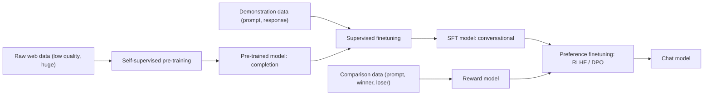

# Post-training: SFT and preference finetuning

> **Before this lesson:** you should know what pre-training, self-supervision, parameters and finetuning mean (see [From language models to foundation models](#/lesson/ai-eng/aie-rise)) and have met the idea of a loss, the number training pushes down (see [Training data, architecture and scale](#/lesson/ai-eng/aie-data-arch-scale)). The one demo uses NumPy and is explained line by line.

## In plain words

Imagine someone who has read every book in a huge library but has never held a job. They know an enormous amount, yet if a customer walks up and asks a question, they might ramble, finish the customer's sentence for them, or repeat something offensive they once read. Knowledge is there; manners and judgement are not.

A freshly pre-trained language model is in that state. **Post-training** is the short "job training" that follows the long years of reading. It has two parts. In the first, the model is shown thousands of examples of a good assistant at work, a question paired with a model answer, and learns to imitate them. That part is called **supervised finetuning**, or SFT. In the second, people look at pairs of answers and say which one they prefer, and the model is nudged toward the kind of answer people pick. That part is called **preference finetuning**.

Why this matters for a job: you will probably never run post-training on a frontier model yourself, but everything you notice about a chat model's personality comes from it: how it refuses, how wordy it is, how politely it hedges. Knowing the recipe lets you predict a model's behaviour, explain it to colleagues and decide when prompting can change it and when you would need finetuning. In interviews, "what is RLHF?" and "why collect comparisons instead of scores?" are standard questions.

A pre-trained model is a powerful text-completion engine, and that is a problem. Huyen points out two issues. First, self-supervision optimizes the model to *complete* text, not to hold a conversation. Second, because it was trained on indiscriminate internet data, its outputs can be racist, sexist, rude or wrong. Post-training addresses both. This lesson explains the two standard steps, SFT and preference finetuning (whose main algorithms go by the abbreviations RLHF, DPO and RLAIF, each spelled out below), and why they matter to you as an application builder.

## 1. The big picture



Read the diagram left to right. The top row is the pre-training you already know: huge, messy web text produces a completion model. The middle row adds a small set of hand-written example answers and turns the completion model into one that converses. The bottom row adds people's choices between answers and produces the polished chat model you use through an API.

Another way Huyen frames the difference:

- **Pre-training optimizes token-level quality.** The model is rewarded for predicting the next token correctly, one token at a time.
- **Post-training optimizes response-level quality.** Users care about whole responses, so the model learns to produce complete answers that people prefer.

People compare pre-training to *reading to acquire knowledge* and post-training to *learning how to use that knowledge*. Post-training is cheap by comparison. InstructGPT, OpenAI's 2022 instruction-following model, used about 2% of its compute for post-training and 98% for pre-training. So post-training mostly **unlocks capabilities the pre-trained model already has** but that are hard to reach through prompting alone.

Huyen uses an internet meme, the "Shoggoth with a smiley face", as an analogy. A Shoggoth is a shapeless monster from horror fiction. Pre-training produces the untamed monster. SFT on high-quality data makes it socially acceptable. Preference finetuning puts a customer-friendly smiley face on it. The analogy also hints that the underlying model is still there under the polish, which is part of why **jailbreaks** work: these are prompts crafted to trick a model into ignoring its safety training (Module 5).

> [!WARNING]
> Terminology varies. "Instruction finetuning" sometimes means SFT only and sometimes means SFT plus preference finetuning. Huyen avoids the term. When reading papers, check which one is meant.

## 2. Supervised finetuning (SFT)

Ask a pre-trained model "How to make pizza" and it may add more context ("…for a family of six?"), add follow-up questions, or give instructions. Only the last is what a user wants. Models imitate their training data, so you show them examples of good responses. This is **demonstration data**, and each example is a (prompt, response) pair. One pair might look like this:

| Prompt | Response |
|---|---|
| "Summarise this paragraph in one sentence: (a paragraph about rainfall)" | "Rainfall in the region has fallen by a third since 1990, mainly in winter." |

The training itself is the same next-token prediction as before. The model is given the prompt and learns to predict the tokens of the written response. It is called *supervised* because, unlike pre-training, the wanted answer was written by a person. The process is also called **behavior cloning**, because the model copies the behaviour shown in the demonstrations.

Demonstration data should cover the range of requests you expect: question answering (QA), summarization, translation, classification, brainstorming, and so on. InstructGPT's mix was dominated by generation tasks, open QA (questions answered from general knowledge, with no document supplied) and brainstorming.

### Demonstration data is expensive

A **labeler** (or annotator) is a person paid to produce or judge training data.

- Labelers need real expertise. About 90% of InstructGPT's demonstration labelers had at least a college degree, and more than a third had a master's.
- Writing one (prompt, response) pair can take up to 30 minutes for long-context tasks such as summarization.
- At \$10 per pair, InstructGPT's roughly 13,000 pairs would cost \$130,000 before task design, recruiting and quality control.

Cheaper options exist, each with its own catch:

- **Volunteers**: LAION's OpenAssistant effort had 13,500 volunteers produce 10,000 conversations (161,443 messages in 35 languages). Labeler demographics were skewed, with about 90% self-identifying as male, and that skew flows into the "preference" the model learns.
- **Heuristic filtering**: DeepMind filtered web text for dialogue-shaped content (`[A]: … [B]: … [A]: …`) for Gopher.
- **AI-generated data**: increasingly common (Module 8).

You can technically train a model from scratch on demonstration data and skip pre-training, but pre-training first usually gives far better results.

## 3. Preference finetuning

SFT teaches the model *how* to respond. It does not teach *which* responses are better when several are plausible, or how to handle contentious requests. Should a model write an essay on why one race is inferior? Explain how to pick a lock? Opinions differ across cultures and contexts, and a single model has to choose. **Preference finetuning** tries to align the model with human preference. Huyen calls it an ambitious, maybe impossible, goal, since "universal human preference" may not exist.

The earliest successful algorithm, still popular, is **RLHF** (reinforcement learning from human feedback). **Reinforcement learning (RL)** is a style of training in which a model tries things and receives a numeric *reward* saying how good each attempt was, and is adjusted to earn more reward, the way a dog learns tricks from treats. In RL vocabulary the model being trained is called the **policy**. People cannot sit and reward millions of attempts, so RLHF first builds an automatic stand-in for human taste:

1. Train a **reward model (RM)**, a separate model that reads a (prompt, response) pair and outputs one number: how much a person would like that response.
2. Optimize the SFT model to produce responses the RM scores highly.

### The reward model

Asking people for absolute scores (called *pointwise* evaluation, because each response is judged alone) is noisy. One labeler gives a 5 and another a 7, and the same labeler may be inconsistent with themselves from one day to the next. **Comparisons** are easier: show two responses and ask which is better. This gives **comparison data** in the form (prompt, winning_response, losing_response).

Some numbers from the book:

- Comparing two responses took labelers for LMSYS (the research group behind a popular public model-ranking site) 3–5 minutes on average, since each response has to be fact-checked.
- Llama 2's comparisons cost about \$3.50 each, compared with \$25 for writing a response.
- InstructGPT labelers ranked responses with about **73% inter-labeler agreement**, meaning two labelers shown the same pair picked the same winner about 73% of the time.
- Ranking several responses at once gives several pairs: $A > B > C$ yields $(A,B)$, $(A,C)$ and $(B,C)$.

The RM outputs a *scalar*, meaning a single number. Training pushes the winner's score above the loser's. In words, the loss does this: take the winner's score minus the loser's score, squash that gap into a probability between 0 and 1 that says "how sure is the RM that the winner wins", and penalise the RM when that probability is low.

The squashing function is the **sigmoid**, written $\sigma$: $\sigma(z) = 1 / (1 + e^{-z})$. It maps a gap of 0 to 0.5 (a coin flip), large positive gaps to nearly 1 and large negative gaps to nearly 0. The penalty is the negative logarithm, $-\log(p)$, which is 0 when $p = 1$ and grows without limit as $p$ approaches 0. InstructGPT's loss, with $r_\theta$ the reward model (the subscript $\theta$ stands for its parameters), $x$ the prompt, $y_w$ the winning response, $y_l$ the losing one, and $\mathbb{E}$ meaning "averaged over all the comparison examples", is:

$$
\mathcal{L}(\theta) = -\,\mathbb{E}_{(x, y_w, y_l)}\Big[\log \sigma\big(r_\theta(x, y_w) - r_\theta(x, y_l)\big)\Big]
$$

A worked example. Suppose the RM gives the winner 2.0 and the loser 0.5. The gap is 1.5, $\sigma(1.5) = 0.82$, and the loss is $-\log(0.82) = 0.20$: small, because the RM agrees with the humans. If it had scored them the other way round, the gap would be $-1.5$, $\sigma(-1.5) = 0.18$, and the loss $-\log(0.18) = 1.70$: large, so training would change the RM a lot.

This way of turning pairwise wins into scores is the **Bradley–Terry** model, named after the two statisticians who proposed it. The probability that $y_w$ beats $y_l$ is modeled as $\sigma(s_w - s_l)$, where $s$ are the scores, and training picks the scores that make the observed human choices most probable. The same model underlies the chess-style Elo rankings of chatbots in Module 3.

The demo below trains a miniature reward model. Each "response" is three made-up numbers (think of them as measurements such as helpfulness, rudeness and length). A hidden rule decides which response a pretend human prefers. The reward model sees only who won each comparison and has to recover the rule.

```python-run
import numpy as np
# Train a tiny linear reward model on synthetic comparison data with the Bradley-Terry loss.
rng = np.random.default_rng(0)
true_w = np.array([2.0, -1.0, 0.5])          # hidden "human preference"
X_w, X_l = [], []
for _ in range(500):
    a, b = rng.normal(size=3), rng.normal(size=3)
    if a @ true_w >= b @ true_w: X_w.append(a); X_l.append(b)
    else:                        X_w.append(b); X_l.append(a)
X_w, X_l = np.array(X_w), np.array(X_l)
w = np.zeros(3)
for step in range(300):
    margin = (X_w - X_l) @ w
    p = 1 / (1 + np.exp(-margin))                       # P(winner beats loser)
    loss = -np.mean(np.log(p + 1e-12))
    grad = -((1 - p)[:, None] * (X_w - X_l)).mean(axis=0)
    w -= 0.5 * grad
    if step % 100 == 0: print(f"step {step:3d} loss {loss:.4f}")
print("learned direction:", (w / np.linalg.norm(w)).round(2))
print("true direction:   ", (true_w / np.linalg.norm(true_w)).round(2))
```

**Reading this Python line by line**

- `rng = np.random.default_rng(0)` creates a random-number generator with a fixed seed, so the run is repeatable.
- `true_w` is the hidden preference: feature 1 is liked (weight 2), feature 2 disliked (weight -1), feature 3 mildly liked (0.5). A response's true appeal is the dot product of its three numbers with `true_w`; `@` is the dot-product operator.
- The first loop makes 500 comparisons. `rng.normal(size=3)` draws a random response. Whichever of `a` and `b` has the higher true appeal is appended to the winners list `X_w`, the other to the losers list `X_l`.
- `w = np.zeros(3)` is the reward model: three weights, all starting at zero. Its score for a response is `response @ w`.
- In the training loop, `margin` is winner score minus loser score for all 500 pairs at once. `p` applies the sigmoid. `loss` is the average of $-\log p$; the tiny `1e-12` avoids taking the log of zero.
- `grad` is the **gradient**: for each weight, the direction that would increase the loss. `w -= 0.5 * grad` moves the weights a small step the opposite way. Repeating this is **gradient descent**, the basic method by which all these models learn.
- Output: the loss starts at 0.6931 (which is $-\log 0.5$: with zero weights every comparison is a coin flip) and falls steadily. The learned direction comes out close to the true one, about `[0.87, -0.44, 0.22]`. The model recovered the hidden taste from nothing but "this one won".

The RM can be trained from scratch or finetuned from the pre-trained or SFT model. Starting from the strongest available model tends to work best. Some argue the RM must be at least as strong as the policy, but as you will see with AI judges in Module 3, **judging is often easier than generating**: you can tell a good essay from a bad one without being able to write the good one.

### Optimizing against the reward model

With the RM fixed, prompts are drawn from a pool, the SFT model generates responses, the RM scores them, and the model is updated to increase reward using **PPO** (proximal policy optimization, a reinforcement-learning algorithm published by OpenAI in 2017 whose design keeps each update small). There is a danger here. The RM is an imperfect copy of human taste, and a model optimized hard against it will find its blind spots, producing odd text the RM happens to love. That is **reward hacking**. To prevent it, a penalty is added for straying too far from the original SFT model. The usual penalty is the **KL divergence**, a number measuring how different two probability distributions are (zero when they are identical).

### DPO and RLAIF

RLHF is complex: two models to train, reinforcement learning that can be unstable, many hyperparameters. Alternatives:

- **DPO (Direct Preference Optimization, published by Rafailov and colleagues in 2023)** skips the separate reward model and the RL loop. It shows that the same goal can be reached with one ordinary supervised loss applied directly to the preference pairs. In words: make the model being trained (written $\pi_\theta$) raise the probability it gives the winning response, relative to a frozen copy of the starting model (the *reference* model $\pi_{\text{ref}}$), by more than it raises the losing response. The constant $\beta$ sets how tightly the model is held to the reference. The formula has the same sigmoid-of-a-gap shape as the reward-model loss above; the gap is now between two log-probability ratios instead of two reward scores. Meta moved from RLHF (Llama 2) to DPO (Llama 3) to reduce complexity.

$$
\mathcal{L}_{\text{DPO}} = -\log\sigma\!\Big(\beta\big[\log\tfrac{\pi_\theta(y_w|x)}{\pi_{\text{ref}}(y_w|x)} - \log\tfrac{\pi_\theta(y_l|x)}{\pi_{\text{ref}}(y_l|x)}\big]\Big)
$$

- **RLAIF** (reinforcement learning from AI feedback) uses preference judgements produced by another AI model instead of human comparisons, which is far cheaper. Huyen notes it was potentially used for Claude.

### Best-of-N: preference at inference time

Some companies skip RL and use the reward model at inference, that is, while answering real requests. They generate several candidate responses and return the one the RM scores highest. This is **best-of-N**. It is a form of *test-time compute*: spending extra computation when answering, instead of during training, to get a better answer (next lesson). Huyen notes that the clothing retailer Stitch Fix and the ride-hailing company Grab found this works well for their use cases. It trades latency and cost for quality without retraining: generating eight candidates costs roughly eight times the output tokens.

> [!INTERVIEW]
> **"Why do RLHF pipelines collect pairwise comparisons instead of 1–10 scores?"** Pointwise scores are inconsistent across and within labelers. Choosing the better of two is easier, faster and more reliable (InstructGPT reported about 73% agreement). A Bradley–Terry loss, $-\log\sigma(r_w - r_l)$, turns comparisons into a scalar reward model. Follow-up: **"Why might a team choose DPO?"** It removes the reward model and PPO loop and optimizes preferences directly with a stable supervised-style loss, which is simpler and cheaper and gave comparable results for Llama 3.

## 4. Why this matters to an application engineer

- **You can estimate alignment from the recipe.** *Alignment* means how well a model's behaviour matches what people want from it. A model with only SFT will follow instructions but may be less polished or less safe than one with preference finetuning.
- **Perplexity can mislead.** Perplexity is a score of how well a model predicts ordinary text, lower being better (Module 3). Post-trained models are tuned toward preferred responses, not raw token prediction, so their perplexity on general text can go *up* even though they are better assistants.
- **Refusal style and verbosity come from post-training.** A model's refusals, hedging and verbosity were learned here. If they hurt your product, prompts help, and finetuning (Module 7) can reshape them.
- **Your own preference data is valuable.** Thumbs up/down and side-by-side choices from users (Module 10) are exactly the comparison data that preference finetuning consumes.
- **Hallucination connects back here.** One hypothesis (next lesson) is that SFT on labeler-written answers that contain knowledge the model lacks *teaches it to make things up*.

## Pitfalls

- Assuming "aligned" means "correct". Preference finetuning optimizes for what labelers liked, and labelers can prefer confident, long or flattering answers.
- Ignoring labeler demographics. A preference dataset encodes the preferences of whoever labeled it.
- Over-optimizing a reward model, so the policy learns to exploit RM weaknesses (reward hacking) without a KL constraint.

## Summary

- Pre-training produces a completion engine with token-level skills. Post-training optimizes response-level quality with a small fraction of compute (about 2% for InstructGPT).
- **SFT** clones behavior from (prompt, response) demonstrations, which are expensive expert-written data.
- **Preference finetuning** aligns with human preference: RLHF (reward model + PPO), **DPO** (direct loss on preference pairs, used by Llama 3) or **RLAIF** (AI feedback).
- Reward models learn from comparisons with a Bradley–Terry loss. They can also be used at inference for **best-of-N** selection.

## Glossary

- **Post-training**: the training stages after pre-training that turn a completion model into a usable assistant.
- **Supervised finetuning (SFT)**: training on human-written (prompt, response) examples so the model imitates them.
- **Demonstration data**: the (prompt, response) pairs used for SFT.
- **Behavior cloning**: learning by copying demonstrated behaviour; another name for what SFT does.
- **Labeler (annotator)**: a person who writes or judges training data.
- **Preference finetuning**: training a model toward the responses people prefer.
- **Comparison data**: (prompt, winning response, losing response) triples.
- **Pointwise evaluation**: scoring one response on its own, as opposed to comparing two.
- **Reinforcement learning (RL)**: training by trial and numeric reward.
- **Policy**: in RL, the model being trained to act (here, to respond).
- **Reward model (RM)**: a model that scores how much a person would like a response.
- **RLHF**: reinforcement learning from human feedback: reward model plus RL.
- **Sigmoid**: the function $1/(1+e^{-z})$ that squashes any number into the range 0 to 1.
- **Bradley–Terry model**: win probability equals the sigmoid of the score difference.
- **Gradient descent**: repeatedly nudging parameters in the direction that lowers the loss.
- **PPO**: proximal policy optimization, the RL algorithm commonly used in RLHF.
- **KL divergence**: a measure of how different two probability distributions are.
- **Reward hacking**: the policy exploiting flaws in the reward model instead of improving.
- **DPO**: Direct Preference Optimization: a single supervised loss on preference pairs, with no reward model.
- **RLAIF**: preference finetuning where the feedback comes from an AI model.
- **Best-of-N**: generating several responses and returning the highest-scored one.
- **Alignment**: how well a model's behaviour matches human wishes and values.

```quiz
[
  {"q": "What are the two problems of a pre-trained model that post-training addresses?", "options": ["Too few parameters and small context", "It is optimized for completion rather than conversation, and its outputs can be toxic or wrong", "It cannot tokenize and cannot sample", "It is too slow and too expensive"], "answer": 1, "explain": "Self-supervision teaches completion, and indiscriminate web data teaches bad behavior. SFT and preference finetuning address both."},
  {"q": "Roughly what share of InstructGPT's compute went to post-training?", "options": ["2%", "20%", "50%", "98%"], "answer": 0, "explain": "About 98% went to pre-training and 2% to post-training, which is why post-training is seen as unlocking existing capabilities."},
  {"q": "Why is comparison data preferred over absolute scores for training reward models?", "options": ["It is free", "Pairwise judgments are easier and more consistent than pointwise scores", "Scores cannot be stored", "PPO requires pairs"], "answer": 1, "explain": "Labelers disagree on absolute scores, even with themselves. Choosing the better of two is more reliable."},
  {"q": "In the reward-model loss -log σ(r(x,y_w) - r(x,y_l)), what does the model learn?", "options": ["To predict the next token", "To score winning responses higher than losing ones", "To minimize perplexity", "To classify toxicity"], "answer": 1, "explain": "The loss falls as the score gap between winner and loser grows (Bradley–Terry)."},
  {"q": "What does DPO remove compared with RLHF?", "options": ["The need for preference data", "The separate reward model and the RL (PPO) loop", "The SFT stage", "The tokenizer"], "answer": 1, "explain": "DPO optimizes the policy directly on preference pairs with a supervised-style loss relative to a reference model."},
  {"q": "Ranking three responses A > B > C produces how many comparison pairs?", "options": ["1", "2", "3", "6"], "answer": 2, "explain": "(A,B), (A,C), (B,C). Ranking several responses at once speeds up labeling."},
  {"q": "A team uses a reward model to choose the best of 8 sampled responses at inference time. This is…", "options": ["RLHF", "DPO", "Best-of-N, a test-time compute strategy", "Distillation"], "answer": 2, "explain": "Best-of-N uses a scorer at inference instead of updating weights, trading compute for quality."}
]
```

> **Source:** Huyen, *AI Engineering*, ch. 2 ("Post-Training": supervised finetuning, preference finetuning, reward model, finetuning using the reward model).
