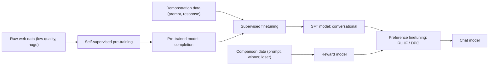

# Post-training: SFT and preference finetuning

A pre-trained model is a powerful text-completion engine, and that is a problem. Huyen points out two issues. First, self-supervision optimizes the model to *complete* text, not to hold a conversation. Second, because it was trained on indiscriminate internet data, its outputs can be racist, sexist, rude or wrong. **Post-training** fixes both. This lesson explains the two standard steps, **supervised finetuning (SFT)** and **preference finetuning** (RLHF, DPO, RLAIF), and why they matter to you as an application builder even if you never run them yourself.

## 1. The big picture



Another way Huyen frames the difference:

- **Pre-training optimizes token-level quality.** The model is rewarded for predicting the next token.
- **Post-training optimizes response-level quality.** Users care about whole responses, so the model learns to produce responses people prefer.

People compare pre-training to *reading to acquire knowledge* and post-training to *learning how to use that knowledge*. Post-training is cheap by comparison. InstructGPT used about 2% of its compute for post-training and 98% for pre-training. So post-training mostly **unlocks capabilities the pre-trained model already has** but that are hard to reach through prompting alone.

Huyen uses the "Shoggoth with a smiley face" meme as an analogy. Pre-training produces an untamed monster. SFT on high-quality data makes it socially acceptable. Preference finetuning puts a customer-friendly smiley face on it. The analogy also hints that the underlying model is still there under the polish, which is part of why jailbreaks work (Module 5).

> [!WARNING]
> Terminology varies. "Instruction finetuning" sometimes means SFT only and sometimes means SFT plus preference finetuning. Huyen avoids the term. When reading papers, check which one is meant.

## 2. Supervised finetuning (SFT)

Ask a pre-trained model "How to make pizza" and it may add more context ("…for a family of six?"), add follow-up questions, or actually give instructions. Only the last is what a user wants. Models imitate their training data, so you show them examples of good responses. This is **demonstration data** in (prompt, response) form. The process is also called **behavior cloning**.

Demonstration data should cover the range of requests you expect: QA, summarization, translation, classification, brainstorming, and so on. InstructGPT's distribution was dominated by generation, open QA and brainstorming.

### Demonstration data is expensive

- Labelers need real expertise. About 90% of InstructGPT's demonstration labelers had at least a college degree, and more than a third had a master's.
- Writing one (prompt, response) pair can take up to 30 minutes for long-context tasks such as summarization.
- At \$10 per pair, InstructGPT's roughly 13,000 pairs would cost \$130,000 before task design, recruiting and quality control.

Cheaper options exist, each with its own catch:

- **Volunteers**: LAION's OpenAssistant effort had 13,500 volunteers produce 10,000 conversations (161,443 messages in 35 languages). Labeler demographics were skewed, with about 90% self-identifying as male, and that skew flows into the "preference" the model learns.
- **Heuristic filtering**: DeepMind filtered web text for dialogue-shaped content (`[A]: … [B]: … [A]: …`) for Gopher.
- **AI-generated data**: increasingly common (Module 8).

You can technically train a model from scratch on demonstration data and skip pre-training, but pre-training first usually gives far better results.

## 3. Preference finetuning

SFT teaches the model *how* to respond. It does not teach *which* responses are better when several are plausible, or how to handle contentious requests. Should a model write an essay on why one race is inferior? Explain how to pick a lock? Opinions differ across cultures and contexts, and a single model has to choose. **Preference finetuning** tries to align the model with human preference. Huyen calls it an ambitious, maybe impossible, goal, since "universal human preference" may not exist.

The earliest successful algorithm, still popular, is **RLHF** (reinforcement learning from human feedback):

1. Train a **reward model (RM)** that scores a (prompt, response) pair.
2. Optimize the SFT model to produce responses the RM scores highly.

### The reward model

Asking people for absolute scores (pointwise evaluation) is noisy. One labeler gives a 5 and another a 7, and the same labeler may be inconsistent with themselves. **Comparisons** are easier: show two responses and ask which is better. This gives **comparison data** in the form (prompt, winning_response, losing_response).

Some numbers from the book:

- Comparing two responses took LMSYS labelers 3–5 minutes on average, since each has to be fact-checked.
- Llama 2's comparisons cost about \$3.50 each, compared with \$25 for writing a response.
- InstructGPT labelers ranked responses with about **73% inter-labeler agreement**.
- Ranking several responses at once gives several pairs: $A > B > C$ yields $(A,B)$, $(A,C)$ and $(B,C)$.

The RM outputs a scalar score. Training pushes the winner's score above the loser's. InstructGPT's loss, with $\sigma$ the sigmoid and $r_\theta$ the reward model, is:

$$
\mathcal{L}(\theta) = -\,\mathbb{E}_{(x, y_w, y_l)}\Big[\log \sigma\big(r_\theta(x, y_w) - r_\theta(x, y_l)\big)\Big]
$$

This is the **Bradley–Terry** model. The probability that $y_w$ beats $y_l$ is modeled as $\sigma(s_w - s_l)$, and we maximize the log-likelihood of the observed preferences. The same model underlies the Elo-style rankings in Module 3.

```python-run
import numpy as np
# Train a tiny linear reward model on synthetic comparison data with the Bradley-Terry loss.
rng = np.random.default_rng(0)
true_w = np.array([2.0, -1.0, 0.5])          # hidden "human preference"
X_w, X_l = [], []
for _ in range(500):
    a, b = rng.normal(size=3), rng.normal(size=3)
    if a @ true_w >= b @ true_w: X_w.append(a); X_l.append(b)
    else:                        X_w.append(b); X_l.append(a)
X_w, X_l = np.array(X_w), np.array(X_l)
w = np.zeros(3)
for step in range(300):
    margin = (X_w - X_l) @ w
    p = 1 / (1 + np.exp(-margin))                       # P(winner beats loser)
    loss = -np.mean(np.log(p + 1e-12))
    grad = -((1 - p)[:, None] * (X_w - X_l)).mean(axis=0)
    w -= 0.5 * grad
    if step % 100 == 0: print(f"step {step:3d} loss {loss:.4f}")
print("learned direction:", (w / np.linalg.norm(w)).round(2))
print("true direction:   ", (true_w / np.linalg.norm(true_w)).round(2))
```

The RM can be trained from scratch or finetuned from the pre-trained or SFT model. Starting from the strongest available model tends to work best. Some argue the RM must be at least as strong as the policy, but as you will see with AI judges, **judging is often easier than generating**.

### Optimizing against the reward model

With the RM fixed, prompts are sampled, the SFT model generates responses, the RM scores them, and the model is updated with **PPO** (proximal policy optimization, OpenAI 2017) to increase reward. A penalty, usually a KL divergence from the SFT model, keeps the policy from drifting into gibberish that games the RM (*reward hacking*).

### DPO and RLAIF

RLHF is complex: two models, RL instability, many hyperparameters. Alternatives:

- **DPO (Direct Preference Optimization, Rafailov et al. 2023)** skips the separate reward model and RL loop. It shows that the RLHF objective can be optimized with a simple classification-style loss directly on preference pairs, using the policy's log-probabilities relative to a frozen reference model. Meta moved from RLHF (Llama 2) to DPO (Llama 3) to reduce complexity.

$$
\mathcal{L}_{\text{DPO}} = -\log\sigma\!\Big(\beta\big[\log\tfrac{\pi_\theta(y_w|x)}{\pi_{\text{ref}}(y_w|x)} - \log\tfrac{\pi_\theta(y_l|x)}{\pi_{\text{ref}}(y_l|x)}\big]\Big)
$$

- **RLAIF** uses AI-generated preference feedback instead of human comparisons. Huyen notes it was potentially used for Claude.

### Best-of-N: preference at inference time

Some companies skip RL and use the reward model at inference. They generate several responses and return the one the RM scores highest. This is **best-of-N**, a form of test-time compute (next lesson). Huyen notes that Stitch Fix and Grab found this works well for their use cases. It trades latency and cost for quality without retraining.

> [!INTERVIEW]
> **"Why do RLHF pipelines collect pairwise comparisons instead of 1–10 scores?"** Pointwise scores are inconsistent across and within labelers. Choosing the better of two is easier, faster and more reliable (InstructGPT reported about 73% agreement). A Bradley–Terry loss, $-\log\sigma(r_w - r_l)$, turns comparisons into a scalar reward model. Follow-up: **"Why might a team choose DPO?"** It removes the reward model and PPO loop and optimizes preferences directly with a stable supervised-style loss, which is simpler and cheaper and gave comparable results for Llama 3.

## 4. Why this matters to an application engineer

- **You can estimate alignment from the recipe.** A model with only SFT will follow instructions but may be less polished or less safe than one with preference finetuning.
- **Perplexity can mislead.** Post-trained models are tuned toward preferred responses, not token prediction, so their perplexity on general text can go *up* (Module 3).
- **Refusal style and verbosity come from post-training.** A model's refusals, hedging and verbosity were learned here. If they hurt your product, prompts help, and finetuning (Module 7) can reshape them.
- **Your own preference data is valuable.** Thumbs up/down and side-by-side choices from users (Module 10) are exactly the comparison data that preference finetuning consumes.
- **Hallucination connects back here.** One hypothesis (next lesson) is that SFT on labeler-written answers that contain knowledge the model lacks *teaches it to make things up*.

## Pitfalls

- Assuming "aligned" means "correct". Preference finetuning optimizes for what labelers liked, and labelers can prefer confident, long or flattering answers.
- Ignoring labeler demographics. A preference dataset encodes the preferences of whoever labeled it.
- Over-optimizing a reward model, so the policy learns to exploit RM weaknesses (reward hacking) without a KL constraint.

## Summary

- Pre-training produces a completion engine with token-level skills. Post-training optimizes response-level quality with a small fraction of compute (about 2% for InstructGPT).
- **SFT** clones behavior from (prompt, response) demonstrations, which are expensive expert-written data.
- **Preference finetuning** aligns with human preference: RLHF (reward model + PPO), **DPO** (direct loss on preference pairs, used by Llama 3) or **RLAIF** (AI feedback).
- Reward models learn from comparisons with a Bradley–Terry loss. They can also be used at inference for **best-of-N** selection.

```quiz
[
  {"q": "What are the two problems of a pre-trained model that post-training addresses?", "options": ["Too few parameters and small context", "It is optimized for completion rather than conversation, and its outputs can be toxic or wrong", "It cannot tokenize and cannot sample", "It is too slow and too expensive"], "answer": 1, "explain": "Self-supervision teaches completion, and indiscriminate web data teaches bad behavior. SFT and preference finetuning address both."},
  {"q": "Roughly what share of InstructGPT's compute went to post-training?", "options": ["2%", "20%", "50%", "98%"], "answer": 0, "explain": "About 98% went to pre-training and 2% to post-training, which is why post-training is seen as unlocking existing capabilities."},
  {"q": "Why is comparison data preferred over absolute scores for training reward models?", "options": ["It is free", "Pairwise judgments are easier and more consistent than pointwise scores", "Scores cannot be stored", "PPO requires pairs"], "answer": 1, "explain": "Labelers disagree on absolute scores, even with themselves. Choosing the better of two is more reliable."},
  {"q": "In the reward-model loss -log σ(r(x,y_w) - r(x,y_l)), what does the model learn?", "options": ["To predict the next token", "To score winning responses higher than losing ones", "To minimize perplexity", "To classify toxicity"], "answer": 1, "explain": "The loss falls as the score gap between winner and loser grows (Bradley–Terry)."},
  {"q": "What does DPO remove compared with RLHF?", "options": ["The need for preference data", "The separate reward model and the RL (PPO) loop", "The SFT stage", "The tokenizer"], "answer": 1, "explain": "DPO optimizes the policy directly on preference pairs with a supervised-style loss relative to a reference model."},
  {"q": "Ranking three responses A > B > C produces how many comparison pairs?", "options": ["1", "2", "3", "6"], "answer": 2, "explain": "(A,B), (A,C), (B,C). Ranking several responses at once speeds up labeling."},
  {"q": "A team uses a reward model to choose the best of 8 sampled responses at inference time. This is…", "options": ["RLHF", "DPO", "Best-of-N, a test-time compute strategy", "Distillation"], "answer": 2, "explain": "Best-of-N uses a scorer at inference instead of updating weights, trading compute for quality."}
]
```

> **Source:** Huyen, *AI Engineering*, ch. 2 ("Post-Training": supervised finetuning, preference finetuning, reward model, finetuning using the reward model).
