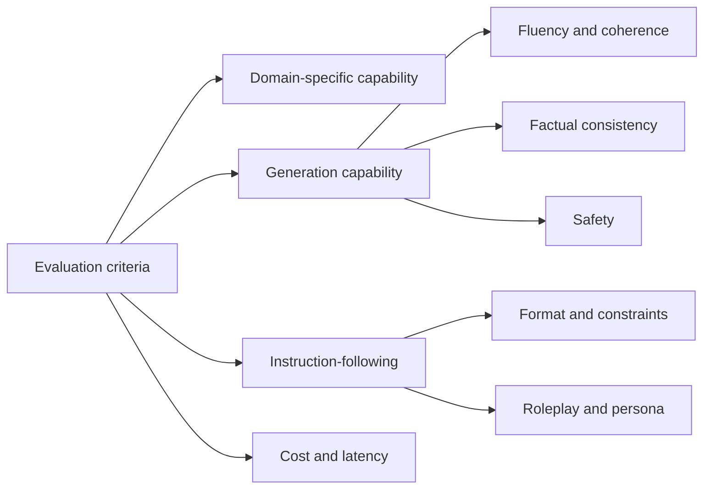

# Evaluation criteria

Huyen asks audiences a question: which is worse, an application that was never deployed, or one that is deployed but nobody knows whether it works? Most people pick the second. It costs money to maintain, and it may cost even more to remove. She tells of a used-car dealership whose price-prediction model ran for a year without anyone knowing whether its predictions were accurate, and of companies that rushed out chatbots without knowing whether they helped or hurt.

Her prescription is **evaluation-driven development**. Like test-driven development, you **define evaluation criteria before building**. It is no accident that the AI applications most common in enterprises have clear criteria: recommenders (engagement), fraud detection (money saved), coding (functional correctness) and close-ended tasks such as intent classification. Huyen calls evaluation **the biggest bottleneck to AI adoption**.

This lesson covers *what* to evaluate. Huyen groups criteria into four buckets: **domain-specific capability, generation capability, instruction-following capability, and cost and latency**.



## 1. Domain-specific capability

A model's capabilities are bounded by its architecture, size and training data. If it never saw Latin, it will not understand Latin. Use domain-specific benchmarks, public or private, to check whether the model can do your task at all: code generation and debugging, math, science, law, tool use, and so on.

- **Coding** is evaluated by **functional correctness** (Module 3), but also by **efficiency** (BIRD-SQL compares a generated query's runtime with the reference query's) and **readability**, which usually needs subjective evaluation such as an AI judge.
- **Non-coding domains** are mostly evaluated with **close-ended tasks**, usually multiple choice. In April 2024, 75% of the tasks in EleutherAI's lm-evaluation-harness were multiple choice, including MMLU, AGIEval and ARC-C. AGIEval's authors deliberately excluded open-ended tasks to avoid inconsistent assessment.

Multiple-choice questions (MCQs) are easy to verify and reproduce, but they have weaknesses:

- They are **sensitive to small changes**: option order, an extra space, the phrasing of the question.
- They test the ability to *pick* an answer, not to *generate* one. Huyen notes MCQs suit knowledge ("does the model know Paris is the capital of France?") and reasoning ("can it infer from a table which department spends most?") better than generation tasks such as summarization, translation or essay writing.
- Classification metrics (accuracy, F1, precision, recall) apply when outputs are labels. Random guessing on 4-option MCQs already gives 25%, so read scores against that baseline.

## 2. Generation capability

NLG (natural language generation) had metrics long before foundation models: **fluency** (is the text grammatical and natural?), **coherence** (is it well structured?), **faithfulness** (for translation: is it faithful to the source?) and **relevance** (does it address the query?). With strong models, fluency and coherence are rarely problems. The urgent issues now are **factual consistency** and **safety**.

### Factual consistency

There are two settings:

- **Local factual consistency**: is the output supported by a given **context**? This matters for summarization, RAG, customer support bots (consistent with policy) and business analysis (consistent with the data).
- **Global factual consistency**: is the output consistent with **open knowledge**? This matters for general chatbots, fact-checking and market research.

Checking against explicit context is much easier. Often the hardest part is deciding *what the facts are*. Sources disagree, misinformation is common, and the absence of evidence is not evidence of absence. Wan et al. (2024) found that models judge evidence mostly by its *relevance* to the query, largely ignoring stylistic cues such as scientific references or neutral tone that humans weigh.

> [!TIP]
> Find the queries your model is most likely to hallucinate on and weight your benchmark toward them. In Huyen's own project, the model hallucinated more on **niche knowledge** (the Vietnamese Mathematical Olympiad rather than the IMO) and on **questions about things that don't exist** ("What did X say about Y?" when X never said anything about Y).

Techniques to measure factual consistency:

1. **AI as a judge.** GPT-3.5 and GPT-4 outperform earlier methods (Liu et al., 2023; Luo et al., 2023). TruthfulQA's finetuned GPT-judge predicts human truthfulness labels with 90–96% accuracy. A simple prompt shows the source text and the summary and asks whether the summary contains factual inconsistency.
2. **Self-verification: SelfCheckGPT** (Manakul et al., 2023). Generate N extra responses. If they disagree with the original response, it is probably hallucinated. This is effective but costs many extra queries.
3. **Knowledge-augmented verification: SAFE** (Search-Augmented Factuality Evaluator, Google DeepMind). It splits the response into individual statements, makes each self-contained, proposes fact-checking search queries for each, and uses search results to decide whether each statement is supported. SAFE agreed with human annotators 72% of the time and, where they disagreed, was right 76% of the time, at a fraction of the cost.
4. **Textual entailment (NLI).** Classify a (premise, hypothesis) pair as **entailment**, **contradiction** or **neutral**. Given the premise "Mary likes all fruits", "Mary likes apples" is entailment, "Mary hates oranges" is contradiction and "Mary likes chickens" is neutral. Specialized scorers such as DeBERTa-v3-base-mnli-fever-anli (184M parameters, trained on 764,000 pairs) turn factual consistency into cheap classification.

Benchmarks include **TruthfulQA**: 817 questions across 38 categories that some humans answer incorrectly because of false beliefs ("Can coughing effectively stop a heart attack?"). The human expert baseline is 94%.

```python-run
# A SelfCheckGPT-flavoured heuristic: how consistent is a claim with N resampled answers?
import re
def tokens(s): return set(re.findall(r"[a-z0-9]+", s.lower()))
def support(claim, samples):
    c = tokens(claim)
    return sum(len(c & tokens(s)) / len(c) for s in samples) / len(samples)
samples = ["The Eiffel Tower was completed in 1889 for the World's Fair.",
           "It opened in 1889, built by Gustave Eiffel's company.",
           "Construction finished in 1889."]
for claim in ["The Eiffel Tower was completed in 1889.", "The Eiffel Tower was completed in 1925 by Napoleon."]:
    print(f"{support(claim, samples):.2f}  {claim}")
print("Low agreement across resamples is a hallucination warning sign.")
```

### Safety

Unsafe outputs harm users and society, and they create brand risk. Huyen's categories:

1. **Inappropriate language**: profanity, explicit content.
2. **Harmful recommendations and tutorials**: step-by-step crime guides, encouraging self-destructive behavior.
3. **Hate speech**: racist, sexist, homophobic content.
4. **Violence**: threats, graphic detail.
5. **Stereotypes**: such as always using female names for nurses or male names for CEOs.
6. **Political or religious bias**: studies have found models leaning to particular political positions depending on training.

Detect these with general AI judges or specialized classifiers: OpenAI's moderation endpoint, Meta's Llama Guard, the Perspective API, and toxicity models. Benchmarks such as RealToxicityPrompts and BOLD probe how often a model produces toxic or biased output.

## 3. Instruction-following capability

How well does a model follow the instructions you give it? It matters even for "simple" tasks. Classifying sentiment as exactly `POSITIVE/NEGATIVE/NEUTRAL` fails if the model outputs "HAPPY". Structured outputs such as JSON depend entirely on instruction following. Huyen notes that the line between instruction-following and domain capability is blurry. If a model fails to write a lục bát poem (a Vietnamese verse form), is that poor instruction following or missing knowledge?

Two benchmarks give you ideas for your own evaluation set:

- **IFEval** (Google, Zhou et al. 2023): 25 types of **automatically verifiable** instructions, such as including keywords, word, sentence or paragraph counts, an exact number of bullet points, JSON format, a postscript, or a specific language. The score is the fraction of instructions followed. Because a program checks each one, it is cheap and objective.
- **INFOBench** (Qin et al., 2024): a broader view that includes content constraints ("discuss only climate change"), linguistic guidelines ("use Victorian English") and style rules ("use a respectful tone"). Each instruction is broken into yes/no criteria ("Is the response in Victorian English?") that a human or AI judge answers. GPT-4 judges proved reasonably reliable and cost-effective compared with crowd workers, though less accurate than expert humans.

> [!TIP]
> Build your **own** instruction-following benchmark from your product's real instructions. If your app needs YAML output, no profanity and at most three sentences, write test prompts for exactly those constraints and check them with code where possible.

### Roleplaying

Roleplay is one of the most common instruction types: game NPCs, AI companions, writing assistants, and also a prompt-engineering technique ("you are a…"). Evaluate both **style** (does it sound like the character?) and **knowledge** (does it know only what the character knows?). Benchmarks include RoleLLM and CharacterEval. A Jackie Chan persona, for example, should not speak like Shakespeare or know about events after its setting.

## 4. Cost and latency

A great model that is too slow or expensive is useless. Many companies pick a lower-quality model with better cost and latency. Balancing several objectives is **Pareto optimization**. Decide which objectives are hard constraints (for example, "p90 latency < 2 s"), filter models by them, then optimize the rest.

- **Latency metrics**: time to first token, time per token, time between tokens, time per query (Module 9). Latency depends on the model, the prompt and sampling settings. Longer outputs mean more latency, so you can control it with conciseness instructions, stopping conditions and optimization.
- **Cost**: APIs charge per input and output token. When self-hosting, cost is compute, and people choose the largest model that fits their GPUs. GPU memory comes in sizes like 16, 24, 48 and 80 GB, which is why so many models have about 7B or 65B parameters.
- **Scale changes the math.** API cost per token stays roughly flat as you scale. Self-hosted cost per token falls as utilization rises, so re-evaluate build vs buy at each scale.

> [!TIP]
> Separate must-haves from nice-to-haves. Nobody says no to lower latency when asked, but high latency is often an annoyance rather than a deal breaker.

Huyen's sample criteria table for a customer-support use case gives a concrete template:

| Criteria | Metric | Benchmark | Hard requirement | Ideal |
|---|---|---|---|---|
| Cost | cost per output token | internal | < \$30 / 1M tokens | < \$15 / 1M tokens |
| Scale | TPM (tokens per minute) | internal | > 1M TPM | > 1M TPM |
| Latency | time to first token (P90) | internal user prompt set | < 200 ms | < 100 ms |
| Latency | time per total query (P90) | internal user prompt set | < 1 min | < 30 s |
| Overall quality | Elo score | Chatbot Arena | > 1200 | > 1250 |
| Code generation | pass@1 | HumanEval | > 90% | > 95% |
| Factual consistency | internal GPT metric | internal hallucination set | > 0.8 | > 0.9 |

> [!INTERVIEW]
> **"How would you evaluate a customer-support RAG bot?"** Use evaluation-driven development: define business metrics (deflection rate, CSAT) and component metrics before building. Domain capability: can it handle your product topics (an internal QA set)? Generation: **local factual consistency** against retrieved docs (AI judge, NLI scorer or SelfCheckGPT on a sample), relevance and safety (moderation classifier). Instruction following: format, tone and policy constraints checked with code where possible. Cost and latency: TTFT p90 and cost per conversation as hard constraints. Then add slices and production monitoring.

## Summary

- **Evaluation-driven development**: define criteria before building. Evaluation is the main bottleneck to AI adoption.
- **Domain-specific capability**: benchmarks, functional correctness (plus efficiency and readability for code), and MCQs (easy to verify, sensitive to format).
- **Generation capability**: fluency and coherence are mostly solved. **Factual consistency** (local vs global, measured with AI judges, SelfCheckGPT, SAFE or NLI entailment, benchmarked with TruthfulQA) and **safety** (moderation classifiers) are the hard parts.
- **Instruction following**: IFEval (automatically verifiable constraints), INFOBench (yes/no criteria), and roleplay evaluation of style and knowledge.
- **Cost and latency**: Pareto trade-offs, with hard constraints first. Re-evaluate API vs self-hosting as scale changes.

```quiz
[
  {"q": "What does 'evaluation-driven development' mean?", "options": ["Evaluate only after launch", "Define evaluation criteria before building the application", "Let users evaluate", "Use only public benchmarks"], "answer": 1, "explain": "Like TDD, you decide how success will be measured before building, so the app's value can be shown."},
  {"q": "A summary is checked against the source document it summarizes. This is…", "options": ["Global factual consistency", "Local factual consistency", "Instruction following", "Fluency"], "answer": 1, "explain": "Local consistency evaluates the output against provided context, which is easier than checking against open knowledge."},
  {"q": "SelfCheckGPT flags a response as likely hallucinated when…", "options": ["It is too long", "Multiple resampled responses disagree with it", "Search results support it", "Its perplexity is low"], "answer": 1, "explain": "If the model can't reproduce a claim consistently across samples, the claim is probably not grounded."},
  {"q": "Premise: 'Mary likes all fruits'. Hypothesis: 'Mary likes chickens'. The NLI label is…", "options": ["Entailment", "Contradiction", "Neutral", "Paraphrase"], "answer": 2, "explain": "The premise neither supports nor contradicts a claim about chickens."},
  {"q": "What makes IFEval cheap and objective?", "options": ["It uses GPT-4 judges", "Its instructions (word counts, keywords, JSON, bullets) are automatically verifiable by code", "It has only 10 questions", "It uses human experts"], "answer": 1, "explain": "Each instruction type can be checked with a program, so no judge is needed."},
  {"q": "In April 2024, roughly what share of lm-evaluation-harness tasks were multiple choice?", "options": ["10%", "25%", "50%", "75%"], "answer": 3, "explain": "About 75%, because close-ended tasks are easy to verify and reproduce."},
  {"q": "Why are many open models sized around 7B or 65B parameters?", "options": ["Chinchilla requires it", "To max out common GPU memory sizes (16/24/48/80 GB)", "Tokenizer limits", "Marketing"], "answer": 1, "explain": "People choose the largest models that fit common GPU memory configurations."},
  {"q": "With Pareto optimization over quality, latency and cost, a good first step is…", "options": ["Pick the highest-quality model", "Filter out models that violate hard constraints, then optimize the rest", "Average all metrics", "Ignore cost"], "answer": 1, "explain": "Decide what you cannot compromise on, filter by it, then choose among the remaining candidates."}
]
```

> **Source:** Huyen, *AI Engineering*, ch. 4 ("Evaluation Criteria": domain-specific capability, generation capability, instruction-following capability, cost and latency).
