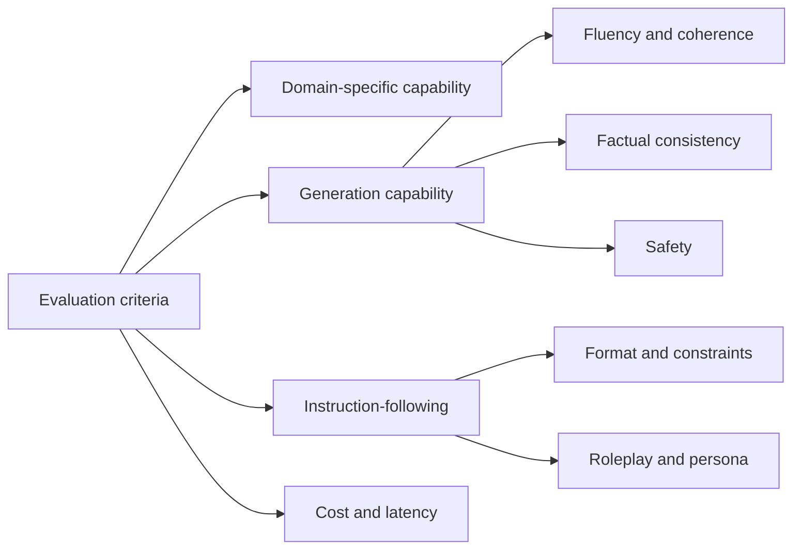

# Evaluation criteria

> **Before this lesson:** read [Exact evaluation and similarity measures](#/lesson/ai-eng/aie-exact-similarity) (functional correctness, exact match, embeddings) and [AI as a judge and comparative evaluation](#/lesson/ai-eng/aie-judge-comparative) (judge prompts, Elo). This lesson decides *what* to measure; those two lessons explained *how* to measure. Basic Python (lists, dictionaries, `if`) is enough for the demos.

## In plain words

Before you can say whether an AI application "works", you have to decide what working means. An **evaluation criterion** is one quality you will check, such as "answers are supported by our help-centre articles", "replies arrive within two seconds" or "the output is valid JSON". This lesson walks through the four families of criteria Huyen recommends: can the model do the *task* at all, does it *write* well and truthfully, does it *follow instructions*, and is it fast and cheap enough.

An everyday picture: hiring a chef. You check whether they can cook your cuisine at all (domain skill), whether the food tastes good and is safe to eat (generation quality and safety), whether they follow the order ticket, "no onions, sauce on the side" (instruction following), and whether they can serve a full dining room on time without blowing the budget (latency and cost). A brilliant chef who takes an hour per plate is the wrong hire for a lunch counter.

Why this matters for a job: interviewers love open questions like "How would you evaluate a customer-support bot?". A strong answer names concrete criteria in each family, a metric for each, and which ones are hard requirements. That is exactly the template this lesson builds, ending with Huyen's sample criteria table.

## Why decide criteria first

Huyen likes to ask audiences which is worse: an application that was never deployed, or one that is **deployed** (released to real users) but nobody knows whether it works. Most people choose the second. It costs money to keep running, and it may cost even more to remove once people depend on it. She describes an engineer at a used-car dealership whose price-prediction model had been running for a year without anyone knowing whether its predictions were any good, and companies that rushed out chatbots without knowing whether they helped or hurt.

Her prescription is **evaluation-driven development**. It borrows from **test-driven development**, a software practice where you write the tests before the code: here you **define the evaluation criteria before you build**. It is no accident that the AI applications most common in companies are the ones with clear success measures: **recommender systems** (which suggest products or videos, judged by *engagement*, meaning clicks and watch time), **fraud detection** (judged by money saved), coding assistants (judged by functional correctness), and close-ended tasks such as **intent classification** (sorting a message into a fixed set of goals, like "refund" or "change address"). Huyen calls evaluation **the biggest bottleneck to AI adoption**.

Huyen groups criteria into four buckets: **domain-specific capability, generation capability, instruction-following capability, and cost and latency**.



## 1. Domain-specific capability

A model's abilities are limited by its architecture, its size and the data it was trained on. If it never saw Latin, it will not understand Latin, however cleverly you prompt it. **Domain-specific capability** asks: can this model do *my kind of task* at all? You check it with domain **benchmarks** (fixed sets of test questions), public or private: code generation and debugging, maths, science, law, tool use, and so on.

- **Coding** is judged mainly by **functional correctness** (does the code pass its tests?), but also by **efficiency** and **readability**. The text-to-SQL benchmark BIRD-SQL, for example, compares how long a generated query takes to run with how long the reference query takes. Readability usually needs a subjective method such as an AI judge.
- **Non-coding domains** are mostly tested with **close-ended tasks**, where the answer comes from a fixed set, usually **multiple-choice questions** (MCQs). In April 2024, 75% of the tasks in EleutherAI's lm-evaluation-harness, a popular open source evaluation tool, were multiple choice, including the well-known MMLU, AGIEval and ARC-C benchmarks. AGIEval's authors deliberately left out open-ended tasks to avoid inconsistent grading.

MCQs are easy to check and to reproduce, but they have weaknesses:

- They are **sensitive to small changes**: the order of the options, an extra space, the wording of the question. A model's score can move several points because option B became option A.
- They test the ability to *pick* an answer, not to *produce* one. Huyen notes that MCQs suit knowledge ("does the model know Paris is the capital of France?") and reasoning ("can it work out from a table which department spends the most?") better than generation tasks such as summarising, translating or essay writing.
- When outputs are labels, the classic **classification metrics** apply. **Accuracy** is the share of answers that are right; precision, recall and F1 (from the previous lessons) look at errors in more detail. Always compare a score with its **baseline**, the score you would get by chance: random guessing on four-option MCQs already scores 25%, so 40% is much less impressive than it sounds.

## 2. Generation capability

**Natural language generation** (NLG) is the field of producing text, and it had quality criteria long before foundation models existed: **fluency** (is the text grammatical and natural?), **coherence** (does it hang together logically?), **faithfulness** (for translation: does it keep the source's meaning?) and **relevance** (does it address the question?). Today's strong models rarely struggle with fluency or coherence. The urgent issues are now **factual consistency** and **safety**.

### Factual consistency

**Factual consistency** asks whether the output's claims are true. A *hallucination* (from the sampling lesson) is a fluent, confident claim that is not grounded in fact. There are two settings:

- **Local factual consistency**: is the output supported by a **context** you supplied, such as a document, a policy or a table? This matters for summarisation, **RAG** (retrieval-augmented generation, where relevant documents are looked up and added to the prompt), customer-support bots (answers must match company policy) and business analysis (answers must match the data).
- **Global factual consistency**: is the output consistent with **open knowledge**, what is true in the world? This matters for general chatbots, fact-checking and market research.

Checking against a supplied context is much easier. With open knowledge, the hardest part is often deciding *what the facts are*: sources disagree, misinformation is common, and finding no evidence for a claim does not prove it false. Wan and colleagues (2024) found that models weigh evidence mostly by how *relevant* it looks to the question and largely ignore cues humans care about, such as scientific references or a neutral tone.

> [!TIP]
> Find the queries your model is most likely to hallucinate on and weight your test set toward them. In Huyen's own project, the model hallucinated more on **niche knowledge** (the Vietnamese Mathematical Olympiad rather than the famous International Mathematical Olympiad) and on **questions about things that don't exist** ("What did X say about Y?" when X never said anything about Y).

Four ways to measure factual consistency:

1. **AI as a judge.** GPT-3.5 and GPT-4 beat earlier automatic methods at this (Liu and colleagues, 2023; Luo and colleagues, 2023). TruthfulQA's authors finetuned a "GPT-judge" that predicts human truthfulness labels with 90–96% accuracy. The basic prompt shows the source text and the summary and asks whether the summary contains anything inconsistent with the source.
2. **Self-verification with SelfCheckGPT** (Manakul and colleagues, 2023). Generate N extra responses to the same question. If they disagree with the original response, the original is probably hallucinated: a model that really knows a fact tends to repeat it, while an invented detail changes from sample to sample. This works but costs many extra model calls.
3. **Knowledge-augmented verification with SAFE**, the Search-Augmented Factuality Evaluator from Google DeepMind (Wei and colleagues, 2024). It uses a model to split the response into individual statements, rewrites each one to stand on its own (replacing "it" with what "it" refers to), proposes search queries to fact-check each statement, and then decides from the search results whether each one is supported. In the paper, SAFE agreed with crowd annotators 72% of the time, and when they disagreed SAFE was right 76% of the time, at a small fraction of the cost.
4. **Textual entailment**, also called **natural language inference** (NLI). A classifier looks at a pair of texts, a *premise* (the context) and a *hypothesis* (a claim from the output), and labels it **entailment** (the claim follows from the premise), **contradiction** (it conflicts) or **neutral** (neither). With the premise "Mary likes all fruits": "Mary likes apples" is entailment, "Mary hates oranges" is contradiction, and "Mary likes chickens" is neutral. Small specialised models such as DeBERTa-v3-base-mnli-fever-anli (184 million parameters, trained on 764,000 labelled pairs) turn factual checking into cheap classification.

The best-known benchmark here is **TruthfulQA**: 817 questions across 38 categories, written so that some humans answer them wrongly because of common false beliefs ("Can coughing effectively stop a heart attack?"). Human experts score 94%.

The demo below imitates the idea behind SelfCheckGPT with a crude word-overlap measure: a claim that the resampled answers keep repeating gets high support; an invented one does not.

```python-run
# A SelfCheckGPT-flavoured heuristic: how consistent is a claim with N resampled answers?
import re
def tokens(s): return set(re.findall(r"[a-z0-9]+", s.lower()))
def support(claim, samples):
    c = tokens(claim)
    return sum(len(c & tokens(s)) / len(c) for s in samples) / len(samples)
samples = ["The Eiffel Tower was completed in 1889 for the World's Fair.",
           "It opened in 1889, built by Gustave Eiffel's company.",
           "Construction finished in 1889."]
for claim in ["The Eiffel Tower was completed in 1889.", "The Eiffel Tower was completed in 1925 by Napoleon."]:
    print(f"{support(claim, samples):.2f}  {claim}")
print("Low agreement across resamples is a hallucination warning sign.")
```

**Reading this Python line by line**

- `import re` loads Python's **regular expression** module; a regular expression is a pattern for finding text. `re.findall(r"[a-z0-9]+", ...)` returns every run of lowercase letters or digits, so `tokens` turns a sentence into a set of lowercase words (a **set** is a collection with no duplicates).
- `support(claim, samples)`: for each sample, `c & tokens(s)` is the set of claim words that also appear in that sample, and dividing by `len(c)` gives the fraction of the claim found there. The outer `sum(...) / len(samples)` averages that fraction over the samples.
- `samples` stands in for three extra answers the model gave to the same question.
- Output: the true claim scores 0.57 and the invented claim (1925, Napoleon) scores 0.37. The invented details appear in none of the samples, so support drops. Real SelfCheckGPT compares meanings with an NLI model or a judge rather than counting words, but the logic is the same.

### Safety

Unsafe outputs harm users and society and create reputational risk for the company. Huyen's categories:

1. **Inappropriate language**: profanity, explicit content.
2. **Harmful recommendations and tutorials**: step-by-step guides to crime, encouragement of self-destructive behaviour.
3. **Hate speech**: racist, sexist or homophobic content.
4. **Violence**: threats and graphic detail.
5. **Stereotypes**: for example, always giving nurses female names and CEOs male names.
6. **Political or religious bias**: studies have found models leaning toward particular political positions depending on how they were trained.

You can detect these with general AI judges or with specialised **moderation classifiers**, models trained to flag unsafe text: OpenAI's moderation endpoint, Meta's Llama Guard, the Perspective API, and various toxicity models. Benchmarks such as RealToxicityPrompts and BOLD measure how often a model produces toxic or biased output.

## 3. Instruction-following capability

**Instruction following** is how well a model does what you asked, in the way you asked. It matters even for easy-looking tasks. If you ask for sentiment as exactly `POSITIVE`, `NEGATIVE` or `NEUTRAL` and the model writes "HAPPY", your code breaks. Structured outputs such as JSON depend entirely on it. Huyen points out that the line between instruction following and domain capability is blurry: if a model fails to write a lục bát poem (a Vietnamese verse form with strict syllable and rhyme rules), is it ignoring instructions, or does it not know the form?

Two benchmarks give good ideas for your own tests:

- **IFEval** (Instruction-Following Evaluation, from Google; Zhou and colleagues, 2023) uses 25 kinds of **automatically verifiable** instructions: include certain keywords, stay within a word, sentence or paragraph count, use exactly N bullet points, answer in JSON, add a postscript, write in a given language. The score is the share of instructions followed. Because a short program checks each one, the benchmark is cheap and objective.
- **INFOBench** (Qin and colleagues, 2024) takes a broader view, including content constraints ("discuss only climate change"), linguistic rules ("use Victorian English") and style rules ("use a respectful tone"). Each instruction is broken into yes/no questions ("Is the response in Victorian English?") that a human or an AI judge answers. GPT-4 proved reasonably reliable and cost-effective as the judge compared with crowd workers, though less accurate than expert humans.

Here is what an IFEval-style check looks like for a support bot whose instructions say: at most 60 words, exactly three bullet points, mention the refund, no exclamation marks, end with a P.S. line.

```python-run
def check_instructions(response):
    """Return a dict: instruction -> followed? Each check is plain code, as in IFEval."""
    words = response.split()
    bullets = [l for l in response.splitlines() if l.strip().startswith("- ")]
    return {
        "at most 60 words":          len(words) <= 60,
        "exactly 3 bullet points":   len(bullets) == 3,
        "mentions 'refund'":         "refund" in response.lower(),
        "no exclamation marks":      "!" not in response,
        "ends with a P.S. line":     response.strip().splitlines()[-1].startswith("P.S."),
    }

good = """Here is how to get your money back:
- Open your order page.
- Click Request refund.
- Expect the money within 5 days.
P.S. Keep your receipt."""

bad = """Great question! To get a refund, open your order page and click the button.
- It is quick.
- It is easy.
P.S. Thanks!"""

for name, resp in [("good", good), ("bad", bad)]:
    results = check_instructions(resp)
    score = sum(results.values()) / len(results)
    print(f"{name}: {score:.0%} of instructions followed")
    for rule, ok in results.items():
        print(f"   {'PASS' if ok else 'FAIL'}  {rule}")
```

**Reading this Python line by line**

- `response.split()` cuts the text at spaces and line breaks, giving a list of words.
- `response.splitlines()` gives a list of lines; the list comprehension `[l for l in ... if l.strip().startswith("- ")]` keeps only lines that begin with a dash and a space, our bullet points. `.strip()` removes spaces at the ends of a line first.
- The function returns a dictionary whose keys describe each instruction and whose values are `True` or `False`.
- `"""..."""` writes a string that spans several lines.
- `sum(results.values())` counts the `True` values (Python treats `True` as 1), and dividing by the number of rules gives the share followed; `:.0%` prints it as a percentage.
- Output: `good: 100%`, with five PASS lines. `bad: 60%`: it has only two bullets, and it uses exclamation marks. Every check is a line of code, so it costs nothing to run on thousands of responses.

> [!TIP]
> Build your **own** instruction-following test set from your product's real instructions. If your app needs YAML output, no profanity and at most three sentences, write test prompts for exactly those constraints and check them with code wherever possible.

### Roleplaying

Roleplay is one of the most common kinds of instruction: non-player characters (NPCs) in games, AI companions, writing assistants, and the prompt technique "You are a…". Evaluate two things: **style** (does it sound like the character?) and **knowledge** (does it know only what the character would know?). Benchmarks include RoleLLM and CharacterEval. A Jackie Chan persona, for example, should not talk like Shakespeare, and a character set in the past should not know about later events.

## 4. Cost and latency

A great model that is too slow or too expensive is useless for your product, and many companies choose a lower-quality model because its cost and latency are better. **Latency** is how long the user waits; **cost** is what each request costs you.

Balancing several goals at once is called **Pareto optimisation**, after the economist Vilfredo Pareto. One option *dominates* another if it is at least as good on every goal and strictly better on at least one; the options that no other option dominates form the **Pareto front**, the set of sensible trade-offs. The practical recipe: decide which goals are **hard constraints** (for example, "90% of requests answered within 2 seconds"), drop every model that breaks them, then choose among the rest.

```python-run
models = [
    # name, quality score (0-1, from your eval set), p90 latency (s), $ per 1M output tokens
    ("model-A", 0.92, 3.5, 30.0),
    ("model-B", 0.88, 1.2, 10.0),
    ("model-C", 0.85, 0.8, 2.0),
    ("model-D", 0.80, 0.6, 0.5),
    ("model-E", 0.83, 1.5, 12.0),
]
MAX_LATENCY, MAX_COST = 2.0, 15.0           # hard requirements
ok = [m for m in models if m[2] <= MAX_LATENCY and m[3] <= MAX_COST]
print("pass hard constraints:", [m[0] for m in ok])

def dominated(m, others):
    # m is dominated if another model is at least as good on every objective and better on one
    return any(o[1] >= m[1] and o[2] <= m[2] and o[3] <= m[3] and o != m for o in others)
front = [m[0] for m in ok if not dominated(m, ok)]
print("Pareto front among them:", front)
print("best quality within constraints:", max(ok, key=lambda m: m[1])[0])
```

**Reading this Python line by line**

- Each model is a **tuple** (a fixed group of values): name, quality, latency, price. `m[2]` is the latency and `m[3]` the price. The numbers are invented for the demo.
- `ok = [...]` keeps models that meet both hard limits. Model-A is the best but too slow and too expensive, so it is dropped.
- `dominated(m, others)` uses `any(...)`, which is `True` if at least one other model is at least as good on quality (higher), latency (lower) and cost (lower). The `o != m` part stops a model dominating itself. Strictly the definition also needs "better on at least one", which these numbers satisfy.
- Output: models B, C, D and E pass the hard constraints. E is not on the Pareto front because B beats it on all three goals. The front is B, C and D, and the highest-quality model within the constraints is B. Whether you pick B, C or D depends on how much a quality point is worth to you compared with a dollar.

Latency and cost in more detail:

- **Latency metrics** include **time to first token** (TTFT: how long until the first word appears), time per output token, time between tokens, and total time per query (all covered in Module 9). Latency is often reported as a **percentile**: "p90 latency of 2 s" means 90% of requests finish within 2 seconds. Latency depends on the model, the prompt and the sampling settings. Longer outputs take longer, so you can control latency with instructions to be concise, stopping conditions and the optimisations of Module 9.
- **Cost**: APIs charge per input token and per output token. When you **self-host** (run an open model on your own hardware), the cost is compute, and people tend to pick the largest model that fits their **GPUs** (graphics processing units, the chips that run models). GPU memory comes in sizes such as 16, 24, 48 and 80 GB, which is one reason so many open models have about 7 billion or 65 billion parameters.
- **Scale changes the maths.** With an API, the price per token stays roughly flat as your usage grows. When self-hosting, the cost per token falls as you keep your hardware busier, so the choice between buying an API and running your own (Module 4's next lesson) should be revisited as you grow.

> [!TIP]
> Separate must-haves from nice-to-haves. Nobody turns down lower latency when asked, but high latency is often an annoyance rather than a deal breaker.

Huyen's sample criteria table for a customer-support application is a template you can copy. **TPM** means tokens per minute, the throughput the provider must sustain.

| Criteria | Metric | Benchmark | Hard requirement | Ideal |
|---|---|---|---|---|
| Cost | cost per output token | internal | < \$30 / 1M tokens | < \$15 / 1M tokens |
| Scale | TPM (tokens per minute) | internal | > 1M TPM | > 1M TPM |
| Latency | time to first token (P90) | internal user prompt set | < 200 ms | < 100 ms |
| Latency | time per total query (P90) | internal user prompt set | < 1 min | < 30 s |
| Overall quality | Elo score | Chatbot Arena | > 1200 | > 1250 |
| Code generation | pass@1 | HumanEval | > 90% | > 95% |
| Factual consistency | internal GPT metric | internal hallucination set | > 0.8 | > 0.9 |

Read each row as a promise: *what* you care about, *how* you will measure it, *on which data*, the line you will not cross, and the target you hope to reach.

> [!INTERVIEW]
> **"How would you evaluate a customer-support RAG bot?"** Use evaluation-driven development: define business metrics (deflection rate, the share of conversations resolved without a human; customer satisfaction, CSAT) and component metrics before building. Domain capability: can it handle your product's topics (an internal question set)? Generation: **local factual consistency** against the retrieved documents (AI judge, NLI scorer, or SelfCheckGPT on a sample), relevance, and safety (moderation classifier). Instruction following: format, tone and policy constraints, checked with code where possible. Cost and latency: TTFT p90 and cost per conversation as hard constraints. Then add per-segment results and production monitoring.

## Pitfalls

- Choosing criteria after building, then picking whichever metric makes the launch look good.
- Reading an MCQ score without its random-guess baseline.
- Treating "fluent" as "correct": modern models write confidently whether or not they are right.
- Testing only global knowledge when the product needs local consistency with your own documents (or the reverse).
- Listing ten criteria with no hard requirements, so every model "passes" and nothing is decided.

## Summary

- **Evaluation-driven development**: define criteria before building. Evaluation is the main bottleneck to AI adoption.
- **Domain-specific capability**: benchmarks, functional correctness (plus efficiency and readability for code) and MCQs (easy to check, sensitive to formatting, compare with the guessing baseline).
- **Generation capability**: fluency and coherence are mostly solved. **Factual consistency** (local versus global; measured with AI judges, SelfCheckGPT, SAFE or NLI; benchmarked with TruthfulQA) and **safety** (moderation classifiers) are the hard parts.
- **Instruction following**: IFEval (code-checkable constraints), INFOBench (yes/no criteria), and roleplay evaluated on style and knowledge.
- **Cost and latency**: Pareto trade-offs with hard constraints first. Revisit API versus self-hosting as your scale changes.

## Glossary

- **Evaluation criterion**: one quality you will check, with a metric attached.
- **Deploy**: release an application to real users.
- **Evaluation-driven development**: deciding how success is measured before building.
- **Test-driven development**: writing tests before the code they test.
- **Domain-specific capability**: whether a model can do your kind of task at all.
- **Multiple-choice question (MCQ)** and **baseline**: a question with fixed options; the score you would get by chance.
- **Accuracy**: the share of answers that are correct.
- **Natural language generation (NLG)**: producing text; judged on fluency, coherence, faithfulness and relevance.
- **Factual consistency (local / global)**: claims supported by supplied context / by world knowledge.
- **SelfCheckGPT**: flags claims that the model does not repeat across extra samples.
- **SAFE**: fact-checks each statement of a response using search results.
- **Natural language inference (textual entailment)**: labelling a premise and hypothesis as entailment, contradiction or neutral.
- **Moderation classifier**: a model that flags unsafe content.
- **Instruction following**: doing what was asked, in the requested form.
- **Automatically verifiable instruction**: a constraint a program can check, such as a word limit.
- **Roleplay / persona**: the model speaking as a character, judged on style and knowledge.
- **Latency / TTFT / percentile (p90)**: waiting time; time to the first token; the value 90% of requests stay under.
- **Pareto front**: the options that no other option beats on every goal at once.
- **Hard constraint**: a requirement a model must meet to be considered at all.
- **Self-hosting**: running a model on hardware you control.
- **GPU**: the processor type that runs AI models.
- **TPM**: tokens per minute, a throughput measure.

```quiz
[
  {"q": "What does 'evaluation-driven development' mean?", "options": ["Evaluate only after launch", "Define evaluation criteria before building the application", "Let users evaluate", "Use only public benchmarks"], "answer": 1, "explain": "Like test-driven development, you decide how success will be measured before building, so the application's value can be shown."},
  {"q": "A summary is checked against the source document it summarises. This is…", "options": ["Global factual consistency", "Local factual consistency", "Instruction following", "Fluency"], "answer": 1, "explain": "Local consistency evaluates the output against supplied context, which is easier than checking against open knowledge."},
  {"q": "SelfCheckGPT flags a response as likely hallucinated when…", "options": ["It is too long", "Multiple resampled responses disagree with it", "Search results support it", "Its perplexity is low"], "answer": 1, "explain": "If the model cannot reproduce a claim consistently across samples, the claim is probably not grounded."},
  {"q": "Premise: 'Mary likes all fruits'. Hypothesis: 'Mary likes chickens'. The NLI label is…", "options": ["Entailment", "Contradiction", "Neutral", "Paraphrase"], "answer": 2, "explain": "The premise neither supports nor contradicts a claim about chickens."},
  {"q": "What makes IFEval cheap and objective?", "options": ["It uses GPT-4 judges", "Its instructions (word counts, keywords, JSON, bullets) are automatically verifiable by code", "It has only 10 questions", "It uses human experts"], "answer": 1, "explain": "Each instruction type can be checked with a short program, so no judge is needed."},
  {"q": "In April 2024, roughly what share of lm-evaluation-harness tasks were multiple choice?", "options": ["10%", "25%", "50%", "75%"], "answer": 3, "explain": "About 75%, because close-ended tasks are easy to verify and reproduce."},
  {"q": "Why are many open models sized around 7B or 65B parameters?", "options": ["Chinchilla requires it", "To make the most of common GPU memory sizes (16/24/48/80 GB)", "Tokenizer limits", "Marketing"], "answer": 1, "explain": "People choose the largest models that fit common GPU memory configurations."},
  {"q": "With Pareto optimisation over quality, latency and cost, a good first step is…", "options": ["Pick the highest-quality model", "Filter out models that violate hard constraints, then optimise the rest", "Average all metrics", "Ignore cost"], "answer": 1, "explain": "Decide what you cannot compromise on, filter by it, then choose among the remaining candidates on the Pareto front."}
]
```

> **Source:** Huyen, *AI Engineering*, ch. 4 ("Evaluation Criteria": domain-specific capability, generation capability, instruction-following capability, cost and latency). SAFE agreement figures from Wei et al., "Long-Form Factuality in Large Language Models" (2024).
