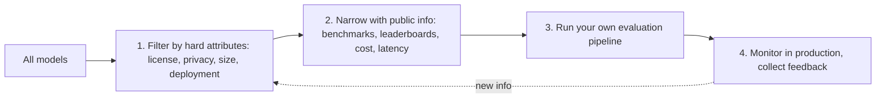

# Model selection, build vs buy and public benchmarks

> **Before this lesson:** read [Evaluation criteria](#/lesson/ai-eng/aie-eval-criteria), which explains hard requirements, latency, cost and benchmarks. Perplexity is used once, for spotting leaked test data; it is taught in [Language modeling metrics](#/lesson/ai-eng/aie-lm-metrics). The demos need only basic Python and a little NumPy, explained line by line.

## In plain words

There are thousands of foundation models, and new ones arrive every week. This lesson is about choosing one. There is no single "best model"; there is the **best model for your application**, given your requirements, your rules and your budget. You will learn a four-step selection process, the big decision between paying for a hosted model and running one yourself, how to read public leaderboards without being fooled, and why test questions leaking into training data (**data contamination**) makes some published scores untrustworthy.

An everyday picture: buying a car. First you rule out anything you cannot accept, whatever its reviews (too wide for your garage, over budget, petrol when you need electric). Then you read reviews and comparison tables to make a shortlist. Then you test-drive the shortlist on *your* roads. After buying, you keep an eye on how it behaves. And you know that some glowing reviews were written by people who tested the car only on a track it had been tuned for. Model selection works the same way, step for step.

Why this matters for a job: "Should we use a commercial API or host an open model?" is one of the most common design questions in AI engineering interviews and in real planning meetings. So is "this model is top of the leaderboard, why not use it?". After this lesson you can answer both with a structured argument instead of a hunch.

## 1. Hard and soft attributes

An **attribute** is any property of a model you might care about. Huyen splits them in two:

- **Hard attributes** are impossible or impractical for you to change. Some come from the model's maker: its **license** (the legal terms of use), its training data, its size. Others come from your own policies: privacy rules, how much control you need.
- **Soft attributes** can be improved with work: accuracy, toxicity, factual consistency, and so on.

Where the line falls depends on your setup. Latency is soft if you host the model yourself and can optimise it, and hard if someone else hosts it. Judging how far a soft attribute can be pushed takes experience. Huyen has seen a model stuck at about 20% accuracy jump to 70% after the task was split into two steps, and she has also seen models stay unusable after weeks of tweaking.

## 2. The model selection workflow



1. **Filter out models whose hard attributes don't work for you.** This depends on policy: whether you may use a commercial API or must self-host, which licenses are acceptable, and **data residency** (rules about which country your data may be stored or processed in).
2. **Use public information** (benchmarks, leaderboards, prices) to make a shortlist, balancing quality, latency and cost.
3. **Run experiments with your own evaluation pipeline** (the next lesson) to find the best candidate on your data.
4. **Monitor in production**, meaning in live use by real users, to catch failures and gather feedback (Module 10).

The steps loop. You might start out wanting to self-host, find that no open model reaches the quality you need, and switch to an API, or the other way round.

## 3. Model build versus buy

For most teams, "build" no longer means training a model from scratch, which costs millions. It means **self-hosting an open model**: downloading its weights and running it on hardware you control. "Buy" means paying per request for access to a **commercial model API** (an **API**, application programming interface, is a way for your code to send a request to someone else's service over the internet). A third route sits between them: finetune and serve open models through a hosting company.

### Open source, open weight, open model

A model's **weights** (also called parameters) are the millions or billions of learned numbers that make up the model; whoever has them can run it. "Open source" is a contested term for models, so Huyen uses two more precise ones:

- **Open weight**: the weights are public, but the training data is not. Most models called "open source" are only open weight.
- **Open model**: the weights *and* the training data are public. Open data lets others retrain the model, audit it (was any data obtained illegally?) and understand its behaviour.

**Licenses** vary widely: Meta's Llama models have their own community licenses, BigCode's models use OpenRAIL-M, and Gemma and Mistral-7B use Apache 2.0, a permissive license. Two questions to ask of any license:

- Does it allow **commercial use**, and with what conditions? Llama 2 and Llama 3 required a separate license for products with more than 700 million monthly active users.
- May you use its **outputs to train other models**? Many licenses forbid it. That matters for **distillation**, training a smaller model to imitate a bigger one's outputs (Module 8). Mistral's license originally restricted this and later relaxed it.

### Model APIs versus self-hosting

Huyen compares the two options along several axes:

| Axis | Model APIs | Self-hosting |
|---|---|---|
| **Data privacy** | data leaves your organisation (Samsung banned ChatGPT after employees pasted secrets into it) | data stays in-house |
| **Data lineage / copyright** | provider may offer *indemnity*, a promise to cover legal costs | fewer checks, so the legal risk is yours |
| **Performance** | the best models are usually closed | the best open models lag somewhat behind |
| **Functionality** | scaling, function calling and structured outputs built in; few logprobs | full access to logprobs and intermediate outputs (useful for classification, evaluation and interpretability); you build features yourself |
| **Cost** | per-token API price | people, time and engineering to optimise, host and maintain |
| **Finetuning** | only what the provider allows | finetune, quantize and optimise freely (license permitting) |
| **Control and transparency** | rate limits, unannounced model changes, risk of losing access | you can freeze a version and inspect changes; you maintain the service |
| **Edge** | needs an internet connection | can run on the user's device |

A few of those words need unpacking. **Data lineage** is the record of where training data came from. **Logprobs** (from the sampling lesson) are the model's log-probabilities for each token. **Interpretability** is the study of *why* a model produced an output, which needs access to its internals. **Quantizing** a model stores its numbers with fewer bits to save memory (Module 7). A **rate limit** caps how many requests you may send per minute. **Edge** deployment means running on the user's own phone, laptop or device rather than in a data centre.

More points from Huyen's discussion:

- **API cost versus engineering cost.** APIs are pay-as-you-go: you pay only for what you use. Self-hosting has large **fixed costs** (engineers and GPUs, paid whether or not anyone uses the service) but a lower **marginal cost**, the extra cost of one more request. So the cheaper option changes with volume, and you should re-evaluate as you grow.
- **Performance gap.** Huyen expects the very strongest models to stay closed, because their makers have little reason to give away their best work. Open models keep narrowing the gap, though.
- **Control.** Providers change models behind their APIs, sometimes without announcement, and users regularly feel that "GPT-4 got worse". Chen and colleagues (2023) measured significant behaviour changes in GPT-3.5 and GPT-4 between March and June 2023. Your evaluation pipeline is your defence: rerun it whenever a model version changes, and **pin** a specific model version where the provider allows.

The demo below makes the fixed-versus-marginal trade-off concrete with invented but plausible numbers. It is a sketch, not a quote: real prices, GPU throughput and staffing vary enormously.

```python-run
import math

API_PRICE = 10.0                   # $ per 1M tokens (input and output blended), illustrative
GPU_HOUR = 2.50                    # $ per GPU per hour, illustrative
GPU_TOKENS_PER_SEC = 1500          # tokens one GPU can serve per second at good utilisation
ENGINEERS = 15000.0                # $ per month of engineering time to run the service
SECONDS_PER_MONTH = 30 * 24 * 3600

def api_cost(tokens):
    return tokens / 1e6 * API_PRICE

def self_host_cost(tokens):
    capacity = GPU_TOKENS_PER_SEC * SECONDS_PER_MONTH          # tokens per GPU per month
    gpus = max(2, math.ceil(tokens / capacity))                # at least 2 for redundancy
    return gpus * GPU_HOUR * 24 * 30 + ENGINEERS, gpus

print(f"{'tokens/month':>14} {'API $':>10} {'self-host $':>12} {'GPUs':>5}  cheaper")
for tokens in [1e8, 1e9, 2e9, 5e9, 2e10, 1e11]:
    a = api_cost(tokens)
    s, g = self_host_cost(tokens)
    print(f"{tokens:14,.0f} {a:10,.0f} {s:12,.0f} {g:5d}  {'API' if a < s else 'self-host'}")
```

**Reading this Python line by line**

- The capitalised names at the top are **constants**: assumptions written once so you can change them and rerun. `1e6` is Python's way of writing one million (1 × 10⁶).
- `api_cost(tokens)` is pure marginal cost: the number of millions of tokens times the price per million.
- `self_host_cost(tokens)` first works out how many tokens one GPU can serve in a month (tokens per second times seconds per month, about 3.9 billion). `math.ceil` rounds up, because you cannot rent 2.3 GPUs, and `max(2, ...)` keeps at least two so one can fail without an outage. The cost is GPU-hours for a 30-day month plus the fixed engineering cost. The function returns two values, the cost and the GPU count.
- In the `print` lines, `:>14` right-aligns a value in 14 characters and `:,.0f` adds thousands separators with no decimals.
- Output: at 100 million and 1 billion tokens a month the API costs \$1,000 and \$10,000 against \$18,600 to self-host, so the API wins. At 2 billion the lines cross (\$20,000 versus \$18,600). At 100 billion tokens the API would cost \$1,000,000 while self-hosting on 26 GPUs costs about \$61,800. That is why many companies start on an API and later move high-volume, well-understood workloads to their own servers, *if* an open model is good enough on their evaluation set.

> [!INTERVIEW]
> **"Should we use GPT-class APIs or host Llama ourselves?"** Walk through the axes. Privacy and compliance (may data leave?), the quality gap on *your* evaluation set, needed functionality (logprobs, structured output, function calling), expected volume and the total cost of engineering plus GPUs against API spend, finetuning needs, control and versioning risk, and edge or on-device requirements. A common answer: start with APIs to validate the product, then move high-volume, well-understood workloads to a self-hosted, finetuned smaller model once the evaluation pipeline shows it is good enough.

## 4. Navigating public benchmarks

There are thousands of **benchmarks**; Google's BIG-bench alone has 214 tasks. An **evaluation harness** is a tool that runs many benchmarks against a model with one command: EleutherAI's **lm-evaluation-harness** supports more than 400 benchmarks, and OpenAI's **evals** is another.

### Public leaderboards

A **leaderboard** combines scores on a chosen set of benchmarks into one ranking of models. Leaderboards help, but they have real limits:

- **Compute limits coverage.** Running benchmarks costs money, so leaderboards leave some out. HELM Lite skipped MS MARCO because it is expensive; Hugging Face skipped HumanEval because it needs many generations per problem.
- **Benchmark choice is opaque and differs between leaderboards.** In late 2023 the Hugging Face Open LLM Leaderboard averaged **six** benchmarks: ARC-C (grade-school science questions), MMLU (multiple-choice questions on 57 subjects), HellaSwag (choosing the most sensible continuation of a scene), TruthfulQA (avoiding popular misconceptions), WinoGrande (working out what a pronoun refers to) and GSM-8K (grade-school maths word problems). Stanford's HELM used **ten**, and only two overlapped (MMLU and GSM-8K). HELM's others were MATH, LegalBench, MedQA, WMT 2014 (translation), NarrativeQA, OpenBookQA and two Natural Questions settings.
- **Benchmarks are correlated.** The **Pearson correlation** is a number from −1 to 1 that measures how closely two sets of scores rise and fall together: 1 means a model's rank on one predicts its rank on the other perfectly. Huyen shows that MMLU, ARC-C and WinoGrande correlate strongly (about 0.87 to 0.90), so averaging them counts one underlying skill three times. TruthfulQA correlates only moderately with the others.
- **Aggregation is naive.** A plain average treats 80% on TruthfulQA the same as 80% on GSM-8K, and an easy point the same as a hard one. HELM used the **mean win rate** instead: for each benchmark, the fraction of other models a model beats, averaged over benchmarks.
- **Saturation.** When models score near the top of a benchmark it stops separating them. In 2024 Hugging Face replaced its benchmarks with harder ones (MMLU-PRO, GPQA, MuSR, MATH level 5, IFEval and BBH) for this reason.

The demo shows how the choice of aggregation can change a ranking.

```python-run
import numpy as np
# Why aggregation choices matter: average score vs mean win rate can rank differently.
models = ["A", "B", "C"]
scores = np.array([  # rows: models, cols: benchmarks
    [0.90, 0.40, 0.70],
    [0.70, 0.60, 0.65],
    [0.60, 0.62, 0.66],
])
avg = scores.mean(axis=1)
print("average score:", {m: round(float(v), 3) for m, v in zip(models, avg)})
wins = np.zeros(3)
for b in range(scores.shape[1]):
    for i in range(3):
        wins[i] += sum(scores[i, b] > scores[j, b] for j in range(3) if j != i) / 2
win_rate = wins / scores.shape[1]
print("mean win rate:", {m: round(float(v), 3) for m, v in zip(models, win_rate)})
```

**Reading this Python line by line**

- `scores` is a 3-by-3 NumPy array: each row is a model, each column a benchmark. `scores[i, b]` is model `i` on benchmark `b`.
- `scores.mean(axis=1)` averages *across* each row (axis 1 is the column direction), giving one average per model. The dictionary comprehension pairs names with rounded values; `float(...)` turns NumPy numbers into plain ones so they print neatly.
- `scores.shape[1]` is the number of columns (3 benchmarks). For each benchmark and each model, the generator inside `sum(...)` produces `True` for every other model it beats; dividing by 2 (the number of opponents) gives that benchmark's win rate.
- Output: by average, A (0.667) beats B (0.65) beats C (0.627). By mean win rate, A (0.667) beats C (0.5) beats B (0.333). B and C swap places. Neither method is "correct"; the point is that a leaderboard's ranking is partly a product of its aggregation rule.

### Building your own leaderboard from public benchmarks

1. **Pick benchmarks for the capabilities you need.** A coding agent needs code benchmarks; a writing assistant needs creative-writing ones. Prefer recent benchmarks, since old ones saturate.
2. **Check that each benchmark is reliable.** Anyone can publish a benchmark, and some do not measure what they claim.
3. **Find or compute the scores.** If a model has no public score on a benchmark you need, run it yourself, and budget for that. Huyen estimates that evaluating one model on HELM's full suite can cost thousands of dollars in API calls.
4. **Aggregate thoughtfully.** Weight benchmarks by how much they matter to you, and account for correlated ones.

## 5. Data contamination

**Data contamination**, also called data leakage or training on the test set, happens when a model was trained on the very data it is later tested on. It can then remember answers instead of working them out, and score higher than its real ability. Rylan Schaeffer made the point with a satirical paper, "Pretraining on the Test Set Is All You Need": a model with only one million parameters, trained purely on benchmark data, scored near-perfectly and beat far larger models.

How contamination happens:

- **By accident, through web scraping.** Models are trained on huge amounts of text **scraped** (automatically downloaded) from the internet up to a **training cutoff** date. Benchmarks published online before that date were probably swept in. This is one reason benchmarks saturate so fast.
- **Indirectly.** The training data and a benchmark come from the same source, such as the same maths textbooks.
- **On purpose, for good reasons.** A developer uses benchmarks to choose the best version of a model, then trains that version on the benchmark data before release because it is high-quality data. Users can no longer evaluate that model fairly on that benchmark.

### Detecting and handling contamination

- **n-gram overlap.** An *n-gram* is a run of $n$ consecutive tokens. If a sequence of, say, 13 tokens from a test example also appears in the training data, the example is marked *dirty*. This is accurate but expensive, because you must search the entire training set, and impossible if you cannot see the training data.
- **Perplexity.** Perplexity measures how surprised a model is by a text. Unusually low perplexity on test data suggests the model has seen it before. This is less accurate but cheap, and needs only the model.

Good practice for model developers is to remove the benchmarks they care about from the training data and, when reporting results, to give scores on the **clean subset** (the examples with no overlap) as well as the whole benchmark; the GPT-3 paper did this. As a model user, prefer benchmarks created after a model's cutoff, private **held-out** sets (data kept back and never published), and your own evaluation data, which by construction is not on the internet.

```python-run
# 13-gram contamination check (word-level for illustration).
def ngrams(tokens, n): return {tuple(tokens[i:i+n]) for i in range(len(tokens)-n+1)}
train = ("the quick brown fox jumps over the lazy dog while the cat sleeps on the warm "
         "windowsill and dreams of mice running through the tall grass at dawn").split()
train_grams = ngrams(train, 13)
evals = [
    "the quick brown fox jumps over the lazy dog while the cat sleeps on the warm windowsill",
    "a completely different question about photosynthesis in plants and how leaves capture light energy",
]
for e in evals:
    dirty = any(g in train_grams for g in ngrams(e.split(), 13))
    print("DIRTY" if dirty else "clean", "|", e[:60], "...")
```

**Reading this Python line by line**

- `ngrams(tokens, n)` slides a window of length `n` along the token list: `tokens[i:i+n]` is the slice starting at position `i`. Each slice becomes a `tuple` (lists cannot be stored in a set, tuples can), and the curly braces build a **set** of them, which makes "is this n-gram present?" a fast lookup.
- `train` is a tiny stand-in for training data, split into words; `train_grams` holds all its 13-word sequences.
- For each test example, `any(...)` is `True` as soon as one of its 13-grams is found in the training set.
- `e[:60]` prints only the first 60 characters.
- Output: the first example, copied from the training text, prints `DIRTY`; the photosynthesis question prints `clean`. Real checks work on tokens rather than words and on billions of documents, using hashing to keep the lookup affordable.

> [!WARNING]
> Public benchmarks are for **narrowing down** candidates, not for picking the winner. A model can top a leaderboard because of contamination, generous prompting setups (for example CoT@32, which samples 32 reasoned answers, compared with 5-shot prompting) or skills you do not need. Your own evaluation pipeline makes the final call.

## Pitfalls

- Choosing by overall leaderboard rank instead of the capabilities your application needs.
- Assuming "open source" means you can do anything commercially. Read the license, including any rules on using outputs.
- Assuming an API model never changes. Pin versions where possible and re-evaluate on updates.
- Averaging correlated benchmarks and counting one skill several times.
- Comparing API and self-hosting on GPU price alone, forgetting the engineering time that self-hosting needs.

## Summary

- Separate **hard attributes** (license, privacy, deployment) from **soft attributes** (accuracy, toxicity). Filter on hard attributes first.
- Workflow: filter on hard attributes, shortlist with public data, evaluate privately, monitor in production, and loop.
- **Build versus buy** today means APIs versus self-hosting open-weight models, weighed on privacy, lineage, performance, functionality, cost, finetuning, control and edge. Fixed versus marginal cost makes the answer depend on volume.
- **Leaderboards** use small, differing, correlated benchmark sets with naive aggregation, and they saturate. Build a custom leaderboard for your needs.
- **Data contamination** inflates scores. Detect it with n-gram overlap or perplexity, report clean-subset results, and trust your own held-out data.

## Glossary

- **Hard / soft attribute**: a model property you cannot change / one you can improve with work.
- **License**: the legal terms for using a model.
- **Data residency**: rules on where data may be stored or processed.
- **Weights**: the learned numbers that make up a model.
- **Open weight / open model**: weights public / weights and training data public.
- **Self-hosting**: running a model on hardware you control.
- **Model API**: a hosted model you call over the internet and pay per use.
- **Distillation**: training a smaller model to imitate a larger one's outputs.
- **Data lineage**: the record of where data came from.
- **Indemnity**: a provider's promise to cover certain legal costs.
- **Interpretability**: studying why a model produced its output.
- **Rate limit**: a cap on requests per unit of time.
- **Edge deployment**: running a model on the user's own device.
- **Fixed / marginal cost**: cost paid regardless of usage / cost of one more unit of usage.
- **Pinning a version**: requesting a specific, unchanging model version.
- **Evaluation harness**: a tool that runs many benchmarks with one command.
- **Leaderboard**: a ranking of models built from benchmark scores.
- **Pearson correlation**: a −1 to 1 measure of how closely two sets of numbers move together.
- **Mean win rate**: the average share of other models a model beats, across benchmarks.
- **Saturation**: when top models all score near the maximum, so a benchmark no longer separates them.
- **Data contamination**: test data that appeared in training data.
- **Training cutoff**: the date after which no data was collected for training.
- **n-gram overlap check**: marking a test example dirty if a long token run also appears in training data.
- **Clean subset / held-out set**: test examples with no overlap / data kept back from publication and training.

```quiz
[
  {"q": "Latency is a HARD attribute for you when…", "options": ["You self-host and can optimise the model", "You use a model hosted by someone else", "The model is open weight", "You use quantization"], "answer": 1, "explain": "If someone else hosts the model, you cannot change its latency much."},
  {"q": "An 'open weight' model is one where…", "options": ["Weights and training data are public", "Only weights are public, not the training data", "Weights are encrypted", "It's free for any commercial use"], "answer": 1, "explain": "Huyen reserves 'open model' for models whose training data is also public. Most 'open source' models are open weight only."},
  {"q": "Which is an advantage of self-hosting over model APIs, according to Huyen?", "options": ["Always the best performance", "No engineering cost", "Access to logprobs and intermediate outputs, plus freedom to finetune and quantize", "Built-in function calling"], "answer": 2, "explain": "Self-hosting gives full access to the model, but you pay in engineering effort, and the best models are usually closed."},
  {"q": "Why is naive averaging of MMLU, ARC-C and WinoGrande problematic?", "options": ["They use different tokenizers", "They're strongly correlated, so averaging over-weights one underlying capability", "They are all saturated at 0%", "They measure latency"], "answer": 1, "explain": "Highly correlated benchmarks count the same skill several times when averaged."},
  {"q": "A 13-token sequence from an eval sample appears verbatim in training data. This sample is…", "options": ["Clean", "Dirty (contaminated)", "Synthetic", "Out of distribution"], "answer": 1, "explain": "n-gram overlap is a standard contamination heuristic. A 13-gram match marks the sample as dirty."},
  {"q": "Which contamination detection method needs NO access to the training data?", "options": ["n-gram overlap", "Perplexity-based detection", "Exact deduplication", "Data lineage audit"], "answer": 1, "explain": "Perplexity only needs the model, but it is less accurate than n-gram overlap."},
  {"q": "Why might a developer deliberately train on benchmark data before release?", "options": ["To cheat only", "High-quality benchmark data can improve the model for users, even though it contaminates that benchmark", "Licenses require it", "To reduce model size"], "answer": 1, "explain": "Huyen notes contamination can be intentional for good reasons. Users then can't use that benchmark to evaluate the model."},
  {"q": "What is the right role of public leaderboards in model selection?", "options": ["Pick the #1 model", "Narrow down candidates before running your own evaluation", "Ignore them entirely", "Replace production monitoring"], "answer": 1, "explain": "They help shortlist, but contamination, prompt differences and mismatched capabilities mean your own evaluation decides."}
]
```

> **Source:** Huyen, *AI Engineering*, ch. 4 ("Model Selection": workflow, build versus buy, navigating public benchmarks, data contamination).
