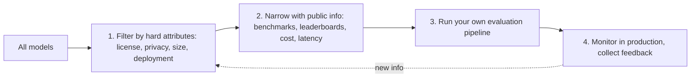

# Model selection, build vs buy and public benchmarks

There are thousands of foundation models, and new ones appear weekly. You will not find the "best model". You are looking for the **best model for your application**, which depends on your criteria, constraints and budget. This lesson follows Huyen's model selection workflow, the **build vs buy** (API vs self-host) decision, how to read public benchmarks and leaderboards, and why **data contamination** means you cannot fully trust them.

## 1. Hard and soft attributes

Huyen separates model attributes into two kinds:

- **Hard attributes** are impossible or impractical for you to change. Some come from model providers (license, training data, model size), and some from your own policies (privacy, control).
- **Soft attributes** can be improved: accuracy, toxicity, factual consistency, and so on.

The line depends on your setup. Latency is soft if you host the model and can optimize it, and hard if someone else hosts it. Estimating how much a soft attribute can improve takes judgment. Huyen has seen a model stuck around 20% accuracy jump to 70% after decomposing the task into two steps, and she has also seen models stay unusable after weeks of tweaking.

## 2. The model selection workflow



1. **Filter out models whose hard attributes don't work for you.** This depends on policy: commercial API vs self-hosting, licenses, data residency.
2. **Use public information** (benchmarks, leaderboards, prices) to shortlist the most promising candidates, balancing quality, latency and cost.
3. **Run experiments with your own evaluation pipeline** (next lesson) to find the best candidate.
4. **Monitor in production** to detect failures and collect feedback (Module 10).

The steps are iterative. You might start wanting to self-host, discover that open models cannot reach the required quality, and switch to an API.

## 3. Model build versus buy

For most teams "build" no longer means training from scratch. It means **self-hosting an open model** versus **buying access to a commercial API**. A third option is to finetune and serve open models through a hosting provider.

### Open source, open weight, open model

"Open source" is contested. Huyen's terminology:

- **Open weight**: weights are public, training data is not. Most "open source" models are only open weight.
- **Open model**: weights *and* training data are public. Open data allows retraining, auditing (was data illegally acquired?) and better understanding.

**Licenses** vary widely: Llama has its own community licenses, BigCode uses OpenRAIL-M, and Gemma and Mistral-7B use Apache 2.0. Questions to ask:

- Does it allow **commercial use**? Are there conditions? Llama 2 and 3 required a separate license for products with more than 700 million monthly active users.
- Can you use its **outputs to train other models**? Many licenses forbid it, which matters for distillation (Module 8). Mistral's license originally restricted this and later relaxed it.

### Model APIs vs self-hosting

Huyen compares the two across seven axes:

| Axis | Model APIs | Self-hosting |
|---|---|---|
| **Data privacy** | data leaves your org (Samsung banned ChatGPT after employees leaked secrets) | data stays in-house |
| **Data lineage / copyright** | provider may offer indemnity | fewer checks, so lineage risk is yours |
| **Performance** | best models are usually closed | best open models lag somewhat behind |
| **Functionality** | scaling, function calling, structured outputs built in. Fewer logprobs | full access to logprobs and intermediate outputs (useful for classification, evaluation, interpretability). Must build features yourself |
| **Cost** | per-token API price | talent, time, engineering to optimize, host and maintain |
| **Finetuning** | only what the provider allows | finetune, quantize and optimize freely (license permitting) |
| **Control and transparency** | rate limits, unannounced model changes, risk of losing access | can freeze a version, inspect changes. You maintain the API |
| **Edge** | needs internet | can run on device |

Other points from the book:

- **API cost vs engineering cost.** APIs are pay-as-you-go. Self-hosting has big fixed costs (people and GPUs) but lower marginal cost at scale. Re-evaluate as you grow.
- **Performance gap.** Huyen argues the strongest models will likely stay closed, because developers have little incentive to give away their best model. Open models keep closing the gap, though.
- **Control.** Model providers change models behind APIs, sometimes silently. People constantly feel "GPT-4 got worse". Chen et al. (2023) measured significant changes in GPT-3.5 and GPT-4 between March and June 2023. Your evaluation pipeline is your defence: rerun it whenever a model version changes.

> [!INTERVIEW]
> **"Should we use GPT-class APIs or host Llama ourselves?"** Walk through the seven axes. Privacy and compliance (can data leave?), the quality gap on *your* eval set, needed functionality (logprobs, structured output, function calling), expected scale and the total cost of engineering plus GPUs vs API spend, finetuning needs, control and versioning risk, and edge or on-device requirements. A common answer is to start with APIs to validate the product, then move high-volume, well-understood workloads to a self-hosted, finetuned smaller model once the eval pipeline proves it's good enough.

## 4. Navigating public benchmarks

There are thousands of benchmarks. Google's BIG-bench alone has 214 tasks. Evaluation harnesses such as EleutherAI's **lm-evaluation-harness** (400+ benchmarks) and OpenAI's **evals** let you run many of them.

### Public leaderboards

Leaderboards aggregate a subset of benchmarks into a ranking. They are helpful but limited:

- **Compute limits coverage.** HELM Lite left out MS MARCO because it is expensive. Hugging Face skipped HumanEval because it needs many generations.
- **Benchmark choice is opaque and differs.** In late 2023 the Hugging Face Open LLM Leaderboard averaged **six** benchmarks: ARC-C (grade-school science), MMLU (57 subjects), HellaSwag (commonsense completion), TruthfulQA (truthfulness), WinoGrande (pronoun resolution) and GSM-8K (grade-school math). Stanford's HELM used **ten**, and only two overlapped (MMLU and GSM-8K). The others were MATH, LegalBench, MedQA, WMT 2014, NarrativeQA, OpenBookQA and two Natural Questions settings.
- **Benchmarks are correlated.** Huyen shows that MMLU, ARC-C and WinoGrande are strongly correlated (Pearson about 0.87–0.90), so averaging them over-weights one underlying skill. TruthfulQA correlates only moderately with the others.
- **Aggregation is naive.** Averaging treats 80% on TruthfulQA the same as 80% on GSM-8K, and an "easy" point the same as a "hard" one. HELM used **mean win rate** (the fraction of times a model beats others across scenarios) instead.
- **Saturation.** In 2024, Hugging Face replaced its benchmarks with harder ones (MMLU-PRO, GPQA, MuSR, MATH lvl 5, IFEval, BBH) because models had saturated the old ones.

```python-run
import numpy as np
# Why aggregation choices matter: average score vs mean win rate can rank differently.
models = ["A", "B", "C"]
scores = np.array([  # rows: models, cols: benchmarks
    [0.90, 0.40, 0.70],
    [0.70, 0.60, 0.65],
    [0.60, 0.62, 0.66],
])
print("average score:", dict(zip(models, scores.mean(axis=1).round(3))))
wins = np.zeros(3)
for b in range(scores.shape[1]):
    for i in range(3):
        wins[i] += sum(scores[i, b] > scores[j, b] for j in range(3) if j != i) / 2
print("mean win rate:", dict(zip(models, (wins / scores.shape[1]).round(3))))
```

### Building your own leaderboard from public benchmarks

1. **Pick benchmarks for the capabilities you need.** Coding agents need code benchmarks, and writing assistants need creative writing benchmarks. Prefer recent ones, since old ones saturate.
2. **Check benchmark reliability.** Anyone can publish a benchmark, and some do not measure what they claim.
3. **Find or compute scores.** If a model has no public score on your benchmark, run it yourself, and budget for it. Huyen estimates that evaluating a model on HELM's full suite can cost thousands of dollars in API calls.
4. **Aggregate thoughtfully.** Weight by importance and handle correlation.

## 5. Data contamination

**Data contamination** (also called data leakage or training on the test set) happens when a model was trained on the data it is evaluated on. It can then memorize answers and score higher than it should. Rylan Schaeffer's satirical paper "Pretraining on the Test Set Is All You Need" trained a 1M-parameter model only on benchmark data. It scored near-perfectly and beat much larger models.

How it happens:

- **Unintentionally, through web scraping.** Benchmarks published before a model's training cutoff were probably scraped. This is one reason benchmarks saturate so fast.
- **Indirectly.** Training data and a benchmark come from the same source, such as the same math textbooks.
- **Intentionally, for good reasons.** A developer picks the best model using benchmarks, then trains it on the benchmark data before release because the data is high quality. Users then cannot evaluate that model on that benchmark.

### Detecting and handling contamination

- **n-gram overlap.** If a sequence of, for example, 13 tokens from an evaluation sample also appears in the training data, the sample is considered *dirty*. This is accurate but expensive (you compare against the whole training set) and impossible without access to the training data.
- **Perplexity.** Unusually low perplexity on evaluation data suggests the model has seen it. This is less accurate but cheap.

Good practice for model developers is to remove benchmarks they care about from training data, and when reporting, to give results on the **clean subset** as well as the whole benchmark. GPT-3's paper did this. As a consumer, prefer benchmarks created after a model's cutoff, private held-out sets, and your own evaluation data, which by construction is not on the internet.

```python-run
# 13-gram contamination check (word-level for illustration).
def ngrams(tokens, n): return {tuple(tokens[i:i+n]) for i in range(len(tokens)-n+1)}
train = ("the quick brown fox jumps over the lazy dog while the cat sleeps on the warm "
         "windowsill and dreams of mice running through the tall grass at dawn").split()
train_grams = ngrams(train, 13)
evals = [
    "the quick brown fox jumps over the lazy dog while the cat sleeps on the warm windowsill",
    "a completely different question about photosynthesis in plants and how leaves capture light energy",
]
for e in evals:
    dirty = any(g in train_grams for g in ngrams(e.split(), 13))
    print("DIRTY" if dirty else "clean", "|", e[:60], "...")
```

> [!WARNING]
> Public benchmarks are for **narrowing down** candidates, not for picking the winner. A model can top a leaderboard because of contamination, prompt tricks (CoT@32 vs 5-shot) or skills you don't need. Your own evaluation pipeline makes the final call.

## Pitfalls

- Choosing by overall leaderboard rank instead of the capabilities your application needs.
- Assuming "open source" means you can do anything commercially. Read the license, including output-use restrictions.
- Assuming an API model is frozen. Pin versions where possible and re-evaluate on updates.
- Averaging correlated benchmarks and double-counting a skill.

## Summary

- Separate **hard attributes** (license, privacy, deployment) from **soft attributes** (accuracy, toxicity). Filter on hard attributes first.
- Workflow: filter on hard attributes, narrow with public data, evaluate privately, monitor in production. Iterate.
- **Build vs buy** is now APIs vs self-hosting open-weight models: data privacy, lineage, performance, functionality, cost, finetuning, control and edge.
- **Leaderboards** use small, differing, correlated benchmark sets and naive aggregation, and they saturate. Build a custom leaderboard for your needs.
- **Data contamination** inflates scores. Detect it with n-gram overlap or perplexity, report clean-subset results, and trust your own held-out data.

```quiz
[
  {"q": "Latency is a HARD attribute for you when…", "options": ["You self-host and can optimize the model", "You use a model hosted by someone else", "The model is open weight", "You use quantization"], "answer": 1, "explain": "If someone else hosts the model, you can't change its latency much."},
  {"q": "An 'open weight' model is one where…", "options": ["Weights and training data are public", "Only weights are public, not the training data", "Weights are encrypted", "It's free for any commercial use"], "answer": 1, "explain": "Huyen reserves 'open model' for models whose training data is also public. Most 'open source' models are open weight only."},
  {"q": "Which is an advantage of self-hosting over model APIs, according to Huyen?", "options": ["Always the best performance", "No engineering cost", "Access to logprobs and intermediate outputs, plus freedom to finetune and quantize", "Built-in function calling"], "answer": 2, "explain": "Self-hosting gives full access to the model, but you pay in engineering effort, and the best models are usually closed."},
  {"q": "Why is naive averaging of MMLU, ARC-C and WinoGrande problematic?", "options": ["They use different tokenizers", "They're strongly correlated, so averaging over-weights one underlying capability", "They are all saturated at 0%", "They measure latency"], "answer": 1, "explain": "Highly correlated benchmarks double-count the same skill when averaged."},
  {"q": "A 13-token sequence from an eval sample appears verbatim in training data. This sample is…", "options": ["Clean", "Dirty (contaminated)", "Synthetic", "Out of distribution"], "answer": 1, "explain": "n-gram overlap is a standard contamination heuristic. A 13-gram match marks the sample as dirty."},
  {"q": "Which contamination detection method needs NO access to the training data?", "options": ["n-gram overlap", "Perplexity-based detection", "Exact deduplication", "Data lineage audit"], "answer": 1, "explain": "Perplexity only needs the model, but it is less accurate than n-gram overlap."},
  {"q": "Why might a developer deliberately train on benchmark data before release?", "options": ["To cheat only", "High-quality benchmark data can improve the model for users, even though it contaminates that benchmark", "Licenses require it", "To reduce model size"], "answer": 1, "explain": "Huyen notes contamination can be intentional for good reasons. Users then can't use that benchmark to evaluate the model."},
  {"q": "What is the right role of public leaderboards in model selection?", "options": ["Pick the #1 model", "Narrow down candidates before running your own evaluation", "Ignore them entirely", "Replace production monitoring"], "answer": 1, "explain": "They help shortlist, but contamination, prompt differences and mismatched capabilities mean your own eval decides."}
]
```

> **Source:** Huyen, *AI Engineering*, ch. 4 ("Model Selection": workflow, build versus buy, navigating public benchmarks, data contamination).
