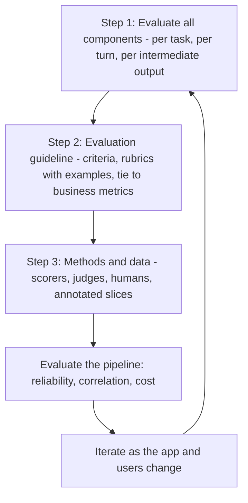

# Designing your evaluation pipeline

> **Before this lesson:** read [Evaluation criteria](#/lesson/ai-eng/aie-eval-criteria) (what to measure) and [Model selection, build vs buy and public benchmarks](#/lesson/ai-eng/aie-model-selection) (why public scores are not enough). AI judges and rubrics come from [AI as a judge and comparative evaluation](#/lesson/ai-eng/aie-judge-comparative). The statistics here (percentages, averages, resampling) are explained from scratch.

## In plain words

An **evaluation pipeline** is the set of tests, data and scoring tools you run every time you change your AI application, so you know whether the change made things better or worse. Public benchmarks help you shortlist models; your own pipeline decides what ships, catches **regressions** (something that used to work and now does not), and tells you whether a new prompt, retriever or model really is an improvement.

An everyday picture: a restaurant kitchen's quality checks. The head chef does not only taste the finished plate. She checks the stock before it goes into the sauce, the sauce before it goes on the plate, and the plate before it leaves the pass, because if the plate is wrong she needs to know *which step* failed. She writes down what "good" means for each dish so every cook judges the same way, keeps a list of dishes that went wrong before, and samples enough plates each evening to trust her impression. That is this lesson in one paragraph.

Why this matters for a job: Huyen's message is that a reliable evaluation pipeline is what separates teams that improve with confidence from teams that guess. "Walk me through building an evaluation set for a new LLM feature" is a classic interview question, and the answer has a recognised shape: evaluate every component, write a clear guideline, choose methods and data, then check that the pipeline itself is trustworthy.

Huyen's three steps are **evaluate all components**, **create an evaluation guideline**, and **define evaluation methods and data**. After those, you evaluate the pipeline itself and keep iterating.



## Step 1. Evaluate every component

Real applications are built from several **components** (separate parts, such as a text extractor, a retriever and a model call), and conversations often run over several **turns** (one user message plus the system's reply). Score the **final output**, and also score every **intermediate output**, the result a component hands to the next one. If you only score the end, a failure tells you *that* something broke but not *where*.

Huyen's example: extracting a person's current employer from a résumé PDF in two steps.

1. Extract all the text from the PDF. Score this step by how similar the extracted text is to a hand-checked transcription of the same PDF.
2. Find the current employer in that text. Score this step with accuracy, using correctly extracted text as input so that step 1's errors do not leak into step 2's score.

If the final answer is wrong, these per-component scores tell you which step to fix. Here is the idea in a few lines, with invented scores for five résumés:

```python
# (text similarity of step 1, was step 2 right given correct text?, final answer right?)
results = [(0.98, True, True), (0.41, True, False), (0.97, False, False),
           (0.95, True, True), (0.38, True, False)]
bad_extraction = sum(1 for sim, s2, final in results if not final and sim < 0.9)
bad_reasoning  = sum(1 for sim, s2, final in results if not final and sim >= 0.9)
# -> 2 failures come from PDF extraction, 1 from the employer-finding step
```

Two of the three failures had poor text extraction (similarity 0.41 and 0.38), so improving the PDF reader is the priority, not rewriting the prompt.

### Per turn versus per task

- **Turn-based evaluation** scores the quality of each individual reply. One turn may include several internal steps.
- **Task-based evaluation** asks whether the system **completed the user's task**, and how many turns it needed. Fixing a bug in 2 turns is very different from fixing it in 20.

Users care about getting their task done, so task-based evaluation matters more. It is also harder, because task boundaries in a conversation are fuzzy: is the user's new question a follow-up or a fresh task? Huyen mentions the **twenty_questions** benchmark from BIG-bench, a game in which one model thinks of a concept and another asks yes/no questions to guess it. Success is guessing the concept; efficiency is the number of questions it took.

## Step 2. Create an evaluation guideline

An **evaluation guideline** is the written document that says what the application should do, how each quality will be scored, and what each score looks like. Huyen calls it the most important step: an ambiguous guideline produces ambiguous scores, and ambiguous scores mislead.

### Define the evaluation criteria

Decide what the application should do, and also what it should **not** do. A customer-support bot for a software company should not answer questions about an upcoming election. Define how out-of-scope inputs (questions outside the product's purpose) should be handled, and what a "good" response means. **Correct is not enough.** LinkedIn's team pointed out that a correct answer can still be a bad response: for a tool that assesses how well you fit a job, "You are a terrible fit" may be true but is useless. A good response explains the gap and how to close it.

LinkedIn's criteria for that job-assessment feature included relevance, factual consistency and safety; Huyen's support-bot example uses the same three.

### Write scoring rubrics, with examples

For every criterion, pick a **scoring system** (binary yes/no, 1 to 5, or 0 to 1) and write a **rubric**: a description of each score level *with example responses*. What does a 3 look like, compared with a 4? Then test the rubric on people. If several humans cannot apply it consistently, refine it, because an AI judge will struggle too. A good rubric has a second life: it can become the **annotation guidelines** (instructions for the people labelling data) when you later build finetuning data.

A fragment of a rubric for *relevance* on a 1-to-3 scale might read:

| Score | Meaning | Example (question: "How do I reset my password?") |
|---|---|---|
| 3 | Directly answers the question | "Go to Settings, then Security, then Reset password." |
| 2 | On topic but incomplete or indirect | "You can manage passwords in Settings." |
| 1 | Off topic | "Our premium plan includes extra storage." |

### Tie evaluation metrics to business metrics

A **business metric** is a number the company already tracks, such as revenue, support costs or the share of requests handled automatically. An evaluation metric is useful only if you know what it means in those terms. Map metric levels to business outcomes, for example:

- Factual consistency of 80%: you can automate 30% of support requests.
- 90%: 50% can be automated.
- 98%: 90% can be automated.

This mapping sets the **usefulness threshold**: perhaps the product is not worth launching until it can automate 50% of requests, so you need 90% factual consistency first. It also helps you prioritise: is pushing consistency from 90% to 98% worth the engineering investment if it raises automation from 50% to 90%?

## Step 3. Define evaluation methods and data

### Select evaluation methods

Different criteria call for different methods. You might use a **small toxicity classifier** for safety, **semantic similarity** (embedding cosine) for relevance, and an **AI judge** for factual consistency against the retrieved context. Mix cost tiers: run a cheap classifier on 100% of traffic and an expensive judge on 1%.

- **Use logprobs when you can get them.** A **logprob** is the log of the probability the model gave a token, and it reveals confidence. A classifier whose top label has 30–40% probability is unsure; one at 95% is confident. Logprobs also give you perplexity, useful for fluency and consistency checks.
- **Automate what you can, and keep humans in the loop anyway**, including in production. LinkedIn had people manually evaluate up to 500 conversations a day. For open-ended quality, human judgement is often the **north-star metric**, the measure everything else is checked against.
- **Plan for production.** Live traffic has no reference answers, but it has users. Decide which user feedback to collect and check how it relates to your offline metrics (Module 10).

### Annotate evaluation data

To **annotate** is to attach labels (correct answers, scores, categories) to examples. Build a labelled set for every component and every criterion, covering both turn-level and task-level evaluation. **Prefer real production data** where possible, and use *natural labels* if you have them (labels that arise on their own, such as whether a user accepted a suggested reply). Otherwise label with humans or with AI (Module 8).

**Slice your data.** A **slice** is a subset of the evaluation data that shares some property: one user tier, one topic, one input length. Looking at results per slice helps you:

- avoid bias against small groups of users,
- debug (is the system bad on long inputs, a particular topic, or a certain format?),
- find where to improve, and
- avoid **Simpson's paradox**, where model A beats B on the combined data but loses within every subgroup (or the reverse).

Here is a small made-up example of Simpson's paradox (the book illustrates it with a well-known medical dataset):

| | Group 1 | Group 2 | Overall |
|---|---|---|---|
| Model A | **90%** (90/100) | **60%** (150/250) | 69% (240/350) |
| Model B | 85% (238/280) | 50% (35/70) | **78%** (273/350) |

A wins both groups, yet B wins overall, because most of B's examples fall in the easier group 1 while most of A's fall in the harder group 2. The overall number is a weighted average, and the weights differ.

```python-run
A = {"g1": (90, 100), "g2": (150, 250)}
B = {"g1": (238, 280), "g2": (35, 70)}
for name, m in [("A", A), ("B", B)]:
    per = {g: f"{c/n:.0%}" for g, (c, n) in m.items()}
    tot = sum(c for c, _ in m.values()) / sum(n for _, n in m.values())
    print(name, per, "overall", f"{tot:.0%}")
```

**Reading this Python line by line**

- `A` and `B` map each group to a pair `(correct, total)`.
- `for name, m in [("A", A), ("B", B)]:` loops over the two models, giving each a printable name.
- `m.items()` yields `(group, (c, n))` pairs; the dictionary comprehension computes each group's accuracy `c/n` and formats it as a percentage with `:.0%`.
- `tot` adds all correct answers and divides by all examples. The `_` is a conventional name for a value we do not need.
- Output: `A {'g1': '90%', 'g2': '60%'} overall 69%` and `B {'g1': '85%', 'g2': '50%'} overall 78%`. Always look at slices before declaring a winner.

Keep **several evaluation sets**, each for a reason:

- one that mirrors the real mix of production traffic;
- slices by user tier (paid versus free), traffic source (mobile versus web) and usage pattern;
- a set of examples the system is known to get wrong;
- examples with common user mistakes such as typos;
- an **out-of-scope** set, to check the application declines politely.

The book's rule of thumb: anything you care about deserves its own test set.

### How much evaluation data? Bootstrap it

You want a set large enough to be trustworthy and small enough to be affordable. A practical check is **bootstrapping**: draw a new set of N examples from your N examples *with replacement* (so some examples appear twice and some not at all), score the system on that resample, repeat many times, and look at how much the scores spread. If one resample gives 90% and another 70%, your set is too small or too noisy to trust a 5-point difference.

The spread is usually summarised as a **95% confidence interval** (CI): a range that, roughly speaking, would contain the true score 95 times out of 100 if you repeated the whole experiment. With bootstrapping you take the 2.5th and 97.5th **percentiles** of the resampled scores (the values below which 2.5% and 97.5% of them fall).

```python-run
import numpy as np
rng = np.random.default_rng(0)
def bootstrap_ci(correct, B=2000):
    correct = np.asarray(correct)
    stats = [rng.choice(correct, size=len(correct), replace=True).mean() for _ in range(B)]
    return np.percentile(stats, [2.5, 97.5])
for n in [30, 100, 1000]:
    sample = rng.random(n) < 0.8          # a model with ~80% true accuracy
    lo, hi = bootstrap_ci(sample)
    print(f"n={n:5d}  acc={sample.mean():.3f}  95% CI=[{lo:.3f}, {hi:.3f}]  width={hi-lo:.3f}")
```

**Reading this Python line by line**

- `rng = np.random.default_rng(0)` makes a seeded random generator, so results repeat exactly.
- `bootstrap_ci(correct, B=2000)` takes a list of True/False results (one per example). `rng.choice(correct, size=len(correct), replace=True)` draws a resample of the same size with replacement; `.mean()` of True/False values is the accuracy (True counts as 1). This happens `B = 2000` times.
- `np.percentile(stats, [2.5, 97.5])` returns the two ends of the 95% interval.
- `sample = rng.random(n) < 0.8` fakes an evaluation run: `rng.random(n)` gives `n` random numbers between 0 and 1, and each is below 0.8 with probability 80%, so each `True` is a correctly answered example.
- Output: with 30 examples the interval runs from 0.567 to 0.867 (width 0.300); with 100, about 0.13 wide; with 1,000, about 0.05 wide. On 30 examples, a 10-point "improvement" could be pure luck.

A formula tells the same story. In words: the uncertainty of an accuracy shrinks with the square root of the number of examples. The **standard error** of an accuracy $p$ measured on $n$ examples is

$$
\text{SE} = \sqrt{\frac{p(1-p)}{n}}
$$

and a 95% interval is about $p \pm 1.96 \times \text{SE}$. Worked example: $p = 0.8$, $n = 100$: $\text{SE} = \sqrt{0.16/100} = 0.04$, so the interval is about $0.8 \pm 0.078$, roughly 0.72 to 0.88. To halve that width you need four times as many examples.

Rules of thumb from OpenAI, cited by Huyen: to detect a 30% difference in scores you need roughly 10 examples, a 10% difference about 100, a 3% difference about 1,000, and a 1% difference about 10,000. The count grows roughly with one over the square of the difference, exactly as the square root in the formula predicts. Benchmarks in EleutherAI's evaluation harness have a median size of around 1,000 examples, with many in the low thousands.

## Evaluate your evaluation pipeline

The pipeline is itself a measuring instrument, and instruments need checking. Ask:

- **Is it giving the right signals?** Do better responses get higher scores? When the evaluation score goes up, do business results follow?
- **How reliable is it?** Run it twice: do you get the same result? Bootstrap intervals, judge consistency checks and fixed sampling settings all help.
- **How correlated are your metrics?** If two metrics always move together, you need only one. If two that should be related are completely unrelated, either you have found something interesting or one metric is broken.
- **How much cost and latency does it add?** Checks in the request path (guardrails) add latency, and judges add cost. Sampling a fraction of traffic helps.

A concrete way to answer the first question is to compare your AI judge with human labels on the same answers. Raw agreement can flatter a judge, because two raters who mostly say "good" will agree often by chance. **Cohen's kappa** corrects for that. In words: it is the agreement achieved beyond chance, divided by the most agreement that was possible beyond chance:

$$
\kappa = \frac{p_o - p_e}{1 - p_e}
$$

where $p_o$ is the observed agreement and $p_e$ the agreement expected if both raters labelled at random with their own overall rates. A kappa of 1 is perfect agreement, 0 is no better than chance.

```python-run
from collections import Counter

human = ["good", "good", "bad", "good", "bad", "good", "good", "bad", "good", "good",
         "bad", "good", "good", "good", "bad", "good", "bad", "good", "good", "good"]
judge = ["good", "good", "bad", "good", "good", "good", "good", "bad", "good", "good",
         "good", "good", "good", "bad", "bad", "good", "good", "good", "good", "good"]

n = len(human)
p_obs = sum(h == j for h, j in zip(human, judge)) / n           # observed agreement
h_counts, j_counts = Counter(human), Counter(judge)
p_chance = sum((h_counts[c] / n) * (j_counts[c] / n) for c in ("good", "bad"))
kappa = (p_obs - p_chance) / (1 - p_chance)
print(f"raw agreement {p_obs:.0%}, agreement expected by chance {p_chance:.0%}, Cohen's kappa {kappa:.2f}")
missed = sum(h == "bad" and j == "good" for h, j in zip(human, judge))
print(f"bad answers the judge let through: {missed} of {h_counts['bad']}")
```

**Reading this Python line by line**

- `human` and `judge` are the labels each gave to the same 20 answers.
- `zip(human, judge)` pairs the labels position by position; `h == j` is `True` where they agree, and summing then dividing by `n` gives $p_o$.
- `Counter(human)` counts each label: 14 "good" and 6 "bad" for the human, 16 and 4 for the judge.
- `p_chance` multiplies the two raters' rates for each label and adds: $0.7 \times 0.8 + 0.3 \times 0.2 = 0.62$.
- Output: raw agreement 80%, chance agreement 62%, kappa 0.47, and the judge passed 3 of the 6 answers the human marked bad. 80% sounded fine; the kappa and the missed-bad count show the judge is too lenient to act as a guardrail yet.

## Iterate

Criteria, data and users change, so the pipeline must change too. Practise **experiment tracking**: record every variable that could change a result, including the evaluation data version, the rubric, the judge prompts and the judge's sampling settings. Then, when a score moves, you can tell whether the application changed or the pipeline did.

> [!INTERVIEW]
> **"Walk me through building an eval set for a new LLM feature."** Start from failure modes and business goals. Break the system into components and define per-component and end-to-end metrics, at turn and task level. Write rubrics with examples and test them on people. Map metric levels to business outcomes to set the launch threshold. Collect real (or realistic) inputs, slice them (user tier, input length, topic, known-hard cases, typos, out-of-scope), and annotate with humans or AI judges. Size the set with bootstrapping. Run cheap automatic scorers on everything and expensive judges and human review on samples. Version everything, check the pipeline's reliability (for example judge-human kappa), and connect it to production feedback.

## Pitfalls

- Only end-to-end metrics, so you cannot tell which component failed.
- "Correctness" without helpfulness or safety criteria.
- A single overall number that hides a regression in one slice (Simpson's paradox).
- An evaluation set too small to separate candidates. Check bootstrap intervals before celebrating a 1% gain.
- Silently changing the judge prompt and then comparing scores across versions.
- Trusting raw agreement between a judge and humans without correcting for chance.

## Summary

- **Step 1**: evaluate each component and the end-to-end system, per turn and per task.
- **Step 2**: a clear guideline with criteria (including what *not* to do), rubrics with examples, and a mapping from metric levels to business outcomes.
- **Step 3**: choose methods per criterion (classifiers, similarity, AI judges, logprobs, humans), annotate real data, slice it, keep several targeted sets, and size them with bootstrapping. Uncertainty shrinks with the square root of the number of examples.
- Then evaluate the pipeline itself (signal, reliability, metric correlation, cost) and iterate with full experiment tracking.

## Glossary

- **Evaluation pipeline**: the tests, data and scorers run on every change to an application.
- **Regression**: something that used to work and now does not.
- **Component / intermediate output**: one part of a system / what one part hands to the next.
- **Turn**: one user message and the system's reply.
- **Turn-based / task-based evaluation**: scoring each reply / scoring whether the whole task was completed, and in how many turns.
- **Evaluation guideline**: the document defining criteria, scoring systems and examples.
- **Rubric**: a description of each score level with example responses.
- **Annotation guidelines**: instructions for the people labelling data.
- **Business metric**: a number the company already tracks, such as cost or automation rate.
- **Usefulness threshold**: the metric level below which the product is not worth launching.
- **North-star metric**: the measure that other metrics are checked against.
- **Annotate**: attach labels to examples.
- **Slice**: a subset of evaluation data sharing a property.
- **Simpson's paradox**: a comparison that reverses when groups are combined.
- **Bootstrapping**: resampling your data with replacement many times to see how much a score varies.
- **Confidence interval (95%)**: a range likely to contain the true score.
- **Percentile**: the value below which a given percentage of numbers fall.
- **Standard error**: the typical size of the error in an estimate; for an accuracy, the square root of p(1−p)/n.
- **Cohen's kappa**: agreement between two raters corrected for chance.
- **Experiment tracking**: recording every variable that could affect a result.

```quiz
[
  {"q": "Why evaluate intermediate outputs (e.g., PDF-to-text) separately from the final answer?", "options": ["It's cheaper", "To find which component causes failures", "Final outputs can't be evaluated", "Regulations require it"], "answer": 1, "explain": "Without per-component evaluation, you can't tell whether extraction or reasoning failed."},
  {"q": "Which evaluation better reflects what users care about?", "options": ["Turn-based", "Task-based (did it complete the task, in how many turns?)", "Perplexity", "Token count"], "answer": 1, "explain": "Users want their task solved. Task-based evaluation captures completion and efficiency."},
  {"q": "LinkedIn's point that 'a correct response is not always a good response' implies…", "options": ["Only measure correctness", "Criteria should include helpfulness (e.g., explaining the gap), not only correctness", "Avoid AI judges", "Use BLEU"], "answer": 1, "explain": "'You're a terrible fit' can be correct but unhelpful. Criteria must reflect what makes a response good."},
  {"q": "Model A beats B on every slice but loses overall. This is…", "options": ["Data contamination", "Simpson's paradox", "Overfitting", "Position bias"], "answer": 1, "explain": "Different slice sizes and difficulties can reverse the combined result."},
  {"q": "You bootstrap your 100-example eval set and get scores ranging from 70% to 90%. What does this suggest?", "options": ["The model is excellent", "The evaluation set is too small or noisy to be trustworthy", "The judge is biased", "Nothing"], "answer": 1, "explain": "Large variance across bootstrap resamples means results aren't reliable. Add data or reduce noise."},
  {"q": "Roughly how many samples are needed to detect a ~3% score difference (OpenAI's rule of thumb cited by Huyen)?", "options": ["10", "100", "1,000", "100,000"], "answer": 2, "explain": "Approximately: 30% → 10, 10% → 100, 3% → 1,000, 1% → 10,000."},
  {"q": "Why tie evaluation metrics to business metrics?", "options": ["To make dashboards prettier", "To know what a metric improvement is worth and set a launch threshold", "To avoid human evaluation", "Business metrics replace evaluation"], "answer": 1, "explain": "Mapping, e.g., factual consistency levels to automation rates shows the value of improvements and the usefulness threshold."},
  {"q": "Two of your evaluation metrics are perfectly correlated. What should you consider?", "options": ["Adding more metrics", "Dropping one; it adds no new information", "Both are broken", "Increasing temperature"], "answer": 1, "explain": "Perfectly correlated metrics are redundant. Unexpectedly uncorrelated ones deserve investigation."}
]
```

> **Source:** Huyen, *AI Engineering*, ch. 4 ("Design Your Evaluation Pipeline": steps 1–3, evaluate your evaluation pipeline, iterate). Cohen's kappa and the standard-error formula are standard statistics added for this lesson.
