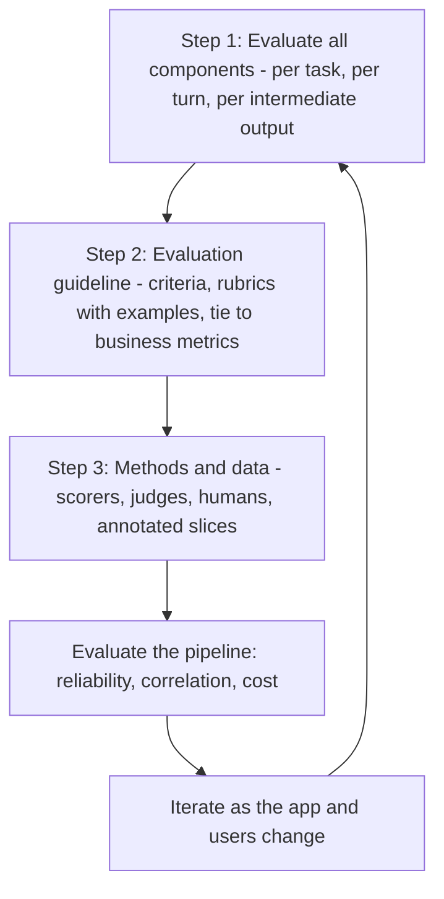

# Designing your evaluation pipeline

Public benchmarks shortlist models. Your **own evaluation pipeline** decides what ships, catches regressions, and tells you whether a new prompt, retriever or model is actually better. Huyen's message is that a reliable evaluation pipeline is what separates teams that iterate confidently from teams that guess. Her three steps are: **evaluate all components**, **create an evaluation guideline**, and **define evaluation methods and data**. After those, you evaluate the pipeline itself and keep iterating.



## Step 1. Evaluate all components in a system

Real applications have many components and many turns. Evaluate the **end-to-end output** and each **intermediate output** independently. Otherwise you will not know where a failure came from.

Huyen's example is extracting a person's current employer from a resume PDF in two steps:

1. Extract all text from the PDF. Evaluate this with similarity between the extracted text and the ground-truth text.
2. Extract the current employer from that text. Evaluate this with accuracy, given correctly extracted text.

If the final answer is wrong, these per-component metrics tell you which step to fix.

### Per turn vs per task

- **Turn-based evaluation** scores the quality of each output. A turn can include several internal steps.
- **Task-based evaluation** asks whether the system **completed the task**, and in how many turns. Solving a bug in 2 turns is very different from 20.

Users care about completing tasks, so task-based evaluation matters more. It is harder, because task boundaries in a conversation are fuzzy (is the new question a follow-up or a new task?). Huyen mentions the **twenty_questions** benchmark from BIG-bench, where one model thinks of a concept and the other asks yes/no questions. Success is guessing the concept, and efficiency is the number of questions needed.

## Step 2. Create an evaluation guideline

Huyen calls the evaluation guideline the most important step. An ambiguous guideline produces ambiguous scores, which mislead.

### Define evaluation criteria

Decide what the application should do, and also what it should **not** do. A customer-support bot should not answer questions about an upcoming election. Define how to handle out-of-scope inputs and what a "good" response means. **Correct is not enough.** LinkedIn shared that a correct answer can still be a bad response. For a job-fit assessment, "You are a terrible fit" is unhelpful even if true. A good response explains the gap and how to close it.

LinkedIn's criteria for its job assessment application included relevance, factual consistency and safety. Huyen's support-bot example uses relevance, factual consistency and safety.

### Create scoring rubrics with examples

For each criterion, pick a **scoring system** (binary, 1–5, 0–1) and write a **rubric with examples**. What does a 3 look like? Validate the rubric with people. If humans find it hard to apply consistently, refine it, because an AI judge will find it hard too. The same rubric can later double as annotation guidelines for finetuning data.

### Tie evaluation metrics to business metrics

A metric is only useful if you know what it means for the business. Map metric levels to business outcomes, for example:

- Factual consistency of 80%: you can automate 30% of support requests.
- 90%: 50% can be automated.
- 98%: 90% can be automated.

This mapping also sets the **usefulness threshold**. Perhaps the product is not worth launching until it reaches 50% automation. It also helps you prioritize: is pushing consistency from 90% to 98% worth the investment?

## Step 3. Define evaluation methods and data

### Select evaluation methods

Different criteria call for different methods. You might use a **small toxicity classifier**, **semantic similarity** for relevance, and an **AI judge** for factual consistency against the context. Mix cost tiers: a cheap classifier on 100% of traffic and an expensive judge on 1%.

- **Use logprobs when available.** They show confidence. A model whose top class has 30–40% probability is unsure, and one at 95% is confident. They also give perplexity for fluency and consistency checks.
- **Use automatic metrics as much as possible, but don't be afraid of human evaluation**, even in production. LinkedIn manually evaluated up to 500 daily conversations. Humans are often the north-star metric for open-ended quality.
- **Plan for production.** References often do not exist in production, but users do. Decide which feedback to collect and how it correlates with your offline metrics (Module 10).

### Annotate evaluation data

Curate annotated examples for each component and criterion, for both turn-based and task-based evaluation. **Use real production data** when possible, and use natural labels if you have them. Otherwise label with humans or AI (Module 8).

**Slice your data.** Separate the data into subsets and examine performance on each. This helps you:

- avoid biases against minority user groups,
- debug (is the system bad on long inputs, or a particular topic or format?),
- find improvement areas, and
- avoid **Simpson's paradox**, where model A beats B on aggregate but loses on every subgroup.

Huyen's Simpson's paradox table (originally kidney-stone treatment data):

| | Group 1 | Group 2 | Overall |
|---|---|---|---|
| Model A | **93%** (81/87) | **73%** (192/263) | 78% (273/350) |
| Model B | 87% (234/270) | 69% (55/80) | **83%** (289/350) |

A wins both groups, yet B wins overall, because B's examples are concentrated in the easier group.

```python-run
A = {"g1": (81, 87), "g2": (192, 263)}
B = {"g1": (234, 270), "g2": (55, 80)}
for name, m in [("A", A), ("B", B)]:
    per = {g: f"{c/n:.0%}" for g, (c, n) in m.items()}
    tot = sum(c for c, _ in m.values()) / sum(n for _, n in m.values())
    print(name, per, "overall", f"{tot:.0%}")
```

Keep **multiple evaluation sets**: one that mirrors the production distribution; slices by tier (paid vs free), traffic source (mobile vs web) and usage; a set of examples the system is known to get wrong; examples with common user mistakes such as typos; and an **out-of-scope** set to check the app declines properly. In Huyen's words, *if you care about something, put a test set on it.*

### How much evaluation data? Bootstrap it

You want a set large enough to be reliable and small enough to be affordable. A practical check is **bootstrapping**: resample your N examples with replacement many times, evaluate on each resample, and look at the spread. If one bootstrap gives 90% and another 70%, the set is too small or too noisy.

```python-run
import numpy as np
rng = np.random.default_rng(0)
def bootstrap_ci(correct, B=2000):
    correct = np.asarray(correct)
    stats = [rng.choice(correct, size=len(correct), replace=True).mean() for _ in range(B)]
    return np.percentile(stats, [2.5, 97.5])
for n in [30, 100, 1000]:
    sample = rng.random(n) < 0.8          # a model with ~80% true accuracy
    lo, hi = bootstrap_ci(sample)
    print(f"n={n:5d}  acc={sample.mean():.3f}  95% CI=[{lo:.3f}, {hi:.3f}]  width={hi-lo:.3f}")
```

Rules of thumb from OpenAI, cited by Huyen: to detect a 30% score difference you need roughly 10 samples, a 10% difference needs about 100, a 3% difference about 1,000, and a 1% difference about 10,000. The number grows roughly with the inverse square of the effect size. Benchmarks in Eleuther's harness have median sizes around 1,000 examples, with many in the low thousands.

## Evaluate your evaluation pipeline

Ask these questions about the pipeline itself:

- **Is it giving the right signals?** Do better responses get higher scores? Do eval improvements lead to better business outcomes?
- **How reliable is it?** If you run it twice, do you get the same result? Bootstrap variance, judge consistency and fixed sampling settings all help.
- **How correlated are your metrics?** If two metrics are perfectly correlated, you need only one. If they are completely uncorrelated, either you found something interesting or one metric is broken.
- **How much cost and latency does it add?** Evaluation in the request path (guardrails) adds latency, and judges add cost. Sampling helps.

## Iterate

Criteria, data and users change, so the pipeline must evolve too. Keep evaluation **experiment tracking**: log every variable that could change a result, including the evaluation data, rubric, judge prompts and judge sampling settings. That way you can tell whether a score changed because the application changed or because the pipeline did.

> [!INTERVIEW]
> **"Walk me through building an eval set for a new LLM feature."** Start from failure modes and business goals. Decompose the system and define per-component and end-to-end metrics, both turn and task level. Write rubrics with examples and validate them with humans. Map metric levels to business outcomes to set the launch threshold. Collect real (or realistic) inputs, slice them (user tier, input length, topic, known-hard cases, typos, out-of-scope), and annotate with humans or AI judges. Size it with bootstrapping. Mix cheap automatic scorers on all data with expensive judges and human review on samples. Version everything, check the pipeline's reliability, and connect it to production feedback.

## Pitfalls

- Only end-to-end metrics, so you cannot localize failures.
- "Correctness" without helpfulness or safety criteria.
- A single aggregate number that hides slice regressions (Simpson's paradox).
- An eval set too small to separate candidates. Check bootstrap intervals before celebrating a 1% gain.
- Silently changing the judge prompt and then comparing scores across versions.

## Summary

- **Step 1**: evaluate each component and the end-to-end system, per turn and per task.
- **Step 2**: a clear guideline with criteria (including what *not* to do), rubrics with examples, and a mapping from metrics to business outcomes.
- **Step 3**: choose methods per criterion (classifiers, similarity, AI judges, logprobs, humans), annotate real data, slice it, keep several targeted sets, and size it with bootstrapping.
- Then evaluate the pipeline itself (signal, reliability, metric correlation, cost) and iterate with full experiment tracking.

```quiz
[
  {"q": "Why evaluate intermediate outputs (e.g., PDF-to-text) separately from the final answer?", "options": ["It's cheaper", "To localize which component causes failures", "Final outputs can't be evaluated", "Regulations require it"], "answer": 1, "explain": "Without per-component evaluation, you can't tell whether extraction or reasoning failed."},
  {"q": "Which evaluation better reflects what users care about?", "options": ["Turn-based", "Task-based (did it complete the task, in how many turns?)", "Perplexity", "Token count"], "answer": 1, "explain": "Users want their task solved. Task-based evaluation captures completion and efficiency."},
  {"q": "LinkedIn's point that 'a correct response is not always a good response' implies…", "options": ["Only measure correctness", "Criteria should include helpfulness (e.g., explaining the gap), not just correctness", "Avoid AI judges", "Use BLEU"], "answer": 1, "explain": "'You're a terrible fit' can be correct but unhelpful. Criteria must reflect what makes a response good."},
  {"q": "Model A beats B on every slice but loses overall. This is…", "options": ["Data contamination", "Simpson's paradox", "Overfitting", "Position bias"], "answer": 1, "explain": "Different slice sizes and difficulties can reverse the aggregate result."},
  {"q": "You bootstrap your 100-example eval set and get scores ranging from 70% to 90%. What does this suggest?", "options": ["The model is excellent", "The evaluation set is too small or noisy to be trustworthy", "The judge is biased", "Nothing"], "answer": 1, "explain": "Large variance across bootstraps means results aren't reliable. Add data or reduce noise."},
  {"q": "Roughly how many samples are needed to detect a ~3% score difference (OpenAI's rule of thumb cited by Huyen)?", "options": ["10", "100", "1,000", "100,000"], "answer": 2, "explain": "Approximately: 30% → 10, 10% → 100, 3% → 1,000, 1% → 10,000."},
  {"q": "Why tie evaluation metrics to business metrics?", "options": ["To make dashboards prettier", "To know what a metric improvement is worth and set a launch threshold", "To avoid human evaluation", "Business metrics replace evaluation"], "answer": 1, "explain": "Mapping, e.g., factual consistency levels to automation rates shows the value of improvements and the usefulness threshold."},
  {"q": "Two of your evaluation metrics are perfectly correlated. What should you consider?", "options": ["Adding more metrics", "Dropping one; it adds no new information", "Both are broken", "Increasing temperature"], "answer": 1, "explain": "Perfectly correlated metrics are redundant. Uncorrelated ones warrant investigation."}
]
```

> **Source:** Huyen, *AI Engineering*, ch. 4 ("Design Your Evaluation Pipeline": steps 1–3, evaluate your evaluation pipeline, iterate).
