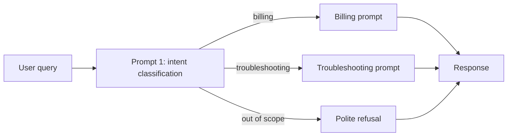

# Prompt engineering best practices

Prompting tricks come and go. "I'll tip you \$300" and "my grandmother will die" belong to particular models and moments. The practices in this lesson are the ones Huyen found to be stable across models and recommended by the major providers: **write clear and explicit instructions, provide sufficient context, break complex tasks into subtasks, give the model time to think, and iterate**. The lesson ends with how to evaluate prompt engineering tools and how to organize and version prompts.

## 1. Write clear and explicit instructions

Communicating with a model is like communicating with a person: clarity helps.

### Explain, without ambiguity, what you want

If you want an essay scored, specify the scale. Is it 1–5 or 1–10? If the model is unsure, should it pick its best guess or output "I don't know"? As you experiment you will see undesired behaviours. Adjust the prompt for each. If the model outputs fractional scores such as 4.5 and you do not want them, tell it that scores must be whole numbers.

### Give the model a persona

A persona fixes the point of view the response is written from. The book's example is a child's two-sentence essay about liking chickens. With no persona, a model might give it 2 out of 5. Asked to grade as a **first-grade teacher**, it gives 4 out of 5. Personas matter for both tone and judgment.

### Provide examples

Examples show the model the kind of response you expect, which instructions alone often leave open. Huyen's example: a bot for young children is asked "Will Santa bring me presents on Christmas?" Without guidance, the model may explain that Santa is fictional. A single example Q&A that plays along (about the tooth fairy, say) steers it toward the tone you want.

Choose example **formats that use fewer tokens** when length matters. Huyen compares two layouts for the same labeled examples: a verbose one ("Label the following item as edible or inedible. Input: chickpea. Output: edible …") at 38 tokens and a compact `chickpea --> edible` layout at 27 tokens, with similar effectiveness.

### Specify the output format

- Ask for **concise** output when you want it. Long outputs cost latency and money.
- Tell the model to skip the lead-in sentence before the answer (for a grader, something like "After reading this essay, my score is…").
- For structured output, state the keys and types and show an example.
- Use **markers** to mark where the answer should start. For classification-style prompts without a marker, the model may continue the *input* instead of producing the label. `edible-or-not: pineapple pizza -->` makes the boundary explicit.

## 2. Provide sufficient context

Reference texts help models the way they help students in an exam. Including the relevant paper, policy or documentation improves answers and **reduces hallucination**, because without the information the model must rely on unreliable internal knowledge. You can supply context directly or give the model tools to gather it. The process of gathering context is **context construction** (RAG and web search, Module 6).

### Restricting a model to its context

Sometimes the model should use *only* the context, for example a Skyrim character that knows nothing about Starbucks. This is hard to guarantee:

- Instruct clearly ("answer using only the provided context") and include examples of questions it should *not* be able to answer.
- Ask it to **quote** the passage it used, which nudges it toward grounded answers.
- Prompting alone is not reliable. Finetuning on your corpus helps, but pre-training knowledge can still leak. Training only on the permitted corpus is the safest option and is rarely feasible.

## 3. Break complex tasks into simpler subtasks

For multi-step tasks, use a **chain of prompts**, one per subtask, instead of one giant prompt. Huyen's customer support example (adapted from OpenAI's guide):

1. **Intent classification**: classify the request into a primary and secondary category (Billing, Technical Support, Account Management, General Inquiry…).
2. **Response generation**: a prompt specific to that intent. For troubleshooting, a step-by-step diagnostic script.



Benefits of **prompt decomposition**:

- **Monitoring.** You can inspect intermediate outputs as well as the final one.
- **Debugging.** You can isolate the failing step and fix it without touching the rest.
- **Parallelization.** Independent subtasks can run at the same time. Generating three versions of a story for different reading levels is three parallel calls.
- **Effort.** Simple prompts are easier to write.
- **Cost.** Simpler steps can use **cheaper models**, such as a small model for intent classification and a strong one for the answer.

The costs are that more calls can increase **user-perceived latency**, especially when users see nothing until the last step, and that the many prompts duplicate some tokens. How far to decompose is a judgment call. GoDaddy found that after decomposing, their system prompt had grown to over 1,500 tokens, and splitting it into smaller task-specific prompts gave better performance at lower token cost.

```python-run
# A two-step prompt chain with a stubbed model, showing routing and independent testing of each step.
def fake_llm(prompt):
    if prompt.startswith("CLASSIFY"):
        q = prompt.split("Query:")[1].lower()
        return "BILLING" if "charge" in q or "refund" in q else "TROUBLESHOOTING" if "error" in q or "crash" in q else "OTHER"
    return f"[answer generated with prompt: {prompt.splitlines()[0]}]"

PROMPTS = {"BILLING": "You handle billing. Be precise about amounts.",
           "TROUBLESHOOTING": "You are tech support. Ask for the device model, then give numbered steps.",
           "OTHER": "Politely say you can only help with billing and technical issues."}
def answer(query):
    intent = fake_llm(f"CLASSIFY the query into BILLING, TROUBLESHOOTING or OTHER.\nQuery: {query}")
    return intent, fake_llm(f"{PROMPTS[intent]}\nQuery: {query}")
for q in ["I was charged twice this month", "The app shows error 502", "Who should I vote for?"]:
    print(q, "->", answer(q))
```

## 4. Give the model time to think

### Chain-of-thought (CoT)

With **CoT** you ask the model outright to reason through the problem in steps before answering. The technique comes from Wei et al. (2022) and predates ChatGPT by close to a year. It was one of the first techniques that worked across models, improving LaMDA, GPT-3 and PaLM on math and reasoning benchmarks. LinkedIn found it also reduces hallucinations.

Variants, from least to most guided:

- **Zero-shot CoT**: append "Think step by step before answering" or "Explain your rationale before giving an answer".
- **Specified steps**: you list the steps yourself. For "which is heavier, a grand piano or a small car?", the steps could be: look up a typical weight for each, then compare.
- **One-shot or few-shot CoT**: include a worked example with its reasoning.

### Self-critique

**Self-critique** (self-eval) asks the model to check its own output, nudging it to examine the answer critically. Like CoT, it adds output tokens.

The cost is **latency**. A model that reasons through intermediate steps makes users wait longer for the final answer, particularly when those steps are long. Use CoT where the accuracy gain justifies it, and consider hiding the reasoning or running it in a separate call.

> [!INTERVIEW]
> **"When would you NOT use chain-of-thought?"** When latency or cost budgets are tight and the task is simple (classification, extraction). When the output must be strictly structured, in which case you can reason in one field or one call and answer in another. And when your model already performs internal reasoning, where forcing explicit steps can add tokens without accuracy. Always measure with your eval set rather than assuming CoT helps.

## 5. Iterate on your prompts

Prompt engineering is back-and-forth. Each model has quirks: one is better with numbers, another at roleplay; some prefer instructions first, some last. Get to know your model, and read the provider's prompting guide.

- **Version your prompts**, and record experiments in a tracking tool.
- **Keep the evaluation data and metrics fixed** so that two prompts can be compared fairly.
- **Judge a prompt by its effect on the full pipeline.** An edit that helps one subtask can still make the end result worse.

## 6. Evaluate prompt engineering tools

Tools try to automate the search for good prompts: **OpenPrompt, DSPy** (which optimizes prompts against metrics, in the spirit of AutoML), and AI-powered generators and mutators such as Google DeepMind's **Promptbreeder** and Microsoft's **TextGrad**. Others help with pieces of the workflow: Guidance, Outlines and Instructor for structured outputs, and tools that perturb prompts to test robustness.

Huyen's cautions:

- **Hidden API calls.** A tool may generate and evaluate many prompt variants. Thirty examples times ten candidate prompts is 300 calls, plus validation calls and retries. Costs can explode unnoticed.
- **Tool errors.** Tool developers make mistakes too: wrong chat templates, typos in default prompts, templates built by token concatenation rather than raw text. The more tools you add, the more ways your system can fail.
- **Tools change without warning**, so the default prompt you depend on may change under you.

Her advice is to **keep it simple**. Write your own prompts first so you understand the problem. If you adopt a tool, **inspect the prompts it actually sends** and track how many calls it makes.

## 7. Organize and version prompts

- **Separate prompts from code.** Put them in their own file (`prompts.py`, `.prompt` files) so they can be reused across applications, tested independently of code, read more easily, and reviewed by domain experts who do not write code.
- **Attach metadata**: the model the prompt was written for, creation date, owning application, creator, intended use, example inputs. Emerging formats such as Google's Dotprompt and Humanloop's prompt files store configuration and schemas with the text.
- **Version prompts separately from code.** If prompts live only in git with the application, a team that wants a newer prompt has to take a whole new commit, and several apps cannot easily share versions. Many teams build a **prompt catalog** that versions each prompt, records which applications depend on it, and notifies owners when it changes.

```python-run
# A minimal prompt catalog entry: text + metadata + version, kept apart from application code.
from dataclasses import dataclass, field
import hashlib
@dataclass
class Prompt:
    name: str
    template: str
    model: str
    version: int = 1
    meta: dict = field(default_factory=dict)
    def render(self, **kw):
        return self.template.format(**kw)   # raises KeyError if a variable is missing
    @property
    def fingerprint(self): return hashlib.sha1(self.template.encode()).hexdigest()[:8]
p = Prompt("essay_scorer", "You are a first-grade teacher. Score this essay from 1 to 5 (integer only).\nEssay: $essay\nScore:",
           model="example-model-v1", meta={"owner": "edu-team", "created": "2025-01-10"})
print(p.render(essay="I like chickens."))
print("version", p.version, "fingerprint", p.fingerprint)
```

## Pitfalls

- Vague instructions with no scale or format, and no policy for uncertainty.
- One enormous prompt doing five jobs, which is hard to debug and expensive.
- Adding CoT everywhere without measuring the latency and cost.
- Trusting framework default prompts without reading them.
- Prompts as string literals scattered through code with no versioning.

## Summary

- **Be clear and explicit**: scales, personas, examples, output formats, markers.
- **Provide context** to reduce hallucination. Restricting a model to its context needs instructions, examples and quotes, and is still imperfect.
- **Decompose** complex tasks into prompt chains for monitoring, debugging, parallelism and cheaper models, and watch latency.
- **Give time to think** with CoT and self-critique. This costs output tokens and latency.
- **Iterate** systematically with versioning and fixed evaluation. Be skeptical of prompt tools (hidden calls, template bugs) and manage prompts as versioned assets separate from code.

```quiz
[
  {"q": "A model gives the chicken essay 2/5 by default but 4/5 when told it is a first-grade teacher. This illustrates…", "options": ["Hallucination", "The effect of a persona on the model's perspective", "Data contamination", "Position bias"], "answer": 1, "explain": "A persona changes how the model judges and responds."},
  {"q": "Which is NOT a benefit of prompt decomposition named by Huyen?", "options": ["Easier monitoring and debugging", "Parallelization of independent subtasks", "Guaranteed lower user-perceived latency", "Using cheaper models for simpler steps"], "answer": 2, "explain": "More sequential calls can increase perceived latency. That is the trade-off."},
  {"q": "Zero-shot chain-of-thought is…", "options": ["Providing worked examples with reasoning", "Adding an instruction such as 'think step by step' without examples", "Finetuning on reasoning traces", "Asking for JSON"], "answer": 1, "explain": "Zero-shot CoT only adds the instruction. Few-shot CoT adds worked examples."},
  {"q": "Main downside of CoT and self-critique?", "options": ["Lower accuracy always", "More output tokens, hence higher latency and cost", "They require finetuning", "They break chat templates"], "answer": 1, "explain": "Reasoning takes tokens, and users wait longer for the final answer."},
  {"q": "A prompt optimization tool evaluates 10 candidate prompts on 30 examples. What should you watch?", "options": ["Nothing", "Hidden model API calls (at least 300, plus retries) driving up cost", "GPU temperature", "Tokenizer version"], "answer": 1, "explain": "Huyen warns that such tools can silently generate very large numbers of API calls."},
  {"q": "Why separate prompts from code?", "options": ["Prompts run faster", "Reusability, independent testing, readability and collaboration with domain experts", "It's required by APIs", "To hide them from version control"], "answer": 1, "explain": "Prompts are assets that several apps and non-engineers work with. Keeping them separate helps all of these."},
  {"q": "Why include an output marker like '-->' at the end of a classification prompt?", "options": ["It reduces tokens to zero", "It signals where the answer starts, so the model doesn't continue the input", "It enables caching", "It prevents jailbreaks"], "answer": 1, "explain": "Without a marker a completion model may keep extending the input text."},
  {"q": "What is Huyen's overall advice on prompt engineering tools?", "options": ["Always start with the most complex framework", "Keep it simple: write prompts yourself first, and inspect what tools actually send", "Never use any tools", "Only use tools that hide prompts"], "answer": 1, "explain": "Understanding your own prompts first makes it easier to judge and debug tools."}
]
```

> **Source:** Huyen, *AI Engineering*, ch. 5 ("Prompt Engineering Best Practices": clear instructions, sufficient context, breaking tasks down, time to think, iterating, tools, organizing and versioning prompts).
