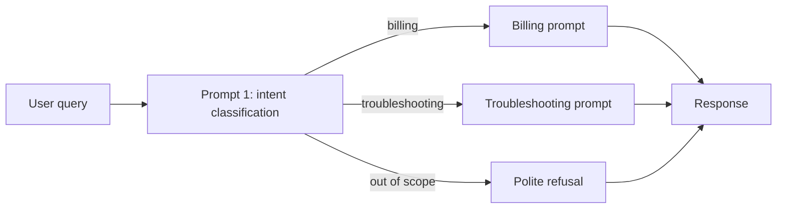

# Prompt engineering best practices

> **Before this lesson:** read [Prompts, in-context learning and context length](#/lesson/ai-eng/aie-prompt-intro), which explains what a prompt is made of, few-shot examples, system prompts and token budgets. Hallucination is introduced in [Sampling](#/lesson/ai-eng/aie-sampling). The demos are short Python programs with every new construct explained.

## In plain words

This lesson is a checklist of habits that make prompts work well across many models: say exactly what you want, give the model the information it needs, split big jobs into small steps, let the model reason before it answers, and test every change. It ends with practical advice on prompt tools and on storing prompts like any other piece of software.

An everyday picture: delegating a task to a capable colleague who has never worked at your company. "Sort out the Henderson thing" will go badly. "Reply to Mrs Henderson's refund email; she was charged twice on 3 May; our policy is a full refund within 30 days; keep it under 100 words and friendly; check the order number before you send" will go well. The colleague is the same person in both cases. What changed is how clear the instructions were, how much context you shared, and whether you broke the job into steps they can check.

Why this matters for a job: prompting tricks come and go. Lines like "I'll tip you \$300" or "my grandmother will die if you get this wrong" belonged to particular models at particular moments. The practices here are the ones Huyen found stable across models and recommended by the major providers: **write clear and explicit instructions, provide sufficient context, break complex tasks into subtasks, give the model time to think, and iterate**. Interviewers expect you to know them, to explain chain-of-thought and its costs, and to say how you would manage prompts in a team.

## 1. Write clear and explicit instructions

Communicating with a model is like communicating with a person: clarity helps, and guessing games hurt.

### Explain, without ambiguity, what you want

If you want an essay scored, name the scale. Is it 1 to 5 or 1 to 10? If the model is unsure, should it give its best guess or say "I don't know"? As you experiment you will see behaviours you do not want; adjust the prompt for each one. If the model gives fractional scores such as 4.5 and you need whole numbers, say that scores must be whole numbers.

Compare two versions of the same instruction:

```text
Vague:    Score this essay.
Explicit: Score this essay for a first-grade class on a scale of 1 to 5, where 1 means
          off-topic and 5 means clear and on-topic. Use whole numbers only. If the text
          is not an essay, output "N/A". Output the score only.
```

The explicit version fixes the scale, defines the ends of it, rules out decimals, says what to do with bad input, and fixes the output format.

### Give the model a persona

A **persona** is a role the model is told to play ("You are a…"). It fixes the point of view the answer is written from. Huyen's example is a child's two-sentence essay about liking chickens. With no persona, a model might give it 2 out of 5. Asked to grade as a **first-grade teacher**, it gives 4 out of 5, because a teacher of six-year-olds judges by different standards. Personas affect both tone and judgement.

### Provide examples

Examples show the kind of response you expect, which instructions alone often leave open. Huyen's example: a chatbot for young children is asked "Will Santa bring me presents on Christmas?" Without guidance, the model may explain that Santa is not real. A single example question and answer that plays along (about the tooth fairy, say) steers it toward the tone you want.

When prompt length matters, choose example **formats that use fewer tokens**. Huyen compares two layouts of the same labelled examples: a wordy one ("Label the following item as edible or inedible. Input: chickpea. Output: edible …") at 38 tokens, and a compact `chickpea --> edible` layout at 27 tokens, with similar effectiveness.

```python-run
verbose = """Label the following item as edible or inedible.
Input: chickpea
Output: edible
Input: box
Output: inedible
Input: pizza
Output:"""
compact = """Label edible or inedible.
chickpea --> edible
box --> inedible
pizza -->"""

def rough_tokens(text):
    return round(len(text) / 4)          # rule of thumb for English: about 4 characters per token

for name, p in [("verbose", verbose), ("compact", compact)]:
    print(f"{name:8s} {len(p):3d} characters  ~{rough_tokens(p)} tokens")
saved = rough_tokens(verbose) - rough_tokens(compact)
print(f"saved ~{saved} tokens per call; at 1,000,000 calls/day that is ~{saved * 1_000_000:,} tokens/day")
```

**Reading this Python line by line**

- The triple-quoted strings hold the two prompt layouts, line breaks included.
- `rough_tokens` estimates a token count with a common rule of thumb: English text averages about four characters per token. `len(text)` counts characters; `round` gives a whole number. A real count needs the model's own tokenizer, so treat this as a sketch.
- The loop prints each layout's character count and estimate; `:3d` pads a whole number to three characters.
- `{... :,}` prints a large number with thousands separators.
- Output: the verbose layout is 127 characters (about 32 tokens) and the compact one 72 characters (about 18). Saving about 14 tokens per call sounds trivial until you multiply it by a million calls a day: about 14 million tokens a day.

### Specify the output format

- Ask for **concise** output when you want it. Long outputs cost latency and money.
- Tell the model to skip any lead-in sentence before the answer (for a grader, something like "After reading this essay, my score is…").
- For structured output such as JSON, state the keys and their types and show an example.
- Use a **marker** to show where the answer should begin. In a classification prompt without one, a model may carry on writing the *input* instead of giving the label. Ending the prompt with `edible-or-not: pineapple pizza -->` makes the boundary unmistakable.

## 2. Provide sufficient context

Reference texts help models the way an open-book exam helps students. Including the relevant paper, policy or documentation improves answers and **reduces hallucination** (confident, made-up statements), because without the information the model has to rely on its unreliable internal memory. You can paste the context into the prompt or give the model **tools** (functions it can call, such as a search) to fetch it. Gathering the right context for each request is called **context construction**; retrieval-augmented generation (RAG) and web search, covered in Module 6, are the main ways to do it.

### Restricting a model to its context

Sometimes the model should use *only* the context you give it. A character in the fantasy game Skyrim, for instance, should know nothing about Starbucks. This is hard to guarantee:

- Instruct clearly ("answer using only the provided context") and include examples of questions it should *not* be able to answer, with the refusal you want.
- Ask it to **quote** the passage it relied on, which nudges it toward **grounded** answers (answers that can be traced to the supplied text).
- Prompting alone is not reliable. Finetuning on your own documents helps, but knowledge from pre-training can still leak through. Training a model only on the permitted material is the safest option and is rarely feasible.

## 3. Break complex tasks into simpler subtasks

For a task with several steps, use a **chain of prompts**, one prompt per subtask, instead of one giant prompt. This is called **prompt decomposition**. Huyen's customer-support example, adapted from OpenAI's prompting guide:

1. **Intent classification**: sort the request into a primary and secondary category (Billing, Technical Support, Account Management, General Inquiry and so on). The **intent** is what the user is trying to achieve.
2. **Response generation**: a prompt written specifically for that intent. For troubleshooting, it could be a step-by-step diagnostic script.



Benefits of decomposition:

- **Monitoring.** You can inspect each intermediate output, not only the final one.
- **Debugging.** You can find the failing step and fix it without touching the rest.
- **Parallelisation.** Independent subtasks can run at the same time. Writing three versions of a story for three reading levels is three calls that can run at once.
- **Effort.** Small, focused prompts are easier to write.
- **Cost.** Simpler steps can use **cheaper models**: a small model for intent classification, a strong one for the answer.

The costs: more calls in a row can increase **user-perceived latency**, especially when the user sees nothing until the last step finishes, and the separate prompts repeat some tokens. How far to decompose is a judgement call. GoDaddy reported that their single system prompt had grown past 1,500 tokens, and splitting it into smaller task-specific prompts gave better results at a lower token cost.

```python-run
# A two-step prompt chain with a stubbed model, showing routing and independent testing of each step.
def fake_llm(prompt):
    if prompt.startswith("CLASSIFY"):
        q = prompt.split("Query:")[1].lower()
        return "BILLING" if "charge" in q or "refund" in q else "TROUBLESHOOTING" if "error" in q or "crash" in q else "OTHER"
    return f"[answer generated with prompt: {prompt.splitlines()[0]}]"

PROMPTS = {"BILLING": "You handle billing. Be precise about amounts.",
           "TROUBLESHOOTING": "You are tech support. Ask for the device model, then give numbered steps.",
           "OTHER": "Politely say you can only help with billing and technical issues."}
def answer(query):
    intent = fake_llm(f"CLASSIFY the query into BILLING, TROUBLESHOOTING or OTHER.\nQuery: {query}")
    return intent, fake_llm(f"{PROMPTS[intent]}\nQuery: {query}")
for q in ["I was charged twice this month", "The app shows error 502", "Who should I vote for?"]:
    print(q, "->", answer(q))
```

**Reading this Python line by line**

- `fake_llm` stands in for a real model call so the demo runs offline. If the prompt starts with `CLASSIFY`, it takes the text after `Query:` (`split("Query:")[1]` is everything after the marker), lowercases it and returns an intent by keyword. The chained `A if ... else B if ... else C` picks the first matching rule.
- For any other prompt it returns a placeholder showing which system prompt was used (`splitlines()[0]` is the first line).
- `PROMPTS` maps each intent to its own specialised system prompt.
- `answer(query)` is the chain: step 1 classifies, step 2 looks up the matching prompt with `PROMPTS[intent]` and calls the model again. It returns both results, so each step can be checked separately.
- Output: the double charge routes to BILLING, the 502 error to TROUBLESHOOTING, and the voting question to OTHER, which politely declines. In a real system you would build a small labelled test set for step 1 alone, because a wrong intent poisons everything after it.

## 4. Give the model time to think

### Chain-of-thought (CoT)

With **chain-of-thought** (CoT) prompting you ask the model to reason through the problem step by step before giving its answer. Because a language model produces text one token at a time, writing out intermediate steps gives it more tokens, and therefore more computation, to reach the answer, and each step can build on the last. The technique comes from Wei and colleagues (2022) and was published close to a year before ChatGPT appeared. It was one of the first techniques that worked across many models, improving LaMDA, GPT-3 and PaLM on maths and reasoning benchmarks. LinkedIn found that it also reduced hallucinations.

Variants, from least to most guided:

- **Zero-shot CoT**: add a line such as "Think step by step before answering" or "Explain your reasoning before giving an answer".
- **Specified steps**: list the steps yourself. For "Which is heavier, a grand piano or a small car?", the steps could be: estimate a typical weight for each, then compare.
- **One-shot or few-shot CoT**: include a worked example together with its reasoning.

When the user should see only the result, ask the model to put its final answer on a line of its own after the reasoning, and extract that line in code:

```python-run
import re
raw = """Step 1: A grand piano weighs about 400-500 kg.
Step 2: A small car weighs about 1,000-1,200 kg.
Step 3: 1,000 kg is more than 500 kg.
ANSWER: small car"""
match = re.search(r"^ANSWER:\s*(.+)$", raw, flags=re.MULTILINE)
print("final answer shown to the user:", match.group(1) if match else "<no answer found, retry>")
```

`raw` stands in for a model's reply. `re.search` looks for a **regular expression**, a text pattern: `^` and `$` mean start and end of a line (with `re.MULTILINE`, of *each* line), `ANSWER:` is literal text, `\s*` skips any spaces, and `(.+)` captures the rest of the line. `match.group(1)` returns the captured text. If the model forgot the marker, `match` is `None` and the code reports that a retry is needed. Output: `final answer shown to the user: small car`.

### Self-critique

**Self-critique** (also called self-evaluation) asks the model to check its own output, for example "Review your answer above for errors and correct any you find." It nudges the model to examine the answer critically. Like CoT, it adds output tokens.

The price of both is **latency**. A model that writes out intermediate steps makes users wait longer for the final answer, especially when those steps are long. Use CoT where the accuracy gain justifies it, and consider hiding the reasoning from the user or running it as a separate call.

> [!INTERVIEW]
> **"When would you NOT use chain-of-thought?"** When latency or cost budgets are tight and the task is simple (classification, extraction). When the output must be strictly structured, in which case you can reason in one field or one call and answer in another. And when your model already reasons internally, where forcing explicit steps can add tokens without adding accuracy. Always measure on your evaluation set rather than assuming CoT helps.

## 5. Iterate on your prompts

Prompt engineering is back-and-forth. Each model has quirks: one is better with numbers, another at roleplay; some prefer instructions first, some last. Get to know your model, and read its provider's prompting guide.

- **Version your prompts**, giving each change a number, and record experiments in a tracking tool.
- **Keep the evaluation data and metrics fixed** while comparing prompts, so the comparison is fair.
- **Judge a prompt by its effect on the whole pipeline.** An edit that helps one subtask can still make the end result worse.

## 6. Evaluate prompt engineering tools

Several tools try to automate the search for good prompts: **OpenPrompt** and **DSPy** (which tunes prompts against a metric you define, in the spirit of AutoML, the automation of machine-learning model building), and AI-driven generators and mutators such as Google DeepMind's **Promptbreeder** and Microsoft's **TextGrad**. Others help with parts of the workflow: Guidance, Outlines and Instructor for structured outputs, and tools that perturb prompts to test robustness.

Huyen's cautions:

- **Hidden API calls.** A tool may generate and score many prompt variants behind the scenes. Thirty examples times ten candidate prompts is 300 calls, plus validation calls and retries. Costs can explode unnoticed.
- **Tool errors.** Tool authors make mistakes too: wrong chat templates, typos in default prompts, templates built by gluing tokens together instead of text. The more tools you add, the more ways your system can fail.
- **Tools change without warning**, so a default prompt you depend on may change under you.

Her advice is to **keep it simple**. Write your own prompts first so you understand the problem. If you adopt a tool, **inspect the prompts it actually sends**, and track how many calls it makes.

## 7. Organise and version prompts

- **Separate prompts from code.** Keep them in their own files (`prompts.py`, `.prompt` files) so they can be reused across applications, tested on their own, read easily, and reviewed by domain experts who do not write code.
- **Attach metadata**, data about the prompt: the model it was written for, creation date, owning application, author, intended use, example inputs. Formats such as Google's Dotprompt and Humanloop's prompt files store configuration and output schemas alongside the text.
- **Version prompts separately from code.** If prompts live only inside one application's code repository, a team that wants a newer prompt has to take a whole new release of that application, and several applications cannot easily share one prompt. Many teams build a **prompt catalog**: a store that versions each prompt, records which applications depend on it, and notifies their owners when it changes.

```python-run
# A minimal prompt catalog entry: text + metadata + version, kept apart from application code.
from dataclasses import dataclass, field
import hashlib
@dataclass
class Prompt:
    name: str
    template: str
    model: str
    version: int = 1
    meta: dict = field(default_factory=dict)
    def render(self, **kw):
        return self.template.format(**kw)   # raises KeyError if a variable is missing
    @property
    def fingerprint(self): return hashlib.sha1(self.template.encode()).hexdigest()[:8]
p = Prompt("essay_scorer", "You are a first-grade teacher. Score this essay from 1 to 5 (integer only).\nEssay: {essay}\nScore:",
           model="example-model-v1", meta={"owner": "edu-team", "created": "2025-01-10"})
print(p.render(essay="I like chickens."))
print("version", p.version, "fingerprint", p.fingerprint)
```

**Reading this Python line by line**

- `@dataclass` is a Python *decorator* that writes the boring parts of a class for you: given the listed fields (`name`, `template`, `model`, `version`, `meta`), it creates the constructor automatically. `version: int = 1` gives a default; `field(default_factory=dict)` gives each prompt its own empty dictionary for metadata.
- `render(self, **kw)` fills the template's `{essay}`-style placeholders with Python's `str.format`. `**kw` collects named arguments into a dictionary. If a placeholder has no value, `format` raises a `KeyError`, so a missing variable fails loudly instead of silently sending a broken prompt.
- `@property` makes `fingerprint` readable like a field (`p.fingerprint`, no brackets). It hashes the template text with SHA-1 (a function that turns any text into a fixed-length code that changes completely if a single character changes) and keeps the first 8 characters. Logging this fingerprint with every request tells you exactly which prompt text produced which output.
- Output: the rendered prompt with "I like chickens." in place of `{essay}`, then `version 1 fingerprint` followed by an 8-character code.

## Pitfalls

- Vague instructions with no scale or format, and no rule for uncertainty.
- One enormous prompt doing five jobs, which is hard to debug and expensive.
- Adding CoT everywhere without measuring the latency and cost.
- Trusting framework default prompts without reading them.
- Prompts as string literals scattered through the code with no versioning.

## Summary

- **Be clear and explicit**: scales, personas, examples, output formats, markers.
- **Provide context** to reduce hallucination. Restricting a model to its context needs instructions, examples and quotes, and is still imperfect.
- **Decompose** complex tasks into prompt chains for monitoring, debugging, parallelism and cheaper models, and watch the latency.
- **Give time to think** with CoT and self-critique; this costs output tokens and latency.
- **Iterate** systematically with versioning and fixed evaluation. Be sceptical of prompt tools (hidden calls, template bugs), and manage prompts as versioned assets separate from code.

## Glossary

- **Persona**: a role the model is told to adopt, which shapes tone and judgement.
- **Marker**: text such as `-->` or `Label:` that shows where the answer should begin.
- **Context construction**: gathering the information a model needs for a request.
- **Tool**: a function the model can call, such as a search or a calculator.
- **Grounded answer**: an answer that can be traced to the supplied context.
- **Prompt decomposition (prompt chain)**: splitting a task into several smaller prompts run in sequence or in parallel.
- **Intent / intent classification**: what the user wants to achieve / sorting a request into a fixed set of intents.
- **User-perceived latency**: how long the user actually waits before seeing a useful answer.
- **Chain-of-thought (CoT)**: prompting the model to reason step by step before answering.
- **Zero-shot / few-shot CoT**: a "think step by step" instruction alone / with worked reasoning examples.
- **Self-critique (self-evaluation)**: asking the model to check and correct its own output.
- **Regular expression**: a pattern language for finding text.
- **AutoML**: automating the search for good machine-learning configurations.
- **Metadata**: data that describes other data, such as a prompt's author and target model.
- **Prompt catalog**: a versioned store of prompts that tracks which applications use them.
- **Hash / fingerprint**: a short code computed from text that changes when the text changes.

```quiz
[
  {"q": "A model gives the chicken essay 2/5 by default but 4/5 when told it is a first-grade teacher. This illustrates…", "options": ["Hallucination", "The effect of a persona on the model's perspective", "Data contamination", "Position bias"], "answer": 1, "explain": "A persona changes how the model judges and responds."},
  {"q": "Which is NOT a benefit of prompt decomposition named by Huyen?", "options": ["Easier monitoring and debugging", "Parallelisation of independent subtasks", "Guaranteed lower user-perceived latency", "Using cheaper models for simpler steps"], "answer": 2, "explain": "More sequential calls can increase perceived latency. That is the trade-off."},
  {"q": "Zero-shot chain-of-thought is…", "options": ["Providing worked examples with reasoning", "Adding an instruction such as 'think step by step' without examples", "Finetuning on reasoning traces", "Asking for JSON"], "answer": 1, "explain": "Zero-shot CoT only adds the instruction. Few-shot CoT adds worked examples."},
  {"q": "Main downside of CoT and self-critique?", "options": ["Lower accuracy always", "More output tokens, hence higher latency and cost", "They require finetuning", "They break chat templates"], "answer": 1, "explain": "Reasoning takes tokens, and users wait longer for the final answer."},
  {"q": "A prompt optimisation tool evaluates 10 candidate prompts on 30 examples. What should you watch?", "options": ["Nothing", "Hidden model API calls (at least 300, plus retries) driving up cost", "GPU temperature", "Tokenizer version"], "answer": 1, "explain": "Huyen warns that such tools can silently generate very large numbers of API calls."},
  {"q": "Why separate prompts from code?", "options": ["Prompts run faster", "Reusability, independent testing, readability and collaboration with domain experts", "It's required by APIs", "To hide them from version control"], "answer": 1, "explain": "Prompts are assets that several apps and non-engineers work with. Keeping them separate helps all of these."},
  {"q": "Why include an output marker like '-->' at the end of a classification prompt?", "options": ["It reduces tokens to zero", "It signals where the answer starts, so the model doesn't continue the input", "It enables caching", "It prevents jailbreaks"], "answer": 1, "explain": "Without a marker a completion model may keep extending the input text."},
  {"q": "What is Huyen's overall advice on prompt engineering tools?", "options": ["Always start with the most complex framework", "Keep it simple: write prompts yourself first, and inspect what tools actually send", "Never use any tools", "Only use tools that hide prompts"], "answer": 1, "explain": "Understanding your own prompts first makes it easier to judge and debug tools."}
]
```

> **Source:** Huyen, *AI Engineering*, ch. 5 ("Prompt Engineering Best Practices": clear instructions, sufficient context, breaking tasks down, time to think, iterating, tools, organising and versioning prompts).
