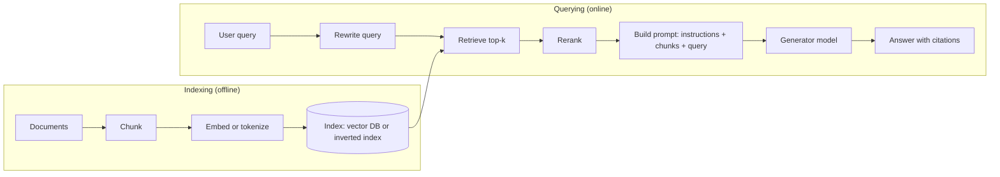

# RAG architecture and retrieval algorithms

> **Before this lesson:** you should know what embeddings and cosine similarity are (see [Exact evaluation and similarity measures](#/lesson/ai-eng/aie-exact-similarity)), and what a context window is and why models use the middle of a long prompt poorly (see [Prompts, in-context learning and context length](#/lesson/ai-eng/aie-prompt-intro)). Precision and recall were introduced in the same evaluation lesson; they are recapped here. Logarithms are recapped in one line where needed.

## In plain words

A model can only answer well if it has the information it needs. Its training data stops at a cutoff date and never included your company's private documents. **Retrieval-augmented generation (RAG)** fixes this: before the model answers, a search step finds the few passages from your own documents that are relevant to the question and pastes them into the prompt, so the model can answer from them.

An everyday picture: an open-book exam with a very large library. You cannot carry every book into the exam room (that is the limited context window), and even if you could, you would waste time flipping pages. So before each question, a librarian fetches the three most relevant pages and hands them to you. How well you do depends mostly on the librarian: if the right page is not in the pile, no amount of cleverness will save you. In RAG the librarian is the **retriever**, and this lesson is about how retrievers find the right pages.

Why this matters for a job: RAG is the most common architecture for business AI applications, from support bots to internal search. Interviewers ask "BM25 or embeddings?", "what is a vector database?", "why not put everything in a long context?" and "how do you evaluate a retriever?". Instructions tell a model *how* to behave; **context** (the information supplied in the prompt) tells it *what it needs to know*. Huyen argues that building context for foundation models plays the role that **feature engineering** (hand-crafting the inputs to a classic machine-learning model) used to play. The two dominant patterns for building context are RAG and **agents**; this lesson covers RAG's architecture and its core, the retrieval algorithms.

> [!NOTE]
> Context engineering as a broader discipline, including MCP, tool schemas and context budgeting, is covered in the **LLM Practice** track. Here we focus on the retrieval mechanics from Huyen's chapter 6.

## 1. Why RAG?

RAG improves a model's output by fetching relevant information from **external memory**: any store outside the model's weights, such as an internal database, a user's past chats, or the internet. The name comes from Lewis and colleagues (2020), but the retrieve-then-generate pattern goes back to Chen and colleagues' 2017 question-answering system, which fetched five Wikipedia pages and had a model read them.

Think of RAG as building context **specific to each query** instead of using the same context for everyone. For a question about one customer's printer, you supply that printer's specifications, not the whole product catalogue.

### Won't long context windows make RAG obsolete?

Huyen's answer is no, for two reasons:

1. **Data always outgrows context.** However long the context window, some application will have more data. Context windows grew from 1K to 2M tokens, and knowledge bases grew too.
2. **More context is not better context.** A model that *accepts* long context does not necessarily *use* it well (the "lost in the middle" effect). Irrelevant text costs money and latency and can distract the model. Retrieval puts in only what matters.

Anthropic's guidance, cited by Huyen: if your knowledge base is smaller than about 200,000 tokens (roughly 500 pages), you can put all of it in the prompt and skip RAG.

## 2. RAG architecture

A RAG system has two components:

- a **retriever**, which fetches information from external memory, and
- a **generator** (the language model), which writes the response using what was fetched.



The diagram has two halves. **Offline** (ahead of time, not while a user waits): documents are cut into chunks, each chunk is converted into a form that can be searched, and the results are stored in an **index**, a data structure built for fast lookup. **Online** (when a question arrives): the query may be rewritten, the retriever fetches the top $k$ most relevant chunks (*top-k*), a reranker may reorder them, and a prompt is assembled from instructions, chunks and the question for the generator to answer, ideally with **citations** pointing to the chunks it used.

In the original paper the retriever and generator were trained together. Today they are usually separate, off-the-shelf parts, though training them together can still improve results a lot. Huyen's key point: **the quality of a RAG system depends on the quality of its retriever.**

A retriever does two jobs: **indexing** (processing data so it can be found quickly) and **querying** (finding the data relevant to a query). How you index depends on how you plan to search. Documents are usually split into smaller pieces called **chunks** first (next lesson). Following the tradition of **information retrieval** (IR), the field behind search engines, Huyen calls both whole documents and chunks "documents".

## 3. Retrieval algorithms

Retrieval is an old field, behind search engines, recommendation systems and log search. It works by **ranking documents by relevance to the query**; algorithms differ in how they score relevance. Huyen divides them into **term-based** and **embedding-based**.

> [!NOTE]
> You will also see "sparse" versus "dense" retrieval. A *sparse* vector is mostly zeros (one position per vocabulary word, as in term-based methods); a *dense* vector is an embedding, with every position filled. Some sparse methods are learned (SPLADE), so the two naming schemes don't line up exactly. Huyen prefers term-based versus embedding-based.

### Term-based (lexical) retrieval

The simplest idea is keyword matching: for the query "AI engineering", return documents containing those words. Two problems appear at once:

- **Too many documents contain the words.** Rank them by **term frequency (TF)**, the number of times a query word (a *term*) appears in a document: more mentions suggest more relevance.
- **Not all words matter equally.** "for" and "the" appear everywhere and say nothing about relevance. So weight each term by its **inverse document frequency (IDF)**: rare terms get a high weight, common terms a low one. In words: divide the number of documents by the number containing the term, then take the logarithm (which grows slowly, so a term ten times rarer gets a bit more weight rather than ten times more). With $N$ documents and $C(t)$ of them containing term $t$:

$$\text{IDF}(t)=\log\frac{N}{C(t)}$$

**TF-IDF** combines them: a document's score is the sum, over the query terms, of each term's IDF times how often it appears in the document, $f(t, D)$:

$$\text{Score}(D, Q) = \sum_{i=1}^{q} \text{IDF}(t_i)\times f(t_i, D)$$

Worked example with four documents: "password" appears in 2 of them and "reset" in 2, so each has $\text{IDF} = \ln(4/2) = 0.693$. A document containing "reset" once and "password" once scores $0.693 \times 1 + 0.693 \times 1 = 1.386$ for the query "reset password". A word found in every document would get $\ln(4/4) = 0$ and contribute nothing.

**BM25** (Okapi BM25, "best matching 25") improves on TF-IDF in two ways. First, **term-frequency saturation**: the tenth mention of a word adds much less than the first, controlled by a constant $k_1$ (around 1.2 to 2). Second, **length normalisation**: a long document mentions everything more often, so its counts are scaled down relative to the average document length (avgdl), controlled by a constant $b$ (around 0.75). It remains a very strong baseline, and the widely used Elasticsearch search engine builds on it.

$$\text{score}(D,Q)=\sum_{t\in Q}\text{IDF}(t)\cdot\frac{f(t,D)\,(k_1+1)}{f(t,D)+k_1\left(1-b+b\,\frac{|D|}{\text{avgdl}}\right)}$$

Here $|D|$ is the document's length in tokens. The data structure that makes all this fast is the **inverted index**: a dictionary from each term to the list of documents containing it (its *posting list*), often with counts. To score a query, you look up only the posting lists of the query's terms instead of reading every document. It is the index at the back of a textbook, which maps a word to the pages that mention it.

```python-run
import math, re
from collections import Counter
docs = ["How to reset your password in the account settings",
        "Error EADDRNOTAVAIL 99 means the address is not available",
        "Password rules: at least 12 characters",
        "Reset the router if the network address is not available"]
tok = lambda s: re.findall(r"[a-z0-9]+", s.lower())
D = [tok(d) for d in docs]; N = len(D); avgdl = sum(map(len, D)) / N
inverted = {}
for i, d in enumerate(D):
    for t, c in Counter(d).items(): inverted.setdefault(t, {})[i] = c
def bm25(query, k1=1.5, b=0.75):
    scores = [0.0] * N
    for t in set(tok(query)):
        posting = inverted.get(t, {})
        idf = math.log((N - len(posting) + 0.5) / (len(posting) + 0.5) + 1)
        for i, f in posting.items():                       # only docs containing the term are touched
            scores[i] += idf * f * (k1 + 1) / (f + k1 * (1 - b + b * len(D[i]) / avgdl))
    return sorted(enumerate(scores), key=lambda x: -x[1])
for q in ["reset password", "EADDRNOTAVAIL"]:
    print(q, "->", [(i, round(s, 3)) for i, s in bm25(q) if s > 0])
```

**Reading this Python line by line**

- `tok` is a small **tokenizer** written as a `lambda` (a one-line unnamed function): it lowercases text and returns every run of letters and digits, so "Password rules:" becomes `["password", "rules"]`.
- `D` holds the tokenized documents, `N` their number, and `avgdl` the average document length (`map(len, D)` applies `len` to each).
- The double loop builds the inverted index. `Counter(d)` counts each term in a document; `inverted.setdefault(t, {})` fetches term `t`'s posting dictionary, creating an empty one the first time, and `[i] = c` records that document `i` contains it `c` times.
- `bm25(query)`: for each distinct query term, `inverted.get(t, {})` fetches its postings (an empty dictionary if no document has it). The IDF line is the smoothed version BM25 uses (the `+ 0.5` and `+ 1` keep it positive even for very common words). The inner loop adds the BM25 term score to each document in the posting list, so documents without the term are never touched.
- `sorted(enumerate(scores), key=lambda x: -x[1])` returns `(document number, score)` pairs, best first.
- Output: "reset password" ranks document 0 first (1.351; it contains both words), then 2 (0.799, "password" only) and 3 (0.642, "reset" only). "EADDRNOTAVAIL" finds only document 1 (1.173). Exact identifiers are where term-based retrieval shines.

**Tokenization choices** matter. Splitting on single words loses multi-word terms such as "hot dog", so n-grams (runs of consecutive words) may be indexed too. Text is commonly lowercased, punctuation removed, and **stop words** (very common words such as "the" and "of") dropped. Classic natural-language-processing libraries such as NLTK and spaCy help.

### Embedding-based (semantic) retrieval

Term-based retrieval works on surface words. A query for "transformer architecture" may return documents about electrical transformers or the *Transformers* films. **Embedding-based retrieval** ranks documents by how close their *meaning* is to the query's.

- **Indexing**: convert each chunk into an embedding with an **embedding model** and store it in a **vector database**, a database built to store vectors and find the ones nearest a given vector.
- **Querying**: embed the query with the *same* model, then fetch the $k$ chunks whose embeddings are closest, usually by cosine similarity.

The hard part is **vector search**. Exact **k-nearest neighbours** (k-NN) compares the query with every stored vector: accurate, but too slow for collections of millions. **Approximate nearest neighbour** (ANN) algorithms trade a little accuracy for a lot of speed. Popular libraries include FAISS (from Meta), ScaNN (Google), Annoy (Spotify) and Hnswlib.

Vector indexes organise vectors into buckets, trees or graphs so that a search can skip most of them:

| Algorithm | Idea |
|---|---|
| **LSH** (locality-sensitive hashing) | a special hash puts similar vectors into the same buckets, so you search only the query's bucket. Fast and light to build, less accurate |
| **HNSW** (hierarchical navigable small world) | a layered graph in which each vector is linked to similar ones; search walks the graph toward the query. Accurate with fast queries, but costly to build and memory-hungry |
| **Product quantization** (PQ) | compress each vector into a short code by splitting it into pieces and replacing each piece with the nearest of a small set of stored patterns, so distances are computed on compact codes |
| **IVF** (inverted file index) | group the vectors into clusters with k-means; search only the clusters nearest the query. Often combined with PQ (IVF-PQ) |
| **Annoy** | a forest of trees, each splitting space with random cuts |

**k-means** is a classic clustering method: pick $c$ starting centres, assign every vector to its nearest centre, move each centre to the average of its vectors, and repeat. The demo builds a tiny IVF index that way and measures **recall@k**: of the true $k$ nearest neighbours, how many did the approximate search find?

```python-run
import numpy as np
rng = np.random.default_rng(0)
N, d, k, n_clusters = 20000, 64, 5, 64
topics = rng.normal(size=(200, d))                      # documents cluster around topics, like real embeddings
X = (topics[rng.integers(0, 200, N)] + 1.0 * rng.normal(size=(N, d))).astype(np.float32)
X /= np.linalg.norm(X, axis=1, keepdims=True)
# A tiny IVF index: k-means clusters; at query time search only the closest clusters.
C = X[rng.choice(N, n_clusters, replace=False)]
for _ in range(8):
    assign = np.argmax(X @ C.T, axis=1)
    C = np.stack([X[assign == c].mean(axis=0) if (assign == c).any() else C[c] for c in range(n_clusters)])
    C /= np.linalg.norm(C, axis=1, keepdims=True)
assign = np.argmax(X @ C.T, axis=1)
queries = X[rng.choice(N, 50, replace=False)] + 0.3 * rng.normal(size=(50, d)).astype(np.float32)
queries /= np.linalg.norm(queries, axis=1, keepdims=True)
exact_all = np.argsort(-(queries @ X.T), axis=1)[:, :k]  # exact k-NN: scan everything
for nprobe in [1, 2, 4, 16]:
    recalls, scanned = [], []
    for q, exact in zip(queries, exact_all):
        probe = np.argsort(-(C @ q))[:nprobe]
        cand = np.where(np.isin(assign, probe))[0]
        approx = cand[np.argsort(-(X[cand] @ q))[:k]]
        recalls.append(len(set(approx) & set(exact)) / k)
        scanned.append(len(cand))
    print(f"nprobe={nprobe:2d}: scanned {np.mean(scanned):6.0f}/{N} vectors on average, mean recall@{k} = {np.mean(recalls):.2f}")
```

**Reading this Python line by line**

- The first lines fake 20,000 document embeddings of 64 numbers each: 200 random "topic" centres, each document a topic plus noise. `X /= np.linalg.norm(X, axis=1, keepdims=True)` scales every row to length 1, so a dot product (`@`) equals cosine similarity.
- `C = X[rng.choice(...)]` picks 64 random documents as starting cluster centres. In the loop, `np.argmax(X @ C.T, axis=1)` assigns each document to its most similar centre, and the `np.stack([...])` line moves each centre to the mean of its documents (keeping the old centre if a cluster is empty). Eight rounds is enough for a demo.
- `queries` are 50 test questions, made by adding noise to random documents.
- `exact_all` is the ground truth: for each query, the positions of the 5 most similar documents found by scanning all 20,000 (`axis=1` sorts each row; `[:, :k]` keeps the first 5 columns).
- For each `nprobe` (number of clusters to search), each query finds its `nprobe` nearest centres, gathers the documents in those clusters with `np.isin` and `np.where`, and ranks only those candidates.
- Output: searching 1 cluster scans about 300 vectors (1.5% of the collection) and finds 31% of the true top 5; 2 clusters about 630 vectors and 46%; 4 clusters about 1,270 and 58%; 16 clusters about 5,000 vectors and 89%. That is the ANN bargain: you choose how much accuracy to trade for speed. Real IVF indexes use many more clusters and tune `nprobe` on a test set.

In practice you would call a library rather than write k-means yourself. A static example with FAISS:

```python
import faiss                                   # pip install faiss-cpu
quantizer = faiss.IndexFlatIP(64)              # exact index over the cluster centres
index = faiss.IndexIVFFlat(quantizer, 64, 256, faiss.METRIC_INNER_PRODUCT)
index.train(X)                                 # run k-means to find 256 cluster centres
index.add(X)                                   # assign every vector to a cluster
index.nprobe = 8                               # clusters searched per query
scores, ids = index.search(queries, 5)         # top-5 neighbours for each query
```

Vector databases are evaluated on **recall**, **QPS** (queries per second), **build time** (how long indexing takes) and **index size** (memory or disk used). The ANN-Benchmarks project compares algorithms on these.

## 4. Comparing retrieval algorithms

| | Term-based | Embedding-based |
|---|---|---|
| **Query speed** | much faster | computing the query embedding and searching vectors can be slow |
| **Out-of-the-box performance** | typically strong, but hard to improve | can do better, especially after finetuning; handles natural, paraphrased questions |
| **Failure modes** | ambiguous words ("transformer") and vocabulary mismatch (the user says "car", the document says "vehicle") | embeddings can **blur exact keywords**: error codes like `EADDRNOTAVAIL (99)`, product names, IDs |
| **Cost** | much cheaper | embedding, vector storage and search can be expensive. Huyen notes vector database spending can be a fifth to a half of model API spending |

There is also an **indexing versus querying trade-off**. A detailed index such as HNSW gives accurate, fast queries but is slow and memory-heavy to build. A simple index such as LSH is quick to build but gives slower, less accurate queries.

### Evaluating retrievers

- **Context precision** (also called context relevance): of the documents retrieved, what fraction is relevant?
- **Context recall**: of all the relevant documents that exist, what fraction was retrieved? This needs every document's relevance labelled for each test query, which is expensive, so some frameworks support only precision.
- **Ranking metrics**, when order matters: **MRR** (mean reciprocal rank: one over the position of the first relevant result, averaged over queries), **MAP** (mean average precision) and **NDCG** (normalised discounted cumulative gain, which rewards relevant results near the top more than lower down).
- **Embedding quality**: MTEB tests embedding models across retrieval, classification and clustering.
- **End to end**: in the end, a retriever is good if it helps the whole RAG system produce better answers.

```python-run
def precision_recall(retrieved, relevant):
    hit = len(set(retrieved) & set(relevant))
    return hit / len(retrieved), hit / len(relevant)
def mrr(retrieved, relevant):
    return next((1 / r for r, d in enumerate(retrieved, 1) if d in relevant), 0.0)
ret, rel = ["d3", "d7", "d1", "d9"], {"d1", "d2", "d7"}
p, r = precision_recall(ret, rel)
print(f"context precision={p:.2f}  context recall={r:.2f}  MRR={mrr(ret, rel):.2f}")
```

`hit` counts retrieved documents that are relevant (two: d7 and d1). Precision is 2 of the 4 retrieved, recall 2 of the 3 relevant. In `mrr`, `enumerate(retrieved, 1)` numbers results from 1, and `next(...)` returns the first value of the generator: one over the rank of the first relevant document, or 0.0 if there is none. d7 sits at rank 2, so the reciprocal rank is 0.5. Output: `context precision=0.50  context recall=0.67  MRR=0.50`.

## 5. Combining retrieval algorithms: hybrid search

Production systems usually combine methods, which is called **hybrid search**.

**In sequence (retrieve, then rerank).** A cheap, less precise retriever, such as a term-based one, fetches a generous set of candidates, and a more precise, more expensive method picks the best of them. For "transformer", fetch every document containing the word, then use vector similarity to keep the ones about the neural-network architecture. A **reranker** is the model used in that second stage.

**In parallel (ensemble).** Several retrievers each produce a ranking, and the rankings are fused. The standard method is **reciprocal rank fusion (RRF)** (Cormack and colleagues, 2009). In words: each retriever gives a document $1/(k + \text{rank})$ points, and the points are added up:

$$\text{Score}(D)=\sum_{i=1}^{n}\frac{1}{k+r_i(D)}$$

Here $r_i(D)$ is the document's rank from retriever $i$, and $k$ is a constant, typically 60, that stops a first place from counting too much and controls how much lower ranks matter. RRF uses **ranks, not scores**, so it needs no conversion between BM25 scores and cosine similarities, which live on different scales.

Worked example: a document ranked 3rd by BM25 and 1st by the embedding retriever scores $1/63 + 1/61 = 0.01587 + 0.01639 = 0.0323$.

```python-run
def rrf(rankings, k=60):
    s = {}
    for r in rankings:
        for rank, d in enumerate(r, 1): s[d] = s.get(d, 0) + 1 / (k + rank)
    return sorted(s.items(), key=lambda x: (-x[1], x[0]))
bm25_rank = ["err_doc", "faq_12", "faq_3"]         # exact keyword match wins here
dense_rank = ["faq_3", "faq_12", "guide_9"]        # semantic match wins here
for d, s in rrf([bm25_rank, dense_rank]): print(f"{d:8s} {s:.4f}")
```

For each ranking, `enumerate(r, 1)` gives each document its rank starting at 1, and `s.get(d, 0) + 1 / (k + rank)` adds its points (starting from 0 the first time). Sorting by `(-score, name)` puts the highest score first and breaks exact ties alphabetically. Output: faq_3 0.0323 and faq_12 0.0323 (found by both retrievers, so they rise to the top), then err_doc 0.0164 and guide_9 0.0159 (each found by only one). You will implement RRF in the `aie-rrf` problem.

> [!INTERVIEW]
> **"BM25 or embeddings for our RAG system?"** Start with BM25 or another term-based baseline: it is cheap, fast, strong out of the box, and it nails exact identifiers. Add embeddings for paraphrases and meaning, and fuse the two with RRF (hybrid). Rerank the top candidates with a stronger model. Evaluate with context precision and recall plus end-to-end answer quality, and weigh the cost of re-embedding, vector storage and query latency. Name the failure modes: ambiguous words for BM25, lost keywords for embeddings.

## Pitfalls

- Embedding queries and documents with **different models**. They must share one embedding space.
- Skipping the keyword baseline and going straight to a vector database.
- Ignoring index build cost and re-embedding cost when data changes often.
- Evaluating only the generator. If retrieval fails, the generator cannot recover.

## Summary

- RAG is a **retriever** plus a **generator**. It builds context per query, and longer context windows do not remove the need for it.
- **Term-based retrieval** (TF-IDF, BM25, inverted index) is fast, cheap and strong on exact terms. **Embedding-based retrieval** (embedding model, vector database, ANN indexes such as HNSW, IVF, PQ and LSH) captures meaning but costs more and can blur keywords.
- Evaluate with context precision and recall, ranking metrics such as MRR and NDCG, and end-to-end quality.
- **Hybrid search** combines methods, either in sequence (retrieve then rerank) or in parallel with **reciprocal rank fusion**.

## Glossary

- **Retrieval-augmented generation (RAG)**: fetching relevant information and adding it to the prompt before the model answers.
- **Context**: the information supplied in the prompt to help with the task.
- **Feature engineering**: hand-crafting the inputs of a classic machine-learning model.
- **External memory**: any information store outside the model's weights.
- **Retriever / generator**: the component that fetches information / the model that writes the answer.
- **Index / indexing / querying**: a structure for fast lookup / building it / searching it.
- **Chunk**: a piece of a document, the unit that is indexed and retrieved.
- **Information retrieval (IR)**: the field of searching collections of documents.
- **Term frequency (TF) / inverse document frequency (IDF)**: how often a term appears in a document / how rare it is across documents.
- **TF-IDF / BM25**: term-based scoring formulas; BM25 adds frequency saturation and length normalisation.
- **Inverted index / posting list**: a map from each term to the documents containing it / one term's list.
- **Stop words**: very common words often removed before indexing.
- **Embedding model / vector database**: a model that turns text into vectors / a store built for nearest-vector search.
- **k-nearest neighbours (k-NN) / approximate nearest neighbour (ANN)**: exact search over all vectors / faster search that may miss a few.
- **LSH, HNSW, PQ, IVF**: ANN index types based on hash buckets, graphs, compressed codes and clusters.
- **k-means**: clustering by repeatedly assigning points to the nearest centre and moving centres to the mean.
- **Recall@k**: the share of the true top-k results that a search returned.
- **QPS**: queries per second, a throughput measure.
- **Context precision / context recall**: share of retrieved documents that are relevant / share of relevant documents retrieved.
- **MRR, MAP, NDCG**: ranking metrics that reward putting relevant results near the top.
- **Hybrid search**: combining several retrieval methods.
- **Reranker**: a more precise model that reorders an initial set of candidates.
- **Reciprocal rank fusion (RRF)**: merging rankings by summing 1/(k + rank).

```quiz
[
  {"q": "Why won't very long context windows make RAG obsolete, per Huyen?", "options": ["Long context is illegal", "Data always exceeds context, and models don't use very long context well; irrelevant context adds cost and noise", "RAG is free", "Embeddings need RAG"], "answer": 1, "explain": "There will always be more data than context, and stuffing context hurts cost, latency and focus."},
  {"q": "What do the two main retriever functions do?", "options": ["Training and inference", "Indexing (prepare data for fast lookup) and querying (find relevant data)", "Tokenizing and sampling", "Chunking and prompting"], "answer": 1, "explain": "How you index depends on how you plan to query."},
  {"q": "What does IDF do in TF-IDF/BM25?", "options": ["Counts words in a document", "Down-weights terms that appear in many documents", "Normalises document length", "Embeds the query"], "answer": 1, "explain": "Common terms like 'the' carry little information, and rare terms are more discriminating."},
  {"q": "What does BM25 add over plain TF-IDF?", "options": ["Embeddings", "Term-frequency saturation and document-length normalisation", "Graph search", "Reranking with LLMs"], "answer": 1, "explain": "k1 controls saturation and b controls length normalisation."},
  {"q": "A user searches for the error code 'EADDRNOTAVAIL (99)'. Which retriever is more likely to find the exact document?", "options": ["Embedding-based only", "Term-based (keyword) retrieval", "Neither", "Random"], "answer": 1, "explain": "Embeddings can blur specific keywords, and term-based retrieval matches them exactly. This is why hybrid search is popular."},
  {"q": "HNSW vs LSH: which statement matches the book?", "options": ["HNSW is quick to build but inaccurate", "HNSW gives accurate, fast queries but is costly to build; LSH is cheap to build but less accurate", "They are identical", "LSH uses graphs"], "answer": 1, "explain": "It's the indexing versus querying trade-off."},
  {"q": "A document is ranked 1st by one retriever and 2nd by another. With RRF and k = 60 its score is…", "options": ["1.5", "1/61 + 1/62", "1/60", "3"], "answer": 1, "explain": "RRF sums 1/(k + rank) across retrievers."},
  {"q": "Context recall is harder to compute than context precision because…", "options": ["It needs GPUs", "You must know all relevant documents in the corpus for each query", "It requires logprobs", "It only works for images"], "answer": 1, "explain": "Recall needs relevance labels for every document, not only the retrieved ones."}
]
```

> **Source:** Huyen, *AI Engineering*, ch. 6 ("RAG": RAG architecture, retrieval algorithms, comparing and combining retrieval algorithms).
