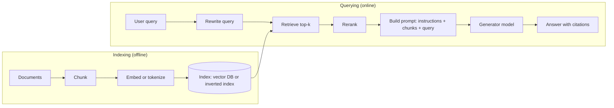

# RAG architecture and retrieval algorithms

A model can only answer well if it has the information it needs. Instructions tell it *how* to behave, and **context** tells it *what it needs to know*. Huyen argues that context construction for foundation models plays the role that feature engineering played for classical ML. The two dominant patterns for constructing context are **RAG** (retrieval-augmented generation) and **agents**. This lesson covers RAG's architecture and its core: retrieval algorithms.

> [!NOTE]
> Context engineering as a broader discipline, including MCP, tool schemas and context budgeting, is covered in the **LLM Practice** track. Here we focus on the retrieval mechanics from Huyen's chapter 6.

## 1. Why RAG?

RAG improves a model's generation by retrieving relevant information from external memory: an internal database, a user's chat history, the internet. The term comes from Lewis et al. (2020), but the retrieve-then-generate pattern goes back to Chen et al.'s 2017 open-domain QA system, which retrieved five Wikipedia pages and had a model read them.

Think of RAG as constructing context **specific to each query** instead of using the same context for all. For a question about one customer's printer, you supply that printer's specifications, not the whole catalog.

### Won't long context windows make RAG obsolete?

Huyen's answer is no, for two reasons:

1. **Data always outgrows context.** However long the context window, some application will have more data. Context has grown from 1K to 2M tokens, and knowledge bases have grown too.
2. **More context is not better context.** A model that can process long context does not necessarily *use* it well (the "lost in the middle" effect). Irrelevant content costs money and latency and can distract the model. Retrieval puts in only what matters.

Anthropic's guidance, cited by Huyen: if your knowledge base is smaller than about 200,000 tokens (roughly 500 pages), you can put it all in the prompt and skip RAG.

## 2. RAG architecture

A RAG system has two components:

- a **retriever**, which fetches information from external memory, and
- a **generator**, which produces the response from it.



In the original paper the retriever and generator were trained together. Today they are usually separate, off-the-shelf components, though end-to-end finetuning can improve results a lot. Huyen says **the quality of a RAG system depends on the quality of its retriever**.

A retriever does two things: **indexing** (processing data so it can be found quickly) and **querying** (finding data relevant to a query). How you index depends on how you want to retrieve. Documents are usually split into **chunks** first (next lesson). Following IR tradition, Huyen calls both documents and chunks "documents".

## 3. Retrieval algorithms

Retrieval is a century-old field behind search engines, recommenders and log analytics. Retrieval works by **ranking documents by relevance to the query**, and algorithms differ in how they score relevance. Huyen divides them into **term-based** and **embedding-based**.

> [!NOTE]
> You will also see "sparse" vs "dense" retrieval. Sparse vectors are mostly zeros (one dimension per vocabulary term, as in term-based methods). Dense vectors are embeddings. Some sparse methods are learned (SPLADE), so the two taxonomies don't line up exactly. Huyen prefers term-based vs embedding-based.

### Term-based (lexical) retrieval

The simplest idea is keyword matching: for the query "AI engineering", return documents containing those words. Two problems appear:

- Too many documents contain the terms. Rank by **term frequency (TF)**, the number of times a term appears in a document.
- Not all terms matter equally. "for" and "at" are everywhere. Weight by **inverse document frequency (IDF)**: with $N$ documents and $C(t)$ containing term $t$, $\text{IDF}(t)=\log\frac{N}{C(t)}$.

**TF-IDF** combines them. For query terms $t_1..t_q$:

$$\text{Score}(D, Q) = \sum_{i=1}^{q} \text{IDF}(t_i)\times f(t_i, D)$$

**BM25** (Okapi BM25, "best matching 25") improves on TF-IDF by saturating term frequency and normalizing for document length. It remains a very strong baseline, and Elasticsearch builds on it.

$$\text{score}(D,Q)=\sum_{t\in Q}\text{IDF}(t)\cdot\frac{f(t,D)\,(k_1+1)}{f(t,D)+k_1\left(1-b+b\,\frac{|D|}{\text{avgdl}}\right)}$$

The data structure that makes this fast is the **inverted index**, a dictionary from each term to the documents containing it, often with term counts.

```python-run
import math, re
from collections import Counter
docs = ["How to reset your password in the account settings",
        "Error EADDRNOTAVAIL 99 means the address is not available",
        "Password rules: at least 12 characters",
        "Reset the router if the network address is not available"]
tok = lambda s: re.findall(r"[a-z0-9]+", s.lower())
D = [tok(d) for d in docs]; N = len(D); avgdl = sum(map(len, D)) / N
inverted = {}
for i, d in enumerate(D):
    for t, c in Counter(d).items(): inverted.setdefault(t, {})[i] = c
def bm25(query, k1=1.5, b=0.75):
    scores = [0.0] * N
    for t in set(tok(query)):
        posting = inverted.get(t, {})
        idf = math.log((N - len(posting) + 0.5) / (len(posting) + 0.5) + 1)
        for i, f in posting.items():                       # only docs containing the term are touched
            scores[i] += idf * f * (k1 + 1) / (f + k1 * (1 - b + b * len(D[i]) / avgdl))
    return sorted(enumerate(scores), key=lambda x: -x[1])
for q in ["reset password", "EADDRNOTAVAIL"]:
    print(q, "->", [(i, round(s, 3)) for i, s in bm25(q) if s > 0])
```

**Tokenization** matters. Splitting on words loses multi-word terms ("hot dog"), so n-grams may be used. Text is commonly lowercased, punctuation is removed, and stop words are dropped. Classical NLP packages such as NLTK and spaCy help.

### Embedding-based (semantic) retrieval

Term-based retrieval works at the lexical level. A query for "transformer architecture" may return documents about electrical transformers or the movie. **Embedding-based retrieval** ranks by how close a document's *meaning* is to the query's.

- **Indexing**: convert each chunk into an embedding with an **embedding model** and store it in a **vector database**.
- **Querying**: embed the query with the *same* model, then fetch the $k$ chunks whose embeddings are closest (often by cosine similarity).

The hard part is **vector search**. Exact **k-nearest neighbors** compares the query to every vector, which is accurate but too slow for large collections. **Approximate nearest neighbor (ANN)** algorithms trade a little accuracy for a lot of speed. Libraries include FAISS (Meta), ScaNN (Google), Annoy (Spotify) and Hnswlib.

Vector indexes organize vectors into buckets, trees or graphs so search can skip most of them:

| Algorithm | Idea |
|---|---|
| **LSH** (locality-sensitive hashing) | hash similar vectors into the same buckets. Fast and light to build, less accurate |
| **HNSW** (hierarchical navigable small world) | multi-layer graph where edges link similar vectors. Search walks the graph. High accuracy and fast queries, costly to build and memory-hungry |
| **Product quantization** | compress each vector into a short code by splitting it into subvectors, so distances are computed on compact codes |
| **IVF** (inverted file index) | k-means clusters the vectors. Search looks only in the nearest clusters. Often combined with PQ (IVF-PQ) |
| **Annoy** | a forest of random-projection trees |

```python-run
import numpy as np
rng = np.random.default_rng(0)
N, d, k = 20000, 64, 5
X = rng.normal(size=(N, d)).astype(np.float32); X /= np.linalg.norm(X, axis=1, keepdims=True)
q = X[123] + 0.1 * rng.normal(size=d); q /= np.linalg.norm(q)
exact = np.argsort(-(X @ q))[:k]                       # exact k-NN: scan everything
# A tiny IVF: cluster with a few k-means steps, then search only the closest clusters.
C = X[rng.choice(N, 64, replace=False)]
for _ in range(5):
    assign = np.argmax(X @ C.T, axis=1)
    C = np.stack([X[assign == c].mean(axis=0) if (assign == c).any() else C[c] for c in range(64)])
    C /= np.linalg.norm(C, axis=1, keepdims=True)
for nprobe in [1, 4, 16]:
    probe = np.argsort(-(C @ q))[:nprobe]
    cand = np.where(np.isin(assign, probe))[0]
    approx = cand[np.argsort(-(X[cand] @ q))[:k]]
    print(f"nprobe={nprobe:2d}: scanned {len(cand):5d}/{N} vectors, recall@{k} = {len(set(approx) & set(exact)) / k:.1f}")
```

Vector databases are evaluated on **recall** (the fraction of true nearest neighbors found), **QPS** (queries per second), **build time** and **index size**. ANN-Benchmarks compares algorithms on these.

## 4. Comparing retrieval algorithms

| | Term-based | Embedding-based |
|---|---|---|
| **Query speed** | much faster | embedding generation and vector search can be slow |
| **Out-of-box performance** | typically strong, but hard to improve | can outperform with finetuning. Handles natural, paraphrased queries |
| **Failure modes** | term ambiguity ("transformer") and vocabulary mismatch | embeddings can **obscure exact keywords**: error codes like `EADDRNOTAVAIL (99)`, product names, IDs |
| **Cost** | much cheaper | embedding, vector storage and search can be expensive. Huyen notes vector DB spending can be a fifth to a half of model API spending |

There is also an **indexing vs querying trade-off**. A detailed index such as HNSW gives accurate, fast queries but is slow and memory-heavy to build. A simple index such as LSH is quick to build but gives slower, less accurate queries.

### Evaluating retrievers

- **Context precision** (context relevance): of the retrieved documents, what fraction is relevant?
- **Context recall**: of all relevant documents, what fraction was retrieved? This requires labeling every document's relevance to each test query, which is expensive, so some frameworks only support precision.
- **Ranking metrics** when order matters: **NDCG**, **MAP**, **MRR**.
- **Embedding quality**: MTEB tests embeddings across retrieval, classification and clustering.
- **End to end**: a retriever is good if it helps the whole RAG system produce better answers.

```python-run
def precision_recall(retrieved, relevant):
    hit = len(set(retrieved) & set(relevant))
    return hit / len(retrieved), hit / len(relevant)
def mrr(retrieved, relevant):
    return next((1 / r for r, d in enumerate(retrieved, 1) if d in relevant), 0.0)
ret, rel = ["d3", "d7", "d1", "d9"], {"d1", "d2", "d7"}
p, r = precision_recall(ret, rel)
print(f"context precision={p:.2f}  context recall={r:.2f}  MRR={mrr(ret, rel):.2f}")
```

## 5. Combining retrieval algorithms: hybrid search

Production systems usually combine approaches. This is called **hybrid search**.

**Sequentially (retrieve, then rerank).** A cheap, less precise retriever such as a term-based one fetches candidates, and a more precise, more expensive mechanism picks the best. For "transformer", fetch every document containing the word, then use vector search to keep those about the neural architecture.

**In parallel (ensemble).** Several retrievers produce rankings, which are fused. The standard algorithm is **reciprocal rank fusion (RRF)** (Cormack et al., 2009):

$$\text{Score}(D)=\sum_{i=1}^{n}\frac{1}{k+r_i(D)}$$

where $r_i(D)$ is the document's rank from retriever $i$ and $k$ is a constant (typically 60) that prevents division by zero and controls the influence of lower-ranked documents. RRF uses **ranks, not scores**, so it needs no calibration between BM25 scores and cosine similarities.

```python-run
def rrf(rankings, k=60):
    s = {}
    for r in rankings:
        for rank, d in enumerate(r, 1): s[d] = s.get(d, 0) + 1 / (k + rank)
    return sorted(s.items(), key=lambda x: (-x[1], x[0]))
bm25_rank = ["err_doc", "faq_12", "faq_3"]         # exact keyword match wins here
dense_rank = ["faq_3", "faq_12", "guide_9"]        # semantic match wins here
for d, s in rrf([bm25_rank, dense_rank]): print(f"{d:8s} {s:.4f}")
```

> [!INTERVIEW]
> **"BM25 or embeddings for our RAG system?"** Start with BM25 or another term-based baseline: it is cheap, fast and strong out of the box, and it nails exact identifiers. Add embeddings for paraphrase and semantic matching, and fuse them with RRF (hybrid). Rerank the top candidates with a stronger model. Evaluate with context precision and recall plus end-to-end answer quality, and consider cost: embedding regeneration, vector storage and query latency. Mention the failure modes: lexical ambiguity for BM25, lost keywords for embeddings.

## Pitfalls

- Embedding queries and documents with **different models**. They must share one embedding space.
- Skipping the keyword baseline and going straight to a vector database.
- Ignoring index build cost and re-embedding cost when data changes often.
- Evaluating only the generator. If retrieval fails, the generator cannot recover.

## Summary

- RAG is a **retriever** plus a **generator**. It builds per-query context, and longer context windows do not remove the need for it.
- **Term-based retrieval** (TF-IDF, BM25, inverted index) is fast, cheap and strong on exact terms. **Embedding-based retrieval** (embedding model, vector DB, ANN such as HNSW, IVF, PQ, LSH) captures meaning but costs more and can lose keywords.
- Evaluate with context precision and recall, ranking metrics, and end-to-end quality.
- **Hybrid search** combines them, either sequentially (retrieve then rerank) or in parallel with **reciprocal rank fusion**.

```quiz
[
  {"q": "Why won't very long context windows make RAG obsolete, per Huyen?", "options": ["Long context is illegal", "Data always exceeds context, and models don't use very long context well; irrelevant context adds cost and noise", "RAG is free", "Embeddings need RAG"], "answer": 1, "explain": "There will always be more data than context, and stuffing context hurts cost, latency and focus."},
  {"q": "What do the two main retriever functions do?", "options": ["Training and inference", "Indexing (prepare data for fast lookup) and querying (find relevant data)", "Tokenizing and sampling", "Chunking and prompting"], "answer": 1, "explain": "How you index depends on how you plan to query."},
  {"q": "What does IDF do in TF-IDF/BM25?", "options": ["Counts words in a document", "Down-weights terms that appear in many documents", "Normalizes document length", "Embeds the query"], "answer": 1, "explain": "Common terms like 'the' carry little information, and rare terms are more discriminative."},
  {"q": "What does BM25 add over plain TF-IDF?", "options": ["Embeddings", "Term-frequency saturation and document-length normalization", "Graph search", "Reranking with LLMs"], "answer": 1, "explain": "k1 controls saturation and b controls length normalization."},
  {"q": "A user searches for the error code 'EADDRNOTAVAIL (99)'. Which retriever is more likely to find the exact document?", "options": ["Embedding-based only", "Term-based (keyword) retrieval", "Neither", "Random"], "answer": 1, "explain": "Embeddings can obscure specific keywords, and term-based retrieval matches them exactly. This is why hybrid search is popular."},
  {"q": "HNSW vs LSH: which statement matches the book?", "options": ["HNSW is quick to build but inaccurate", "HNSW gives accurate, fast queries but is costly to build; LSH is cheap to build but less accurate", "They are identical", "LSH uses graphs"], "answer": 1, "explain": "It's the indexing/querying trade-off."},
  {"q": "A document is ranked 1st by one retriever and 2nd by another. With RRF and k = 60 its score is…", "options": ["1.5", "1/61 + 1/62", "1/60", "3"], "answer": 1, "explain": "RRF sums 1/(k + rank) across retrievers."},
  {"q": "Context recall is harder to compute than context precision because…", "options": ["It needs GPUs", "You must know all relevant documents in the corpus for each query", "It requires logprobs", "It only works for images"], "answer": 1, "explain": "Recall needs relevance labels for every document, not just the retrieved ones."}
]
```

> **Source:** Huyen, *AI Engineering*, ch. 6 ("RAG": RAG architecture, retrieval algorithms, comparing and combining retrieval algorithms).
