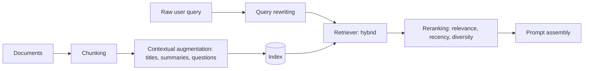

# Retrieval optimization

> **Before this lesson:** read [RAG architecture and retrieval algorithms](#/lesson/ai-eng/aie-rag-retrieval), which explains retrievers, indexes, BM25, embeddings, hybrid search and context precision and recall. Defensive habits for running model-generated SQL come from [Defensive prompt engineering](#/lesson/ai-eng/aie-prompt-defense). The demos are short Python programs, explained line by line.

## In plain words

Choosing BM25, embeddings or a mix of both is only the start of building a good retrieval system. Much of a RAG system's quality comes from the decisions around the retriever: how documents are cut into pieces, how results are reordered, how the user's question is cleaned up before searching, and what extra information is attached to each piece so it can be found. Huyen names four tactics: **chunking strategy, reranking, query rewriting and contextual retrieval**. She then extends RAG beyond text, to **images** and to **tables**.

An everyday picture: organising a recipe binder so you can find things fast. If you tear recipes into random strips, a strip that says "bake for 40 minutes" is useless without knowing which dish it belongs to (chunking, and the context a chunk loses). If you write the dish name at the top of every strip, it is findable again (contextual retrieval). When a friend asks "and the dessert one?", you first work out which dessert they mean before searching (query rewriting). And when you pull out ten candidates, you put the three best and most recent on top (reranking).

Why this matters for a job: "Our RAG bot gives wrong answers, how do you debug it?" is one of the most common AI engineering interview questions, and the answer is mostly this lesson. These are also the knobs teams turn every week in production.



The diagram shows where each tactic sits. On the indexing side, documents are chunked and each chunk is enriched before it goes into the index. On the query side, the user's message is rewritten, the retriever searches, and results are reranked before the prompt is assembled.

## 1. Chunking strategy

A **chunk** is a piece of a document that is indexed and retrieved as one unit; **chunking** is the process of cutting documents into chunks. How you index depends on how you plan to retrieve, and chunking has a large effect on retrieval quality: if the answer is split across two chunks, or buried in a huge chunk full of other material, the retriever will struggle.

### Simple strategies

- **Fixed-size chunks** measured in some unit: characters (for example 2,048), words (512), sentences (20) or paragraphs (one each).
- **Recursive splitting**: start with the largest natural unit (sections). Any section over the size limit is split into paragraphs; any paragraph still too long is split into sentences, and so on. This makes it less likely that related text is cut in an arbitrary place.
- **Structure-aware splitting**: splitters that understand a format, such as code split by function, question-and-answer documents split by Q&A pair, and special handling for languages such as Chinese that do not separate words with spaces.

Here is recursive splitting in code. It tries paragraph breaks first, then sentence ends, then spaces:

```python-run
def recursive_split(text, max_chars, seps=("\n\n", ". ", " ")):
    """Split on the biggest separator first; only pieces still too long are split further."""
    if len(text) <= max_chars:
        return [text]
    if not seps:                                   # no separator left: hard cut
        return [text[i:i + max_chars] for i in range(0, len(text), max_chars)]
    sep, rest = seps[0], seps[1:]
    chunks, current = [], ""
    for piece in text.split(sep):
        candidate = piece if not current else current + sep + piece
        if len(candidate) <= max_chars:
            current = candidate                    # keep packing pieces into this chunk
        else:
            if current:
                chunks.append(current)
            if len(piece) > max_chars:
                chunks.extend(recursive_split(piece, max_chars, rest))   # too big: go one level finer
                current = ""
            else:
                current = piece
    if current:
        chunks.append(current)
    return chunks

doc = ("Refunds. You can request a refund within 30 days. Refunds go back to the original card.\n\n"
       "Shipping. Orders ship in 2 days. Express shipping costs extra and arrives next day. "
       "We do not ship to PO boxes.\n\n"
       "Contact. Email support any time.")
for c in recursive_split(doc, 90):
    print(f"[{len(c):2d}] {c!r}")
```

**Reading this Python line by line**

- If the text already fits within `max_chars`, it is returned as a single chunk. That is the stopping point of the **recursion** (a function calling itself on a smaller piece of the problem).
- If no separators are left, the text is cut into fixed slices as a last resort.
- Otherwise the function splits on the biggest separator (`seps[0]`, first a blank line meaning a paragraph break). It then *packs* consecutive pieces into `current` as long as they fit, so short paragraphs share a chunk.
- When a piece will not fit, the packed chunk is saved. If the piece on its own is still too long, the function calls itself with the remaining, finer separators (`rest`), which is the recursive step.
- `{c!r}` prints the chunk with quotes, so you can see exactly where it starts and ends.
- Output: four chunks. The refunds paragraph (87 characters) fits whole. The shipping paragraph is too long, so it is split at sentence ends into 82 and 27 characters. The contact paragraph is 32. Notice one flaw: the full stop after "next day" vanished, because the separator `". "` is removed at a cut. Production splitters keep separators attached to the text.

### Overlap

Without overlap, a chunk boundary can cut straight through important context. Huyen's example is the sentence "I left my wife a note". If the boundary falls after "wife", the first chunk says something very different from the original and the second ("a note") says almost nothing. **Overlapping** chunks repeat a little text at each boundary so that boundary information appears whole in at least one chunk. A typical setting is a 2,048-character chunk with about 20 characters of overlap.

```python-run
def fixed_chunks(words, size, overlap):
    step = size - overlap
    return [" ".join(words[i:i + size]) for i in range(0, max(1, len(words) - overlap), step)]
text = "I left my wife a note on the kitchen table before the long flight to Hanoi"
for size, ov in [(4, 0), (4, 2)]:
    print(f"size={size}, overlap={ov}:")
    for c in fixed_chunks(text.split(), size, ov): print("   ", c)
```

`step = size - overlap` is how far each chunk's start moves forward: 4 words without overlap, 2 words with an overlap of 2. `range(0, ..., step)` produces the start positions, and `words[i:i + size]` takes `size` words from each. The `max(1, len(words) - overlap)` stop value avoids a final chunk that would contain only overlap. Output: without overlap, "I left my wife" and "a note on the" are separate chunks, the misleading split. With overlap, a middle chunk "my wife a note" keeps the phrase together. You will write a fuller version in the `aie-text-splitter` problem.

### Token-based chunking

You can also measure chunks in the generator model's **tokens**. Chunk sizes then line up exactly with the model's limits, but if you later switch to a model with a different tokenizer you must re-chunk and re-index everything.

### Chunk size trade-offs

| Smaller chunks | Larger chunks |
|---|---|
| more varied information fits in the context (halve the size, fit twice as many) | each chunk keeps more of its surrounding context |
| risk losing important information: if topic X is named only in the first half of a document, the second half's chunk may never be retrieved | fewer chunks fit, with more irrelevant text in each |
| more chunks means more embeddings to compute and store and a larger search space (slower queries) | cheaper indexing |

The chunk size must not exceed the generator's context limit, and for embedding-based retrieval it must not exceed the **embedding model's** input limit either (longer text is often cut off silently). No chunk size or overlap is right for every application, so the advice is to test several on your own data, measuring context recall and end-to-end answer quality.

## 2. Reranking

The retriever's first ranking can be improved by a second pass, called **reranking**. It helps most when you must **cut the number of documents**, to fit the context window or to save input tokens.

- **Two-stage pattern.** A cheap retriever fetches many candidates, say 100, and a more precise, more expensive model reorders the top ones and keeps, say, 5. A common choice is a **cross-encoder**: a model that reads the query and a document *together* and outputs a relevance score. It is more accurate than comparing two separately computed embeddings, but too slow to run over the whole collection.
- **Time-based reranking.** Give recent documents more weight. This matters for news, email assistants and stock analysis.
- **Diversity.** A common extension outside the book is **maximal marginal relevance** (MMR), which penalises candidates that are too similar to ones already chosen, so the context is not filled with near-duplicates. You will implement it in the `aie-mmr` problem.

Huyen points out a difference between **context reranking and search reranking**. In web search, whether a result is first or fifth decides whether anyone sees it. When reranking for a model's context, order still matters somewhat, since models read the beginning and end of the context best, but once a document is *included*, its exact rank matters much less.

A simple time-based reranker mixes relevance with a **time decay**. A common decay uses a **half-life**: the age at which a document's freshness score halves. In words: freshness is $0.5$ raised to (age divided by half-life), and the final score is a weighted average of relevance and freshness, with weight $\alpha$ on relevance:

$$
\text{score} = \alpha \cdot \text{relevance} + (1 - \alpha)\cdot 0.5^{\,\text{age}/\text{half-life}}
$$

Worked example: a 30-day-old document with relevance 0.80, half-life 180 days and $\alpha = 0.7$: freshness is $0.5^{30/180} = 0.891$, so the score is $0.7 \times 0.80 + 0.3 \times 0.891 = 0.56 + 0.267 = 0.827$.

```python-run
import numpy as np
# Recency-aware reranking: combine relevance with an exponential time decay.
docs = [("Q3 earnings summary", 0.82, 400), ("Q4 earnings summary", 0.80, 30), ("Company history", 0.60, 2000)]
half_life = 180.0   # days
for alpha in [1.0, 0.7]:
    scored = sorted(((alpha * rel + (1 - alpha) * 0.5 ** (age / half_life), name) for name, rel, age in docs), reverse=True)
    print(f"alpha={alpha}:", [(n, round(s, 3)) for s, n in scored])
```

Each document is `(title, relevance, age in days)`. The generator expression builds `(score, title)` pairs with the formula above, and `sorted(..., reverse=True)` puts the highest score first (tuples sort by their first element). Output: with `alpha=1.0` (relevance only), the 400-day-old Q3 summary edges out Q4 (0.82 versus 0.80). With `alpha=0.7`, the fresh Q4 summary jumps clearly ahead (0.827 versus 0.638). For "what were our latest earnings?", that is the ranking you want.

## 3. Query rewriting

**Query rewriting** (also called query reformulation, normalisation or expansion) turns the user's raw message into a better search query before retrieval. Consider this conversation:

> **User:** What plan is the Acme Corp account on?
> **AI:** Acme Corp has been on the Team plan since March.
> **User:** And Globex?

Searching with "And Globex?" alone returns junk, because the words "plan" and "account" are missing. The query must be rewritten to stand on its own: *"What plan is the Globex account on?"*

- Traditional search engines use hand-written rules. AI applications can give the job to a model: show it the conversation so far and ask it to restate the user's latest message as a complete, self-contained question.
- It gets hard with **identity resolution**, working out *who* or *what* a vague reference points to. A follow-up such as "And its parent company?" first requires looking up which company "its" is. If that information is not available, the rewriter should say the query cannot be resolved. It must **not invent a name**, which would lead to a confidently wrong answer.

A rewriting prompt for a model might read (static example):

```text
Given the conversation, rewrite the user's LAST message as a standalone search query.
If the message refers to something you cannot identify from the conversation, output: UNRESOLVED.
Conversation:
{{history}}
Last message: {{message}}
Standalone query:
```

The demo is a rule-based stand-in for such a model, handling one pattern ("How about X?"):

```python-run
# A rule-based stand-in for an LLM rewriter: resolve an elliptical follow-up using the previous question.
import re
def rewrite(history, last):
    m = re.match(r"(?i)(how|what) about (.+?)\??\Z", last.strip())
    if not m or not history: return last
    prev_q = history[-1]
    entity = re.search(r"[A-Z][a-z]+ [A-Z][a-z]+", prev_q)          # naive: first capitalized full name
    return prev_q.replace(entity.group(0), m.group(2)) if entity else last
hist = ["When did Maria Lopez last place an order with us?"]
print(rewrite(hist, "How about Daniel Kim?"))
```

`re.match` checks whether the message starts with "how about" or "what about" (`(?i)` ignores case) and captures what follows, minus an optional question mark (`\??`) at the very end (`\Z`). If it matches, the code finds the first capitalised two-word name in the previous question and swaps in the new one. Output: `When did Daniel Kim last place an order with us?`. Real rewriters use a model because follow-ups come in endless forms, but the contract is the same: input is history plus last message, output is a standalone query or an explicit "cannot resolve".

## 4. Contextual retrieval

The idea of **contextual retrieval** is to **enrich each chunk with extra context** so that it is easier to find.

- **Metadata**: tags, keywords and named things (*entities*) pulled out of the chunk. If a document contains the error code `EADDRNOTAVAIL (99)`, storing that code as metadata lets you find the chunk by exact keyword even after its text has been turned into an embedding. Product pages can be enriched with descriptions and reviews; images and videos with titles and captions.
- **Questions the chunk can answer.** For customer support, attach the phrasings customers actually use to the refund-policy article: "Can I get my money back?", "How do I return this?", "I was charged twice". A user's question then matches one of these even when it shares no words with the policy's formal wording.
- **Document context.** A chunk cut from the middle of a document may never say what it is about. Add the document's **title and summary**. Anthropic (2024) uses a model to write a short context of **50–100 tokens** that places each chunk within its document, using a prompt that shows the whole document and the chunk and asks for a brief situating context. That context is **prepended** (added to the front of) the chunk before it is indexed with both BM25 and embeddings.

```python-run
doc_title = "ACME Q2 2030 Financial Report"
chunk = "Revenue grew 3% over the previous quarter."
print("Raw chunk     :", chunk)
print("Contextualized:", f"[From '{doc_title}', section 'Revenue'. This chunk reports ACME's Q2 2030 quarter-over-quarter revenue growth.] {chunk}")
print("\nThe raw chunk never mentions ACME or Q2 2030, so a query like 'ACME revenue growth Q2 2030' would miss it.")
```

This demo only prints the before and after. The bracketed sentence plays the role of the model-written context. A search for "ACME revenue growth Q2 2030" now shares four important words with the contextualised chunk, and none with the raw one.

### Evaluating retrieval solutions

Huyen's checklist for choosing a retrieval product or vector database:

- Which retrieval methods does it support? Does it do **hybrid search**?
- Which embedding models and vector search algorithms?
- **Scalability** in data volume and in query traffic.
- **Indexing time**, and how much data you can add or delete at once.
- **Query latency** for each algorithm.
- **Pricing structure** for managed (hosted) services: charged by the number of documents or vectors, or by query volume?

Enterprise needs come on top: **access control** (who may see which documents), compliance, and separating the *data plane* (where your data is stored and processed) from the *control plane* (the service that manages it).

## 5. RAG beyond text

### Multimodal RAG

If the generator is **multimodal** (it accepts images, audio or video as well as text), the retrieved context can include those too. If a user asks what colour a landmark building is, the retriever can fetch a photo of it and pass that to the model together with the question.

- Retrieval can use **metadata** (titles, tags, captions) with ordinary text search.
- Or it can use a **multimodal embedding model** such as CLIP: embed images and texts into the same space, embed the query, and fetch the nearest images.

### RAG with tabular data

Many answers live in tables. Take an online shop. "How many units of our best-selling hat did we sell this past week?" can only be answered by querying a `Sales` table in a database. This is **text-to-SQL**, in three steps:

1. **Text-to-SQL**: generate an SQL query from the user's question and the **schemas** of the tables (descriptions of each table's columns and their types).
2. **SQL execution**: run the query against the database.
3. **Generation**: answer from the query result and the original question.

If there are too many tables to fit all their schemas in the prompt, add a step before step 1 that predicts **which tables** are needed. The SQL can be written by the main generator model or by a separate model specialised in text-to-SQL. Notice that this is already agent-like: the model produces an action (an SQL query) that a tool carries out. The next lesson covers agents.

```python-run
import sqlite3
con = sqlite3.connect(":memory:")
con.executescript("""
CREATE TABLE sales(order_id INT, product TEXT, units INT, day INT);
INSERT INTO sales VALUES (1,'Fruity Fedora',2,1),(2,'Fruity Fedora',1,5),(3,'Cozy Cap',4,6),(4,'Fruity Fedora',3,9);
""")
question = "How many units of Fruity Fedora were sold in the last 7 days (today is day 10)?"
generated_sql = "SELECT SUM(units) FROM sales WHERE product='Fruity Fedora' AND day > 10 - 7"   # step 1 (stubbed model output)
result = con.execute(generated_sql).fetchone()[0]                                               # step 2
print(f"Q: {question}\nSQL: {generated_sql}\nA: {result} units were sold in the last 7 days.")   # step 3
```

**Reading this Python line by line**

- `sqlite3` is Python's built-in small database. `connect(":memory:")` creates a temporary database that lives only in memory.
- `executescript` runs two SQL statements: `CREATE TABLE` defines a `sales` table with four columns, and `INSERT` adds four rows.
- `generated_sql` stands in for what a model would write in step 1. It sums the `units` column for rows where the product is the Fruity Fedora and the day is after day 3.
- `con.execute(...).fetchone()[0]` runs the query (step 2) and takes the single number it returns.
- The final `print` is step 3, done here with a template instead of a model.
- Output: the question, the SQL, and `A: 4 units were sold in the last 7 days.` Only the sales on days 5 and 9 (1 + 3 units) fall within the window; the day-1 sale is too old and the Cozy Cap is a different product.

> [!WARNING]
> Executing model-generated SQL is tool execution. Use read-only database credentials, restrict which tables are visible, set row limits and timeouts, and treat retrieved or user text as untrusted (see defensive prompt engineering).

> [!INTERVIEW]
> **"Your RAG bot gives wrong answers. How do you debug it?"** Separate retrieval from generation. (1) Check whether the right chunk was retrieved (context recall and precision on a labelled set). (2) If not: inspect chunking (size, overlap, lost context), try hybrid search for keyword-heavy queries, add query rewriting for conversational follow-ups, add contextual enrichment (titles, summaries, questions) and a reranker. (3) If the right chunk was retrieved but the answer is still wrong: check where the chunk sits in the prompt, tighten instructions ("answer only from the context, cite the passage"), reduce noise by passing fewer chunks, and measure factual consistency. Change one thing at a time against a fixed evaluation set.

## Pitfalls

- Chunking with a fixed size and no overlap, and never revisiting it.
- Chunks longer than the embedding model's limit, which get silently truncated.
- Retrieving with the raw last message in a multi-turn chat.
- A rewriter that invents entities it cannot resolve.
- Chunks that are meaningless out of context ("It grew 3%").

## Summary

- **Chunking**: fixed-size, recursive or structure-aware. Use overlap to keep boundary context. Size trades variety against lost context and indexing cost. Experiment on your own data.
- **Reranking**: a second, more precise scorer (such as a cross-encoder), recency weighting and diversity. For a model's context, inclusion matters more than exact rank.
- **Query rewriting**: make each query stand alone. Resolve identities, and never invent them.
- **Contextual retrieval**: add metadata, answerable questions and a short situating context (Anthropic's 50–100 tokens) to each chunk.
- RAG extends to **multimodal** data (captions or CLIP-style embeddings) and **tabular** data (text-to-SQL, execute, generate).

## Glossary

- **Chunk / chunking**: a piece of a document indexed as one unit / cutting documents into such pieces.
- **Fixed-size, recursive and structure-aware splitting**: cutting by a set length; cutting by the biggest natural unit first and going finer only where needed; cutting along a format's own structure.
- **Recursion**: a function solving a problem by calling itself on smaller parts.
- **Overlap**: text repeated at the end of one chunk and the start of the next.
- **Token-based chunking**: measuring chunk size in the model's tokens.
- **Reranking**: reordering retrieved candidates with a second, more precise step.
- **Cross-encoder**: a model that reads a query and a document together and scores their relevance.
- **Time decay / half-life**: lowering a document's score with age / the age at which the score halves.
- **Maximal marginal relevance (MMR)**: choosing results that are relevant but not too similar to each other.
- **Query rewriting**: turning a raw message into a standalone, searchable query.
- **Identity resolution**: working out which person or thing a vague reference points to.
- **Contextual retrieval**: enriching chunks with metadata, questions or a situating summary before indexing.
- **Metadata / entity**: data describing a chunk / a named thing such as a product, person or error code.
- **Prepend**: add to the front.
- **Access control**: rules about who may see which documents.
- **Multimodal**: handling more than one kind of data, such as text and images.
- **Text-to-SQL**: generating a database query from a natural-language question.
- **Schema**: a description of a table's columns and their types.

```quiz
[
  {"q": "Why add overlap between chunks?", "options": ["To reduce index size", "So information at chunk boundaries appears intact in at least one chunk", "To speed up embedding", "To avoid tokenization"], "answer": 1, "explain": "'I left my wife' / 'a note' loses the meaning. Overlap keeps boundary context together."},
  {"q": "Halving the chunk size means…", "options": ["Half as many embeddings to store", "Twice as many chunks to index and search, but twice as many chunks fit in context", "No change", "Better recall guaranteed"], "answer": 1, "explain": "Smaller chunks give more varied context but raise indexing and storage cost and can lose context."},
  {"q": "What's a downside of chunking by the generator's tokens?", "options": ["Tokens are larger than words", "Switching to a model with a different tokenizer requires re-indexing", "It can't be done", "It breaks BM25"], "answer": 1, "explain": "Token-based chunks depend on a specific tokenizer."},
  {"q": "How does context reranking differ from search reranking?", "options": ["Order never matters", "Exact rank matters less as long as the document is included, though placement at start/end still helps", "It uses no models", "It must be random"], "answer": 1, "explain": "In search the top positions are everything. For a model's context, inclusion matters most."},
  {"q": "In a chat about account plans, the follow-up 'And Globex?' should be handled by…", "options": ["Retrieving with it verbatim", "Rewriting it into a standalone query using conversation history", "Ignoring it", "Increasing top-k"], "answer": 1, "explain": "Query rewriting makes the query self-contained before retrieval."},
  {"q": "A user asks 'And its parent company?' and the system has no record of which company that is. The rewriter should…", "options": ["Guess a plausible company", "Acknowledge that the query can't be resolved rather than invent one", "Return an empty string silently", "Use the user's name"], "answer": 1, "explain": "An invented identity leads to a confidently wrong answer."},
  {"q": "Anthropic's contextual retrieval does what before indexing?", "options": ["Deletes short chunks", "Prepends a short model-generated context (about 50-100 tokens) situating each chunk in its document", "Translates chunks to English", "Quantizes embeddings"], "answer": 1, "explain": "The situating context makes chunks retrievable even when they don't mention the document's subject."},
  {"q": "The three steps of RAG over tabular data are…", "options": ["Chunk, embed, rerank", "Text-to-SQL, SQL execution, generation from the result", "Tokenize, sample, decode", "Crawl, index, serve"], "answer": 1, "explain": "The model writes a query, a tool executes it, and the model answers from the result."}
]
```

> **Source:** Huyen, *AI Engineering*, ch. 6 ("Retrieval Optimization": chunking strategy, reranking, query rewriting, contextual retrieval; "RAG Beyond Texts").
