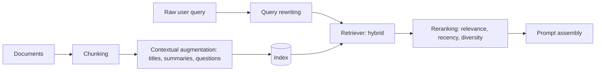

# Retrieval optimization

Choosing BM25, embeddings or a hybrid is only the start. In practice, much of a RAG system's quality comes from decisions around the retriever. Huyen names four tactics: **chunking strategy, reranking, query rewriting and contextual retrieval**. She then extends RAG beyond text to **multimodal** and **tabular** data. This lesson covers each, with small runnable demos.



## 1. Chunking strategy

How you index depends on how you plan to retrieve, and chunking has a large effect on retrieval quality.

### Simple strategies

- **Fixed-size chunks** by some unit: characters (for example 2,048), words (512), sentences (20) or paragraphs (one each).
- **Recursive splitting**: split by sections. If a section is too long, split it into paragraphs, and if a paragraph is too long, into sentences. This reduces the chance of cutting related text arbitrarily.
- **Structure-aware splitting**: language-specific splitters for code, Q&A documents split by question–answer pair, and special handling for languages such as Chinese.

### Overlap

Without overlap, a boundary can cut through important context. Huyen's example is "I left my wife a note". Split into "I left my wife" and "a note", neither chunk carries the meaning. **Overlapping** chunks ensure boundary information appears whole in at least one chunk. A typical setting is a 2,048-character chunk with about 20 characters of overlap.

### Token-based chunking

You can chunk by the generative model's **tokens**. This aligns chunk sizes with the model's limits, but if you later change models (and tokenizers) you must re-index.

### Chunk size trade-offs

| Smaller chunks | Larger chunks |
|---|---|
| more diverse information fits in the context (halve the size, fit twice as many) | each chunk keeps more of its surrounding context |
| risk losing important information. If topic X is named only in the first half of a document, the second half's chunk may never be retrieved | fewer chunks fit, with more irrelevant text in each |
| more chunks means more embeddings to compute and store and a larger search space (slower queries) | cheaper indexing |

The chunk size must not exceed the generator's context limit, and for embedding-based retrieval it must not exceed the **embedding model's** context limit either. In Huyen's words, there is no universal best chunk size or overlap. You have to experiment.

```python-run
def fixed_chunks(words, size, overlap):
    step = size - overlap
    return [" ".join(words[i:i + size]) for i in range(0, max(1, len(words) - overlap), step)]
text = "I left my wife a note on the kitchen table before the long flight to Hanoi"
for size, ov in [(4, 0), (4, 2)]:
    print(f"size={size}, overlap={ov}:")
    for c in fixed_chunks(text.split(), size, ov): print("   ", c)
```

## 2. Reranking

The retriever's first ranking can be refined. Reranking is especially useful when you need to **cut the number of documents**, to fit the context window or to reduce input tokens.

- **Two-stage pattern.** A cheap retriever fetches many candidates, and a more precise, more expensive model (for example a cross-encoder that reads query and document together) reorders the top ones.
- **Time-based reranking.** Give recent data more weight. This matters for news, email assistants and stock analysis.
- **Diversity.** A common extension outside the book is maximal marginal relevance (MMR), which penalizes candidates that are too similar to ones already chosen, so the context is not filled with near-duplicates. You will implement it in the problems.

Huyen makes a point about **context reranking vs search reranking**. In search, the exact position (first or fifth) is crucial. In context reranking, order still matters, because models read the beginning and end of context best, but as long as a document is *included*, its exact rank matters less.

```python-run
import numpy as np
# Recency-aware reranking: combine relevance with an exponential time decay.
docs = [("Q3 earnings summary", 0.82, 400), ("Q4 earnings summary", 0.80, 30), ("Company history", 0.60, 2000)]
half_life = 180.0   # days
for alpha in [1.0, 0.7]:
    scored = sorted(((alpha * rel + (1 - alpha) * 0.5 ** (age / half_life), name) for name, rel, age in docs), reverse=True)
    print(f"alpha={alpha}:", [(n, round(s, 3)) for s, n in scored])
```

## 3. Query rewriting

Query rewriting is also called query reformulation, normalization or expansion. Consider this conversation:

> **User:** When was the last time John Doe bought something from us?
> **AI:** John last bought a Fruity Fedora hat two weeks ago, on January 3, 2030.
> **User:** How about Emily Doe?

Retrieving with "How about Emily Doe?" alone returns junk. The query must be rewritten to stand alone: *"When was the last time Emily Doe bought something from us?"*

- Traditional search engines use heuristics. AI applications can use a model with a prompt such as "Given the following conversation, rewrite the last user input to reflect what the user is actually asking."
- It gets hard with **identity resolution**. "How about his wife?" first requires looking up who his wife is. If that information is unavailable, the rewriter should say the query cannot be resolved. It should **not hallucinate a name**, which would produce a confidently wrong answer.

```python-run
# A rule-based stand-in for an LLM rewriter: resolve an elliptical follow-up using the previous question.
import re
def rewrite(history, last):
    m = re.match(r"(?i)(how|what) about (.+?)\??\Z", last.strip())
    if not m or not history: return last
    prev_q = history[-1]
    entity = re.search(r"[A-Z][a-z]+ [A-Z][a-z]+", prev_q)          # naive: first capitalized full name
    return prev_q.replace(entity.group(0), m.group(2)) if entity else last
hist = ["When was the last time John Doe bought something from us?"]
print(rewrite(hist, "How about Emily Doe?"))
```

## 4. Contextual retrieval

The idea is to **augment each chunk with context** so it is easier to retrieve.

- **Metadata**: tags, keywords, extracted entities. If a document contains the error code `EADDRNOTAVAIL (99)`, storing it as metadata lets you find the chunk by keyword even after it has been embedded. Products can be augmented with descriptions and reviews, and images and videos with titles and captions.
- **Questions it can answer.** For customer support, attach likely questions to the password-reset article: "How to reset password?", "I forgot my password", "I can't log in", "Help, I can't find my account".
- **Document context.** A chunk cut from the middle of a document may not say what it is about. Add the document **title and summary**. Anthropic (2024) uses a model to write a short context of **50–100 tokens** that situates each chunk within its document, using a prompt that shows the whole document and the chunk and asks for a succinct situating context. That context is **prepended** to the chunk before indexing with both BM25 and embeddings.

```python-run
doc_title = "ACME Q2 2030 Financial Report"
chunk = "Revenue grew 3% over the previous quarter."
print("Raw chunk     :", chunk)
print("Contextualized:", f"[From '{doc_title}', section 'Revenue'. This chunk reports ACME's Q2 2030 quarter-over-quarter revenue growth.] {chunk}")
print("\nThe raw chunk never mentions ACME or Q2 2030, so a query like 'ACME revenue growth Q2 2030' would miss it.")
```

### Evaluating retrieval solutions

Huyen's checklist for choosing a retrieval solution or vector database:

- Which retrieval mechanisms does it support? Does it do **hybrid search**?
- Which embedding models and vector search algorithms?
- **Scalability** in data volume and query traffic.
- **Indexing time**, and how much you can add or delete in bulk.
- **Query latency** per algorithm.
- **Pricing structure** for managed solutions: by document or vector volume, or by query volume?

Enterprise needs such as access control, compliance and separation of data and control planes are extra.

## 5. RAG beyond text

### Multimodal RAG

If the generator is multimodal, context can include images, audio and video. For "What's the color of the house in the Pixar movie Up?", the retriever fetches a picture of the house.

- Retrieval can use **metadata** (titles, tags, captions) with ordinary text search.
- Or it can use a **multimodal embedding model** such as CLIP. Embed images and texts into the same space, embed the query, and fetch the nearest images.

### RAG with tabular data

Many answers live in tables. For an e-commerce site ("Kitty Vogue" in the book), "How many units of Fruity Fedora were sold in the last 7 days?" needs a query against a `Sales` table. This is **text-to-SQL**:

1. **Text-to-SQL**: generate the SQL query from the user question and the table schemas.
2. **SQL execution**: run it.
3. **Generation**: answer from the SQL result and the original question.

If there are too many tables to fit their schemas in the prompt, add an intermediate step that predicts **which tables** are needed. Text-to-SQL can be done by the same generator or by a specialized model. Notice that this is already agent-like: the model generates an action (SQL) that a tool executes. The next lesson covers agents.

```python-run
import sqlite3
con = sqlite3.connect(":memory:")
con.executescript("""
CREATE TABLE sales(order_id INT, product TEXT, units INT, day INT);
INSERT INTO sales VALUES (1,'Fruity Fedora',2,1),(2,'Fruity Fedora',1,5),(3,'Cozy Cap',4,6),(4,'Fruity Fedora',3,9);
""")
question = "How many units of Fruity Fedora were sold in the last 7 days (today is day 10)?"
generated_sql = "SELECT SUM(units) FROM sales WHERE product='Fruity Fedora' AND day > 10 - 7"   # step 1 (stubbed model output)
result = con.execute(generated_sql).fetchone()[0]                                               # step 2
print(f"Q: {question}\nSQL: {generated_sql}\nA: {result} units were sold in the last 7 days.")   # step 3
```

> [!WARNING]
> Executing model-generated SQL is tool execution. Use read-only credentials, restrict tables, set limits and timeouts, and treat retrieved or user text as untrusted (see defensive prompt engineering).

> [!INTERVIEW]
> **"Your RAG bot gives wrong answers. How do you debug it?"** Separate retrieval from generation. (1) Check whether the right chunk was retrieved (context recall and precision on a labelled set). (2) If not: inspect chunking (size, overlap, lost context), try hybrid search for keyword-heavy queries, add query rewriting for conversational follow-ups, add contextual augmentation (titles, summaries, questions) and rerank. (3) If the chunk was retrieved but the answer is still wrong: check where the chunk sits in the prompt, tighten instructions ("answer only from context, cite the passage"), reduce noise by passing fewer chunks, and measure factual consistency. Change one thing at a time against a fixed eval set.

## Pitfalls

- Chunking with a fixed size and no overlap, and never revisiting it.
- Chunks longer than the embedding model's limit, which get silently truncated.
- Retrieving with the raw last message in a multi-turn chat.
- A rewriter that invents entities it cannot resolve.
- Chunks that are meaningless out of context ("It grew 3%").

## Summary

- **Chunking**: fixed-size, recursive or structure-aware. Use overlap to keep boundary context. Size trades diversity against lost context and indexing cost. Experiment.
- **Reranking**: a second-stage precise scorer, recency weighting and diversity. In context reranking, inclusion matters more than exact rank.
- **Query rewriting**: make each query stand alone. Resolve identities, and never hallucinate them.
- **Contextual retrieval**: add metadata, answerable questions and a short document-situating context (Anthropic's 50–100 tokens) to each chunk.
- RAG extends to **multimodal** (captions or CLIP-style embeddings) and **tabular** data (text-to-SQL, execute, generate).

```quiz
[
  {"q": "Why add overlap between chunks?", "options": ["To reduce index size", "So information at chunk boundaries appears intact in at least one chunk", "To speed up embedding", "To avoid tokenization"], "answer": 1, "explain": "'I left my wife' / 'a note' loses the meaning. Overlap keeps boundary context together."},
  {"q": "Halving the chunk size means…", "options": ["Half as many embeddings to store", "Twice as many chunks to index and search, but twice as many chunks fit in context", "No change", "Better recall guaranteed"], "answer": 1, "explain": "Smaller chunks give more diverse context but raise indexing and storage cost and can lose context."},
  {"q": "What's a downside of chunking by the generator's tokens?", "options": ["Tokens are larger than words", "Switching to a model with a different tokenizer requires re-indexing", "It can't be done", "It breaks BM25"], "answer": 1, "explain": "Token-based chunks depend on a specific tokenizer."},
  {"q": "How does context reranking differ from search reranking?", "options": ["Order never matters", "Exact rank matters less as long as the document is included, though placement at start/end still helps", "It uses no models", "It must be random"], "answer": 1, "explain": "In search the top positions are everything. For context, inclusion matters most."},
  {"q": "The follow-up 'How about Emily Doe?' should be handled by…", "options": ["Retrieving with it verbatim", "Rewriting it into a standalone query using conversation history", "Ignoring it", "Increasing top-k"], "answer": 1, "explain": "Query rewriting makes the query self-contained before retrieval."},
  {"q": "A user asks 'How about his wife?' and the system has no record of who she is. The rewriter should…", "options": ["Guess a plausible name", "Acknowledge that the query can't be resolved rather than hallucinate", "Return an empty string silently", "Use the user's name"], "answer": 1, "explain": "A hallucinated identity leads to a confidently wrong answer."},
  {"q": "Anthropic's contextual retrieval does what before indexing?", "options": ["Deletes short chunks", "Prepends a short model-generated context (about 50-100 tokens) situating each chunk in its document", "Translates chunks to English", "Quantizes embeddings"], "answer": 1, "explain": "The situating context makes chunks retrievable even when they don't mention the document's subject."},
  {"q": "The three steps of RAG over tabular data are…", "options": ["Chunk, embed, rerank", "Text-to-SQL, SQL execution, generation from the result", "Tokenize, sample, decode", "Crawl, index, serve"], "answer": 1, "explain": "The model writes a query, a tool executes it, and the model answers from the result."}
]
```

> **Source:** Huyen, *AI Engineering*, ch. 6 ("Retrieval Optimization": chunking strategy, reranking, query rewriting, contextual retrieval; "RAG Beyond Texts").
