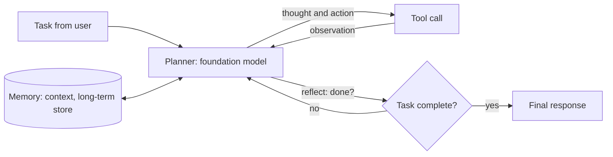

# Agents: tools, planning, failure modes and memory

Huyen calls intelligent agents the ultimate goal of AI for many people, and notes that the capabilities of foundation models have made agents, which were long only theoretical, practical to build. The area is new and fast-moving, with few established frameworks, so she builds the topic from first principles: what an agent is, the **tools** it uses, how it **plans** and **reflects**, how agents **fail** and how to **evaluate** them. The chapter closes with **memory**, which both RAG and agents depend on.

> [!NOTE]
> Tool-calling protocols such as MCP and hands-on agent frameworks are covered in the **LLM Practice** track. This lesson gives the conceptual model from the book.

## 1. What is an agent?

Following Russell and Norvig, an **agent** is anything that can perceive its **environment** and **act** upon it. An agent is defined by:

- its **environment**, set by the use case: a game, the internet, a kitchen, a computer with a terminal and file system, and
- its **set of actions**, extended by the **tools** it can use.

The two depend on each other. The environment determines which tools are possible (only legal moves in chess), and the tool inventory limits where the agent can operate. A robot that can only swim is confined to water.

By this definition ChatGPT is an agent: it can search the web, run Python and generate images. **RAG systems are agents** too, with retrievers and SQL executors as their tools. SWE-agent (Yang et al., 2024) operates in a computer environment with actions such as navigating a repository, searching files, viewing files and editing lines.

In an AI agent, the model is the **brain**. It processes the task and the feedback from the environment, **plans** a sequence of actions, and decides whether the task is done.



### Why agents need stronger models

- **Compound mistakes.** A multi-step task multiplies error. With 95% accuracy per step, accuracy over 10 steps drops to about 60%, and over 100 steps to about 0.6%.
- **Higher stakes.** With tools, agents can do more impactful things, so failures are more severe.

Tasks with many steps also cost time and money. If agents can be autonomous, the human time they save can still make that worthwhile.

```python-run
for p in [0.99, 0.95, 0.90]:
    print(f"per-step accuracy {p:.2f}:", {n: f"{p**n:.1%}" for n in [1, 5, 10, 20, 100]})
```

## 2. Tools

An agent does not need external tools to be an agent, but without them its abilities are limited. Tools let an agent **perceive** (read-only actions) and **act** (write actions). Huyen groups them into three categories.

### Knowledge augmentation (context construction)

Text and image retrievers, SQL executors, internal people search, inventory APIs, Slack and email readers, and **web browsing**. Web access keeps a model from going stale, but it exposes the agent to the open internet's quality problems and attacks, so choose search APIs carefully.

### Capability extension

Tools that cover weaknesses of the model itself:

- **Calculator.** Models are bad at arithmetic: ask for 199,999 ÷ 292 and they often miss. A calculator tool fixes it.
- Calendar, timezone and unit converters, and translators.
- **Code interpreter.** The model writes code, the tool runs it and returns results. This is powerful for data analysis and also the most dangerous tool, because of **code injection** risk.
- Tools that add modalities: a text-only model can call DALL-E to generate images, use an OCR tool to read PDFs, or a transcriber for audio.

Tools can boost performance a lot. Chameleon (Lu et al., 2023) improved over the best published few-shot result by 11.37% on ScienceQA and by 17% on TabMWP by giving GPT-4 a set of 13 tools.

### Write actions

Tools that **change** things: updating a database, sending email, initiating a bank transfer. These enable real automation, such as a full customer outreach workflow, and they carry real risk. Huyen offers a comparison. We trust self-driving cars and human employees with dangerous capabilities when there are proper safeguards, and agents need the same: security measures, approvals and limited permissions.

## 3. Planning

A task has a **goal** and **constraints** (plan a two-week trip from San Francisco to India on a \$5,000 budget). Planning means working out a sequence of actions to reach the goal within the constraints. For "How many companies without revenue have raised at least \$1 billion?", you could start from companies without revenue and filter by funding, or start from the few companies that raised \$1 billion and filter by revenue. The second is far more efficient.

### Decouple planning from execution

If one prompt both plans and executes, a model could produce a 1,000-step plan that goes nowhere and burn API calls for hours. Instead:

1. **Generate a plan.**
2. **Validate it**, with heuristics (no invalid tools, at most X steps) or with an AI judge.
3. **Execute** only validated plans, and evaluate the outputs.

The planner, validator and executor can be seen as a **multi-agent system**. To cut latency, generate several plans in parallel and let the evaluator pick, at extra cost. An **intent classifier** helps planning and should be able to label requests as `IRRELEVANT` so that the agent declines instead of wasting compute. Humans can step in at any stage: providing a high-level plan, validating plans, or approving and executing risky operations. Define the **level of automation** for each action.

### Can foundation models plan?

This is debated. Yann LeCun argues that autoregressive LLMs cannot plan. Critics point out that planning is a search problem that needs **backtracking**, while an autoregressive model only generates forward. Huyen's view is that a model can revise a plan by generating a new one, and that planning needs knowledge of available actions, their outcomes (a world model) and the goal. LLMs may hold much of this knowledge, and may plan better when combined with search and state-tracking tools. Even if a model is a poor planner alone, it can be part of a planner.

### Plan generation and function calling

The simplest planner is a prompt: describe the tools, give examples, and ask for a plan. Huyen's example has tools `get_today_date()`, `fetch_top_products(start_date, end_date, num_products)` and `fetch_product_info(product_name)`, and the model outputs a list of calls. Because parameters often depend on earlier outputs, plans may leave them to be filled in at execution time.

**Function calling** (tool use) is the API mechanism for this:

1. **Create a tool inventory.** Declare each tool's name, description, parameters and types.
2. **Specify which tools the agent may use** for a query. APIs offer settings such as `required` (must use a tool), `none` (must not) and `auto` (the model decides).

The model returns the function name and arguments as structured output, and your code executes it. **Always check that parameter values are valid**, because models hallucinate arguments.

### Planning granularity

A plan can be high-level ("book flights, then hotels") or detailed down to exact function calls. Detailed plans are harder to generate but easier to execute. Plans written with **exact function names** break when tools are renamed or added, and a planner finetuned on an old tool inventory needs retraining. Plans in **natural language** ("get the current date", "retrieve last week's best-selling product") are more robust to tool changes, but they need a **translator** to turn each step into an executable command. Translation is simpler than planning, so a weaker model can do it, though it adds a place where errors can occur.

### Complex plans: control flow

- **Sequential**: task B after task A (convert text to SQL, then run it).
- **Parallel**: tasks A and B at once (fetch the top 100 products and each one's price together).
- **If statement**: choose B or C based on the previous output (check the earnings report, then buy or sell).
- **For loop**: repeat until a condition holds (generate random numbers until you get a prime).

Parallel execution cuts user-perceived latency, so check whether an agent framework supports it.

### Reflection and error correction

Even good plans need to be checked and adjusted. Reflection can happen:

- after receiving a query, to judge whether the request is feasible,
- after generating a plan, to judge whether it makes sense,
- after each execution step, to check that it is on track, and
- after the whole plan runs, to decide whether the task is accomplished.

**ReAct** (Yao et al., 2022) interleaves reasoning and action. Each step has a **Thought** (plan and reflect), an **Act** (tool call) and an **Observation** (tool output), repeated until the agent decides it is finished. **Reflexion** (Shinn et al., 2023) splits reflection into an **evaluator** that scores the outcome and a **self-reflection** module that analyzes what went wrong, then proposes a new *trajectory*. In a multi-agent setting, one agent acts and another critiques.

Reflection is relatively easy to implement and can bring surprisingly large gains. The costs are **tokens and latency**. Thoughts and observations are long, and both papers use many few-shot examples to enforce the format, which takes up context.

```python-run
# A minimal ReAct loop with a scripted "model" so it runs deterministically.
tools = {"lookup": lambda k: {"fedora_units_week": "6", "fedora_price": "12.5"}.get(k, "Error: key not found"),
         "mul": lambda a, b: str(float(a) * float(b))}
script = iter([("Thought: I need units sold.", ("lookup", ["fedora_units_week"])),
               ("Thought: Now the unit price.", ("lookup", ["fedora_price"])),
               ("Thought: Revenue = units x price.", ("mul", ["{0}", "{1}"])),
               ("Thought: I have the answer.", None)])
observations = []
for step in range(10):                                   # hard step limit: never loop forever
    thought, action = next(script)
    print(thought)
    if action is None:
        print("Final Answer: weekly revenue is", observations[-1]); break
    name, args = action
    args = [a.format(*observations) for a in args]
    obs = tools[name](*args) if name in tools else f"Error: unknown tool {name}"
    observations.append(obs)
    print(f"Action: {name}{args}\nObservation: {obs}")
```

### Tool selection

More tools give more capability but are harder to use well, and their descriptions consume context. Toolformer learned 5 tools, Chameleon used 13, and Gorilla tried to select among 1,645 APIs. Huyen's advice:

- Compare agent performance with different tool sets.
- Run **ablations**: remove a tool, and if performance does not drop, keep it removed.
- Find tools the agent often misuses. If prompting and finetuning do not help, replace the tool.
- Plot the **distribution of tool calls**. Different models and tasks prefer different tools.
- Study **tool transitions**. If tool X is usually followed by Y, combine them into one bigger tool. Voyager's **skill manager** stores new skills (programs) the agent writes for later reuse.

## 4. Agent failure modes and evaluation

Evaluation is about detecting failures. On top of the usual failures of AI applications, agents fail in planning, tools and efficiency.

### Planning failures

- **Invalid tool**: the plan calls `bing_search`, which is not in the inventory.
- **Valid tool, invalid parameters**: `lbs_to_kg` is called with two parameters when it takes one.
- **Valid tool, incorrect parameter values**: `lbs_to_kg(100)` when the value should be 120.
- **Goal failure**: the plan does not solve the task or violates constraints (a trip to Ho Chi Minh City instead of Hanoi, or one far over budget). **Time** is an often-overlooked constraint: a grant proposal delivered after the deadline is useless.
- **Reflection errors**: the agent is convinced it finished when it did not. It assigns 40 of 50 people to rooms and declares success.

Build a planning dataset of (task, tool inventory) pairs, generate K plans per task, and measure:

1. the fraction of plans that are valid,
2. the average number of plans needed to get a valid one,
3. the fraction of tool calls that are valid,
4. how often invalid tools are called,
5. how often valid tools get invalid parameters, and
6. how often valid tools get incorrect parameter values.

Then look for patterns: which task types and which tools fail most?

### Tool failures

The right tool is chosen, but its **output is wrong**: an image captioner mis-describes, or a SQL generator returns a wrong query. A **translator** from high-level plans to commands can also introduce errors. Or a needed tool is missing entirely, such as no internet access for current stock prices. Test every tool independently, **print every tool call and output**, and benchmark the translator. To spot missing tools, work with domain experts and watch which tools they use.

### Efficiency

A valid plan can still be wasteful. Track the average **steps per task**, **cost per task**, and the time each action takes, and compare with a baseline (another agent or a human). Humans and AI work differently. Visiting 100 web pages is slow for a person and trivial for an agent that can do it in parallel.

```python-run
# Scoring plans against a tool inventory: the planning-failure metrics from the book.
inventory = {"lbs_to_kg": 1, "fetch_top_products": 3, "get_today_date": 0}
plans = [[("get_today_date", []), ("fetch_top_products", ["2030-01-01", "2030-01-07", 1])],
         [("bing_search", ["fedora"])],
         [("lbs_to_kg", [120, "kg"])],
         [("lbs_to_kg", [120])]]
valid_plans = invalid_tool = bad_params = calls = 0
for plan in plans:
    ok = True
    for name, args in plan:
        calls += 1
        if name not in inventory: invalid_tool += 1; ok = False
        elif len(args) != inventory[name]: bad_params += 1; ok = False
    valid_plans += ok
print(f"valid plans: {valid_plans}/{len(plans)}   invalid-tool calls: {invalid_tool}/{calls}   invalid-parameter calls: {bad_params}/{calls}")
```

## 5. Memory

Memory refers to the mechanisms that let a model **retain and use information**. A model has three:

| Mechanism | What it is | Properties |
|---|---|---|
| **Internal knowledge** | what the model learned in training | available in every query, changes only when the model is updated |
| **Short-term memory** | the **context** (previous messages, current task data) | fast to access, limited capacity, does not persist across tasks |
| **Long-term memory** | **external data sources** reached by retrieval | persists across tasks, can be edited or deleted without retraining |

Where to put information depends on how often it is used. Information essential for all tasks goes into internal knowledge through training or finetuning. Rarely needed information goes into long-term memory. Immediate, task-specific information goes into short-term memory.

Benefits of an explicit memory system:

- **Managing information overflow** within a session. Overflow from the context goes to long-term memory.
- **Persisting information between sessions.** A coach or assistant that forgets your preferences every time is frustrating.
- **Boosting consistency.** If the model remembers its earlier answers, such as the score it gave a joke, later answers can stay consistent.
- **Maintaining structural integrity of data.** Text is unstructured. Tables and queues stored outside the context keep their structure.

A memory system has two functions:

- **Memory management**: what to store in short-term and what in long-term memory. In practice long-term storage is large, so this mostly means deciding what to **add** to and **delete** from the limited short-term context.
- **Memory retrieval**: fetching relevant information from long-term memory. This is the same as RAG retrieval.

Strategies when the context fills up:

- **FIFO.** Drop the oldest messages first. It is simple, but early messages may hold the most important information, such as the task itself.
- **Summarization.** Keep a running summary, and optionally track named entities.
- **Redundancy removal.** Bae et al. (2022) summarize, then compare the summary's sentences with existing memory and decide whether to keep, merge or replace each.
- **Reflection-based.** Liu et al. (2023) have the agent reflect after each action on whether new information should be inserted, merged with existing memory, or should replace outdated or contradictory memory.

**Contradictions** need a policy. Some systems keep the newest information, some ask a model to judge, and some keep both. Huyen notes that contradictions can confuse the agent but can also help it see things from different perspectives.

```python-run
# Short-term memory management: FIFO vs. summarize-the-overflow, under a token budget.
history = ["TASK: plan a 2-week Hanoi trip under 5000 USD", "User prefers boutique hotels", "Flights found: 1200 USD",
           "Hotel A: 90 USD per night", "Hotel B: 150 USD per night", "User: avoid red-eye flights"]
budget = 18          # 'tokens' = words, for illustration
def size(msgs): return sum(len(m.split()) for m in msgs)
fifo = list(history)
while size(fifo) > budget: fifo.pop(0)
print("FIFO keeps      :", fifo)
keep = list(history); overflow = []
while size(keep) > budget - 6: overflow.append(keep.pop(0))
summary = "SUMMARY: Hanoi 2wk under 5000 USD; boutique hotels; flights 1200 USD"   # produced by a model in practice
print("Summary + recent:", [summary] + keep)
```

> [!INTERVIEW]
> **"How would you evaluate and harden an agent before production?"** Measure planning failures (invalid tools, invalid parameters, wrong values, goal and constraint violations, false 'done'), tool failures (test each tool and translator separately, log every call) and efficiency (steps, cost and time per task against a baseline). Decouple planning from execution with validation. Enforce step and cost limits. Require human approval for write actions. Give least-privilege tool access and sandbox code execution. Use reflection for error correction, and choose a strong model, because per-step errors compound (0.95^10 ≈ 0.6).

## Summary

- An **agent** is defined by its environment and its actions, and tools extend the actions. RAG is a simple agent.
- **Tools**: knowledge augmentation, capability extension and write actions. They are powerful and risky.
- **Planning**: decouple generate, validate and execute. Use function calling. Choose plan granularity (function names vs natural language plus a translator). Support sequential, parallel, conditional and loop control flow. Add **reflection** (ReAct, Reflexion) at the cost of tokens and latency.
- **Failures**: planning (invalid tool, parameters or values, goal failures, reflection errors), tool failures and inefficiency. Measure each.
- **Memory**: internal knowledge, short-term context and long-term external stores. Manage overflow with FIFO, summarization, redundancy removal or reflection, and decide how to handle contradictions.

```quiz
[
  {"q": "With 95% accuracy per step, an agent's approximate accuracy over 10 steps is…", "options": ["95%", "85%", "60%", "5%"], "answer": 2, "explain": "0.95^10 ≈ 0.60. Errors compound, which is why agents need stronger models."},
  {"q": "A code interpreter belongs to which tool category in Huyen's taxonomy?", "options": ["Knowledge augmentation", "Capability extension", "Write actions", "Memory"], "answer": 1, "explain": "It extends what the model can do (compute, analyze), though it also brings code-injection risk."},
  {"q": "Why decouple planning from execution?", "options": ["To use more tokens", "So plans can be validated before costly or risky execution", "Because models can't call tools", "To avoid reflection"], "answer": 1, "explain": "Validation with heuristics or AI judges prevents executing long, useless or invalid plans."},
  {"q": "An agent calls lbs_to_kg with two arguments, but the tool takes one. This is a…", "options": ["Invalid tool", "Valid tool, invalid parameters", "Tool failure", "Goal failure"], "answer": 1, "explain": "The tool exists, but the call's parameters don't match its signature."},
  {"q": "What is the trade-off of plans written in natural language instead of exact function names?", "options": ["They can't be executed at all", "More robust to tool changes, but they need a translator, which can introduce errors", "They use fewer tokens always", "They need no validation"], "answer": 1, "explain": "A translator maps high-level steps to executable commands."},
  {"q": "In ReAct, each step consists of…", "options": ["Retrieve, Rerank, Generate", "Thought, Act, Observation", "Plan, Compile, Run", "Encode, Decode"], "answer": 1, "explain": "ReAct interleaves reasoning with actions and observations."},
  {"q": "Which memory mechanism persists across tasks and can be edited without updating the model?", "options": ["Internal knowledge", "Short-term memory (context)", "Long-term memory (external data via retrieval)", "KV cache"], "answer": 2, "explain": "External stores persist and can be changed independently of the model."},
  {"q": "What is the main weakness of FIFO context management?", "options": ["It is expensive", "Early messages that may hold the most important information (e.g., the task) are dropped first", "It requires a vector DB", "It causes hallucination by itself"], "answer": 1, "explain": "Oldest-first eviction can remove the original instructions. Summarization mitigates this."}
]
```

> **Source:** Huyen, *AI Engineering*, ch. 6 ("Agents": overview, tools, planning, agent failure modes and evaluation; "Memory").
