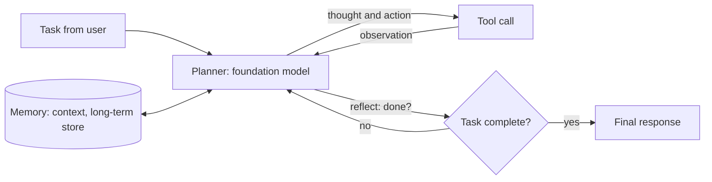

# Agents: tools, planning, failure modes and memory

> **Before this lesson:** read [RAG architecture and retrieval algorithms](#/lesson/ai-eng/aie-rag-retrieval) and [Retrieval optimization](#/lesson/ai-eng/aie-retrieval-opt), which introduce retrievers and text-to-SQL. Prompt chains and chain-of-thought come from [Prompt engineering best practices](#/lesson/ai-eng/aie-prompt-practices), and the risks of tools from [Defensive prompt engineering](#/lesson/ai-eng/aie-prompt-defense). JSON (a text format of named fields in curly braces) is used in one demo and explained there.

## In plain words

An **AI agent** is a system in which a language model does more than answer: it decides on a sequence of actions, carries them out using **tools** (functions it can call, such as a web search, a calculator or a database query), looks at the results, and keeps going until the task is done. Asked "How much did our best-selling hat earn last week?", a chatbot can only guess. An agent can look up last week's sales, find the best seller, fetch its price, multiply, and report a real number.

An everyday picture: a capable personal assistant with a phone, a laptop and a company card. You give a goal ("book me a trip to Hanoi under \$5,000"). They plan the steps, make calls, check what came back, change the plan when a flight is full, and tell you when it is done. Good assistants check their own work and ask before spending big sums. Poor ones confidently report "all booked" when half the bookings failed. AI agents have exactly these strengths and weaknesses.

Why this matters for a job: Huyen calls intelligent agents the ultimate goal of AI for many people, and foundation models have made agents, long only a theory, practical to build. Interviewers ask how agents plan, what ReAct is, how function calling works, why errors compound over many steps, and how you would evaluate and harden an agent before launch. The area is new and changes fast, so Huyen builds it from first principles: what an agent is, the tools it uses, how it **plans** and **reflects**, how agents **fail** and how to **evaluate** them. The lesson closes with **memory**, which both RAG and agents depend on.

> [!NOTE]
> Tool-calling protocols such as MCP and hands-on agent frameworks are covered in the **LLM Practice** track. This lesson gives the conceptual model from the book.

## 1. What is an agent?

Following Russell and Norvig's classic AI textbook, an **agent** is anything that can perceive its **environment** and **act** on it. An agent is defined by:

- its **environment**, set by the use case: a game, the internet, a kitchen, a computer with a terminal and files; and
- its **set of actions**, which grows with the **tools** it can use.

The two depend on each other. The environment determines which actions make sense (only legal moves in chess), and the available tools limit where the agent can operate: a robot that can only swim is stuck in water.

By this definition ChatGPT is an agent: it can search the web, run Python code and generate images. **RAG systems are agents** too, with retrievers and SQL executors as their tools. SWE-agent (Yang and colleagues, 2024) works in a computer environment with actions such as navigating a code repository, searching files, viewing files and editing lines.

In an AI agent, the model is the **brain**. It reads the task and the feedback from the environment, **plans** a sequence of actions, and decides when the task is finished.



Read the loop: the model receives a task, thinks and chooses an action, a tool carries it out and returns an **observation** (the tool's output), the model checks whether the task is complete, and either loops again or gives the final answer. Memory feeds information in and stores what is learned along the way.

### Why agents need stronger models

- **Compound mistakes.** A task with many steps multiplies the chance of error. If each step is right with probability $p$ and steps fail independently, all $n$ steps are right with probability $p^n$. With 95% accuracy per step, 10 steps succeed about 60% of the time ($0.95^{10} = 0.599$), and 100 steps about 0.6% of the time.
- **Higher stakes.** With tools, agents can do more impactful things, so their failures are more severe.

Many-step tasks also cost time and money. If an agent can work **autonomously** (without a person supervising every step), the human time it saves can still make that worthwhile.

```python-run
for p in [0.99, 0.95, 0.90]:
    print(f"per-step accuracy {p:.2f}:", {n: f"{p**n:.1%}" for n in [1, 5, 10, 20, 100]})
```

The dictionary comprehension computes `p**n` (`p` to the power `n`) for five task lengths and formats each as a percentage with one decimal. Output: at 99% per step, a 100-step task still succeeds 36.6% of the time; at 95%, 10 steps give 59.9% and 100 steps 0.6%; at 90%, 20 steps give only 12.2%. Small improvements in per-step reliability matter enormously for long tasks.

## 2. Tools

An agent does not strictly need external tools, but without them it can do little. Tools let an agent **perceive** its environment (*read-only actions*) and **change** it (*write actions*). Huyen groups tools into three categories.

### Knowledge augmentation (context construction)

These tools fetch information: text and image retrievers, SQL executors, internal people search, inventory **APIs** (interfaces other programs expose for requests), Slack and email readers, and **web browsing**. Web access keeps a model from going stale after its training cutoff, but exposes the agent to the open internet's low-quality content and attacks, so choose search APIs carefully.

### Capability extension

These tools cover weaknesses of the model itself:

- **Calculator.** Models are bad at arithmetic: ask for 199,999 ÷ 292 and they often get it wrong. A calculator tool fixes that.
- Calendar, time-zone and unit converters, and translators.
- **Code interpreter.** The model writes code, the tool runs it and returns the result. This is powerful for data analysis and also the most dangerous tool, because of **code injection**: an attacker getting the agent to run harmful code.
- Tools that add **modalities** (kinds of input or output): a text-only model can call an image generator such as DALL-E, an **OCR** tool (optical character recognition, reading text from images and scanned PDFs), or a speech transcriber.

Tools can raise performance a lot. Chameleon (Lu and colleagues, 2023) gave GPT-4 a set of 13 tools and beat the best published few-shot result by 11.37% on ScienceQA, a science question benchmark, and by 17% on TabMWP, a benchmark of maths problems over tables.

### Write actions

These tools **change** things: updating a database, sending an email, starting a bank transfer. They enable real automation, such as a complete customer outreach workflow, and carry real risk. Huyen compares this with how we already trust self-driving cars and human employees with dangerous capabilities when proper safeguards exist. Agents need the same: security measures, approvals and limited permissions.

## 3. Planning

A task has a **goal** and **constraints**: "plan a two-week trip from San Francisco to India on a \$5,000 budget" has a goal (the trip) and constraints (two weeks, \$5,000). **Planning** means working out a sequence of actions that reaches the goal within the constraints. Order matters for efficiency. For "How many companies without revenue have raised at least \$1 billion?", you could start from all companies without revenue and filter by funding, or start from the few companies that raised \$1 billion and filter by revenue. The second touches far fewer records.

### Decouple planning from execution

If one prompt both plans and carries out the plan, a model could launch a 1,000-step plan that goes nowhere and burn API calls for hours. Instead:

1. **Generate a plan.**
2. **Validate it**, with simple rules (only tools that exist, at most X steps) or with an AI judge.
3. **Execute** only validated plans, and evaluate the results.

The planner, validator and executor can be seen as a **multi-agent system**, several model-driven components working together. To cut waiting time, you can generate several plans in parallel and let the validator pick the best, at extra cost. An **intent classifier** (a step that sorts requests by what the user wants) helps planning, and should be able to label requests as `IRRELEVANT` so the agent declines instead of wasting compute. Humans can step in at any stage: giving a high-level plan, approving plans, or approving and carrying out risky operations themselves. Decide the **level of automation** for each kind of action.

### Can foundation models plan?

This is debated. Yann LeCun argues that autoregressive language models (models that generate one token after another, left to right) cannot plan. Critics point out that planning is a search problem that needs **backtracking**, going back to an earlier choice when a path fails, while an autoregressive model only moves forward. Huyen's view: a model can revise a plan by generating a new one, and planning needs knowledge of the available actions, their likely outcomes (a *world model*) and the goal. Language models may hold much of this knowledge and may plan better when combined with search and state-tracking tools. Even if a model is a poor planner on its own, it can be part of a planner.

### Plan generation and function calling

The simplest planner is a prompt: describe the tools, give examples, and ask for a plan. Huyen's example has three tools, `get_today_date()`, `fetch_top_products(start_date, end_date, num_products)` and `fetch_product_info(product_name)`, and the model outputs a list of calls. Because some arguments depend on earlier results (you need today's date before you can ask for last week's products), plans may leave them to be filled in when the plan runs.

**Function calling** (also called tool use) is the API feature that supports this:

1. **Create a tool inventory.** Declare each tool's name, a description of what it does, and its parameters with their types.
2. **Say which tools the agent may use** for a request. APIs offer settings such as `required` (must call a tool), `none` (must not) and `auto` (the model decides).

The model then returns the function name and arguments as structured output, and *your* code carries out the call. A static example of a tool declaration in the common JSON-schema style:

```python
tools = [{
    "type": "function",
    "function": {
        "name": "fetch_top_products",
        "description": "Return the best-selling products between two dates.",
        "parameters": {
            "type": "object",
            "properties": {
                "start_date":   {"type": "string", "description": "YYYY-MM-DD"},
                "end_date":     {"type": "string", "description": "YYYY-MM-DD"},
                "num_products": {"type": "integer"},
            },
            "required": ["start_date", "end_date", "num_products"],
        },
    },
}]
```

**Always check that the model's arguments are valid before executing**, because models invent tools and arguments. Here is a minimal validator:

```python-run
import json

TOOLS = {
    "fetch_top_products": {"start_date": str, "end_date": str, "num_products": int},
    "fetch_product_info": {"product_name": str},
    "get_today_date": {},
}

def validate(call_json):
    """Return 'OK' or a short reason the call must not be executed."""
    try:
        call = json.loads(call_json)
    except json.JSONDecodeError:
        return "not valid JSON"
    name, args = call.get("name"), call.get("arguments", {})
    if name not in TOOLS:
        return f"unknown tool {name!r}"
    params = TOOLS[name]
    missing = [p for p in params if p not in args]
    extra = [a for a in args if a not in params]
    wrong = [p for p, t in params.items() if p in args and not isinstance(args[p], t)]
    if missing: return f"missing {missing}"
    if extra:   return f"unexpected {extra}"
    if wrong:   return f"wrong type for {wrong}"
    return "OK"

calls = [
    '{"name": "fetch_top_products", "arguments": {"start_date": "2030-01-01", "end_date": "2030-01-07", "num_products": 3}}',
    '{"name": "bing_search", "arguments": {"q": "fedora"}}',
    '{"name": "fetch_top_products", "arguments": {"start_date": "2030-01-01", "num_products": "three"}}',
    '{"name": "fetch_product_info", "arguments": {"product_name": "Fruity Fedora", "color": "red"}}',
    '{"name": "get_today_date", "arguments": {}',
]
for c in calls:
    print(f"{validate(c):40s} <- {c[:60]}")
```

**Reading this Python line by line**

- `TOOLS` is the inventory: each tool name maps to a dictionary of parameter names and their expected Python types (`str` for text, `int` for whole numbers).
- `json.loads` turns the model's JSON text into a Python dictionary. If the text is broken, it raises `JSONDecodeError`, which the `try`/`except` turns into a reason string.
- `call.get("name")` reads a key without crashing if it is absent (it returns `None`).
- Three list comprehensions find required parameters that are missing, arguments that the tool does not accept, and arguments of the wrong type. `isinstance(value, t)` checks a value's type.
- Output: the first call is `OK`; the second names a tool that does not exist (`unknown tool 'bing_search'`); the third is `missing ['end_date']` (it also has a wrong type, but the first problem found is reported); the fourth has an `unexpected ['color']` argument; the fifth is `not valid JSON` because its closing brace is missing. Only the first should ever reach a real tool.

### Planning granularity

A plan can be high-level ("book flights, then hotels") or detailed down to exact function calls. Detailed plans are harder to generate but easier to execute. Plans written with **exact function names** break when tools are renamed or added, and a planner finetuned on an old tool inventory needs retraining. Plans written in **natural language** ("get the current date", "retrieve last week's best-selling product") survive tool changes better, but need a **translator**, a step that turns each plain-language step into an executable call. Translating is easier than planning, so a weaker, cheaper model can do it, but it adds one more place where errors can happen.

### Complex plans: control flow

**Control flow** is the order in which steps run:

- **Sequential**: task B after task A (turn text into SQL, then run it).
- **Parallel**: tasks A and B at the same time (fetch the top 100 products and each one's price together).
- **If statement**: choose B or C depending on the previous result (check the earnings report, then decide to buy or sell).
- **For loop**: repeat until a condition holds (generate random numbers until one is prime).

Parallel execution cuts the time a user waits, so check whether an agent framework supports it.

### Reflection and error correction

Even good plans need checking and adjusting along the way. **Reflection** means the agent evaluating its own progress. It can happen:

- after receiving a request, to judge whether it is feasible at all;
- after generating a plan, to judge whether the plan makes sense;
- after each step, to check the agent is still on track;
- after the whole plan runs, to decide whether the task is really accomplished.

**ReAct** (Yao and colleagues, 2022; the name joins *reason* and *act*) interleaves reasoning and action. Each step has a **Thought** (plan and reflect), an **Act** (a tool call) and an **Observation** (the tool's output), repeated until the agent decides it is finished. **Reflexion** (Shinn and colleagues, 2023) splits reflection into an **evaluator** that scores the outcome and a **self-reflection** module that analyses what went wrong, then proposes a new *trajectory* (sequence of actions). In a multi-agent setup, one agent acts and another critiques.

Reflection is fairly easy to add and can bring surprisingly large gains. Its costs are **tokens and latency**: thoughts and observations are long, and both papers use many few-shot examples to enforce the format, which takes up context.

```python-run
# A minimal ReAct loop with a scripted "model" so it runs deterministically.
tools = {"lookup": lambda k: {"fedora_units_week": "6", "fedora_price": "12.5"}.get(k, "Error: key not found"),
         "mul": lambda a, b: str(float(a) * float(b))}
script = iter([("Thought: I need units sold.", ("lookup", ["fedora_units_week"])),
               ("Thought: Now the unit price.", ("lookup", ["fedora_price"])),
               ("Thought: Revenue = units x price.", ("mul", ["{0}", "{1}"])),
               ("Thought: I have the answer.", None)])
observations = []
for step in range(10):                                   # hard step limit: never loop forever
    thought, action = next(script)
    print(thought)
    if action is None:
        print("Final Answer: weekly revenue is", observations[-1]); break
    name, args = action
    args = [a.format(*observations) for a in args]
    obs = tools[name](*args) if name in tools else f"Error: unknown tool {name}"
    observations.append(obs)
    print(f"Action: {name}{args}\nObservation: {obs}")
```

**Reading this Python line by line**

- `tools` holds two tiny tools written as `lambda` functions: `lookup` reads a value from a small table (or returns an error message), and `mul` multiplies two numbers given as text.
- `script` replaces the model: `iter([...])` makes an iterator, and each `next(script)` returns the next `(thought, action)` pair that a real model would generate. An action is a tool name plus arguments; `None` means "I'm done".
- `for step in range(10)` is a **hard step limit**, a safety net so a confused agent can never loop forever.
- `a.format(*observations)` fills placeholders like `{0}` and `{1}` with earlier observations, which is how a later step uses earlier results.
- The `obs = ...` line calls the tool if it exists, or records an error the model could react to.
- Output: three Thought/Action/Observation rounds (units 6, price 12.5, product 75.0), then `Final Answer: weekly revenue is 75.0`.

### Tool selection

More tools give more capability but are harder to use well, and their descriptions take up context. Toolformer learned 5 tools, Chameleon used 13, and Gorilla tried to choose among 1,645 APIs. Huyen's advice:

- Compare the agent's performance with different tool sets.
- Run **ablations**: remove one tool at a time; if performance does not drop, leave it out.
- Find tools the agent often misuses. If better prompts and finetuning do not help, replace the tool.
- Plot the **distribution of tool calls**: different models and tasks prefer different tools.
- Study **tool transitions**: if tool X is nearly always followed by tool Y, combine them into one bigger tool. The Voyager agent's **skill manager** stores new skills (small programs) the agent writes, for reuse later.

## 4. Agent failure modes and evaluation

Evaluation is about finding failures. On top of the usual failures of AI applications (hallucination, unsafe output), agents fail in planning, in tools and in efficiency.

### Planning failures

- **Invalid tool**: the plan calls `bing_search`, which is not in the inventory.
- **Valid tool, invalid parameters**: `lbs_to_kg` is called with two arguments when it takes one.
- **Valid tool, incorrect parameter values**: `lbs_to_kg(100)` when the value should be 120.
- **Goal failure**: the plan does not solve the task or breaks a constraint (a trip to Ho Chi Minh City instead of Hanoi, or one far over budget). **Time** is an often-forgotten constraint: a grant proposal delivered after the deadline is useless.
- **Reflection errors**: the agent believes it has finished when it has not, for example assigning 40 of 50 people to rooms and declaring success.

To measure these, build a planning dataset of (task, tool inventory) pairs, generate K plans per task, and compute:

1. the fraction of plans that are valid;
2. the average number of plans needed to get a valid one;
3. the fraction of tool calls that are valid;
4. how often invalid tools are called;
5. how often valid tools get invalid parameters; and
6. how often valid tools get incorrect parameter values.

Then look for patterns: which task types and which tools fail most often?

### Tool failures

Here the right tool is chosen but its **output is wrong**: an image captioner misdescribes a picture, or a text-to-SQL generator writes a wrong query. A translator from high-level plans to calls can also introduce errors. Or a needed tool is missing entirely, such as no internet access when the task needs current stock prices. Test every tool on its own, **log every tool call and its output**, and benchmark the translator separately. To spot missing tools, work with domain experts and watch which tools *they* reach for.

### Efficiency

A valid plan can still be wasteful. Track the average **steps per task**, **cost per task** and the time each action takes, and compare with a **baseline** (another agent, or a person doing the task). Remember that people and agents have different strengths: visiting 100 web pages is slow for a person and trivial for an agent that can do it in parallel.

```python-run
# Scoring plans against a tool inventory: the planning-failure metrics from the book.
inventory = {"lbs_to_kg": 1, "fetch_top_products": 3, "get_today_date": 0}
plans = [[("get_today_date", []), ("fetch_top_products", ["2030-01-01", "2030-01-07", 1])],
         [("bing_search", ["fedora"])],
         [("lbs_to_kg", [120, "kg"])],
         [("lbs_to_kg", [120])]]
valid_plans = invalid_tool = bad_params = calls = 0
for plan in plans:
    ok = True
    for name, args in plan:
        calls += 1
        if name not in inventory: invalid_tool += 1; ok = False
        elif len(args) != inventory[name]: bad_params += 1; ok = False
    valid_plans += ok
print(f"valid plans: {valid_plans}/{len(plans)}   invalid-tool calls: {invalid_tool}/{calls}   invalid-parameter calls: {bad_params}/{calls}")
```

Here the inventory records only how many arguments each tool takes. `valid_plans = invalid_tool = bad_params = calls = 0` sets four counters to zero at once. Each plan is checked call by call; a single bad call marks the whole plan invalid, and `valid_plans += ok` adds 1 for a plan that stayed `True`. Output: `valid plans: 2/4   invalid-tool calls: 1/5   invalid-parameter calls: 1/5`. Note that the fourth plan counts as valid even if 120 was the wrong value: catching *incorrect values* needs the expected answer, not only the inventory.

## 5. Memory

**Memory** means the mechanisms that let a model **keep and use information**. A model-based system has three:

| Mechanism | What it is | Properties |
|---|---|---|
| **Internal knowledge** | what the model learned in training, stored in its weights | available in every request; changes only when the model is retrained or finetuned |
| **Short-term memory** | the **context**: earlier messages and the current task's data | fast to use, limited in size, gone when the task ends |
| **Long-term memory** | **external data sources** reached by retrieval | persists across tasks; can be edited or deleted without retraining |

Where to put a piece of information depends on how often it is needed. Information essential for every task belongs in internal knowledge, through training or finetuning. Rarely needed information belongs in long-term memory. Immediate, task-specific information belongs in short-term memory.

Benefits of an explicit memory system:

- **Managing information overflow** within a session: what does not fit in the context moves to long-term memory.
- **Persisting information between sessions.** A coaching app that forgets your preferences every time is frustrating.
- **Boosting consistency.** If the model remembers its earlier answers, such as the score it gave a joke, later answers can stay consistent.
- **Keeping data structured.** Text in a prompt is unstructured; tables and queues stored outside the context keep their structure.

A memory system has two jobs:

- **Memory management**: deciding what goes into short-term and what into long-term memory. Long-term storage is usually large, so in practice this mostly means choosing what to **add** to and **remove** from the limited context.
- **Memory retrieval**: fetching relevant information from long-term memory, which is the same problem as RAG retrieval.

Strategies when the context fills up:

- **FIFO** (first in, first out): drop the oldest messages first. Simple, but early messages may hold the most important information, such as the task itself.
- **Summarisation**: keep a running summary of older messages, and optionally track **named entities** (the people, places and things mentioned).
- **Redundancy removal**: Bae and colleagues (2022) summarise, then compare each summary sentence with existing memory and decide whether to keep, merge or replace it.
- **Reflection-based**: Liu and colleagues (2023) have the agent reflect after each action on whether new information should be inserted, merged with existing memory, or replace outdated or contradictory memory.

**Contradictions** need a policy. Some systems keep the newest information, some ask a model to judge, some keep both. Huyen notes that contradictions can confuse an agent, but can also help it see things from different perspectives.

```python-run
# Short-term memory management: FIFO vs. summarize-the-overflow, under a token budget.
history = ["TASK: plan a 2-week Hanoi trip under 5000 USD", "User prefers boutique hotels", "Flights found: 1200 USD",
           "Hotel A: 90 USD per night", "Hotel B: 150 USD per night", "User: avoid red-eye flights"]
budget = 18          # 'tokens' = words, for illustration
def size(msgs): return sum(len(m.split()) for m in msgs)
fifo = list(history)
while size(fifo) > budget: fifo.pop(0)
print("FIFO keeps      :", fifo)
keep = list(history); overflow = []
while size(keep) > budget - 6: overflow.append(keep.pop(0))
summary = "SUMMARY: Hanoi 2wk under 5000 USD; boutique hotels; flights 1200 USD"   # produced by a model in practice
print("Summary + recent:", [summary] + keep)
```

**Reading this Python line by line**

- `history` is a conversation as a list of messages; `size` counts words as a stand-in for tokens.
- FIFO: `list(history)` makes a copy, and `while size(fifo) > budget: fifo.pop(0)` keeps removing the first (oldest) message until the rest fit in 18 words.
- Summarisation: the second loop removes old messages until there is room for a 6-word summary, moving them to `overflow`. In a real system a model would read `overflow` and write the summary; here it is typed in.
- Output: FIFO keeps only the last three messages, and the task itself ("plan a 2-week Hanoi trip under 5000 USD") is gone. The summary version keeps the two most recent messages plus a summary that preserves the task, the budget and the hotel preference.

> [!INTERVIEW]
> **"How would you evaluate and harden an agent before production?"** Measure planning failures (invalid tools, invalid parameters, wrong values, goal and constraint violations, false "done"), tool failures (test each tool and the translator separately, log every call) and efficiency (steps, cost and time per task against a baseline). Separate planning from execution with validation. Enforce step and cost limits. Validate every tool call's arguments. Require human approval for write actions. Give least-privilege tool access and sandbox code execution. Use reflection for error correction, and choose a strong model, because per-step errors compound ($0.95^{10} \approx 0.6$).

## Pitfalls

- Letting an agent execute plans it has not validated, with no step or cost limit.
- Executing tool calls without checking the tool exists and the arguments are valid.
- Giving write tools (send, delete, pay) without approvals or least privilege.
- Trusting the agent's own "task complete" message without an independent check.
- Managing context with FIFO alone and losing the original task.

## Summary

- An **agent** is defined by its environment and its actions, and tools extend the actions. RAG is a simple agent.
- **Tools**: knowledge augmentation, capability extension and write actions, all powerful and some risky.
- **Planning**: separate generate, validate and execute. Use function calling and validate arguments. Choose plan granularity (function names versus natural language plus a translator). Support sequential, parallel, conditional and loop control flow. Add **reflection** (ReAct, Reflexion) at the cost of tokens and latency.
- **Failures**: planning (invalid tool, parameters or values, goal failures, reflection errors), tool failures and inefficiency. Measure each.
- **Memory**: internal knowledge, short-term context and long-term external stores. Manage overflow with FIFO, summarisation, redundancy removal or reflection, and decide how to handle contradictions.

## Glossary

- **Agent**: a system that perceives an environment and acts on it; here, a model that plans and uses tools.
- **Environment / action**: where the agent operates / something it can do there.
- **Tool**: a function the model can call, such as search, a calculator or a database query.
- **Observation**: the output a tool returns to the agent.
- **Compound error**: per-step mistakes multiplying over a long task ($p^n$).
- **Autonomous**: working without a person approving every step.
- **Read-only vs write action**: an action that only gathers information vs one that changes something.
- **Code interpreter / code injection**: a tool that runs model-written code / an attack that gets harmful code run.
- **OCR**: optical character recognition, reading text from images.
- **Goal / constraint**: what the task must achieve / limits it must respect.
- **Planning**: choosing a sequence of actions to reach a goal within constraints.
- **Multi-agent system**: several model-driven components working together.
- **Backtracking**: returning to an earlier choice when a path fails.
- **Function calling (tool use)**: an API feature where the model returns a tool name and arguments for your code to execute.
- **Tool inventory**: the list of tools, their descriptions and parameters.
- **Translator**: a step that turns plain-language plan steps into executable calls.
- **Control flow**: the order steps run in: sequential, parallel, conditional, loop.
- **Reflection**: an agent evaluating its own progress and results.
- **ReAct**: a loop of Thought, Act and Observation.
- **Reflexion**: reflection split into an evaluator and a self-reflection module that proposes a new trajectory.
- **Trajectory**: the sequence of actions an agent takes.
- **Ablation**: removing one component to see whether it mattered.
- **Baseline**: a reference result to compare against.
- **Internal knowledge / short-term memory / long-term memory**: what is in the weights / what is in the context / what is in external stores.
- **FIFO**: first in, first out; dropping the oldest items first.
- **Named entity**: a specific person, place, organisation or thing mentioned in text.

```quiz
[
  {"q": "With 95% accuracy per step, an agent's approximate accuracy over 10 steps is…", "options": ["95%", "85%", "60%", "5%"], "answer": 2, "explain": "0.95^10 ≈ 0.60. Errors compound, which is why agents need stronger models."},
  {"q": "A code interpreter belongs to which tool category in Huyen's taxonomy?", "options": ["Knowledge augmentation", "Capability extension", "Write actions", "Memory"], "answer": 1, "explain": "It extends what the model can do (compute, analyse), though it also brings code-injection risk."},
  {"q": "Why decouple planning from execution?", "options": ["To use more tokens", "So plans can be validated before costly or risky execution", "Because models can't call tools", "To avoid reflection"], "answer": 1, "explain": "Validation with rules or AI judges prevents executing long, useless or invalid plans."},
  {"q": "An agent calls lbs_to_kg with two arguments, but the tool takes one. This is a…", "options": ["Invalid tool", "Valid tool, invalid parameters", "Tool failure", "Goal failure"], "answer": 1, "explain": "The tool exists, but the call's parameters don't match its signature."},
  {"q": "What is the trade-off of plans written in natural language instead of exact function names?", "options": ["They can't be executed at all", "More robust to tool changes, but they need a translator, which can introduce errors", "They use fewer tokens always", "They need no validation"], "answer": 1, "explain": "A translator maps high-level steps to executable commands."},
  {"q": "In ReAct, each step consists of…", "options": ["Retrieve, Rerank, Generate", "Thought, Act, Observation", "Plan, Compile, Run", "Encode, Decode"], "answer": 1, "explain": "ReAct interleaves reasoning with actions and observations."},
  {"q": "Which memory mechanism persists across tasks and can be edited without updating the model?", "options": ["Internal knowledge", "Short-term memory (context)", "Long-term memory (external data via retrieval)", "KV cache"], "answer": 2, "explain": "External stores persist and can be changed independently of the model."},
  {"q": "What is the main weakness of FIFO context management?", "options": ["It is expensive", "Early messages that may hold the most important information (e.g., the task) are dropped first", "It requires a vector DB", "It causes hallucination by itself"], "answer": 1, "explain": "Oldest-first removal can delete the original instructions. Summarisation mitigates this."}
]
```

> **Source:** Huyen, *AI Engineering*, ch. 6 ("Agents": overview, tools, planning, agent failure modes and evaluation; "Memory").
