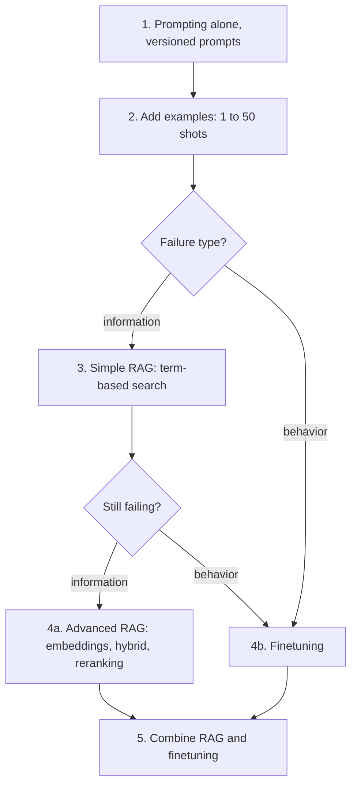

# When (and when not) to finetune

**Finetuning** adapts a model by further training all or part of it, so its weights change. Prompting and RAG adapt a model through its input. Finetuning can improve domain capability, safety and, most often, instruction following: output formats, style and structure. It also needs far more up front in data, hardware and ML skill. This lesson covers the decision. What is finetuning in the bigger picture? When does it help? When is it the wrong tool? How does it relate to RAG?

## 1. Finetuning in context: transfer learning

Finetuning is a form of **transfer learning**: knowledge gained on one task speeds up learning another. Huyen notes the idea goes back to the 1970s. Its big payoff is **sample efficiency**. Training a legal-question model from scratch might need millions of examples, while finetuning a good base model might need a few hundred.

Ways to finetune, each matching a training phase from Module 2:

- **Self-supervised finetuning** (continued pre-training): keep training on raw domain text such as legal documents, or Vietnamese books, with the next-token objective. Raw text is cheap, so this is a common first step before supervised finetuning.
- **Infilling finetuning**: train the model to fill in blanks. This is useful for editing and code debugging, and an autoregressive model can be finetuned this way.
- **Supervised finetuning**: train on (input, output) pairs, such as instructions and responses. High-quality annotated data is expensive, especially when it needs expertise or factual checking.
- **Preference finetuning**: train on (instruction, winning response, losing response) comparisons.
- **Long-context finetuning**: extend a model's context length. This usually requires changing the architecture (positional embeddings) and is harder than other kinds. It can degrade performance on shorter sequences.

Who finetunes? Model developers post-train models before release. Application developers mostly finetune an already post-trained model, and the more refined the base model, the less adaptation work remains. Providers may offer finetuned variants. Code Llama, for example, comes from Llama 2 through several finetuning stages.

## 2. Reasons to finetune

- **Quality on your task.** A general model may be weak on your specific needs, such as a less common SQL dialect or customer-specific queries. Finetuning on that data helps.
- **Structured outputs.** Finetuning is a common way to get reliable JSON, YAML or a domain-specific format.
- **Bias mitigation.** Carefully curated finetuning data can counteract biases from pre-training. Finetuning on text authored by women reduced gender bias in BERT-like models (Garimella et al., 2022).
- **Making small models good enough.** You can finetune a big model, but finetuning **small** models is much more common. They need less memory, and they are cheaper and faster in production. A typical pattern is **distillation**: finetune a small model to imitate a larger one using data generated by the larger one (Module 8).
- **A small specialized model can beat a large general one.** Grammarly found its finetuned Flan-T5 models outperformed a GPT-3 variant specialized for text editing across many writing tasks, despite being **60 times smaller**, using only 82,000 (instruction, output) pairs.

Historically, context limits were a third reason. When prompts could hold only a few examples, finetuning let you "show" many more. Longer contexts weakened this argument, though finetuning still wins when you have very many examples.

## 3. Reasons not to finetune

Many benefits of finetuning can be obtained, to a degree, without it. Careful prompts and context improve quality, and the structured-output techniques from Module 2 handle formats.

1. **It can hurt other tasks.** Finetuning on "changing orders" queries may improve those while degrading product recommendations and general feedback. Mitigations: finetune on all the tasks you care about, use separate models per task, or merge separately finetuned models (lesson 3 of this module).
2. **High up-front investment and ongoing maintenance.**
   - **Data**: annotated data is slow and expensive to get. Open source and synthetic data vary in usefulness.
   - **ML knowledge**: choosing a base model, optimizers, learning rates, spotting overfitting and underfitting, evaluating throughout.
   - **Serving**: you must host the finetuned model or pay a service, and inference optimization for large models is not trivial (Module 9).
   - **Keeping up**: new base models arrive constantly and may improve faster than your finetuned one. You need a policy for when to switch or re-finetune.
3. **Prompting has not really been tried.** Huyen describes a pattern she has seen repeatedly. Someone insists that prompting does not work and wants to finetune. On inspection, the prompt experiments were minimal and unsystematic: unclear instructions, examples that did not represent real data, and poorly defined metrics. Once the prompting process was fixed, prompting was enough.

> [!TIP]
> **General-purpose vs finetuned domain models.** Huyen cites the BloombergGPT story. Bloomberg trained a finance-specific model at large cost, yet zero-shot GPT-4-0314 outperformed it on several financial benchmarks, including FiQA sentiment analysis (87.15 vs 75.07) and ConvFinQA (76.48 vs 43.41). A strong general model plus good prompting is a hard baseline to beat, so test it before investing.

There are also cost arguments on both sides. A finetuned model can use a **shorter prompt**, with no long instructions or examples, which reduces tokens per request. Prompt caching (Module 9) narrows that advantage. With APIs, finetuned models may be priced higher per token.

## 4. Finetuning and RAG

After you have exhausted prompting, should you try RAG or finetuning? Huyen's rule is to diagnose the failures first:

- **Information-based failures** call for **RAG**. The output is factually wrong or outdated because the model lacks the information (private data) or has stale information (it answers 10 Taylor Swift albums when the answer is now 11).
- **Behavior-based failures** call for **finetuning**. The output is factually fine but irrelevant, in the wrong format, or in the wrong style. Technical specs that lack the detail your engineers need, or HTML that does not compile, are examples. **Semantic parsing** into unusual DSLs often needs finetuning.

Her one-line summary: **finetuning is for form, and RAG is for facts.**

Evidence from Ovadia et al. (2024), "Fine-Tuning or Retrieval?":

| Model | Base | Base + RAG | Finetuned (regular) | Finetuned (paraphrases) |
|---|---|---|---|---|
| Mistral-7B | 0.481 | **0.875** | 0.504 | 0.588 |
| Llama 2-7B | 0.353 | **0.585** | 0.219 | 0.392 |
| Orca 2-7B | 0.456 | **0.876** | 0.511 | 0.566 |

On current-events questions, RAG beat finetuning by a wide margin, and RAG on the base model beat RAG on finetuned models. On MMLU, RAG outperformed finetuning in almost all categories. Adding RAG to a finetuned model helped 43% of the time and did not help 57% of the time, compared with RAG alone.

If the model has **both** kinds of issue, **start with RAG**. It is easier, with no training data to curate and no model to host, and it often gives the bigger boost. Start with simple term-based retrieval such as BM25 before reaching for vector databases. RAG and finetuning are not mutually exclusive and can be combined.

Finetuning can reduce hallucination if done with enough high-quality data, and it can make hallucination worse if the data quality is poor.

## 5. A workflow for adapting a model

Before any adaptation, define evaluation criteria and build the evaluation pipeline (Module 4). Then:



1. Get the model to do the task with **prompting alone**, using the best practices from Module 5 and versioned prompts.
2. **Add examples** to the prompt, anywhere from 1 to 50 depending on the use case.
3. If failures come from missing information, connect **data sources**, starting with basic term-based retrieval.
4. Depending on failure modes: (a) more **advanced RAG** such as embedding-based retrieval, or (b) **finetuning** for behavioral issues such as irrelevant, malformatted or unsafe responses. Embedding-based retrieval adds inference complexity, and finetuning adds development complexity.
5. **Combine** RAG and finetuning for a further boost.

Huyen quotes an OpenAI-style view of the progression. Prompting gives the fastest iteration and RAG adds knowledge, then finetuning changes behavior. The right path depends on the application and its failure modes.

```python-run
# A tiny triage helper: label eval failures, then let the counts point to RAG or finetuning.
failures = [
  ("Answered with last year's pricing", "information"),
  ("Did not know our internal refund policy", "information"),
  ("Returned prose instead of the JSON schema", "behavior"),
  ("Correct facts but wrong tone for legal memo", "behavior"),
  ("Hallucinated a product that doesn't exist", "information"),
  ("Cited the right doc but ignored the 3-bullet limit", "behavior"),
  ("Used outdated API version in generated code", "information"),
]
from collections import Counter
c = Counter(kind for _, kind in failures)
print(dict(c))
print("Next step:", "start with RAG (facts)" if c["information"] >= c["behavior"] else "consider finetuning (form)")
```

> [!INTERVIEW]
> **"A PM wants to finetune because 'the model doesn't know our product'. What do you say?"** That is an information failure, so RAG fits better. It is cheaper, updates instantly when the docs change, and can show citations. Finetuning suits behavior problems (format, style, a domain-specific syntax) or cost and latency goals with a smaller model. I'd check that prompting has been tried systematically with an eval set, start with BM25-based RAG, and consider finetuning only for the behavior failures that remain, while accounting for data cost, serving, and the maintenance burden as base models improve.

## Pitfalls

- Finetuning to inject frequently changing facts. They go stale, and updating means retraining.
- Skipping systematic prompt experiments and evaluation before finetuning.
- Finetuning on one narrow task and then being surprised by regressions elsewhere.
- Ignoring the ongoing cost: re-finetuning for each new base model, hosting and monitoring.

## Summary

- Finetuning is transfer learning that changes weights. It can be self-supervised, infilling, supervised, preference-based or long-context.
- **Reasons to finetune**: task quality, structured outputs and styles, bias mitigation, and making small models good enough (often through distillation). Grammarly's Flan-T5 beat a model 60× larger.
- **Reasons not to**: regressions on other tasks, high up-front and maintenance cost, and prompting that has not been tried properly. Strong general models can beat costly domain models (BloombergGPT vs GPT-4).
- **Finetuning is for form, RAG is for facts.** With both problems, start with RAG and with simple retrieval.
- Workflow: prompting, then examples, then simple RAG, then advanced RAG or finetuning, then both, with evaluation at every step.

```quiz
[
  {"q": "'Finetuning is for form, and RAG is for facts' means…", "options": ["Finetuning adds knowledge; RAG fixes formatting", "Use RAG for missing/outdated information and finetuning for behavior such as format and style", "They are interchangeable", "RAG requires finetuning"], "answer": 1, "explain": "Information-based failures call for RAG, and behavior-based failures call for finetuning."},
  {"q": "A model answers with last year's album count because of its training cutoff. Best first fix?", "options": ["Full finetuning", "RAG to supply current information", "Lower temperature", "Quantization"], "answer": 1, "explain": "It's an information failure. RAG outperformed finetuning on current-events questions in Ovadia et al."},
  {"q": "Grammarly's finetuned Flan-T5 outperformed a GPT-3 text-editing variant despite being…", "options": ["Twice as large", "The same size", "60 times smaller", "Trained on trillions of examples"], "answer": 2, "explain": "A small model finetuned on 82,000 pairs beat a far larger general model on their tasks."},
  {"q": "Which is a real risk of finetuning on one narrow task?", "options": ["It always improves all tasks", "Performance on other tasks can degrade", "The tokenizer changes", "Context length doubles"], "answer": 1, "explain": "Finetuning for one task can hurt others. Mitigate with multi-task data, separate models or merging."},
  {"q": "If a model has both information and behavior issues, Huyen recommends starting with…", "options": ["Finetuning", "RAG, beginning with simple term-based retrieval", "Training from scratch", "Model merging"], "answer": 1, "explain": "RAG is easier (no training data or hosting) and often gives a bigger boost."},
  {"q": "What does the BloombergGPT vs GPT-4 comparison illustrate?", "options": ["Domain models always win", "A strong general-purpose model can outperform an expensive domain-specific one", "Finance can't be modeled", "Finetuning is free"], "answer": 1, "explain": "Zero-shot GPT-4 beat BloombergGPT on several finance benchmarks."},
  {"q": "Self-supervised finetuning means…", "options": ["Training on labeled (instruction, response) pairs", "Continuing next-token training on raw domain text", "Training on preference comparisons", "Extending the context length"], "answer": 1, "explain": "It uses cheap raw text, often before supervised finetuning."},
  {"q": "Before trying RAG or finetuning, what must be in place according to the workflow?", "options": ["A vector database", "Evaluation criteria and an evaluation pipeline", "A GPU cluster", "A model gateway"], "answer": 1, "explain": "Evaluation is how you measure progress at every adaptation step."}
]
```

> **Source:** Huyen, *AI Engineering*, ch. 7 ("Finetuning Overview", "When to Finetune": reasons to finetune, reasons not to finetune, finetuning and RAG).
