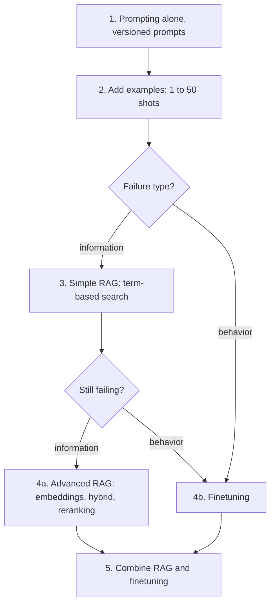

# When (and when not) to finetune

> **Before this lesson:** you should know what weights, pre-training and post-training (supervised finetuning and preference finetuning) are (see [Post-training: SFT and preference finetuning](#/lesson/ai-eng/aie-post-training)), how prompting adapts a model without changing it (see [Prompt engineering best practices](#/lesson/ai-eng/aie-prompt-practices)), and what RAG does (see [RAG architecture and retrieval algorithms](#/lesson/ai-eng/aie-rag-retrieval)). Evaluation pipelines come from [Designing your evaluation pipeline](#/lesson/ai-eng/aie-eval-pipeline).

## In plain words

**Finetuning** means taking a model that has already been trained and training it some more, on examples of your own task, so that its **weights** (the learned numbers inside it) change. Prompting and RAG adapt a model through what you put in its input; finetuning changes the model itself. It can make a model better at your domain, safer, and above all more reliable at following your instructions: your output format, your style, your structure. It also needs far more up-front investment in data, hardware and machine-learning skill.

An everyday picture: you hire an experienced chef for your restaurant. Prompting is handing them today's order ticket with notes. RAG is giving them the recipe binder to look things up. Finetuning is sending them on a two-week course in your house style until they cook your dishes without looking. The course is expensive and slow, and if the menu changes every week it is the wrong tool: the binder is better for facts that change. But if the problem is *how* they cook (plating, portion size, a technique) rather than *what* is on the menu, training is the fix.

Why this matters for a job: "Should we finetune?" is one of the most expensive decisions an AI team makes, and interviewers love it. A product manager says "the model doesn't know our product, let's finetune"; you are expected to diagnose the failure, explain why RAG may fit better, and know when finetuning really is the answer. This lesson covers where finetuning fits in the bigger picture, when it helps, when it is the wrong tool, and how it relates to RAG.

## 1. Finetuning in context: transfer learning

Finetuning is a form of **transfer learning**: knowledge gained on one task makes learning another task faster. Huyen notes the idea goes back to the 1970s. Its big payoff is **sample efficiency**, needing fewer examples to reach good performance. Training a legal-question model from scratch might need millions of examples; finetuning a good existing model might need a few hundred, because the model already knows language, reasoning and a good deal about law.

A **base model** is the model you start from. There are several ways to finetune it, each matching a phase of training described in Module 2:

- **Self-supervised finetuning** (also called continued pre-training): keep training on raw text from your domain, such as legal documents or Vietnamese books, with the same next-token prediction objective used in pre-training. Raw text is cheap, so this is a common first step before supervised finetuning.
- **Infilling finetuning**: train the model to fill in blanks in the middle of text. This is useful for editing and for code debugging, and an autoregressive model (one that normally writes left to right) can be finetuned this way.
- **Supervised finetuning (SFT)**: train on (input, output) pairs, such as instructions and the responses you want. High-quality labelled data is expensive, especially when it needs experts or fact-checking.
- **Preference finetuning**: train on comparisons of the form (instruction, winning response, losing response), so the model learns which answers people prefer.
- **Long-context finetuning**: extend how many tokens the model can read at once. This usually needs changes to how the model encodes token positions (its *positional embeddings*), is harder than the other kinds, and can make the model worse on short inputs.

Who finetunes? Model developers post-train their models before release. Application developers mostly finetune a model that has already been post-trained; the more refined the starting model, the less work remains. Providers may also release finetuned variants: Code Llama, for example, was produced from Llama 2 through several finetuning stages.

Here is roughly what supervised finetuning data looks like: one JSON record per example, often in the same chat format as the API.

```text
{"messages": [{"role": "system", "content": "Reply as Acme support. Output JSON only."},
              {"role": "user", "content": "Where is order 1182?"},
              {"role": "assistant", "content": "{\"intent\": \"order_status\", \"order_id\": \"1182\"}"}]}
```

Hundreds or thousands of such records, each showing the exact behaviour you want, are what a finetuning job learns from.

## 2. Reasons to finetune

- **Quality on your task.** A general model may be weak on your specific needs, such as a less common dialect of SQL or the kinds of questions your customers ask. Finetuning on that data helps.
- **Structured outputs.** Finetuning is a common way to get reliable JSON, YAML or a domain-specific format.
- **Bias mitigation.** Carefully chosen finetuning data can counteract biases picked up in pre-training. Garimella and colleagues (2022) reduced gender bias in BERT-like models by finetuning on text written by women.
- **Making small models good enough.** You can finetune a big model, but finetuning **small** models is much more common: they need less memory and are cheaper and faster to run in production. A typical pattern is **distillation**: finetune a small model to imitate a larger one, using data the larger one generated (Module 8).
- **A small specialised model can beat a large general one.** Grammarly found its finetuned Flan-T5 models beat a GPT-3 variant specialised for text editing across many writing tasks, despite being **60 times smaller**, using only 82,000 (instruction, output) pairs.

Historically, short context windows were another reason: when a prompt could hold only a few examples, finetuning let you "show" the model thousands. Longer contexts weakened this argument, though finetuning still wins when you have very many examples.

## 3. Reasons not to finetune

Many of finetuning's benefits can be had, at least partly, without it: careful prompts and context improve quality, and the structured-output techniques from the sampling lesson handle formats.

1. **It can hurt other tasks.** Finetuning a support model on "change my order" requests may improve those while making it worse at product recommendations and general feedback. Mitigations: finetune on all the tasks you care about together, keep a separate model per task, or merge separately finetuned models into one (lesson 3 of this module).
2. **High up-front investment and ongoing maintenance.**
   - **Data**: labelled data is slow and expensive to get. Open source and synthetic data vary in usefulness.
   - **Machine-learning knowledge**: choosing a base model, an **optimiser** (the algorithm that updates the weights) and a **learning rate** (how big each update is), spotting **overfitting** (memorising the training examples instead of learning the pattern) and **underfitting** (not learning enough), and evaluating throughout.
   - **Serving**: you must host the finetuned model or pay a service to, and making large models fast and cheap to run is not trivial (Module 9).
   - **Keeping up**: new base models arrive constantly and may improve faster than your finetuned one. You need a policy for when to switch or finetune again.
3. **Prompting has not really been tried.** Huyen describes a pattern she has seen again and again. Someone insists prompting does not work and wants to finetune. On inspection, the prompt experiments were minimal and unsystematic: unclear instructions, examples that did not resemble real data, poorly defined metrics. Once the prompting process was fixed, prompting was enough.

> [!TIP]
> **General-purpose versus finetuned domain models.** Huyen cites the BloombergGPT story. Bloomberg trained a finance-specific model at great cost, yet GPT-4-0314 with no examples (zero-shot) beat it on several financial benchmarks, including FiQA sentiment analysis (87.15 versus 75.07) and ConvFinQA (76.48 versus 43.41). A strong general model plus good prompting is a hard baseline to beat, so test it before investing.

There are cost arguments on both sides. A finetuned model can work with a **shorter prompt**, without long instructions or many examples, which saves tokens on every request. Prompt caching (Module 9) narrows that advantage, and API providers often charge more per token for finetuned models. The demo makes the trade-off concrete with invented prices:

```python-run
# Illustrative prices: does a shorter prompt pay for a finetuned model's higher per-token price?
BASE_IN, BASE_OUT = 0.50, 1.50        # $ per 1M tokens, base model
FT_IN, FT_OUT = 1.00, 3.00            # $ per 1M tokens, finetuned model (often priced higher)
TRAINING = 2000.0                     # one-off finetuning cost in $
OUT = 150                             # output tokens per request (same for both)

def monthly(requests, prompt_tokens, price_in, price_out):
    return requests * (prompt_tokens * price_in + OUT * price_out) / 1e6

for requests in [100_000, 1_000_000, 10_000_000]:
    base = monthly(requests, 1800, BASE_IN, BASE_OUT)      # long prompt: instructions + 20 examples
    ft = monthly(requests, 300, FT_IN, FT_OUT)             # short prompt: behaviour is in the weights
    months = TRAINING / (base - ft) if base > ft else float("inf")
    print(f"{requests:>10,} req/month: base ${base:>8,.0f}  finetuned ${ft:>8,.0f}  training pays back in {months:5.1f} months")
```

**Reading this Python line by line**

- The constants are assumptions you can edit: prices per million input and output tokens for each model, a one-off training cost, and a fixed output length.
- `monthly(...)` computes the bill: requests times (prompt tokens times input price plus output tokens times output price), divided by a million because prices are per million tokens. Worked for one request on the base model: $1800 \times 0.50 + 150 \times 1.50 = 1125$ millionths of a dollar, about \$0.0011.
- `months` is the **payback period**: training cost divided by the monthly saving. `float("inf")` (infinity) covers the case where finetuning saves nothing.
- `100_000` is Python's way of writing 100000 with readable separators.
- Output: at 100,000 requests a month the finetuned model saves only about \$37 a month, so training takes 53 months to pay back. At 1 million requests it pays back in 5.3 months, at 10 million in half a month. Cost alone rarely justifies finetuning at low volume, but at high volume the shorter prompt adds up.

## 4. Finetuning and RAG

Once prompting has been pushed as far as it will go, should you try RAG or finetuning next? Huyen's rule is to diagnose the failures first:

- **Information-based failures** call for **RAG**. The output is wrong or out of date because the model lacks the information (your private data) or has stale information (it says Taylor Swift has 10 albums when she now has 11).
- **Behaviour-based failures** call for **finetuning**. The facts are fine, but the output is irrelevant, in the wrong format or in the wrong style. Technical specifications missing the detail your engineers need, or generated HTML that does not render, are examples. **Semantic parsing** (turning natural language into a formal language) into unusual **domain-specific languages** (DSLs, small languages built for one purpose, such as a company's internal query language) often needs finetuning.

Her one-line summary: **finetuning is for form, and RAG is for facts.**

Evidence from Ovadia and colleagues (2024), "Fine-Tuning or Retrieval?", on questions about current events (accuracy, higher is better):

| Model | Base | Base + RAG | Finetuned (regular) | Finetuned (paraphrases) |
|---|---|---|---|---|
| Mistral-7B | 0.481 | **0.875** | 0.504 | 0.588 |
| Llama 2-7B | 0.353 | **0.585** | 0.219 | 0.392 |
| Orca 2-7B | 0.456 | **0.876** | 0.511 | 0.566 |

Read a row: Mistral-7B answered 48.1% correctly on its own, 87.5% with RAG, and only 50.4% after finetuning on the new facts (58.8% when the finetuning data included paraphrases of each fact). RAG beat finetuning by a wide margin, and RAG on the base model beat RAG on finetuned models. On MMLU (a broad multiple-choice knowledge benchmark), RAG also beat finetuning in almost every category. Adding RAG on top of a finetuned model helped only 43% of the time, compared with RAG alone.

If the model has **both** kinds of problem, **start with RAG**. It is easier (no training data to curate, no model to host) and often gives the bigger improvement. Start with simple term-based retrieval such as BM25 before reaching for vector databases. RAG and finetuning are not mutually exclusive and can be combined later.

Finetuning can reduce hallucination if done with enough high-quality data, and it can make hallucination worse if the data is poor.

## 5. A workflow for adapting a model

Before any adaptation, define evaluation criteria and build the evaluation pipeline (Module 4). Then:



1. Get the model to do the task with **prompting alone**, using the best practices from Module 5 and versioned prompts.
2. **Add examples** to the prompt, anywhere from 1 to 50 depending on the use case.
3. If failures come from missing information, connect **data sources**, starting with basic term-based retrieval.
4. Depending on the remaining failures: (a) more **advanced RAG**, such as embedding-based retrieval, or (b) **finetuning** for behavioural problems such as irrelevant, badly formatted or unsafe responses. Embedding-based retrieval adds complexity at run time; finetuning adds complexity during development.
5. **Combine** RAG and finetuning for a further improvement.

Huyen sums up a view common among model providers: prompting gives the fastest iteration, RAG adds knowledge, and finetuning changes behaviour. The right path depends on the application and its failures.

To apply the rule, label each failure from your evaluation set as information or behaviour, then count:

```python-run
# A tiny triage helper: label eval failures, then let the counts point to RAG or finetuning.
failures = [
  ("Answered with last year's pricing", "information"),
  ("Did not know our internal refund policy", "information"),
  ("Returned prose instead of the JSON schema", "behavior"),
  ("Correct facts but wrong tone for legal memo", "behavior"),
  ("Hallucinated a product that doesn't exist", "information"),
  ("Cited the right doc but ignored the 3-bullet limit", "behavior"),
  ("Used outdated API version in generated code", "information"),
]
from collections import Counter
c = Counter(kind for _, kind in failures)
print(dict(c))
print("Next step:", "start with RAG (facts)" if c["information"] >= c["behavior"] else "consider finetuning (form)")
```

`failures` pairs each failure description with its label. `Counter(kind for _, kind in failures)` counts the labels (the `_` ignores the description). The last line applies Huyen's rule: if information failures are at least as common, start with RAG. Output: `{'information': 4, 'behavior': 3}` and `Next step: start with RAG (facts)`. In a real project you would also look at which failures matter most to users, not only how many there are.

> [!INTERVIEW]
> **"A PM wants to finetune because 'the model doesn't know our product'. What do you say?"** That is an information failure, so RAG fits better: it is cheaper, updates instantly when the documents change, and can show citations. Finetuning suits behaviour problems (format, style, a domain-specific syntax) or cost and latency goals with a smaller model. I'd check that prompting has been tried systematically against an evaluation set, start with BM25-based RAG, and consider finetuning only for the behaviour failures that remain, while accounting for data cost, serving, and the maintenance burden as base models improve.

## Pitfalls

- Finetuning to inject facts that change often. They go stale, and updating means retraining.
- Skipping systematic prompt experiments and evaluation before finetuning.
- Finetuning on one narrow task and then being surprised by regressions elsewhere.
- Ignoring the ongoing cost: finetuning again for each new base model, hosting and monitoring.

## Summary

- Finetuning is transfer learning that changes weights. It can be self-supervised, infilling, supervised, preference-based or long-context.
- **Reasons to finetune**: task quality, structured outputs and styles, bias mitigation, and making small models good enough (often through distillation). Grammarly's Flan-T5 beat a model 60 times larger.
- **Reasons not to**: regressions on other tasks, high up-front and maintenance cost, and prompting that has not been tried properly. Strong general models can beat costly domain models (BloombergGPT versus GPT-4).
- **Finetuning is for form, RAG is for facts.** With both problems, start with RAG, and with simple retrieval.
- Workflow: prompting, then examples, then simple RAG, then advanced RAG or finetuning, then both, with evaluation at every step.

## Glossary

- **Finetuning**: further training of an existing model on task-specific examples, changing its weights.
- **Weights**: the learned numbers inside a model.
- **Transfer learning**: reusing knowledge from one task to learn another faster.
- **Sample efficiency**: reaching good performance with few training examples.
- **Base model**: the model you start finetuning from.
- **Self-supervised finetuning (continued pre-training)**: more next-token training on raw domain text.
- **Infilling**: training a model to fill in missing text in the middle.
- **Supervised finetuning (SFT)**: training on (input, desired output) pairs.
- **Preference finetuning**: training on comparisons between a better and a worse response.
- **Long-context finetuning**: training a model to handle longer inputs.
- **Distillation**: training a small model to imitate a larger one's outputs.
- **Bias mitigation**: reducing unfair tendencies a model learned from its data.
- **Optimiser / learning rate**: the algorithm that updates weights / how large each update is.
- **Overfitting / underfitting**: memorising training data instead of the pattern / failing to learn the pattern.
- **Serving**: running a model so applications can send it requests.
- **Payback period**: how long savings take to cover a one-off cost.
- **Information-based vs behaviour-based failure**: wrong or missing facts vs wrong format, style or relevance.
- **Semantic parsing**: turning natural language into a formal language such as a query.
- **Domain-specific language (DSL)**: a small language made for one purpose.

```quiz
[
  {"q": "'Finetuning is for form, and RAG is for facts' means…", "options": ["Finetuning adds knowledge; RAG fixes formatting", "Use RAG for missing/outdated information and finetuning for behaviour such as format and style", "They are interchangeable", "RAG requires finetuning"], "answer": 1, "explain": "Information-based failures call for RAG, and behaviour-based failures call for finetuning."},
  {"q": "A model answers with last year's album count because of its training cutoff. Best first fix?", "options": ["Full finetuning", "RAG to supply current information", "Lower temperature", "Quantization"], "answer": 1, "explain": "It's an information failure. RAG outperformed finetuning on current-events questions in Ovadia et al."},
  {"q": "Grammarly's finetuned Flan-T5 outperformed a GPT-3 text-editing variant despite being…", "options": ["Twice as large", "The same size", "60 times smaller", "Trained on trillions of examples"], "answer": 2, "explain": "A small model finetuned on 82,000 pairs beat a far larger general model on their tasks."},
  {"q": "Which is a real risk of finetuning on one narrow task?", "options": ["It always improves all tasks", "Performance on other tasks can degrade", "The tokenizer changes", "Context length doubles"], "answer": 1, "explain": "Finetuning for one task can hurt others. Mitigate with multi-task data, separate models or merging."},
  {"q": "If a model has both information and behaviour issues, Huyen recommends starting with…", "options": ["Finetuning", "RAG, beginning with simple term-based retrieval", "Training from scratch", "Model merging"], "answer": 1, "explain": "RAG is easier (no training data or hosting) and often gives a bigger boost."},
  {"q": "What does the BloombergGPT vs GPT-4 comparison illustrate?", "options": ["Domain models always win", "A strong general-purpose model can outperform an expensive domain-specific one", "Finance can't be modelled", "Finetuning is free"], "answer": 1, "explain": "Zero-shot GPT-4 beat BloombergGPT on several finance benchmarks."},
  {"q": "Self-supervised finetuning means…", "options": ["Training on labelled (instruction, response) pairs", "Continuing next-token training on raw domain text", "Training on preference comparisons", "Extending the context length"], "answer": 1, "explain": "It uses cheap raw text, often before supervised finetuning."},
  {"q": "Before trying RAG or finetuning, what must be in place according to the workflow?", "options": ["A vector database", "Evaluation criteria and an evaluation pipeline", "A GPU cluster", "A model gateway"], "answer": 1, "explain": "Evaluation is how you measure progress at every adaptation step."}
]
```

> **Source:** Huyen, *AI Engineering*, ch. 7 ("Finetuning Overview", "When to Finetune": reasons to finetune, reasons not to finetune, finetuning and RAG).
