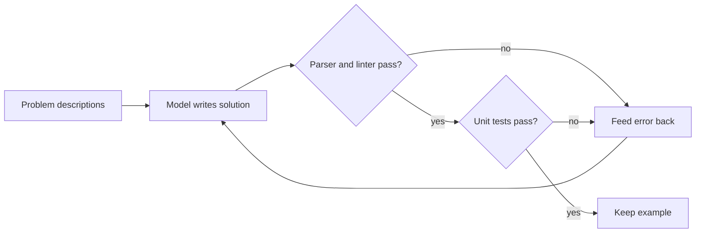

# Data synthesis, distillation and processing

> **Before this lesson:** read [Data curation: quality, coverage, quantity](#/lesson/ai-eng/aie-data-curation), which explains what good training data looks like and why quality, coverage and quantity all matter. It helps to know what finetuning and LoRA are from [When (and when not) to finetune](#/lesson/ai-eng/aie-when-finetune) and [PEFT, LoRA, model merging and hyperparameters](#/lesson/ai-eng/aie-peft-lora). Similarity measures such as Jaccard similarity and embeddings were introduced in [Exact evaluation and similarity measures](#/lesson/ai-eng/aie-exact-similarity), and AI judges in [AI as a judge and comparative evaluation](#/lesson/ai-eng/aie-judge-comparative). The demos use basic Python and a little NumPy, explained line by line.

## In plain words

The previous lesson showed that good training data is the heart of a good model, and that collecting it by hand is slow and expensive. This lesson covers the two jobs that remain once you know what data you want.

The first job is **making data with programs** instead of collecting it from people. **Synthetic data** is data that a program or an AI model produced rather than data recorded from the real world. You can create it with simple fill-in-the-blank templates, by transforming real examples (adding typos, swapping words), by running simulations, or by asking a strong language model to write examples for you. A special case is **model distillation**: training a small model to copy the behaviour of a big one by learning from the big one's outputs.

The second job is **processing**: getting raw data ready for training. That means looking at it, removing copies of the same example, cleaning out junk and forbidden content, and putting every example into the exact format the model expects.

An everyday picture: you are preparing flashcards to help a friend study for a driving test. Some cards you copy from the official handbook (real data). Others you write yourself by changing details on existing cards, "the light is red" becoming "the light is amber" (augmentation). Others you invent from a template, "What does a ___ sign mean?" (synthesis). You might even ask a driving instructor to write a pile of cards for you (asking a strong model, which is close to distillation). Before you hand the stack over, you throw out duplicates, fix typos, remove anything wrong, and make every card follow the same front-and-back layout (processing). A stack full of repeats or wrong answers would teach your friend bad habits, no matter how many cards it held.

Why this matters for a job: most teams that finetune a model today use some synthetic data, and almost every team must clean and deduplicate what they have. Interviewers often ask "What are the risks of training on data generated by an LLM?" and "How would you deduplicate a million documents?" By the end of this lesson you can answer both.

## 1. Augmentation versus synthesis

Two words describe "data made by a program":

- **Data augmentation** creates new examples by changing existing *real* examples. A photo of a cat flipped left to right is still a photo of a cat, so you now have two training images instead of one.
- **Data synthesis** generates brand-new examples that imitate the properties of real data. Simulating how a person moves a mouse, in order to train a detector that tells humans from bots, is synthesis: no real mouse movement was copied.

The boundary between the two is fuzzy, and Huyen often uses "synthesis" to cover both. One more point before we go on: synthetic data rarely replaces data written by people altogether. In practice teams **mix** synthetic examples with real ones.

### Why would anyone synthesize data?

Five reasons come up again and again.

- **Quantity.** Programs can produce data at a scale people cannot, which matters most where real data is scarce. Think of rare weather events, deep-sea exploration, or car accidents for self-driving software: you cannot wait for enough real crashes to happen.
- **Coverage.** You can produce data with exactly the traits you are missing: very short texts, very long texts, toxic phrases to train a toxicity detector, tricky **adversarial examples** (inputs crafted on purpose to fool a model), or extra examples of a rare class when your data is **imbalanced** (one category far outnumbers another). The TrueTeacher project asked LLMs to write summaries that deliberately contradict their source, then used them to train a detector of such contradictions. Anthropic used models to write evaluation datasets testing 154 different behaviours and found the model-written sets came close to, and sometimes beat, human-written ones in quality.
- **Quality.** Sometimes AI-written data is *better* than human data. Tool-use examples are one case, because people and models work differently (people like clicking buttons, models do better calling programs). Hard maths problems are another. Preference ratings are a third: a single model rates more consistently than a crowd of different people does.
- **Privacy.** Where real records are sensitive, such as hospital patient files or insurance claims, synthetic records that look realistic let you build and test a system without exposing anyone's personal details.
- **Distillation.** You can train one model to imitate another (section 5).

## 2. Traditional techniques: rules and simulation

Long before large language models, engineers made data with plain code. These methods are cheap, predictable and still widely used.

### Rule-based synthesis

- **Templates.** A **template** is a sentence or document with blanks, and a random generator fills the blanks. A popular Python library for fake but realistic values is **Faker**, which produces made-up names, addresses, dates and card numbers. A template for a card transaction might have fields for transaction ID, date, amount, merchant, location and status. Fraud-detection teams often train a first model on synthetic transactions like these to prove the idea works before anyone grants access to real customer data. Templates suit any document with a fixed structure (invoices, resumes, tax forms, contracts, configuration files) and anything that follows a **grammar**, meaning strict rules about what a valid example looks like, such as regular expressions or maths equations. DeepMind trained its AlphaGeometry system on **100 million** synthetic geometry examples.
- **Procedural transformations.** "Procedural" means following a fixed recipe. For images: rotate, crop, scale, or erase part of the picture, tricks used as far back as AlexNet. For text: replace a word with a similar one, so "fantastic nurse" becomes "great nurse". You find substitutes through a synonym dictionary or by looking for words whose **embeddings** (lists of numbers that capture meaning) sit close together.
- **Bias mitigation.** A model trained mostly on "she is a nurse" and "he is a doctor" picks up a stereotype. Swapping gendered words ("She's a fantastic nurse" becomes "He's a fantastic nurse"), or swapping names from different backgrounds, balances the data. This is called **counterfactual augmentation**: you create the version of the example that did not happen.
- **Perturbation.** To **perturb** an example is to add a small amount of noise to it. Research on adversarial attacks showed that tiny changes can fool a model: one study found that changing a *single pixel* flipped the predicted label for 67.97% of natural images in the CIFAR-10 dataset. Training on perturbed data makes a model more **robust**, meaning less easily thrown off by small variations. BERT's training used a version of this idea: 15% of tokens were chosen for the masking task, and 10% of those were replaced with a random word.

Here are three of these tricks in a few lines of Python.

```python-run
import random
random.seed(3)
templates = ["How do I {verb} my {obj}?", "I can't {verb} my {obj}, please help.", "Steps to {verb} {obj}?"]
verbs, objs = ["reset", "change", "recover"], ["password", "email address", "2FA device"]
swap = {"she": "he", "her": "his", "mom": "dad", "Ms.": "Mr."}
print("Template synthesis:")
for _ in range(4):
    print("  ", random.choice(templates).format(verb=random.choice(verbs), obj=random.choice(objs)))
s = "Today her mom said she is a fantastic nurse"
print("Counterfactual augmentation:\n  ", s, "\n  ", " ".join(swap.get(w, w) for w in s.split()))
def typo(text, rate=0.08):
    return "".join(c if random.random() > rate or not c.isalpha() else random.choice("abcdefghijklmnopqrstuvwxyz") for c in text)
print("Perturbation (typos):\n  ", typo("How do I reset my password?"))
```

**Reading this Python line by line**

- `random.seed(3)` fixes the starting point of the random number generator, so you get the same "random" choices every time you run it. That makes results repeatable.
- `templates` holds three sentence patterns. The parts in curly braces, `{verb}` and `{obj}`, are blanks.
- `verbs` and `objs` are the values that may fill those blanks.
- `swap` is a dictionary (a lookup table) mapping each gendered word to its counterpart.
- In the loop, `random.choice(templates)` picks one pattern at random, and `.format(verb=..., obj=...)` fills the blanks with a randomly chosen verb and object. Four loops give four synthetic support questions.
- `s.split()` breaks the sentence into words. `swap.get(w, w)` looks up each word in the table and returns the swapped word if there is one, or the word unchanged if not. `" ".join(...)` glues the words back together.
- `typo` walks through each character `c`. With probability `rate` (8%), and only for letters, it replaces the character with a random letter; otherwise it keeps it.
- Output: four questions such as "How do I recover my 2FA device?" and "I can't recover my 2FA device, please help.", the sentence rewritten as "Today his dad said he is a fantastic nurse", and a typo version such as "How do I resey my iassword?". With three templates, three verbs and three objects there are only 27 possible questions, which is the main weakness of templates: they produce variety only within the patterns you thought of.

### Simulation

Instead of running a costly or dangerous experiment in the real world, you can run it in a computer model of the world. Self-driving companies generate rare road scenarios in virtual environments (CARLA, Waymo's SimulationCity, Tesla's simulator). Robotics teams simulate joint movements and keep the ones that succeed. Simulation is also good for **tool-use data**: for a given request, simulate many different sequences of actions, run them, check which ones reach the right result, and keep the most efficient sequence as the training label. It suits rare events in other fields too: company IPOs or bankruptcies in finance, defects on a factory line, extreme climate scenarios.

## 3. AI-powered data synthesis

Strong language models opened up far richer ways to generate data.

- **Simulating programs and people.** A model can pretend to be an API (a programming interface to some service) and produce plausible responses without anyone calling the real service, as the StableToolBench project did. In **self-play**, copies of an AI play against each other and learn from the games. OpenAI's Dota 2 bot played the equivalent of about 180 years of games each day, and AlphaGo learned from millions of games against itself. The same idea works for negotiations, or for role-play between a simulated customer and a simulated support agent.
- **Paraphrasing and translation.** To **paraphrase** is to say the same thing in different words. "How to reset my password?" can become "I forgot my password", "How can I change my password?" and many more. Translation can grow data for languages with little text available (**low-resource languages**) and also for less common programming languages. **Back-translation** translates an example into another language and then back again, keeping the example only if the round trip preserves its meaning. It acts as both augmentation and a quality check.
- **Pre-training data.** Even the huge text collections used for pre-training can be partly synthetic. Researchers have trained models on AI-generated short stories and synthetic textbooks.

### Instruction data synthesis

Recall from the post-training lesson that **instruction finetuning** (also called supervised finetuning) trains a model on (instruction, response) pairs. You can synthesize the instructions, the responses, or both.

- **Generate instructions from a plan.** Start from a list of topics, keywords or instruction types, or from templates. The **UltraChat** project asked ChatGPT for 30 topics, then 30 to 50 subtopics for each, then instructions and responses for each subtopic.
- **Seed and expand.** Start with a few human-written examples, called **seeds**, and ask a model to write many more in the same spirit. **Alpaca** began with 175 human-written (instruction, response) seeds from the Self-Instruct project and used OpenAI's text-davinci-003 to grow them into **52,000** pairs.
- **Reverse instruction.** Models struggle to write long, high-quality responses without **hallucinating** (stating false things confidently). So flip the task around: take existing high-quality writing by people, such as books or Wikipedia articles, and ask the AI to write the *prompt* that would lead to that text. Now the responses are human quality, and the AI only wrote the easy part. Repeating this lets a weaker model build better instruction data for itself and improve step by step.
- **Long-context finetuning data.** To teach a model to use very long inputs, split long documents into short chunks, generate (question, answer) pairs for each chunk, then pair each question and answer with the **entire long document** as context. The model has to find the relevant part inside a long input, which is the skill you want.

### Case study: Llama 3's coding data

Meta's Llama 3 team described a careful pipeline for synthetic code. Read it as a recipe you can borrow.

1. Generate a large, varied set of descriptions of programming problems.
2. For each description and each programming language, ask the model for a solution. Including general rules of good programming in the prompt, and asking for step-by-step **chain-of-thought** reasoning, improved quality.
3. Verify each solution. Run the code through **parsers** (programs that check the code follows the language's grammar) and **linters** (tools that flag suspicious code such as uninitialized variables or type errors). Generate **unit tests** (small programs that check a piece of code gives the right output) and run them.
4. When a solution fails a check, feed the error message back to the model and ask it to fix the code. Keep only examples that pass every check. About 20% of solutions were wrong at first and were then corrected this way.

The team also used **code translation** (converting solutions into less common languages) and **code back-translation**: have the model write an explanation or documentation for some code, regenerate code from that explanation alone, and keep the example only if the regenerated code faithfully matches. The pipeline produced more than 2.7 million synthetic coding examples.



### Verifying synthetic data

A useful rule of thumb: people synthesize the kinds of data they can check. That is a big reason coding data is synthesized so often, since you can run it. The main ways to verify:

- **Functional correctness** where possible: run the code, execute unit tests, use back-translation.
- **AI verifiers**: an AI judge (a model asked to grade other outputs) or a specialized scoring model rates each example, say from 1 to 5 or as good versus bad, or checks it against stated quality rules. The factual-consistency checks from the evaluation lessons can filter out examples containing hallucinations.
- **Creative checks.** If your synthetic data is meant to look like real data, train a classifier to tell the two apart. If the classifier succeeds easily, your synthetic data is not realistic enough.
- **Heuristics.** A **heuristic** is a simple rule of thumb that is usually, though not always, right. Filter examples by keywords, author, creation date, metadata or source. Drop empty or very short examples, instructions that appear with many different responses (or the reverse), and outputs that merely repeat the input. **Anomaly detection**, which flags examples that look very different from the rest, can catch outliers.

Checking synthetic data is as hard as evaluating any AI output, and it calls for the same mix of methods.

## 4. Limitations of AI-generated data

Synthetic data is powerful but has four well-known weaknesses.

1. **Quality control.** "Garbage in, garbage out": a model trained on bad examples learns bad habits. Without a reliable way to verify synthetic examples, teams will not trust them.
2. **Superficial imitation.** The paper "The False Promise of Imitating Proprietary LLMs" (Gudibande and colleagues, 2023) found that models trained to imitate a stronger model copied its **style** convincingly but fell short on factual accuracy and on tasks outside their training data. Imitation can even *encourage* hallucination. Suppose a student model is trained on a teacher's correct maths solutions to problems the student cannot actually solve. The student learns to produce text that *looks like* a confident solution, whether or not it is right.
3. **Potential model collapse.** **Model collapse** is the gradual decay that can happen when models are trained, generation after generation, on data produced by earlier models. "The Curse of Recursion" (Shumailov and colleagues, 2023) showed that this can cause lasting damage: common patterns become over-represented and rare cases are forgotten. A later paper, "Is Model Collapse Inevitable?" (Gerstgrasser and colleagues, 2024), argued that collapse is unavoidable if *all* the training data is synthetic, but can be avoided by **mixing synthetic data with real data**. Nobody has found a universal safe ratio, and some studies report big gains from data that is mostly synthetic. The same feedback loop can also amplify biases over successive generations.
4. **Obscure data lineage.** **Data lineage** is the record of where data came from. If model X was trained on copyrighted or contaminated data and you train on X's outputs, your model quietly inherits the problem. If X had seen benchmark B during training, your model's score on B is contaminated too, even though you never touched B.

The next demo shows model collapse in miniature. The "model" here is the simplest one possible: a **Gaussian** (bell curve) described by its average and its spread, its **standard deviation**.

```python-run
import numpy as np
# Toy model collapse: each generation is trained only on samples from the previous one.
# Rare events (the tails) vanish; mixing in real data slows the loss of diversity.
rng = np.random.default_rng(0)
real = rng.normal(0, 1, 20000)
def generation(prev, mix_real=0.0, n=20):
    k = int(n * mix_real)
    train = np.concatenate([rng.choice(prev, n - k), rng.choice(real, k)])
    return rng.normal(train.mean(), train.std(), 2000)       # "model" = fitted Gaussian, then sampled
for mix in [0.0, 0.5]:
    data = real
    for g in range(200): data = generation(data, mix)
    print(f"real-data mix {mix:.0%}: std after 200 generations = {data.std():.3f} (original 1.0), share beyond |x|>2: {np.mean(np.abs(data) > 2):.2%}")
```

**Reading this Python line by line**

- `rng = np.random.default_rng(0)` creates a seeded random number generator so the run is repeatable.
- `real` is 20,000 numbers drawn from a bell curve with average 0 and standard deviation 1. This stands in for real-world data.
- `generation` simulates one round of "train a model, then generate data with it". It takes a small training set of `n = 20` examples: `n - k` drawn from the previous generation's output and `k` drawn from the real data, where `k` is the real-data share times 20.
- `train.mean()` and `train.std()` are the "model": the average and spread fitted to those 20 examples. `rng.normal(...)` then samples 2,000 new examples from that fitted bell curve. That output becomes the next generation's training data.
- The outer loop runs 200 generations twice: once with no real data (`mix = 0.0`) and once with half real data (`mix = 0.5`).
- The printout reports the final spread and the share of examples further than 2 from the centre, which are the rare "tail" events. In the real data about 4.6% of values lie out there.
- Output: with no real data, the spread falls to about 0.000 and the tails disappear completely (0.00%): the distribution has collapsed to a single point. With half real data, the spread stays near 0.8 and about 1.5% of examples remain in the tails. Every generation loses a little diversity because a small sample rarely contains the extremes, and those losses compound. Real data keeps pulling the model back toward reality.

## 5. Model distillation

**Model distillation**, also called knowledge distillation (Hinton and colleagues, 2015), trains a small model, the **student**, to imitate a larger model, the **teacher**.

- Traditionally the aim is a smaller, faster model to deploy. **DistilBERT** is 40% smaller than BERT, keeps 97% of its language-understanding ability, and runs 60% faster.
- The student can be trained from scratch (as DistilBERT was) or finetuned starting from an existing pre-trained model. **Alpaca** finetuned the 7-billion-parameter Llama model on examples produced by the 175-billion-parameter text-davinci-003. It behaved similarly to the teacher in many cases while being about 4% of its size.
- Synthetic instruction data is often combined with adapters such as LoRA (from the PEFT lesson). BuzzFeed finetuned Flan-T5 with LoRA on examples generated by OpenAI's models and reported cutting its inference costs by 80%.

> [!WARNING]
> Not every model may legally be distilled. Many model licenses **forbid using the model's outputs to train other models**, especially competing ones. Read the license before you build a pipeline on a model's outputs.

Not all training on synthetic data counts as distillation. Distillation assumes the teacher is the gold standard the student aims to match. Sometimes a student ends up *stronger* than the model that produced its data. Reverse-instruction bootstrapping is one example. NVIDIA's **Nemotron-4 340B**, finetuned on data generated by the smaller Mixtral-8x7B, beat that "teacher" on several tasks.

## 6. Data processing

Whether your data was collected, bought or synthesized, it must be processed before training. A few working habits save a lot of time:

- **Order the steps by cost.** If cleaning each example is slow, **deduplicate first** so you do not clean the same example twice. If deduplication is the expensive step, filter out clearly low-quality data first so there is less to deduplicate.
- **Do trial runs.** Run every script on a small sample and check the results before processing everything.
- **Never change the original data in place.** Keep the raw copy. You or another team may want it processed differently later, and every script has bugs at some point.

### Inspect the data

Start by computing statistics. Where did the data come from, and what has already been done to it? Plot distributions of token counts, input and response lengths, topics and languages. Microsoft researchers compared GPT-3 and GPT-4 outputs by looking at the distribution of (verb, direct object) pairs, such as ("write", "essay"), and at response lengths. Split your plots by source, by time and by annotator, and hunt for outliers. Do some annotators write much shorter responses than others, or give consistently higher scores? Where an example has several labels, measure **inter-annotator disagreement** (how often labellers disagree) and resolve conflicts. If the same query appears with different responses, find out why.

**Look at the data with your own eyes.** Huyen stresses this more than any tool. Greg Brockman, a co-founder of OpenAI, has made the same point: manually inspecting data has perhaps the best ratio of value to prestige of anything in machine learning. It is unglamorous and enormously useful. Fifteen minutes of reading examples can save hours of confused debugging.

### Deduplicate the data

To **deduplicate** is to find and remove repeated examples. Duplicates matter for three reasons:

- They **skew the distribution**. In Huyen's toy example of a product-price table, several copies of a "red pencil, \$20" row might teach a model that red items are expensive.
- They **contaminate tests**. If one copy lands in the training set and another in the test set, the model is tested on something it has already memorized, and its score looks better than it is.
- They **hurt performance** more than you would expect. An Anthropic study found that repeating only **0.1% of the data 100 times** made an 800-million-parameter model perform like a 400-million-parameter one, even though 90% of the training tokens were still unique.

Duplication comes in several forms: whole documents repeated, a paragraph repeated inside one document, or a passage (say a famous quote) repeated across many documents. You must decide what counts as a duplicate: at what level (document, paragraph or sentence), whether it must match exactly or only mostly (say 80% overlap), and whether word order matters.

The techniques are the same ones used to measure similarity:

- **Pairwise comparison**: compare every example with every other using exact match, **n-gram** overlap (shared runs of n consecutive words), fuzzy matching or semantic similarity from embeddings. Comparing every pair is expensive: a million documents means about half a trillion pairs.
- **Hashing**: a **hash function** turns any text into a short fixed-size code. Put examples into buckets by their hash and compare only examples inside the same bucket. **MinHash** and **Bloom filters** are two well-known hashing techniques for this job.
- **Dimensionality reduction**: shrink each example to a short vector, then use vector-search techniques (as in the RAG lesson) to find close neighbours.

Ready-made libraries include dupeGuru, Dedupe, datasketch, TextDistance, TheFuzz and deduplicate-text-datasets.

To understand MinHash, start with **Jaccard similarity**: for two sets, the size of their overlap divided by the size of their union. If two documents share 5 of their 7 distinct word pairs in total, their Jaccard similarity is 5/7, about 0.71. MinHash estimates this number without comparing the full sets. The trick: apply a hash function to every element of both sets and note each set's smallest hash value. The chance that the two smallest values match equals the Jaccard similarity. Repeat with many different hash functions and count how often they match; that fraction is your estimate. Each document is then summarized by a short list of numbers, its **signature**.

```python-run
import re, zlib
def shingles(t, n=2):
    w = re.findall(r"[a-z0-9]+", t.lower()); return {" ".join(w[i:i+n]) for i in range(max(1, len(w)-n+1))}
def minhash(sh, k=64):       # k hash functions simulated by salting; the signature is each one's minimum
    return [min(zlib.crc32(f"{i}|{s}".encode()) for s in sh) for i in range(k)]
docs = ["The quick brown fox jumps over the lazy dog near the river bank",
        "the quick brown fox jumps over the lazy dog near the river bank!!",
        "The quick brown fox leaps over the lazy dog near the river bank",
        "Completely different sentence about quantization of neural networks"]
sig = [minhash(shingles(d)) for d in docs]
for i in range(len(docs)):
    for j in range(i+1, len(docs)):
        a, b = shingles(docs[i]), shingles(docs[j])
        est = sum(x == y for x, y in zip(sig[i], sig[j])) / 64
        print(f"docs {i},{j}: true Jaccard {len(a&b)/len(a|b):.2f}   MinHash estimate {est:.2f}")
```

**Reading this Python line by line**

- `shingles` lowercases the text, pulls out the words with a regular expression (`[a-z0-9]+` means "one or more letters or digits"), and returns the **set** of every pair of neighbouring words. These overlapping word pairs are called **shingles**. Using a set means repeats inside a document count once.
- `minhash` builds a signature of 64 numbers. `zlib.crc32` is a fast hash function that turns bytes into a whole number. Prefixing each shingle with a different number `i` ("salting") makes 64 different hash functions out of one. For each of the 64, the code keeps the minimum hash over all shingles.
- `docs` holds four sentences: an original, a copy differing only in case and punctuation, a copy with one word changed ("jumps" to "leaps"), and an unrelated sentence.
- `sig` computes a signature per document.
- The double loop visits every pair once. `a & b` is the set overlap and `a | b` the union, so `len(a&b)/len(a|b)` is the true Jaccard similarity. `est` counts how many of the 64 signature positions agree and divides by 64.
- Output: documents 0 and 1 score 1.00 (they are identical once lowercased and stripped of punctuation), documents 0 and 2 have a true Jaccard of 0.71 and a MinHash estimate of 0.64, and every pair involving the unrelated sentence scores 0.00. The estimate is close, not exact; more hash functions give a tighter estimate. In a real system, you would flag pairs above a chosen threshold, such as 0.8, as near-duplicates, and you would use extra bucketing tricks so that you never compare most pairs at all.

### Clean and filter the data

- **Remove extra formatting.** Scraped text is full of leftover HTML tags and Markdown symbols. Databricks found that stripping excess Markdown and HTML tokens raised a model's accuracy by **20%** and shortened inputs by **60%**.
- **Remove non-compliant data**: personally identifiable information (PII), sensitive, copyrighted or toxic content, and any fields you are not permitted to use, such as zip code, name or gender.
- **Remove low-quality data** using the verification methods from section 3. Reading samples by hand often reveals heuristics nobody would think of. Kern and colleagues (2024) found that labels produced in the **second half of an annotation session** were lower quality, probably because annotators got tired.
- **Filter down** if you have more data than you can afford to train on. **Active learning** picks the examples the model would learn the most from, and **importance sampling** picks the examples most relevant to your task. Sorscher and colleagues (2022) showed that a good **data-pruning** metric (a score for deciding which examples to drop) can cut training cost substantially.

### Format the data

Finally, put every example in the exact form the model expects: tokenized with the model's own **tokenizer** (the tool that splits text into tokens) and wrapped in its **chat template** (the special markers that separate system, user and assistant messages). A wrong template causes strange, hard-to-trace bugs, as the prompting module explained.

For supervised finetuning, the data is (instruction, response) pairs, and the instruction may be split further into a system prompt and a user prompt. Moving from prompt engineering to finetuning changes what the instructions look like. A finetuning instruction usually does **not need a task description or examples**, because the model learns the task from the training data itself.

Take a 3-shot prompt (a prompt with three worked examples) used before finetuning:

```text
Label the following item as either edible or inedible.
Item: burger
Label: edible
Item: car
Label: inedible
Item: mushroom
Label: edible
Item: {INPUT}
Label:
```

For finetuning, each example shrinks to a bare pair:

| Prompt | Completion |
|---|---|
| `burger -->` | `edible` |
| `car -->` | `inedible` |
| `mushroom -->` | `edible` |

Shorter prompts mean fewer tokens to process, so the finetuned model is cheaper to run. The catch: **at inference, your prompts must match the finetuning format exactly.** If you trained on `burger -->`, do not send `burger` or `Item: burger -->` in production, or quality drops.

> [!INTERVIEW]
> **"What are the risks of training on LLM-generated data, and how do you mitigate them?"** Four risks. Quality: verify with execution and unit tests, back-translation, AI judges and heuristics. Superficial imitation and inherited hallucination: keep human-written responses through reverse instruction, and evaluate reasoning rather than style. Model collapse and loss of rare cases: mix in real data and track diversity metrics. Obscure lineage, licensing and benchmark contamination: check the teacher model's license and training data, and keep private held-out evaluation sets. On top of that, deduplicate, run a compliance filter, and read samples by hand.

> [!INTERVIEW]
> **"How would you deduplicate a million documents?"** First define a duplicate (document or paragraph level, exact or near match, threshold). Remove exact duplicates cheaply by hashing normalized text. For near-duplicates, compute MinHash signatures of word shingles and use bucketing so only likely matches are compared, then confirm candidate pairs with true Jaccard similarity. Deduplicate across train and test splits too, keep the original data, and spot-check removed pairs by hand.

## Pitfalls

- Training mostly or only on synthetic data with no real data mixed in, which risks model collapse.
- Trusting synthetic examples without verification. If you cannot check a kind of data, be wary of synthesizing it.
- Distilling from a model whose license forbids it.
- Skipping manual inspection because statistics "look fine".
- Overwriting the raw data while cleaning it.
- Deduplicating only within the training set and forgetting the overlap between training and test sets.
- Finetuning on one prompt format and serving another.

## Summary

- **Augmentation** transforms real examples; **synthesis** generates new ones. Both raise quantity and coverage, sometimes quality, help with privacy, and enable distillation.
- **Traditional techniques**: templates and Faker, procedural transformations, counterfactual swaps for bias, perturbation for robustness, and simulation.
- **AI-powered techniques**: simulating APIs and people, self-play, paraphrase, translation and back-translation, instruction synthesis (topic trees, seed and expand, reverse instruction), and long-context data.
- **Verify** with functional checks, AI verifiers, realism classifiers and heuristics. Llama 3's coding pipeline (generate, lint, test, self-correct, back-translate) is a model example.
- **Limits**: quality control, superficial imitation, model collapse (mix in real data) and obscure lineage.
- **Distillation** trains a student to imitate a teacher (DistilBERT, Alpaca). Check licenses. A student trained on synthetic data can surpass the model that made it.
- **Processing**: inspect (by hand too), deduplicate (pairwise, hashing such as MinHash, dimensionality reduction), clean and filter (formatting, compliance, quality, active learning), and format with the right tokenizer and chat template. Keep the original data.

## Glossary

- **Synthetic data**: data produced by a program or model rather than recorded from the real world.
- **Data augmentation**: making new examples by transforming real ones.
- **Data synthesis**: generating new examples that imitate real data.
- **Adversarial example**: an input crafted to fool a model.
- **Class imbalance**: one category vastly outnumbering another in a dataset.
- **Template**: a pattern with blanks filled in by a generator.
- **Faker**: a Python library that generates realistic fake values.
- **Counterfactual augmentation**: creating the version of an example that did not happen, such as swapping gender.
- **Perturbation**: adding small noise to an example; training on it builds **robustness**.
- **Simulation**: generating data from a computer model of the world.
- **Self-play**: copies of an AI playing against each other to generate experience.
- **Paraphrase**: the same meaning in different words.
- **Back-translation**: translating to another language and back to check or augment data.
- **Seed examples**: a small set of human-written examples a model expands.
- **Reverse instruction**: having AI write the prompt for an existing human-written response.
- **Hallucination**: a model stating false things confidently.
- **Parser / linter / unit test**: checks that code is grammatical / free of suspicious patterns / produces correct outputs.
- **Heuristic**: a simple rule of thumb that is usually right.
- **Model collapse**: decay from training repeatedly on model-generated data, losing rare cases.
- **Data lineage**: the record of where data came from.
- **Model distillation**: training a small student model to imitate a larger teacher.
- **Deduplication**: finding and removing repeated examples.
- **n-gram / shingle**: a run of n consecutive words.
- **Jaccard similarity**: size of the overlap of two sets divided by the size of their union.
- **Hash function**: a function turning any input into a short fixed-size code.
- **MinHash**: a hashing method whose signatures estimate Jaccard similarity.
- **Inter-annotator disagreement**: how often different labellers disagree.
- **Active learning / importance sampling**: choosing the most informative / most task-relevant examples.
- **Chat template**: the special markers a model uses to separate messages.

```quiz
[
  {"q": "What is 'reverse instruction' synthesis?", "options": ["Generating responses for human prompts", "Taking existing high-quality content and having AI generate the prompts that would elicit it", "Translating instructions backwards", "Deleting instructions"], "answer": 1, "explain": "Responses stay human quality, which avoids AI hallucinations in long answers."},
  {"q": "Why is coding data among the most commonly synthesized?", "options": ["Code is short", "It can be verified programmatically (execution, tests, back-translation)", "It has no licenses", "Models can't hallucinate code"], "answer": 1, "explain": "People synthesize what they can verify. Llama 3's synthetic data was mostly verifiable code."},
  {"q": "Model collapse refers to…", "options": ["Running out of GPU memory", "Degradation from recursively training on AI-generated data, where rare events are forgotten", "A model refusing to answer", "Quantization error"], "answer": 1, "explain": "Probable events get over-represented across generations. Mixing in real data mitigates it."},
  {"q": "What did 'The False Promise of Imitating Proprietary LLMs' find?", "options": ["Imitation models match teachers in everything", "Imitation models mimic style well but struggle with factual accuracy and generalization", "Distillation is illegal", "Students are always larger"], "answer": 1, "explain": "Superficial imitation: the student sounds like the teacher without having its capabilities."},
  {"q": "DistilBERT compared with BERT is…", "options": ["40% smaller, retains 97% of language comprehension, 60% faster", "Twice as large", "Less accurate by 50%", "Trained with RLHF"], "answer": 0, "explain": "These are the figures from Sanh et al. (2019) cited in the book."},
  {"q": "An Anthropic study found that repeating 0.1% of data 100 times…", "options": ["Improved the model", "Degraded an 800M-parameter model to roughly 400M-level performance", "Had no effect", "Doubled training speed"], "answer": 1, "explain": "Duplicates can be surprisingly harmful, which is why deduplication matters."},
  {"q": "When should you deduplicate before cleaning?", "options": ["Never", "When cleaning each example is expensive, so duplicates aren't cleaned needlessly", "Only for images", "Only after formatting"], "answer": 1, "explain": "Order processing steps to minimise wasted work."},
  {"q": "You finetuned on prompts formatted as 'burger -->'. At inference you should prompt with…", "options": ["'Item: burger -->'", "'burger'", "'burger -->' (the same format as in finetuning)", "A long task description"], "answer": 2, "explain": "Inference prompts must match the finetuning format, or performance drops."}
]
```

> **Source:** Huyen, *AI Engineering*, ch. 8 ("Data Augmentation and Synthesis", "Model Distillation", "Data Processing").
