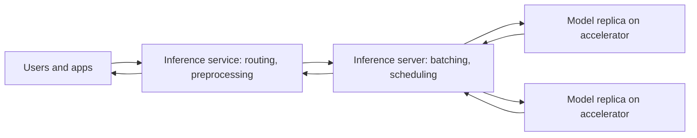

# Inference bottlenecks, metrics and hardware

New models come and go. Making them **faster and cheaper** stays relevant. A model that is too slow is useless for a stock-prediction or chat application, and a model that is too expensive has no return on investment. Inference optimization happens at three levels: the **model** (smaller size, more efficient architectures), the **hardware** (more powerful accelerators) and the **service** (running the model efficiently on the hardware for a given workload). This lesson covers the fundamentals: what the bottlenecks are, how to measure performance, and the hardware underneath. The next two lessons cover model-level and service-level techniques.

Even if you only call model APIs, this material helps you read providers' numbers, set latency targets and reason about cost.

## 1. Inference overview

A model has two phases in its lifecycle: **training** and **inference** (computing an output for an input). In production the component that runs inference is the **inference server**. It hosts models and has access to the hardware. It sits inside an **inference service**, which also receives, routes and preprocesses requests. Model APIs from OpenAI, Google and others are inference services. If you use them, most of this is done for you. If you host models, it is your job.



### Computational bottlenecks

Optimization means finding the bottleneck and removing it. There are two main kinds:

- **Compute-bound**: the time to finish is set by the amount of computation. Password cracking is a classic example.
- **Memory bandwidth-bound**: the time is set by how fast data can move between memory and processors. Moving data from CPU memory to the GPU is an example.

> [!NOTE]
> "Memory-bound" sometimes means limited by memory *capacity* (the out-of-memory error). Huyen notes that capacity limits can often be worked around by splitting work, at the cost of more data movement, so in the end they become bandwidth limits too.

The concepts come from the **Roofline** paper (Williams et al., 2009). An operation's **arithmetic intensity**, the number of arithmetic operations per byte of memory access, decides which regime it is in. Profilers such as NVIDIA Nsight draw roofline charts.

Different workloads have different bottlenecks. Image generators like Stable Diffusion are typically **compute-bound**. Autoregressive language models are typically **memory bandwidth-bound**. Within LLM inference:

- **Prefill** processes the input tokens in parallel, so it is **compute-bound**.
- **Decode** generates one token at a time, loading large weight matrices for each step, so it is **memory bandwidth-bound**.

Because the two have different profiles, production systems often decouple them onto different machines (lesson 3 of this module). Today, much of LLM inference optimization targets the memory bandwidth bottleneck.

### Online and batch inference APIs

- **Online APIs** optimize for **latency** and process requests as they arrive. Chatbots and code completion use them.
- **Batch APIs** optimize for **cost**. With relaxed latency (hours), providers can batch aggressively and use cheaper hardware. Both Google Gemini and OpenAI offered batch APIs at a **50% discount**. Good fits are synthetic data generation, periodic reports (summarizing Slack messages, sentiment over brand mentions, analyzing support tickets), processing a new customer's uploaded documents, reprocessing data after a model migration, personalized newsletters, and re-indexing a knowledge base.

**Streaming mode** returns tokens as they are generated, which cuts the wait for the first token. The downside is that you cannot score a response before users see it. You can still retract or update it after a problem is detected.

> [!WARNING]
> In traditional ML, "batch inference" means predictions are **precomputed** before requests arrive, which is possible when the inputs are finite and predictable (recommendations for every user). For foundation models, open-ended inputs cannot be predicted, so a batch API simply means requests are processed later and more cheaply.

## 2. Inference performance metrics

### Latency: TTFT and TPOT

**Latency** is the time from sending a query to receiving the complete response. For streaming autoregressive generation it is split into:

- **Time to first token (TTFT)**: how quickly the first token appears. It corresponds to the **prefill** step and depends on input length. Users expect it to be nearly instant for chat and tolerate more for long-document summarization.
- **Time per output token (TPOT)**: how quickly each later token is generated. At 100 ms per token, 1,000 tokens take 100 s. For streaming, TPOT only has to beat reading speed. A very fast reader reads at about 120 ms per token, so **6–8 tokens per second** is enough for most use cases.
- **Time between tokens (TBT) / inter-token latency (ITL)**: the time between consecutive output tokens.

$$\text{total latency} = \text{TTFT} + \text{TPOT} \times (\text{number of output tokens})$$

Two services with the same total latency can feel different. Is an instant first token with slower generation better, or a slightly later start with faster generation? That needs user studies. You can trade TTFT against TPOT by shifting compute between prefill and decode.

With chain-of-thought or agentic steps, the TTFT the *model* sees differs from what the *user* sees. The model starts emitting plan tokens that the user never sees. Some teams use **time to publish** for the first token the user actually sees.

**Latency is a distribution, so look at percentiles.** For ten TTFT values of 100, 102, 100, 100, 99, 104, 110, 90, 3,000 and 95 ms, the mean is 390 ms, which makes the service look far slower than it usually is. One outlier (a network glitch or a very long prompt) caused it. Report **p50** (the median) and **p90, p95, p99** for the tail, and plot TTFT against input length.

```python-run
import numpy as np
ttft = np.array([100, 102, 100, 100, 99, 104, 110, 90, 3000, 95])
print(f"mean = {ttft.mean():.0f} ms   p50 = {np.percentile(ttft, 50):.0f} ms   p90 = {np.percentile(ttft, 90):.0f} ms   p99 = {np.percentile(ttft, 99):.0f} ms")
def total_latency(ttft_ms, tpot_ms, n_out): return (ttft_ms + tpot_ms * n_out) / 1000
for name, t1, tp in [("A: fast start, slow stream", 200, 60), ("B: slow start, fast stream", 2000, 30)]:
    print(f"{name}: 60 tokens -> {total_latency(t1, tp, 60):.1f}s   600 tokens -> {total_latency(t1, tp, 600):.1f}s")
```

### Throughput and goodput

**Throughput** is the number of output tokens per second the service generates across all users, written tokens/s or TPS. Input (prefill) and output (decode) throughput should be counted separately because their bottlenecks differ. Throughput can also be counted as completed requests per second (RPS) or, because LLM requests are slow, **requests per minute (RPM)**.

Throughput is tied directly to **cost**. If a system costs \$2 per hour and generates 100 tokens per second, it costs about **\$5.556 per 1M output tokens** (2 ÷ (100 × 3600) × 10⁶). With 200 output tokens per request, decoding 1,000 requests costs \$1.11. Prefill cost is calculated the same way: at \$2 per hour and 100 requests per minute, prefilling 1,000 requests costs \$0.33, for a total of \$1.44.

Because tokenizers differ, comparing tokens per second across models is only approximate. **Cost per request** is the more robust comparison.

There is a **latency/throughput trade-off**. Batching raises throughput and worsens latency. LinkedIn noted that you can often double or triple throughput if you are willing to sacrifice TTFT and TPOT. So throughput alone can hide a bad user experience. **Goodput** measures the requests per second that **satisfy the SLO**. If the SLO is TTFT ≤ 200 ms and TPOT ≤ 100 ms, the service completes 100 requests per minute, and only 30 meet the SLO, then goodput is **30 requests per minute**.

```python-run
def cost_per_million_tokens(dollars_per_hour, tokens_per_second):
    return dollars_per_hour / (tokens_per_second * 3600) * 1e6
print(f"2 USD/h at 100 tok/s -> {cost_per_million_tokens(2, 100):.3f} USD per 1M output tokens")
# goodput: only requests meeting the SLO count
reqs = [(150, 80), (250, 60), (180, 120), (90, 40), (199, 100)]      # (TTFT ms, TPOT ms)
ok = [r for r in reqs if r[0] <= 200 and r[1] <= 100]
print(f"throughput {len(reqs)} req/min, goodput {len(ok)} req/min")
```

### Utilization, MFU and MBU

**Utilization** measures how efficiently a resource is used. The familiar "GPU utilization" from `nvidia-smi` is the percentage of *time* the GPU is processing something. A GPU capable of 100 operations per second reports 100% even while doing one operation per second. That is not very useful.

Better metrics:

- **MFU (Model FLOP/s Utilization)**: observed throughput divided by the theoretical maximum throughput at peak FLOP/s. If the chip could generate 100 tokens per second at peak and you get 20, MFU is 20%.
- **MBU (Model Bandwidth Utilization)**: the share of achievable memory bandwidth in use. The bandwidth used by LLM inference is:

$$\text{bandwidth used} = \text{parameter count} \times \text{bytes/param} \times \text{tokens/s}$$

For a 7B model in FP16 at 100 tokens per second: $7\text{B} \times 2 \times 100 = 700$ GB/s. On an A100-80GB with about 2 TB/s of bandwidth, MBU = 700 / 2000 = **70%**. This shows why **quantization** matters: fewer bytes per parameter means less bandwidth per token.

Throughput is linear in both MFU and MBU. What counts as good depends on the workload. Compute-bound workloads have higher MFU and lower MBU, and bandwidth-bound workloads the opposite. Training usually reaches higher MFU than inference because its workloads are more predictable, and above **50%** is considered good. Reported training MFUs: GPT-3 at 21.3% (V100), Gopher at 32.5% (TPU v3), Megatron-Turing NLG at 30.2% (A100) and PaLM at 46.2% (TPU v4). MBU tends to fall as concurrent users increase, because the workload shifts toward compute-bound.

High utilization is not the goal on its own. The goal is fast, cheap jobs. Higher utilization while cost and latency both rise is not an improvement.

```python-run
def mbu(params, bytes_per_param, tokens_per_s, peak_bandwidth_bytes_per_s):
    return params * bytes_per_param * tokens_per_s / peak_bandwidth_bytes_per_s
for fmt, b in [("FP16", 2), ("INT8", 1), ("4-bit", 0.5)]:
    print(f"7B {fmt}: bandwidth for 100 tok/s = {7e9*b*100/1e9:.0f} GB/s, MBU on 2 TB/s chip = {mbu(7e9, b, 100, 2e12):.0%};"
          f" max tok/s at 100% MBU = {2e12/(7e9*b):.0f}")
```

## 3. AI accelerators

How fast and how cheaply software runs depends on the hardware. You can optimize a model for a specific chip, and chips are designed for specific workloads.

### What is an accelerator?

An **accelerator** is a chip designed to speed up a particular type of workload. The dominant AI accelerator is the **GPU**.

- **CPUs** have a few powerful cores (up to about 64 on high-end consumer machines) and are good at sequential, general-purpose work.
- **GPUs** have thousands of smaller cores optimized for work that splits into many independent calculations. ML workloads are dominated by **matrix multiplication**, which is highly parallelizable.

The GPU's success inspired many others: AMD GPUs, Google's **TPU**, Intel's Habana Gaudi, Graphcore's IPU, Groq's LPU, Cerebras' wafer-scale chips, and more.

A major theme is **chips specialized for inference**. Inference can account for up to **90%** of ML costs in deployed systems (Desislavov et al., 2023). Training needs far more memory (backpropagation) and emphasizes throughput. Inference aims for low latency and tolerates lower precision, so inference chips are optimized for **lower precision and faster memory access** rather than large memory capacity. Examples are the Apple Neural Engine, AWS Inferentia and Meta's MTIA, plus edge chips such as Google's Edge TPU and NVIDIA Jetson.

Chips are compared on three characteristics.

### Computational capabilities

Measured in **FLOP/s** (often written FLOPS), ideally under realistic conditions. A chip's FLOP/s depends on numerical precision. Lower precision means more operations per second. Huyen's table for the NVIDIA H100 SXM, with sparsity:

| Precision | teraFLOP/s |
|---|---|
| TF32 Tensor Core | 989 |
| BFLOAT16 / FP16 Tensor Core | 1,979 |
| FP8 / INT8 Tensor Core | 3,958 |

Each halving of precision roughly doubles the peak rate. This is another reason quantization speeds up inference.

### Memory size and bandwidth

A GPU has many cores to feed, so data transfer speed is critical. There are three levels of memory:

| Memory | Bandwidth | Size |
|---|---|---|
| **CPU memory (DRAM)** | 25–50 GB/s | 16–64 GB on laptops, up to 1 TB or more on workstations |
| **GPU high-bandwidth memory (HBM)** | 256 GB/s to over 1.5 TB/s | about 24–80 GB |
| **GPU on-chip SRAM** (caches) | over 10 TB/s | 40 MB or less |

Much of GPU optimization is about using this hierarchy well. Mainstream frameworks do not expose fine control over it, which is why engineers reach for GPU programming languages such as **CUDA**, OpenAI's **Triton** and AMD's **ROCm**.

### Power consumption

An A100 has 54 billion transistors and an H100 has 80 billion. An H100 running at peak for a year uses about **7,000 kWh**, compared with about 10,000 kWh for the average US household. Electricity is a scaling bottleneck, and data centers are being built where power is cheap. Chips report **maximum power draw** or **TDP** (thermal design power, a proxy for expected draw under typical workloads). For CPUs and GPUs, the maximum can be roughly 1.1–1.5× TDP.

> [!TIP]
> **Selecting accelerators.** Start from your workload. If it is compute-bound, look for more FLOP/s. If it is memory-bound, look for more bandwidth and memory. Then ask three questions. Can the hardware run my workload? How long does it take? How much does it cost? FLOP/s, memory size and bandwidth answer the first two. Cost depends on cloud price, or on purchase price plus power when you own the hardware.

> [!INTERVIEW]
> **"Users complain the chatbot is slow. Which metrics do you look at and why?"** Split latency into TTFT (prefill, grows with input length) and TPOT (decode). Look at p50/p90/p99 instead of the mean. Check what the user actually sees (time to publish, if hidden reasoning or tool steps come first). If TTFT is high: shorten prompts, use prompt caching, add prefill capacity. If TPOT is high: use a smaller or quantized model, a better KV-cache or batching configuration, or shorter outputs. Track goodput (requests meeting the SLO), not just throughput, since batching improves throughput at latency's expense.

## Pitfalls

- Reporting mean latency.
- Counting input and output tokens together in "throughput".
- Treating `nvidia-smi` utilization as efficiency.
- Comparing tokens per second across models with different tokenizers.
- Optimizing throughput and breaking the latency SLO.

## Summary

- Bottlenecks are **compute-bound** (prefill, image generation) or **memory bandwidth-bound** (decode, most LLM inference).
- **Online** APIs target latency, and **batch** APIs target cost (about 50% cheaper). Streaming reduces perceived wait.
- **Latency** = TTFT + TPOT × output tokens. Use percentiles. **Throughput** drives cost, and **goodput** counts only requests that meet the SLO.
- **MFU** and **MBU** measure real efficiency. Bandwidth used = parameters × bytes per parameter × tokens per second.
- **Accelerators** are judged by FLOP/s (which depends on precision), memory size and bandwidth, and power. Inference chips favour low precision and fast memory access.

```quiz
[
  {"q": "Which statement about LLM inference bottlenecks is correct?", "options": ["Prefill is memory bandwidth-bound; decode is compute-bound", "Prefill is compute-bound; decode is memory bandwidth-bound", "Both are disk-bound", "Neither has a bottleneck"], "answer": 1, "explain": "Prefill processes inputs in parallel (compute). Decode loads large weights per token (bandwidth)."},
  {"q": "TTFT is 300 ms, TPOT is 50 ms, and the response has 200 tokens. Total latency?", "options": ["0.35 s", "10.3 s", "15 s", "60 s"], "answer": 1, "explain": "0.3 + 0.05 × 200 = 10.3 s."},
  {"q": "Why prefer percentiles (p50, p90, p99) over the mean for latency?", "options": ["They are easier to compute", "Latency is a distribution and outliers skew the mean", "The mean is always zero", "Percentiles reduce cost"], "answer": 1, "explain": "One 3,000 ms request among ~100 ms ones pushes the mean to 390 ms."},
  {"q": "A server costs 2 USD/h and outputs 100 tokens/s. Cost per 1M output tokens is about…", "options": ["0.06 USD", "0.56 USD", "5.56 USD", "55.6 USD"], "answer": 2, "explain": "2 / (100 × 3600) × 1e6 ≈ 5.56."},
  {"q": "A service completes 100 requests per minute, but only 30 meet the latency SLO. Its goodput is…", "options": ["100 RPM", "70 RPM", "30 RPM", "3.3 RPM"], "answer": 2, "explain": "Goodput counts only the requests that satisfy the SLO."},
  {"q": "Why is nvidia-smi 'GPU utilization' a poor efficiency metric?", "options": ["It is always 0", "It measures the fraction of time the GPU is busy, not how much of its capacity is used", "It only works on CPUs", "It measures memory bandwidth"], "answer": 1, "explain": "A GPU doing 1% of its possible work can still show 100%. MFU and MBU are more meaningful."},
  {"q": "A 7B model in FP16 generates 100 tokens/s on a chip with 2 TB/s bandwidth. MBU is…", "options": ["35%", "70%", "100%", "7%"], "answer": 1, "explain": "7e9 × 2 bytes × 100 = 700 GB/s; 700 / 2000 = 70%."},
  {"q": "Which use case fits a batch API best?", "options": ["A live customer chat", "Code autocomplete", "Generating synthetic training data overnight", "Voice assistant"], "answer": 2, "explain": "Batch APIs trade latency (hours) for about 50% lower cost, which suits offline jobs."}
]
```

> **Source:** Huyen, *AI Engineering*, ch. 9 ("Understanding Inference Optimization": inference overview, inference performance metrics, AI accelerators).
