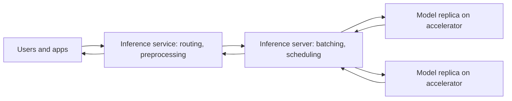

# Inference bottlenecks, metrics and hardware

> **Before this lesson:** read [Memory math, numerical formats and quantization](#/lesson/ai-eng/aie-memory-quant), which explains parameters, bytes per parameter, FP16 and quantization. It helps to remember from [Sampling, structured outputs and the probabilistic nature of AI](#/lesson/ai-eng/aie-sampling) that a language model writes its answer one token at a time, and from [Training data, architecture and scale](#/lesson/ai-eng/aie-data-arch-scale) what a transformer and FLOPs are. The demos use basic Python and NumPy, explained line by line.

## In plain words

**Inference** is the act of using a trained model: you send it an input and it computes an output. Training happens once (or occasionally); inference happens every time a user asks a question, millions of times a day for a popular product. This module is about making inference **faster and cheaper**. New models arrive every few months, but the need to run them quickly and affordably never goes away. A model that answers too slowly is useless for live chat or stock trading, and a model that costs more to run than it earns is a business failure.

This first lesson lays the foundations. It answers three questions. **What slows inference down?** (the bottlenecks). **How do you measure speed and cost?** (the metrics). **What hardware does the work?** (the accelerators). The next two lessons cover techniques: changing the model itself, and changing the way the service runs it.

An everyday picture: a restaurant kitchen. How long until a diner sees their first dish (the first token) and how quickly the remaining dishes follow (the rest of the tokens) are two different experiences. How many dishes the kitchen sends out per hour across all tables (throughput) decides whether the restaurant makes money. A kitchen can be slow because the cooks cannot chop fast enough (compute-bound) or because ingredients arrive from the storeroom too slowly (memory-bound), and adding more cooks only helps in the first case. And the tools in the kitchen, the stoves and fridges, are the hardware.

Why this matters for a job: even if you only call a model through an API and never touch a GPU, you will set latency targets, read providers' price sheets, choose between an online and a batch API, and explain to your manager why the bill doubled. Interviewers love "Users say our chatbot is slow. What do you measure?" This lesson gives you the vocabulary to answer.

Optimization happens at three levels, and this module visits all three:

- **Model level**: make the model itself smaller or more efficient (lesson 2 of this module).
- **Hardware level**: run on more powerful or more suitable chips (this lesson).
- **Service level**: run the model on the hardware more cleverly for your workload (lesson 3).

## 1. Inference overview

A model's life has two phases: **training** (learning the weights) and **inference** (using them). In production, the program that runs inference is the **inference server**. It holds the models in memory and talks to the hardware. The server sits inside a larger **inference service**, which also receives incoming requests, routes them to the right place and prepares them (for example, tokenizing the text). When you call a model API from OpenAI, Google or Anthropic, you are using someone else's inference service, and they handle everything in this module for you. When you host a model yourself, it becomes your job.



A **replica** is one complete copy of the model loaded on hardware. Running several replicas lets the service handle more users at once.

### Computational bottlenecks

To make something faster, you first find its **bottleneck**: the single slowest part that limits the whole. Speeding up anything else is wasted effort. For inference there are two main kinds.

- **Compute-bound**: the job is limited by how many calculations the processor can do per second. Cracking a password by trying billions of guesses is the classic example: each guess needs heavy computation and very little data.
- **Memory bandwidth-bound**: the job is limited by how fast data can be moved between memory and the processor. **Memory bandwidth** is that speed, measured in bytes per second. Copying a big file from the computer's main memory onto a graphics card is an example: the processor sits idle waiting for data to arrive.

> [!NOTE]
> "Memory-bound" sometimes means something else: running out of memory *capacity*, the dreaded out-of-memory error. Huyen points out that capacity problems can usually be worked around by splitting the work into pieces, at the cost of moving more data back and forth. So in the end they turn into bandwidth problems too.

These ideas come from the **Roofline model** (Williams and colleagues, 2009). Its key quantity is **arithmetic intensity**: how many arithmetic operations a job performs for each byte it reads from memory. High intensity (lots of maths per byte) means compute-bound; low intensity means bandwidth-bound. Profiling tools such as NVIDIA Nsight draw "roofline charts" showing which side of the line your program falls on.

Different AI workloads have different bottlenecks. Image generators such as Stable Diffusion are usually **compute-bound**. Language models that write one token at a time, called **autoregressive** models, are usually **memory bandwidth-bound**. Even inside one language-model request, two phases behave differently:

- **Prefill** is the first phase: the model reads all the input tokens. It can process them **in parallel**, all at once, so there is a lot of maths per byte of weights loaded. Prefill is **compute-bound**.
- **Decode** is the second phase: the model generates output tokens **one at a time**. For every single new token it must read essentially all of its weights from memory, but it does only a little maths with them. Decode is **memory bandwidth-bound**.

Because the two phases stress the hardware differently, large production systems often run them on separate machines (lesson 3 of this module explains how). Today, much of the work on making language models faster targets the memory bandwidth bottleneck of decode.

### Online and batch inference APIs

Providers offer two styles of API.

- **Online APIs** aim for low **latency** (waiting time). They process each request as soon as it arrives. Chatbots and code completion use them.
- **Batch APIs** aim for low **cost**. You submit many requests and accept results hours later. With that slack, the provider can group requests together efficiently and use cheaper hardware. Both Google Gemini and OpenAI have offered batch APIs at a **50% discount**. Good fits include generating synthetic data, periodic reports (summarizing Slack messages, analysing sentiment in brand mentions on social media, reviewing support tickets), processing documents a new customer uploads, reprocessing everything after switching models, personalized newsletters, and rebuilding a knowledge-base index.

**Streaming mode** sends tokens to the user as soon as each is generated, instead of waiting for the full answer. It makes the wait feel much shorter. The downside: you cannot check a response for problems before the user sees it. You can still retract or edit a response after a problem is detected.

> [!WARNING]
> In traditional machine learning, "batch inference" means something different: computing predictions **in advance**, before any request arrives. That works when inputs are limited and predictable, such as computing movie recommendations for every user overnight. For foundation models, inputs are open-ended and cannot be predicted, so a "batch API" only means your requests are processed later and more cheaply.

## 2. Inference performance metrics

### Latency: TTFT and TPOT

**Latency** is the total time from sending a request until the full response has arrived. For a model that streams tokens, it is more useful to split it into parts:

- **Time to first token (TTFT)**: how long until the first token appears. It covers the **prefill** step, so it grows with the length of the input. Users expect TTFT to feel almost instant in a chat, but will tolerate a longer wait when they asked for a summary of a long document.
- **Time per output token (TPOT)**: how long each token after the first takes. At 100 milliseconds (ms) per token, a 1,000-token answer takes 100 seconds. When streaming, TPOT only needs to be faster than people read. A very fast reader takes about 120 ms per token, so **6 to 8 tokens per second** is enough for most uses.
- **Time between tokens (TBT)**, also called **inter-token latency (ITL)**: the gap between two consecutive output tokens. It is close to TPOT but measured per gap, so it reveals stutters.

Putting them together:

$$\text{total latency} = \text{TTFT} + \text{TPOT} \times (\text{number of output tokens})$$

Two services with the same total latency can feel very different. Is it better to show the first token instantly and then trickle, or to start a bit later and then flow quickly? Only studies with real users answer that. Engineers can trade one for the other by shifting hardware between prefill and decode.

With chain-of-thought reasoning or agents (lesson on agents), there is a twist: the model may produce many tokens of planning or tool calls that the user never sees. The model's first token is then not the user's first token. Some teams track **time to publish**: the time until the first token the user actually sees.

**Latency is a distribution, so report percentiles.** A **percentile** tells you the value below which a given share of measurements fall. **p50** (the median) is the value half of requests beat; **p90** is the value 90% beat; **p99** is the value 99% beat, which captures the worst experiences, called the **tail**. Consider ten TTFT measurements: 100, 102, 100, 100, 99, 104, 110, 90, 3,000 and 95 ms. The **mean** (average) is 390 ms, which makes the service look four times slower than it usually is. A single outlier, perhaps a network glitch or an unusually long prompt, caused that. It is also wise to plot TTFT against input length, because longer inputs take longer to prefill.

```python-run
import numpy as np
ttft = np.array([100, 102, 100, 100, 99, 104, 110, 90, 3000, 95])
print(f"mean = {ttft.mean():.0f} ms   p50 = {np.percentile(ttft, 50):.0f} ms   p90 = {np.percentile(ttft, 90):.0f} ms   p99 = {np.percentile(ttft, 99):.0f} ms")
def total_latency(ttft_ms, tpot_ms, n_out): return (ttft_ms + tpot_ms * n_out) / 1000
for name, t1, tp in [("A: fast start, slow stream", 200, 60), ("B: slow start, fast stream", 2000, 30)]:
    print(f"{name}: 60 tokens -> {total_latency(t1, tp, 60):.1f}s   600 tokens -> {total_latency(t1, tp, 600):.1f}s")
```

**Reading this Python line by line**

- `np.array([...])` stores the ten TTFT measurements in a NumPy array, which supports fast statistics.
- `ttft.mean()` is the average. `np.percentile(ttft, 50)` is the median; 90 and 99 give the tail percentiles. `:.0f` prints with no decimal places.
- `total_latency` applies the formula above and divides by 1,000 to turn milliseconds into seconds.
- The loop compares two imaginary services: A starts in 200 ms then takes 60 ms per token; B starts in 2,000 ms then takes 30 ms per token.
- Output: mean 390 ms but p50 100 ms, p90 399 ms and p99 2,740 ms. The median shows the usual experience; the p99 exposes the outlier. For the services, both take 3.8 s for a 60-token answer, but for a 600-token answer A takes 36.2 s and B only 20.0 s. Which service is "faster" depends on how long your typical answers are, so measure with realistic outputs.

### Throughput and goodput

**Throughput** is how many output tokens the whole service generates per second, across all users at once. It is written tokens/s or TPS (tokens per second). Count input (prefill) and output (decode) tokens separately, because they have different bottlenecks. Throughput can also be counted in finished requests: requests per second (RPS) or, since language-model requests are slow, **requests per minute (RPM)**.

Throughput translates directly into **cost**. Suppose a machine costs \$2 per hour and generates 100 output tokens per second. In an hour it produces 100 × 3,600 = 360,000 tokens, so a million tokens cost 2 ÷ 360,000 × 1,000,000 ≈ **\$5.556**. If each request produces 200 output tokens, decoding 1,000 requests (200,000 tokens) costs about \$1.11. Prefill cost is worked out the same way: if the same \$2-per-hour machine can prefill 100 requests per minute, then 1,000 requests take 10 minutes and cost about \$0.33, for a total of about \$1.44 per 1,000 requests.

Different models use different **tokenizers** (the tools that split text into tokens), so the same sentence may be 10 tokens for one model and 13 for another. Tokens per second are therefore only roughly comparable across models. **Cost per request** is the fairer comparison.

There is a **latency/throughput trade-off**. Grouping requests together (**batching**, covered in lesson 3) raises throughput but makes each request wait longer. LinkedIn reported that you can often double or triple throughput if you are willing to accept worse TTFT and TPOT. So a high throughput number can hide unhappy users. That is why teams measure **goodput**: the number of requests per second (or minute) that meet the **SLO**, the **service-level objective**, which is the performance target you promise, such as "TTFT under 200 ms and TPOT under 100 ms". If a service finishes 100 requests per minute but only 30 of them meet the SLO, its goodput is **30 requests per minute**.

```python-run
def cost_per_million_tokens(dollars_per_hour, tokens_per_second):
    return dollars_per_hour / (tokens_per_second * 3600) * 1e6
print(f"2 USD/h at 100 tok/s -> {cost_per_million_tokens(2, 100):.3f} USD per 1M output tokens")
# goodput: only requests meeting the SLO count
reqs = [(150, 80), (250, 60), (180, 120), (90, 40), (199, 100)]      # (TTFT ms, TPOT ms)
ok = [r for r in reqs if r[0] <= 200 and r[1] <= 100]
print(f"throughput {len(reqs)} req/min, goodput {len(ok)} req/min")
```

**Reading this Python line by line**

- `cost_per_million_tokens` divides the hourly price by the tokens produced per hour (`tokens_per_second * 3600`) to get the price of one token, then multiplies by a million (`1e6` is scientific notation for 1,000,000).
- `reqs` is a list of five requests, each a pair (TTFT, TPOT) in milliseconds.
- `ok = [r for r in reqs if ...]` is a **list comprehension**: it keeps only the requests whose TTFT is at most 200 and whose TPOT is at most 100. `r[0]` is the first item of the pair, `r[1]` the second.
- Output: \$5.556 per million tokens, and throughput 5 versus goodput 3. The request with 250 ms TTFT and the one with 120 ms TPOT were served, but too slowly to count. Note that 199 ms and exactly 100 ms pass, because the SLO says "at most".

### Utilization, MFU and MBU

**Utilization** measures how much of a resource you are actually using. The figure most people see first, "GPU utilization" from the `nvidia-smi` command, is misleading: it reports the share of *time* the GPU was busy doing anything at all. A GPU able to do 100 operations per second, doing one operation per second, still shows 100% as long as it is never idle. That tells you little about efficiency.

Two better metrics compare what you get against what the chip could theoretically do:

- **MFU (Model FLOP/s Utilization)**: your observed throughput divided by the throughput the chip would reach if it ran at its peak **FLOP/s** (floating-point operations per second, a measure of raw calculating speed). If the chip could in theory produce 100 tokens per second and you get 20, your MFU is 20%.
- **MBU (Model Bandwidth Utilization)**: the share of the chip's achievable memory bandwidth that you are using. If peak bandwidth is 1 TB/s and your inference uses 500 GB/s, MBU is 50%.

For a language model decoding one stream of tokens, the bandwidth used is roughly every weight read once per token:

$$\text{bandwidth used} = \text{parameter count} \times \text{bytes per parameter} \times \text{tokens per second}$$

Worked example: a 7-billion-parameter model stored in FP16 (2 bytes per parameter) generating 100 tokens per second uses $7 \times 10^9 \times 2 \times 100 = 1.4 \times 10^{12}$ bytes per second, which is **1,400 GB/s** (1.4 TB/s). On an A100-80GB GPU with a theoretical 2 TB/s of bandwidth, MBU = 1,400 ÷ 2,000 = **70%**.

> [!NOTE]
> The book's version of this example writes the intermediate figure as 700 GB/s while still arriving at 70%. Multiplying out 7B × 2 bytes × 100 gives 1,400 GB/s, and 1,400 ÷ 2,000 is indeed 70%, so the final MBU is right and only the intermediate number is a slip. The demo below computes it for you.

The formula shows why **quantization** speeds up inference: fewer bytes per parameter means less data to move for every token.

Throughput rises in direct proportion to both MFU and MBU, which is why some people use throughput as shorthand for them. What counts as a "good" number depends on the model, hardware and workload. Compute-bound work shows high MFU and low MBU; bandwidth-bound work shows the reverse. Training usually reaches higher MFU than inference, because its workload is predictable and can be batched well; during inference, prefill reaches higher MFU than decode. For training, an MFU above **50%** is generally considered good. Some reported training MFUs: GPT-3 at 21.3% on V100 GPUs, Gopher at 32.5% on TPU v3, Megatron-Turing NLG at 30.2% on A100s and PaLM at 46.2% on TPU v4. MBU tends to fall as more users share a machine, because the extra work per second pushes the workload from bandwidth-bound toward compute-bound.

High utilization is not the goal in itself. The goal is jobs that finish quickly and cheaply. If utilization goes up while cost and latency also go up, nothing has improved.

```python-run
def mbu(params, bytes_per_param, tokens_per_s, peak_bandwidth_bytes_per_s):
    return params * bytes_per_param * tokens_per_s / peak_bandwidth_bytes_per_s
for fmt, b in [("FP16", 2), ("INT8", 1), ("4-bit", 0.5)]:
    print(f"7B {fmt}: bandwidth for 100 tok/s = {7e9*b*100/1e9:.0f} GB/s, MBU on 2 TB/s chip = {mbu(7e9, b, 100, 2e12):.0%};"
          f" max tok/s at 100% MBU = {2e12/(7e9*b):.0f}")
```

**Reading this Python line by line**

- `mbu` applies the formula: bandwidth used divided by the chip's peak bandwidth.
- The loop tries three number formats: FP16 at 2 bytes per parameter, INT8 at 1 byte and 4-bit at half a byte.
- `7e9*b*100/1e9` is the bandwidth in GB/s for 100 tokens per second. `:.0%` prints a fraction as a percentage.
- `2e12/(7e9*b)` asks the reverse question: if we used all 2 TB/s, how many tokens per second could we get? It divides peak bandwidth by the bytes read per token.
- Output: FP16 needs 1,400 GB/s (MBU 70%) and tops out around 143 tokens per second; INT8 needs 700 GB/s (35%) with a ceiling near 286; 4-bit needs 350 GB/s (18%) with a ceiling near 571. Halving the bytes per weight doubles the speed limit for a bandwidth-bound decode. Real systems fall short of these ceilings, but the proportions hold.

## 3. AI accelerators

How fast and how cheaply software runs depends on the hardware underneath. Models can be tuned for particular chips, and chips are designed with particular workloads in mind.

### What is an accelerator?

An **accelerator** is a chip built to speed up one kind of work. In AI the dominant accelerator is the **GPU** (graphics processing unit), originally designed for drawing video-game graphics.

- A **CPU** (central processing unit, the main chip in every computer) has a few powerful **cores** (independent processing units), up to about 64 in high-end consumer machines. It is good at general tasks done step by step.
- A **GPU** has thousands of smaller, simpler cores. It shines when a job splits into many independent calculations that can run at the same time. Machine-learning workloads are dominated by **matrix multiplication** (multiplying large grids of numbers), which splits up beautifully, so GPUs fit them perfectly.

The GPU's success inspired many rivals: AMD's GPUs, Google's **TPU** (tensor processing unit), Intel's Habana Gaudi, Graphcore's IPU, Groq's LPU, Cerebras' wafer-scale chips, and others.

An important trend is **chips designed only for inference**. Inference can account for up to **90%** of the machine-learning costs of a deployed system (Desislavov and colleagues, 2023), because training happens once while inference runs forever. Training needs far more memory (backpropagation stores many intermediate values) and cares most about throughput. Inference cares about low latency and tolerates lower numerical precision. So inference chips favour **lower precision and faster memory access** over huge memory capacity. Examples include the Apple Neural Engine, AWS Inferentia and Meta's MTIA, plus chips for **edge devices** (phones, cameras, cars), such as Google's Edge TPU and NVIDIA Jetson.

Accelerators are compared on three characteristics: compute, memory, and power.

### Computational capability

Compute is measured in **FLOP/s**, often written FLOPS, ideally measured under realistic conditions rather than the marketing peak. A chip's FLOP/s depend on the **numerical precision**: the fewer bits per number, the more operations per second. Huyen's figures for the NVIDIA H100 SXM (with sparsity, a feature that skips some zero values):

| Precision | teraFLOP/s (trillions per second) |
|---|---|
| TF32 Tensor Core | 989 |
| BFLOAT16 / FP16 Tensor Core | 1,979 |
| FP8 / INT8 Tensor Core | 3,958 |

Each halving of precision roughly doubles the peak rate. This is a second reason quantization speeds up inference, on top of the bandwidth saving.

### Memory size and bandwidth

A GPU has thousands of cores to keep busy, so moving data to them fast is critical. There are three levels of memory, from big and slow to tiny and fast:

| Memory | Bandwidth | Size |
|---|---|---|
| **CPU memory (DRAM)** | 25–50 GB/s | 16–64 GB on laptops, up to 1 TB or more on workstations |
| **GPU high-bandwidth memory (HBM)** | 256 GB/s to over 1.5 TB/s | about 24–80 GB |
| **GPU on-chip SRAM** (caches) | over 10 TB/s | 40 MB or less |

**DRAM** (dynamic random-access memory) is the ordinary memory in your computer. **HBM** (high-bandwidth memory) is the GPU's own memory, stacked close to the chip; it is where model weights live during inference. **SRAM** (static random-access memory) sits on the chip itself; it is extremely fast but tiny. Much of GPU performance engineering is about keeping the data that is needed next in the fastest level available. Mainstream frameworks such as PyTorch do not give fine control over this, which is why engineers write **kernels** (small, specialized programs that run on the GPU) in GPU programming languages such as NVIDIA's **CUDA**, OpenAI's **Triton** and AMD's **ROCm**.

### Power consumption

Chips are made of transistors: an A100 has 54 billion, an H100 has 80 billion. All that switching uses electricity. An H100 running flat out for a year uses about **7,000 kWh** (kilowatt-hours), compared with roughly 10,000 kWh for an average US household in a year. Electricity has become a limit on how big AI can grow, and companies now build data centers where power is cheap. Chip makers list a **maximum power draw** or a **TDP** (thermal design power), which estimates the heat a chip produces under a typical workload and so approximates its expected power use. For CPUs and GPUs, the maximum draw can be roughly 1.1 to 1.5 times the TDP.

> [!TIP]
> **Choosing accelerators.** Start from your workload. If it is compute-bound, prioritize FLOP/s. If it is bandwidth-bound, prioritize memory bandwidth and size. Then ask three questions. Can this hardware run my workload at all? How long will it take? How much will it cost? FLOP/s, memory size and bandwidth answer the first two. Cost is the cloud's hourly price if you rent, or the purchase price plus electricity and cooling if you own the machines.

> [!INTERVIEW]
> **"Users complain the chatbot is slow. Which metrics do you look at and why?"** Split latency into TTFT (prefill, grows with input length) and TPOT (decode). Look at p50, p90 and p99 rather than the mean. Check what the user actually sees (time to publish, if hidden reasoning or tool calls come first). If TTFT is high: shorten prompts, use prompt caching (reusing the processed form of repeated prompt text, lesson 3), add prefill capacity. If TPOT is high: use a smaller or quantized model, tune the KV cache (the store of per-token intermediate results, lesson 2) or batching, or shorten outputs. Track goodput (requests meeting the SLO), not only throughput, because batching improves throughput at latency's expense.

## Pitfalls

- Reporting mean latency instead of percentiles.
- Counting input and output tokens together as one "throughput" number.
- Treating `nvidia-smi` utilization as a measure of efficiency.
- Comparing tokens per second across models with different tokenizers instead of comparing cost per request.
- Raising throughput through heavy batching and silently breaking the latency SLO.
- Choosing a GPU by its FLOP/s alone when your workload (decode) is limited by bandwidth.

## Summary

- Bottlenecks are **compute-bound** (prefill, image generation) or **memory bandwidth-bound** (decode, most language-model inference). Arithmetic intensity decides which.
- **Online** APIs target latency; **batch** APIs target cost (about 50% cheaper). Streaming reduces the perceived wait.
- **Latency** = TTFT + TPOT × output tokens. Use percentiles. **Throughput** drives cost, and **goodput** counts only requests that meet the SLO.
- **MFU** and **MBU** measure real efficiency. Bandwidth used ≈ parameters × bytes per parameter × tokens per second, so fewer bytes per weight means faster decode.
- **Accelerators** are judged by FLOP/s (which depend on precision), memory size and bandwidth (DRAM, HBM, SRAM), and power. Inference chips favour low precision and fast memory access.

## Glossary

- **Inference**: running a trained model to produce an output.
- **Inference server / inference service**: the program that runs the model / the whole system around it that receives and routes requests.
- **Replica**: one full copy of a model loaded on hardware.
- **Bottleneck**: the slowest part that limits overall speed.
- **Compute-bound / memory bandwidth-bound**: limited by calculation speed / by data-transfer speed.
- **Memory bandwidth**: how many bytes per second can move between memory and processor.
- **Arithmetic intensity**: arithmetic operations per byte of memory accessed.
- **Autoregressive**: generating output one token at a time, each depending on the previous ones.
- **Prefill / decode**: processing the input in parallel / generating output tokens one by one.
- **Online API / batch API**: low-latency immediate processing / cheaper delayed processing.
- **Streaming**: sending tokens to the user as they are generated.
- **Latency**: time from request to complete response.
- **TTFT / TPOT / TBT (ITL)**: time to first token / time per output token / time between tokens.
- **Time to publish**: time until the first token the user actually sees.
- **Percentile (p50, p90, p99)**: the value below which that share of measurements falls.
- **Throughput**: output tokens (or requests) per second across all users.
- **SLO**: service-level objective, the performance target.
- **Goodput**: throughput counting only requests that meet the SLO.
- **Utilization**: how much of a resource is in use.
- **FLOP/s**: floating-point operations per second.
- **MFU / MBU**: model FLOP/s utilization / model bandwidth utilization.
- **Accelerator**: a chip specialized to speed up a workload.
- **CPU / GPU / TPU**: general processor / massively parallel processor / Google's tensor processor.
- **Core**: an independent processing unit inside a chip.
- **DRAM / HBM / SRAM**: main computer memory / GPU high-bandwidth memory / on-chip cache memory.
- **Kernel**: a small specialized program that runs on an accelerator.
- **TDP**: thermal design power, an estimate of typical power draw.

```quiz
[
  {"q": "Which statement about LLM inference bottlenecks is correct?", "options": ["Prefill is memory bandwidth-bound; decode is compute-bound", "Prefill is compute-bound; decode is memory bandwidth-bound", "Both are disk-bound", "Neither has a bottleneck"], "answer": 1, "explain": "Prefill processes inputs in parallel (compute). Decode loads large weights per token (bandwidth)."},
  {"q": "TTFT is 300 ms, TPOT is 50 ms, and the response has 200 tokens. Total latency?", "options": ["0.35 s", "10.3 s", "15 s", "60 s"], "answer": 1, "explain": "0.3 + 0.05 × 200 = 10.3 s."},
  {"q": "Why prefer percentiles (p50, p90, p99) over the mean for latency?", "options": ["They are easier to compute", "Latency is a distribution and outliers skew the mean", "The mean is always zero", "Percentiles reduce cost"], "answer": 1, "explain": "One 3,000 ms request among ~100 ms ones pushes the mean to 390 ms."},
  {"q": "A server costs 2 USD/h and outputs 100 tokens/s. Cost per 1M output tokens is about…", "options": ["0.06 USD", "0.56 USD", "5.56 USD", "55.6 USD"], "answer": 2, "explain": "2 / (100 × 3600) × 1e6 ≈ 5.56."},
  {"q": "A service completes 100 requests per minute, but only 30 meet the latency SLO. Its goodput is…", "options": ["100 RPM", "70 RPM", "30 RPM", "3.3 RPM"], "answer": 2, "explain": "Goodput counts only the requests that satisfy the SLO."},
  {"q": "Why is nvidia-smi 'GPU utilization' a poor efficiency metric?", "options": ["It is always 0", "It measures the fraction of time the GPU is busy, not how much of its capacity is used", "It only works on CPUs", "It measures memory bandwidth"], "answer": 1, "explain": "A GPU doing 1% of its possible work can still show 100%. MFU and MBU are more meaningful."},
  {"q": "A 7B model in FP16 generates 100 tokens/s on a chip with 2 TB/s bandwidth. MBU is…", "options": ["35%", "70%", "100%", "7%"], "answer": 1, "explain": "7e9 × 2 bytes × 100 = 1.4e12 bytes/s = 1,400 GB/s; 1,400 / 2,000 = 70%."},
  {"q": "Which use case fits a batch API best?", "options": ["A live customer chat", "Code autocomplete", "Generating synthetic training data overnight", "Voice assistant"], "answer": 2, "explain": "Batch APIs trade latency (hours) for about 50% lower cost, which suits offline jobs."}
]
```

> **Source:** Huyen, *AI Engineering*, ch. 9 ("Understanding Inference Optimization": inference overview, inference performance metrics, AI accelerators).
