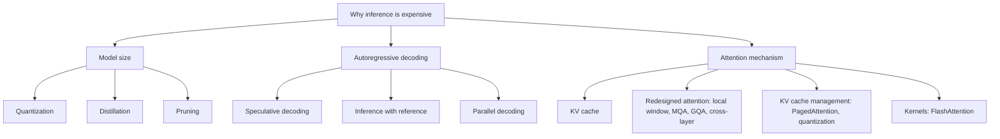
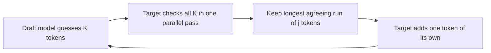

# Model optimization: compression, speculative decoding and the KV cache

> **Before this lesson:** read [Inference bottlenecks, metrics and hardware](#/lesson/ai-eng/aie-inference-metrics), which explains prefill and decode, compute-bound versus memory bandwidth-bound work, TTFT, TPOT and GPU memory. Quantization is taught in [Memory math, numerical formats and quantization](#/lesson/ai-eng/aie-memory-quant) and distillation in [Data synthesis, distillation and processing](#/lesson/ai-eng/aie-data-synthesis). The transformer and its attention mechanism were introduced in [Training data, architecture and scale](#/lesson/ai-eng/aie-data-arch-scale); this lesson recaps what you need. The demos use basic Python and NumPy, explained line by line.

## In plain words

The previous lesson showed what makes inference slow and how to measure it. This lesson is about the first family of fixes: changing **the model itself** so it runs faster. Because these techniques modify the model or the way it computes, some of them can also change its answers, so you must re-evaluate after applying them.

Huyen observes that most foundation models today share three traits that make inference expensive, and each trait has its own family of fixes:

1. They are **large**: billions of numbers must be stored and moved. Fix: **compress** the model so it has fewer or smaller numbers.
2. They are **autoregressive**: they write one token at a time, each waiting for the previous one. Fix: find ways to produce **several tokens per step**.
3. They rely on **attention**: each new token looks back at all earlier tokens, which costs memory and time that grow with the length of the text. Fix: **store and reuse** earlier work (the KV cache) and make attention cheaper.

A fourth, cross-cutting fix is to write faster low-level code for the hardware, through **kernels** and **compilers**.

An everyday picture: a professional translator working on a long book. You can make them faster by giving them a pocket dictionary instead of a twenty-volume encyclopedia (compression). You can hire a junior assistant who drafts the next few sentences, which the expert then checks in one glance and approves or corrects (speculative decoding). The translator keeps a notebook of names and terms already decided, so they never have to re-read earlier chapters to remember them (the KV cache). And you can rearrange their desk so everything they reach for most is closest to hand (kernels).

Why this matters for a job: whenever you host an open model, these techniques decide your cost per request and your latency. Interview questions such as "Explain speculative decoding" and "What is the KV cache and why does it limit batch size?" are very common for AI engineering roles.



## 1. Model compression

**Model compression** means making a model smaller. A smaller model is usually faster too, because there is less data to move through memory for every token (recall that decode is bandwidth-bound). There are three main methods.

- **Quantization** (covered in the memory-math lesson) stores each number with fewer bits, for example 16 bits instead of 32, or 4 instead of 16. **Weight-only quantization**, which shrinks the stored weights while leaving other values alone, is by far the most popular compression technique in practice. It is easy to apply, works out of the box for many models, and is very effective: going from 32 to 16 bits halves the memory needed. It does have a floor: you cannot go below 1 bit per value.
- **Distillation** (covered in the data-synthesis lesson) trains a small **student** model to imitate a big **teacher**. It is common when a smaller model can match the specific behaviour you need.
- **Pruning** comes from gardening: cutting away branches that do not help. It has two meanings for neural networks. The first removes entire **nodes** (units of the network), which changes the architecture and reduces the number of parameters. The second keeps the architecture but finds the **least useful parameters and sets them to zero**. A model with many zeros is called **sparse**. Sparse models need less storage, and on hardware that can skip zeros they compute faster. A pruned model can be used as is, or finetuned briefly to recover lost quality. Frankle and Carbin (2019) showed that some networks could lose over **90%** of their non-zero parameters without losing accuracy.

In practice **pruning is less common** than the other two. It requires understanding the model's architecture in detail, its gains are often smaller, and not all hardware can take advantage of sparsity.

The demo below applies **magnitude pruning**, the simplest version: zero out the weights with the smallest absolute values, on the theory that they contribute least.

```python-run
import numpy as np
rng = np.random.default_rng(0)
W = rng.normal(0, 1, (256, 256)); x = rng.normal(size=256)
y = W @ x
for sparsity in [0.5, 0.9, 0.99]:
    thr = np.quantile(np.abs(W), sparsity)                # magnitude pruning: zero the smallest weights
    Wp = np.where(np.abs(W) >= thr, W, 0.0)
    rel_err = np.linalg.norm(Wp @ x - y) / np.linalg.norm(y)
    print(f"sparsity {sparsity:.0%}: non-zeros {np.count_nonzero(Wp):6d}, relative output error {rel_err:.3f}")
print("A random matrix has no redundancy to exploit, so errors grow fast; trained networks tolerate pruning much better.")
```

**Reading this Python line by line**

- `W` is a 256 × 256 **weight matrix** (a grid of 65,536 numbers), standing in for one layer of a network. `x` is an input vector of 256 numbers.
- `y = W @ x` is the layer's output. The `@` symbol is matrix multiplication.
- For each target sparsity (50%, 90%, 99%), `np.quantile(np.abs(W), sparsity)` finds the threshold below which that share of weights fall, by absolute size.
- `np.where(condition, W, 0.0)` keeps each weight whose size is at least the threshold and replaces the rest with zero.
- `rel_err` measures how far the pruned layer's output is from the original, as a fraction of the original's size. `np.linalg.norm` gives the length of a vector.
- Output: at 50% sparsity, 32,768 weights remain and the error is about 0.28; at 90%, 6,554 remain and the error is about 0.75; at 99%, 656 remain and the output is almost entirely wrong (0.97). This random matrix is a worst case, since every weight carries independent information. Trained networks contain a lot of redundancy, which is why real models can often lose most of their weights with little harm.

## 2. Overcoming the autoregressive decoding bottleneck

An autoregressive model produces tokens strictly one after another. At 100 ms per token, a 100-token answer takes 10 seconds. Output tokens are also much more expensive than input tokens: Huyen cites Anyscale's finding that for some models, one output token adds about as much latency as 100 input tokens. Even small improvements to decoding therefore pay off handsomely. Three families of techniques attack it.

### Speculative decoding

**Speculative decoding** pairs two models. A small, fast **draft model** guesses the next few tokens, and the big **target model** (the one whose quality you want) checks the guesses. Step by step:

1. The draft model generates $K$ tokens in a row: $x_{t+1}, \ldots, x_{t+K}$. Here $t$ is the number of tokens so far and $K$ is a small number such as 4.
2. The target model **checks all $K$ tokens in a single parallel pass**.
3. The target accepts the **longest run of draft tokens, from the start, that it agrees with**. Call the number accepted $j$. If it disagrees with the third token, it keeps the first two, and the rest are thrown away.
4. As a by-product of the same pass, the target produces **one extra token** of its own, $x_{t+j+1}$, at the first position it disagreed with (or after the last one if all were accepted). The cycle then repeats from there.

So every cycle produces at least one token (the target's own, if no draft token is accepted) and at most $K + 1$ tokens (all $K$ accepted plus the extra one). With greedy decoding, the output is exactly what the target alone would have produced, and with sampling, a careful acceptance rule keeps it statistically equivalent; only the speed changes.



Why does this help?

1. **Checking is parallel, generating is sequential.** Checking $K$ tokens is like a small prefill: the target processes them all at once. Speculative decoding effectively turns part of decoding's slow, one-at-a-time work into prefill-style parallel work.
2. **Many tokens are easy to predict.** After "The capital of France is", even a tiny model guesses "Paris". A weak draft model gets the easy tokens right, so the acceptance rate is high.
3. **Decode leaves compute idle.** Because decode is bandwidth-bound, the processor spends much of its time waiting for data. The extra maths needed to verify $K$ tokens uses those otherwise wasted **FLOPs** (floating-point operations) almost for free.

The **acceptance rate** (the share of drafted tokens accepted) depends on the domain. Structured text such as code is more predictable, so acceptance is higher. A bigger $K$ means fewer verification passes but more rejected guesses. The draft model should ideally use the same vocabulary and tokenizer as the target, so their tokens line up.

Results: for Chinchilla-70B, DeepMind trained a 4-billion-parameter draft model that produced a token in 1.8 ms versus the target's 14.1 ms, nearly 8 times faster. Speculative decoding cut response latency by **more than half without changing quality**. T5-XXL saw similar gains. The technique is easy to implement (about 50 lines of PyTorch) and is built into popular serving frameworks: vLLM, TGI (Text Generation Inference) and llama.cpp.

The demo uses a toy "language" where the target model always knows the next word of one fixed sentence, and the draft model gets it right except for two hard words.

```python-run
# Speculative decoding with greedy verification on a toy deterministic "language".
target = "the cat sat on the mat and the dog sat on the rug".split()
def target_next(prefix):                    # the expensive model: always right
    return target[len(prefix)] if len(prefix) < len(target) else None
def draft_next(prefix):                     # the cheap model: wrong on a few 'hard' tokens
    t = target_next(prefix)
    return "floor" if t in ("mat", "rug") else t
K, out, target_calls, drafted, accepted = 4, [], 0, 0, 0
while len(out) < len(target):
    proposal, ctx = [], list(out)
    for _ in range(K):
        t = draft_next(ctx)
        if t is None: break
        proposal.append(t); ctx.append(t)
    target_calls += 1                        # ONE parallel target pass verifies all K and yields 1 extra token
    j = 0
    while j < len(proposal) and target_next(out + proposal[:j]) == proposal[j]: j += 1
    drafted += len(proposal); accepted += j
    out += proposal[:j]
    nxt = target_next(out)
    if nxt is not None: out.append(nxt)
print(" ".join(out))
print(f"tokens: {len(out)}, target passes: {target_calls} (vs {len(out)} without), acceptance rate: {accepted/drafted:.0%}")
```

**Reading this Python line by line**

- `target` is the sentence split into 13 words; it plays the role of what the big model would write.
- `target_next(prefix)` returns the correct next word given the words so far (`len(prefix)` is how many words are written), or `None` at the end.
- `draft_next` copies the target except that it wrongly guesses "floor" whenever the correct word is "mat" or "rug".
- `K = 4` draft tokens per cycle; `out` is the text so far; the three counters track target passes, drafted tokens and accepted tokens.
- Inside the `while` loop, the inner `for` loop lets the draft model write up to 4 words, appending each guess to a scratch copy `ctx` so the next guess builds on it.
- `target_calls += 1` counts one verification pass. In a real system this single pass checks all 4 guesses at once.
- The small `while` finds `j`, the number of leading guesses the target agrees with, stopping at the first disagreement.
- `out += proposal[:j]` keeps the accepted guesses; then the target adds its own next word.
- Output: the full sentence, produced in 13 tokens with only 4 target passes instead of 13, and an acceptance rate of 64%. Each pass yielded about three tokens. In real systems each verification pass costs a bit more than one ordinary decoding step, so the speedup is smaller than 13/4, but it is often around two to three times.

### Inference with reference

Outputs often **repeat parts of the input**. A model answering a question about a document quotes it; a model fixing a bug in code rewrites the file with most lines unchanged. **Inference with reference** exploits this: instead of generating those tokens, it **copies candidate tokens from the input** and lets the model verify them, exactly as with draft tokens. It is speculative decoding **without a draft model**. The hard part is finding the right span of the input to copy at each step; the simplest method looks for input text that matches the most recent output tokens. It only helps when input and output overlap heavily, as in retrieval-based systems, coding assistants and long multi-turn conversations. Yang and colleagues (2023) report roughly a **2×** speedup in such cases.

### Parallel decoding

**Parallel decoding** tries to break the one-after-another rule altogether, generating several future tokens $x_{t+1}, \ldots, x_{t+k}$ **at the same time**. The intuition: given "the cat sits", you can guess that the token after next is probably "the", even without knowing whether the next one is "on" or "under".

- **Lookahead decoding** (Fu and colleagues, 2024) uses the model's own decoder. It guesses $K$ future tokens in parallel and refines the guesses with the **Jacobi method**, an old numerical technique for solving many equations by repeatedly updating all unknowns at once, until the guesses are consistent with what the model would generate one by one.
- **Medusa** (Cai and colleagues, 2024) attaches several small extra output layers, called **decoding heads**, to the model. Head $k$ predicts the token $k+1$ positions ahead. The heads are trained while the original model stays **frozen** (its weights unchanged). Each head proposes several options, which are arranged in a tree, and the model picks the most promising combination. NVIDIA reported up to **1.9×** faster generation for Llama 3.1 on its H200 GPUs using Medusa.

Parallel decoding is promising but counter-intuitive, and methods like Medusa are harder to implement than speculative decoding.

## 3. Attention mechanism optimization

### A short recap of attention

Inside a transformer, each token is represented by a vector (a list of numbers). In every **attention layer**, each token's vector is turned into three new vectors: a **query** (what this token is looking for), a **key** (what this token offers, used for matching) and a **value** (the information this token passes on if chosen). To compute the output for the newest token, the model compares its query with the keys of **all earlier tokens**, and uses the matches to blend those tokens' values. A model has many such layers, and each layer usually has several **attention heads**, independent copies of this matching process that can each focus on different relationships.

The key consequence: generating token $x_t$ needs the key and value vectors of every earlier token $x_1, \ldots, x_{t-1}$, in every layer. Generating $x_{t+1}$ needs all of those again, plus the ones for $x_t$.

### The KV cache

Recomputing the keys and values for every earlier token at every step would be enormously wasteful: their values do not change. The **KV cache** (key-value cache) stores them in GPU memory, so each new step only computes the keys and values of the single newest token and appends them. The cache is used **only during inference**. In training, the whole sequence is known in advance and processed in one go, so there is nothing to cache.

The cache trades computation for **memory**, and that memory adds up quickly. Note too that the cache does not make attention free: to generate $x_t$, the newest query still has to be compared with all $t-1$ stored keys, so the work per step still grows with the length of the text. Without optimizations, the cache needs:

$$\text{KV cache size} = 2 \times B \times S \times L \times H \times M$$

where $B$ is the **batch size** (how many sequences are processed together), $S$ the sequence length in tokens, $L$ the number of transformer layers, $H$ the **model dimension** (the length of each token's vector), and $M$ the bytes per stored value. The factor 2 is there because we store both keys and values.

Worked example: Llama 2 13B has $L = 40$ layers and $H = 5{,}120$. With a batch of $B = 32$ sequences, each $S = 2{,}048$ tokens long, at $M = 2$ bytes per value:

$$2 \times 32 \times 2048 \times 40 \times 5120 \times 2 \approx 54\ \text{GB}$$

That is about **twice the size of the model's own 26 GB of weights**. For long contexts, the KV cache becomes the main limit on throughput, because the memory it consumes caps how many sequences can share a GPU at once.

```python-run
def kv_cache_gb(B, S, L, H, M=2): return 2 * B * S * L * H * M / 1e9
print(f"Llama 2 13B, batch 32, 2,048 tokens: {kv_cache_gb(32, 2048, 40, 5120):.1f} GB (weights: 26 GB)")
for S in [2048, 8192, 32768, 131072]:
    per_seq = kv_cache_gb(1, S, 40, 5120)
    print(f"context {S:>6}: {per_seq:6.2f} GB per sequence -> max batch on 80 GB GPU after 26 GB weights: {int(54 // per_seq)}")
```

**Reading this Python line by line**

- `kv_cache_gb` multiplies out the formula and divides by $10^9$ to get gigabytes. `M=2` sets a default of 2 bytes per value (FP16).
- The first `print` reproduces the worked example.
- The loop computes the cache for **one** sequence at four context lengths, from 2,048 to 131,072 tokens.
- An 80 GB GPU holding 26 GB of weights has 54 GB left for the cache. `54 // per_seq` is **integer division** (how many whole sequences fit), and `int(...)` turns it into a whole number.
- `{S:>6}` right-aligns the number in six characters so the columns line up.
- Output: 53.7 GB for the worked example. Per sequence, the cache needs 1.68 GB at 2K tokens (32 sequences fit), 6.71 GB at 8K (8 fit), 26.84 GB at 32K (2 fit) and 107 GB at 128K, which does not fit at all. Quadrupling the context divides the batch size by four, which is why long-context serving is expensive.

### Redesigning the attention mechanism

These techniques change the model's architecture, so they must be applied when the model is trained or finetuned, not afterwards.

- **Local windowed attention** (Beltagy and colleagues, 2020): each token attends only to a fixed window of nearby tokens instead of all earlier ones. With 10,000-token sequences and a 1,000-token window, the KV cache shrinks tenfold. Windowed layers can be interleaved with ordinary **global attention** layers so the model still sees the whole document.
- **Cross-layer attention** (Brandon and colleagues, 2024): neighbouring layers share the same key and value vectors. If three layers share, the cache shrinks threefold.
- **Multi-query attention** (Shazeer, 2019): all the attention heads in a layer share a single set of keys and values, while keeping separate queries.
- **Grouped-query attention** (Ainslie and colleagues, 2023): a middle ground. The heads are split into groups, and each group shares one set of keys and values. This balances quality against cache size.

Character.AI, whose average conversation carries a history of **180 messages**, reported that combining multi-query attention, interleaved local and global attention, and cross-layer attention cut its KV cache by **more than 20 times**. Memory stopped being the bottleneck even for large batches.

### Managing the KV cache without changing the model

These techniques leave the model alone and manage the cache more cleverly.

- **PagedAttention**, introduced with the vLLM serving framework (Kwon and colleagues, 2023), splits the cache into small blocks that need not sit next to each other in memory, much as an operating system splits memory into **pages**. Without it, systems reserve one big contiguous chunk per request, much of which goes unused. Paging reduces this waste (**fragmentation**) and lets requests share common blocks.
- **KV cache quantization** stores the cache with fewer bits; **adaptive KV cache compression** and **selective KV caching** drop or compress entries that matter little.

### Writing kernels for attention

A third approach changes neither the design nor the storage, but makes the attention computation itself faster on specific hardware. **FlashAttention** (Dao and colleagues, 2022) **fuses** the several operations of attention into a single GPU program, so intermediate results stay in fast on-chip memory instead of being written to and read back from the slower main GPU memory. This sharply reduces memory traffic. The original was written for NVIDIA A100 GPUs; FlashAttention-3 targets H100s.

## 4. Kernels and compilers

A **kernel** is a small program optimized for a particular hardware accelerator, implementing a routine such as matrix multiplication, attention or convolution. Writing kernels requires knowing the hardware's memory hierarchy and using low-level languages such as CUDA, Triton or ROCm (introduced in the previous lesson). It used to be a dark art practised by a handful of specialists. Four common techniques:

- **Vectorization**: process several neighbouring data elements in one instruction instead of one at a time.
- **Parallelization**: split the input into independent chunks and process them simultaneously on different cores or threads.
- **Loop tiling**: reorder the way loops visit data so that the pieces being worked on fit in the fast cache. The best tile size depends on the hardware.
- **Operator fusion**: combine several operations into one pass, so intermediate results are not written to memory and read back. This needs knowledge of which operations the specific model uses.

The demo shows vectorization in plain Python and NumPy. The task: apply ReLU (replace negatives with zero), double each value, and sum.

```python-run
import numpy as np, time
x = np.random.default_rng(0).normal(size=300_000)
t = time.perf_counter(); s = 0.0
for v in x: s += max(v, 0.0) * 2.0                      # element at a time
loop = time.perf_counter() - t
t = time.perf_counter(); a = np.maximum(x, 0.0); b = a * 2.0; s2 = b.sum()      # vectorized, two passes
vec = time.perf_counter() - t
t = time.perf_counter(); s3 = (np.maximum(x, 0.0) * 2.0).sum()                   # same work expressed in one chain
fused = time.perf_counter() - t
print(f"python loop {loop*1e3:7.1f} ms | vectorized {vec*1e3:6.2f} ms | chained {fused*1e3:6.2f} ms | results equal: {np.isclose(s, s2) and np.isclose(s, s3)}")
```

**Reading this Python line by line**

- `x` holds 300,000 random numbers. `time.perf_counter()` reads a precise clock; subtracting two readings gives elapsed seconds.
- The `for` loop handles one number at a time in Python: `max(v, 0.0)` is ReLU, then multiply by 2 and add to the running sum.
- The vectorized line uses NumPy, which runs the same operation over the whole array in compiled code: `np.maximum(x, 0.0)` applies ReLU to every element, `* 2.0` doubles every element, `.sum()` adds them up.
- The "chained" line writes the same NumPy work as one expression. NumPy still creates intermediate arrays here, so it is not truly fused; a compiler or custom kernel would do all three steps in a single pass.
- `np.isclose` checks the three answers agree, allowing for tiny rounding differences.
- Output: the Python loop takes tens of milliseconds (about 70 ms on one machine), while the vectorized versions take under a millisecond, roughly 80 times faster, with identical results. Exact timings vary by computer and browser. The gap comes from doing the work in bulk in compiled code rather than one element at a time.

A model written in PyTorch describes its operations at a high level. To run on a specific chip, that description must be **lowered**, translated step by step into hardware-specific instructions, by a **compiler**. Examples include torch.compile, XLA, Apache TVM, MLIR, OpenVINO, TensorRT and ONNX Runtime. Compilers apply techniques like fusion and tiling automatically and sometimes find optimizations people miss.

Combined, these techniques add up. In a PyTorch case study running Llama-7B on an A100-80GB GPU, throughput rose from 25.5 tokens per second to 107 with `torch.compile`, to 157.4 with INT8 weight quantization, to 196.8 with INT4, and to **244.7 tokens per second** after adding speculative decoding: nearly ten times the starting point. The study did not report the effect on output quality, which is a reminder to evaluate before shipping.

> [!INTERVIEW]
> **"Explain speculative decoding."** A small draft model proposes K tokens. The large target model verifies all K in one parallel pass, accepts the longest agreeing prefix, and adds one token of its own, so each pass yields between 1 and K+1 tokens. It works because verification is parallel like prefill, many tokens are easy for a small model, and decode leaves compute idle because it is bandwidth-bound. With exact verification the output distribution matches the target model's. Gains depend on the acceptance rate, which is higher for predictable text such as code.

> [!INTERVIEW]
> **"What is the KV cache and why does it limit throughput?"** During autoregressive decoding each new token attends to all previous tokens. The KV cache stores every previous token's key and value vectors per layer so they are not recomputed. Its size is 2·B·S·L·H·M, which grows linearly with batch size and context length and can exceed the weights (about 54 GB for Llama 2 13B at batch 32 and 2K context). It therefore caps how many sequences fit in a batch. Mitigations: grouped- or multi-query attention, windowed and cross-layer attention (architectural), PagedAttention and cache quantization or compression (serving), and prompt caching to reuse shared prefixes across requests.

## Pitfalls

- Assuming compression is free. Quantization, pruning and distillation can change outputs, so evaluate again.
- Using speculative decoding with a draft model that rarely agrees with the target. A low acceptance rate means wasted work and can even slow things down.
- Forgetting KV-cache memory when sizing GPUs for long-context workloads.
- Expecting pruning speedups on hardware that cannot exploit sparsity.
- Assuming architectural attention changes (GQA, windowed attention) can be bolted onto an existing model without retraining or finetuning.

## Summary

- Foundation models are **large**, **autoregressive** and **attention-based**, and each trait has its own family of optimizations.
- **Compression**: weight-only quantization (the most popular), distillation, and pruning (less common).
- **Decoding bottleneck**: **speculative decoding** (draft K tokens, verify in parallel, keep the longest agreeing prefix plus one target token), **inference with reference** (copy candidate tokens from the input) and **parallel decoding** (Lookahead, Medusa).
- **Attention**: the **KV cache** avoids recomputation but costs $2BSLHM$ bytes. Shrink it with windowed, cross-layer, multi-query or grouped-query attention, manage it with PagedAttention and compression, and compute attention faster with FlashAttention.
- **Kernels and compilers**: vectorization, parallelization, loop tiling and operator fusion, applied by hand or by compilers that lower models to hardware.

## Glossary

- **Model compression**: making a model smaller (quantization, distillation, pruning).
- **Weight-only quantization**: storing weights with fewer bits.
- **Pruning**: removing nodes or zeroing out the least useful parameters.
- **Sparse model**: a model in which many parameters are zero.
- **Magnitude pruning**: zeroing the weights with the smallest absolute values.
- **Speculative decoding**: a draft model proposes tokens that the target model verifies in parallel.
- **Draft model / target model**: the small fast guesser / the large model whose output you want.
- **Acceptance rate**: the share of drafted tokens the target accepts.
- **Inference with reference**: using spans copied from the input as draft tokens.
- **Parallel decoding**: generating several future tokens simultaneously (Lookahead, Medusa).
- **Decoding head**: an extra output layer that predicts a token further ahead.
- **Frozen**: weights kept fixed during training.
- **Query / key / value**: the three vectors attention computes per token, for asking, matching and passing information.
- **Attention head**: one independent copy of the attention computation within a layer.
- **KV cache**: stored keys and values of earlier tokens, reused during decoding.
- **Batch size**: the number of sequences processed together.
- **Model dimension**: the length of each token's vector inside the model.
- **Local windowed / cross-layer / multi-query / grouped-query attention**: architectural changes that shrink the KV cache.
- **PagedAttention**: storing the KV cache in non-contiguous blocks to reduce waste.
- **Fragmentation**: memory wasted in reserved but unused gaps.
- **FlashAttention**: a fused attention kernel that minimizes memory traffic.
- **Kernel**: a small program optimized for specific hardware.
- **Vectorization / parallelization / loop tiling / operator fusion**: core kernel-optimization techniques.
- **Compiler / lowering**: a tool that translates a model into hardware instructions / that translation process.

```quiz
[
  {"q": "Which model compression technique is by far the most popular in practice?", "options": ["Pruning", "Weight-only quantization", "Layer stacking", "Parallel decoding"], "answer": 1, "explain": "It's easy, works out of the box for many models and is very effective."},
  {"q": "In speculative decoding with K draft tokens, how many tokens does one loop produce if ALL draft tokens are accepted?", "options": ["K - 1", "K", "K + 1", "2K"], "answer": 2, "explain": "K accepted draft tokens plus one extra token generated by the target model."},
  {"q": "Why is verifying draft tokens cheaper than generating them with the target model?", "options": ["Verification uses a smaller vocabulary", "Verification of K tokens can be done in parallel, while generation is sequential", "Verification skips attention", "It isn't cheaper"], "answer": 1, "explain": "Speculative decoding turns decoding's profile into that of prefilling, using otherwise idle compute."},
  {"q": "Inference with reference is most useful when…", "options": ["Outputs share large spans with the input (code edits, document QA)", "Outputs are very creative", "The model has no context", "Using image models"], "answer": 0, "explain": "It copies candidate tokens from the input instead of generating them, with no extra model."},
  {"q": "What does the KV cache store?", "options": ["Model weights", "Key and value vectors of previous tokens, per layer, to avoid recomputation", "User prompts for reuse across users", "Gradients"], "answer": 1, "explain": "It trades memory for computation during inference only."},
  {"q": "KV cache for batch 32, sequence 2,048, 40 layers, dimension 5,120, 2 bytes/value is about…", "options": ["5.4 GB", "27 GB", "54 GB", "540 GB"], "answer": 2, "explain": "2 × 32 × 2048 × 40 × 5120 × 2 ≈ 53.7 GB."},
  {"q": "Grouped-query attention reduces KV cache size by…", "options": ["Dropping layers", "Sharing key-value pairs among groups of query heads", "Quantizing weights", "Shortening prompts"], "answer": 1, "explain": "It generalizes multi-query attention, where all heads share one set of K/V."},
  {"q": "What does PagedAttention (vLLM) do?", "options": ["Changes the model architecture", "Stores the KV cache in non-contiguous blocks to reduce fragmentation and share memory", "Removes the KV cache", "Prunes attention heads"], "answer": 1, "explain": "It is a memory-management technique inspired by OS paging, and it does not alter the model."}
]
```

> **Source:** Huyen, *AI Engineering*, ch. 9 ("Model Optimization": model compression, overcoming the autoregressive decoding bottleneck, attention mechanism optimization, kernels and compilers).
