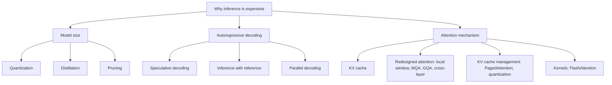

# Model optimization: compression, speculative decoding and the KV cache

Model-level optimization makes the **model itself** more efficient, usually by modifying it, which means it can change the model's behaviour. Huyen points out that most foundation models today share three properties that make inference expensive: they are **large**, they are **autoregressive**, and they rely on **attention**. This lesson follows that structure: model compression, getting around the autoregressive decoding bottleneck, optimizing attention (the KV cache), and kernels and compilers.



## 1. Model compression

Compression reduces a model's size, and a smaller model is usually faster too.

- **Quantization** (Module 7) reduces numerical precision. **Weight-only quantization is by far the most popular** technique. It is easy, works out of the box for many models, and is very effective: going from 32 to 16 bits halves memory. It has a floor of 1 bit per value.
- **Distillation** (Module 8) trains a small model to mimic a large one. It is common when a smaller model can match the behaviour you need.
- **Pruning** has two meanings. One is removing entire nodes, which changes the architecture and reduces the parameter count. The other is setting the **least useful parameters to zero**, which keeps the count but makes the model **sparse**, reducing storage and speeding up computation. Pruned models can be used directly or finetuned to recover quality. Frankle and Carbin (2019) reduced non-zero parameters of some networks by over **90%** without hurting accuracy.

In practice **pruning is less common**. It requires understanding the model's architecture, its gains are often smaller than those of other methods, and not all hardware can take advantage of sparsity.

```python-run
import numpy as np
rng = np.random.default_rng(0)
W = rng.normal(0, 1, (256, 256)); x = rng.normal(size=256)
y = W @ x
for sparsity in [0.5, 0.9, 0.99]:
    thr = np.quantile(np.abs(W), sparsity)                # magnitude pruning: zero the smallest weights
    Wp = np.where(np.abs(W) >= thr, W, 0.0)
    rel_err = np.linalg.norm(Wp @ x - y) / np.linalg.norm(y)
    print(f"sparsity {sparsity:.0%}: non-zeros {np.count_nonzero(Wp):6d}, relative output error {rel_err:.3f}")
print("A random matrix has no redundancy to exploit, so errors grow fast; trained networks tolerate pruning much better.")
```

## 2. Overcoming the autoregressive decoding bottleneck

Autoregressive models generate one token after another. At 100 ms per token, a 100-token response takes 10 s. Output tokens are also more expensive than input tokens. Huyen cites Anyscale's finding that one output token can have the same latency impact as about 100 input tokens for some models. Small improvements in decoding therefore matter a lot.

### Speculative decoding

A faster, weaker **draft model** proposes tokens, and the **target model** verifies them:

1. The draft model generates $K$ tokens: $x_{t+1}, \ldots, x_{t+K}$.
2. The target model **verifies these $K$ tokens in parallel**.
3. The target accepts the **longest prefix** of draft tokens it agrees with, say $j$ tokens.
4. The target generates **one extra token** $x_{t+j+1}$, and the loop repeats from there.

If no draft token is accepted, the loop still produces one token, the target's. If all are accepted, it produces $K + 1$ tokens.

Why it works:

1. **Verifying is parallel and generating is sequential.** Speculative decoding effectively turns decoding's computational profile into that of prefilling.
2. **Some tokens are easy to predict**, so a weak draft model gets them right, giving a high acceptance rate.
3. Decoding is memory bandwidth-bound, so there are **idle FLOPs** that can be used for verification at little cost.

Acceptance rates depend on the domain. Structured text such as code has higher acceptance. A larger $K$ means fewer verification calls but a lower acceptance rate. The draft model should ideally share the target's vocabulary and tokenizer.

Results: for Chinchilla-70B, DeepMind trained a 4B draft model that generated a token in 1.8 ms versus 14.1 ms, about 8× faster, and this cut response latency by **more than half without changing quality**. T5-XXL got similar speedups. The technique is easy to implement (about 50 lines of PyTorch) and is built into vLLM, TGI (Text Generation Inference) and llama.cpp.

```python-run
# Speculative decoding with greedy verification on a toy deterministic "language".
target = "the cat sat on the mat and the dog sat on the rug".split()
def target_next(prefix):                    # the expensive model: always right
    return target[len(prefix)] if len(prefix) < len(target) else None
def draft_next(prefix):                     # the cheap model: wrong on a few 'hard' tokens
    t = target_next(prefix)
    return "floor" if t in ("mat", "rug") else t
K, out, target_calls, drafted, accepted = 4, [], 0, 0, 0
while len(out) < len(target):
    proposal, ctx = [], list(out)
    for _ in range(K):
        t = draft_next(ctx)
        if t is None: break
        proposal.append(t); ctx.append(t)
    target_calls += 1                        # ONE parallel target pass verifies all K and yields 1 extra token
    j = 0
    while j < len(proposal) and target_next(out + proposal[:j]) == proposal[j]: j += 1
    drafted += len(proposal); accepted += j
    out += proposal[:j]
    nxt = target_next(out)
    if nxt is not None: out.append(nxt)
print(" ".join(out))
print(f"tokens: {len(out)}, target passes: {target_calls} (vs {len(out)} without), acceptance rate: {accepted/drafted:.0%}")
```

### Inference with reference

Outputs often **repeat input text**: quoting a document, or fixing a bug where most of the code stays the same. Instead of generating those tokens, **copy them from the input** as draft tokens and verify them. It is like speculative decoding but needs **no extra model**. The challenge is finding the relevant span at each step, and the simplest approach is matching the current tokens. It is useful only when context and output overlap heavily, as in retrieval systems, coding and multi-turn conversations. Yang et al. (2023) report about a **2×** speedup in such cases.

### Parallel decoding

These techniques try to break the sequential dependency by generating $x_{t+1}, \ldots, x_{t+k}$ **simultaneously**. Given "the cat sits", you can guess the token after next is probably "the" without knowing whether the next one is "on" or "under".

- **Lookahead decoding** (Fu et al., 2024) uses the same decoder. It generates $K$ future tokens in parallel, verifies them with the **Jacobi method**, and regenerates only those that fail until all pass.
- **Medusa** (Cai et al., 2024) adds several small **decoding heads**, where head $k$ predicts the token at position $t+k+1$. The heads are trained while the original model is frozen. Each head proposes options, which are organized into a tree to select the most promising combination. NVIDIA reported up to **1.9×** faster generation for Llama 3.1 on H200 GPUs.

Parallel decoding is appealing but unintuitive, and techniques like Medusa are harder to implement.

## 3. Attention mechanism optimization

Generating token $x_t$ requires the key and value vectors of all previous tokens $x_1..x_{t-1}$. Generating $x_{t+1}$ needs those again plus $x_t$'s.

### The KV cache

Recomputing all previous keys and values at every step is wasteful. The **KV cache** stores them, so each step computes only the K/V vectors of the newest token. It is used **only during inference**. During training the whole sequence is known and processed at once.

The cache trades computation for **memory**. Attention computation still grows with sequence length: to generate $x_t$, the new query attends to all $t-1$ cached keys. Without optimization the cache needs:

$$\text{KV cache size} = 2 \times B \times S \times L \times H \times M$$

where $B$ is batch size, $S$ sequence length, $L$ the number of transformer layers, $H$ the model dimension and $M$ bytes per value. The factor 2 covers keys and values.

Example: Llama 2 13B has $L = 40$ and $H = 5{,}120$. With $B = 32$, $S = 2{,}048$ and 2 bytes per value:

$$2 \times 32 \times 2048 \times 40 \times 5120 \times 2 \approx 54\ \text{GB}$$

That is twice the model's 26 GB of weights. For long contexts the **KV cache becomes the main bottleneck for throughput**, because it limits the batch size.

```python-run
def kv_cache_gb(B, S, L, H, M=2): return 2 * B * S * L * H * M / 1e9
print(f"Llama 2 13B, batch 32, 2,048 tokens: {kv_cache_gb(32, 2048, 40, 5120):.1f} GB (weights: 26 GB)")
for S in [2048, 8192, 32768, 131072]:
    per_seq = kv_cache_gb(1, S, 40, 5120)
    print(f"context {S:>6}: {per_seq:6.2f} GB per sequence -> max batch on 80 GB GPU after 26 GB weights: {int(54 // per_seq)}")
```

### Redesigning the attention mechanism

These change the architecture, so they apply only during training or finetuning:

- **Local windowed attention** (Beltagy et al., 2020): attend only to a fixed window of nearby tokens. With 10,000-token sequences and a 1,000-token window, the KV cache shrinks 10×. It can be interleaved with global attention to keep document-level information.
- **Cross-layer attention** (Brandon et al., 2024): share K/V vectors across adjacent layers. Three layers sharing gives a 3× smaller cache.
- **Multi-query attention** (Shazeer, 2019): share K/V vectors across all query heads.
- **Grouped-query attention** (Ainslie et al., 2023): a generalization where heads are divided into groups, and each group shares K/V. This balances quality and cache size.

Character.AI, whose average conversation has a history of **180 messages**, reported that multi-query attention, interleaved local and global attention, and cross-layer attention together reduced its KV cache by **over 20×**, so memory was no longer the bottleneck for large batches.

### Optimizing the KV cache size

These manage the cache without changing the model:

- **PagedAttention** (vLLM; Kwon et al., 2023) splits the KV cache into non-contiguous blocks, like OS paging. This reduces fragmentation and allows flexible memory sharing.
- **KV cache quantization**, **adaptive KV cache compression** and **selective KV caching**.

### Writing kernels for attention computation

Instead of changing the design or the storage, make the computation itself faster on specific hardware. **FlashAttention** (Dao et al., 2022) fuses several operations used in attention into one kernel, which greatly reduces memory reads and writes. It was written for A100 GPUs, and FlashAttention-3 targets H100s.

## 4. Kernels and compilers

A **kernel** is a piece of code optimized for a particular hardware accelerator, for routines such as matrix multiplication, attention and convolution. Writing kernels requires knowing the hardware's memory hierarchy and using lower-level languages (CUDA, Triton, ROCm). It used to be a dark art practised by a few. Four common techniques:

- **Vectorization**: process multiple contiguous data elements at once instead of one at a time.
- **Parallelization**: divide the input into independent chunks processed on different cores or threads.
- **Loop tiling**: reorder data access in loops to fit the hardware's memory layout and cache. This is hardware-dependent.
- **Operator fusion**: combine several operators into a single pass to avoid redundant memory access. It needs knowledge of the specific model's operators.

```python-run
import numpy as np, time
x = np.random.default_rng(0).normal(size=300_000)
t = time.perf_counter(); s = 0.0
for v in x: s += max(v, 0.0) * 2.0                      # element at a time
loop = time.perf_counter() - t
t = time.perf_counter(); a = np.maximum(x, 0.0); b = a * 2.0; s2 = b.sum()      # vectorized, two passes
vec = time.perf_counter() - t
t = time.perf_counter(); s3 = (np.maximum(x, 0.0) * 2.0).sum()                   # same work expressed in one chain
fused = time.perf_counter() - t
print(f"python loop {loop*1e3:7.1f} ms | vectorized {vec*1e3:6.2f} ms | chained {fused*1e3:6.2f} ms | results equal: {np.isclose(s, s2) and np.isclose(s, s3)}")
```

A model script describes operations at a high level. To run on a chip it must be **lowered** into hardware-specific code by a **compiler**: torch.compile, XLA, Apache TVM, MLIR, OpenVINO, TensorRT, ONNX Runtime and others. Compilers can apply these optimizations automatically and sometimes find ones that humans miss.

Combined, these techniques add up. In a PyTorch case study on Llama-7B on an A100-80GB, throughput went from 25.5 tokens/s to 107 with `torch.compile`, to 157.4 with INT8 quantization, 196.8 with INT4, and **244.7 tokens/s** after adding speculative decoding. The effect on output quality was not reported.

> [!INTERVIEW]
> **"What is the KV cache and why does it limit throughput?"** During autoregressive decoding each new token attends to all previous tokens. The KV cache stores every previous token's key and value vectors per layer so they are not recomputed. Its size is 2·B·S·L·H·M, which grows linearly with batch size and context length and can exceed the weights (about 54 GB for Llama 2 13B at batch 32 and 2K context). It therefore caps how many sequences fit in a batch. Mitigations: grouped- or multi-query attention, windowed and cross-layer attention (architectural), PagedAttention and cache quantization or compression (serving), and prompt caching to reuse prefixes across requests.

## Pitfalls

- Assuming compression is free. Quantization, pruning and distillation can change outputs, so evaluate again.
- Using speculative decoding with a draft model that rarely agrees. A low acceptance rate means wasted work.
- Forgetting KV-cache memory when sizing GPUs for long-context workloads.
- Expecting pruning speedups on hardware that cannot exploit sparsity.

## Summary

- Models are large, autoregressive and attention-based, and each property has its own optimization family.
- **Compression**: quantization (the most popular), distillation, and pruning (less common).
- **Decoding bottleneck**: **speculative decoding** (draft, parallel verify, accept the longest agreeing prefix plus one token), **inference with reference** (copy from the input) and **parallel decoding** (Lookahead, Medusa).
- **Attention**: the **KV cache** avoids recomputation but costs $2BSLHM$ bytes. Reduce it with windowed, cross-layer, multi-query or grouped-query attention, manage it with PagedAttention and compression, and compute it faster with FlashAttention.
- **Kernels and compilers**: vectorization, parallelization, loop tiling, operator fusion, and lowering through compilers.

```quiz
[
  {"q": "Which model compression technique is by far the most popular in practice?", "options": ["Pruning", "Weight-only quantization", "Layer stacking", "Parallel decoding"], "answer": 1, "explain": "It's easy, works out of the box for many models and is very effective."},
  {"q": "In speculative decoding with K draft tokens, how many tokens does one loop produce if ALL draft tokens are accepted?", "options": ["K - 1", "K", "K + 1", "2K"], "answer": 2, "explain": "K accepted draft tokens plus one extra token generated by the target model."},
  {"q": "Why is verifying draft tokens cheaper than generating them with the target model?", "options": ["Verification uses a smaller vocabulary", "Verification of K tokens can be done in parallel, while generation is sequential", "Verification skips attention", "It isn't cheaper"], "answer": 1, "explain": "Speculative decoding turns decoding's profile into that of prefilling, using otherwise idle compute."},
  {"q": "Inference with reference is most useful when…", "options": ["Outputs share large spans with the input (code edits, document QA)", "Outputs are very creative", "The model has no context", "Using image models"], "answer": 0, "explain": "It copies candidate tokens from the input instead of generating them, with no extra model."},
  {"q": "What does the KV cache store?", "options": ["Model weights", "Key and value vectors of previous tokens, per layer, to avoid recomputation", "User prompts for reuse across users", "Gradients"], "answer": 1, "explain": "It trades memory for computation during inference only."},
  {"q": "KV cache for batch 32, sequence 2,048, 40 layers, dimension 5,120, 2 bytes/value is about…", "options": ["5.4 GB", "27 GB", "54 GB", "540 GB"], "answer": 2, "explain": "2 × 32 × 2048 × 40 × 5120 × 2 ≈ 53.7 GB."},
  {"q": "Grouped-query attention reduces KV cache size by…", "options": ["Dropping layers", "Sharing key-value pairs among groups of query heads", "Quantizing weights", "Shortening prompts"], "answer": 1, "explain": "It generalizes multi-query attention, where all heads share one set of K/V."},
  {"q": "What does PagedAttention (vLLM) do?", "options": ["Changes the model architecture", "Stores the KV cache in non-contiguous blocks to reduce fragmentation and share memory", "Removes the KV cache", "Prunes attention heads"], "answer": 1, "explain": "It is a memory-management technique inspired by OS paging, and it does not alter the model."}
]
```

> **Source:** Huyen, *AI Engineering*, ch. 9 ("Model Optimization": model compression, overcoming the autoregressive decoding bottleneck, attention mechanism optimization, kernels and compilers).
