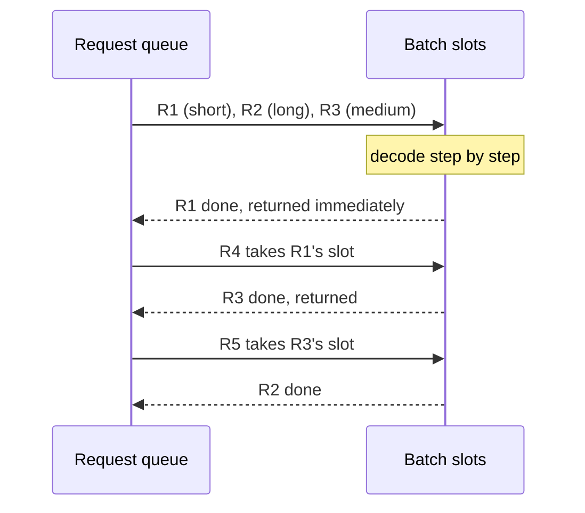

# Service optimization: batching, prompt caching and parallelism

Model-level techniques change the model. **Service-level** techniques change how the model is run. Given fixed resources (compute and memory) and a changing workload (requests from many users, possibly for different models), the goal is to allocate resources so that latency and cost are as low as possible. Huyen notes that these techniques **don't modify the model and shouldn't change output quality**. This lesson covers the four she discusses: **batching, decoupling prefill and decode, prompt caching and parallelism**.

## 1. Batching

Batching is one of the easiest ways to cut cost. Instead of processing each request separately, the service processes requests that arrive around the same time together, which raises throughput a lot. Huyen's analogy: individual processing is everyone driving their own car, and batching is putting them on a bus. A bus moves more people, but each rider may wait longer.

### Static batching

Group a **fixed number** of requests. The bus waits until every seat is filled. The drawback is that the first request waits for the last one to arrive, however late it is.

### Dynamic batching

Set a batch size **and a maximum time window**. With a batch size of 4 and a 100 ms window, the server runs the batch when it has 4 requests or when 100 ms has passed, whichever comes first. The bus leaves on schedule or when it is full. Latency stays bounded, but batches may run partly empty, which wastes compute.

### Continuous (in-flight) batching

With naive batching, every response in a batch is returned only when the whole batch finishes. LLM responses vary widely in length. If one request needs 10 tokens and another 1,000, the short one waits for the long one.

**Continuous batching** (introduced in the Orca paper, Yu et al., 2022) returns each response **as soon as it completes** and immediately puts a **new request into the freed slot**. The bus drops off a passenger and picks up another right away, which keeps it full.



```python-run
# Simulate static vs continuous batching. Each request needs `n` decode steps; one step serves every slot.
import statistics
need = [10, 1000, 30, 20, 400, 15, 25, 600, 12, 18, 50, 40]      # output tokens per request, all queued at t=0
SLOTS = 4
def static(reqs):
    t, done = 0, []
    for i in range(0, len(reqs), SLOTS):
        batch = reqs[i:i + SLOTS]
        t += max(batch)                       # everyone in the batch waits for the longest response
        done += [t] * len(batch)
    return done
def continuous(reqs):
    queue, slots, t, done = list(reqs), [], 0, []
    while queue or slots:
        while queue and len(slots) < SLOTS: slots.append(queue.pop(0))
        step = min(slots)                     # advance until the next response finishes
        t += step
        slots = [s - step for s in slots]
        done += [t] * slots.count(0)
        slots = [s for s in slots if s > 0]   # freed slots are refilled on the next iteration
    return done
for name, f in [("static", static), ("continuous", continuous)]:
    d = f(need)
    print(f"{name:10s}: mean completion {statistics.mean(d):7.1f} steps, median {statistics.median(d):6.1f}, all done at {max(d)}")
```

Median completion time drops sharply with continuous batching, because short requests no longer wait behind long ones.

## 2. Decoupling prefill and decode

LLM inference has two phases with different bottlenecks. Prefill is compute-bound and decode is memory bandwidth-bound. If both run on the same machine they compete for resources and slow each other down. Adding a new query's prefill to a machine in the middle of decoding other responses can stall those responses and noticeably hurt TPOT.

DistServe (Zhong et al., 2024) and "Inference without Interference" (Hu et al., 2024) show that assigning **prefill and decode to different instances**, such as different GPUs, significantly increases the volume of requests served within latency targets. The intermediate state has to be transferred from prefill to decode instances, but with fast links such as NVLink the overhead is small.

The **ratio** of prefill to decode instances depends on the workload and on priorities:

- Long inputs with a priority on **TTFT**: more prefill, for example **2:1 to 4:1**.
- Short inputs with a priority on **TPOT**: more decode, for example **1:2 to 1:1**.

## 3. Prompt caching

Many prompts in an application share text. The most common shared segment is the **system prompt**. A **prompt cache** (also called a context cache or prefix cache) stores the processed form of these overlapping segments so that they are computed once.

Good fits:

- **Long system prompts.** With a 1,000-token system prompt and one million API calls a day, caching saves about **one billion** repeated input tokens daily.
- **Long documents** queried many times: chat with a book or a codebase.
- **Long conversations.** Earlier turns are cached and reused when processing later messages.

Caveats: like the KV cache, a prompt cache can be large and uses memory. Implementing it yourself takes significant engineering. Model APIs now offer it. The technique was introduced in November 2023 (Gim et al.) and adopted quickly. Google Gemini gave cached input tokens a **75% discount** and charged for cache storage (\$1.00 per million tokens per hour at the time of writing). Anthropic's prompt caching promised up to **90% cost savings** and up to **75% lower latency**.

Anthropic's reported numbers (2024):

| Use case | TTFT without caching | TTFT with caching | Cost reduction |
|---|---|---|---|
| Chat with a book (100,000-token cached prompt) | 11.5 s | 2.4 s (−79%) | −90% |
| Many-shot prompting (10,000-token prompt) | 1.6 s | 1.1 s (−31%) | −86% |
| Multi-turn conversation (10 turns, long system prompt) | about 10 s | about 2.5 s (−75%) | −53% |

```python-run
# Cost of a workload with and without prompt caching (prices in USD per 1M tokens, illustrative).
def daily_cost(calls, prefix_tokens, unique_tokens, output_tokens, p_in, p_cached, p_out, cache=True):
    cached = prefix_tokens if cache else 0
    uncached = unique_tokens + (0 if cache else prefix_tokens)
    return calls * (uncached * p_in + cached * p_cached + output_tokens * p_out) / 1e6
args = dict(calls=1_000_000, prefix_tokens=1000, unique_tokens=200, output_tokens=150, p_in=3.0, p_cached=0.30, p_out=15.0)
a, b = daily_cost(cache=False, **args), daily_cost(cache=True, **args)
print(f"without cache: {a:,.0f} USD/day   with cache: {b:,.0f} USD/day   saving {1 - b/a:.0%}")
print("Saved input tokens per day:", f"{args['calls'] * args['prefix_tokens']:,}")
```

> [!TIP]
> Prompt caches match on **prefixes**. Put the stable content first (system prompt, tool definitions, long documents, few-shot examples) and the variable content last (the user's question). A timestamp or a user name at the top of the prompt defeats the cache. Provider details vary, including minimum cacheable length, cache lifetime and write surcharges, so check the documentation for your model.

Prompt caching is different from the **response caching** covered in Module 10 (exact and semantic caching). A prompt cache reuses the *computation of the input prefix* and still generates a fresh response. A response cache returns a stored *answer* and skips generation altogether.

## 4. Parallelism

Accelerators are built for parallel processing, and parallelism is the backbone of high-performance computing. There are two general families, **data parallelism** and **model parallelism**, plus strategies specific to LLMs.

### Replica parallelism

The simplest strategy is to create **multiple replicas** of the model. More replicas handle more simultaneous requests, at the cost of more chips. Fitting models of different sizes (8B, 13B, 34B, 70B) onto GPUs of different memory sizes (24, 40, 48, 80 GB) is a **bin-packing problem**. Should three 13B models share a 40 GB GPU, or should that GPU be reserved for one 34B model? It gets complicated as models, replicas and chips multiply.

### Model parallelism

Often the model is too big for one machine. **Model parallelism** splits one model across several machines.

- **Tensor parallelism** (intra-operator parallelism) is the most common for inference. The tensors in an operator such as a matrix multiplication are partitioned across devices and computed in parallel. For example, one matrix is split column-wise and each part is multiplied on a different device. This lets you serve models that don't fit on one chip and **reduces latency**, though communication overhead limits the gain.
- **Pipeline parallelism** divides the model's computation into **stages** assigned to different machines, with data passing from one stage to the next. Several inputs can be in different stages at once, which raises throughput. Each request pays extra communication between stages, so **latency increases**. It is therefore more common in training than in latency-sensitive inference.

```python-run
import numpy as np
# Tensor parallelism in miniature: split a matrix column-wise across two "devices" and add the partial results.
rng = np.random.default_rng(0)
W, x = rng.normal(size=(6, 8)), rng.normal(size=8)
dev0 = W[:, :4] @ x[:4]              # computed on device 0
dev1 = W[:, 4:] @ x[4:]              # computed on device 1, at the same time
print("split result equals the full product:", np.allclose(dev0 + dev1, W @ x))
```

### Context and sequence parallelism

For LLMs specifically, the **input sequence** can be split across machines:

- **Context parallelism**: split the sequence itself, with the first half of the tokens processed on machine 1 and the second half on machine 2.
- **Sequence parallelism**: split the operators needed for the whole sequence, with attention handled on one machine and the feedforward computation on another.

## 5. Putting it together

These techniques are usually combined, and they interact:

| Technique | Mainly improves | Watch out for |
|---|---|---|
| Static batching | throughput, cost | first request's wait |
| Dynamic batching | throughput with bounded latency | partially filled batches |
| Continuous batching | throughput and tail latency for mixed lengths | implementation complexity |
| Prefill/decode decoupling | TTFT and TPOT under load | state transfer, choosing the ratio |
| Prompt caching | TTFT and input cost | memory and storage cost, prefix stability |
| Replica parallelism | request capacity | cost, bin packing |
| Tensor parallelism | latency, fitting big models | communication overhead |
| Pipeline parallelism | throughput | higher latency per request |

Huyen's closing advice for the chapter applies widely. No single technique fits every workload. Measure your own traffic: input and output length distributions, burstiness, and latency requirements. Find the bottleneck and then pick techniques. Across use cases, the ones with the largest impact have tended to be **quantization, tensor parallelism, replica parallelism and attention mechanism optimization**.

> [!INTERVIEW]
> **"How would you cut cost and latency for a chatbot with a 4,000-token system prompt and bursty traffic?"** Enable prompt caching and keep the system prompt as a stable prefix (lower TTFT and input cost). Use continuous batching so short replies aren't held up by long ones. Scale replicas for the bursts, and use dynamic batching windows tuned to the latency SLO. For self-hosting, separate prefill and decode instances (with more prefill capacity when inputs are long), quantize the model, and track goodput rather than raw throughput. Send non-interactive jobs to a batch API.

## Pitfalls

- Batching for throughput without checking the latency SLO. Watch goodput.
- Static batching for LLM outputs of very different lengths.
- Putting variable content at the start of the prompt, which breaks prefix caching.
- Confusing prompt caching (reuses the input computation) with response caching (reuses answers).
- Using pipeline parallelism for a latency-critical service.

## Summary

- Service-level optimization allocates fixed resources to changing workloads without changing the model or its outputs.
- **Batching**: static (wait for a full batch), dynamic (full batch or time window), continuous (return finished responses immediately and refill the slots).
- **Decoupling prefill and decode** removes resource contention. The ratio depends on input lengths and whether you prioritize TTFT or TPOT.
- **Prompt caching** reuses shared prefixes such as system prompts, documents and conversation history. It can cut cost by up to 90% and TTFT by up to about 75–79% in the reported cases.
- **Parallelism**: replicas for capacity, tensor parallelism for latency and large models, pipeline parallelism for throughput (mostly in training), and context or sequence parallelism for long inputs.

```quiz
[
  {"q": "Dynamic batching processes a batch when…", "options": ["Only when the batch is full", "The batch is full OR a maximum time window has passed, whichever comes first", "Every request arrives", "The GPU is idle for an hour"], "answer": 1, "explain": "The time window bounds how long early requests wait."},
  {"q": "What problem does continuous batching solve?", "options": ["GPU overheating", "Short responses waiting for the longest response in the batch, and idle slots", "Tokenization errors", "Model hallucination"], "answer": 1, "explain": "Completed responses return immediately and new requests take the freed slots."},
  {"q": "Why decouple prefill and decode onto different instances?", "options": ["They use different tokenizers", "They have different bottlenecks (compute vs memory bandwidth) and compete for resources when colocated", "Decode needs CPUs", "To avoid using the KV cache"], "answer": 1, "explain": "Mixing them hurts TPOT and TTFT. Separating them improves the request volume served within the SLO."},
  {"q": "Your inputs are long and you prioritize TTFT. A reasonable prefill:decode instance ratio is…", "options": ["1:4", "1:2", "2:1 to 4:1", "0:1"], "answer": 2, "explain": "Long inputs need more prefill compute. Short inputs with a TPOT priority would use 1:2 to 1:1."},
  {"q": "With a 1,000-token system prompt and 1 million calls per day, prompt caching avoids reprocessing about…", "options": ["1 million tokens", "100 million tokens", "1 billion tokens", "1 trillion tokens"], "answer": 2, "explain": "1,000 × 1,000,000 = 1 billion repeated input tokens per day."},
  {"q": "To benefit from prompt (prefix) caching, you should…", "options": ["Put the user's question first", "Put stable content first and variable content last", "Randomize the system prompt", "Disable streaming"], "answer": 1, "explain": "Caches match on shared prefixes, so anything variable at the start invalidates the cache."},
  {"q": "Which parallelism strategy typically reduces latency and lets a model too big for one chip be served?", "options": ["Replica parallelism", "Tensor parallelism", "Pipeline parallelism", "None"], "answer": 1, "explain": "Tensor (intra-operator) parallelism splits operators across devices. Pipeline parallelism raises throughput but adds latency."},
  {"q": "How does prompt caching differ from response (exact/semantic) caching?", "options": ["They are identical", "Prompt caching reuses processed input prefixes but still generates; response caching returns a stored answer", "Prompt caching stores outputs", "Response caching needs GPUs"], "answer": 1, "explain": "One saves prefill computation, and the other skips generation."}
]
```

> **Source:** Huyen, *AI Engineering*, ch. 9 ("Inference Service Optimization": batching, decoupling prefill and decode, prompt caching, parallelism).
