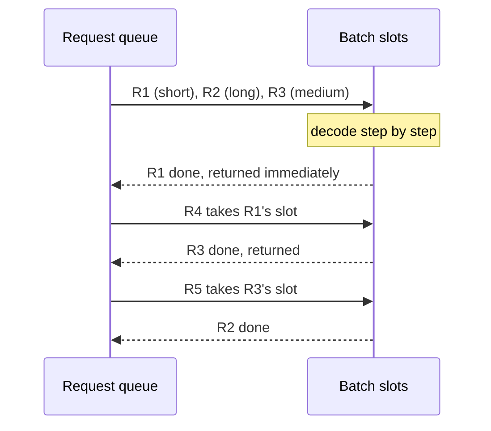

# Service optimization: batching, prompt caching and parallelism

> **Before this lesson:** read [Inference bottlenecks, metrics and hardware](#/lesson/ai-eng/aie-inference-metrics) (prefill and decode, TTFT, TPOT, throughput, goodput, SLOs) and [Model optimization: compression, speculative decoding, KV cache](#/lesson/ai-eng/aie-model-opt) (the KV cache and its memory cost). The system prompt was introduced in [Prompts, in-context learning and context length](#/lesson/ai-eng/aie-prompt-intro). The demos use basic Python and NumPy, explained line by line.

## In plain words

The previous lesson changed the model. This lesson leaves the model alone and changes **how the service runs it**. You have a fixed amount of hardware (chips and memory) and a constantly changing stream of requests from many users, sometimes for several different models. **Service-level optimization** is the art of sharing that hardware out so that responses are fast and cheap. Huyen stresses an important property: these techniques **do not modify the model, so they should not change the quality of its outputs**. That makes them low-risk wins.

She covers four techniques, and this lesson takes them in turn:

1. **Batching**: processing several requests together.
2. **Decoupling prefill and decode**: running the two phases of a request on separate machines.
3. **Prompt caching**: computing shared prompt text once and reusing it.
4. **Parallelism**: spreading work across many chips.

An everyday picture: a city's public transport. Instead of everyone driving their own car, people share buses (batching). Some buses wait until full, some leave on a timetable, and the best ones let passengers hop on and off at every stop so seats are never empty. Ticket checking happens at the station entrance, separately from the ride itself, so the two do not slow each other down (decoupling). Regular commuters use a season pass, so they skip buying a ticket every morning (prompt caching). And when one bus is not enough, the city runs more buses on the route, or a longer articulated bus that several drivers' sections share (parallelism).

Why this matters for a job: these are the levers you pull when a self-hosted model is too slow or too expensive, and the features you switch on when using an API (prompt caching can cut a bill by half or more). Interview questions like "How would you cut cost for a chatbot with a long system prompt?" are answered with this lesson.

## 1. Batching

**Batching** means grouping requests that arrive at around the same time and processing them together in one pass through the model. It is one of the easiest ways to cut cost. Recall that decode is memory bandwidth-bound: for every token, the model's weights must be read from memory. If 16 requests share the same pass, the weights are read once for all 16, so throughput rises dramatically for little extra cost. Huyen's analogy: processing each request alone is everyone driving their own car; batching is putting them on a bus. The bus moves far more people per trip, but a rider may have to wait for it.

There are three styles of batching, each fixing a weakness of the previous one.

### Static batching

**Static batching** groups a **fixed number** of requests. The bus does not leave until every seat is taken. The weakness: the first request must wait for the last one to arrive, however long that takes. At a quiet time of day, an early request might wait a very long time.

### Dynamic batching

**Dynamic batching** sets a batch size **and a maximum waiting time**. With a batch size of 4 and a window of 100 milliseconds, the server runs the batch as soon as it has 4 requests or as soon as 100 ms have passed since the first one arrived, whichever comes first. The bus leaves when full or when the timetable says so. Waiting time is now capped, but batches may leave partly empty, which wastes some compute.

### Continuous (in-flight) batching

Both styles above share a hidden problem for language models. With ordinary batching, the responses in a batch are all returned only when the **whole batch** has finished. Language-model responses vary enormously in length. If one request needs 10 tokens and its batch-mate needs 1,000, the short one finishes early and then sits waiting, done but undelivered, while its slot in the batch does nothing.

**Continuous batching**, also called **in-flight batching** and introduced in the Orca paper (Yu and colleagues, 2022), fixes both halves. It returns each response **the moment it finishes**, and it **immediately puts a new request into the freed slot**. The bus drops a passenger off at their stop and picks up a waiting one straight away, so it always runs full.



The simulation below compares static and continuous batching on twelve requests of very different lengths, with four slots.

```python-run
# Simulate static vs continuous batching. Each request needs `n` decode steps; one step serves every slot.
import statistics
need = [10, 1000, 30, 20, 400, 15, 25, 600, 12, 18, 50, 40]      # output tokens per request, all queued at t=0
SLOTS = 4
def static(reqs):
    t, done = 0, []
    for i in range(0, len(reqs), SLOTS):
        batch = reqs[i:i + SLOTS]
        t += max(batch)                       # everyone in the batch waits for the longest response
        done += [t] * len(batch)
    return done
def continuous(reqs):
    queue, slots, t, done = list(reqs), [], 0, []
    while queue or slots:
        while queue and len(slots) < SLOTS: slots.append(queue.pop(0))
        step = min(slots)                     # advance until the next response finishes
        t += step
        slots = [s - step for s in slots]
        done += [t] * slots.count(0)
        slots = [s for s in slots if s > 0]   # freed slots are refilled on the next iteration
    return done
for name, f in [("static", static), ("continuous", continuous)]:
    d = f(need)
    print(f"{name:10s}: mean completion {statistics.mean(d):7.1f} steps, median {statistics.median(d):6.1f}, all done at {max(d)}")
```

**Reading this Python line by line**

- `need` lists how many output tokens (decode steps) each of 12 requests needs. They all arrive at time 0. `SLOTS = 4` is the batch size.
- In `static`, `range(0, len(reqs), SLOTS)` walks through the requests four at a time. `reqs[i:i + SLOTS]` takes the next four. The batch takes as many steps as its longest member, `max(batch)`, and every member is recorded as finishing at that moment.
- In `continuous`, `queue` holds waiting requests and `slots` holds the remaining steps of requests in progress.
- The inner `while` fills empty slots from the front of the queue (`queue.pop(0)` removes and returns the first item).
- `step = min(slots)` jumps time forward to the next moment any request finishes. Every slot's remaining work drops by `step`.
- `slots.count(0)` counts the requests that have finished; each gets the current time as its completion time. Finished requests are then removed so their slots can be refilled.
- `statistics.mean` and `statistics.median` summarize when requests finished.
- Output: static batching gives a mean completion of about 1,417 steps and a median of 1,600, with everything done at step 1,650. Continuous batching gives a mean of about 221, a median of only 76, and everything done at step 1,000. Short requests no longer wait behind long ones, so the typical user gets an answer about twenty times sooner, and the whole workload even finishes earlier because no slot sits idle.

## 2. Decoupling prefill and decode

Recall the two phases of a language-model request: **prefill** (reading the input, compute-bound) and **decode** (writing the output one token at a time, memory bandwidth-bound). When both run on the same machine, they compete for its resources and slow each other down. For example, when a new request's prefill lands on a GPU that is in the middle of decoding other users' answers, those answers stall while the prefill runs, and their TPOT (time per output token) gets noticeably worse.

Two research papers, DistServe (Zhong and colleagues, 2024) and "Inference without Interference" (Hu and colleagues, 2024), showed that putting **prefill and decode on different instances**, for example different GPUs, significantly increases the number of requests served within latency targets. The prefill machine must hand over its intermediate results (the KV cache for the prompt) to the decode machine, but with fast connections between GPUs, such as NVIDIA's **NVLink**, this transfer costs little.

How many prefill machines per decode machine? The **ratio** depends on your workload and priorities:

- **Long inputs, with TTFT (time to first token) as the priority**: more prefill capacity, for example **2:1 to 4:1** prefill to decode.
- **Short inputs, with TPOT as the priority**: more decode capacity, for example **1:2 to 1:1**.

## 3. Prompt caching

Many prompts within one application share large chunks of text. The most common shared chunk is the **system prompt**, the fixed instructions placed at the start of every request. Normally the model would prefill that same text again for every single request. A **prompt cache**, also called a **context cache** or **prefix cache**, stores the processed form of shared segments (their KV cache entries) so they are computed only once and then reused.

Prompt caching pays off most for:

- **Long system prompts.** With a 1,000-token system prompt and one million API calls a day, caching avoids reprocessing about **one billion** input tokens every day.
- **Long documents queried many times**, such as chatting with a book or a codebase: the document is processed once and every question reuses it.
- **Long conversations.** The earlier turns of a chat are cached and reused as each new message arrives.

Some cautions. Like the KV cache, a prompt cache can be large and occupies memory. Building one yourself takes real engineering effort. Fortunately, model APIs now offer it as a feature. The technique was introduced in November 2023 (Gim and colleagues) and spread quickly. Google Gemini charged cached input tokens at a **75% discount** but added a fee for storing the cache (\$1.00 per million tokens per hour at the time the book was written). Anthropic advertised up to **90% lower cost** and up to **75% lower latency** with its prompt caching.

Anthropic's reported examples (2024):

| Use case | TTFT without caching | TTFT with caching | Cost reduction |
|---|---|---|---|
| Chat with a book (100,000-token cached prompt) | 11.5 s | 2.4 s (−79%) | −90% |
| Many-shot prompting (10,000-token prompt) | 1.6 s | 1.1 s (−31%) | −86% |
| Multi-turn conversation (10 turns, long system prompt) | about 10 s | about 2.5 s (−75%) | −53% |

"Many-shot prompting" means putting many worked examples in the prompt, which makes it long and repetitive across requests: a perfect caching target.

The demo estimates a daily bill with and without caching. The prices are illustrative, in US dollars per million tokens.

```python-run
# Cost of a workload with and without prompt caching (prices in USD per 1M tokens, illustrative).
def daily_cost(calls, prefix_tokens, unique_tokens, output_tokens, p_in, p_cached, p_out, cache=True):
    cached = prefix_tokens if cache else 0
    uncached = unique_tokens + (0 if cache else prefix_tokens)
    return calls * (uncached * p_in + cached * p_cached + output_tokens * p_out) / 1e6
args = dict(calls=1_000_000, prefix_tokens=1000, unique_tokens=200, output_tokens=150, p_in=3.0, p_cached=0.30, p_out=15.0)
a, b = daily_cost(cache=False, **args), daily_cost(cache=True, **args)
print(f"without cache: {a:,.0f} USD/day   with cache: {b:,.0f} USD/day   saving {1 - b/a:.0%}")
print("Saved input tokens per day:", f"{args['calls'] * args['prefix_tokens']:,}")
```

**Reading this Python line by line**

- `daily_cost` takes the number of calls per day, the length of the shared prefix (the system prompt), the length of each request's unique part, the output length, and three prices: normal input, cached input and output.
- With caching on, the prefix tokens are billed at the cached price and only the unique tokens at the full input price. With caching off, the prefix is billed at the full input price along with the unique part.
- The last line multiplies the per-call cost by the number of calls and divides by a million, because prices are per million tokens.
- `args` is a dictionary of settings; `**args` unpacks it into the function's named parameters, so we do not repeat them. `1_000_000` is Python's way of writing one million with readable underscores.
- `{a:,.0f}` prints with thousands separators and no decimals.
- Output: about \$5,850 a day without caching and \$3,150 with it, a 46% saving, and one billion input tokens a day not reprocessed. Output tokens (150 per call at \$15 per million) are untouched by caching, which is why the saving is not larger.

> [!TIP]
> Prompt caches match on **prefixes**: the cache only helps for text that is identical from the very first token. Put stable content first (system prompt, tool definitions, long documents, few-shot examples) and variable content last (the user's question). A timestamp or the user's name at the top of the prompt breaks the match and defeats the cache. Providers differ in minimum cacheable length, how long the cache lives, and whether writing to the cache costs extra, so check the documentation for your model.

Prompt caching is not the same as **response caching**, which the architecture lesson covers (exact and semantic caching). A prompt cache reuses the *computation for the input prefix* and still generates a fresh answer. A response cache returns a previously stored *answer* and skips generation entirely.

## 4. Parallelism

Accelerators are built for parallel work, and parallelism is the backbone of high-performance computing. There are two broad families: **data parallelism**, where each device works on different inputs with a full copy of the model, and **model parallelism**, where one model is split across devices. Language models add some strategies of their own.

### Replica parallelism

The simplest strategy is to run **several replicas** (complete copies) of the model, each on its own chips. More replicas serve more requests at the same time, at the cost of more hardware. This is the inference version of data parallelism.

It sounds trivial, but deciding which models go on which chips quickly becomes a puzzle. Fitting models of different sizes (8B, 13B, 34B and 70B parameters) onto GPUs with different memory (24, 40, 48 and 80 GB) is a **bin-packing problem**: like packing boxes of different sizes into suitcases of different sizes with as little empty space as possible. Should a 40 GB GPU hold three 13B models, or be kept for one 34B model? With many models, replicas and chip types, the choice gets complicated.

### Model parallelism

Often a model is too large to fit on one chip. **Model parallelism** splits one model across several devices.

- **Tensor parallelism**, also called **intra-operator parallelism**, is the most common choice for inference. A **tensor** is a multi-dimensional array of numbers, such as a weight matrix. Tensor parallelism splits the tensors inside one operation, such as a matrix multiplication, across devices, and the pieces are computed at the same time. For example, a weight matrix can be cut into column blocks, with each block multiplied on a different GPU. This lets you serve models that do not fit on a single chip and also **reduces latency**, because each device does only part of the work. The devices must exchange partial results, and that communication limits how much you gain.
- **Pipeline parallelism** splits the model's layers into consecutive **stages** on different machines, like stations on an assembly line, with each stage passing its output to the next. Different inputs can occupy different stages at the same time, which raises throughput. But each request now pays for hand-offs between stages, so **latency goes up**. That is why pipeline parallelism is more common in training than in latency-sensitive inference.

Here is tensor parallelism in miniature. When you multiply a matrix by a vector, you can split the matrix's columns (and the matching parts of the vector) between two devices and add their partial answers.

```python-run
import numpy as np
# Tensor parallelism in miniature: split a matrix column-wise across two "devices" and add the partial results.
rng = np.random.default_rng(0)
W, x = rng.normal(size=(6, 8)), rng.normal(size=8)
dev0 = W[:, :4] @ x[:4]              # computed on device 0
dev1 = W[:, 4:] @ x[4:]              # computed on device 1, at the same time
print("split result equals the full product:", np.allclose(dev0 + dev1, W @ x))
```

**Reading this Python line by line**

- `W` is a 6 × 8 weight matrix and `x` an input vector of length 8, both random.
- `W[:, :4]` means "all rows, first four columns"; `x[:4]` is the first four entries of `x`. Their product is device 0's share of the work.
- `W[:, 4:]` and `x[4:]` are the last four columns and entries: device 1's share. In a real system both devices compute at the same time.
- `dev0 + dev1` combines the partial results. This combining step is the communication that tensor parallelism must pay for.
- `np.allclose` checks that the combined answer matches the full multiplication `W @ x`, allowing for tiny rounding differences.
- Output: `True`. Matrix multiplication splits cleanly into independent pieces, which is exactly why GPUs and multi-GPU systems handle it so well.

### Context and sequence parallelism

For language models, you can also split the **input sequence** across machines, which helps with very long inputs:

- **Context parallelism** splits the sequence itself: the first half of the tokens is processed on machine 1 and the second half on machine 2.
- **Sequence parallelism** splits the operations needed for the whole sequence: for example, attention runs on one machine and the **feedforward** computation (the other main part of each transformer layer) on another.

## 5. Putting it together

Real systems combine these techniques, and they interact. This table summarizes what each mainly buys you and what to watch for.

| Technique | Mainly improves | Watch out for |
|---|---|---|
| Static batching | throughput, cost | first request's wait |
| Dynamic batching | throughput with bounded latency | partially filled batches |
| Continuous batching | throughput and tail latency for mixed lengths | implementation complexity |
| Prefill/decode decoupling | TTFT and TPOT under load | state transfer, choosing the ratio |
| Prompt caching | TTFT and input cost | memory and storage cost, prefix stability |
| Replica parallelism | request capacity | cost, bin packing |
| Tensor parallelism | latency, fitting big models | communication overhead |
| Pipeline parallelism | throughput | higher latency per request |

Huyen's closing advice for the inference chapter applies broadly. No single technique fits every workload. Measure your own traffic first: the distribution of input and output lengths, how **bursty** it is (whether requests arrive in sudden spikes), and your latency requirements. Find the bottleneck, then choose techniques. Across many use cases, the techniques that have tended to make the biggest difference are **quantization, tensor parallelism, replica parallelism and attention mechanism optimization**.

> [!INTERVIEW]
> **"How would you cut cost and latency for a chatbot with a 4,000-token system prompt and bursty traffic?"** Enable prompt caching and keep the system prompt as a stable prefix (lower TTFT and input cost). Use continuous batching so short replies are not held up by long ones. Scale replicas for the bursts, and tune dynamic batching windows to the latency SLO. When self-hosting, separate prefill and decode instances (with more prefill capacity when inputs are long), quantize the model, and track goodput rather than raw throughput. Send non-interactive jobs to a batch API.

> [!INTERVIEW]
> **"Tensor versus pipeline parallelism: which for inference, and why?"** Tensor parallelism splits each operation across devices, so every device works on every request at the same time: it lowers latency and lets an oversized model fit, at the cost of frequent communication, which favours devices linked by fast interconnects. Pipeline parallelism assigns groups of layers to devices; it raises throughput by keeping several requests in flight but adds per-request latency from stage hand-offs. For latency-sensitive inference, tensor parallelism is usually the choice.

## Pitfalls

- Batching for throughput without checking the latency SLO. Watch goodput.
- Using static batching for language-model outputs of very different lengths.
- Putting variable content at the start of the prompt, which breaks prefix caching.
- Confusing prompt caching (reuses the input computation) with response caching (reuses answers).
- Using pipeline parallelism for a latency-critical service.
- Running prefill and decode on the same GPUs under heavy load and blaming the model for slow streaming.

## Summary

- Service-level optimization shares fixed resources among changing workloads without changing the model or its outputs.
- **Batching**: static (wait for a full batch), dynamic (full batch or time window, whichever first), continuous (return finished responses at once and refill their slots).
- **Decoupling prefill and decode** removes contention between compute-bound and bandwidth-bound work. The ratio depends on input lengths and whether TTFT or TPOT matters more.
- **Prompt caching** reuses shared prefixes such as system prompts, documents and conversation history. In the reported cases it cut cost by up to 90% and TTFT by up to about 79%.
- **Parallelism**: replicas for capacity, tensor parallelism for latency and oversized models, pipeline parallelism for throughput (mostly in training), and context or sequence parallelism for long inputs.

## Glossary

- **Service-level optimization**: running a model more efficiently without changing it.
- **Batching**: processing several requests together in one pass.
- **Static batching**: waiting for a fixed number of requests.
- **Dynamic batching**: running when the batch is full or a time window expires.
- **Continuous (in-flight) batching**: returning each response when done and refilling its slot immediately.
- **Decoupling prefill and decode**: running the two phases on separate instances.
- **NVLink**: NVIDIA's fast connection between GPUs.
- **System prompt**: fixed instructions placed at the start of every request.
- **Prompt cache (context cache, prefix cache)**: stored computation for shared prompt prefixes.
- **Many-shot prompting**: a prompt with many worked examples.
- **Response caching**: returning a stored answer instead of generating one.
- **Data parallelism / model parallelism**: copies of the model on different inputs / one model split across devices.
- **Replica parallelism**: running several full copies of a model.
- **Bin-packing problem**: fitting items of different sizes into containers with minimal waste.
- **Tensor**: a multi-dimensional array of numbers.
- **Tensor (intra-operator) parallelism**: splitting each operation's tensors across devices.
- **Pipeline parallelism**: splitting layers into stages on different machines.
- **Context parallelism / sequence parallelism**: splitting the input tokens / the per-sequence operations across machines.
- **Feedforward layer**: the part of each transformer layer that transforms each token's vector independently.
- **Bursty traffic**: requests arriving in sudden spikes.

```quiz
[
  {"q": "Dynamic batching processes a batch when…", "options": ["Only when the batch is full", "The batch is full OR a maximum time window has passed, whichever comes first", "Every request arrives", "The GPU is idle for an hour"], "answer": 1, "explain": "The time window bounds how long early requests wait."},
  {"q": "What problem does continuous batching solve?", "options": ["GPU overheating", "Short responses waiting for the longest response in the batch, and idle slots", "Tokenization errors", "Model hallucination"], "answer": 1, "explain": "Completed responses return immediately and new requests take the freed slots."},
  {"q": "Why decouple prefill and decode onto different instances?", "options": ["They use different tokenizers", "They have different bottlenecks (compute vs memory bandwidth) and compete for resources when colocated", "Decode needs CPUs", "To avoid using the KV cache"], "answer": 1, "explain": "Mixing them hurts TPOT and TTFT. Separating them improves the request volume served within the SLO."},
  {"q": "Your inputs are long and you prioritize TTFT. A reasonable prefill:decode instance ratio is…", "options": ["1:4", "1:2", "2:1 to 4:1", "0:1"], "answer": 2, "explain": "Long inputs need more prefill compute. Short inputs with a TPOT priority would use 1:2 to 1:1."},
  {"q": "With a 1,000-token system prompt and 1 million calls per day, prompt caching avoids reprocessing about…", "options": ["1 million tokens", "100 million tokens", "1 billion tokens", "1 trillion tokens"], "answer": 2, "explain": "1,000 × 1,000,000 = 1 billion repeated input tokens per day."},
  {"q": "To benefit from prompt (prefix) caching, you should…", "options": ["Put the user's question first", "Put stable content first and variable content last", "Randomize the system prompt", "Disable streaming"], "answer": 1, "explain": "Caches match on shared prefixes, so anything variable at the start invalidates the cache."},
  {"q": "Which parallelism strategy typically reduces latency and lets a model too big for one chip be served?", "options": ["Replica parallelism", "Tensor parallelism", "Pipeline parallelism", "None"], "answer": 1, "explain": "Tensor (intra-operator) parallelism splits operators across devices. Pipeline parallelism raises throughput but adds latency."},
  {"q": "How does prompt caching differ from response (exact/semantic) caching?", "options": ["They are identical", "Prompt caching reuses processed input prefixes but still generates; response caching returns a stored answer", "Prompt caching stores outputs", "Response caching needs GPUs"], "answer": 1, "explain": "One saves prefill computation, and the other skips generation."}
]
```

> **Source:** Huyen, *AI Engineering*, ch. 9 ("Inference Service Optimization": batching, decoupling prefill and decode, prompt caching, parallelism).
