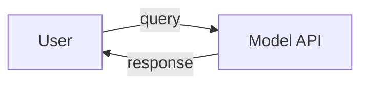
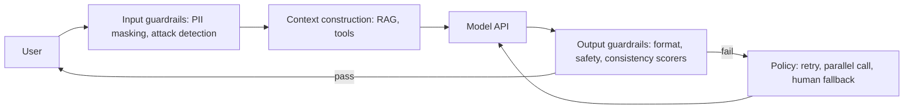
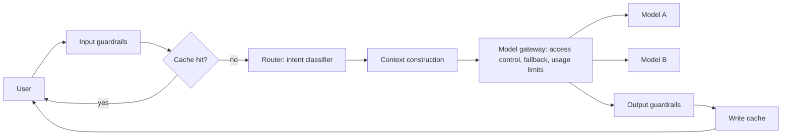

# Building up an AI application architecture

The earlier modules covered individual techniques: prompting, RAG, agents, finetuning, optimization. This lesson puts them together. Huyen's approach is to start from the **simplest possible architecture** and add components only when a real need appears. The architecture she describes has been validated at many companies and applies to a wide range of applications. The steps are:

1. Enhance context.
2. Put in guardrails.
3. Add a model router and gateway.
4. Reduce latency with caches.
5. Add agent patterns.

The next lesson covers what you need once this is running: observability, orchestration and user feedback.

## The starting point

In its simplest form, the application receives a query, sends it to a model, and returns the response. There is no context augmentation, no guardrails and no optimization. "Model API" here means either a third-party API (OpenAI, Google, Anthropic) or a self-hosted model.



## Step 1. Enhance context

The first addition is usually a way for the system to **gather the information each query needs**. Huyen compares context construction to feature engineering for foundation models. The mechanisms are the ones from Module 6:

- text retrieval (term-based, embedding-based or hybrid), image and multimodal retrieval, tabular retrieval through text-to-SQL, and
- **tools** that gather information automatically: web search, news, weather, internal APIs.

Model API providers differ in what they support, including document upload limits, retrieval types and tool use, so compare them. Specialized RAG solutions may let you upload as many documents as your vector database holds, while general-purpose model APIs often cap uploads.

## Step 2. Put in guardrails

Guardrails reduce risk and protect you and your users. Place them wherever there is exposure. They are grouped into **input** and **output** guardrails.

### Input guardrails

They protect against two kinds of risk.

**1. Leaking private information to external APIs.** This applies when you send data outside your organization. It can happen when an employee pastes a company secret into a prompt, when a developer puts internal policies in the system prompt, or when a tool retrieves private data into the context. There is no airtight way to stop it, but you can use **sensitive-data detection** tools on outgoing prompts for:

- personal information (ID numbers, phone numbers, bank accounts),
- human faces, and
- keywords and phrases associated with intellectual property or privileged information.

When sensitive data is found, either **block** the whole query or **mask** it. A phone number can be replaced with a placeholder such as `[PHONE NUMBER]`. Keep a **reverse PII map** so that if the response contains the placeholder, you can **unmask** it before showing the user.

```python-run
import re
PATTERNS = {"EMAIL": r"[\w.+-]+@[\w-]+\.[\w.]+", "PHONE": r"\+?\d[\d\s().-]{7,}\d"}
def mask(text):
    reverse, counts = {}, {}
    for label, pat in PATTERNS.items():
        def repl(m, label=label):
            counts[label] = counts.get(label, 0) + 1
            ph = f"[{label}_{counts[label]}]"
            reverse[ph] = m.group(0)
            return ph
        text = re.sub(pat, repl, text)
    return text, reverse
def unmask(text, reverse):
    for ph, original in reverse.items(): text = text.replace(ph, original)
    return text
prompt = "Draft a reply to ana@example.com and say we'll call her at +1 415 555 0100 tomorrow."
masked, rmap = mask(prompt)
print("sent to API :", masked)
response = "Hi! We will call you at [PHONE_1] tomorrow. A copy goes to [EMAIL_1]."     # model output with placeholders
print("shown to user:", unmask(response, rmap))
```

**2. Model jailbreaking and prompt attacks.** These are covered in Module 5. Risks can be reduced but never fully removed.

### Output guardrails

Output guardrails have two jobs: **catch output failures** and **specify the policy** for handling each failure mode.

Failures to catch:

- **Quality**: empty responses (the easiest to detect), **malformatted** responses such as invalid JSON, **factually inconsistent** (hallucinated) responses, and generally bad responses.
- **Security**: **toxic** responses (racist, sexual, illegal), responses containing **private or sensitive information**, responses that trigger **remote tool or code execution**, and **brand-risk** responses that mischaracterize your company or competitors.

Track the **false refusal rate** as well as security failures. A system that blocks legitimate requests frustrates users.

**Failure policies:**

- **Retry.** Models are probabilistic, so trying again may work. If the response is empty or malformatted, retry up to X times. Retries cost latency (a retry after failure doubles the wait) and money. To limit latency, make **parallel calls**: send the query twice at once and pick the better response. That raises cost and keeps latency flat.
- **Fall back to humans.** Transfer tricky requests to human operators. Triggers can be specific key phrases, a sentiment classifier detecting anger, or a turn limit, which prevents users getting stuck in a loop.

### Guardrail trade-offs and implementation

- **Reliability vs latency.** Guardrails add latency. Some teams told Huyen they chose not to implement guardrails because latency mattered more.
- **Streaming.** Output guardrails work poorly in stream mode. Partial responses are hard to evaluate, and unsafe content may reach the user before a guardrail can block it.
- **Self-hosting vs APIs.** API providers supply many guardrails out of the box. Self-hosting removes the need for some input guardrails, because data does not leave your organization.

Ready-made solutions include Meta's Purple Llama, NVIDIA NeMo Guardrails, Azure PyRIT and Azure AI content filters, the Perspective API and OpenAI's moderation API. Some model gateways bundle guardrails.



## Step 3. Add model router and gateway

As applications grow to use several models, two components help manage the complexity and cost.

### Router

Use **different solutions for different queries**, not one model for everything.

- **Specialization.** One model for technical troubleshooting and another for billing may each do better than a generalist.
- **Cost.** Send simple queries to cheaper models.

A router typically contains an **intent classifier** that predicts what the user is trying to do, and routes on that:

- A password reset goes to the FAQ page.
- A billing mistake goes to a human operator.
- A technical problem goes to the troubleshooting chatbot.

An intent classifier also keeps the system away from **out-of-scope** conversations. Asked who it would vote for, the bot returns a stock reply without spending an API call. It can detect **ambiguous** queries and ask for clarification. For "Freezing", it asks whether the user wants to freeze their account or is talking about the weather.

Other routers decide what to do next. A **next-action predictor** for agents chooses between the code interpreter and the search API. A **memory router** decides whether to use an attached document or search the internet.

Routers should be **fast and cheap** so that several can be used without much overhead. Many teams adapt small language models (GPT-2, BERT, Llama 7B) or train smaller classifiers from scratch. Routing usually happens **before** retrieval: is the query in scope, and does it need retrieval? It can also happen after: should this go to a human? Watch **context limits**. If a 1,000-token query bound for a 4K-context model picks up 8,000 tokens from a web search, either truncate the context or reroute to a model with a larger window.

```python-run
# A toy router: intent classification -> route. In production this is a small, fast model.
import re
ROUTES = {"reset_password": "FAQ page", "billing": "human operator", "troubleshooting": "troubleshooting bot (strong model)",
          "smalltalk": "cheap model", "out_of_scope": "stock refusal (no model call)"}
RULES = [("reset_password", r"\b(reset|forgot|change).{0,15}password\b"), ("billing", r"\b(refund|charged|invoice|billing)\b"),
         ("troubleshooting", r"\b(error|crash|not working|bug|fail)"), ("out_of_scope", r"\b(vote|election|religion)\b"),
         ("smalltalk", r"\b(hi|hello|thanks|thank you)\b")]
def route(q):
    intent = next((name for name, pat in RULES if re.search(pat, q.lower())), "troubleshooting")
    return intent, ROUTES[intent]
for q in ["I forgot my password", "I was charged twice", "The app crashes on start", "Who would you vote for?", "Thanks!"]:
    print(f"{q:28s} -> {route(q)}")
```

### Gateway

A **model gateway** is an intermediate layer that lets your organization work with different models in a **unified and secure** way.

- **Unified interface.** One wrapper sits in front of all models, self-hosted and commercial. If a provider changes its API, you update the gateway, not every application.
- **Access control and cost management.** Applications get access to the gateway, not your organizational API tokens, which leak easily. The gateway enforces fine-grained access (which user or application may use which model) and **monitors and limits usage** to prevent abuse and control spend.
- **Fallback policies.** When rate limits or API failures occur, which Huyen notes is unfortunately common, the gateway routes to alternative models, retries after a wait, or degrades gracefully.
- **Other functions**, since all traffic already passes through it: load balancing, logging and analytics, and sometimes caching and guardrails.

Gateways are fairly simple to build, and many exist off the shelf: Portkey's AI Gateway, MLflow AI Gateway, Wealthsimple's LLM Gateway, TrueFoundry, Kong and Cloudflare.

```python-run
# A minimal gateway: unified call, per-key access control, usage accounting, and fallback on failure.
class Gateway:
    def __init__(self, backends, acl, budget_tokens):
        self.backends, self.acl, self.budget, self.used = backends, acl, budget_tokens, {}
    def complete(self, api_key, models, prompt):
        for model in models:                               # ordered list = fallback chain
            if model not in self.acl.get(api_key, set()): continue
            cost = len(prompt.split())
            if self.used.get(api_key, 0) + cost > self.budget: return "429: budget exceeded"
            try:
                out = self.backends[model](prompt)
                self.used[api_key] = self.used.get(api_key, 0) + cost
                return f"[{model}] {out}"
            except RuntimeError: continue                  # provider outage or rate limit -> try the next model
        return "503: no model available"
def flaky(prompt): raise RuntimeError("rate limited")
gw = Gateway({"big": flaky, "small": lambda p: p.upper()}, {"team-a": {"big", "small"}, "team-b": {"small"}}, budget_tokens=8)
print(gw.complete("team-a", ["big", "small"], "summarize this ticket"))
print(gw.complete("team-b", ["big"], "hello"))
print(gw.complete("team-a", ["small"], "one two three four five six"))
```

## Step 4. Reduce latency with caches

Inference caching (the KV cache and prompt cache) lives in the inference layer (Module 9). This step is about **system caching**: storing *responses* so that some queries skip the model.

### Exact caching

A cached item is used only when exactly the same item is requested. If a user asks for a summary of a product, the system checks whether a summary of that exact product exists. Exact caching also avoids repeated **vector searches**. It is especially attractive for queries with **multiple steps** (chain-of-thought) or **slow actions** (retrieval, SQL execution, web search).

Implementation: in-memory storage for speed, or PostgreSQL, Redis or tiered storage for capacity. You need an **eviction policy**: LRU (least recently used), LFU (least frequently used) or FIFO.

What to cache depends on how likely the query is to recur. **User-specific** queries ("What's the status of my recent order?") and **time-sensitive** queries ("How's the weather?") are poor candidates. Some teams train a classifier to predict whether a query should be cached.

> [!WARNING]
> **Caching can leak data.** User X asks "What is the return policy for electronics?" The answer depends on X's membership, so the response includes X's information, and the system caches it as if it were generic. Later, user Y asks the same question and receives X's information. Never cache responses that depend on user-specific context without including that context in the cache key.

### Semantic caching

Cached items are reused when the new query is **semantically similar**. "What's the capital of Vietnam?" and "What's the capital city of Vietnam?" can share an answer. The mechanism:

1. Embed the query.
2. Use vector search to find the cached embedding with the highest similarity, X.
3. If X is above a **similarity threshold**, return the cached result. Otherwise process the query and cache it with its embedding.

Huyen is cautious. Semantic caching's value is "more dubious" because many of its components can fail: it needs high-quality embeddings, working vector search and a reliable similarity metric, and the threshold is hard to set. A false match returns a **wrong answer**. The vector search also adds latency and compute. It can be worth it if the hit rate is high, so measure efficiency, cost and performance risk first.



## Step 5. Add agent patterns

So far each query follows a sequential flow. Real applications can have **loops, parallel execution and conditional branching** (Module 6). After generating an output, the system may decide the task is not done and run another retrieval, feeding the first response and the new context back into the model.

Model outputs can also trigger **write actions**: composing an email, placing an order, initiating a bank transfer. Write actions make a system far more capable and expose it to far more risk. Grant them with the utmost care, using least privilege and human approval for anything that matters.

At this point the architecture is complex. Complex systems solve more tasks, and they also have more failure modes and are harder to debug. That is why the next topic is **observability**.

> [!INTERVIEW]
> **"Design the architecture for a customer-support assistant."** Start simple (query → model) and add components by need. (1) Context: hybrid retrieval over the knowledge base plus tools for order lookup. (2) Guardrails: PII masking with a reverse map on input, attack detection, and output checks (format, toxicity, factual consistency against retrieved context) with a retry and human-fallback policy. Mention the latency and streaming trade-offs. (3) Router: an intent classifier to send password resets to the FAQ, billing to humans, and out-of-scope queries to a stock reply; cheap models for simple intents. Gateway: unified API, keys and access control, rate and cost limits, fallbacks. (4) Caching: an exact cache for generic FAQs, with care about user-specific responses; a semantic cache only if measured hit rates justify it; prompt caching for the system prompt. (5) Agent patterns and write actions (refunds) with human approval. Then observability and feedback.

## Pitfalls

- Starting with the full architecture when the simple one has not been tried.
- Guardrails with no failure policy. Detection alone does nothing.
- One expensive model for every query when a router could send most of them to cheaper paths.
- API keys distributed to every team when a gateway should hold them.
- Caching responses that contain user-specific or time-sensitive information.
- A semantic cache with an untuned threshold that returns wrong answers.

## Summary

- Build the architecture step by step: **context → guardrails → router and gateway → caches → agent patterns**.
- **Input guardrails** stop private-data leaks (detect, block or mask, with a reverse PII map) and prompt attacks. **Output guardrails** catch quality and security failures and apply policies (retry, parallel calls, human fallback). Watch latency and streaming.
- A **router** (intent classifier, next-action predictor) sends each query to the best and cheapest solution. A **gateway** gives a unified interface, access control, cost limits, fallbacks, logging and load balancing.
- **Exact caching** is simple and safe when keys are right. **Semantic caching** raises the hit rate at the risk of wrong answers. Mind eviction policies and data leaks.
- **Agent patterns** add loops and write actions, which bring more capability, more risk and more need for observability.

```quiz
[
  {"q": "What is the first component Huyen suggests adding to the simplest query → model architecture?", "options": ["A semantic cache", "Context enhancement (retrieval and tools)", "A model gateway", "Write actions"], "answer": 1, "explain": "Giving the model the information it needs comes first, then guardrails, router/gateway, caches and agent patterns."},
  {"q": "What is a reverse PII map used for?", "options": ["Encrypting model weights", "Mapping placeholders back to the original sensitive values so responses can be unmasked", "Reversing embeddings", "Routing queries"], "answer": 1, "explain": "Sensitive values are masked before the API call and restored in the response."},
  {"q": "Why do output guardrails work poorly with streaming?", "options": ["Streaming disables APIs", "Partial responses are hard to evaluate, so unsafe content can reach users before it is blocked", "Streaming changes the model", "Guardrails require GPUs"], "answer": 1, "explain": "Tokens are shown as they're generated, before the whole response can be checked."},
  {"q": "To retry a failed generation without doubling user-perceived latency, you can…", "options": ["Lower temperature to 0", "Send the query in parallel calls and pick the better response", "Disable guardrails", "Use a longer prompt"], "answer": 1, "explain": "Parallel calls trade extra cost for latency."},
  {"q": "A router's intent classifier can do all of these EXCEPT…", "options": ["Send simple queries to cheaper models", "Decline out-of-scope queries with a stock response", "Ask for clarification on ambiguous queries", "Guarantee factual correctness of responses"], "answer": 3, "explain": "Routing chooses the path. It does not verify the answers."},
  {"q": "Which is NOT a typical model gateway function?", "options": ["Unified interface to many models", "Access control and usage limits", "Fallback when a provider fails", "Training the models"], "answer": 3, "explain": "A gateway mediates access. It doesn't train models."},
  {"q": "User Y receives user X's membership details from a cached answer to a 'generic' return-policy question. The root cause is…", "options": ["Too low temperature", "Caching a response that depended on user-specific context", "A wrong tokenizer", "KV cache overflow"], "answer": 1, "explain": "User-specific responses must not be cached as generic ones."},
  {"q": "Why does Huyen call semantic caching's value 'more dubious' than exact caching?", "options": ["It can't be implemented", "It depends on embeddings, vector search and a tuned threshold, and a false match returns a wrong answer", "It never gets hits", "It needs no storage"], "answer": 1, "explain": "Many components can fail, and the vector search itself costs time and compute."}
]
```

> **Source:** Huyen, *AI Engineering*, ch. 10 ("AI Engineering Architecture": steps 1–5).
