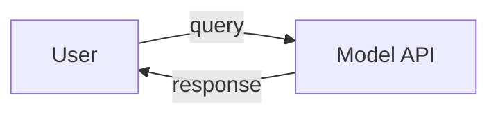
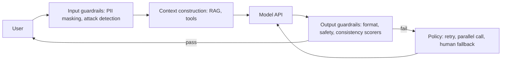
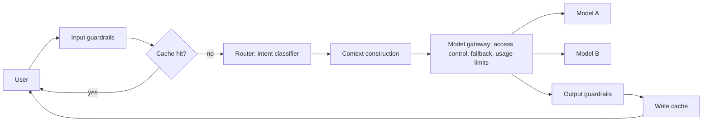

# Building up an AI application architecture

> **Before this lesson:** this lesson ties together the whole track, so it helps to have met retrieval and tools in [RAG architecture and retrieval algorithms](#/lesson/ai-eng/aie-rag-retrieval) and [Agents: tools, planning, failure modes and memory](#/lesson/ai-eng/aie-agents), prompt attacks in [Defensive prompt engineering](#/lesson/ai-eng/aie-prompt-defense), embeddings and similarity in [Exact evaluation and similarity measures](#/lesson/ai-eng/aie-exact-similarity), and prompt caching in [Service optimization: batching, prompt caching, parallelism](#/lesson/ai-eng/aie-service-opt). Each idea is briefly recapped when it appears. The demos use basic Python, explained line by line.

## In plain words

The earlier lessons each taught one technique: writing prompts, retrieving documents, building agents, finetuning, making inference fast. A real product needs several of them working together. The overall arrangement of the pieces, which component talks to which and in what order, is the application's **architecture**.

Huyen's advice is to **start with the simplest architecture that could possibly work and add components only when a real need appears**. Her recipe, which she says has held up across many companies and a wide range of applications, adds pieces in five steps:

1. **Enhance context**: give the model the information it needs.
2. **Put in guardrails**: protect against leaks, attacks and bad outputs.
3. **Add a model router and gateway**: send each query to the right model, through one controlled entry point.
4. **Reduce latency with caches**: reuse earlier answers when it is safe to.
5. **Add agent patterns**: let the system loop, branch and take actions.

An everyday picture: opening a small restaurant. On day one, one cook takes orders and cooks (query in, model, answer out). Soon you buy a pantry and recipe books so the cook has what each dish needs (context). You add a health inspector at the door and a quality check before plates leave the kitchen (guardrails). As the menu grows, a host directs each order to the right station, pastry or grill, and all suppliers are reached through one purchasing office (router and gateway). Popular dishes are prepared ahead and kept warm (caches). Finally, staff are trusted to take actions on their own, like reordering stock, with a manager approving anything expensive (agent patterns). You would never build all of that on opening day; you add each piece when the lack of it hurts.

Why this matters for a job: "Design an AI customer-support assistant" is one of the most common system-design interview questions for AI engineers, and this lesson is essentially the answer key. It is also the mental checklist you will use when reviewing any real AI product. The next lesson covers what you need once the system is running: observability, orchestration and user feedback.

## The starting point

In its simplest form, the application receives a user's **query** (their question or request), sends it to a model, and returns the model's response. Nothing adds context, nothing checks inputs or outputs, nothing is optimized. Here "model API" means either a third-party API (OpenAI, Google, Anthropic) or a model you host yourself; the architecture is the same.



This is a perfectly good place to start. Many prototypes stop here, and you learn a lot from seeing where it fails.

## Step 1. Enhance context

The first addition is usually a way to **gather the information each query needs** before calling the model. Huyen compares building the context to **feature engineering** in classic machine learning, the step where engineers prepared the input signals a model would learn from. For foundation models, the context plays that role. The mechanisms come from the RAG and agents lessons:

- **Retrieval**: fetching relevant pieces of text from your documents, using **term-based** search (matching keywords), **embedding-based** search (matching meaning via vectors), or a **hybrid** of both. Retrieval also extends to images and other media, and to tables through **text-to-SQL** (a model writes a database query from a plain-language question).
- **Tools**: functions the system can call to fetch information automatically, such as web search, news, weather, or your company's internal APIs (for example, an order-status lookup).

Model API providers differ in how much of this they support: how many documents you can upload, what kinds of retrieval, which tools. Compare them for your needs. A dedicated RAG product may be limited only by the size of its **vector store** (the database holding document embeddings), while a general-purpose model API usually caps how many documents you can attach.

## Step 2. Put in guardrails

**Guardrails** are checks that reduce risk, protecting both you and your users. Place them wherever there is exposure. They fall into two groups: **input guardrails**, which inspect what goes into the model, and **output guardrails**, which inspect what comes out.

### Input guardrails

Input guardrails protect against two kinds of risk.

**1. Leaking private information to external APIs.** This matters whenever data leaves your organization, for example when you call a third-party model API. Leaks happen in ordinary ways: an employee pastes a company secret into a prompt, a developer puts internal policies into the system prompt, or a tool retrieves private records into the context. There is no airtight defence, but **sensitive-data detection** tools can scan outgoing prompts for:

- personal identifiers such as national ID numbers, phone numbers and bank account numbers,
- human faces in images, and
- words and phrases linked to the company's intellectual property or other privileged information.

When something sensitive is found, you have two choices: **block** the whole query, or **mask** the sensitive part. Masking replaces it with a placeholder; for example, a phone number becomes `[PHONE NUMBER]`. If you keep a **reverse PII map**, a lookup table from each placeholder back to the original value (PII means personally identifiable information), you can **unmask** the response: if the model's answer contains the placeholder, swap the real value back in before showing it to the user. The external API never sees the real value.

```python-run
import re
PATTERNS = {"EMAIL": r"[\w.+-]+@[\w-]+\.[\w.]+", "PHONE": r"\+?\d[\d\s().-]{7,}\d"}
def mask(text):
    reverse, counts = {}, {}
    for label, pat in PATTERNS.items():
        def repl(m, label=label):
            counts[label] = counts.get(label, 0) + 1
            ph = f"[{label}_{counts[label]}]"
            reverse[ph] = m.group(0)
            return ph
        text = re.sub(pat, repl, text)
    return text, reverse
def unmask(text, reverse):
    for ph, original in reverse.items(): text = text.replace(ph, original)
    return text
prompt = "Draft a reply to ana@example.com and say we'll call her at +1 415 555 0100 tomorrow."
masked, rmap = mask(prompt)
print("sent to API :", masked)
response = "Hi! We will call you at [PHONE_1] tomorrow. A copy goes to [EMAIL_1]."     # model output with placeholders
print("shown to user:", unmask(response, rmap))
```

**Reading this Python line by line**

- `PATTERNS` maps a label to a **regular expression**, a compact pattern language for matching text. The email pattern means "some letters, digits, dots, plus or minus signs, then `@`, then a domain with a dot". The phone pattern means "an optional `+`, a digit, at least seven more digits, spaces, brackets, dots or dashes, then a final digit".
- `mask` loops over the patterns. For each one it defines a small function `repl` that is called for every match `m`. It counts matches per label, builds a numbered placeholder such as `[EMAIL_1]`, records `placeholder -> original` in `reverse`, and returns the placeholder to replace the match. (`label=label` freezes the current label inside the function, a common Python idiom inside loops.)
- `re.sub(pat, repl, text)` finds every match of the pattern and replaces it with whatever `repl` returns.
- `unmask` walks through the reverse map and replaces each placeholder in the response with its original value.
- The example masks a prompt, then pretends the model replied using the placeholders.
- Output: the API receives "Draft a reply to [EMAIL_1] and say we'll call her at [PHONE_1] tomorrow.", and the user sees the reply with the real phone number and email restored. Real systems use far more thorough detectors than two regular expressions, often specialized models, because people write phone numbers and names in endless formats.

**2. Model jailbreaking and prompt attacks.** A **jailbreak** tricks a model into ignoring its rules; a **prompt injection** hides instructions inside content the model reads. The defensive prompting lesson covered these in depth. Input guardrails that detect known attack patterns lower the risk, but it can never be removed completely.

### Output guardrails

Output guardrails have two jobs: **catch failures** in what the model produced, and **define a policy** for what to do about each kind of failure. Detection without a policy does nothing.

Failures to catch fall into two groups:

- **Quality failures**: empty responses (the easiest to spot), **malformatted** responses that break the required format (for example, invalid JSON when your code expects JSON), **factually inconsistent** responses that contradict the provided context (hallucinations), and responses that are poor in general.
- **Security failures**: **toxic** responses (racist, sexual or describing illegal activity), responses that reveal **private or sensitive information**, responses that trigger **remote tool or code execution** (for example, an injected command the system then runs), and **brand-risk** responses that misrepresent your company or competitors.

Measure the **false refusal rate** as well as security failures: how often the system wrongly blocks a legitimate request. A system that refuses too much is as frustrating as one that is unsafe.

**Failure policies:**

- **Retry.** Models are probabilistic (the sampling lesson explained why), so asking again often works. If a response is empty or malformatted, retry up to some limit. Retries cost time and money: a retry after a failure roughly doubles the wait. To avoid the extra wait, make **parallel calls**: send the same query twice at once and keep the better response. Cost goes up, but latency stays flat.
- **Fall back to humans.** Hand difficult conversations to a human operator. Triggers can include specific phrases ("speak to a person"), a **sentiment classifier** (a model that detects emotion) noticing the user is angry, or a limit on the number of turns, which stops users being trapped in a frustrating loop.

### Guardrail trade-offs and implementation

- **Reliability versus latency.** Every check adds time. Some teams told Huyen they skipped guardrails entirely because latency mattered more to them.
- **Streaming.** Output guardrails fit poorly with streaming, where tokens are shown as they are generated. A partial response is hard to judge, and unsafe content may already be on the user's screen before a guardrail can block it.
- **Self-hosting versus APIs.** API providers include many guardrails out of the box. Self-hosting removes the need for some input guardrails, because data never leaves your organization, but you must build the rest yourself.

Ready-made options include Meta's Purple Llama, NVIDIA NeMo Guardrails, Azure's PyRIT and content filters, Google's Perspective API, and OpenAI's moderation endpoint. Some model gateways (step 3) bundle guardrails as well.



## Step 3. Add a model router and a gateway

Once your application uses more than one model, two components help manage the complexity and the cost.

### Router

A **router** sends **different queries to different solutions** instead of using one model for everything. Two motives:

- **Specialization.** A model tuned for technical troubleshooting and another for billing questions may each beat a single general-purpose model.
- **Cost.** Simple queries can go to cheaper, smaller models, saving the expensive model for hard ones.

The heart of most routers is an **intent classifier**: a model that guesses what the user is trying to do. The query is then routed by intent:

- A password reset goes to the FAQ page that explains how.
- A billing mistake goes to a human operator.
- A technical problem goes to the troubleshooting chatbot.

An intent classifier also keeps the system out of **out-of-scope** conversations. If someone asks a support bot who it would vote for, the router can return a polite stock reply without spending a model call. It can also spot **ambiguous** queries and ask a clarifying question. Given only "Freezing", it might ask whether the user wants to freeze their account or is complaining about the weather.

Other routers decide the next step rather than the destination. A **next-action predictor** in an agent chooses, say, between running the code interpreter and calling the search API. A **memory router** decides whether to answer from an attached document or search the internet.

A router must be **fast and cheap**, because one pipeline may chain several. Many teams adapt small language models (GPT-2, BERT, Llama 7B) or train small classifiers from scratch. Routing usually happens **before** retrieval (is the query in scope? does it need retrieval at all?) but can happen after too (should this go to a human?). Watch **context limits**: if a 1,000-token query is routed to a model with a 4,000-token context window and then picks up 8,000 tokens from a web search, you must either trim the context or reroute to a model with a larger window.

```python-run
# A toy router: intent classification -> route. In production this is a small, fast model.
import re
ROUTES = {"reset_password": "FAQ page", "billing": "human operator", "troubleshooting": "troubleshooting bot (strong model)",
          "smalltalk": "cheap model", "out_of_scope": "stock refusal (no model call)"}
RULES = [("reset_password", r"\b(reset|forgot|change).{0,15}password\b"), ("billing", r"\b(refund|charged|invoice|billing)\b"),
         ("troubleshooting", r"\b(error|crash|not working|bug|fail)"), ("out_of_scope", r"\b(vote|election|religion)\b"),
         ("smalltalk", r"\b(hi|hello|thanks|thank you)\b")]
def route(q):
    intent = next((name for name, pat in RULES if re.search(pat, q.lower())), "troubleshooting")
    return intent, ROUTES[intent]
for q in ["I forgot my password", "I was charged twice", "The app crashes on start", "Who would you vote for?", "Thanks!"]:
    print(f"{q:28s} -> {route(q)}")
```

**Reading this Python line by line**

- `ROUTES` maps each intent to where it should go.
- `RULES` is an ordered list of (intent, regular expression) pairs. `\b` marks a word boundary, so "hi" does not match inside "this". `.{0,15}` allows up to 15 characters between "forgot" and "password".
- In `route`, the expression inside `next(...)` is a **generator**: it yields the name of each rule whose pattern is found in the lowercased query, in order. `next` takes the first one, or the default `"troubleshooting"` if none match.
- The function returns the intent and its destination.
- `{q:28s}` pads the query to 28 characters so the arrows line up.
- Output: the password question goes to the FAQ page, the double charge to a human, the crash to the strong troubleshooting bot, the voting question to a stock refusal and "Thanks!" to a cheap model. Keyword rules are brittle ("my password won't save" would not match), which is why production routers are trained classifiers, but the routing logic around them looks much like this.

### Gateway

A **model gateway** sits between all your applications and all the models they use. It gives the whole organization **one consistent, secured entry point**.

- **Unified interface.** One wrapper fronts every model, whether self-hosted or commercial. If a provider changes its API, you update the gateway once instead of every application.
- **Access control and cost management.** Applications are given access to the gateway, not your organization's API keys, which leak easily (pasted into code, chat messages or logs). The gateway enforces fine-grained rules about which user or application may use which model, and it **monitors and limits usage** to prevent abuse and keep spending under control.
- **Fallback policies.** When a provider hits its **rate limit** (the maximum number of requests it allows per minute) or fails outright, which Huyen notes happens more often than anyone would like, the gateway can route to an alternative model, retry after a pause, or degrade gracefully.
- **Other functions**, since all traffic passes through it anyway: **load balancing** (spreading requests across replicas), logging and analytics, and sometimes caching and guardrails.

Gateways are fairly simple to build, and many exist ready-made, open source or commercial: for example, gateways from Portkey, MLflow, Wealthsimple, TrueFoundry, Kong and Cloudflare.

```python-run
# A minimal gateway: unified call, per-key access control, usage accounting, and fallback on failure.
class Gateway:
    def __init__(self, backends, acl, budget_tokens):
        self.backends, self.acl, self.budget, self.used = backends, acl, budget_tokens, {}
    def complete(self, api_key, models, prompt):
        for model in models:                               # ordered list = fallback chain
            if model not in self.acl.get(api_key, set()): continue
            cost = len(prompt.split())
            if self.used.get(api_key, 0) + cost > self.budget: return "429: budget exceeded"
            try:
                out = self.backends[model](prompt)
                self.used[api_key] = self.used.get(api_key, 0) + cost
                return f"[{model}] {out}"
            except RuntimeError: continue                  # provider outage or rate limit -> try the next model
        return "503: no model available"
def flaky(prompt): raise RuntimeError("rate limited")
gw = Gateway({"big": flaky, "small": lambda p: p.upper()}, {"team-a": {"big", "small"}, "team-b": {"small"}}, budget_tokens=8)
print(gw.complete("team-a", ["big", "small"], "summarize this ticket"))
print(gw.complete("team-b", ["big"], "hello"))
print(gw.complete("team-a", ["small"], "one two three four five six"))
```

**Reading this Python line by line**

- `class Gateway` defines a new kind of object. `__init__` runs when one is created and stores four things: `backends` (a dictionary from model name to a function that calls it), `acl` (an **access control list**: which keys may use which models), the token `budget` per key, and `used`, a running tally per key.
- `complete` receives the caller's key, an ordered list of models to try (the **fallback chain**) and the prompt.
- For each model, it skips any the key is not allowed to use. It estimates the cost as the number of words, and refuses with `429` (the standard HTTP code for "too many requests") if the call would exceed the budget.
- `try` / `except RuntimeError` calls the model and, if it raises an error (here standing for an outage or rate limit), moves on to the next model. On success it records the usage and returns the answer tagged with the model's name.
- If nothing works, it returns `503` (HTTP for "service unavailable").
- `flaky` always fails. The "small" model is a `lambda`, a one-line nameless function, that returns the prompt in capitals.
- Output: team A's request fails on "big" and falls back to "small", returning `[small] SUMMARIZE THIS TICKET`. Team B asks only for "big", which it is not allowed to use, so it gets `503: no model available`. Team A's third request would bring its usage to 3 + 6 = 9 words, over the budget of 8, so it gets `429: budget exceeded`.

## Step 4. Reduce latency with caches

The KV cache and prompt cache from the inference lessons live inside the model server. This step is about **system caching**: storing whole *responses* so that some queries skip the model entirely. A **cache hit** means the answer was found in the cache; a **cache miss** means it was not.

### Exact caching

With **exact caching**, a stored item is reused only when exactly the same thing is requested again. If a user asks for a summary of a particular product, the system first checks whether a summary of that exact product is already stored. Exact caching can also store the results of **vector searches**, so a repeated query does not search again. It pays off most for queries that involve **several steps** (chain-of-thought reasoning) or **slow actions** (retrieval, running SQL, web search).

For storage, use in-memory storage for speed, or PostgreSQL, Redis or **tiered storage** (a small fast layer in front of a big slow one) for capacity. Because a cache cannot grow forever, it needs an **eviction policy**, a rule for what to throw out when full: **LRU** (least recently used), **LFU** (least frequently used) or **FIFO** (first in, first out).

Whether to cache a query depends on how likely it is to come up again. **User-specific** queries ("What's the status of my recent order?") and **time-sensitive** queries ("How's the weather?") are poor candidates. Some teams train a small classifier to predict which queries are worth caching.

> [!WARNING]
> **Caching can leak data.** User X asks, "What is the return policy for electronics?" The answer depends on X's membership tier, so the response contains X's details, and the system caches it as though it were a generic answer. Later user Y asks the same question and is shown X's information. Never cache a response that depends on user-specific context unless that context is part of the cache key.

### Semantic caching

With **semantic caching**, a stored answer is reused when the new query **means the same thing** as an earlier one, even if worded differently. "What's the capital of Vietnam?" and "What's the capital city of Vietnam?" can share an answer. The mechanism:

1. Compute the query's **embedding** (a vector representing its meaning).
2. Search the cache's vector index for the stored query whose embedding is closest, and note the **similarity score**.
3. If the score is above a chosen **similarity threshold**, return the cached answer. Otherwise, process the query normally and store it, with its embedding, for next time.

Huyen is cautious here. She considers semantic caching's value more questionable than exact caching's, because it has many parts that can go wrong: it needs good embeddings, reliable vector search and a trustworthy similarity metric, and the threshold is hard to set. Too loose, and "How do I cancel my order?" might be answered with the cached reply to "How do I place an order?": a **wrong answer**, delivered confidently. The vector search itself also costs time and compute. Semantic caching can be worth it when the **hit rate** (the share of queries answered from the cache) is high, so measure efficiency, cost and the risk to quality before committing.



## Step 5. Add agent patterns

So far each query flows straight through the system, one step after another. Real applications can include **loops, parallel steps and conditional branches**, the agent patterns from the agents lesson. For example, after generating an answer, the system might decide the task is not finished, run another retrieval, and feed the first answer plus the new context back into the model.

Model outputs can also trigger **write actions**: actions that change something in the world, such as composing and sending an email, placing an order or starting a bank transfer. Write actions make a system vastly more useful and vastly riskier. Grant them with great care: follow the principle of **least privilege** (give each component only the permissions it truly needs) and require **human approval** for anything consequential.

By now the architecture is complex. Complex systems can solve more tasks, but they also have more ways to fail and are harder to debug. That is why the next lesson turns to **observability**: seeing what the system is doing.

> [!INTERVIEW]
> **"Design the architecture for a customer-support assistant."** Start simple (query → model) and add components by need. (1) Context: hybrid retrieval over the knowledge base, plus tools for order lookup. (2) Guardrails: PII masking with a reverse map on input, attack detection, and output checks (format, toxicity, factual consistency against retrieved context) with a retry and human-fallback policy; mention the latency and streaming trade-offs. (3) Router: an intent classifier sending password resets to the FAQ, billing disputes to humans, out-of-scope queries to a stock reply, and simple intents to cheap models. Gateway: unified API, keys and access control, rate and cost limits, fallbacks. (4) Caching: exact caching for generic FAQs, careful to exclude user-specific responses; semantic caching only if measured hit rates justify it; prompt caching for the system prompt. (5) Agent patterns and write actions (refunds) behind human approval. Then observability and feedback loops.

## Pitfalls

- Building the full architecture before trying the simple one.
- Guardrails with no failure policy. Detection alone changes nothing.
- One expensive model for every query when a router could send most to cheaper paths.
- Handing raw provider API keys to every team instead of using a gateway.
- Caching responses that contain user-specific or time-sensitive information.
- A semantic cache with an untuned threshold that returns confident wrong answers.
- Granting write actions without least privilege or human approval.

## Summary

- Build the architecture step by step: **context → guardrails → router and gateway → caches → agent patterns**, each added when a real need appears.
- **Input guardrails** stop private-data leaks (detect, then block or mask, with a reverse PII map) and prompt attacks. **Output guardrails** catch quality and security failures and apply policies (retry, parallel calls, human fallback). Watch latency, streaming and false refusals.
- A **router** (intent classifier, next-action predictor, memory router) sends each query to the best and cheapest path. A **gateway** provides a unified interface, access control, cost limits, fallbacks, load balancing and logging.
- **Exact caching** is simple and safe when cache keys include any user-specific context. **Semantic caching** raises the hit rate at the risk of wrong answers. Choose an eviction policy and guard against leaks.
- **Agent patterns** add loops, branches and write actions: more capability, more risk, and more need for observability.

## Glossary

- **Architecture**: the arrangement of an application's components and how they connect.
- **Query**: the user's request sent to the system.
- **Context enhancement / construction**: gathering the information a query needs before calling the model.
- **Feature engineering**: preparing the input signals for a classic ML model.
- **Text-to-SQL**: a model turning a plain-language question into a database query.
- **Vector store**: a database of embeddings used for retrieval.
- **Guardrail**: a check on inputs or outputs that reduces risk.
- **PII**: personally identifiable information.
- **Masking / reverse PII map**: replacing sensitive values with placeholders / the table used to restore them.
- **Jailbreak / prompt injection**: tricking a model into breaking its rules / hiding instructions in content it reads.
- **Malformatted response**: output that breaks the required format.
- **False refusal rate**: how often legitimate requests are wrongly blocked.
- **Parallel calls**: sending the same query several times at once and keeping the best answer.
- **Sentiment classifier**: a model that detects emotion in text.
- **Router / intent classifier**: a component that picks a path per query / a model that guesses the user's goal.
- **Out-of-scope query**: a request the application is not meant to handle.
- **Next-action predictor / memory router**: routers that choose an agent's next tool / its information source.
- **Model gateway**: a single controlled entry point to all models.
- **Access control list**: rules about who may use what.
- **Rate limit**: the maximum requests a provider allows per period.
- **Fallback chain**: an ordered list of alternatives to try when one fails.
- **Load balancing**: spreading requests across replicas.
- **Cache hit / miss / hit rate**: found in cache / not found / the share of queries found.
- **Exact caching / semantic caching**: reuse for identical requests / for requests with similar meaning.
- **Eviction policy (LRU, LFU, FIFO)**: the rule for what to remove when the cache is full.
- **Similarity threshold**: the minimum similarity for a semantic cache hit.
- **Write action**: an action that changes something in the world.
- **Least privilege**: giving each component only the permissions it needs.

```quiz
[
  {"q": "What is the first component Huyen suggests adding to the simplest query → model architecture?", "options": ["A semantic cache", "Context enhancement (retrieval and tools)", "A model gateway", "Write actions"], "answer": 1, "explain": "Giving the model the information it needs comes first, then guardrails, router/gateway, caches and agent patterns."},
  {"q": "What is a reverse PII map used for?", "options": ["Encrypting model weights", "Mapping placeholders back to the original sensitive values so responses can be unmasked", "Reversing embeddings", "Routing queries"], "answer": 1, "explain": "Sensitive values are masked before the API call and restored in the response."},
  {"q": "Why do output guardrails work poorly with streaming?", "options": ["Streaming disables APIs", "Partial responses are hard to evaluate, so unsafe content can reach users before it is blocked", "Streaming changes the model", "Guardrails require GPUs"], "answer": 1, "explain": "Tokens are shown as they're generated, before the whole response can be checked."},
  {"q": "To retry a failed generation without doubling user-perceived latency, you can…", "options": ["Lower temperature to 0", "Send the query in parallel calls and pick the better response", "Disable guardrails", "Use a longer prompt"], "answer": 1, "explain": "Parallel calls trade extra cost for latency."},
  {"q": "A router's intent classifier can do all of these EXCEPT…", "options": ["Send simple queries to cheaper models", "Decline out-of-scope queries with a stock response", "Ask for clarification on ambiguous queries", "Guarantee factual correctness of responses"], "answer": 3, "explain": "Routing chooses the path. It does not verify the answers."},
  {"q": "Which is NOT a typical model gateway function?", "options": ["Unified interface to many models", "Access control and usage limits", "Fallback when a provider fails", "Training the models"], "answer": 3, "explain": "A gateway mediates access. It doesn't train models."},
  {"q": "User Y receives user X's membership details from a cached answer to a 'generic' return-policy question. The root cause is…", "options": ["Too low temperature", "Caching a response that depended on user-specific context", "A wrong tokenizer", "KV cache overflow"], "answer": 1, "explain": "User-specific responses must not be cached as generic ones."},
  {"q": "Why does Huyen call semantic caching's value 'more dubious' than exact caching?", "options": ["It can't be implemented", "It depends on embeddings, vector search and a tuned threshold, and a false match returns a wrong answer", "It never gets hits", "It needs no storage"], "answer": 1, "explain": "Many components can fail, and the vector search itself costs time and compute."}
]
```

> **Source:** Huyen, *AI Engineering*, ch. 10 ("AI Engineering Architecture": steps 1–5).
