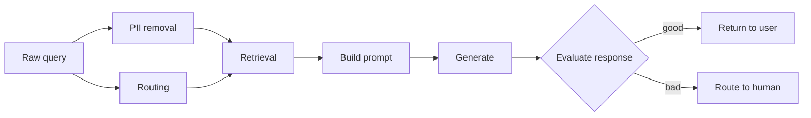

# Observability, orchestration and user feedback

> **Before this lesson:** read [Building up an AI application architecture](#/lesson/ai-eng/aie-architecture), which builds the system (context, guardrails, router, gateway, caches, agent patterns) that this lesson watches and improves. Evaluation pipelines and AI judges come from [Designing your evaluation pipeline](#/lesson/ai-eng/aie-eval-pipeline) and [AI as a judge and comparative evaluation](#/lesson/ai-eng/aie-judge-comparative); preference data from [Post-training: SFT and preference finetuning](#/lesson/ai-eng/aie-post-training); the data flywheel from [Data curation: quality, coverage, quantity](#/lesson/ai-eng/aie-data-curation); and TTFT and TPOT from [Inference bottlenecks, metrics and hardware](#/lesson/ai-eng/aie-inference-metrics). The demos use basic Python and a little NumPy, explained line by line.

## In plain words

Once an AI application has retrieval, guardrails, routers, a gateway, caches and agent loops, three new questions arise. **How do you know what the system is doing right now?** **How do all the pieces get wired together?** **How does the system get better over time?** Huyen's three answers are the three parts of this lesson:

1. **Monitoring and observability**: measuring and recording what happens inside the system, so that you notice problems quickly and can work out their causes.
2. **AI pipeline orchestration**: the code or tool that connects models, databases and tools into one end-to-end flow.
3. **User feedback**: signals from users, explicit (a thumbs-down) and implicit (the user rewrites the question), that tell you how well the system serves them. Feedback is also data that nobody else has, which makes it a competitive advantage.

An everyday picture: running a busy hospital ward. Monitors beside each bed track heart rate and oxygen and raise an alarm when something drifts (monitoring). Detailed charts record every medicine given, when and by whom, so a doctor can reconstruct what went wrong without guessing (logs and traces). A care plan coordinates which specialist sees the patient when, and what information passes between them (orchestration). And patients' comments, from formal surveys to a frown when the food arrives, tell the staff what to improve (feedback). A ward with no monitors and no charts might run fine for a while, but when something goes wrong, nobody can tell what happened.

Why this matters for a job: shipping a model is the beginning, not the end. AI engineers spend much of their time on production systems: answering "why did quality drop last Tuesday?", adding logging, building dashboards and designing feedback buttons. Interviewers ask "How would you monitor an LLM application?" and "How would you build a feedback loop?" This lesson gives you structured answers.

## 1. Monitoring and observability

Observability should be designed into a product from the start, not bolted on later, and the more complex the product, the more it matters. The purpose of monitoring is the same as the purpose of evaluation: to **reduce risks and discover opportunities**. The risks include application failures, security attacks and **drift** (gradual change in the system or its users, covered below). The opportunities include ways to improve quality and save money.

Three metrics borrowed from **DevOps** (the discipline of running software reliably in production) measure how good your observability is:

- **MTTD (mean time to detection)**: when something goes wrong, how long, on average, until you notice?
- **MTTR (mean time to response)**: once you have noticed, how long until the problem is fixed?
- **CFR (change failure rate)**: the percentage of changes or **deployments** (releases of new versions) that cause failures needing a fix or a **rollback** (returning to the previous version). If you do not know your CFR, your platform is not observable enough.

A high CFR points at your **evaluation pipeline**: bad changes should be caught before they are deployed, not after. Evaluation and monitoring must work hand in hand. The metrics you use in evaluation should carry over into monitoring, and problems discovered in monitoring should feed back into evaluation as new test cases.

> [!NOTE]
> **Monitoring versus observability.** Monitoring tracks a system's external outputs to tell you *when* something is wrong; nothing guarantees those outputs explain *what* is wrong. Observability is a stronger promise: the system is **instrumented** (fitted with code that records what it is doing) thoroughly enough that you can infer its internal state from what it records, so you can find the cause **without shipping new code** to investigate. Huyen uses "monitoring" for the act of tracking information and "observability" for the whole process of instrumenting, tracking and debugging.

### Metrics

A **metric** is a number tracked over time, such as "share of responses that are valid JSON". Metrics are not the goal in themselves; their job is to tell you when something is wrong and where to improve. So **design metrics around the failure modes you want to catch.** Useful families:

- **Format failures** are the easiest to track. How often is the output invalid JSON? Of those, how many are easy to repair automatically (a missing closing bracket) and how many are not (required keys missing)?
- **Generation quality**: factual consistency, relevance, conciseness and similar properties, often scored by AI judges.
- **Safety**: toxicity, PII (personally identifiable information) appearing in inputs or outputs, how often guardrails fire, how often the system refuses, and unusual queries, which may be legitimate edge cases or prompt attacks.
- **Conversational signals**: how often users stop a response halfway, the average number of **turns** (back-and-forth exchanges) per conversation, the average tokens per input and per output, and how the distribution of output lengths changes over time.
- **Component metrics**: for retrieval, context relevance and precision; for a vector database, storage size and query time.
- **Latency**: TTFT, TPOT and total latency, tracked per user so you can see how the system copes as usage grows.
- **Cost**: number of queries, input and output token volumes, requests per second compared with your provider's rate limits, and the cost and hit rate of any caches.

Measure how these metrics move together, and how they relate to your **north-star metrics**: the few business numbers that matter most, such as **DAU** (daily active users), session length or subscriptions. A metric that rises and falls with a north-star metric suggests something worth improving; a metric with no relationship to them suggests something not worth optimizing.

You must also choose between **spot checks** (examining a sample of requests) and **exhaustive checks** (examining every request). Most teams use a mix, with cheap checks on everything and expensive ones, such as AI judges, on a sample. Make every metric **sliceable**, that is, breakable down by user, release, prompt or chain version, prompt type and time, so that when a number moves you can see where.

### Logs and traces

Metrics are **aggregates**: summaries of many events. **Logs** are the raw events themselves, an **append-only** record (new entries are added, old ones never changed) of what happened. A typical debugging session:

1. Metrics show that something went wrong five minutes ago.
2. You read the logs from around that time to see what happened.
3. You match the errors in the logs against the metrics to confirm you have found the right problem.

For fast detection (low MTTD), metrics must be computed quickly. For fast response (low MTTR), logs must be available quickly: if logs arrive 15 minutes late, you cannot investigate a problem from 5 minutes ago.

**Log everything**, because you cannot know in advance what you will need. That includes the configuration (model endpoint, model name, sampling settings such as temperature, top-p, top-k and stop conditions, and the prompt template), the user's query, the **final prompt** actually sent to the model after all templating and retrieval, the output, intermediate outputs, every tool call and its result, and when each component starts, finishes or crashes. Tag each record with IDs showing which request and component it came from. Logs grow fast, so use automated analysis and **anomaly detection** (flagging records that look unusual). And still **read production data by hand**, ideally every day. Shankar and colleagues (2024) found that developers' sense of what counts as a good or bad output shifts as they look at more real data, which leads them to rewrite prompts and update their evaluation pipelines.

A **trace** is the linked record of one request's journey through the system: from the user's query through every action (routing, retrieval, model call, tool use, guardrail check) to the final response, with the **time and cost of each step**. Each step in a trace is often called a **span**. Ideally you can follow how a query was transformed at each step and see exactly where it went wrong.

```python-run
import time, json, uuid
# A tiny tracer: one trace per request, one span per step with duration and cost.
class Trace:
    def __init__(self, query): self.id, self.query, self.spans = uuid.uuid4().hex[:8], query, []
    def span(self, name, fn, cost=0.0, **meta):
        t = time.perf_counter(); out = fn()
        self.spans.append({"step": name, "ms": round((time.perf_counter() - t) * 1000, 2), "cost_usd": cost, **meta})
        return out
tr = Trace("When does my order arrive?")
intent = tr.span("router", lambda: "order_status", model="intent-small")
ctx = tr.span("retrieval", lambda: ["order 123: ships Friday"], k=1)
prompt = tr.span("prompt_build", lambda: f"Context: {ctx}\nQ: {tr.query}", template="support_v7")
answer = tr.span("generation", lambda: "Your order ships Friday.", cost=0.0004, model="big", temperature=0.2, input_tokens=24, output_tokens=6)
ok = tr.span("output_guardrail", lambda: "Friday" in ctx[0], check="consistency")
print(json.dumps({"trace_id": tr.id, "query": tr.query, "spans": tr.spans}, indent=1))
print("total cost:", sum(s["cost_usd"] for s in tr.spans))
```

**Reading this Python line by line**

- `class Trace` defines a trace object. `__init__` gives it a short random ID (`uuid.uuid4().hex[:8]` takes the first 8 characters of a random unique identifier), stores the query, and starts an empty list of spans.
- `span` runs one step. It takes the step's name, a function `fn` that does the work, an optional cost, and any extra details as keyword arguments (`**meta` collects them into a dictionary). It times the call with `time.perf_counter()`, appends a record with the duration in milliseconds, the cost and the details, and returns the step's result so the pipeline can continue.
- The next five lines simulate a support pipeline. Each `lambda` is a stand-in for real work: the router returns an intent, retrieval returns one document, the prompt builder combines context and query, generation returns an answer with its cost and token counts, and the guardrail checks the answer is supported by the retrieved context.
- `json.dumps(..., indent=1)` prints the whole trace as indented JSON, the format most logging systems store.
- The last line adds up the cost over all spans.
- Output: a JSON record with a random trace ID, the query, and five spans showing each step's name, duration (near 0 ms here, since the stand-ins do no real work), cost and details such as `"model": "big"` and `"template": "support_v7"`, followed by `total cost: 0.0004`. In a real system, if a user complained about this answer, you would look up its trace and see exactly which document was retrieved, which prompt template was used and what the model said.

### Drift detection

**Drift** is gradual, often silent, change. The more components a system has, the more things can drift:

- **System prompt changes.** Someone edits the prompt template, fixes a typo, or a colleague updates it without telling you. Simple logic, such as comparing a hash of the prompt with the last known version, catches this.
- **User behaviour changes.** Users adapt to the technology. They learn which phrasings get better answers, or start writing shorter prompts, which slowly shifts response lengths. If you only watch metrics, you may see the shift but not its cause; investigation is needed.
- **Underlying model changes.** When you use a model through an API, the provider may change the model behind the API without changing the API itself, and does not always announce it. Chen and colleagues (2023) and the company Voiceflow documented significant performance shifts between versions of GPT-4 and GPT-3.5. Track quality on a fixed evaluation set over time to catch such changes.

The demo detects a silent change in output lengths using the **population stability index (PSI)**, a standard drift score. PSI splits the baseline data into buckets, compares the share of the old and new data falling in each bucket, and sums up the differences. Zero means no change; larger means more change.

```python-run
import numpy as np
rng = np.random.default_rng(0)
# Detect a silent change by comparing this week's output-length distribution to a baseline.
baseline = rng.normal(180, 40, 2000)       # output tokens per response last month
this_week = rng.normal(230, 40, 500)       # after an unannounced model update
def psi(a, b, bins=10):                    # population stability index
    edges = np.quantile(a, np.linspace(0, 1, bins + 1)); edges[0], edges[-1] = -np.inf, np.inf
    pa = np.histogram(a, edges)[0] / len(a) + 1e-6; pb = np.histogram(b, edges)[0] / len(b) + 1e-6
    return float(np.sum((pb - pa) * np.log(pb / pa)))
print(f"mean length {baseline.mean():.0f} -> {this_week.mean():.0f} tokens, PSI = {psi(baseline, this_week):.2f} (above 0.25 is usually treated as a significant shift)")
```

**Reading this Python line by line**

- `baseline` simulates 2,000 response lengths from last month, averaging 180 tokens with a spread of 40. `this_week` simulates 500 lengths after an unannounced model update, averaging 230.
- In `psi`, `np.linspace(0, 1, bins + 1)` gives 11 evenly spaced fractions from 0 to 1, and `np.quantile` turns them into bucket edges so each of the 10 buckets holds a tenth of the baseline. The outer edges are set to minus and plus infinity so no value falls outside.
- `np.histogram(a, edges)[0]` counts how many values land in each bucket; dividing by the total gives the share per bucket. Adding `1e-6` (one millionth) avoids dividing by zero or taking the log of zero for empty buckets.
- The PSI formula sums, over buckets, (new share minus old share) times the log of (new share over old share). Each term is positive whenever the shares differ, so the total grows with the size of the shift.
- Output: mean length 179 → 229 tokens and a PSI of about 1.51, far above the common 0.25 alarm level. A real system would compute this daily and alert someone, who would then check whether the provider changed the model.

## 2. AI pipeline orchestration

An **orchestrator** specifies how the models, databases and tools in an application work together in an end-to-end **pipeline** (a chain of processing steps), and makes sure data flows correctly between them. Working with one involves two steps:

1. **Defining components.** Tell the orchestrator which models, retrieval sources and tools the system uses, plus any evaluation and monitoring tools. A model gateway (previous lesson) makes adding models easier.
2. **Chaining.** Describe the sequence of steps from receiving a query to completing the task, which is essentially **function composition** (feeding each step's output into the next). For example: process the raw query, retrieve relevant data, combine query and data into a prompt, generate a response, evaluate the response, then return it if it is good or route it to a human if it is not.

The orchestrator passes data between steps, helps check that each step's output matches what the next step expects, and should alert you when the flow breaks, whether from a component failure or a data mismatch.

> [!WARNING]
> An AI pipeline orchestrator is **not** the same as a general-purpose workflow orchestrator such as Airflow or Metaflow, which schedule batch data jobs. The names overlap; the jobs do not.

For latency-sensitive applications, **run steps in parallel whenever you can**. Routing and PII removal, for example, do not depend on each other and can run at the same time.



Orchestration tools include LangChain, LlamaIndex, Flowise, Langflow and Haystack, and many RAG and agent frameworks double as orchestrators. Huyen's advice is to **start without one**. Every external tool adds complexity, and an orchestrator can hide the details of how your system works, making it harder to understand and debug. Adopt one later, if it genuinely makes life easier. When you evaluate one, consider:

- **Integration and extensibility.** Does it support the components you use now and may use later? If it lacks something, is it easy to extend?
- **Support for complex pipelines**: branching, parallel steps and error handling.
- **Ease of use, performance and scalability.** Look for intuitive APIs, good documentation and an active community. Check that it makes no **hidden API calls** (extra model calls you did not ask for, which add cost) and adds no latency, and that it scales with your applications and traffic.

## 3. User feedback

User feedback has always had two jobs in software: **evaluating** the application and **guiding its development**. In AI applications it has a third: feedback is **proprietary data**, data that only you have, and data is a competitive advantage. It powers the **data flywheel**: a product that launches early and attracts users collects data that improves its models, which attracts more users, making it ever harder for competitors to catch up. Feedback is also *user data*, so respect privacy: users have a right to know how their data is used.

### Extracting conversational feedback

Feedback comes in two kinds.

- **Explicit feedback** is what users give when asked: thumbs up or down, star ratings, a yes or no to "Did we solve your problem?". It is standard and easy to interpret, but **sparse** (few people bother) and biased toward the kind of people who do respond.
- **Implicit feedback** is inferred from what users do. It varies by application, and it is abundant but **noisy** (it can mean several things).

Conversational interfaces make feedback easy for users to give and hard for you to extract, because it is buried in ordinary language. Suppose a travel assistant suggests three hotels. A reply of "Yes, book me the one close to the galleries" reveals an interest in art. "Is there nothing under \$200?" reveals price sensitivity, and also tells you the assistant has not yet understood what the user wants.

You can use feedback for **evaluation** (turning it into monitoring metrics), **development** (training future models or guiding improvements) and **personalization** (adapting the product to each user).

**Natural-language feedback**: signals in what users write.

- **Early termination.** The user stops a response midway, closes the app, tells the model to stop, or quietly leaves. The conversation is probably going badly.
- **Error correction.** Follow-ups starting with "No, …" or "I meant, …" suggest the model missed. Users may **rephrase** the request (detectable with heuristics or a model), point out specific errors ("Bill is the suspect, not the victim"), ask the model to double-check ("Are you sure?", "Check again", "Show me the sources"), or **edit the model's output directly**. A user's edit is a strong signal and gives you free **preference data**: the original response is the losing example and the edited version the winning one, exactly the format preference finetuning needs.
- **Complaints.** Users complain without correcting: the answer is wrong, irrelevant, toxic, too long, or lacking detail. In the FITS dataset analysis that Huyen cites, the most common complaints were that the bot did not answer the question, was not specific enough, or got facts wrong.
- **Sentiment.** Frustration ("Uggh"), disappointment, or, less often, satisfaction. Call centres track whether callers' voices get louder during a call; similarly, how sentiment changes over a conversation is informative. The model's own **refusal rate** ("Sorry, I can't…", "As a language model…") is another signal worth tracking.

**Other conversational feedback**: signals in what users do.

- **Regeneration.** Asking for a new response may mean the first was unsatisfying, or the user may only want options, which is common for creative writing and images. Regeneration is a stronger signal when users pay per use than under a flat subscription, since it costs them something. Some apps ask users to compare the new response with the old one, which yields comparative feedback.
- **Conversation organization.** Deleting, renaming, sharing and bookmarking conversations. Deleting is a strong negative signal, unless the user deleted it out of embarrassment or for privacy. Renaming suggests the conversation was good but the automatic title was poor.
- **Conversation length.** Its meaning depends on the product. For an AI companion, long conversations mean the user is engaged. For a customer-support bot, long conversations mean the bot is struggling to solve the problem.
- **Dialogue diversity.** Measured by the number of distinct tokens or topics. A long conversation in which the bot keeps repeating itself means the user is stuck in a loop.

Explicit feedback is easier to interpret but scarce; implicit feedback is plentiful but ambiguous. Use both, and study your own users to learn what the signals mean in your product.

```python-run
import re
# Heuristic extraction of implicit signals from conversations (a classifier would do this in production).
def signals(turns):
    s = set()
    user = [t for r, t in turns if r == "user"]
    for t in user[1:]:
        low = t.lower()
        if re.match(r"(no[,.!]|i meant|that's not)", low): s.add("error_correction")
        if re.search(r"are you sure|check again|show me the sources", low): s.add("asks_to_verify")
        if re.search(r"ugh|useless|this is wrong|terrible", low): s.add("negative_sentiment")
    if len(user) > 1 and len(set(re.findall(r"\w+", user[0].lower())) & set(re.findall(r"\w+", user[-1].lower()))) >= 3: s.add("rephrase")
    bot = [t for r, t in turns if r == "assistant"]
    if len(bot) != len(set(bot)): s.add("bot_repeating (low dialogue diversity)")
    return sorted(s)
convo = [("user", "Find me a hotel in Sydney under 200 dollars"), ("assistant", "Here is the Historic Rocks Hotel at 400 per night."),
         ("user", "No, I meant under 200 dollars"), ("assistant", "Here is the Historic Rocks Hotel at 400 per night."),
         ("user", "Ugh, this is wrong. Find me a hotel in Sydney under 200 dollars")]
print(signals(convo))
```

**Reading this Python line by line**

- A conversation is a list of (role, text) pairs. `user = [t for r, t in turns if r == "user"]` collects the user's messages in order.
- The loop looks at every user message after the first (`user[1:]`), lowercased. `re.match` checks whether the message *starts* with "no" followed by punctuation, "i meant" or "that's not", which signals an error correction. `re.search` looks anywhere in the message for verification requests and for negative words.
- The `rephrase` check compares the sets of words in the first and last user messages; `&` takes the words they share. Three or more shared words suggest the user is asking the same thing again.
- `bot` collects the assistant's messages. If there are fewer distinct messages than messages (`len(bot) != len(set(bot))`), the bot repeated itself.
- `sorted(s)` returns the detected signals in alphabetical order.
- Output: `['bot_repeating (low dialogue diversity)', 'error_correction', 'negative_sentiment', 'rephrase']`. This short conversation is clearly failing: the bot ignored the price limit twice. Keyword rules like these miss a lot and misfire sometimes (a message starting "No problem, thanks!" would count as a correction), which is why production systems use trained classifiers, but the signals they look for are the same.

### Feedback design

**When to collect feedback.** Throughout the user's journey, without getting in the way.

- **At the start (calibration).** Face ID scans your face, a voice assistant learns your voice, a language-learning app tests your level. Make this optional unless it is truly necessary, because it adds friction before the user gets any value.
- **When something goes wrong.** Let users downvote, regenerate, switch models, or say "You're wrong". Ideally they can still finish their task: let them **edit** the output or **collaborate** with the AI. **Inpainting**, where a user selects part of an image for the AI to redo, is an example of collaboration that also yields high-quality feedback. If all else fails, hand off to a human.
- **When the model is unsure.** Ask the user. Showing a short and a long summary side by side gives **comparative feedback**. Google Photos asks "Is this the same person?" when a face match is uncertain. Showing two **full** long responses to compare often produces poor feedback, because few users read both; partial responses or short options work better.

Positive feedback is worth collecting too, because it reveals which features delight users. Some product people argue it is unnecessary, since good results are what users expect by default. Asking only in specific situations, and only a small share of users (around 1%), limits the disruption, though sampling can introduce bias.

**How to collect feedback.** It should fit into the user's workflow, be easy to give, and be easy to ignore.

- **Midjourney**: for each prompt, the user can upscale one image (U), generate variations of one (V), or regenerate all of them. Each choice is a strong signal about which image was best, gathered as a side effect of normal use.
- **GitHub Copilot**: code suggestions appear in faint text. Pressing Tab accepts; continuing to type ignores. Feedback costs the user almost nothing.
- Standalone chat apps such as ChatGPT and Claude are less woven into daily workflows than a tool like Copilot, so they may collect less natural feedback.
- **Context matters.** A thumbs-down without the conversation that preceded it is hard to act on. Ask users' consent to attach recent interaction data and explain clearly how it will be used. Some products ask users to donate their last few conversations along with their feedback.
- **Explain how feedback is used**: personalization, aggregate statistics or training? If users fear their feedback is not private, they will not give it. Tell users when their feedback has changed their experience.
- **Avoid ambiguous design.** Huyen shows icon-only emotion buttons that users misread. A choice between a "shorter" and a "longer" version only helps if you can tell why the user picked one.

### Feedback limitations

Feedback is valuable but flawed. Know its biases before you train on it.

- **Leniency bias.** People rate more kindly than deserved, to be nice or to avoid follow-up questions. In 2015, Uber's average driver rating was 4.8 out of 5, and drivers below 4.6 risked being removed from the platform. Replacing numbers with descriptive options ("Great ride", "Could've been better", "Don't match me with this driver again") yields more useful signals.
- **Randomness.** Some users click at random, for instance because they cannot be bothered to read two long responses.
- **Position bias.** Users click the first option more often, regardless of quality. Randomize the order or correct for the bias statistically.
- **Preference bias.** In side-by-side comparisons, people tend to prefer longer responses even when they are less accurate, because length is easier to notice than errors. There is also **recency bias**: favouring whichever answer was seen last.

**Degenerate feedback loops.** You only get feedback on what you show. When a model's outputs shape the feedback it receives, and that feedback trains the next model, any initial bias is amplified. In a video recommender, items ranked high get more clicks and are then ranked even higher. This is called **exposure bias**, **popularity bias** or the **filter bubble**. A model that learns users like cat photos shows more cats, gets more cat clicks, and eventually the product shows nothing but cats. For assistants, the same loop can teach **sycophancy**: Sharma and colleagues (2023) and Stray (2023) describe models learning to tell users what they want to hear rather than what is accurate or genuinely helpful.

So understand the limits of feedback before training on it, inspect it for biases, and think about how optimizing for it will change your product over time.

> [!INTERVIEW]
> **"How would you monitor an LLM application in production?"** Define metrics from failure modes: format validity, quality scores from AI judges on a sample, safety (toxicity, PII, guardrail and refusal rates), conversational signals (early stops, turns, regenerations), latency (TTFT, TPOT, p50 and p99) and cost (tokens, cache hit rate). Make them sliceable by release, prompt version and user segment, and correlate them with north-star metrics. Log full configurations, final prompts, tool calls and outputs with trace IDs, and read samples daily. Detect drift in prompts, user behaviour and provider models, for example by running a fixed evaluation set on a schedule. Judge the setup by MTTD, MTTR and CFR, and feed incidents back into the evaluation pipeline.

> [!INTERVIEW]
> **"How would you build a feedback loop for an AI writing assistant?"** Instrument implicit signals in the workflow (accept, edit, regenerate, copy, early stop) plus light explicit signals (thumbs, optional comment). Log context with consent and say how it will be used. Derive monitoring metrics (acceptance rate, edit distance between suggestion and final text, regeneration rate) and correlate them with north-star metrics. Turn user edits into preference data (original = losing, edited = winning) for evaluation sets and later finetuning. Guard against bias: randomize positions, watch for leniency and length preference, and avoid degenerate loops and sycophancy by not optimizing engagement alone. Feed production failures back into the evaluation pipeline.

## Pitfalls

- Adding observability after launch, when the first incident has already happened.
- Tracking metrics that are easy to compute rather than ones tied to real failure modes.
- Logging the user's query but not the final prompt actually sent to the model.
- Logs that arrive too late to debug a live problem.
- Assuming an API model never changes because the API name did not.
- Adopting a heavy orchestrator before understanding your own pipeline.
- Training on feedback without checking it for leniency, position and length biases, or optimizing engagement until the model turns sycophantic.

## Summary

- **Observability**: judge it by MTTD, MTTR and CFR. Design **metrics** around failure modes, make them sliceable and relate them to north-star metrics. **Log everything**, keep a **trace** per request, read production data by hand, and detect **drift** in prompts, user behaviour and underlying models.
- **Orchestration**: define components, then chain them. Run independent steps in parallel. Start without an orchestrator; when choosing one, check integration, support for complex pipelines, ease of use, performance and hidden API calls.
- **User feedback** serves evaluation, development and personalization, and builds a proprietary data advantage (the data flywheel). Collect **explicit** and **implicit** signals: early termination, error correction, complaints, sentiment, regeneration, conversation organization, length and diversity.
- **Design** feedback to be seamless and contextual, and respect privacy. Collect it at the start, when things go wrong and when the model is unsure.
- **Limits**: leniency, randomness, position and preference biases, and degenerate feedback loops that amplify bias and can train sycophancy.

## Glossary

- **Monitoring / observability**: tracking outputs to see when something is wrong / instrumenting a system so you can also work out why.
- **Instrumentation**: code added to record what a system is doing.
- **DevOps**: the practice of building and running software reliably in production.
- **MTTD / MTTR / CFR**: mean time to detection / mean time to response / change failure rate.
- **Deployment / rollback**: releasing a new version / returning to the previous one.
- **Metric**: a number tracked over time.
- **North-star metric**: a top business number, such as daily active users (DAU).
- **Spot check / exhaustive check**: examining a sample / examining everything.
- **Sliceable**: breakable down by segment, version or time.
- **Log**: an append-only record of individual events.
- **Final prompt**: the exact text sent to the model after templating and retrieval.
- **Anomaly detection**: automatically flagging unusual records.
- **Trace / span**: the linked record of one request's path / one step within it.
- **Drift**: gradual change in prompts, users or models.
- **PSI (population stability index)**: a score measuring how much a distribution has shifted.
- **Orchestrator**: a tool that wires models, data sources and tools into a pipeline.
- **Pipeline / chaining**: a sequence of processing steps / connecting them so each feeds the next.
- **Hidden API calls**: extra model calls a tool makes without you asking.
- **Proprietary data**: data only your organization has.
- **Data flywheel**: users generate data that improves the product, attracting more users.
- **Explicit / implicit feedback**: ratings users give when asked / signals inferred from their behaviour.
- **Early termination**: a user stopping a response or leaving mid-conversation.
- **Preference data**: pairs of a better and a worse response to the same prompt.
- **Regeneration**: asking the model for a new response.
- **Dialogue diversity**: how varied a conversation's content is.
- **Calibration**: collecting information about a user at the start to personalize the product.
- **Inpainting**: having the AI redo a selected part of an image.
- **Comparative feedback**: a user choosing between two or more options.
- **Leniency / position / preference / recency bias**: rating too kindly / favouring the first option / favouring longer answers / favouring the last one seen.
- **Degenerate feedback loop**: outputs shaping the feedback that trains the next model, amplifying bias.
- **Exposure (popularity) bias / filter bubble**: shown items get more feedback and are shown even more.
- **Sycophancy**: a model telling users what they want to hear rather than what is accurate.

```quiz
[
  {"q": "Which three metrics does Huyen use to judge the quality of a system's observability?", "options": ["TTFT, TPOT, TPS", "MTTD, MTTR, CFR", "BLEU, ROUGE, F1", "MFU, MBU, QPS"], "answer": 1, "explain": "Mean time to detection, mean time to response, and change failure rate."},
  {"q": "A high change failure rate (CFR) most directly suggests you should…", "options": ["Buy more GPUs", "Strengthen the evaluation pipeline so bad changes are caught before deployment", "Disable logging", "Raise temperature"], "answer": 1, "explain": "Evaluation and monitoring must work together. Pre-deployment evaluation should catch regressions."},
  {"q": "What is a trace?", "options": ["An aggregate metric", "The linked record of a request's whole path through the system, with time and cost per step", "A type of guardrail", "A cache key"], "answer": 1, "explain": "Traces let you follow a query step by step and locate the failing component."},
  {"q": "Which is NOT one of the drift sources discussed?", "options": ["System prompt changes", "User behaviour changes", "Underlying model changes behind an API", "Changes in GPU fan speed"], "answer": 3, "explain": "Prompts, users and underlying models are the drift sources. Providers may update models without notice."},
  {"q": "Huyen's advice about orchestration tools is to…", "options": ["Adopt the most complex one on day one", "Start building without one, and adopt later if it helps", "Use Airflow as an AI orchestrator", "Avoid them forever"], "answer": 1, "explain": "Orchestrators add complexity and can hide critical details. Understand your pipeline first."},
  {"q": "A user edits the assistant's generated text before using it. Why is this especially valuable?", "options": ["It reduces token cost", "It is a strong signal and yields preference data: original = losing response, edited = winning response", "It proves the model is perfect", "It disables caching"], "answer": 1, "explain": "User edits are free preference-finetuning examples."},
  {"q": "For a customer-support bot, a very long conversation usually indicates…", "options": ["High engagement, which is always good", "Inefficiency: the bot is struggling to resolve the issue", "Low latency", "A cache hit"], "answer": 1, "explain": "Interpretation depends on the product. Long is good for companions and bad for support."},
  {"q": "A degenerate feedback loop is when…", "options": ["Users stop giving feedback", "Predictions influence the feedback used to train the next model, amplifying initial biases", "The cache evicts entries", "Logs are delayed"], "answer": 1, "explain": "You only get feedback on what you show. This leads to popularity bias and can even train sycophancy."}
]
```

> **Source:** Huyen, *AI Engineering*, ch. 10 ("Monitoring and Observability", "AI Pipeline Orchestration", "User Feedback": extracting conversational feedback, feedback design, feedback limitations).
