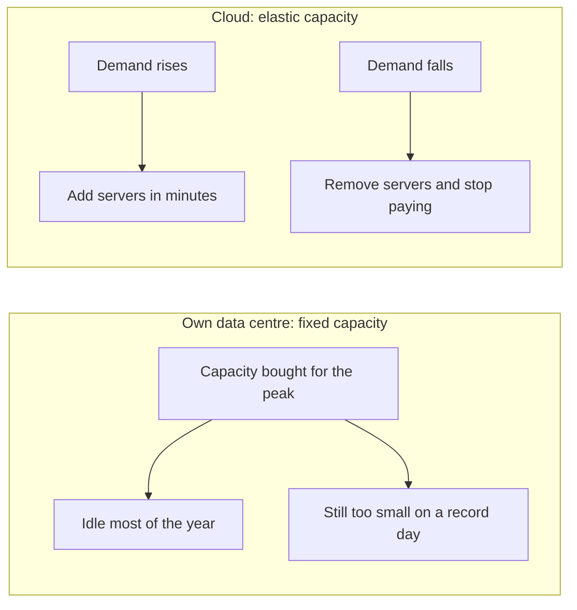
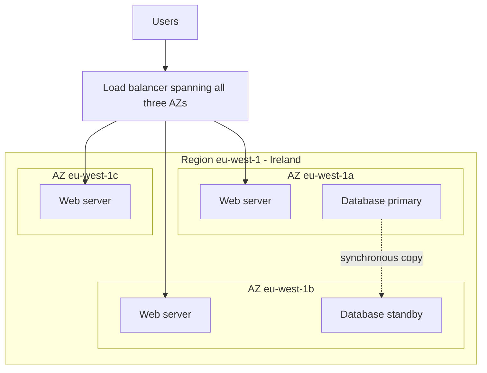

# What cloud computing is, and the AWS global map

## Before this lesson

You need no cloud experience at all. It helps to know what a web server and a database are in the loosest sense: a **server** is a computer that waits for requests from other computers and answers them, and a **database** is a program that stores data so it can be found again. If the words "IP address" or "DNS" are new, the [networking track](#/lesson/networking/layers-encapsulation) explains them, but you can read this lesson without it.

## In plain words

**Cloud computing** means renting computers, storage and ready-made software services from a company that runs enormous buildings full of machines, and paying only for what you use, by the second or by the gigabyte. You reach those machines over the internet. You never see or touch them.

An everyday analogy: electricity. A century ago a factory that wanted power built its own generator, hired people to run it, and bought one big enough for the busiest day of the year. Today the factory plugs into the grid and pays a meter. It does not care which power station produced the current. The cloud did the same thing to computers. **Amazon Web Services (AWS)** is the largest such "grid" for computing.

Why it matters for a job: most companies founded in the last fifteen years have never owned a server. Backend, data, machine-learning and DevOps roles all assume that you can read an architecture diagram full of AWS names, launch and secure resources, and reason about what they will cost. This track builds that skill from nothing.

## Life before the cloud

Imagine a small company, *Tidewater Books*, that wants to sell books online in 2004. Before writing a line of code they must:

1. **Buy servers.** Physical machines, ordered from a vendor, delivered in four to eight weeks.
2. **Rent space in a data centre** — a building with power, cooling, fire suppression and fast network lines — or build a server room.
3. **Guess capacity.** How many visitors will come in December? Guess too low and the site falls over on the best sales day of the year. Guess too high and expensive machines sit idle for eleven months.
4. **Hire people** to replace failed disks, patch operating systems and watch the machines at night.

Money spent before earning anything, on equipment that loses value, is called **capital expenditure** (often shortened to *capex*). The cloud replaces most of it with **operational expenditure** (*opex*): a monthly bill that grows and shrinks with usage.

## The five characteristics of a cloud

A widely used definition (from the United States National Institute of Standards and Technology, NIST) lists five properties. A service is "cloud" when it has all of them.

| Characteristic | Plain meaning | Tidewater Books example |
|---|---|---|
| On-demand self-service | You get resources by clicking or calling an API, without talking to a salesperson | A developer starts a server at 02:00 on a Sunday |
| Broad network access | Everything is reachable over standard networks | The same service is used from a laptop, a phone and another server |
| Resource pooling | The provider's hardware is shared between many customers, kept apart by software | Your virtual server shares a physical machine with strangers, safely |
| Rapid elasticity | Capacity can grow and shrink quickly, often automatically | Ten servers in December, two in February |
| Measured service | Usage is metered and you pay for what you used | 31 hours of a server, 12 GB stored, 2 million requests |

An **API** (application programming interface) is a set of operations that a program can call. Every single thing in AWS — starting a server, creating a database, changing a firewall rule — is an API call. The website you click through is a friendly face on top of those calls. This fact comes back in the next lesson and explains why AWS can be automated so thoroughly.

**Elasticity** deserves a second look because it is the idea interviewers probe most. It is the ability to match capacity to demand *in both directions*. Growing is called **scaling out** (more machines) or **scaling up** (a bigger machine); shrinking is **scaling in** or **scaling down**. A system that can only grow is scalable but not elastic, and it wastes money every night.



## Six advantages AWS likes to quote

AWS summarises the business case in six points. They are worth knowing because they are examined directly, and because each one is an argument you may have to make to a manager.

1. **Trade fixed expense for variable expense.** Pay when you consume instead of before.
2. **Benefit from massive economies of scale.** A provider buying hardware by the hundred thousand pays less per unit than you could, and passes part of that on.
3. **Stop guessing capacity.** Start small, measure, adjust.
4. **Increase speed and agility.** A new environment takes minutes, so experiments become cheap.
5. **Stop spending money running and maintaining data centres.** Your engineers work on your product.
6. **Go global in minutes.** Deploy near your users on another continent without opening an office there.

> [!WARNING]
> "Pay only for what you use" has a second half that marketing leaves out: **you pay for what you forget to turn off**. A server left running, a database nobody uses, a load balancer from last year's demo — all keep charging. The third lesson of this module sets up budgets and alerts before you create anything.

## Service models: how much do you manage?

Cloud services are grouped by where the line falls between the provider's work and yours.

- **Infrastructure as a Service (IaaS)**: you rent raw building blocks — virtual servers, disks, networks — and manage the operating system and everything above it. On AWS: **EC2** (Elastic Compute Cloud, virtual servers).
- **Platform as a Service (PaaS)**: you hand over your code or your data and the provider runs the servers, operating system and runtime. On AWS: **Elastic Beanstalk** (web applications), **RDS** (Relational Database Service, managed databases), **Lambda** (run a function without any server to manage).
- **Software as a Service (SaaS)**: a finished application used through a browser. Web mail is the classic example. On AWS: **Amazon WorkMail**, **Amazon QuickSight**.

Think of pizza. Making it at home from flour is running your own data centre. Buying a frozen pizza and using your own oven is IaaS. Delivery is PaaS: you bring the table and the drinks. Eating at a restaurant is SaaS.

| You manage… | On-premises | IaaS | PaaS | SaaS |
|---|---|---|---|---|
| Application code and data | you | you | you | provider (you own the data) |
| Runtime, middleware | you | you | provider | provider |
| Operating system | you | you | provider | provider |
| Virtualisation, servers, storage, network | you | provider | provider | provider |
| Building, power, cooling | you | provider | provider | provider |

*On-premises* (often "on-prem") means "in buildings the company runs itself".

### Deployment models

- **Public cloud** (sometimes "all-in cloud"): everything runs at the provider.
- **Hybrid**: some systems stay on-premises and are connected to the cloud by a private link. Common in banks, hospitals and any company with twenty years of existing systems.
- **Private cloud**: cloud-style self-service software running on hardware the company owns.

## Virtualisation: how one machine becomes many

A physical server in an AWS building might have 96 processor cores and 768 GB of memory. Few customers need all of that. A program called a **hypervisor** slices the physical machine into isolated **virtual machines** (VMs), each of which behaves like a complete computer with its own operating system. AWS calls a virtual machine an **instance**. The hypervisor guarantees that one customer's instance cannot read another's memory or disk.

This is the mechanism behind *resource pooling* and it is why you can rent a two-core server for a fraction of a cent per second: you are renting a slice.

## The AWS global infrastructure

AWS is not one data centre. It is organised in three nested levels, and nearly every architecture decision you will make refers to them.

### Regions

A **Region** is a geographic area that contains a complete, independent copy of AWS: for example `eu-west-1` (Ireland), `us-east-1` (Northern Virginia), `ap-southeast-2` (Sydney). At the time of writing there are well over thirty Regions; AWS adds a few each year, so check the official list rather than memorising a number.

Key facts:

- **Regions are isolated from each other.** A failure in Ireland does not spread to Frankfurt. Most resources you create exist in exactly one Region and are invisible from the others.
- **Data does not leave a Region unless you move it.** This is what lets a French hospital promise that patient records stay in the European Union.
- **Prices and available services differ by Region.** `us-east-1` is usually the cheapest and receives new services first.

How to choose a Region, in order of priority:

1. **Legal and compliance** requirements about where data may live.
2. **Latency**: the delay between a user's request and the response. Pick a Region near your users.
3. **Service availability**: confirm that the services you need exist there.
4. **Cost**: compare prices only after the first three are satisfied.

### Availability Zones

Inside each Region there are several **Availability Zones (AZs)** — at least three in almost every Region. An AZ is one or more data centres with their own power supply, cooling and network connections, placed kilometres away from the other AZs of the Region so that a fire, flood or power cut affects one zone only, yet close enough (roughly under 100 km) that the private fibre between them has a delay of one or two milliseconds.

AZ names add a letter to the Region code: `eu-west-1a`, `eu-west-1b`, `eu-west-1c`.

> [!NOTE]
> The letter is shuffled per account. Your `eu-west-1a` may be a different physical zone from a colleague's `eu-west-1a` in another account; AWS does this to spread customers evenly. When two accounts must agree on a physical zone, use the **AZ ID** (for example `euw1-az2`), which is the same for everyone.

The single most important design rule on AWS follows from this structure:

> **Run at least two copies of anything important, in different Availability Zones.**

A system built this way is called **Multi-AZ** and it is **highly available**: it keeps working when one data centre is lost. You will meet this rule again for servers, databases, load balancers and NAT gateways.



### Edge locations

A third kind of site is far more numerous: **edge locations**, also called **points of presence**. There are several hundred, in cities that have no Region. They do not run your servers. They run a small set of services whose job is to be physically close to users:

- **Amazon CloudFront**, the content delivery network (CDN): it keeps copies of your images, videos and pages near users so that a visitor in Lagos does not wait for a round trip to Ireland.
- **Amazon Route 53**, the DNS service that turns names like `example.com` into addresses.
- **AWS Global Accelerator**, **AWS WAF** (web application firewall) and **AWS Shield** (protection against flooding attacks).

### Local Zones, Wavelength and Outposts

Three smaller ideas extend the map and appear in exam questions:

- **Local Zones** put compute and storage in a large city that has no Region, for workloads needing single-digit-millisecond latency to that city.
- **Wavelength Zones** place AWS hardware inside mobile operators' 5G networks.
- **AWS Outposts** are racks of AWS hardware installed in *your* building and managed by AWS — the hybrid option when data must physically stay on site.

### Where does a service live?

Services have different **scopes**. Getting this wrong is a classic beginner confusion ("I created a server yesterday and it has vanished" — it is in another Region).

| Scope | Meaning | Examples |
|---|---|---|
| Global | One instance for the whole account | IAM (users and permissions), Route 53, CloudFront, AWS Organizations |
| Regional | Exists in one Region, spread over its AZs for you | S3 buckets, DynamoDB tables, Lambda functions, SQS queues, VPCs |
| Zonal | Lives in one AZ; you add redundancy yourself | EC2 instances, EBS disks, subnets |

## Worked example: latency decides the Region

Tidewater Books has 70 % of its customers in France and Germany and 30 % in Canada. The little simulation below estimates the average delay for three candidate Regions, using typical round-trip times. Change the numbers and run it again.

```python-run
# Typical round-trip network delay in milliseconds from a user country to a Region.
latency_ms = {
    "eu-west-3 (Paris)":      {"FR": 8,  "DE": 18, "CA": 95},
    "eu-central-1 (Frankfurt)": {"FR": 14, "DE": 6,  "CA": 100},
    "ca-central-1 (Montreal)": {"FR": 90, "DE": 98, "CA": 12},
}
share = {"FR": 0.40, "DE": 0.30, "CA": 0.30}   # where the customers are

for region, by_country in latency_ms.items():
    avg = sum(by_country[c] * share[c] for c in share)   # weighted average
    worst = max(by_country.values())
    print(f"{region:28s} average {avg:5.1f} ms   worst {worst} ms")
```

Line by line: `latency_ms` is a dictionary of dictionaries holding one delay per Region and country; `share` holds each country's share of customers; the loop multiplies each delay by the share of users who experience it and adds the results, which is a **weighted average**; `max` finds the worst-served country.

Both European Regions average about 37 ms, while Montreal averages 69 ms. But every single-Region choice leaves somebody near 100 ms. That observation motivates two later topics: a CDN that serves static content from edge locations ([CloudFront](#/lesson/aws/cloudfront)), and, for larger companies, running in two Regions with latency-based DNS routing ([Route 53](#/lesson/aws/route53)).

## A first look at the service catalogue

AWS has more than two hundred services. Nobody knows them all. A solutions architect knows about thirty well, and the same thirty appear in almost every design. Here they are grouped by job, with the module of this track that teaches each.

| Job | Core services | Module |
|---|---|---|
| Compute | EC2, Lambda, ECS, EKS, Fargate | 2 and 10 |
| Storage | S3, EBS, EFS, FSx, S3 Glacier classes | 2 and 3 |
| Networking | VPC, Route 53, CloudFront, Elastic Load Balancing, Direct Connect | 4, 8, 9 |
| Databases | RDS, Aurora, DynamoDB, ElastiCache, Redshift | 5 |
| Security and identity | IAM, KMS, Secrets Manager, CloudTrail, GuardDuty, WAF, Shield | 6 |
| Monitoring | CloudWatch, EventBridge, X-Ray | 7 |
| Decoupling | SQS, SNS, Kinesis, Step Functions | 9 |
| Automation | CloudFormation, CDK, Systems Manager, CodePipeline | 11 |
| Data and ML | Glue, Athena, EMR, SageMaker, Bedrock | 13 |

> [!TIP]
> When you meet an unfamiliar service name, ask three questions: **What job does it do** (compute, store, move, secure, observe)? **What is its scope** (global, regional, zonal)? **What do I pay for** (hours, requests, gigabytes)? Those three answers are enough to place it in a diagram.

## Cost notes and free-tier warnings

- Nothing in this lesson costs money: reading about Regions is free, and so is creating an account.
- The **unit of billing differs per service**: virtual servers by the second, storage by gigabyte-month, serverless functions by request and duration, data leaving AWS for the internet by the gigabyte. Data *entering* AWS is free.
- **Data transfer between Regions, and between AZs, is charged** (a small amount per gigabyte). A Multi-AZ design is the right default, but chatty services that send terabytes between zones show up on the bill.
- The same resource costs different amounts in different Regions — sometimes 20 % or more. Always check the Region selector before comparing prices.

## Pitfalls

- **Looking in the wrong Region.** The console remembers the last Region you used. Resources "disappear" because the selector at the top right changed.
- **Treating an AZ as a backup location.** AZs protect against data-centre failures, not against you deleting the data or against a regional event. Backups and cross-Region copies are separate decisions.
- **Assuming every service exists everywhere.** New Regions launch with a subset.
- **Confusing edge locations with Regions.** You cannot launch a virtual server in an edge location.
- **Saying "the cloud is always cheaper".** A steady, predictable workload running flat out for years can be cheaper on owned hardware. The cloud wins on variable demand, speed, and not needing staff for hardware.

> [!INTERVIEW]
> **"What is the difference between a Region and an Availability Zone?"** A Region is an independent geographic area with its own copy of AWS services; an Availability Zone is one or more isolated data centres inside a Region, with separate power and networking, linked to the other zones by low-latency private fibre. You spread a system across AZs for high availability and across Regions for disaster recovery, data residency or to be near distant users.
>
> **"Scalability versus elasticity?"** Scalability is the ability to handle more load by adding resources. Elasticity adds the ability to release them automatically when the load drops, so cost follows demand.

## Cheat sheet

| Term | One-line meaning |
|---|---|
| Region | Independent geographic area, e.g. `eu-west-1`; choose by compliance, latency, services, cost |
| Availability Zone | Isolated data centre group inside a Region; use at least two |
| Edge location | Small site near users for CloudFront, Route 53, WAF, Shield |
| IaaS / PaaS / SaaS | You manage the OS / only your code and data / nothing but your settings |
| Capex vs opex | Pay upfront for assets vs pay monthly for usage |
| Elasticity | Capacity follows demand up and down |
| High availability | Survives the loss of a component, typically one AZ |

## Summary

- Cloud computing is on-demand, metered rental of pooled computing resources over a network, with rapid elasticity.
- It swaps upfront capital expenditure for a variable monthly bill, and removes capacity guessing.
- IaaS, PaaS and SaaS differ in how much of the stack the provider operates.
- AWS is organised into isolated **Regions**, each made of several **Availability Zones**, plus hundreds of **edge locations** for content delivery and DNS.
- Design rule number one: anything important runs in at least two Availability Zones.
- Know each service's scope — global, regional or zonal — to know what you must make redundant yourself.

## Glossary

- **API**: operations a program can call; every AWS action is one.
- **Availability Zone (AZ)**: isolated data centre or group of data centres inside a Region.
- **Capital expenditure (capex)**: money spent upfront on long-lived assets.
- **CDN**: content delivery network; copies of content kept near users.
- **Edge location**: small AWS site that serves cached content and DNS answers.
- **Elasticity**: automatic growth and shrinkage of capacity with demand.
- **High availability**: staying up when a component fails.
- **Hypervisor**: software that divides one physical machine into virtual machines.
- **Instance**: AWS's word for a virtual machine.
- **Latency**: delay between a request and its response.
- **On-premises**: in facilities operated by the company itself.
- **Operational expenditure (opex)**: ongoing running costs.
- **Region**: independent geographic area containing a full set of AWS services.

```quiz
[
  {"q": "A start-up expects ten times more traffic during a two-week sale and normal traffic afterwards. Which cloud property lets it pay for the extra servers only during the sale?",
   "options": ["Resource pooling", "Elasticity", "Broad network access", "Economies of scale"],
   "answer": 1,
   "explain": "Elasticity is capacity that grows and then shrinks with demand, so the bill follows usage. Pooling and scale explain why the provider can offer it cheaply, not how you avoid paying after the sale."},
  {"q": "A German insurer must keep customer data inside the EU and wants the service to survive the loss of one data centre. What is the minimum design?",
   "options": ["One AZ in an EU Region", "Two or more AZs in one EU Region", "One AZ in each of two Regions, one in the EU and one in the US", "An edge location in Frankfurt"],
   "answer": 1,
   "explain": "Spreading across Availability Zones inside one EU Region gives resilience to a data-centre failure while keeping data in the EU. A US Region would break the residency rule and edge locations do not host servers."},
  {"q": "Which of these is a PaaS-style service, where AWS manages the operating system for you?",
   "options": ["An EC2 instance", "An EBS disk", "An RDS database", "A VPC"],
   "answer": 2,
   "explain": "With RDS you choose an engine and size and AWS patches the OS and database software. EC2 is IaaS: you manage the operating system yourself."},
  {"q": "A developer created an EC2 instance yesterday, but today the EC2 console shows zero instances. Nothing was deleted. What is the most likely reason?",
   "options": ["Instances expire after 24 hours", "The console is showing a different Region", "The instance moved to another Availability Zone", "Free-tier instances are hidden"],
   "answer": 1,
   "explain": "EC2 is a regional and zonal service: the console lists only the resources of the selected Region. Instances never move Regions or zones by themselves."},
  {"q": "What do edge locations primarily do?",
   "options": ["Run customers' virtual servers closer to cities", "Store backups of every Region", "Serve cached content and DNS answers close to users", "Connect Availability Zones inside a Region"],
   "answer": 2,
   "explain": "Edge locations host CloudFront caches, Route 53 DNS and related edge services. General compute runs in Regions (or Local Zones)."},
  {"q": "Which statement about cost is correct?",
   "options": ["Data transferred into AWS from the internet is charged per GB, data going out is free", "Stopping to use a resource stops the charges even if it still exists", "Prices for the same service can differ between Regions", "Multi-AZ designs never add data-transfer cost"],
   "answer": 2,
   "explain": "Prices vary by Region. Inbound data is free and outbound is charged; resources bill while they exist, used or not; traffic between zones is charged."},
  {"q": "A company moves from buying servers every three years to paying a monthly AWS bill. In accounting terms it has traded…",
   "options": ["opex for capex", "capex for opex", "fixed capacity for fixed cost", "IaaS for SaaS"],
   "answer": 1,
   "explain": "Upfront purchases are capital expenditure; the pay-as-you-go bill is operational expenditure."}
]
```

> **Source:** AWS Certified Solutions Architect Official Study Guide, ch. 1 (Introduction to AWS). Current facts checked against https://docs.aws.amazon.com/whitepapers/latest/aws-overview/introduction.html and https://docs.aws.amazon.com/global-infrastructure/latest/regions/aws-regions.html
