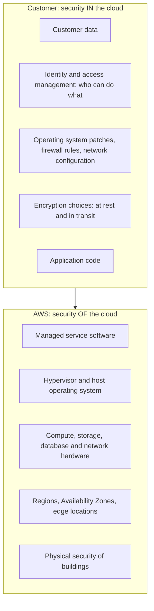
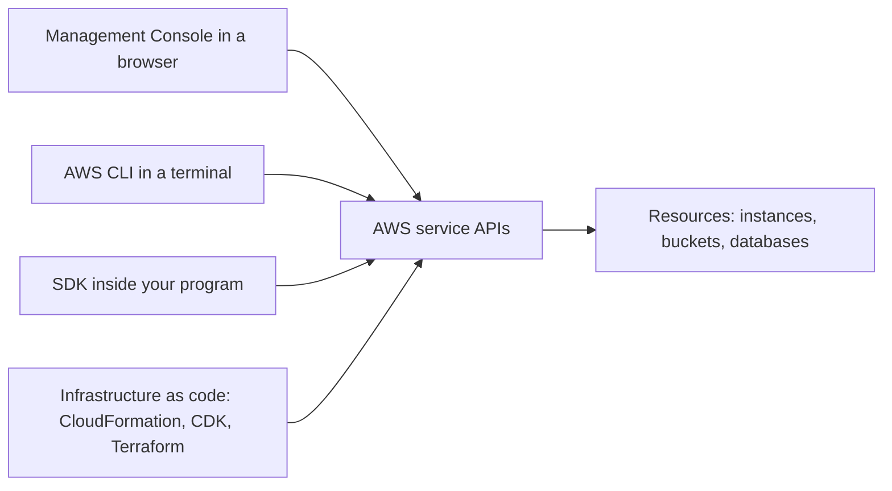
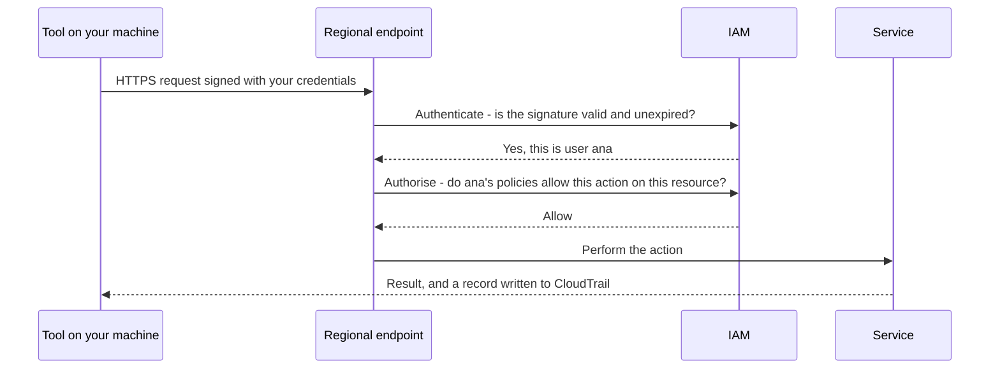

# Shared responsibility and four ways to drive AWS

## Before this lesson

Read [What cloud computing is, and the AWS global map](#/lesson/aws/what-is-cloud) first: you should know what a Region, an Availability Zone, an instance and an API are. For the command-line parts it helps to have typed a few commands in a terminal; the [Linux command line track](#/lesson/linux-cli/shell-and-navigation) covers that from zero.

## In plain words

Two questions come up the moment a company puts anything on AWS.

**"Who is responsible when something goes wrong?"** The answer is a split, called the **shared responsibility model**. AWS looks after the buildings, the hardware and the software that runs the services. You look after what you put there and how you configure it. Renting a flat is a good analogy: the landlord maintains the walls, the roof and the lock on the street door; you are the one who must lock your own flat, choose who gets a key, and not leave the window open. If a burglar walks through your open window, the landlord is not at fault.

**"How do I tell AWS what to do?"** There are four ways — clicking in a website, typing commands, calling AWS from program code, and describing what you want in a file that AWS then builds. They all end up as the same API calls. Knowing when to use which is a core professional habit: clicking is fine for learning, but production systems are built from files.

Why it matters for a job: nearly every publicised cloud data leak was a customer-side misconfiguration, not a failure of AWS. Interviewers ask about the model to check that you know which half is yours.

## The shared responsibility model

AWS phrases the split as:

- AWS is responsible for **security *of* the cloud**.
- The customer is responsible for **security *in* the cloud**.



### What AWS always does

- Guards the buildings: fences, guards, cameras, access logs. Customers cannot visit.
- Maintains and replaces hardware, and destroys old disks so that data cannot be recovered from them.
- Runs and patches the hypervisor that isolates customers from each other.
- Operates the global network.
- Has independent auditors inspect all this and publishes their reports (SOC 1, 2 and 3 reports, ISO 27001 certificates, PCI DSS attestations and many more). You download them from a service called **AWS Artifact**. This is how a customer can satisfy their own auditor without visiting a data centre.

### What the customer always does

- Decides **who can sign in and what they may do** (the IAM service, module 6).
- Classifies and protects **their data**: what is sensitive, whether it is encrypted, who may read it, where it is backed up.
- Configures the **network controls** AWS provides: which ports are open, to whom.
- Writes secure **application code**.

### The line moves with the service type

How much lands on your side depends on how "managed" the service is. Compare three ways to run a database.

| Task | Database installed on EC2 (IaaS) | RDS (managed) | DynamoDB (fully managed, serverless) |
|---|---|---|---|
| Physical security, hardware | AWS | AWS | AWS |
| Patch the operating system | **You** | AWS | AWS |
| Install and patch the database software | **You** | AWS (you pick the maintenance window) | AWS |
| Set up backups and replication | **You** | AWS does it once you switch it on | AWS does it once you switch it on |
| Firewall rules to reach it | **You** | **You** | Not applicable (access is by IAM) |
| Who may read which data | **You** | **You** | **You** |
| Encrypt the data | **You** | **You** choose a setting | On by default; **you** choose the key |

Two rows never move: **your data** and **your access rules** are always yours. A convenient rule of thumb: *if you can configure it, you are responsible for configuring it well.*

> [!INTERVIEW]
> **"An S3 bucket containing customer records was found open to the internet. Under the shared responsibility model, who is responsible?"** The customer. AWS is responsible for the S3 service being durable and for enforcing the access policy exactly as written; the customer wrote the policy. A strong answer adds the controls that would have prevented it: Block Public Access left on, least-privilege bucket policies, and AWS Config or IAM Access Analyzer to detect public resources.

A third category is sometimes called **shared controls**: things both sides do, each at their own layer. *Patch management*: AWS patches hosts, you patch your instances' operating systems. *Awareness and training*: AWS trains its staff, you train yours. *Configuration management*: AWS configures its devices, you configure your databases and applications.

## Four ways to drive AWS

Everything in AWS is an API call sent over HTTPS to a regional **endpoint** (a web address such as `ec2.eu-west-1.amazonaws.com`) and signed with your credentials. The four tools below are four ways to produce those calls.



### 1. The Management Console

The **AWS Management Console** is the website at `console.aws.amazon.com`. You sign in, pick a Region in the top-right corner, search for a service and click.

Good for: learning, exploring a new service, looking at dashboards and graphs, one-off investigation.

Bad for: anything you need to do twice. Clicks leave no record of *why*, cannot be reviewed by a colleague before they happen, and cannot be repeated exactly. Teams call manual changes **ClickOps**, and not kindly.

Inside the console there is also **AWS CloudShell**: a terminal in the browser, already signed in as you, with the command-line tool installed. It is the quickest way to try the commands in this track without installing anything.

### 2. The AWS CLI

The **AWS Command Line Interface (CLI)** is a program called `aws` that you run in a terminal. Every command has the same shape:

```bash
aws <service> <operation> [--option value ...]
```

A first session, with the output you should expect:

```bash
# 1. Who am I? Works with any valid credentials and needs no permissions.
aws sts get-caller-identity
```

```
{
    "UserId": "AIDAEXAMPLEEXAMPLE",
    "Account": "111122223333",
    "Arn": "arn:aws:iam::111122223333:user/ana"
}
```

- `sts` is the Security Token Service, the part of AWS that deals with credentials.
- `get-caller-identity` asks "which identity do these credentials belong to?".
- The answer is JSON (a text format of `"name": value` pairs). `Account` is the 12-digit account number. `Arn` is an **Amazon Resource Name**, the unique identifier format used for everything in AWS: `arn:aws:<service>:<region>:<account>:<resource>`. IAM is global, which is why the Region part is empty here.

```bash
# 2. List the Regions enabled for this account, as a compact table.
aws ec2 describe-regions --query "Regions[].RegionName" --output table
```

```
----------------------
|   DescribeRegions  |
+--------------------+
|  eu-north-1        |
|  eu-west-3         |
|  eu-west-1         |
|  us-east-1         |
|  ...               |
+--------------------+
```

- `--query` filters the JSON on your machine using a small language called **JMESPath**. `Regions[].RegionName` means "from the list `Regions`, take the field `RegionName` of every element".
- `--output table` prints a table instead of JSON. The other formats are `json` (the default), `yaml` and `text` (tab-separated, convenient in shell scripts).

```bash
# 3. Run a command against a specific Region and a specific set of credentials.
aws s3 ls --region eu-west-1 --profile sandbox
```

- `--region` overrides the default Region for one command.
- `--profile` chooses one of several named sets of settings stored on your machine.

#### How the CLI finds credentials

The CLI must sign each request. It looks for credentials in a fixed order and uses the first it finds:

1. command-line options;
2. environment variables (`AWS_ACCESS_KEY_ID`, `AWS_SECRET_ACCESS_KEY`, `AWS_SESSION_TOKEN`);
3. the files `~/.aws/credentials` and `~/.aws/config` (named profiles, including single sign-on profiles);
4. the role attached to the machine it runs on (an EC2 instance, a container, CloudShell).

An **access key** is a pair: an *access key ID* (public, starts with `AKIA`) and a *secret access key* (the password part). A long-lived access key in a file is the least safe option because anyone who copies the file is you. The recommended setup today is **IAM Identity Center** (single sign-on), configured with:

```bash
aws configure sso          # asks for your organisation's start URL and Region, once
aws sso login --profile sandbox   # opens the browser; grants credentials that expire in hours
```

Credentials obtained this way are **temporary**: they stop working after a few hours even if they leak.

> [!WARNING]
> Never paste an access key into source code, a chat message or a public repository. Automated scanners find keys pushed to public GitHub repositories within minutes, and the usual result is hundreds of large instances mining cryptocurrency on your bill. If a key leaks: deactivate it in IAM immediately, then check CloudTrail for what it did.

### 3. The SDKs

A **software development kit (SDK)** is a library that lets your program call AWS in its own language. There are SDKs for Python (called **boto3**), JavaScript, Java, Go, .NET, Rust and others. Applications use the SDK; humans and shell scripts use the CLI.

```python
import boto3                                   # the AWS SDK for Python

s3 = boto3.client("s3", region_name="eu-west-1")   # a client object for one service
response = s3.list_buckets()                   # one API call: ListBuckets
for bucket in response["Buckets"]:             # the response is a Python dict
    print(bucket["Name"], bucket["CreationDate"])
```

- `boto3.client("s3")` builds an object whose methods map one-to-one to S3 API operations.
- No credentials appear in the code. The SDK uses the same search order as the CLI, so the same program runs on your laptop (with your profile) and on a server (with the server's role).
- SDKs **retry automatically** with increasing pauses when AWS answers "slow down" (called *throttling*) and they handle *pagination*, the splitting of long lists into pages.

### 4. Infrastructure as code

**Infrastructure as code (IaC)** means writing a file that *describes* the resources you want, storing it in version control (Git) like any other code, and letting a tool create, change or delete real resources until they match the file.

The AWS-native tool is **CloudFormation**. A file is called a **template**; the set of resources created from it is a **stack**. A minimal template that creates one private storage bucket:

```yaml
AWSTemplateFormatVersion: "2010-09-09"      # fixed string that identifies the format
Description: One private bucket for invoices
Resources:                                   # the only mandatory section
  InvoiceBucket:                             # a name you choose, used inside this file
    Type: AWS::S3::Bucket                    # what kind of resource to create
    Properties:
      VersioningConfiguration:
        Status: Enabled                      # keep old versions of overwritten files
```

```bash
aws cloudformation deploy \
  --template-file bucket.yaml \
  --stack-name invoices-dev
```

```
Waiting for changeset to be created..
Waiting for stack create/update to complete
Successfully created/updated stack - invoices-dev
```

Run the same command again and nothing happens, because reality already matches the file. Change `Status`, run it again, and only that property is updated. Delete the stack and everything it created is removed. That property — *applying the same description repeatedly gives the same result* — is called **idempotency**, and it is what makes IaC safe.

This style is **declarative**: you state the end result, not the steps. The alternatives you will hear about:

| Tool | Language | Notes |
|---|---|---|
| CloudFormation | YAML or JSON | AWS-native, no extra software, state kept by AWS |
| AWS CDK (Cloud Development Kit) | TypeScript, Python, Java, Go… | You write a program that generates CloudFormation |
| Terraform / OpenTofu | HCL | Works across many providers; you manage a state file |
| AWS SAM | YAML | A CloudFormation shorthand for serverless applications |

Module 11 covers CloudFormation and the CDK in depth; the worked project in module 14 builds a real stack.

### Which tool when?

| Situation | Use | Why |
|---|---|---|
| First look at a service; reading graphs and logs | Console | Visual, discoverable |
| Quick question ("which instances are running?") | CLI or CloudShell | One line, scriptable |
| A script that runs every night | CLI in a shell script, or SDK | Repeatable |
| Your application reads a file from S3 | SDK | It is program code |
| Creating or changing anything in production | Infrastructure as code | Reviewed, versioned, repeatable, reversible |

> [!TIP]
> A healthy habit while learning: build it once in the console to understand the options, then delete it and rebuild it with the CLI or a template. The second pass is where the knowledge sticks, and you end with something reusable.

## Worked example: the same task, four ways

Task: create a bucket named `tidewater-invoices-dev-111122223333` in Ireland.

1. **Console**: S3 → *Create bucket* → type the name → choose Region → *Create*. Thirty seconds, no record.
2. **CLI**:
   ```bash
   aws s3api create-bucket \
     --bucket tidewater-invoices-dev-111122223333 \
     --region eu-west-1 \
     --create-bucket-configuration LocationConstraint=eu-west-1
   ```
   `s3api` exposes the raw S3 operations; `LocationConstraint` is required for every Region except `us-east-1`. Running it a second time fails with `BucketAlreadyOwnedByYou` — commands are **imperative** (do this step) and not automatically idempotent.
3. **SDK**: `s3.create_bucket(Bucket=..., CreateBucketConfiguration={"LocationConstraint": "eu-west-1"})`, with the same failure on a second run unless you catch the error.
4. **CloudFormation**: the template above with a `BucketName` property. A second run does nothing, and deleting the stack cleans up.

Bucket names are unique across *all* AWS accounts in the world, which is why the example includes the account number.

### How every request is checked

Whichever tool you use, each request passes the same three gates before anything happens:



- **Authentication** answers "who are you?". **Authorisation** answers "are you allowed?". The default answer is *no* until a policy says yes.
- **CloudTrail** is the audit log of API calls. It records who did what, when and from where. This is why a manual change in the console is never truly invisible.

## Cost notes and free-tier warnings

- The console, the CLI, the SDKs, CloudShell and CloudFormation are **free**. You pay only for the resources they create.
- A tool that makes creation easy also makes *expensive* creation easy. A loop in a script that launches instances can spend a month's budget in an afternoon. Give automation narrow permissions and set a budget alert (next lesson).
- Deleting a CloudFormation stack deletes its resources and stops their charges — one more reason to build experiments as stacks.

## Pitfalls

- **Believing a managed service is secure by default in every respect.** AWS secures the service; exposing it is still possible through your settings.
- **Long-lived access keys on laptops and in CI systems.** Prefer single sign-on for people and roles for machines.
- **Forgetting the Region.** A CLI command without `--region` uses the profile's default; resources land somewhere unexpected.
- **Mixing console edits with IaC.** If you change by hand a resource that a template manages, reality and the file disagree (this is called **drift**) and the next deployment may overwrite or fail.
- **Assuming the CLI is idempotent.** It is not; a `create` run twice fails or creates two.

## Cheat sheet

| Question | Answer |
|---|---|
| Security *of* the cloud | AWS: facilities, hardware, hypervisor, managed service software |
| Security *in* the cloud | Customer: data, IAM, OS patching on EC2, firewall rules, encryption settings, code |
| Always the customer's | Data and access management |
| Where to get AWS audit reports | AWS Artifact |
| Console | Learning and viewing |
| CLI | Ad-hoc commands and scripts: `aws <service> <operation>` |
| SDK | Calls from application code (boto3 for Python) |
| IaC | Declarative, versioned, idempotent creation of infrastructure |
| ARN format | `arn:aws:service:region:account:resource` |

## Summary

- AWS secures the infrastructure and the managed parts of each service; customers secure their data, identities, configuration and code.
- The more managed the service, the less operational work is yours — but data and access rules are yours in every case.
- All four tools produce signed API calls: the console for exploring, the CLI for commands and scripts, SDKs for applications, infrastructure as code for anything that must be repeatable.
- Prefer temporary credentials (single sign-on, roles) to long-lived access keys.
- Every call is authenticated, authorised and recorded in CloudTrail.

## Glossary

- **Access key**: a long-lived ID and secret pair used to sign API requests.
- **ARN**: Amazon Resource Name, the unique identifier of a resource.
- **AWS Artifact**: the portal for downloading AWS compliance reports.
- **Authentication / authorisation**: proving identity / checking permission.
- **boto3**: the AWS SDK for Python.
- **CloudShell**: a browser terminal with the CLI, signed in as you.
- **CloudTrail**: the log of API calls made in an account.
- **Declarative**: describing the desired end state instead of the steps.
- **Drift**: a difference between real resources and their template.
- **Endpoint**: the web address of a service's API in a Region.
- **Idempotent**: giving the same result whether applied once or many times.
- **Infrastructure as code (IaC)**: managing infrastructure through versioned definition files.
- **JMESPath**: the query language behind the CLI's `--query` option.
- **Stack / template**: a set of resources created by CloudFormation / the file describing them.
- **Throttling**: a service refusing requests temporarily because you sent too many.

```quiz
[
  {"q": "A company runs PostgreSQL on Amazon RDS. A critical vulnerability is announced in the Linux kernel used by the database hosts. Who patches it?",
   "options": ["The customer, by logging in over SSH", "AWS, because RDS is a managed service", "Nobody; RDS has no operating system", "The customer, by opening a support ticket for each instance"],
   "answer": 1,
   "explain": "On RDS, AWS manages the operating system and database software. On a self-installed database on EC2, the same patch would be the customer's job."},
  {"q": "Which task is the customer's responsibility for EVERY AWS service, however managed?",
   "options": ["Replacing failed disks", "Patching the hypervisor", "Deciding who may access the data", "Securing the data-centre building"],
   "answer": 2,
   "explain": "Data and access management always stay with the customer. Hardware, hypervisor and buildings are always AWS's."},
  {"q": "A team must create identical networks in three environments (dev, staging, production) and have every change reviewed before it is applied. Which approach fits best?",
   "options": ["Click through the console three times with a checklist", "A shell script of CLI create commands", "A CloudFormation or Terraform template stored in Git", "Ask AWS Support to copy the network"],
   "answer": 2,
   "explain": "Infrastructure as code is declarative, versioned and idempotent, so the same template yields the same network in each environment and changes go through code review."},
  {"q": "A script runs 'aws s3api create-bucket' for the same bucket name twice. What happens the second time, and what does that tell you?",
   "options": ["Nothing; all CLI commands are idempotent", "It fails because the bucket already exists; imperative commands are not automatically idempotent", "A second bucket with a numeric suffix is created", "The first bucket is emptied"],
   "answer": 1,
   "explain": "The CLI issues one imperative API call. Unlike a declarative template, it does not compare the desired state with reality."},
  {"q": "An auditor asks for evidence that AWS data centres are physically secure. What should the customer do?",
   "options": ["Book a visit to the data centre", "Download the relevant third-party audit reports from AWS Artifact", "Install cameras on their EC2 instances", "Nothing can be provided"],
   "answer": 1,
   "explain": "Customers cannot visit facilities. Independent auditors do, and AWS publishes the reports through AWS Artifact."},
  {"q": "Where should a Python application running on an EC2 instance get its AWS credentials?",
   "options": ["From an access key written in the source code", "From an access key in an environment file committed to Git", "From the IAM role attached to the instance, picked up automatically by the SDK", "From the root user's password"],
   "answer": 2,
   "explain": "The SDK's credential search ends with the role of the machine it runs on. That gives temporary, automatically rotated credentials with nothing to leak in code."},
  {"q": "What does the option --query \"Reservations[].Instances[].InstanceId\" do in an AWS CLI command?",
   "options": ["It asks AWS to return fewer results, reducing cost", "It filters the JSON response on the client using JMESPath", "It selects the Region to query", "It creates a saved search in the console"],
   "answer": 1,
   "explain": "--query is applied locally to the response and uses JMESPath. Server-side filtering uses --filters where a service supports it."}
]
```

> **Source:** AWS Certified Solutions Architect Official Study Guide, ch. 1 (AWS fundamentals, accessing the platform) and ch. 12 (shared responsibility model). Checked against https://docs.aws.amazon.com/whitepapers/latest/aws-risk-and-compliance/shared-responsibility-model.html and https://docs.aws.amazon.com/cli/latest/userguide/cli-chap-configure.html
