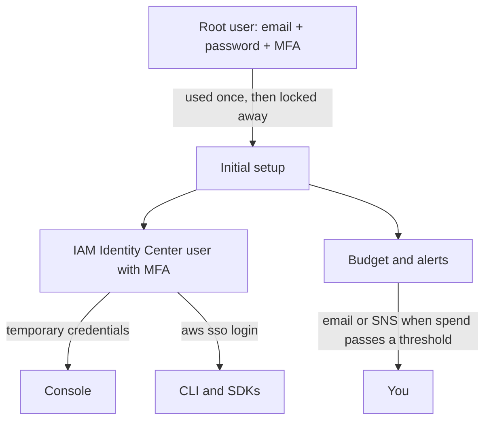

# A safe first account: root user, MFA, budgets and the free tier

## Before this lesson

You should have read [Shared responsibility and four ways to drive AWS](#/lesson/aws/responsibility-and-tools): you know that securing your own account is your half of the deal, and what the console and the CLI are. No account is needed yet — this lesson is about creating one without regretting it.

## In plain words

An **AWS account** is a container: it holds your resources, has its own bill, and has a wall around it that other accounts cannot cross unless you open a door. Creating one takes ten minutes and a payment card.

Think of it as moving into a house that comes with a **master key**. The master key opens everything, can change every lock, and can sell the house. A sensible person puts that key in a safe on day one, makes everyday keys for the people who live there, and installs a smoke alarm. In AWS terms: lock away the **root user**, create ordinary identities for daily work, and set a **budget alarm** so that a forgotten resource cannot quietly burn money.

Why it matters for a job: "I left something running and got a bill" and "my access key leaked" are the two classic beginner disasters, and both are prevented by the ten steps in this lesson. Employers also expect you to read a bill and estimate one.

## What an account contains

- A unique 12-digit **account ID** (for example `111122223333`).
- One **root user**, identified by the email address used at sign-up.
- A **payment method** and a monthly bill.
- Its own set of resources in every Region, invisible to all other accounts.

Companies do not put everything in one account. They use many — one per environment or team — grouped under **AWS Organizations** with a single combined bill. An account is the strongest isolation boundary AWS offers: a mistake in the "dev" account cannot delete the "prod" database. Module 6 returns to this; for learning, one account is enough.

## The root user

The **root user** is the identity created with the account. It signs in with an email address and password and has **unrestricted power that no policy can remove** inside the account. A short list of tasks can be done only by root, among them:

- changing the account's email address or closing the account;
- changing the support plan in some cases and certain billing settings;
- restoring permissions when an administrator has locked everybody out.

For everything else, root is unnecessary and dangerous: if its password is stolen, the thief owns the account.

> [!WARNING]
> Do not use the root user for daily work, and never create access keys for it. A root access key is the master key copied onto a sticky note. If one exists in an account you inherit, delete it.

### Multi-factor authentication

**Multi-factor authentication (MFA)** means proving identity with two different kinds of evidence: something you *know* (a password) and something you *have* (a phone or a hardware key). A stolen password alone is then useless.

AWS supports three kinds of second factor:

| Type | What it is | Notes |
|---|---|---|
| Passkey or FIDO2 security key | A fingerprint or face unlock on your device, or a USB/NFC key such as a YubiKey | Resistant to phishing; the strongest choice |
| Authenticator app (TOTP) | An app that shows a six-digit code changing every 30 seconds | Free; back up the app or you can be locked out |
| Hardware TOTP token | A small device showing codes | For environments where phones are not allowed |

*TOTP* stands for time-based one-time password. AWS now **requires** MFA for root users; turning it on is the first thing you do.

## Ten steps to a safe first account

1. **Sign up with an email address you will keep**, ideally a shared mailbox or alias for a company (`aws-prod@example.com`), not a personal address of someone who may leave.
2. **Choose the account plan.** Since July 2025 new customers pick a *free plan* or a *paid plan* (explained below).
3. **Sign in as root once and enable MFA** (console → account name at top right → *Security credentials* → *Assign MFA device*). Register a second device as a spare.
4. **Check that root has no access keys** on the same page.
5. **Create your everyday identity.** The recommended route is **IAM Identity Center**: enable it, create a user for yourself, and assign that user a *permission set* such as `AdministratorAccess`. You then sign in through a personal portal URL and receive temporary credentials. (The older route — an *IAM user* with a password — still works and still appears in exams; module 6 compares them.)
6. **Enable MFA on that identity too.**
7. **Allow non-root identities to see billing.** By default only root can; switch on *IAM user and role access to Billing information* in the account settings.
8. **Create a budget with email alerts** (below). Do this before launching anything.
9. **Sign out of root.** Store its password and the spare MFA device somewhere safe. From now on you use the everyday identity.
10. **Pick a home Region** and remember to check the Region selector whenever something "is missing".



## How billing works

AWS bills monthly, in arrears, for metered usage. Three patterns cover almost everything:

- **Pay as you go**: by the second, the request or the gigabyte, with no commitment.
- **Save when you commit**: promise a level of usage for one or three years (Savings Plans, Reserved Instances) and pay 30–70 % less. Module 2 covers these.
- **Pay less by using more**: volume tiers. The price per gigabyte of storage or outbound data drops as the monthly quantity grows.

And three things are usually **free**: creating an account, data transferred *into* AWS from the internet, and data moving between services inside the same Availability Zone over private addresses.

### What a small bill is made of

| Line | Unit | Typical surprise |
|---|---|---|
| EC2 instance | per second while *running* | Stopped instances stop compute charges, but their disks keep billing |
| EBS volume and snapshots | GB-month | Disks of deleted servers that were not deleted with them |
| Public IPv4 address | per hour, attached or not | Every public address is charged, even on a running instance |
| NAT gateway | per hour **and** per GB processed | Often the largest line in a small account |
| Load balancer | per hour and per capacity unit | A forgotten load balancer costs about the same idle as busy |
| RDS database | per hour plus storage | Stopped databases restart by themselves after seven days |
| S3 | GB-month, requests, data out | Millions of tiny requests; old versions kept by versioning |
| Data transfer out | per GB to the internet | Downloads and video |

### Tags: making the bill readable

A **tag** is a label made of a key and a value that you attach to a resource: `Project=bookshop`, `Environment=dev`, `Owner=ana`. Tags do nothing by themselves. Their power comes from what reads them: once you mark a tag key as a **cost allocation tag** in the billing console, the bill can be grouped by its values, so you can answer "what does the dev environment cost?".

```bash
# Add two tags to an existing instance.
aws ec2 create-tags \
  --resources i-0abc1234def567890 \
  --tags Key=Project,Value=bookshop Key=Environment,Value=dev
```

- `--resources` takes one or more resource IDs.
- Each `Key=…,Value=…` pair is one tag. Keys and values are case-sensitive: `environment` and `Environment` are different tags, which is why teams write down a tagging standard and audit it (the problem *Tag Compliance Audit* in this module has you write such an audit).

### The billing tools

| Tool | What it answers |
|---|---|
| **Bills** page | What did I owe last month, line by line? |
| **Cost Explorer** | Graphs of spend over time, grouped by service, Region or tag; a forecast for the month |
| **AWS Budgets** | Tell me when actual or forecast spend passes a threshold |
| **Cost Anomaly Detection** | Tell me when spending behaves unusually, without me choosing a threshold |
| **AWS Pricing Calculator** | What *would* this architecture cost? (an estimate before building) |
| **Cost and Usage Report** | The raw, line-per-resource-per-hour data, delivered to S3 for analysis |
| **Trusted Advisor / Cost Optimization Hub** | Which resources look idle or oversized? |

## Worked example: a budget from the command line

The budget below sends an email when actual spend reaches 80 % of USD 10, and again when the *forecast* for the month exceeds USD 10.

```bash
aws budgets create-budget \
  --account-id 111122223333 \
  --budget '{
    "BudgetName": "monthly-learning-budget",
    "BudgetLimit": {"Amount": "10", "Unit": "USD"},
    "TimeUnit": "MONTHLY",
    "BudgetType": "COST"
  }' \
  --notifications-with-subscribers '[
    {"Notification": {"NotificationType": "ACTUAL", "ComparisonOperator": "GREATER_THAN",
                      "Threshold": 80, "ThresholdType": "PERCENTAGE"},
     "Subscribers": [{"SubscriptionType": "EMAIL", "Address": "you@example.com"}]},
    {"Notification": {"NotificationType": "FORECASTED", "ComparisonOperator": "GREATER_THAN",
                      "Threshold": 100, "ThresholdType": "PERCENTAGE"},
     "Subscribers": [{"SubscriptionType": "EMAIL", "Address": "you@example.com"}]}
  ]'
```

Reading it part by part:

- `--account-id` is your 12-digit account number.
- `--budget` is a JSON document: a name, a limit of 10 US dollars, evaluated per calendar month, tracking cost (budgets can also track usage quantities or commitment coverage).
- `--notifications-with-subscribers` is a list. Each entry pairs a rule with the people to tell. The first rule fires on `ACTUAL` spend above 80 % of the limit; the second on `FORECASTED` spend above 100 %.
- A successful call prints nothing. Confirm with `aws budgets describe-budgets --account-id 111122223333`.

> [!WARNING]
> A budget **alerts**; by default it does not stop anything. Charges continue until you delete or stop the resources. Budgets can be given *actions* (for example, attach a policy that denies launching new instances), but nothing in AWS will delete your resources for you. Billing data also lags by several hours, so an alert is not instantaneous.

## The free tier, as it works today

The free tier changed in **July 2025**, and older books and tutorials describe the previous scheme. Both matter because accounts created under the old rules still follow them.

**Accounts created from 15 July 2025.** At sign-up you choose:

- a **free plan**: you receive USD 100 in credits, can earn up to USD 100 more by completing introductory activities, and cannot be charged. The plan ends after six months or when the credits are used up, whichever comes first; the account is then closed unless you upgrade. Some services that could consume the credits very quickly are unavailable on this plan.
- a **paid plan**: the same credits apply first, then normal pay-as-you-go pricing. Nothing is blocked.

**Accounts created before that date** keep the older model: twelve months of specific monthly allowances (for example 750 hours of a small EC2 instance, 5 GB of S3 standard storage, 750 hours of a small RDS database).

**For everyone**, a set of **always-free** allowances does not expire. Examples that matter for this track: 1 million Lambda requests and 400,000 GB-seconds per month, 25 GB of DynamoDB storage, 1 million SNS publishes, 1 million SQS requests, 10 CloudWatch custom metrics and alarms. There are also **short-term trials** that start when you first use a service.

> [!TIP]
> Whatever plan you are on, treat the free tier as a discount, not a guarantee. The safe routine for every exercise in this track is: **create → experiment → delete, in the same sitting**, and check the *Bills* page the next morning.

### Things that are never free

These catch learners most often:

- **NAT gateways** (hourly charge from the minute they exist).
- **Elastic IP addresses and all public IPv4 addresses** (hourly).
- **Load balancers** beyond any trial allowance.
- **Data transfer out** beyond 100 GB per month.
- **Large or GPU instances**, and anything provisioned with a capacity commitment.
- **Snapshots, old S3 versions and logs** that accumulate silently.

## Estimating a bill by hand

The arithmetic of a bill is always the same: *quantity minus free allowance, multiplied by the unit price, with tiers*. The simulation estimates a small learning account for one month. The prices are illustrative round numbers, not a quote; change them and re-run.

```python-run
HOURS = 730  # average hours in a month

usage = [
    # (description, quantity, free allowance, price per unit in USD)
    ("t3.micro instance hours",      HOURS,      0,       0.0114),
    ("gp3 disk GB-month",            20,         0,       0.088),
    ("public IPv4 address hours",    HOURS,      0,       0.005),
    ("S3 standard GB-month",         12,         5,       0.023),
    ("data transfer out GB",         40,         100,     0.09),
    ("Lambda requests (millions)",   2.5,        1,       0.20),
    ("NAT gateway hours",            HOURS,      0,       0.048),
]

total = 0.0
for name, qty, free, price in usage:
    billable = max(0, qty - free)        # never negative
    cost = billable * price
    total += cost
    print(f"{name:30s} {billable:8.1f} x {price:<7} = {cost:6.2f}")
print(f"{'TOTAL':30s} {'':8s}   {'':7s}   {total:6.2f}")
```

What each line does: the list holds one tuple per usage type; `max(0, qty - free)` applies the free allowance without going below zero; the loop multiplies and accumulates; the last line prints the sum. Notice the result: the NAT gateway (about USD 35) costs four times more than the server it serves. Remove that line and the month costs under USD 15. That one observation — *find the largest line first* — is most of cost optimisation.

The problem *Monthly Bill Estimator* at the end of this module asks you to implement the same logic with tiered prices.

## Support plans

Every account includes **Basic** support: documentation, forums, billing help and a limited Trusted Advisor. Paid plans add technical help from engineers:

| Plan | Who it is for | Notable feature |
|---|---|---|
| Basic | Learning | Billing and account support only |
| Developer | Experimenting | Email access to engineers in business hours |
| Business | Production workloads | 24/7 phone and chat, full Trusted Advisor checks |
| Enterprise On-Ramp / Enterprise | Business-critical systems | A technical account manager, fastest response times |

Plan names and prices change; the idea to keep is that production systems normally justify at least the Business tier.

## Cost notes and free-tier warnings

- Creating the account, Identity Center, IAM, budgets (the first two with actions; alert-only budgets are free) and Cost Explorer's console are free.
- Set the budget **before** the first resource. USD 5–10 is a sensible learning limit.
- Close an account you no longer need: *Account* → *Close account* (root only). Resources are deleted after a 90-day grace period.
- If you do get an unexpected bill from an honest mistake, open a billing support case promptly, explain, and delete the resources. AWS frequently grants a one-time credit, but it is a courtesy, not a right.

## Pitfalls

- **Using root every day**, or creating root access keys.
- **One MFA device and no spare**: losing a phone becomes an account-recovery process with identity documents.
- **Signing up with a personal email for a company account.**
- **Assuming "free tier" means "free account"**: usage above the allowance, or of services outside it, is charged on a paid plan.
- **Stopping instead of deleting.** A stopped instance still pays for its disk and any Elastic IP.
- **Budgets created after the surprise.**
- **Untagged resources**: nobody knows what they are for, so nobody dares delete them.

> [!INTERVIEW]
> **"You have been given a brand-new AWS account for a new team. What do you do in the first hour?"** Secure root with MFA and remove any root keys; set up federated or Identity Center access with MFA instead of IAM users with long-lived keys; create budgets and anomaly alerts; turn on CloudTrail across all Regions and send logs to a protected bucket; agree a tagging standard; and, if the company uses AWS Organizations, attach the account to the right organisational unit so that guardrail policies apply. Mentioning both security *and* cost controls shows the right instincts.

## Cheat sheet

| Topic | Rule |
|---|---|
| Root user | MFA on, no access keys, used only for root-only tasks |
| Daily access | IAM Identity Center (or an IAM user with MFA), temporary credentials |
| First cost control | A budget with ACTUAL and FORECASTED alerts |
| Find what costs money | Cost Explorer, grouped by service, then by tag |
| Estimate before building | AWS Pricing Calculator |
| Free tier (new accounts) | Credits, up to six months on the free plan, plus always-free allowances |
| Never free | NAT gateway, public IPv4, load balancers, data out beyond the allowance |
| Clean-up habit | Create, experiment, delete in one sitting |

## Summary

- An account is an isolation and billing boundary with one all-powerful root user.
- Secure root with MFA, never give it access keys, and use an everyday identity with temporary credentials.
- Bills are metered usage times unit price; tags and Cost Explorer make them explainable.
- Budgets warn, they do not stop spending; create one before anything else.
- The free tier now works through credits and a time-limited free plan for new accounts, with a separate set of always-free allowances; several common resources are never covered.

## Glossary

- **Account ID**: the 12-digit number identifying an AWS account.
- **AWS Budgets**: the service that alerts when cost or usage crosses a threshold.
- **AWS Organizations**: the service that groups many accounts under one bill and one set of guardrails.
- **Cost allocation tag**: a tag key activated so that the bill can be grouped by it.
- **Cost Explorer**: the tool for graphing and forecasting spend.
- **Credit**: prepaid value that is applied to the bill before your payment method.
- **IAM Identity Center**: the service for single sign-on to one or many accounts with temporary credentials.
- **MFA**: multi-factor authentication, a second proof of identity beyond the password.
- **Passkey / FIDO2 key**: a phishing-resistant second factor based on public-key cryptography.
- **Root user**: the unrestricted identity created with the account.
- **Tag**: a key/value label attached to a resource.
- **TOTP**: a time-based one-time password generated by an authenticator.

```quiz
[
  {"q": "Which of these should be done with the root user?",
   "options": ["Launching the team's first EC2 instance", "Creating an access key for the CI pipeline", "Closing the AWS account", "Viewing CloudWatch dashboards every morning"],
   "answer": 2,
   "explain": "Closing the account is one of the few root-only tasks. Everything else should be done with an everyday identity that has only the needed permissions."},
  {"q": "A learner creates a USD 10 monthly budget with an email alert at 80 %. Spending reaches USD 30 because a NAT gateway was left running. What did the budget do?",
   "options": ["It deleted the NAT gateway at USD 10", "It stopped all billing at USD 10", "It sent alerts; the charges continued", "It suspended the account"],
   "answer": 2,
   "explain": "By default budgets only notify. Stopping spend requires deleting the resources (or configuring budget actions, which can restrict permissions but still do not delete resources)."},
  {"q": "An EC2 instance is stopped for three weeks. Which charge continues?",
   "options": ["The per-second compute charge", "The EBS volume storage charge", "Data transfer in", "None; stopped instances are free"],
   "answer": 1,
   "explain": "Compute billing stops when the instance stops, but its disks still exist and are billed per GB-month, as are any Elastic IPs."},
  {"q": "The finance team wants the monthly bill split by project. What is needed?",
   "options": ["One Region per project", "Resources tagged with a Project key, activated as a cost allocation tag", "A separate root user per project", "A Business support plan"],
   "answer": 1,
   "explain": "Cost allocation tags let Cost Explorer and the bill group spending by tag value. (Separate accounts per project are another valid approach.)"},
  {"q": "Which statement about the current free tier for an account created today is correct?",
   "options": ["Every service is free for twelve months", "New accounts receive credits and can choose a free plan that lasts up to six months or until the credits run out", "The free tier removes the need for a budget", "NAT gateways are included in the always-free allowances"],
   "answer": 1,
   "explain": "Since July 2025 new accounts get credits and choose between a time-limited free plan and a paid plan. Always-free allowances exist for some services, and NAT gateways are not among them."},
  {"q": "Why is a passkey or FIDO2 security key considered stronger than a six-digit authenticator code?",
   "options": ["It is longer", "It cannot be phished, because it only responds to the genuine sign-in domain", "It never needs a spare", "It replaces the need for a password policy"],
   "answer": 1,
   "explain": "FIDO2 credentials are bound to the real site's domain, so a fake login page cannot relay them. TOTP codes can be typed into a phishing page."},
  {"q": "A small account's bill shows these monthly lines: instance 8, disk 2, NAT gateway 35, S3 1 (USD). What is the most effective first action?",
   "options": ["Move the S3 data to a colder storage class", "Shrink the disk", "Question whether the NAT gateway is needed and remove or replace it", "Buy a Savings Plan for the instance"],
   "answer": 2,
   "explain": "Cost work starts with the largest line. The NAT gateway is 76 % of the bill; alternatives include VPC endpoints or placing the instance in a public subnet for a learning setup."}
]
```

> **Source:** AWS Certified Solutions Architect Official Study Guide, ch. 1 (accounts and pricing overview), ch. 6 (root user and MFA) and ch. 12 (account security features). The book's free-tier description predates the July 2025 change; current rules checked against https://docs.aws.amazon.com/awsaccountbilling/latest/aboutv2/free-tier.html and https://docs.aws.amazon.com/IAM/latest/UserGuide/root-user-best-practices.html
