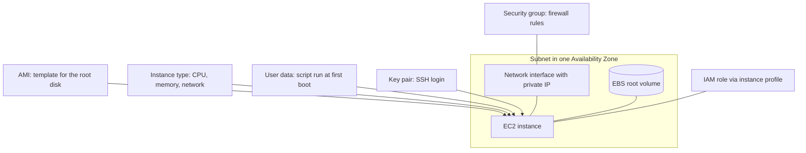
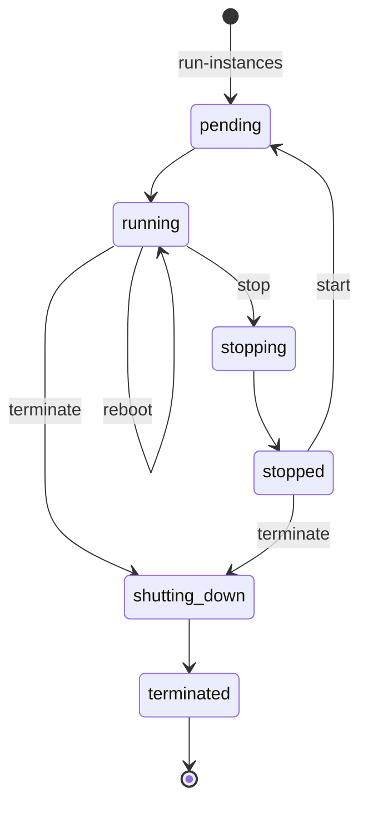

# EC2 instances, instance types, AMIs and user data

## Before this lesson

You need [the first module](#/lesson/aws/what-is-cloud): Regions, Availability Zones, what an instance is, and a secured account with a budget ([A safe first account](#/lesson/aws/account-and-billing)). Knowing how to connect to a remote machine with SSH helps; the Linux track's [SSH lesson](#/lesson/linux-cli/ssh-tmux) covers it.

## In plain words

**Amazon EC2** (Elastic Compute Cloud) rents you virtual computers by the second. You choose how powerful the computer is, which operating system and software it starts with, which network it sits in and who may reach it. A minute later it is running, and you can log in as if it were a machine under your desk. When you no longer need it you delete it and the charges stop.

A useful analogy is hiring a car. The **instance type** is the model (small city car or lorry). The **AMI** is what is already in the boot and on the dashboard when you collect it — operating system and pre-installed software. **User data** is a note for the rental staff: "before handing over the keys, please fit a child seat and fill the tank". The **key pair** is the car key.

Why it matters for a job: EC2 is the oldest and most general AWS service. Containers, managed databases and even "serverless" services are built on top of it, and its vocabulary — instance type, AMI, security group, instance profile — appears in every architecture conversation.

## The parts of an instance



Every launch answers the same questions:

1. **Which AMI?** (what is on the disk)
2. **Which instance type?** (how big)
3. **Which subnet?** (which network and therefore which Availability Zone)
4. **Which security group?** (which traffic is allowed in)
5. **Which storage?** (size and type of the disks)
6. **How do I get in?** (key pair, or Session Manager)
7. **What may the instance do in AWS?** (IAM role)
8. **Anything to run at first boot?** (user data)

## Instance types: reading the name

An instance type such as `m7g.large` looks cryptic but follows a strict pattern:

```
 m      7       g        .   large
 |      |       |            |
family  generation  attributes   size
```

- **Family** — what the hardware is balanced for.
- **Generation** — higher is newer, usually faster *and* cheaper per unit of work.
- **Attributes** — extra letters: `g` = AWS Graviton (ARM) processor, `a` = AMD, `i` = Intel, `d` = includes local NVMe disks, `n` = extra network capacity.
- **Size** — `nano`, `micro`, `small`, `medium`, `large`, `xlarge`, `2xlarge` … Each step roughly doubles vCPUs and memory, and doubles the price.

A **vCPU** (virtual CPU) is a share of a physical processor: on Intel and AMD types it is one hardware thread (half a core); on Graviton types it is a full core.

| Family | Letter | Optimised for | Typical uses |
|---|---|---|---|
| General purpose | `t`, `m` | Balanced CPU and memory | Web servers, small databases, development |
| Compute optimised | `c` | More CPU per GB of memory | Batch processing, encoding, game servers, scientific models |
| Memory optimised | `r`, `x`, `z` | More memory per vCPU | In-memory caches, large relational databases, analytics |
| Storage optimised | `i`, `d`, `h` | Fast or very large local disks | NoSQL databases, data warehouses, log processing |
| Accelerated computing | `p`, `g`, `inf`, `trn` | GPUs and other accelerators | Machine-learning training and inference, rendering |
| High-performance computing | `hpc` | Tightly coupled parallel jobs | Simulations |

A mnemonic many candidates use: **m**ain, **c**ompute, **r**AM, **i**/O, **g**raphics, **t**iny-and-burstable.

### Burstable instances and CPU credits

The `t` family (for example `t3.micro`, `t4g.small`) is cheap because it does not give you a full CPU all the time. Each size has a **baseline** (for `t3.micro`, 10 % of each vCPU). While the instance uses less than the baseline it earns **CPU credits**; when it needs more it spends them to *burst* up to 100 %.

- Good fit: workloads that are idle most of the time with short spikes — a small website, a development box.
- Bad fit: anything that needs steady CPU; it runs out of credits.

What happens at zero credits depends on the mode. In **standard** mode the instance is throttled to its baseline. In **unlimited** mode (the default for `t3` and `t4g`) it keeps bursting and you are charged for the extra CPU.

> [!WARNING]
> A `t3` instance in unlimited mode running at 100 % CPU around the clock can cost more than the equivalent `m` instance. If CloudWatch shows `CPUCreditBalance` at zero, the workload has outgrown the `t` family.

## AMIs: the template

An **Amazon Machine Image (AMI)** is a template containing the contents of the root disk (operating system, installed software, configuration), a list of additional disks, and launch permissions. Launching an instance copies the template into a new disk.

Where AMIs come from:

| Source | Example | Notes |
|---|---|---|
| AWS-provided | Amazon Linux 2023, Ubuntu, Windows Server | Maintained and patched by AWS or the vendor |
| AWS Marketplace | A firewall appliance, a pre-configured database | May add a software fee per hour |
| Community | Anything shared publicly | Treat as untrusted |
| Your own | "Golden image" with your application baked in | Built with EC2 Image Builder or Packer |

Facts to remember:

- **AMIs are regional.** An AMI ID such as `ami-0abc…` is valid in one Region. To use an image elsewhere, **copy** it; the copy gets a new ID.
- AMIs have an **architecture** (`x86_64` or `arm64`) that must match the instance type. A Graviton instance needs an `arm64` AMI.
- The root device is either **EBS-backed** (the normal case: the disk is a network volume that survives a stop) or **instance-store-backed** (rare today: the disk is local and the instance cannot be stopped, only terminated).

### Baking versus bootstrapping

There are two ways to get your software onto an instance.

- **Bootstrapping**: start from a plain AMI and install everything at first boot with a script. Flexible, always installs the latest packages, but slow (minutes) and dependent on external download servers at launch time.
- **Baking** a **golden AMI**: install everything once, create an AMI, launch from it. Fast (seconds) and predictable, but you must rebuild the image for every change.

Most teams mix the two: bake the slow, stable parts (runtime, agents), bootstrap the small, fast-changing parts (which version of the application to pull, environment name).

## User data

**User data** is text you supply at launch. On Linux AMIs, a program called **cloud-init** runs it as the `root` user, **once, during the first boot**. It is the bootstrapping mechanism.

```bash
#!/bin/bash
# User data for an Amazon Linux 2023 web server.
dnf update -y                          # 1. apply security updates
dnf install -y nginx                   # 2. install the web server
TOKEN=$(curl -sX PUT "http://169.254.169.254/latest/api/token" \
        -H "X-aws-ec2-metadata-token-ttl-seconds: 300")          # 3. get a metadata session token
AZ=$(curl -s -H "X-aws-ec2-metadata-token: $TOKEN" \
     http://169.254.169.254/latest/meta-data/placement/availability-zone)   # 4. ask where we are
echo "<h1>Hello from $AZ</h1>" > /usr/share/nginx/html/index.html           # 5. write a page
systemctl enable --now nginx           # 6. start nginx now and on every boot
```

Line by line:

1. `#!/bin/bash` tells cloud-init to run the text as a shell script.
2. `dnf` is the package manager of Amazon Linux 2023; `-y` answers "yes" to prompts because nobody is there to type.
3. The two `curl` commands talk to the **instance metadata service (IMDS)**, a special address, `169.254.169.254`, reachable only from inside the instance. It answers questions such as "what is my instance ID, my AZ, my role's temporary credentials?". The first call obtains a short-lived token and the second presents it: this is **IMDSv2**, the secure version, which you should require on every instance.
4. The page shows the Availability Zone, which is handy later for seeing a load balancer alternate between zones.
5. `systemctl enable --now` starts the service and registers it to start after a reboot.

Things that confuse newcomers:

- User data runs **only on first boot** by default. Editing it later and rebooting does nothing.
- It is limited to 16 KB and is **not secret**: anyone with access to the instance can read it from the metadata service. Do not put passwords in it; fetch secrets at runtime from Secrets Manager or Parameter Store using the instance's role.
- Output goes to `/var/log/cloud-init-output.log`. When a freshly launched server "does nothing", read that file first.

## Worked example: launch, inspect, clean up

> [!WARNING]
> The commands below create a billable instance with a public IPv4 address (roughly one to two US cents per hour in total for a `t3.micro`). Run the clean-up step when you finish.

```bash
# 1. Find the latest Amazon Linux 2023 AMI for this Region (AWS publishes it as a public parameter).
AMI=$(aws ssm get-parameter \
  --name /aws/service/ami-amazon-linux-latest/al2023-ami-kernel-default-x86_64 \
  --query Parameter.Value --output text)
echo "$AMI"
```

```
ami-0c1e3f5a7b9d2e4f6
```

Hard-coding an AMI ID is a common mistake: IDs differ per Region and new images are published every few weeks. Asking the Systems Manager parameter always returns the current one.

```bash
# 2. Create a security group that allows HTTP from anywhere.
SG=$(aws ec2 create-security-group --group-name web-demo \
  --description "HTTP for the EC2 lesson" --query GroupId --output text)
aws ec2 authorize-security-group-ingress --group-id "$SG" \
  --protocol tcp --port 80 --cidr 0.0.0.0/0
```

A **security group** is a firewall around the instance; by default it lets nothing in. `0.0.0.0/0` means "any IPv4 address". Port 22 (SSH) is deliberately not opened: we will not need it.

```bash
# 3. Launch.
aws ec2 run-instances \
  --image-id "$AMI" \
  --instance-type t3.micro \
  --security-group-ids "$SG" \
  --user-data file://userdata.sh \
  --metadata-options "HttpTokens=required" \
  --tag-specifications 'ResourceType=instance,Tags=[{Key=Name,Value=web-demo},{Key=Project,Value=learning}]' \
  --query "Instances[0].InstanceId" --output text
```

```
i-0a1b2c3d4e5f67890
```

- `--user-data file://userdata.sh` uploads the script from the previous section.
- `--metadata-options "HttpTokens=required"` enforces IMDSv2.
- `--tag-specifications` tags the instance at creation, so it is never untagged.
- With no subnet given, AWS uses the **default VPC**, a ready-made network present in every Region of a new account, whose subnets assign public addresses.

```bash
# 4. Wait until it is running and fetch its public address.
aws ec2 wait instance-running --instance-ids i-0a1b2c3d4e5f67890
aws ec2 describe-instances --instance-ids i-0a1b2c3d4e5f67890 \
  --query "Reservations[0].Instances[0].[State.Name,PublicIpAddress,Placement.AvailabilityZone]" \
  --output text
```

```
running   54.74.12.201   eu-west-1b
```

Open `http://54.74.12.201` after a minute (user data needs time to finish) and the page reads "Hello from eu-west-1b".

```bash
# 5. Clean up: terminate the instance, wait, then delete the security group.
aws ec2 terminate-instances --instance-ids i-0a1b2c3d4e5f67890
aws ec2 wait instance-terminated --instance-ids i-0a1b2c3d4e5f67890
aws ec2 delete-security-group --group-id "$SG"
```

## The instance lifecycle



| Action | Compute charge | Root EBS volume | Instance store data | Private IP | Public IP (auto-assigned) |
|---|---|---|---|---|---|
| Reboot | continues | kept | kept | kept | kept |
| Stop, then start | stops while stopped | kept | **lost** | kept | **changes** |
| Hibernate | stops | kept, plus memory saved to disk | lost | kept | changes |
| Terminate | stops | deleted by default | lost | released | released |

Two consequences worth memorising:

- **Stop/start moves the instance to different physical hardware.** That is why a stop-and-start fixes a "scheduled retirement" notice, and why local (instance store) data disappears.
- **An auto-assigned public address changes on every stop/start.** If a fixed public address is required, allocate an **Elastic IP** (a static public IPv4 address you own until you release it) — or, better, put a load balancer or DNS name in front and stop caring about instance addresses.

**Termination protection** is a flag that makes `terminate` fail until the flag is removed; switch it on for anything precious.

## Getting in: key pairs, Instance Connect and Session Manager

- A **key pair** is an SSH key: AWS stores the public half and places it on the instance at first boot; you keep the private half. If you lose it, there is no download-again button.
- **EC2 Instance Connect** pushes a temporary public key for 60 seconds and opens an SSH session from the browser or CLI.
- **Systems Manager Session Manager** opens a shell through an agent on the instance, using your IAM permissions. It needs **no open inbound port, no key pair and no public address**, and every session can be logged. This is the recommended method for production.

```bash
aws ssm start-session --target i-0a1b2c3d4e5f67890
```

## Giving an instance permissions: roles

Software on an instance often needs to call AWS — read a file from S3, write a metric. Never copy access keys onto the server. Attach an **IAM role** instead (through a wrapper called an **instance profile**). The SDK and CLI on the instance then fetch temporary credentials for that role from the metadata service automatically, and AWS rotates them several times a day.

## Cost notes and free-tier warnings

- Linux instances are billed **per second** with a 60-second minimum, only while `running`.
- The EBS root volume is billed per GB-month for as long as it exists, including while the instance is stopped.
- Every **public IPv4 address costs about half a US cent per hour** (roughly USD 3.60 a month), attached or idle. Since February 2024 this applies to all of them, not only unattached Elastic IPs as older texts say.
- Graviton (`g`) types typically cost about 20 % less than the comparable Intel type for the same or better performance; use them when your software runs on ARM.
- Data transferred out to the internet is charged per GB beyond the monthly free allowance.

## Pitfalls

- **Hard-coded AMI IDs** in scripts that are then run in another Region.
- **Secrets in user data.**
- **Expecting user data to re-run** after a reboot.
- **Port 22 open to `0.0.0.0/0`**: bots try passwords within minutes. Restrict to your address or use Session Manager.
- **IMDSv1 left enabled**: a web application with a server-side request forgery bug can be tricked into fetching the role's credentials. Require IMDSv2.
- **Treating an instance like a pet**: hand-configured, unrepeatable, irreplaceable. Aim for instances you can terminate and recreate from an AMI and a script at any time.

> [!INTERVIEW]
> **"What happens to the data when you stop an EC2 instance?"** Data on EBS volumes persists; data on instance store volumes is lost because a start places the instance on a different host. The private IP is kept, an auto-assigned public IP is replaced, an Elastic IP stays associated. Compute billing stops, storage billing continues.
>
> **"How would an application on EC2 authenticate to S3?"** With an IAM role attached through an instance profile; the SDK obtains rotating temporary credentials from the instance metadata service (IMDSv2). No keys are stored on the instance.

## Cheat sheet

| Concept | Remember |
|---|---|
| Instance type name | family + generation + attributes `.` size, e.g. `c7g.xlarge` |
| `t` family | Burstable with CPU credits; baseline, then burst |
| AMI | Regional template for the root disk; copy to use elsewhere |
| User data | Root script, first boot only, 16 KB, not secret |
| IMDS | `169.254.169.254`; require IMDSv2 tokens |
| Stop vs terminate | Stop keeps EBS and private IP; terminate deletes |
| Elastic IP | Static public IPv4; charged hourly |
| Access | Prefer Session Manager over open SSH |
| Permissions | IAM role via instance profile, never stored keys |

## Summary

- An EC2 instance is assembled from an AMI, an instance type, a subnet, security groups, storage, a way in and an optional role and boot script.
- Instance type names encode family, generation, processor and size; pick the family from the workload's bottleneck.
- AMIs are regional templates; baking them makes launches fast, user data makes them flexible.
- Stopping preserves EBS data but changes the host and the auto-assigned public address; terminating deletes.
- Use roles for permissions, IMDSv2 for metadata and Session Manager for access.

## Glossary

- **AMI**: Amazon Machine Image, the template an instance's root disk is created from.
- **Bootstrapping / baking**: configuring at first boot / pre-building everything into an image.
- **cloud-init**: the program on Linux AMIs that runs user data.
- **CPU credit**: the unit a burstable instance earns below baseline and spends above it.
- **Default VPC**: the ready-made network in each Region of an account.
- **Elastic IP**: a static public IPv4 address allocated to your account.
- **Graviton**: AWS's own ARM-based processors.
- **IMDS**: instance metadata service at `169.254.169.254`.
- **Instance profile**: the container that attaches an IAM role to an instance.
- **Key pair**: an SSH key whose public half AWS installs on the instance.
- **Security group**: the instance-level firewall.
- **Session Manager**: shell access through Systems Manager without inbound ports.
- **User data**: text supplied at launch, usually a script run once at first boot.
- **vCPU**: a virtual processor; a hardware thread on x86, a core on Graviton.

```quiz
[
  {"q": "A team needs to run an in-memory analytics engine that requires 256 GB of RAM but only modest CPU. Which family is the natural choice?",
   "options": ["c - compute optimised", "r - memory optimised", "t - burstable", "i - storage optimised"],
   "answer": 1,
   "explain": "The r family offers the most memory per vCPU. Compute optimised would force paying for many unneeded cores to reach that memory."},
  {"q": "An instance with an auto-assigned public IP and one instance store volume is stopped and started. What has changed afterwards?",
   "options": ["Nothing", "The private IP and the EBS data", "The public IP, the underlying host, and the instance store data is gone", "The AMI ID"],
   "answer": 2,
   "explain": "Start places the instance on new hardware: local instance store data is lost and a new public IP is assigned. The private IP and EBS volumes persist."},
  {"q": "A launch script in user data installs the application, but a developer changes the script and reboots the instance; the change does not take effect. Why?",
   "options": ["User data is limited to 1 KB", "User data runs only on the first boot by default", "Reboots are not allowed on EBS-backed instances", "The security group blocks it"],
   "answer": 1,
   "explain": "cloud-init runs user data scripts once per instance. To apply a change, launch a new instance (or use a configuration tool such as Systems Manager)."},
  {"q": "A script that launches instances works in eu-west-1 but fails in us-east-1 with 'InvalidAMIID.NotFound'. What is the cause?",
   "options": ["AMIs are regional, so the hard-coded ID does not exist in the other Region", "us-east-1 does not support Linux", "The key pair is global", "The instance type name is different in each Region"],
   "answer": 0,
   "explain": "AMI IDs are specific to a Region. Look the ID up dynamically (for example through the public SSM parameter) or copy the AMI."},
  {"q": "A small t3 instance serving a busy API shows CPUCreditBalance at 0 for days and the bill is higher than expected. What is happening?",
   "options": ["The instance is in unlimited mode and is being charged for sustained bursting; the workload needs a non-burstable type", "CPU credits are refunded monthly", "The instance has been throttled to zero CPU", "The AMI is too large"],
   "answer": 0,
   "explain": "Unlimited mode lets the instance keep bursting for an extra charge. Sustained high CPU means an m or c instance would be cheaper and more predictable."},
  {"q": "Which is the most secure way for administrators to get a shell on production instances in private subnets?",
   "options": ["Open port 22 to 0.0.0.0/0 and share one key pair", "Give each instance an Elastic IP", "Use Systems Manager Session Manager with IAM permissions and session logging", "Put the root password in user data"],
   "answer": 2,
   "explain": "Session Manager needs no inbound port, no public address and no shared key, and access is controlled and audited through IAM."},
  {"q": "Why should IMDSv2 be required on instances?",
   "options": ["It makes instances boot faster", "It requires a session token obtained with a PUT request, which blocks most request-forgery attacks from stealing role credentials", "It is needed for user data to run", "It encrypts EBS volumes"],
   "answer": 1,
   "explain": "IMDSv1 answers simple GET requests, so a vulnerable application can be tricked into reading credentials. IMDSv2's token step defeats that class of attack."}
]
```

> **Source:** AWS Certified Solutions Architect Official Study Guide, ch. 3 (Amazon EC2). The book predates Graviton, IMDSv2, per-second billing and the public IPv4 charge; current facts checked against https://docs.aws.amazon.com/AWSEC2/latest/UserGuide/instance-types.html , https://docs.aws.amazon.com/AWSEC2/latest/UserGuide/configuring-instance-metadata-service.html and https://docs.aws.amazon.com/AWSEC2/latest/UserGuide/user-data.html
