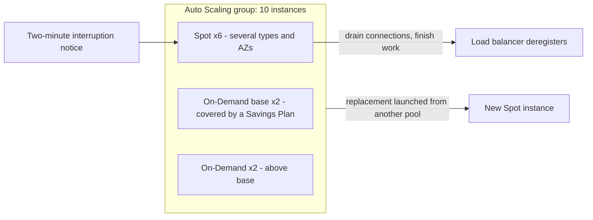
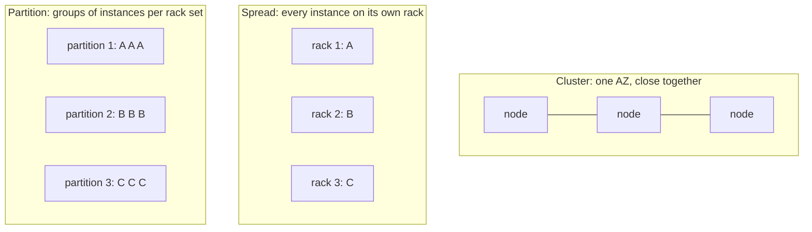

# Paying for EC2: purchasing options, placement groups and right-sizing

## Before this lesson

You should be able to launch and terminate an instance and read an instance type name ([EC2 instances, instance types, AMIs and user data](#/lesson/aws/ec2-instances)), and you should have a budget alert in place ([A safe first account](#/lesson/aws/account-and-billing)).

## In plain words

The same virtual server can cost very different amounts depending on **how you agree to pay for it**. AWS offers a menu:

- pay the full price with no promise (**On-Demand**);
- promise to keep using a certain amount for one or three years and get a large discount (**Savings Plans** and **Reserved Instances**);
- take spare capacity that AWS can take back at two minutes' notice, for the largest discount (**Spot**);
- pay extra to have physical machines to yourself (**Dedicated**).

Train tickets work the same way. A flexible ticket bought at the station costs the most. A season ticket is cheaper per journey if you travel every day. A last-minute standby seat is cheapest, but you may be asked to get off. First-class private compartments cost more.

This lesson also covers two related decisions: **where** instances are placed relative to each other (placement groups) and **how big** they should be (right-sizing). Why it matters for a job: compute is usually the largest line on an AWS bill, and "how would you reduce this cost?" is among the most common interview and exam scenarios.

## On-Demand

**On-Demand** is the default: no commitment, per-second billing (60-second minimum) for Linux, hourly for some licensed operating systems.

Use it for: new workloads whose usage you cannot predict yet, short experiments, spiky load on top of a committed baseline, and anything that must not be interrupted but will not run for a year.

It is the reference price. Every other option is described as a discount relative to it.

## Commitments: Savings Plans and Reserved Instances

Both exchange a **one- or three-year commitment** for a lower price. Neither is a different kind of instance: they are **billing discounts** that are applied automatically to matching usage. You launch instances exactly as before.

### Savings Plans

With a **Savings Plan** you commit to spend a fixed amount per hour — say USD 2.00 per hour — on compute for one or three years. Usage up to that amount is charged at the discounted rate; usage above it is charged On-Demand.

| Plan type | Applies to | Flexibility | Typical discount |
|---|---|---|---|
| Compute Savings Plan | EC2 in any Region, family, size and OS, **plus Fargate and Lambda** | Highest | up to about 66 % |
| EC2 Instance Savings Plan | One instance family in one Region (any size, any OS) | Medium | up to about 72 % |

### Reserved Instances

A **Reserved Instance (RI)** is the older mechanism: you reserve a specific configuration (instance type, Region, operating system, tenancy).

- **Standard RI**: largest discount (up to about 72 %); attributes are fixed, though the reservation can be sold on the Reserved Instance Marketplace.
- **Convertible RI**: smaller discount (up to about 66 %); can be exchanged for a different family, size or OS.
- **Regional scope** gives a billing discount anywhere in the Region; **zonal scope** additionally *reserves capacity* in one Availability Zone.

Reserved Instances still matter for other services: RDS, ElastiCache, Redshift and OpenSearch have *reserved nodes* and are not covered by Savings Plans.

### Payment options

Both mechanisms offer three ways to pay; the more you pay at the start, the larger the discount:

- **All Upfront** — the whole term paid on day one;
- **Partial Upfront** — part on day one, the rest monthly;
- **No Upfront** — monthly only, still committed for the full term.

> [!WARNING]
> A commitment is owed **whether or not you use it**. If the project is cancelled after four months, the remaining months are still billed. Commit only to the steady baseline you are confident will exist for the whole term — commonly 60–80 % of the minimum load — and cover the rest with On-Demand and Spot.

### Capacity Reservations

A discount does not guarantee that AWS has a free machine of the type you want in the zone you want during a regional incident. An **On-Demand Capacity Reservation** does: it holds capacity for a given type in a given Availability Zone, billed at the On-Demand rate whether used or not, with no term. Combine it with a Savings Plan to get both the guarantee and the discount. Disaster-recovery plans use this.

## Spot Instances

**Spot Instances** use capacity that AWS has not sold. The discount is typically 60–90 %. The catch: when AWS needs the capacity back it sends a **two-minute interruption notice** and then stops or terminates the instance.

How it works today (older texts describe bidding, which no longer exists):

- The **Spot price** for each instance type in each Availability Zone moves slowly with supply and demand. You pay the current price.
- You may set a maximum price, but the default (the On-Demand price) is almost always right.
- The notice arrives as an EventBridge event and in the instance metadata, so software can checkpoint and drain.
- AWS may also send an earlier **rebalance recommendation** when a pool is at elevated risk.

Good fits — work that tolerates interruption:

- batch jobs, data processing, rendering, CI build agents;
- stateless web servers behind a load balancer, mixed with On-Demand;
- machine-learning training that saves checkpoints.

Bad fits: a single database server, anything that cannot lose a node without downtime.

Making Spot reliable is about **diversification**: ask for many instance types across several Availability Zones, and let AWS pick the pools least likely to be interrupted (the *price-capacity-optimised* allocation strategy). In practice you rarely request Spot Instances directly; you configure an **Auto Scaling group** or **EC2 Fleet** with a mix such as "two On-Demand as a base, then 70 % Spot".



## Dedicated options

Normally your instance shares a physical host with other customers' instances (**shared tenancy**), isolated by the hypervisor.

- A **Dedicated Instance** runs on hardware that serves only your account. You do not see or control which host.
- A **Dedicated Host** is a whole physical server allocated to you, with visibility of its sockets and cores. It exists mainly for **bring-your-own-licence** software that is licensed per physical core or socket (some Windows Server, SQL Server and Oracle licences) and for strict compliance rules.

Both cost more. Choose them only when a licence or a regulator demands it.

## Comparison table

| Option | Commitment | Discount vs On-Demand | Can be interrupted? | Best for |
|---|---|---|---|---|
| On-Demand | none | 0 % | no | unpredictable or short workloads |
| Compute Savings Plan | 1 or 3 years, USD/hour | up to ~66 % | no | steady baseline, flexible across types, Fargate, Lambda |
| EC2 Instance Savings Plan | 1 or 3 years, one family and Region | up to ~72 % | no | steady baseline on a known family |
| Standard / Convertible RI | 1 or 3 years, specific configuration | up to ~72 % / ~66 % | no | legacy purchases; RDS, ElastiCache, Redshift equivalents |
| Capacity Reservation | none | 0 % (combine with a plan) | no | guaranteed capacity in an AZ |
| Spot | none | 60–90 % | **yes, 2-minute notice** | fault-tolerant, flexible work |
| Dedicated Host | optional | costs more | no | per-core licences, compliance |

## Worked example: where is the break-even?

A reservation charges for every hour of the month. On-Demand charges only for hours used. So a commitment only pays off above a certain utilisation. The simulation finds it.

```python-run
HOURS = 730                      # hours in an average month
on_demand = 0.096                # USD per hour, illustrative
committed = 0.060                # effective hourly rate with a 1-year commitment
spot = 0.030                     # average Spot rate
rework = 0.10                    # 10 % of Spot hours are redone after interruptions

print(f"{'hours used':>10} {'on-demand':>10} {'committed':>10} {'spot':>8}  cheapest safe option")
for used in (100, 300, 456, 457, 600, 730):
    cost_od = used * on_demand                 # pay only for what runs
    cost_ri = HOURS * committed                # pay for the whole month regardless
    cost_spot = used * (1 + rework) * spot     # redo some work after interruptions
    safe = "on-demand" if cost_od <= cost_ri else "commitment"
    print(f"{used:>10} {cost_od:>10.2f} {cost_ri:>10.2f} {cost_spot:>8.2f}  {safe}")

print("break-even utilisation:", f"{committed / on_demand:.1%}")
```

Reading the code: the loop tries several numbers of hours used in the month. On-Demand cost grows with the hours; the committed cost is a flat `730 × 0.060 = 43.80`; Spot cost includes 10 % extra hours for work repeated after interruptions. The last line shows the rule of thumb: **the break-even utilisation equals the committed rate divided by the On-Demand rate** — here 62.5 %, or about 456 hours. An instance running only during office hours (about 22 % of the month) should stay On-Demand, or better, be switched off at night. Spot is cheapest in every row, but only for work that can be interrupted.

The problem *On-Demand vs Reserved vs Spot* in this module asks you to code this decision exactly.

### A layered purchasing strategy

Real fleets combine the options:

1. **Baseline** that runs all year → Savings Plan (three-year for the part you are sure of, one-year for the rest).
2. **Predictable daily peaks** → On-Demand, started and stopped by Auto Scaling.
3. **Flexible or batch capacity** → Spot.
4. **Development and test** → On-Demand with a schedule that stops instances at night and weekends (that alone removes about 70 % of their hours).

## Placement groups

By default AWS spreads your instances over its hardware without telling you where. A **placement group** lets you influence the physical arrangement.

| Strategy | What it does | Trade-off | Use it for |
|---|---|---|---|
| **Cluster** | Packs instances close together in one Availability Zone on a high-bandwidth network segment | Lowest latency and highest throughput between nodes, but one rack or zone failure can hit them all | High-performance computing, tightly coupled simulations, distributed training |
| **Spread** | Puts each instance on distinct hardware (separate racks) | At most **seven running instances per Availability Zone** per group | A handful of critical instances that must not fail together |
| **Partition** | Divides the group into partitions (up to seven per zone); partitions do not share racks, instances inside a partition may | Large fleets with rack-level fault isolation | Hadoop, Cassandra, Kafka — software that understands "racks" |



```bash
# Create a cluster placement group and launch two instances into it.
aws ec2 create-placement-group --group-name sim-cluster --strategy cluster
aws ec2 run-instances --image-id "$AMI" --instance-type c7i.4xlarge --count 2 \
  --placement "GroupName=sim-cluster"
```

- `--strategy` is `cluster`, `spread` or `partition`.
- `--count 2` launches both at once. For cluster groups, launch all instances in one request and use the same instance type; adding instances later can fail with an *insufficient capacity* error because there may be no room left on that network segment.

For the highest network performance between nodes, combine a cluster placement group with **enhanced networking** (the Elastic Network Adapter, standard on current instance types) and, for HPC, the **Elastic Fabric Adapter**.

## Right-sizing

**Right-sizing** means choosing the cheapest instance type that meets the workload's needs with a sensible margin. Oversized instances are the most common waste in AWS accounts, because people size for a guess and never look again.

The procedure:

1. **Measure for at least two weeks**, covering a business cycle. CloudWatch gives CPU, network and disk metrics out of the box. **Memory is not collected by default** — install the CloudWatch agent to get it.
2. **Use a high percentile, not the average.** The *95th percentile* (p95) is the value that 95 % of measurements are below. Averages hide the busy hour.
3. **Add headroom**, typically 20–30 %, for growth and spikes.
4. **Pick the cheapest type that fits both CPU and memory.** Consider a different family, not only a smaller size, and consider Graviton.
5. **Change and observe.** Resizing an EBS-backed instance needs a stop, a type change and a start — a few minutes of downtime per instance, or none if instances sit behind a load balancer and are replaced one at a time.

**AWS Compute Optimizer** automates steps 1–4 and labels each instance *over-provisioned*, *under-provisioned* or *optimized*, with a recommended type.

```bash
# Resize a stopped instance (it must be EBS-backed).
aws ec2 stop-instances --instance-ids i-0a1b2c3d4e5f67890
aws ec2 wait instance-stopped --instance-ids i-0a1b2c3d4e5f67890
aws ec2 modify-instance-attribute --instance-id i-0a1b2c3d4e5f67890 \
  --instance-type "{\"Value\": \"m7g.large\"}"
aws ec2 start-instances --instance-ids i-0a1b2c3d4e5f67890
```

Moving from an `x86_64` type to a Graviton type also requires an `arm64` AMI, so that change is done by launching new instances, not by modifying one.

> [!TIP]
> The order that saves the most with the least risk: **switch off** what is unused, **right-size** what remains, **then** buy commitments for the right-sized baseline. Committing first locks in the waste.

## Cost notes and free-tier warnings

- Savings Plans and Reserved Instances are **purchases**. On a learning account, do not click "Purchase" to see what happens; there is no undo for most of them.
- Spot Instances are an inexpensive way to experiment with large types, but data on their instance store vanishes at interruption and EBS volumes left behind keep billing.
- Placement groups are free. The instance types usually put in cluster groups are not small.
- Dedicated Hosts bill per host-hour from allocation until you release the host, whether or not instances run on it.
- Compute Optimizer's standard recommendations are free.

## Pitfalls

- **Buying commitments for the peak** instead of the baseline.
- **Assuming a Reserved Instance or Savings Plan reserves capacity.** Only zonal RIs and Capacity Reservations do.
- **Running a stateful single node on Spot.**
- **A Spot fleet with one instance type in one zone**: when that pool is reclaimed, everything goes at once.
- **Spread placement for a fleet of thirty**: the limit is seven running instances per zone per group.
- **Right-sizing from CPU alone** and discovering afterwards that the application needed the memory.
- **Describing Spot as bidding.** The auction model was retired in 2017.

> [!INTERVIEW]
> **"Our EC2 bill is too high. Walk me through what you would do."** Start with visibility: Cost Explorer grouped by instance type, tag and purchase option. Remove idle resources and schedule non-production instances off outside working hours. Right-size using two weeks of p95 CPU and memory, considering newer generations and Graviton. Move fault-tolerant workloads to Spot inside Auto Scaling groups with diversified types. Only then cover the remaining steady baseline with a Compute Savings Plan, sized conservatively, and review quarterly.
>
> **"Savings Plan or Reserved Instance?"** Savings Plans for EC2, Fargate and Lambda because they are flexible and apply automatically; Reserved Instances (or reserved nodes) for services that Savings Plans do not cover, such as RDS and ElastiCache, or when a zonal capacity reservation is wanted.

## Cheat sheet

| Need | Choose |
|---|---|
| No commitment, cannot be interrupted | On-Demand |
| Steady usage for 1–3 years | Savings Plan (Compute for flexibility) |
| Lowest price, interruption acceptable | Spot, diversified, inside an Auto Scaling group |
| Guaranteed capacity in one AZ | Capacity Reservation (or zonal RI) |
| Per-core licences, compliance isolation | Dedicated Host |
| Lowest latency between nodes | Cluster placement group |
| Few critical instances on separate hardware | Spread placement group (max 7 per AZ) |
| Rack-aware big-data clusters | Partition placement group |
| Too-large instances | Right-size from p95 metrics; Compute Optimizer |

## Summary

- On-Demand is the flexible reference price; commitments (Savings Plans, Reserved Instances) discount steady usage; Spot discounts interruptible usage most of all.
- A commitment is paid for every hour, so it only wins above its break-even utilisation.
- Spot interruptions come with two minutes' notice; diversification and automation make Spot dependable.
- Placement groups trade failure isolation against network performance: cluster, spread, partition.
- Right-size from measured p95 CPU and memory with headroom, before buying commitments.

## Glossary

- **Break-even utilisation**: the fraction of hours above which a commitment is cheaper than On-Demand.
- **Capacity Reservation**: capacity held for you in an Availability Zone at the On-Demand price.
- **Compute Optimizer**: the service that recommends instance sizes from metrics.
- **Dedicated Host / Dedicated Instance**: a whole physical server allocated to you / an instance on hardware not shared with other accounts.
- **Enhanced networking**: high-performance network virtualisation used by current instance types.
- **On-Demand**: pay-as-you-go pricing with no commitment.
- **p95**: the value that 95 % of samples do not exceed.
- **Placement group**: a rule for how instances are physically arranged.
- **Reserved Instance**: a one- or three-year discount tied to a specific configuration.
- **Right-sizing**: matching instance size to measured need.
- **Savings Plan**: a one- or three-year commitment to an hourly spend, discounting matching compute.
- **Spot Instance**: spare capacity sold at a deep discount and reclaimable with two minutes' notice.
- **Tenancy**: whether an instance shares physical hardware with other customers.

```quiz
[
  {"q": "A nightly genomics pipeline runs for about four hours, can restart any failed step from a checkpoint, and must be as cheap as possible. Which purchasing option fits?",
   "options": ["On-Demand", "Three-year Standard Reserved Instances", "Spot Instances", "Dedicated Hosts"],
   "answer": 2,
   "explain": "The job is interruption-tolerant and short, exactly the Spot profile. A reservation would bill for the twenty idle hours each day."},
  {"q": "A company has run forty m6i.large instances around the clock for two years and expects to keep that level, but plans to migrate some services to Fargate and to newer instance families. What should cover the baseline?",
   "options": ["Standard Reserved Instances for m6i.large", "A Compute Savings Plan", "Spot Instances", "Capacity Reservations alone"],
   "answer": 1,
   "explain": "A Compute Savings Plan follows usage across families, Regions and even Fargate and Lambda, so the discount survives the migration. Standard RIs would be stranded on m6i."},
  {"q": "An instance costs 0.10 per hour On-Demand and 0.07 per hour (effective) with a one-year commitment. Above what utilisation does the commitment save money?",
   "options": ["30 %", "50 %", "70 %", "100 %"],
   "answer": 2,
   "explain": "Break-even is committed rate divided by On-Demand rate: 0.07 / 0.10 = 70 %. Below that, paying On-Demand only for hours used is cheaper."},
  {"q": "A disaster-recovery plan requires that 20 c7i.2xlarge instances can definitely be started in eu-west-1b during a regional capacity crunch. What guarantees this?",
   "options": ["A regional Savings Plan", "An On-Demand Capacity Reservation in eu-west-1b", "A spread placement group", "Requesting Spot with a high maximum price"],
   "answer": 1,
   "explain": "Only Capacity Reservations (or zonal Reserved Instances) hold capacity. Savings Plans are purely a billing discount."},
  {"q": "A fluid-dynamics simulation runs on 16 instances that exchange messages constantly; network latency between nodes dominates run time. Which placement strategy?",
   "options": ["Spread", "Partition", "Cluster", "No placement group, spread across three AZs"],
   "answer": 2,
   "explain": "Cluster placement packs instances close together in one AZ for the lowest latency and highest throughput, at the cost of correlated failure risk."},
  {"q": "A team puts 12 critical instances in one spread placement group in a single Availability Zone and the launch of the eighth fails. Why?",
   "options": ["Spread groups allow at most seven running instances per AZ", "Spread groups require Dedicated Hosts", "Spread groups only work with Spot", "The instances must be the same type"],
   "answer": 0,
   "explain": "Each instance in a spread group goes on distinct hardware and the limit is seven per Availability Zone per group. Use several zones or a partition group."},
  {"q": "Before buying a Savings Plan, an engineer finds average CPU at 9 % and p95 CPU at 22 % on a fleet of m6i.2xlarge instances, with memory p95 at 30 %. What should happen first?",
   "options": ["Buy the plan for the current fleet immediately", "Right-size the fleet, then size the commitment to the smaller baseline", "Convert everything to Dedicated Hosts", "Increase the instance size to add headroom"],
   "answer": 1,
   "explain": "The fleet is heavily over-provisioned. Committing first would lock in spending for capacity that right-sizing would remove."}
]
```

> **Source:** AWS Certified Solutions Architect Official Study Guide, ch. 3 (pricing options, tenancy, placement groups). The book describes Spot bidding and predates Savings Plans; current behaviour checked against https://docs.aws.amazon.com/AWSEC2/latest/UserGuide/instance-purchasing-options.html , https://docs.aws.amazon.com/savingsplans/latest/userguide/what-is-savings-plans.html and https://docs.aws.amazon.com/AWSEC2/latest/UserGuide/placement-groups.html
