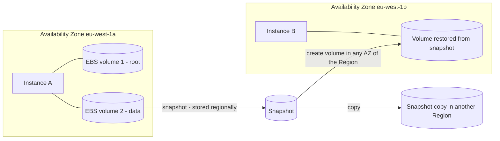

# EBS volumes, snapshots and instance store

## Before this lesson

You should know how an instance is launched, stopped and terminated ([EC2 instances, instance types, AMIs and user data](#/lesson/aws/ec2-instances)) and what an Availability Zone is ([the AWS global map](#/lesson/aws/what-is-cloud)). It helps to know that a Linux disk must be formatted with a file system and *mounted* at a directory before use; the Linux track's [storage lesson](#/lesson/linux-cli/storage-media) explains that.

## In plain words

An instance needs disks. AWS offers two kinds of disk for EC2:

- **Amazon EBS** (Elastic Block Store): a disk that lives on the network, separately from the instance. It keeps its data when the instance stops, can be detached and attached to another instance, and can be copied to a backup with one command.
- **Instance store**: a disk physically inside the host machine. It is very fast and included in the instance price, but its contents vanish when the instance stops or the host fails.

An analogy: an EBS volume is an **external USB drive** — unplug it from one computer and plug it into another, and your files are still there. Instance store is a **hotel-room whiteboard**: quick to write on, but wiped when you check out.

Why it matters for a job: choosing the wrong volume type is a classic cause of slow databases and of surprisingly large bills; and "we lost the data because it was on instance store" is a mistake people make exactly once.

## Block, file and object storage

Three words appear throughout this track.

- **Block storage** presents a raw sequence of numbered blocks. The operating system puts a file system on it and uses it like a local disk. EBS and instance store are block storage.
- **File storage** presents folders and files over the network to many machines at once (EFS, FSx — module 3).
- **Object storage** stores whole objects (a file plus metadata) by name over HTTP; there is no "edit in place" (S3 — module 3).

Databases and operating systems need block storage because they update small pieces of files constantly.

## EBS essentials

- A volume lives in **one Availability Zone** and can attach only to instances **in that same zone**. Inside the zone AWS keeps redundant copies automatically, so the failure of a single physical disk does not lose the volume.
- A volume normally attaches to **one instance at a time**. (A feature called *Multi-Attach* lets `io1`/`io2` volumes attach to several instances in one zone, for clustered software that coordinates its own writes. It is not a shared file system.)
- A volume is billed for its **provisioned size**, not for the data in it, from creation to deletion.
- Size, type and performance can be changed **while in use** (a feature called Elastic Volumes). Size can only go up.
- The **root volume** is deleted on termination by default; extra volumes are kept by default. Both are controlled by a flag called `DeleteOnTermination`.



## Two numbers that describe disk speed

- **IOPS** (input/output operations per second): how many separate read or write operations the disk completes each second. Matters for workloads doing many small, scattered operations — transactional databases.
- **Throughput** (MiB per second): how much data flows per second. Matters for large sequential reads and writes — log processing, data warehouses, video.

The two are linked by the size of each operation: `throughput = IOPS × I/O size`. A volume doing 3,000 IOPS with 16 KiB operations moves about 47 MiB/s; with 256 KiB operations it would need 750 MiB/s, so the throughput limit is reached first.

## Volume types

There are two families: **SSD** (solid-state, good at random small operations) and **HDD** (spinning disks, good only at sequential streams and cheaper per GB).

| Type | Family | Size | Max IOPS | Max throughput | Use it for |
|---|---|---|---|---|---|
| **gp3** | General purpose SSD | 1 GiB – 64 TiB | 80,000 | 2,000 MiB/s | The default for almost everything: boot volumes, most databases, dev/test |
| gp2 | General purpose SSD (previous generation) | 1 GiB – 16 TiB | 16,000 | 250 MiB/s | Legacy; migrate to gp3 |
| **io2 Block Express** | Provisioned IOPS SSD | 4 GiB – 64 TiB | 256,000 | 4,000 MiB/s | Large, latency-sensitive, business-critical databases; 99.999 % durability |
| io1 | Provisioned IOPS SSD (previous generation) | 4 GiB – 16 TiB | 64,000 | 1,000 MiB/s | Legacy |
| **st1** | Throughput optimised HDD | 125 GiB – 16 TiB | 500 | 500 MiB/s | Big sequential workloads: log processing, data warehouses. Cannot be a boot volume |
| **sc1** | Cold HDD | 125 GiB – 16 TiB | 250 | 250 MiB/s | Rarely accessed data at the lowest price. Cannot be a boot volume |

Limits rise over time (gp3's ceiling was raised from 16,000 to 80,000 IOPS in 2025, for example), so verify exact figures in the documentation before quoting them in a design.

### gp3 versus gp2

The difference between these two is a frequent exam and interview topic.

- **gp2** ties performance to size: 3 IOPS per GiB, with a floor of 100 and a ceiling of 16,000. A 100 GiB volume has a baseline of only 300 IOPS. Small volumes can *burst* to 3,000 IOPS using **I/O credits**, a bucket that fills while the volume is quiet and drains while it is busy. When the bucket is empty the volume drops to its baseline, and a database that seemed fine in testing slows to a crawl in production.
- **gp3** separates the two: every volume gets **3,000 IOPS and 125 MiB/s included**, whatever its size, with no credits. More can be bought independently (up to 500 IOPS per GiB, and 0.25 MiB/s per provisioned IOPS). It is also about 20 % cheaper per GiB.

```python-run
def gp2_iops(size_gib):
    """Baseline IOPS of a gp2 volume: 3 per GiB, at least 100, at most 16,000."""
    return min(16000, max(100, 3 * size_gib))

def gp2_burst_minutes(size_gib, credits=5_400_000):
    """How long a full credit bucket sustains a 3,000 IOPS burst."""
    base = gp2_iops(size_gib)
    if base >= 3000:
        return None                      # baseline already at or above the burst level
    return credits / (3000 - base) / 60  # credits drain at (burst - baseline) per second

print(f"{'size GiB':>8} {'gp2 baseline':>13} {'gp2 burst min':>14} {'gp3 included':>13}")
for size in (8, 30, 100, 334, 500, 1000, 4000):
    burst = gp2_burst_minutes(size)
    burst_txt = "n/a" if burst is None else f"{burst:.0f}"
    print(f"{size:>8} {gp2_iops(size):>13} {burst_txt:>14} {3000:>13}")
```

Line by line: `gp2_iops` applies the three-part rule with `min` and `max`. `gp2_burst_minutes` uses the fact that a volume starts with 5.4 million credits and spends them at "burst rate minus baseline" per second; dividing gives seconds, then minutes. The table shows that a 100 GiB gp2 volume can burst for about 33 minutes and then falls to 300 IOPS, while a gp3 volume of any size holds 3,000 indefinitely. That is why gp3 is the default choice.

The problem *EBS Volume IOPS and Throughput* in this module has you implement these rules for four volume types.

### When to pay for Provisioned IOPS

Choose `io2` when the workload needs **more IOPS than gp3 offers, sub-millisecond and consistent latency, or higher durability** — for example a large transactional database where storage latency directly limits transactions per second.

> [!TIP]
> The volume is only half of the path. Every instance type has its own **maximum EBS IOPS and throughput**. A volume provisioned for 30,000 IOPS attached to an instance limited to 12,000 delivers 12,000. Check the instance limit before buying volume performance; current instance types are *EBS-optimised* by default, meaning they have dedicated network capacity for storage traffic.

## Snapshots

A **snapshot** is a point-in-time copy of a volume, stored by AWS in S3 (you do not see the bucket). Snapshots are how you back up, copy and move volumes.

- **Incremental**: the first snapshot copies all used blocks; each later one stores only the blocks that changed since the previous snapshot. Deleting an old snapshot never breaks newer ones — AWS keeps any blocks they still need.
- **Regional**: a snapshot can create a new volume in **any Availability Zone** of its Region. This is how a volume "moves" between zones.
- **Copyable across Regions and accounts**, which is the basis of disaster-recovery copies.
- **Taken while in use.** The snapshot captures what is on the disk at the instant it starts. For a consistent database backup, flush and pause writes briefly, or stop the instance; multi-volume snapshots can capture several volumes at the same instant.

### Restoring is lazy

A volume created from a snapshot is usable immediately, but its blocks are fetched from S3 the first time each one is read, so first reads are slow. For volumes that must perform at full speed straight away, enable **Fast Snapshot Restore** on the snapshot (charged per hour per zone) or read every block once before use.

### Automating and protecting snapshots

- **Amazon Data Lifecycle Manager** creates and deletes snapshots on a schedule, selected by tag ("every volume tagged `Backup=daily`: snapshot at 02:00, keep 14").
- **AWS Backup** does the same across many services (EBS, RDS, DynamoDB, EFS) from one policy.
- **Snapshot archive** is a cheaper tier for snapshots kept for months, with a restore time of a day or more.
- **Recycle Bin** keeps deleted snapshots and AMIs for a period you choose, protecting against accidental deletion.

An **AMI** of an EBS-backed instance is, underneath, a set of snapshots plus launch settings. That is why deregistering an AMI does not delete its snapshots: you must delete them separately or keep paying for them.

## Encryption

EBS encryption uses keys held in **AWS KMS** (Key Management Service, module 6). When a volume is encrypted:

- data at rest on the volume, data moving between the volume and the instance, and all snapshots made from it are encrypted;
- snapshots of encrypted volumes are encrypted, and volumes created from them are too;
- the performance cost is negligible.

There is no direct switch to encrypt an existing unencrypted volume. The route is: **snapshot → copy the snapshot with encryption enabled → create a volume from the encrypted copy → swap volumes**. The simpler policy is to turn on **encryption by default** in the account's EC2 settings for each Region, so every new volume is encrypted without anyone remembering to tick a box.

## Instance store

Some instance types (those with a `d` in the name, such as `m7gd` or `i4i`, plus the storage-optimised families) include **instance store** volumes: NVMe SSDs physically attached to the host.

| Property | Instance store | EBS |
|---|---|---|
| Location | Inside the host | Network storage in the AZ |
| Persistence | Lost on stop, hibernate, terminate or host failure; **survives reboot** | Independent of the instance's life |
| Performance | Hundreds of thousands to millions of IOPS, very low latency | Up to 256,000 IOPS per volume |
| Cost | Included in the instance price | Per GB-month plus provisioned performance |
| Snapshots | None | Yes |
| Resize, detach, move | No | Yes |

Data on instance store is called **ephemeral**. Use it for things that can be rebuilt: caches, temporary scratch space, buffers, and replicated data stores (a Cassandra or Kafka cluster that keeps three copies on three nodes can lose one node's disk safely).

## Worked example: add, grow, snapshot and move a data volume

> [!WARNING]
> These commands create a billable volume and snapshots (a few US cents per day at this size). The final step deletes them.

```bash
# 1. Create a 20 GiB gp3 volume in the instance's zone and attach it.
VOL=$(aws ec2 create-volume --availability-zone eu-west-1a --size 20 \
  --volume-type gp3 --encrypted \
  --tag-specifications 'ResourceType=volume,Tags=[{Key=Name,Value=data}]' \
  --query VolumeId --output text)
aws ec2 wait volume-available --volume-ids "$VOL"
aws ec2 attach-volume --volume-id "$VOL" --instance-id i-0a1b2c3d4e5f67890 --device /dev/sdf
```

- `--availability-zone` must match the instance's zone, or the attach fails.
- `--encrypted` uses the account's default KMS key for EBS.
- `--device /dev/sdf` is the name requested; on current (Nitro) instances the disk appears inside Linux as an NVMe device such as `/dev/nvme1n1`.

```bash
# 2. On the instance: create a file system and mount it.
sudo mkfs -t xfs /dev/nvme1n1        # format (only once - this erases the disk)
sudo mkdir -p /data
sudo mount /dev/nvme1n1 /data        # make it available at /data
df -h /data
```

```
Filesystem      Size  Used Avail Use% Mounted on
/dev/nvme1n1     20G  175M   20G   1% /data
```

```bash
# 3. Grow the volume to 50 GiB and raise performance, without downtime.
aws ec2 modify-volume --volume-id "$VOL" --size 50 --iops 6000 --throughput 250
# then, on the instance, tell the file system about the new space:
sudo xfs_growfs /data
```

`modify-volume` changes the block device; the file system does not know about the extra space until `xfs_growfs` (or `resize2fs` for ext4) is run. Forgetting this second step is the usual reason "the resize did not work". After a modification you must wait six hours before modifying the same volume again.

```bash
# 4. Snapshot it, then create a copy of the volume in another zone.
SNAP=$(aws ec2 create-snapshot --volume-id "$VOL" --description "data before upgrade" \
  --query SnapshotId --output text)
aws ec2 wait snapshot-completed --snapshot-ids "$SNAP"
aws ec2 create-volume --availability-zone eu-west-1b --snapshot-id "$SNAP" --volume-type gp3
```

```bash
# 5. Clean up (after unmounting on the instance with: sudo umount /data).
aws ec2 detach-volume --volume-id "$VOL"
aws ec2 delete-volume --volume-id "$VOL"
aws ec2 delete-snapshot --snapshot-id "$SNAP"
# also delete the second volume created in step 4
```

## Combining volumes: RAID

**RAID** combines several disks into one logical disk in the operating system. Two levels are relevant on EBS:

- **RAID 0** (striping) spreads data across volumes to add their IOPS and throughput together; losing any one volume loses everything. Used when one volume's maximum is not enough.
- **RAID 1** (mirroring) writes the same data to two volumes for redundancy beyond what EBS already provides; rarely needed.

RAID 5 and 6 are discouraged on EBS because their parity writes consume IOPS.

## Cost notes and free-tier warnings

- You pay for **provisioned GiB-months** even when the volume is empty or the instance is stopped.
- gp3 charges extra only for IOPS above 3,000 and throughput above 125 MiB/s; io2 charges for every provisioned IOPS, which can exceed the storage charge many times over.
- **Snapshots** are billed for the changed blocks they store. They accumulate silently: a daily snapshot without a retention rule grows the bill every day.
- **Unattached volumes** (state `available`) are pure waste. Find them with `aws ec2 describe-volumes --filters Name=status,Values=available`.
- Fast Snapshot Restore is expensive (charged hourly per snapshot per zone); enable it only where needed.

## Pitfalls

- **Creating the volume in a different Availability Zone from the instance.**
- **Keeping important data on instance store** without replication elsewhere.
- **Assuming "terminate" keeps the data**: the root volume is deleted unless you changed the flag.
- **Sizing a gp2 volume by capacity only**, then hitting the I/O credit wall.
- **Forgetting to extend the file system** after growing a volume.
- **Deregistering AMIs but leaving their snapshots.**
- **Sharing or copying snapshots encrypted with the default AWS-managed key**: they cannot be shared across accounts; use a customer-managed key for anything you intend to share.

> [!INTERVIEW]
> **"How would you move an EBS volume to another Availability Zone or Region?"** Take a snapshot. In the same Region, create a volume from it in the target zone. For another Region, copy the snapshot there first, then create the volume. An encrypted snapshot needs a KMS key available in the destination.
>
> **"gp3 or io2 for a production database?"** Start with gp3: 3,000 IOPS included, up to 80,000 purchasable, at a lower price. Move to io2 Block Express when the database needs more IOPS than that, consistently sub-millisecond latency, or the higher durability — and confirm that the instance type's EBS limits can use it.

## Cheat sheet

| Question | Answer |
|---|---|
| Default volume type | gp3 (3,000 IOPS / 125 MiB/s included) |
| Highest performance and durability | io2 Block Express |
| Cheap sequential throughput | st1; coldest and cheapest: sc1 (neither can boot) |
| Scope of a volume | One Availability Zone |
| Scope of a snapshot | Regional; copy for other Regions |
| Snapshots are | Incremental, restorable to any AZ, lazily loaded |
| Encrypt an existing volume | Snapshot → encrypted copy → new volume |
| Instance store survives | Reboot only |
| Grow a volume | `modify-volume`, then grow the file system |

## Summary

- EBS is persistent network block storage scoped to one Availability Zone; instance store is fast, free with the instance and ephemeral.
- IOPS measures operations, throughput measures volume of data; SSD types serve random access, HDD types serve sequential streams.
- gp3 is the default; its performance is independent of size, unlike gp2 with its size-based baseline and burst credits.
- Snapshots are incremental, regional backups from which volumes can be created in any zone, copied across Regions and shared.
- Encrypt by default, automate snapshot retention, and remember the instance's own EBS limits.

## Glossary

- **Block storage**: storage exposed as raw numbered blocks, used like a local disk.
- **Data Lifecycle Manager**: the scheduler for EBS snapshots and AMIs.
- **EBS**: Elastic Block Store, persistent network volumes for EC2.
- **EBS-optimised**: having dedicated network capacity for EBS traffic.
- **Elastic Volumes**: changing size, type or performance of a volume in use.
- **Ephemeral**: lost when the instance stops or fails.
- **Fast Snapshot Restore**: a paid option that makes volumes from a snapshot fully performant at creation.
- **I/O credit**: the unit a gp2 volume spends to burst above its baseline.
- **Instance store**: disks physically attached to the host.
- **IOPS**: input/output operations per second.
- **RAID 0 / RAID 1**: striping for speed / mirroring for redundancy.
- **Snapshot**: an incremental, point-in-time copy of a volume.
- **Throughput**: megabytes transferred per second.

```quiz
[
  {"q": "A 60 GiB gp2 volume holds a database that performs well for the first half hour of each batch job and then becomes very slow. What is the most likely cause and fix?",
   "options": ["The volume is full; add space", "I/O credits are exhausted and the volume has fallen to its 180 IOPS baseline; migrate to gp3", "The snapshot is running; disable snapshots", "The instance needs a public IP"],
   "answer": 1,
   "explain": "A 60 GiB gp2 volume has a 180 IOPS baseline and bursts to 3,000 only while credits last (about half an hour). gp3 provides 3,000 IOPS continuously regardless of size."},
  {"q": "An instance in eu-west-1a must be replaced by one in eu-west-1c, keeping the data volume. What is the correct procedure?",
   "options": ["Detach the volume and attach it to the new instance", "Snapshot the volume and create a new volume from the snapshot in eu-west-1c", "Enable Multi-Attach", "Change the volume's Availability Zone with modify-volume"],
   "answer": 1,
   "explain": "A volume cannot leave its Availability Zone. Snapshots are regional, so a new volume can be created from one in any zone of the Region."},
  {"q": "Which data should NOT be stored only on instance store?",
   "options": ["A cache that can be rebuilt", "Temporary files of a batch job", "The single copy of a customer orders database", "Shuffle space for a Spark job"],
   "answer": 2,
   "explain": "Instance store is lost on stop, termination or host failure. Irreplaceable data belongs on EBS (with snapshots) or a replicated or managed store."},
  {"q": "A team takes a snapshot of a 500 GiB volume every night; about 5 GiB of blocks change each day. Roughly how much snapshot storage is used after 10 nights?",
   "options": ["5,000 GiB", "About 545 GiB (one full copy of used blocks plus nine increments)", "50 GiB", "500 GiB exactly, whatever changes"],
   "answer": 1,
   "explain": "Snapshots are incremental: the first stores all used blocks (at most 500 GiB), each later one only the changed blocks."},
  {"q": "A security review requires an existing unencrypted data volume to be encrypted. What is the approach?",
   "options": ["Tick 'encrypt' in the volume's settings", "Snapshot the volume, copy the snapshot with encryption enabled, create a volume from the copy and swap it in", "Run modify-volume --encrypted", "It is impossible; rebuild the server from scratch"],
   "answer": 1,
   "explain": "Encryption cannot be toggled on an existing volume. The snapshot-copy-restore route produces an encrypted volume with the same data."},
  {"q": "A 2 TiB volume stores application logs that are written sequentially and read in large scans a few times a day. Cost matters more than latency. Which type?",
   "options": ["io2", "gp3", "st1", "Instance store"],
   "answer": 2,
   "explain": "Throughput-optimised HDD (st1) is designed for large sequential workloads at a lower price per GiB than SSD."},
  {"q": "A gp3 volume is provisioned with 20,000 IOPS and attached to an instance type whose maximum EBS performance is 10,000 IOPS. What does the workload get?",
   "options": ["20,000 IOPS", "30,000 IOPS", "At most 10,000 IOPS", "3,000 IOPS"],
   "answer": 2,
   "explain": "The instance's own EBS limit caps what any attached volumes can deliver. Performance paid for above that limit is wasted."},
  {"q": "After running modify-volume to grow a volume from 50 to 100 GiB, 'df -h' on the instance still shows 50 GiB. What is missing?",
   "options": ["A reboot is always required", "The file system must be extended (for example xfs_growfs or resize2fs)", "The volume must be detached and reattached", "Snapshots must be deleted first"],
   "answer": 1,
   "explain": "modify-volume enlarges the block device; the file system on it must then be grown to use the new space."}
]
```

> **Source:** AWS Certified Solutions Architect Official Study Guide, ch. 3 (Amazon EBS, instance stores). The book predates gp3 and io2; current limits checked against https://docs.aws.amazon.com/ebs/latest/userguide/ebs-volume-types.html , https://docs.aws.amazon.com/ebs/latest/userguide/general-purpose.html and https://docs.aws.amazon.com/ebs/latest/userguide/ebs-snapshots.html
