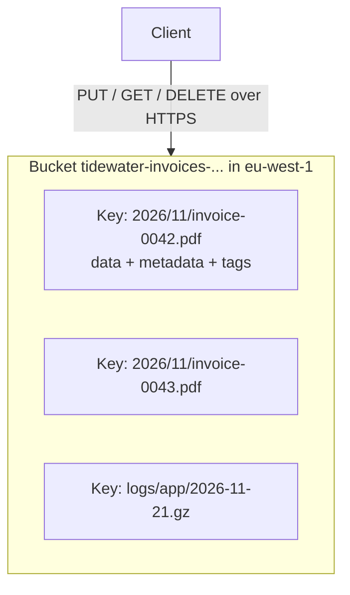
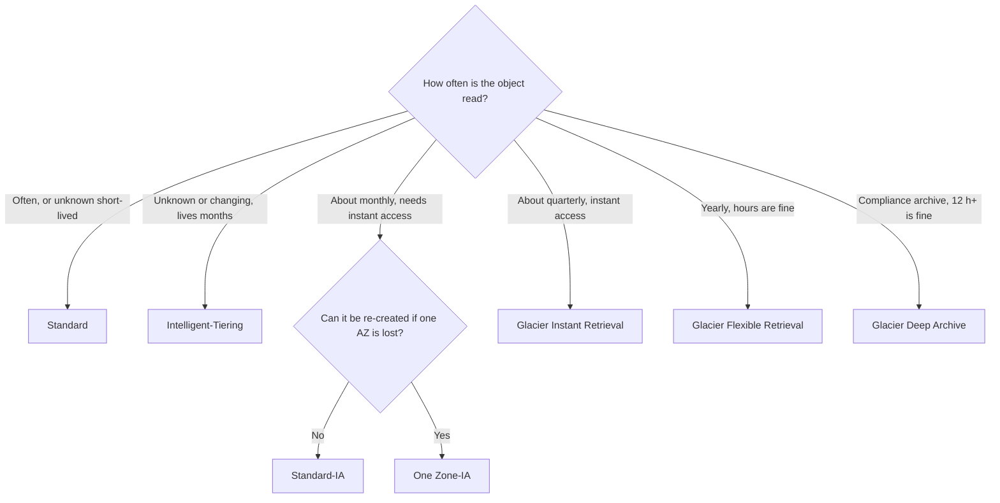

# S3 buckets, objects, storage classes and lifecycle rules

## Before this lesson

You need the vocabulary of [the first module](#/lesson/aws/what-is-cloud) (Region, Availability Zone) and the idea of block versus object storage from [EBS volumes, snapshots and instance store](#/lesson/aws/ebs-storage). You should be able to run an AWS CLI command ([four ways to drive AWS](#/lesson/aws/responsibility-and-tools)).

## In plain words

**Amazon S3** (Simple Storage Service) stores files — AWS calls them **objects** — in containers called **buckets**. You put an object in with a name, and you get it back by that name over the internet protocol HTTPS. There is no disk to size, no server to run, and no practical limit to how much you can store.

Picture a **coat check** with unlimited hooks. You hand over a coat and receive a ticket; show the ticket and you get the same coat back. You cannot ask the attendant to sew on one button while the coat hangs there — you collect it, change it, and check it in again. S3 behaves the same way: objects are written and read **whole**. And you can choose how the coat is kept: on the front rail for instant collection, or in a cheaper warehouse across town where retrieval takes hours.

Why it matters for a job: S3 is the most widely used service on AWS. Backups, logs, images, data lakes, machine-learning datasets, static websites and the outputs of almost every other service end up there. Understanding its storage classes is also the easiest way to save real money.

## Buckets, objects and keys

- A **bucket** is a named container created in one Region. Bucket names share one worldwide namespace: if anyone anywhere owns `photos`, you cannot. Names are 3–63 characters of lowercase letters, digits and hyphens. A common convention adds the account ID and Region: `tidewater-invoices-111122223333-eu-west-1`.
- An **object** is the data plus metadata. It can be from 0 bytes to **50 TB** (raised from 5 TB, a figure that older material still quotes). A single upload request can carry up to 5 GB; larger objects must use **multipart upload**, which sends the object in parts, in parallel, and is recommended above about 100 MB.
- A **key** is the object's full name inside the bucket, for example `2026/11/invoice-0042.pdf`.

There are **no folders**. The console draws folders because many keys share a **prefix** (`2026/11/`) and it groups on the `/` character. This matters: "listing a folder" is really "listing keys that start with a prefix", and lifecycle rules, permissions and event notifications all select objects by prefix.

Each object also carries:

- **system metadata** (size, last-modified time, content type, storage class, an **ETag** that acts as a fingerprint);
- optional **user metadata** (your own `x-amz-meta-…` headers);
- optional **tags** (up to ten key/value pairs, usable in lifecycle rules and access policies);
- a **version ID** when versioning is on (next lesson).



### What you can and cannot do with an object

| Operation | Supported? |
|---|---|
| Upload a whole object (PUT) | Yes |
| Download a whole object, or a byte range of it (GET) | Yes |
| Delete, copy, list by prefix | Yes |
| Change ten bytes in the middle | **No** — upload a new object |
| Append to an existing object | Not in general-purpose buckets |
| Lock a file while editing, as a file system does | No |

This is why S3 is not a disk for a database or an operating system, and why it scales so well: each object is independent.

## Durability, availability and consistency

Three properties are quoted constantly.

- **Durability** is the chance that data is not lost. S3 is designed for **99.999999999 %** ("eleven nines") durability per year: store ten million objects and you might expect to lose one every ten thousand years. S3 achieves this by keeping redundant pieces of every object on many devices across **at least three Availability Zones** (for most classes).
- **Availability** is the chance that a request succeeds at a given moment. S3 Standard is designed for 99.99 %.
- **Consistency** describes what a read sees after a write. S3 gives **strong read-after-write consistency**: once a PUT or DELETE succeeds, every later read and list reflects it.

> [!NOTE]
> Older books (including the edition this track follows) describe S3 as *eventually consistent* for overwrites and deletes. That changed in December 2020; S3 is now strongly consistent for all operations at no extra cost. If you meet the old statement in a practice question, check the question's date.

Durability is not a backup. Eleven nines protects against hardware failure, not against a script that deletes the wrong prefix. Versioning and replication (next lesson) cover that.

## First commands

```bash
# Create a bucket in Ireland.
aws s3 mb s3://tidewater-demo-111122223333-eu-west-1 --region eu-west-1
```

```
make_bucket: tidewater-demo-111122223333-eu-west-1
```

```bash
# Upload one file, then a whole directory.
aws s3 cp invoice-0042.pdf s3://tidewater-demo-111122223333-eu-west-1/2026/11/
aws s3 sync ./reports s3://tidewater-demo-111122223333-eu-west-1/reports/
```

- `s3 mb` means *make bucket*. `s3://bucket/key` is the CLI's address format.
- `cp` copies one file (add `--recursive` for a directory). A destination ending in `/` keeps the file name.
- `sync` uploads only files that are new or changed, like `rsync`. Add `--delete` to remove remote files that no longer exist locally — powerful, and dangerous if the paths are swapped.

```bash
# List keys under a prefix, with sizes.
aws s3 ls s3://tidewater-demo-111122223333-eu-west-1/2026/11/ --human-readable
```

```
2026-11-21 10:15:02  184.3 KiB invoice-0042.pdf
```

```bash
# Inspect one object's metadata without downloading it.
aws s3api head-object --bucket tidewater-demo-111122223333-eu-west-1 --key 2026/11/invoice-0042.pdf
```

```
{
    "LastModified": "2026-11-21T10:15:02+00:00",
    "ContentLength": 188723,
    "ETag": "\"9b2cf535f27731c974343645a3985328\"",
    "ContentType": "application/pdf",
    "ServerSideEncryption": "AES256",
    "Metadata": {}
}
```

`ServerSideEncryption: AES256` shows that the object was encrypted at rest automatically; S3 has encrypted every new object by default since January 2023. The `aws s3` commands are convenient high-level tools; `aws s3api` exposes each underlying API operation.

## Storage classes

Every object has a **storage class** that sets its price and retrieval behaviour. All classes share the eleven-nines durability design; they differ in price per GB, price per retrieval, speed of access and number of zones.

| Class | Designed for | Zones | Access time | Min. storage duration | Min. billable size | Retrieval fee |
|---|---|---|---|---|---|---|
| **S3 Standard** | Frequently used data | ≥ 3 | milliseconds | none | none | no |
| **S3 Intelligent-Tiering** | Unknown or changing access patterns | ≥ 3 | milliseconds | none | none | no (small monitoring fee per object) |
| **S3 Standard-IA** | Infrequent access, must stay instantly available | ≥ 3 | milliseconds | 30 days | 128 KB | yes, per GB |
| **S3 One Zone-IA** | Infrequent, re-creatable data | **1** | milliseconds | 30 days | 128 KB | yes |
| **S3 Glacier Instant Retrieval** | Archive touched about once a quarter | ≥ 3 | milliseconds | 90 days | 128 KB | yes, higher |
| **S3 Glacier Flexible Retrieval** | Archive touched about once a year | ≥ 3 | minutes to hours | 90 days | 40 KB overhead per object | yes |
| **S3 Glacier Deep Archive** | Long-term retention, almost never read | ≥ 3 | hours (up to 12–48) | 180 days | 40 KB overhead per object | yes |
| S3 Express One Zone | Lowest latency for request-heavy workloads | 1 | single-digit ms | none | none | — |

*IA* means infrequent access. A few explanations make the table readable:

- **Minimum storage duration**: delete or move an object earlier and you are charged as if it had stayed for the whole minimum.
- **Minimum billable size**: in the IA classes and Glacier Instant Retrieval, an object smaller than 128 KB is billed as 128 KB. In the two archive classes each object carries 40 KB of extra index data (32 KB at the archive price, 8 KB at the Standard price). **Millions of tiny files are therefore expensive to archive**; bundle them into larger archives first.
- **Retrieval fee**: the colder the class, the cheaper to store and the dearer to read. A class that is cheap for data you never read becomes expensive for data you read often.
- Objects in Glacier Flexible Retrieval and Deep Archive are **not readable directly**. You issue a *restore* request, wait, and then read a temporary copy. Flexible Retrieval offers expedited (1–5 minutes), standard (3–5 hours) and bulk (5–12 hours, free) options; Deep Archive offers standard (about 12 hours) and bulk (about 48 hours).

> [!NOTE]
> "Amazon Glacier" in older material was a separate archive service with its own *vaults* and *archives*. Today archiving is done with the three **S3 Glacier storage classes** inside ordinary buckets, and the old stand-alone service is legacy. The class called simply "Glacier" in old texts corresponds to *Glacier Flexible Retrieval*.

### Intelligent-Tiering

If you cannot predict access, **S3 Intelligent-Tiering** watches each object and moves it automatically between a frequent tier, an infrequent tier (after 30 days without access) and an archive-instant tier (after 90 days), and back to frequent the moment it is read. There are no retrieval fees; you pay a small monthly monitoring charge per object (objects under 128 KB are not monitored and stay in the frequent tier). It is a sound default for data lakes and user uploads.

### Choosing a class



## Lifecycle rules

Data usually cools with age: this week's logs are read constantly, last year's almost never. A **lifecycle configuration** tells S3 to act on objects as they age, with no code to run.

A rule has a **filter** (a prefix, tags, or object size bounds) and **actions**:

- **Transition**: move objects to a colder class after N days.
- **Expiration**: delete objects after N days.
- Clean-up actions: delete old versions, remove expired delete markers, **abort incomplete multipart uploads** after N days.

```json
{
  "Rules": [
    {
      "ID": "logs-cool-then-expire",
      "Status": "Enabled",
      "Filter": {"Prefix": "logs/"},
      "Transitions": [
        {"Days": 30, "StorageClass": "STANDARD_IA"},
        {"Days": 90, "StorageClass": "GLACIER"}
      ],
      "Expiration": {"Days": 365},
      "AbortIncompleteMultipartUpload": {"DaysAfterInitiation": 7}
    }
  ]
}
```

Field by field:

- `ID` is a label for humans; `Status` lets you disable a rule without deleting it.
- `Filter.Prefix` limits the rule to keys beginning with `logs/`. An empty filter means the whole bucket.
- `Transitions` moves objects to Standard-IA at 30 days old and to Glacier Flexible Retrieval (API name `GLACIER`) at 90 days.
- `Expiration` deletes them at 365 days.
- `AbortIncompleteMultipartUpload` removes the invisible parts of uploads that never finished. Those parts are billed and do not appear in normal listings, so every bucket should have this action.

```bash
aws s3api put-bucket-lifecycle-configuration \
  --bucket tidewater-demo-111122223333-eu-west-1 \
  --lifecycle-configuration file://lifecycle.json
```

Rules of the road:

- Transitions only go **downhill** towards colder classes. Moving back up is done by copying the object.
- Objects must be at least 30 days old before a transition to Standard-IA or One Zone-IA.
- By default, lifecycle does not transition objects **smaller than 128 KB**, because the minimum billable size would make it a loss.
- Each transition is charged as a request per object. Moving a billion tiny objects costs more than it saves.
- Lifecycle runs once a day; actions take effect within a day or two of the threshold, and billing changes at the threshold.

The problem *S3 Lifecycle Schedule* asks you to compute an object's timeline from several overlapping rules.

## Worked example: what does a lifecycle rule save?

Tidewater Books keeps 1 TB of new log data every month for a year. Compare leaving it all in Standard against the rule above. Prices are illustrative.

```python-run
PRICE = {"STANDARD": 0.023, "STANDARD_IA": 0.0125, "GLACIER": 0.0036}   # USD per GB-month
GB_PER_MONTH = 1024            # new data arriving each month
MONTHS = 12

def storage_class(age_months):
    """Class of data that is `age_months` old under the lifecycle rule."""
    if age_months < 1:
        return "STANDARD"
    if age_months < 3:
        return "STANDARD_IA"
    return "GLACIER"

flat = tiered = 0.0
for month in range(1, MONTHS + 1):          # bill for each month of the year
    for batch_age in range(month):          # every batch uploaded so far
        flat += GB_PER_MONTH * PRICE["STANDARD"]
        tiered += GB_PER_MONTH * PRICE[storage_class(batch_age)]

print(f"all in STANDARD : {flat:9.2f} USD for the year")
print(f"with lifecycle  : {tiered:9.2f} USD for the year")
print(f"saving          : {100 * (1 - tiered / flat):.0f} %")
```

Line by line: `storage_class` maps a batch's age to the class the rule puts it in. The outer loop walks the twelve monthly bills; the inner loop walks every batch that exists by then (one in month 1, twelve in month 12) and adds its storage cost under both policies. The result is a saving of roughly 60 % — before counting transition and retrieval charges, which is why the saving only holds for data you rarely read back.

The problem *S3 Monthly Storage Cost* has you price a mixed set of objects including the minimum-size and archive-overhead rules.

## How S3 charges

Six meters run at once:

1. **Storage** per GB-month, by class.
2. **Requests**: PUT, COPY, POST and LIST cost roughly ten times more than GET; colder classes charge more per request.
3. **Retrieval** per GB from IA and Glacier classes.
4. **Data transfer out** to the internet per GB (transfer in is free; transfer to CloudFront is free).
5. **Management features**: Intelligent-Tiering monitoring, inventory, analytics, replication.
6. **Early deletion** when minimum durations are not met.

## Cost notes and free-tier warnings

- Storing a few gigabytes while learning costs cents. The surprises come from **requests** (a loop making millions of LIST or PUT calls) and from **data transfer out**.
- **Incomplete multipart uploads** and (with versioning) **old versions** are invisible in a normal listing and fully billed. Add lifecycle clean-up rules to every bucket.
- A bucket must be **empty before it can be deleted**. `aws s3 rb s3://bucket --force` empties and removes it — double-check the name first.
- S3 Storage Lens and the bucket's *Metrics* tab show where the bytes are; Storage Class Analysis suggests when data is cold enough to move to IA.

## Pitfalls

- **Treating prefixes as real folders** and being surprised that "an empty folder" is an object or nothing at all.
- **Archiving millions of small objects** and paying more than Standard because of the per-object overhead.
- **Moving data to an IA class and reading it daily.** Retrieval fees exceed the storage saving.
- **Deleting or transitioning before the minimum duration**, incurring early-deletion charges.
- **Using S3 as a file system for an application that edits files in place.** Use EBS or EFS.
- **Assuming a bucket name is private.** Names appear in URLs and DNS; never put secrets in bucket or key names.
- **Repeating the old "eventually consistent" rule.** S3 has been strongly consistent since late 2020.

> [!INTERVIEW]
> **"A compliance team must keep 50 TB of records for seven years; they are almost never read, and a retrieval within a day is acceptable. What do you recommend?"** S3 Glacier Deep Archive, reached by a lifecycle rule or by uploading directly to that class; bundle small files into larger archives to avoid per-object overhead; enable versioning and Object Lock in compliance mode if the records must be immutable; and note the 180-day minimum duration and the roughly 12-hour standard restore time.
>
> **"Standard-IA or One Zone-IA?"** Both are for infrequently read data needing millisecond access. One Zone-IA keeps data in a single Availability Zone, so it is cheaper but would be lost if that zone were destroyed; use it only for data you can re-create, such as thumbnails or a second copy.

## Cheat sheet

| Fact | Value |
|---|---|
| Max object size | 50 TB (single PUT 5 GB; multipart above ~100 MB) |
| Bucket name scope | Globally unique; bucket lives in one Region |
| Durability / Standard availability | 11 nines / 99.99 % |
| Consistency | Strong read-after-write for all operations |
| IA minimums | 30 days, 128 KB, per-GB retrieval fee |
| Glacier Instant / Flexible / Deep Archive | 90 / 90 / 180 days minimum |
| Archive retrieval | Flexible: minutes to hours; Deep Archive: about 12–48 hours |
| Unknown access pattern | Intelligent-Tiering |
| Lifecycle | Transition (downhill only), expire, abort multipart |

## Summary

- S3 stores whole objects by key in regional buckets with a global namespace; folders are only prefixes.
- It is designed for eleven nines of durability and is strongly consistent.
- Storage classes trade storage price against access price and speed; IA and Glacier classes have minimum durations, minimum sizes and retrieval fees.
- Intelligent-Tiering automates the choice when access patterns are unknown.
- Lifecycle rules move ageing data to colder classes, expire it and clean up incomplete uploads.

## Glossary

- **Availability**: the probability that a request succeeds.
- **Bucket**: a regional container for objects with a globally unique name.
- **Durability**: the probability that stored data is not lost.
- **ETag**: an identifier of an object's content, usable to detect changes.
- **Expiration**: lifecycle deletion of an object at a given age.
- **Key**: the full name of an object within a bucket.
- **Lifecycle configuration**: rules that transition or expire objects automatically.
- **Minimum storage duration**: the period an object is billed for even if removed earlier.
- **Multipart upload**: uploading a large object in independently sent parts.
- **Object**: data plus metadata stored under a key.
- **Prefix**: the leading part of a key, used to group objects.
- **Restore**: the request that makes an archived object temporarily readable.
- **Storage class**: the price and access tier of an object.
- **Strong consistency**: reads always reflect the latest successful write.

```quiz
[
  {"q": "An application stores 40 million thumbnails of about 20 KB each and reads them rarely. An engineer proposes moving them to Standard-IA to save money. What happens?",
   "options": ["Storage cost drops by about half", "Each object is billed as 128 KB, so the bill rises instead of falling", "The objects become unreadable for 30 days", "Nothing changes; IA and Standard cost the same"],
   "answer": 1,
   "explain": "Standard-IA has a 128 KB minimum billable size. A 20 KB object is charged as 128 KB, more than six times its size, which outweighs the lower per-GB price."},
  {"q": "Monthly financial reports are opened often for 30 days, occasionally for the next two months, and must then be kept for seven years with next-day retrieval acceptable. Which lifecycle fits?",
   "options": ["Standard, then delete after 90 days", "Standard, to Standard-IA at 30 days, to Glacier Deep Archive at 90 days, expire at about 2,555 days", "One Zone-IA from day 0", "Glacier Flexible Retrieval at day 0, then Standard at day 30"],
   "answer": 1,
   "explain": "The pattern matches data cooling over time: Standard while hot, IA while occasionally read, Deep Archive for long retention, with an expiration at seven years. Transitions only go towards colder classes."},
  {"q": "Immediately after a successful PUT that overwrites an existing object, another client issues a GET for the same key. What does it receive?",
   "options": ["Possibly the old version for a few seconds", "Always the new version", "An error until replication completes", "Either version at random for up to an hour"],
   "answer": 1,
   "explain": "S3 has provided strong read-after-write consistency for all PUT, DELETE and LIST operations since December 2020."},
  {"q": "A bucket's storage metrics show 300 GB, but listing every object adds up to 180 GB. Versioning is off. What is the most likely explanation?",
   "options": ["S3 rounds up to the nearest 100 GB", "Parts of incomplete multipart uploads are being stored and billed", "Deleted objects are kept for 30 days", "Metadata takes 40 % of the space"],
   "answer": 1,
   "explain": "Parts of unfinished multipart uploads do not appear in normal listings but are billed. A lifecycle rule with AbortIncompleteMultipartUpload removes them."},
  {"q": "Which statement about buckets is correct?",
   "options": ["A bucket spans all Regions automatically", "Bucket names need to be unique only within your account", "A bucket is created in one Region, and its name is unique across all AWS accounts", "Buckets contain real folders that can be locked"],
   "answer": 2,
   "explain": "Buckets are regional resources with a globally unique name. Folders are a display convention over key prefixes."},
  {"q": "User uploads have unpredictable access: some files are opened daily for years, others never again. The team wants savings without retrieval fees or operational work. Which class?",
   "options": ["Standard-IA", "Glacier Flexible Retrieval", "Intelligent-Tiering", "One Zone-IA"],
   "answer": 2,
   "explain": "Intelligent-Tiering moves each object between tiers according to its own access pattern, with no retrieval fees, for a small per-object monitoring charge."},
  {"q": "An object is uploaded to Glacier Flexible Retrieval and deleted after 20 days. How is storage billed?",
   "options": ["For 20 days", "For 90 days, because of the minimum storage duration", "Nothing, deletion within 30 days is free", "For 180 days"],
   "answer": 1,
   "explain": "Glacier Flexible Retrieval has a 90-day minimum storage duration; removing an object earlier incurs a pro-rated charge for the remaining days."}
]
```

> **Source:** AWS Certified Solutions Architect Official Study Guide, ch. 2 (Amazon S3 and Amazon Glacier). The book describes eventual consistency and the stand-alone Glacier service; current behaviour and classes checked against https://docs.aws.amazon.com/AmazonS3/latest/userguide/storage-class-intro.html , https://docs.aws.amazon.com/AmazonS3/latest/userguide/object-lifecycle-mgmt.html and https://docs.aws.amazon.com/AmazonS3/latest/userguide/Welcome.html
