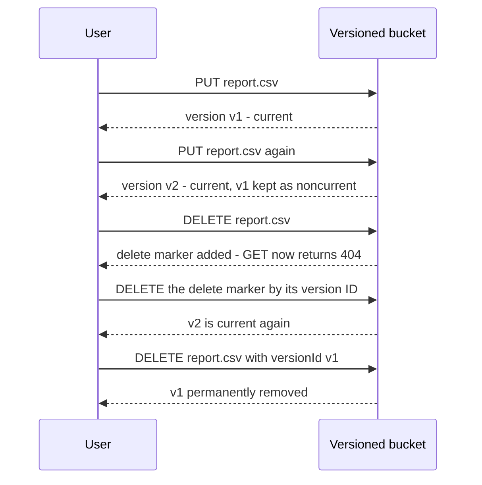
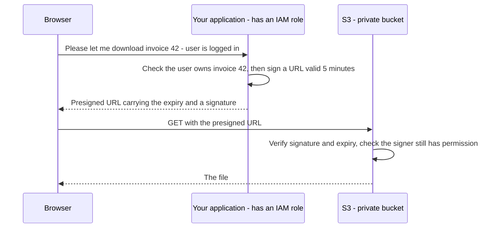
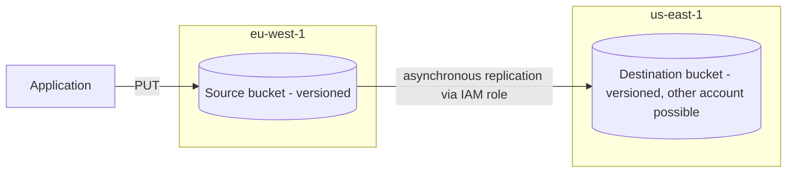

# S3 versioning, encryption, replication, access control and presigned URLs

## Before this lesson

Read [S3 buckets, objects, storage classes and lifecycle rules](#/lesson/aws/s3-basics) first: you should know what a bucket, key, prefix and lifecycle rule are. This lesson shows JSON policies; the full grammar of policies is taught in [IAM users, groups, roles and policies](#/lesson/aws/iam-identities), but each example here is explained line by line, so you can read on without it.

## In plain words

The previous lesson treated S3 as a place to put things. This one is about **keeping them safe and deciding who gets to them**:

- **Versioning** keeps every old copy when a file is overwritten or deleted — an undo button.
- **Encryption** scrambles data so that it is unreadable without a key.
- **Replication** keeps an automatic second copy in another bucket, possibly on another continent.
- **Access control** decides who may read or write, and **Block Public Access** is the safety catch that stops a bucket being opened to the whole internet by mistake.
- A **presigned URL** is a temporary link that lets one outsider download or upload one object.
- **Static website hosting** serves a bucket's files as a website.

Think of a bank's safe-deposit room: the boxes are locked (encryption), the clerk checks a list before letting anyone in (access policies), nothing is ever thrown away without a record (versioning), a duplicate is kept at another branch (replication), and a visitor can be given a pass valid for fifteen minutes for one named box (a presigned URL).

Why it matters for a job: publicly exposed buckets are the best-known kind of cloud data leak. Being able to explain exactly how S3 decides who can read an object is a core skill for any role touching AWS.

## Versioning

With **versioning** enabled on a bucket, S3 never overwrites or removes data in place:

- A PUT to an existing key creates a **new version** with a new **version ID**; the previous one becomes a *noncurrent version*.
- A DELETE without a version ID does not remove anything. It adds a **delete marker**, a placeholder that makes the object look deleted. Remove the marker and the object reappears.
- A DELETE that names a version ID permanently removes that version.



A bucket has three versioning states: *unversioned* (the default), *enabled*, and *suspended*. Once enabled it can be suspended but never returned to unversioned; existing versions stay.

```bash
aws s3api put-bucket-versioning --bucket tidewater-demo-111122223333-eu-west-1 \
  --versioning-configuration Status=Enabled

# Show every version and delete marker of one key.
aws s3api list-object-versions --bucket tidewater-demo-111122223333-eu-west-1 \
  --prefix reports/q3.csv \
  --query "{Versions:Versions[].[VersionId,IsLatest,Size],Markers:DeleteMarkers[].[VersionId,IsLatest]}"
```

```
{
    "Versions": [
        ["3HL4kqtJlcpXroDTDmJ.rioqSD6nzQp1", false, 20480],
        ["null", false, 18112]
    ],
    "Markers": [
        ["Zk8aZ1r0dQ7VwPq0mE2nWlq1TjM5y1b0", true]
    ]
}
```

The object looks deleted (the latest entry is a marker) but both data versions are intact. The version ID `null` belongs to an object uploaded before versioning was switched on.

Two companions to versioning:

- **MFA Delete** requires a one-time code from the root user's MFA device to delete a version permanently or to change the versioning state.
- **Object Lock** makes versions *write once, read many* (WORM): for a retention period nobody can delete or overwrite them. In **compliance mode** not even the root user can shorten the period; **governance mode** lets specially permitted users override it. A **legal hold** freezes an object with no end date. Object Lock is the standard defence against ransomware and the answer to regulatory "immutable records" requirements.

> [!WARNING]
> Versioning keeps **every** old version, and each is billed at full size. A 1 GB file overwritten daily becomes 30 GB in a month. Always pair versioning with a lifecycle rule that expires noncurrent versions (for example "keep the three newest noncurrent versions, delete the rest after 30 days") and removes expired delete markers.

## Encryption

Encryption protects data in two places: **in transit** (travelling over the network) and **at rest** (stored on disk).

**In transit**: S3 endpoints accept HTTPS, which uses TLS to encrypt the connection. To *require* it, a bucket policy can deny any request where the condition key `aws:SecureTransport` is `false` (shown later).

**At rest**: every new object is encrypted on the server side. You choose who manages the key.

| Option | Who holds the key | What you get | Notes |
|---|---|---|---|
| **SSE-S3** | S3 | Encryption with no effort and no cost | The default for all buckets since 2023 (shown as `AES256`) |
| **SSE-KMS** | AWS KMS, in a key you control | A key policy saying who may decrypt, plus an audit trail of every use in CloudTrail | KMS charges per request; turn on **S3 Bucket Keys** to cut those calls by about 99 % |
| **DSSE-KMS** | AWS KMS | Two independent layers of encryption | For specific compliance regimes |
| **SSE-C** | You, supplied with every request | AWS never stores your key | You must manage and never lose the keys |
| **Client-side** | You, before upload | S3 only ever sees ciphertext | Your application does the cryptography |

*SSE* means server-side encryption: S3 encrypts as it writes and decrypts as it reads, transparently for anyone who is allowed.

The practical difference between the first two is **separation of duties**. With SSE-S3, anyone allowed to `GetObject` can read the data. With SSE-KMS, the reader additionally needs `kms:Decrypt` on the key, so a mistaken bucket policy alone does not expose the content — and the key policy can live with a different team.

```bash
# Make SSE-KMS with a specific key the default for a bucket, with Bucket Keys on.
aws s3api put-bucket-encryption --bucket tidewater-demo-111122223333-eu-west-1 \
  --server-side-encryption-configuration '{
    "Rules": [{
      "ApplyServerSideEncryptionByDefault": {
        "SSEAlgorithm": "aws:kms",
        "KMSMasterKeyID": "arn:aws:kms:eu-west-1:111122223333:key/1234abcd-12ab-34cd-56ef-1234567890ab"
      },
      "BucketKeyEnabled": true
    }]
  }'
```

## Who can access a bucket?

By default a new bucket and everything in it is **private**: only identities in the owning account that have been given permission can touch it. Access is opened by policies. Four mechanisms exist; two are in everyday use.

1. **IAM (identity-based) policies** — attached to users and roles: "this role may read that bucket". Used for access *within* your account.
2. **Bucket (resource-based) policies** — attached to the bucket: "these principals may do this here". Needed for cross-account access, public access, and bucket-wide rules such as "HTTPS only".
3. **Access control lists (ACLs)** — an old per-object mechanism. New buckets have ACLs **disabled** ("bucket owner enforced"); leave them that way.
4. **Access points** — named entry points to a bucket, each with its own policy, useful when dozens of applications share one bucket.

A request is allowed when an applicable policy allows it and **no** policy denies it. An explicit `Deny` always wins.

### Reading a bucket policy

```json
{
  "Version": "2012-10-17",
  "Statement": [
    {
      "Sid": "HttpsOnly",
      "Effect": "Deny",
      "Principal": "*",
      "Action": "s3:*",
      "Resource": [
        "arn:aws:s3:::tidewater-invoices-111122223333-eu-west-1",
        "arn:aws:s3:::tidewater-invoices-111122223333-eu-west-1/*"
      ],
      "Condition": {"Bool": {"aws:SecureTransport": "false"}}
    },
    {
      "Sid": "PartnerCanReadExports",
      "Effect": "Allow",
      "Principal": {"AWS": "arn:aws:iam::444455556666:role/partner-reader"},
      "Action": "s3:GetObject",
      "Resource": "arn:aws:s3:::tidewater-invoices-111122223333-eu-west-1/exports/*"
    }
  ]
}
```

- `Version` is the policy language version; it is always this date string.
- Each **statement** has an `Effect` (`Allow` or `Deny`), a `Principal` (who), an `Action` (what), a `Resource` (on what) and optionally a `Condition` (when).
- The first statement denies *every* S3 action to *everyone* whenever the request did not use TLS. Because Deny overrides Allow, plain HTTP can never succeed.
- Note the **two resource ARNs**: the bucket itself (for bucket-level actions such as listing) and `bucket/*` (for the objects). Forgetting one of them is the most common policy bug.
- The second statement lets one role in another account (`444455556666`) download objects under `exports/`. For the access to work, that role's own IAM policy must *also* allow the action: cross-account access needs a yes from both sides.

### Block Public Access

**S3 Block Public Access** is a set of four switches, at account and bucket level, that override policies and ACLs:

| Setting | Effect |
|---|---|
| BlockPublicAcls | Rejects new public ACLs |
| IgnorePublicAcls | Ignores existing public ACLs |
| BlockPublicPolicy | Rejects a bucket policy that grants public access |
| RestrictPublicBuckets | Ignores public grants in an existing policy; only the owner account and AWS services get in |

All four are **on by default** for new buckets. A bucket can only become public if someone deliberately turns them off *and* writes a public policy. Leave them on at the account level, and serve public content through CloudFront instead (module 8). **IAM Access Analyzer for S3** lists any buckets shared outside your account.

> [!WARNING]
> A policy with `"Principal": "*"` and no restricting condition means *the entire internet*, including people who are not AWS customers. Before turning off Block Public Access, be certain the bucket holds only data meant for the world. The problem *Public Bucket Detector* in this module has you write the check that tools such as Access Analyzer perform.

## Presigned URLs

Sometimes one person without AWS credentials needs one object: a customer downloading their invoice, a browser uploading a photo. Making the bucket public is the wrong answer. A **presigned URL** is the right one.

Your application — which does have credentials — computes a URL that contains the bucket, the key, an expiry time and a cryptographic **signature**. Whoever holds the URL can perform exactly that one operation until it expires, with the permissions of the identity that signed it.



```bash
aws s3 presign s3://tidewater-invoices-111122223333-eu-west-1/2026/11/invoice-0042.pdf \
  --expires-in 300
```

```
https://tidewater-invoices-111122223333-eu-west-1.s3.eu-west-1.amazonaws.com/2026/11/invoice-0042.pdf
?X-Amz-Algorithm=AWS4-HMAC-SHA256&X-Amz-Credential=ASIA...%2F20261121%2Feu-west-1%2Fs3%2Faws4_request
&X-Amz-Date=20261121T101500Z&X-Amz-Expires=300&X-Amz-SignedHeaders=host&X-Amz-Signature=5d1c...
```

Reading the query string: `X-Amz-Date` is when it was signed, `X-Amz-Expires` is the lifetime in seconds, `X-Amz-Signature` proves nothing was altered. Change one character of the key and the signature no longer matches.

Rules to remember:

- The maximum lifetime is **seven days** when signed with long-term credentials. When signed with **temporary credentials** (a role), the URL stops working when those credentials expire, which may be much sooner than the requested lifetime.
- The URL carries the signer's permissions *at the time of use*. Remove the signer's access and outstanding URLs die.
- Anyone who obtains the URL can use it; keep lifetimes short and send it only over HTTPS.
- Presigned **PUT** URLs (or presigned POST forms) let browsers upload straight to S3, so large files never pass through your servers.

The problem *Presigned URL Expiry Check* has you parse these parameters and decide validity.

## Replication

**Replication** copies new objects from a source bucket to a destination bucket automatically and asynchronously.

- **Cross-Region Replication (CRR)**: destination in another Region — for disaster recovery, data residency or serving distant users.
- **Same-Region Replication (SRR)**: destination in the same Region — for aggregating logs, or keeping a copy in another account that an attacker in the first account cannot touch.

Requirements and behaviour:

- **Versioning must be enabled on both buckets.**
- S3 needs an IAM role allowing it to read the source and write the destination.
- Only objects written **after** the rule exists are replicated; existing objects need **S3 Batch Replication**.
- **Delete markers are not replicated by default** (optional), and deletions of specific versions are never replicated — so a malicious or accidental purge at the source does not purge the replica.
- Replication is usually done within seconds to minutes; **Replication Time Control** gives a 15-minute commitment for a fee.
- Rules can filter by prefix or tag and can place replicas in a cheaper storage class or under a different owner.



Replication is not a backup against bad writes: a corrupted upload is replicated faithfully. Versioning on both sides is what lets you step back.

## Static website hosting

A bucket can serve its objects as a website: HTML, CSS, JavaScript and images, with no server. "Static" means the files are sent as they are; nothing runs on the server side.

The original feature — the **S3 website endpoint** — needs a public bucket and speaks only HTTP. The recommended design today keeps the bucket private and puts **CloudFront** in front:

1. Keep Block Public Access on.
2. Create a CloudFront distribution with the bucket as origin and **origin access control (OAC)**, so that only that distribution may read the bucket.
3. Attach a free TLS certificate and your domain name to the distribution.

The bucket policy that goes with it grants `s3:GetObject` to the service principal `cloudfront.amazonaws.com` with a condition that the request comes from your distribution's ARN. Module 8 builds this.

If a browser page served from one domain must fetch objects from a bucket on another domain, the bucket needs a **CORS** (cross-origin resource sharing) configuration listing the allowed origins and methods; without it the browser blocks the response.

## Other features worth recognising

- **Event notifications**: S3 can send a message to SQS, SNS, Lambda or EventBridge when objects are created or deleted — the trigger for "resize every uploaded image".
- **Transfer Acceleration**: uploads enter AWS at the nearest edge location and travel on AWS's network, speeding up long-distance transfers.
- **Server access logs and CloudTrail data events**: who requested which object.
- **S3 Inventory and Batch Operations**: list billions of objects and apply one action to all of them.
- **Requester Pays**: the downloader, not the owner, pays request and transfer charges.

## Cost notes and free-tier warnings

- **Noncurrent versions** and **replicas** are billed as normal storage; replication also charges requests and, for CRR, inter-Region data transfer.
- **SSE-KMS** adds a KMS request charge per object operation unless Bucket Keys are enabled.
- **Presigned URLs** are free to create; the download they permit incurs normal request and data-transfer-out charges on *your* bill.
- A **public bucket** is not only a security risk but a cost risk: anyone can download from it repeatedly at your expense.
- To delete a versioned bucket you must delete **all versions and delete markers**; an expiration lifecycle rule is the simplest way.

## Pitfalls

- **Policy with only `bucket/*` or only the bucket ARN**, so that either listing or reading fails.
- **Cross-account access granted on one side only.**
- **Encrypting with the AWS-managed KMS key** (`aws/s3`) and then finding that other accounts cannot decrypt: its key policy cannot be changed. Use a customer-managed key for shared data.
- **Presigned URL signed by a role with a one-hour session, requested for seven days**: it dies after an hour.
- **Expecting replication to copy what was already there.**
- **Versioning without noncurrent-version expiry**, growing the bill forever.
- **Opening a bucket to host a website** when CloudFront with OAC would keep it private.

> [!INTERVIEW]
> **"How do you make sure an S3 bucket is never accidentally public?"** Keep Block Public Access enabled at the account level; disable ACLs; write least-privilege bucket policies and require TLS; serve public content through CloudFront with origin access control; monitor with IAM Access Analyzer and an AWS Config rule; and in an organisation, use a service control policy that forbids changing the account's Block Public Access settings.
>
> **"A user must upload a 2 GB video from a browser. How?"** The backend authenticates the user and returns presigned URLs for a multipart upload (or a presigned POST); the browser sends the parts straight to S3. The backend never handles the bytes, and the bucket stays private. A CORS rule on the bucket permits the browser's origin.

## Cheat sheet

| Need | Feature |
|---|---|
| Undo overwrites and deletes | Versioning (+ lifecycle for noncurrent versions) |
| Immutable records, ransomware defence | Object Lock, compliance mode |
| Default encryption | SSE-S3, automatic |
| Control and audit of the key | SSE-KMS with a customer-managed key and Bucket Keys |
| Force HTTPS | Bucket policy denying `aws:SecureTransport = false` |
| Access from another account | Bucket policy plus the other side's IAM policy |
| Prevent public exposure | Block Public Access, ACLs disabled |
| Temporary access for one object | Presigned URL (max 7 days) |
| Copy to another Region or account | Replication (versioning on both sides) |
| Website | Private bucket + CloudFront with OAC |

## Summary

- Versioning turns overwrites and deletes into recoverable events; Object Lock makes versions immutable.
- All objects are encrypted at rest; SSE-KMS adds key-level access control and auditing.
- Access is private by default and opened by IAM and bucket policies; an explicit Deny wins, and Block Public Access overrides public grants.
- Presigned URLs delegate a single operation for a limited time using the signer's permissions.
- Replication keeps asynchronous copies in another bucket and requires versioning; it does not copy pre-existing objects or version deletions.
- Host static sites from a private bucket behind CloudFront.

## Glossary

- **ACL**: access control list, a legacy per-object permission mechanism.
- **Block Public Access**: account and bucket switches that override public grants.
- **Bucket policy**: a resource-based policy attached to a bucket.
- **CORS**: browser rules permitting a page from one origin to call another.
- **CRR / SRR**: cross-Region / same-Region replication.
- **Delete marker**: a placeholder version that makes an object appear deleted.
- **MFA Delete**: requiring an MFA code to remove versions permanently.
- **Noncurrent version**: any version that is no longer the latest.
- **OAC**: origin access control, letting only a CloudFront distribution read a bucket.
- **Object Lock**: write-once-read-many retention for object versions.
- **Presigned URL**: a time-limited, signed link granting one operation on one object.
- **Principal**: the identity a policy statement applies to.
- **SSE-S3 / SSE-KMS / SSE-C**: server-side encryption with S3-managed, KMS-managed or customer-provided keys.
- **Version ID**: the identifier of one stored version of an object.

```quiz
[
  {"q": "In a versioning-enabled bucket, a user runs a normal delete on 'plan.docx' (no version ID). What is the state afterwards?",
   "options": ["All versions are permanently removed", "A delete marker becomes the current version; earlier versions remain and can be restored", "The latest version is removed and the previous one becomes current", "The request fails without MFA"],
   "answer": 1,
   "explain": "A simple DELETE adds a delete marker. The data versions stay until deleted by version ID or expired by a lifecycle rule."},
  {"q": "A bucket policy allows s3:GetObject on 'arn:aws:s3:::media/*' for a role, but the role gets AccessDenied when running a list of the bucket. Why?",
   "options": ["ListBucket is a bucket-level action and needs the bucket ARN 'arn:aws:s3:::media' as resource", "Listing requires versioning", "Listing is never allowed by bucket policies", "The objects are encrypted"],
   "answer": 0,
   "explain": "Object actions use the 'bucket/*' ARN; bucket actions such as s3:ListBucket use the bucket ARN itself. Both must be granted for list and read."},
  {"q": "A backend running under an IAM role (session length one hour) generates a presigned URL with --expires-in 86400. A customer opens it three hours later and receives an error. Why?",
   "options": ["Presigned URLs cannot exceed one hour", "The URL is tied to the temporary credentials that signed it, which expired after an hour", "The customer needs an AWS account", "Block Public Access blocks presigned URLs"],
   "answer": 1,
   "explain": "A presigned URL is valid until its own expiry or the expiry of the signing credentials, whichever comes first."},
  {"q": "Auditors require that archived trade records cannot be deleted or altered by anyone, including administrators, for seven years. Which feature?",
   "options": ["Versioning alone", "S3 Object Lock in compliance mode", "SSE-KMS", "Cross-Region Replication"],
   "answer": 1,
   "explain": "Compliance-mode Object Lock prevents deletion or overwrite of a version by any user, root included, until the retention date."},
  {"q": "A team enables Cross-Region Replication on a bucket that already holds 2 million objects. A week later the destination has only the objects uploaded since. What is needed to copy the rest?",
   "options": ["Nothing; replication is slow and will catch up", "S3 Batch Replication for the existing objects", "Disable and re-enable versioning", "Turn on Transfer Acceleration"],
   "answer": 1,
   "explain": "Replication rules apply to objects written after they are created. Existing objects are replicated with Batch Replication."},
  {"q": "A security team wants every read of sensitive objects to require permission on an encryption key they control and to be logged per use. Which encryption option?",
   "options": ["SSE-S3", "SSE-KMS with a customer-managed key", "No encryption with a strict bucket policy", "Client-side Base64 encoding"],
   "answer": 1,
   "explain": "With SSE-KMS the reader needs kms:Decrypt on the key, the key policy is controlled separately, and each use is recorded in CloudTrail."},
  {"q": "What is the recommended way to host a public static website from S3 today?",
   "options": ["Turn off Block Public Access and use the S3 website endpoint over HTTP", "Keep the bucket private and serve it through CloudFront with origin access control and a TLS certificate", "Attach an Elastic IP to the bucket", "Share presigned URLs for every page"],
   "answer": 1,
   "explain": "CloudFront with OAC provides HTTPS, caching and a custom domain while the bucket remains private."}
]
```

> **Source:** AWS Certified Solutions Architect Official Study Guide, ch. 2 (S3 advanced features: versioning, encryption, access control, pre-signed URLs, replication, static hosting). ACL-based public access in the book is superseded; current behaviour checked against https://docs.aws.amazon.com/AmazonS3/latest/userguide/access-control-block-public-access.html , https://docs.aws.amazon.com/AmazonS3/latest/userguide/using-presigned-url.html , https://docs.aws.amazon.com/AmazonS3/latest/userguide/replication.html and https://docs.aws.amazon.com/AmazonS3/latest/userguide/UsingEncryption.html
