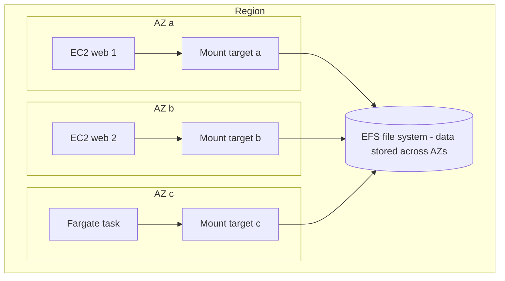
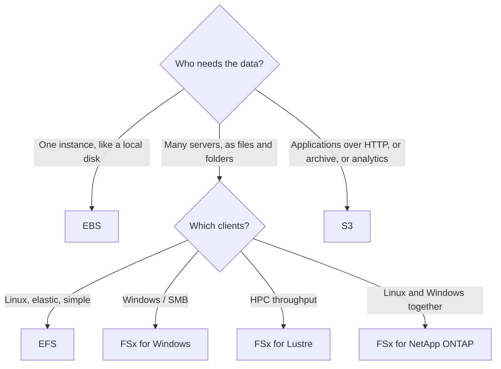

# EFS, FSx and Storage Gateway: choosing block, file or object

## Before this lesson

You should know EBS ([EBS volumes, snapshots and instance store](#/lesson/aws/ebs-storage)) and S3 ([S3 buckets, objects, storage classes and lifecycle rules](#/lesson/aws/s3-basics)). A rough idea of what a subnet and a security group are helps; both are taught in [the VPC module](#/lesson/aws/vpc-basics), and this lesson explains what it needs as it goes.

## In plain words

EBS gives one server a disk. S3 gives every program a place to drop whole files over HTTP. Many applications need something in between: **a folder that several servers can open at the same time**, with ordinary file operations — open, edit a few bytes, rename, lock. That is a **shared file system**.

Imagine an office. EBS is the drawer in your own desk: fast, but only you can use it. S3 is the post room: you hand over a sealed parcel and collect it later. A shared file system is the **filing cabinet in the corridor** that everyone on the floor can open at once.

AWS offers two families:

- **Amazon EFS** (Elastic File System): a shared file system for Linux that grows and shrinks by itself.
- **Amazon FSx**: managed versions of four well-known file systems — Windows File Server, Lustre, NetApp ONTAP and OpenZFS — for workloads that need their specific features.

This lesson also covers the services that connect storage in your own building to AWS (**Storage Gateway**, **DataSync**, the **Snow** devices), and ends with the comparison that interviewers love: *EBS versus EFS versus S3*.

## Why a shared file system?

Typical situations:

- A content management system such as WordPress runs on four web servers behind a load balancer. An editor uploads an image through server 1; a visitor is then served by server 3, which must see the same file.
- A team of data scientists wants one home directory visible from every notebook server.
- Containers that start and stop all day need a place to keep files that outlives each container.
- A legacy application reads and writes paths like `/shared/reports/` and cannot be rewritten to call S3.

Two **protocols** — the languages a client uses to talk to a file server — dominate:

- **NFS** (Network File System), the standard on Linux and Unix.
- **SMB** (Server Message Block), the standard on Windows.

A file system that follows the usual Unix rules (permissions, hard links, locking, consistent reads after writes) is called **POSIX-compliant**; many Linux applications assume those rules.

## Amazon EFS

**EFS** is a managed NFS (version 4) file system.

- **Elastic**: there is no size to choose. It holds what you put in it, from kilobytes to petabytes, and you pay per GB-month actually stored.
- **Shared**: thousands of EC2 instances, containers (ECS, EKS) and Lambda functions can mount it simultaneously.
- **Regional**: a standard EFS file system stores data redundantly across several Availability Zones. A **One Zone** variant keeps data in a single zone for a lower price.
- **Linux only**: EFS speaks NFS; Windows instances cannot use it.

### Mount targets

Clients reach the file system through **mount targets**: network endpoints with an IP address, one per Availability Zone, placed in a subnet you choose. Each has a security group, which must allow inbound **TCP port 2049** (the NFS port) from the clients.



Create one mount target in **every** zone where clients run, and have each client use the target in its own zone. That avoids both a single point of failure and inter-zone data-transfer charges.

### Storage classes and lifecycle

Like S3, EFS has tiers and a lifecycle policy, applied **per file**:

| Class | Use | Relative price |
|---|---|---|
| Standard | Files in active use | highest |
| Infrequent Access (IA) | Files not read for a chosen number of days (for example 30) | much lower storage price, small fee per GB read |
| Archive | Files not read for about 90 days or more | lowest, higher access fee |

With **lifecycle management** enabled, files move to colder classes automatically and (optionally) return to Standard on first access. For file shares where most files are written once and seldom reopened, this cuts the bill dramatically.

### Performance settings

- **Throughput mode**: *Elastic* (the recommended default — throughput scales with the workload and you pay for what you move), *Provisioned* (you reserve a fixed throughput), or *Bursting* (throughput proportional to the amount stored, with burst credits; small file systems can run out of credits, an echo of the gp2 story).
- **Performance mode**: *General Purpose* (lowest latency, right for almost everything) or *Max I/O* (a legacy mode for highly parallel workloads, with higher latency).

Every operation on a network file system crosses the network, so latency per operation is higher than EBS — fractions of a millisecond to a few milliseconds. Workloads touching huge numbers of tiny files feel this most.

### Security

- Network: security groups on the mount targets.
- Identity: standard POSIX users and permissions; **EFS access points** pin an application to a directory and a user ID; IAM policies can control who may mount.
- Encryption: at rest with KMS (set at creation) and in transit with TLS (a mount option).

### Worked example: one file system, two instances

> [!WARNING]
> An EFS file system bills per GB stored and mount targets are free, so this exercise costs almost nothing — but the EC2 instances mounting it are billed as usual. Delete everything at the end.

```bash
# 1. Create an encrypted file system with elastic throughput.
FS=$(aws efs create-file-system --encrypted --throughput-mode elastic \
  --tags Key=Name,Value=shared-content --query FileSystemId --output text)
echo "$FS"
```

```
fs-0123456789abcdef0
```

```bash
# 2. One mount target per subnet (repeat for each Availability Zone used).
aws efs create-mount-target --file-system-id "$FS" \
  --subnet-id subnet-0aaa1111 --security-groups sg-0efs2222

# 3. Move files that are not read for 30 days to Infrequent Access.
aws efs put-lifecycle-configuration --file-system-id "$FS" \
  --lifecycle-policies TransitionToIA=AFTER_30_DAYS \
                       TransitionToPrimaryStorageClass=AFTER_1_ACCESS
```

- `--encrypted` turns on encryption at rest; it cannot be added later.
- The security group `sg-0efs2222` must allow TCP 2049 from the instances' security group.
- The second lifecycle policy brings a file back to Standard the first time it is read.

```bash
# 4. On each instance (Amazon Linux): install the helper and mount with TLS.
sudo dnf install -y amazon-efs-utils
sudo mkdir -p /mnt/shared
sudo mount -t efs -o tls fs-0123456789abcdef0:/ /mnt/shared
df -h /mnt/shared
```

```
Filesystem      Size  Used Avail Use% Mounted on
127.0.0.1:/     8.0E     0  8.0E   0% /mnt/shared
```

`8.0E` is eight exabytes: the file system reports an effectively unlimited size because there is nothing to provision. `-o tls` encrypts traffic in transit. Create a file on one instance (`echo hi | sudo tee /mnt/shared/test.txt`) and read it from the other to see the sharing.

To mount automatically after a reboot, add a line to `/etc/fstab`:

```
fs-0123456789abcdef0:/  /mnt/shared  efs  _netdev,tls  0 0
```

`_netdev` tells Linux to wait for the network before mounting.

## Amazon FSx

**FSx** runs four existing file systems as managed services. You choose one because your workload needs *that* file system's features.

| FSx for… | Protocols | Choose it when | Notable features |
|---|---|---|---|
| **Windows File Server** | SMB | Windows applications and users need a file share | Active Directory integration, NTFS permissions, shadow copies, DFS namespaces |
| **Lustre** | Lustre client (Linux) | High-performance computing and machine-learning training need very high throughput and sub-millisecond latency | Can present an S3 bucket as a file system and write results back; *scratch* (temporary) or *persistent* deployments |
| **NetApp ONTAP** | NFS, SMB, iSCSI | Migrating from NetApp, or one share must serve Linux and Windows together | Snapshots, clones, compression and deduplication, automatic tiering to cheap storage |
| **OpenZFS** | NFS | Migrating ZFS-based or Linux file servers needing very low latency | Instant snapshots and clones |

Unlike EFS, FSx file systems are **provisioned**: you choose storage capacity and throughput (they can be increased later), and you choose a **Single-AZ** or **Multi-AZ** deployment. Multi-AZ keeps a standby file server in a second zone and fails over automatically.

Quick matching rules for scenario questions:

- "Windows", "SMB", "Active Directory", "NTFS" → **FSx for Windows File Server**.
- "HPC", "hundreds of GB per second", "process data in S3 with a parallel file system" → **FSx for Lustre**.
- "Both NFS and SMB clients", "NetApp", "SnapMirror" → **FSx for NetApp ONTAP**.
- "Linux shared storage that grows automatically, serverless" → **EFS**.

## Connecting on-premises storage to AWS

Companies with their own data centres rarely move everything at once. These services cover the hybrid cases.

### AWS Storage Gateway

**Storage Gateway** is software you run in your data centre (as a virtual machine or a hardware appliance). Local applications talk to it with the storage protocols they already use; behind the scenes the data lives in AWS, with a local cache for speed.

| Gateway type | Local applications see | Data lands in | Typical use |
|---|---|---|---|
| **S3 File Gateway** | An NFS or SMB share | S3 objects (one file = one object) | Move file archives and backups to S3 while keeping a familiar share |
| **FSx File Gateway** | An SMB share | FSx for Windows File Server | Low-latency local access to cloud Windows shares (being wound down for new customers; check current availability) |
| **Volume Gateway** | iSCSI block volumes | S3, with EBS snapshots | *Cached* mode keeps hot data local and everything in AWS; *stored* mode keeps everything local and backs up to AWS |
| **Tape Gateway** | A virtual tape library | S3 and Glacier classes | Replace physical backup tapes without changing backup software |

*iSCSI* is a protocol that carries block-storage commands over a network.

### AWS DataSync

**DataSync** is a managed transfer service: an agent reads from an NFS, SMB, HDFS or object store and copies to S3, EFS or FSx (or between AWS storage services), verifying integrity, preserving metadata, and running on a schedule. Use it for migrations and recurring replication over the network.

Rule of thumb: **Storage Gateway** when on-premises applications need ongoing *access* to cloud-backed storage; **DataSync** when you need to *move or copy* data.

### The Snow family and Transfer Family

When the data is too large for the network — sending 100 TB over a 100 Mbit/s line takes more than three months — AWS will ship you a storage device. You copy data onto it and send it back; AWS loads it into S3.

- **Snowball Edge** devices hold tens to hundreds of terabytes and can also run compute at remote sites.
- Earlier members (the small *Snowcone*, the truck-sized *Snowmobile*) have been retired; older texts, including the edition this track follows, describe *AWS Import/Export Disk*, a still older service that Snowball replaced. Check the current device list before designing around one.

**AWS Transfer Family** provides managed SFTP, FTPS and AS2 endpoints that store files in S3 or EFS, for partners who insist on file transfer protocols.

## EBS versus EFS versus S3

This is the comparison to know cold.

| | **EBS** | **EFS** | **S3** |
|---|---|---|---|
| Storage type | Block | File (NFS) | Object |
| Access | Mounted as a disk by one instance (normally) | Mounted by many Linux clients at once | HTTPS API from anywhere |
| Scope | One Availability Zone | Regional (or One Zone) | Regional |
| Capacity | Provisioned, up to 64 TiB per volume | Elastic, effectively unlimited | Elastic, unlimited; 50 TB per object |
| Edit part of a file | Yes | Yes | No — rewrite the object |
| Latency | Lowest (sub-millisecond to low ms) | Low ms | Tens of ms per request |
| Relative price per GB | Middle | Highest (Standard class) | Lowest |
| Typical uses | Boot volumes, databases | Shared content, home directories, container storage | Backups, media, data lakes, static sites |



A rough feel for cost: storing 1 TB for a month costs on the order of USD 23 in S3 Standard, USD 80 on gp3 EBS, and USD 300 in EFS Standard — but only a few tens of dollars in EFS once lifecycle management has moved cold files to Infrequent Access. The right question is therefore not "which is cheapest per GB?" but "which access pattern do I need, and how cold is the data?".

## Cost notes and free-tier warnings

- **EFS** charges per GB-month by class, plus throughput in Elastic mode (per GB read and written) or a fixed fee in Provisioned mode. Without lifecycle management everything stays in the expensive Standard class.
- **FSx** charges for provisioned storage and throughput capacity every hour the file system exists, used or not. Multi-AZ roughly doubles it. An FSx for Lustre *persistent* file system left running after a training job is a classic waste.
- **Storage Gateway** charges per GB written through it, plus the underlying S3 storage and requests.
- **DataSync** charges per GB copied.
- **Snow devices** have a per-job fee and daily charges beyond the included days.
- Clients mounting an EFS mount target in a *different* zone pay inter-zone data transfer.

## Pitfalls

- **Trying to mount EFS from Windows.** Use FSx for Windows File Server.
- **Forgetting port 2049** in the mount target's security group — the mount command hangs.
- **One mount target for three zones**: a zonal outage takes the share away from everyone.
- **Bursting throughput mode on a small file system**, exhausting credits under load. Use Elastic.
- **Using EFS for a database** that needs low, consistent latency. Use EBS.
- **Using S3 through a file-system adapter as if it were POSIX.** Renames become copy-and-delete and partial edits rewrite whole objects.
- **Choosing a Snow device when a few days of DataSync over the existing link would do**, or the reverse.

> [!INTERVIEW]
> **"When would you choose EFS over EBS?"** When several instances or containers, possibly in different Availability Zones, must read and write the same files concurrently, or when capacity should grow automatically. EBS is a single-instance disk in one zone with lower latency, right for boot volumes and databases.
>
> **"A company wants to keep using its backup software, which writes to tapes, but stop handling physical tapes."** Storage Gateway in Tape Gateway mode: the software sees a virtual tape library; data is stored in S3 and archived to Glacier classes.

## Cheat sheet

| Clue in the question | Service |
|---|---|
| Shared Linux file storage, grows automatically, multi-AZ | EFS |
| Windows share, SMB, Active Directory | FSx for Windows File Server |
| HPC or ML training, parallel file system, linked to S3 | FSx for Lustre |
| NFS and SMB together, NetApp features | FSx for NetApp ONTAP |
| On-premises apps need cloud-backed NFS/SMB share | S3 File Gateway |
| Replace tape library | Tape Gateway |
| Migrate or sync files over the network | DataSync |
| Too much data for the network | Snowball Edge |
| Partners need SFTP into S3 | Transfer Family |

## Summary

- Shared file systems fill the gap between single-instance block storage and whole-object storage.
- EFS is elastic, regional NFS for Linux, reached through per-zone mount targets, with per-file storage classes and lifecycle.
- FSx offers Windows File Server, Lustre, NetApp ONTAP and OpenZFS when a workload needs those specific systems.
- Storage Gateway gives on-premises applications cloud-backed shares, volumes and virtual tapes; DataSync moves data over the network; Snow devices move it physically.
- Choose between EBS, EFS and S3 by access pattern first, then by price.

## Glossary

- **Access point (EFS)**: an entry to a file system that enforces a directory and a user identity.
- **DataSync**: the managed service for copying data between storage systems.
- **EFS**: Elastic File System, managed NFS for Linux.
- **FSx**: managed Windows File Server, Lustre, NetApp ONTAP and OpenZFS file systems.
- **iSCSI**: a protocol for block storage over a network.
- **Lustre**: a parallel file system used in high-performance computing.
- **Mount target**: the per-zone network endpoint of an EFS file system.
- **NFS / SMB**: the file-sharing protocols of Linux/Unix and of Windows.
- **POSIX**: the standard defining Unix file behaviour.
- **Snowball Edge**: a shippable storage and compute device for large transfers.
- **Storage Gateway**: on-premises software presenting cloud storage through local protocols.
- **Throughput mode**: how an EFS file system's transfer capacity is determined.

```quiz
[
  {"q": "Six Linux web servers in three Availability Zones behind a load balancer must all see images uploaded through any one of them. Which storage is the most direct fit?",
   "options": ["One EBS volume with Multi-Attach", "Amazon EFS with a mount target in each zone", "Instance store on each server", "FSx for Windows File Server"],
   "answer": 1,
   "explain": "EFS is a regional NFS file system that many Linux instances across zones can mount concurrently. EBS volumes are confined to one zone and Multi-Attach is not a shared file system."},
  {"q": "A mount command for a new EFS file system hangs and times out. Instances and mount target are in the same subnet. What is the most likely cause?",
   "options": ["EFS is not available in that Region", "The mount target's security group does not allow inbound TCP 2049 from the instances", "The file system is empty", "The instance needs a public IP"],
   "answer": 1,
   "explain": "NFS uses TCP port 2049. If the mount target's security group does not allow it from the clients, the mount cannot connect."},
  {"q": "A finance department runs Windows applications that need a shared drive with Active Directory permissions. Which service?",
   "options": ["EFS", "S3 with static website hosting", "FSx for Windows File Server", "FSx for Lustre"],
   "answer": 2,
   "explain": "SMB, NTFS permissions and Active Directory integration are what FSx for Windows File Server provides. EFS is NFS-only."},
  {"q": "A research group must train models on 200 TB of data that lives in S3, with the highest possible file-system throughput for a week. Which option?",
   "options": ["FSx for Lustre linked to the S3 bucket", "EFS in Bursting mode", "An S3 File Gateway", "One large gp3 volume"],
   "answer": 0,
   "explain": "FSx for Lustre is a parallel file system built for HPC and ML throughput and can present S3 data as files, loading it on demand."},
  {"q": "An EFS file system holds 5 TB, of which 90 % has not been opened in a year. What reduces cost most with no application change?",
   "options": ["Switch performance mode to Max I/O", "Enable lifecycle management to move unread files to Infrequent Access or Archive", "Add more mount targets", "Convert to Provisioned throughput"],
   "answer": 1,
   "explain": "Lifecycle management tiers individual files to much cheaper classes after a period without access, transparently to clients."},
  {"q": "A company must migrate 60 TB of files from an on-premises NFS server to EFS over a 1 Gbit/s link within two weeks, preserving permissions and verifying integrity. Which service?",
   "options": ["Storage Gateway Tape Gateway", "AWS DataSync", "S3 Transfer Acceleration", "A cluster placement group"],
   "answer": 1,
   "explain": "DataSync copies between NFS/SMB sources and AWS storage with verification, metadata preservation and scheduling. 60 TB over 1 Gbit/s takes roughly a week."},
  {"q": "Which statement correctly contrasts EBS and S3?",
   "options": ["EBS is object storage, S3 is block storage", "EBS volumes are regional, S3 buckets are zonal", "A file on EBS can be modified in place; an S3 object must be replaced as a whole", "S3 can be the boot disk of an EC2 instance"],
   "answer": 2,
   "explain": "Block storage supports in-place updates. S3 objects are immutable units replaced by a new PUT. EBS is zonal and S3 regional."}
]
```

> **Source:** AWS Certified Solutions Architect Official Study Guide, ch. 2 (object versus block and file storage), ch. 3 (EBS) and ch. 11 (AWS Storage Gateway, Import/Export). EFS, FSx, DataSync and Snowball post-date the book; facts checked against https://docs.aws.amazon.com/efs/latest/ug/whatisefs.html , https://docs.aws.amazon.com/fsx/ , https://docs.aws.amazon.com/storagegateway/latest/userguide/WhatIsStorageGateway.html and https://docs.aws.amazon.com/datasync/latest/userguide/what-is-datasync.html
