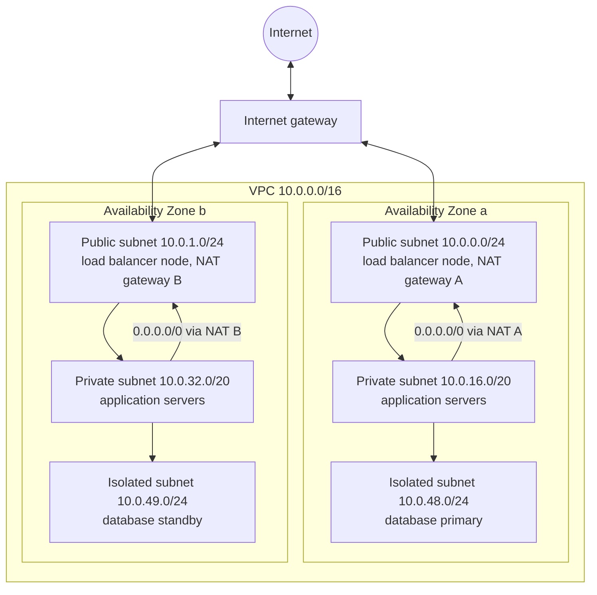

# VPCs, CIDR planning, subnets, route tables and gateways

## Before this lesson

You should know Regions and Availability Zones ([the AWS global map](#/lesson/aws/what-is-cloud)) and have launched an instance ([EC2 instances](#/lesson/aws/ec2-instances)). If IP addresses and binary numbers are unfamiliar, the networking track's [IPv4, subnets and NAT](#/lesson/networking/ipv4-subnets-nat) lesson is the gentlest start; this lesson re-explains the essentials.

## In plain words

A **VPC** (Virtual Private Cloud) is your own private network inside AWS. Nothing gets in or out unless you build a door. Inside it you draw smaller areas called **subnets**, decide which of them can talk to the internet, and place your servers and databases in the right ones.

Think of an office building you rent. The **VPC** is the building. **Subnets** are the floors. The **route table** on each floor is the sign by the lift saying "for the street, go this way; for other floors, go that way". The **internet gateway** is the front door to the street. A **NAT gateway** is the mail room: staff on upper floors can send letters out and get replies, but nobody from the street can walk up to their desks.

Why it matters for a job: every EC2 instance, database, load balancer and container runs in a VPC. Most "it cannot connect" problems are VPC problems, and a network diagram with public and private subnets across two Availability Zones is the first thing drawn in almost any AWS design interview.

## IP addresses and CIDR in five minutes

An **IPv4 address** is a 32-bit number written as four decimal numbers from 0 to 255, such as `10.0.3.17`. Each of the four parts (an *octet*) is 8 bits.

A network is a contiguous block of addresses, written in **CIDR notation**: an address, a slash, and a **prefix length** — the number of leading bits that are fixed for every address in the block.

- `10.0.0.0/16`: the first 16 bits (`10.0`) are fixed, the remaining 16 are free → 2¹⁶ = 65,536 addresses, `10.0.0.0` to `10.0.255.255`.
- `10.0.1.0/24`: 24 bits fixed, 8 free → 2⁸ = 256 addresses, `10.0.1.0` to `10.0.1.255`.
- `10.0.1.64/26`: 26 fixed, 6 free → 64 addresses, `10.0.1.64` to `10.0.1.127`.

The rule: **a `/n` block holds 2^(32 − n) addresses. A bigger number after the slash means a smaller network.** Each step up halves the block.

| Prefix | Addresses | Usable in an AWS subnet (minus 5) |
|---|---|---|
| /16 | 65,536 | 65,531 |
| /20 | 4,096 | 4,091 |
| /24 | 256 | 251 |
| /26 | 64 | 59 |
| /28 | 16 | 11 |

**Private address ranges** are blocks reserved (by a standard called RFC 1918) for internal networks; they are never routed on the public internet:

- `10.0.0.0/8` (10.0.0.0 – 10.255.255.255)
- `172.16.0.0/12` (172.16.0.0 – 172.31.255.255)
- `192.168.0.0/16` (192.168.0.0 – 192.168.255.255)

VPCs should use these ranges.

### Try it

```python-run
import ipaddress   # standard library: no AWS needed

vpc = ipaddress.ip_network("10.20.0.0/16")
print("VPC", vpc, "has", vpc.num_addresses, "addresses")

# Split the VPC into /20 blocks and hand out the first six: 3 AZs x 2 tiers.
blocks = list(vpc.subnets(new_prefix=20))
plan = [("public", az) for az in "abc"] + [("private", az) for az in "abc"]
for (tier, az), net in zip(plan, blocks):
    usable = net.num_addresses - 5          # AWS reserves 5 addresses per subnet
    print(f"{tier:8s} az-{az}  {str(net):16s} {net[0]} - {net[-1]}  usable {usable}")

print("blocks left for the future:", len(blocks) - len(plan))
print("do the first two overlap?", blocks[0].overlaps(blocks[1]))
print("is 10.20.17.5 in the second block?", ipaddress.ip_address("10.20.17.5") in blocks[1])
```

Line by line: `ip_network` parses a CIDR block; `subnets(new_prefix=20)` cuts it into equal `/20` pieces (sixteen of them, because 20 − 16 = 4 extra bits and 2⁴ = 16); `zip` pairs each piece with a tier and zone; `net[0]` and `net[-1]` are the first and last address. The last lines show that sibling blocks never overlap and how to test membership. Ten of the sixteen blocks stay free — leaving room is deliberate.

## The VPC

A VPC is a regional resource with a primary IPv4 CIDR block between `/16` and `/28`. It spans all Availability Zones of its Region. Other blocks can be added later, but the primary block **cannot be changed**, so plan before creating.

### CIDR planning rules

1. **Use private ranges.**
2. **Do not overlap** with any network this VPC may ever be connected to: other VPCs, other accounts, the office, a partner. Two networks with the same addresses cannot be routed to each other. This is the mistake that is most painful to fix later.
3. **Be generous but not greedy.** A `/16` per VPC is common; a company-wide plan might allocate a `/16` per environment per Region out of `10.0.0.0/8`. **Amazon VPC IPAM** (IP Address Manager) keeps such a plan and hands out blocks automatically.
4. **Leave gaps** for subnets you have not thought of yet.

Every account has a **default VPC** in each Region (`172.31.0.0/16`) with a public subnet in every zone. It exists so that beginners can launch instances immediately. Production systems use purpose-built VPCs.

## Subnets

A **subnet** is a slice of the VPC's range that lives in **exactly one Availability Zone**. Resources are launched *into a subnet*, and that choice fixes their zone.

AWS **reserves five addresses** in every subnet. In `10.0.1.0/24`:

| Address | Reserved for |
|---|---|
| 10.0.1.0 | Network address |
| 10.0.1.1 | The VPC router |
| 10.0.1.2 | The Amazon DNS server |
| 10.0.1.3 | Future use |
| 10.0.1.255 | Broadcast address (broadcast is not supported, but the address is held) |

So a `/24` gives 251 usable addresses and the smallest subnet, a `/28`, gives 11. Remember that load balancers, NAT gateways, Lambda functions in a VPC and managed databases all consume addresses too — undersized subnets run out.

### Public and private subnets

The words "public" and "private" are not settings. They describe **routing**:

- A **public subnet** is one whose route table sends internet-bound traffic to an **internet gateway**.
- A **private subnet** has no such route. Its instances cannot be reached from the internet.
- An **isolated subnet** has no route to the internet at all, not even outbound.

The standard layout puts load balancers and NAT gateways in public subnets, application servers in private subnets, and databases in private (often isolated) subnets — repeated in at least two Availability Zones.



## Route tables

A **route table** is a list of rules, each saying "traffic for this destination range goes to that target". Every subnet is associated with exactly one route table; a subnet with no explicit association uses the VPC's **main route table**.

| Destination | Target | Meaning |
|---|---|---|
| 10.0.0.0/16 | local | Anything inside the VPC is delivered directly. Present in every table; cannot be removed |
| 0.0.0.0/0 | igw-0a1b… | Everything else goes to the internet gateway → this is a *public* route table |

`0.0.0.0/0` matches every IPv4 address and is called the **default route**.

When several routes match, the **most specific one wins** — the longest prefix. A packet for `10.0.5.9` matches both rows above; `/16` is more specific than `/0`, so it stays local. Order in the table is irrelevant. The problem *Route Table Longest-Prefix Match* has you implement exactly this, and *Public, Private or Isolated Subnet?* has you classify subnets from their tables.

> [!TIP]
> Leave the **main route table** without an internet route and create explicit tables for public subnets. Then a subnet someone forgets to associate ends up private by default, not public.

## The internet gateway

An **internet gateway (IGW)** connects a VPC to the internet. It is horizontally scaled and redundant, costs nothing by itself, and one is attached per VPC.

For an instance to be reachable from the internet, **four** things must all be true:

1. An internet gateway is attached to the VPC.
2. The subnet's route table has a default route to it.
3. The instance has a **public IPv4 address** (auto-assigned or Elastic IP).
4. The security group (and network ACL) allow the traffic.

The instance's operating system only ever sees its *private* address. The internet gateway translates between that and the public address one-to-one. This is why `ip addr` on an instance never shows the public IP.

## NAT gateways

Servers in private subnets still need to reach out: operating-system updates, third-party APIs, AWS service endpoints. **Network address translation (NAT)** lets many private addresses share one public address for *outbound* connections; replies are let back in, but nobody outside can start a connection.

A **NAT gateway** is the managed service for this:

- It lives in a **public subnet** and has an Elastic IP.
- Private subnets' route tables point `0.0.0.0/0` at it.
- It is **zonal**. For high availability create **one per Availability Zone** and have each private subnet use the NAT gateway of its own zone; otherwise losing the NAT's zone cuts off every zone.
- It scales automatically to tens of gigabits per second.

A **NAT instance** — an ordinary EC2 instance configured to forward traffic — is the older do-it-yourself alternative. It is cheaper at very small scale but is a single point of failure you must patch and size, and it needs its *source/destination check* disabled. Exams still ask for the comparison:

| | NAT gateway | NAT instance |
|---|---|---|
| Managed by | AWS | You |
| Availability | Redundant within its zone | One instance; you script failover |
| Bandwidth | Scales automatically | Limited by instance type |
| Security groups | Cannot be attached | Can be attached |
| Port forwarding / bastion use | No | Possible |
| Cost | Hourly + per GB | Instance price |

For IPv6 there is no NAT; the equivalent "outbound only" device is the **egress-only internet gateway**.

> [!WARNING]
> A NAT gateway is billed **every hour it exists plus every gigabyte it processes**, in both directions, and has no free allowance. One gateway is roughly USD 35 a month before any traffic, and a three-zone design triples that. It is the most common "surprise" line on small bills. For learning, delete it when you finish; for production, reduce the gigabytes with VPC endpoints (two lessons ahead) so that traffic to S3 and other AWS services bypasses it.

## Other building blocks

- **Elastic network interface (ENI)**: a virtual network card with a private IP, security groups and a MAC address. Every instance has a primary one; extra ENIs can be moved between instances (for example to shift an IP address to a standby).
- **Elastic IP (EIP)**: a static public IPv4 address that belongs to your account until released. Charged hourly like every public IPv4 address.
- **DHCP option set**: the settings handed to instances when they boot — which DNS servers and domain name to use. The default uses the Amazon-provided DNS resolver at the VPC's base address plus two (`10.0.0.2` in a `10.0.0.0/16` VPC).
- **DNS attributes**: `enableDnsSupport` (use the Amazon resolver) and `enableDnsHostnames` (give instances DNS names). Both must be on for private hosted zones and for most VPC endpoints.
- **IPv6**: a VPC can be dual-stack, with an Amazon-provided `/56` and `/64` per subnet. All IPv6 addresses are public; reachability is still governed by routes and security groups.
- **VPC Flow Logs**: records of accepted and rejected connections (addresses, ports, byte counts — not contents), sent to CloudWatch Logs or S3. The first tool to reach for when traffic disappears.

## Worked example: build the network with the CLI

> [!WARNING]
> Step 5 creates a NAT gateway, which is billed hourly. If you are only practising, stop after step 4, or run the clean-up at the end promptly.

```bash
# 1. The VPC.
VPC=$(aws ec2 create-vpc --cidr-block 10.0.0.0/16 \
  --tag-specifications 'ResourceType=vpc,Tags=[{Key=Name,Value=bookshop}]' \
  --query Vpc.VpcId --output text)
aws ec2 modify-vpc-attribute --vpc-id "$VPC" --enable-dns-hostnames

# 2. One public and one private subnet in zone a (repeat with other CIDRs for zone b).
PUB=$(aws ec2 create-subnet --vpc-id "$VPC" --cidr-block 10.0.0.0/24 \
  --availability-zone eu-west-1a --query Subnet.SubnetId --output text)
PRIV=$(aws ec2 create-subnet --vpc-id "$VPC" --cidr-block 10.0.16.0/20 \
  --availability-zone eu-west-1a --query Subnet.SubnetId --output text)
```

- `create-vpc` returns a JSON description; `--query Vpc.VpcId` extracts the ID into a shell variable.
- Each subnet names its zone and a block inside the VPC's range. At this point both subnets are private: they share the main route table, which has only the `local` route.

```bash
# 3. Internet gateway: create, then attach.
IGW=$(aws ec2 create-internet-gateway --query InternetGateway.InternetGatewayId --output text)
aws ec2 attach-internet-gateway --internet-gateway-id "$IGW" --vpc-id "$VPC"

# 4. A public route table: default route to the IGW, associated with the public subnet.
RT_PUB=$(aws ec2 create-route-table --vpc-id "$VPC" --query RouteTable.RouteTableId --output text)
aws ec2 create-route --route-table-id "$RT_PUB" --destination-cidr-block 0.0.0.0/0 --gateway-id "$IGW"
aws ec2 associate-route-table --route-table-id "$RT_PUB" --subnet-id "$PUB"
```

Only after step 4 is `$PUB` a public subnet. Nothing about the subnet itself changed — only its route table.

```bash
# 5. NAT gateway in the public subnet, and a private route table that uses it.
EIP=$(aws ec2 allocate-address --domain vpc --query AllocationId --output text)
NAT=$(aws ec2 create-nat-gateway --subnet-id "$PUB" --allocation-id "$EIP" \
  --query NatGateway.NatGatewayId --output text)
aws ec2 wait nat-gateway-available --nat-gateway-ids "$NAT"
RT_PRIV=$(aws ec2 create-route-table --vpc-id "$VPC" --query RouteTable.RouteTableId --output text)
aws ec2 create-route --route-table-id "$RT_PRIV" --destination-cidr-block 0.0.0.0/0 --nat-gateway-id "$NAT"
aws ec2 associate-route-table --route-table-id "$RT_PRIV" --subnet-id "$PRIV"
```

```bash
# 6. Inspect the result.
aws ec2 describe-route-tables --route-table-ids "$RT_PRIV" \
  --query "RouteTables[0].Routes[].[DestinationCidrBlock,GatewayId,NatGatewayId]" --output table
```

```
-----------------------------------------------
|             DescribeRouteTables             |
+-------------+---------+---------------------+
|  10.0.0.0/16|  local  |  None               |
|  0.0.0.0/0  |  None   |  nat-0f1e2d3c4b5a6  |
+-------------+---------+---------------------+
```

```bash
# 7. Clean up in reverse order.
aws ec2 delete-nat-gateway --nat-gateway-id "$NAT"
aws ec2 wait nat-gateway-deleted --nat-gateway-ids "$NAT"
aws ec2 release-address --allocation-id "$EIP"
aws ec2 delete-subnet --subnet-id "$PUB"; aws ec2 delete-subnet --subnet-id "$PRIV"
aws ec2 delete-route-table --route-table-id "$RT_PUB"; aws ec2 delete-route-table --route-table-id "$RT_PRIV"
aws ec2 detach-internet-gateway --internet-gateway-id "$IGW" --vpc-id "$VPC"
aws ec2 delete-internet-gateway --internet-gateway-id "$IGW"
aws ec2 delete-vpc --vpc-id "$VPC"
```

In real projects these twenty commands become one infrastructure-as-code template; the worked project in module 14 does that.

## Cost notes and free-tier warnings

- VPCs, subnets, route tables, internet gateways and security groups are **free**.
- **NAT gateways**: hourly charge plus per-GB processing. The largest network cost in many accounts.
- **Public IPv4 addresses**: charged hourly each.
- **Data transfer**: free inbound; charged outbound to the internet; charged between Availability Zones (in each direction) and between Regions. Traffic within one zone over private addresses is free.
- **VPC Flow Logs** incur log ingestion and storage charges; sample or filter in busy networks.

## Pitfalls

- **Overlapping CIDR blocks** between VPCs or with the office network.
- **Subnets too small** for load balancers, Lambda and growth.
- **Believing a subnet is public because its name says so.** Check the route table.
- **Instance in a public subnet without a public IP**, or with a public IP in a private subnet: neither is reachable from the internet.
- **One NAT gateway for all zones**: cheaper, but a zonal failure breaks outbound access everywhere, and cross-zone traffic is charged.
- **Putting the NAT gateway in a private subnet.** It must sit in a public one.
- **Databases in public subnets.** They belong in private subnets, reached through the application tier.

> [!INTERVIEW]
> **"What makes a subnet public?"** Its route table has a route for `0.0.0.0/0` to an internet gateway. For an instance in it to be reachable it additionally needs a public IP and permissive security group and network ACL rules.
>
> **"How do instances in a private subnet download updates?"** Through a NAT gateway located in a public subnet, referenced by the private subnet's default route — one NAT gateway per Availability Zone for resilience. For AWS services, VPC endpoints avoid the NAT entirely.

## Cheat sheet

| Item | Key facts |
|---|---|
| VPC | Regional; CIDR /16 to /28; primary block fixed |
| Subnet | One AZ; 5 addresses reserved; smallest /28 (11 usable) |
| Addresses in /n | 2^(32−n) |
| Public subnet | Default route → internet gateway |
| Private subnet | Default route → NAT gateway (or none) |
| Route selection | Longest prefix wins; `local` route always present |
| Internet gateway | One per VPC, free, 1:1 translation for public IPs |
| NAT gateway | In a public subnet, zonal, outbound only, hourly + per GB |
| Egress-only IGW | Outbound-only for IPv6 |
| Flow Logs | Connection metadata for troubleshooting |

## Summary

- A VPC is a private, regional network defined by a CIDR block that must not overlap with networks it will connect to.
- Subnets are zonal slices; five addresses in each are reserved.
- Route tables decide where traffic goes and, with it, whether a subnet is public, private or isolated; the most specific route wins.
- An internet gateway gives two-way internet access to resources with public addresses; a NAT gateway gives outbound-only access to private subnets.
- Build every tier in at least two Availability Zones, with a NAT gateway per zone.

## Glossary

- **CIDR block**: an address range written as address/prefix-length.
- **Default route**: the route for `0.0.0.0/0`, used when nothing more specific matches.
- **Egress-only internet gateway**: outbound-only gateway for IPv6.
- **Elastic IP**: a static public IPv4 address owned by your account.
- **ENI**: elastic network interface, a virtual network card.
- **Internet gateway**: the VPC component providing two-way internet connectivity.
- **Longest-prefix match**: choosing the most specific matching route.
- **Main route table**: the table used by subnets without an explicit association.
- **NAT gateway**: managed outbound-only address translation for private subnets.
- **Prefix length**: the number of fixed leading bits in a CIDR block.
- **Private address range**: RFC 1918 ranges not routed on the internet.
- **Route table**: rules mapping destination ranges to targets.
- **Subnet**: a slice of a VPC's range in one Availability Zone.
- **VPC**: Virtual Private Cloud, an isolated network in one Region.
- **VPC Flow Logs**: logs of network connection metadata.

```quiz
[
  {"q": "How many IP addresses can be assigned to resources in a subnet with the CIDR block 10.0.5.0/26?",
   "options": ["64", "62", "59", "32"],
   "answer": 2,
   "explain": "A /26 has 2^(32-26) = 64 addresses and AWS reserves five in every subnet, leaving 59."},
  {"q": "An instance in a subnet has a public IP and a security group allowing HTTP from anywhere, but cannot be reached from the internet. The VPC has an internet gateway attached. What should be checked next?",
   "options": ["Whether the instance has an IAM role", "Whether the subnet's route table has a 0.0.0.0/0 route to the internet gateway", "Whether the AMI is Linux", "Whether the VPC has a NAT gateway"],
   "answer": 1,
   "explain": "A subnet is public only if its route table sends the default route to the internet gateway. Without that route, the public IP is unreachable."},
  {"q": "Application servers in private subnets across three Availability Zones use a single NAT gateway in zone a. Zone a fails. What happens?",
   "options": ["Nothing; NAT gateways are regional", "Servers in zones b and c lose outbound internet access", "The internet gateway takes over automatically", "The servers become publicly reachable"],
   "answer": 1,
   "explain": "A NAT gateway is a zonal resource. For resilience, deploy one per zone and route each private subnet to the NAT gateway in its own zone."},
  {"q": "A route table contains: 10.0.0.0/16 -> local, 10.50.0.0/16 -> pcx-1, 0.0.0.0/0 -> nat-1. Where is a packet for 10.50.3.8 sent?",
   "options": ["local", "pcx-1", "nat-1", "It is dropped because two routes match"],
   "answer": 1,
   "explain": "Both the /16 for 10.50.0.0 and the default route match; the longest prefix (/16) wins, so the packet goes to the peering connection."},
  {"q": "A company plans to connect a new VPC to its office network, which uses 10.0.0.0/16. Which CIDR block is a safe choice for the VPC?",
   "options": ["10.0.0.0/16", "10.0.128.0/17", "10.1.0.0/16", "8.8.0.0/16"],
   "answer": 2,
   "explain": "10.1.0.0/16 is a private range that does not overlap the office. The first two overlap with it, and 8.8.0.0/16 is public address space owned by someone else."},
  {"q": "Which statement about NAT gateways is correct?",
   "options": ["They allow inbound connections initiated from the internet", "They are placed in a private subnet", "They are placed in a public subnet and allow outbound connections from private subnets", "They are free"],
   "answer": 2,
   "explain": "A NAT gateway sits in a public subnet with an Elastic IP and translates outbound connections; unsolicited inbound connections are not possible. It is billed hourly and per GB."},
  {"q": "An engineer runs 'ip addr' on an instance that has the public IP 52.30.1.2 and only sees 10.0.0.25. Why?",
   "options": ["The public IP is not really assigned", "The internet gateway performs one-to-one translation; the operating system only knows the private address", "The instance is in a private subnet", "IPv6 is enabled"],
   "answer": 1,
   "explain": "Public IPv4 addresses are mapped to the instance's private address by the internet gateway. The network interface inside the instance holds only the private IP."}
]
```

> **Source:** AWS Certified Solutions Architect Official Study Guide, ch. 4 (Amazon VPC: subnets, route tables, internet gateways, DHCP option sets, EIPs, ENIs, NAT instances and gateways). Pricing notes for public IPv4 addresses and current NAT gateway behaviour checked against https://docs.aws.amazon.com/vpc/latest/userguide/how-it-works.html , https://docs.aws.amazon.com/vpc/latest/userguide/vpc-nat-gateway.html and https://docs.aws.amazon.com/vpc/latest/userguide/subnet-sizing.html
