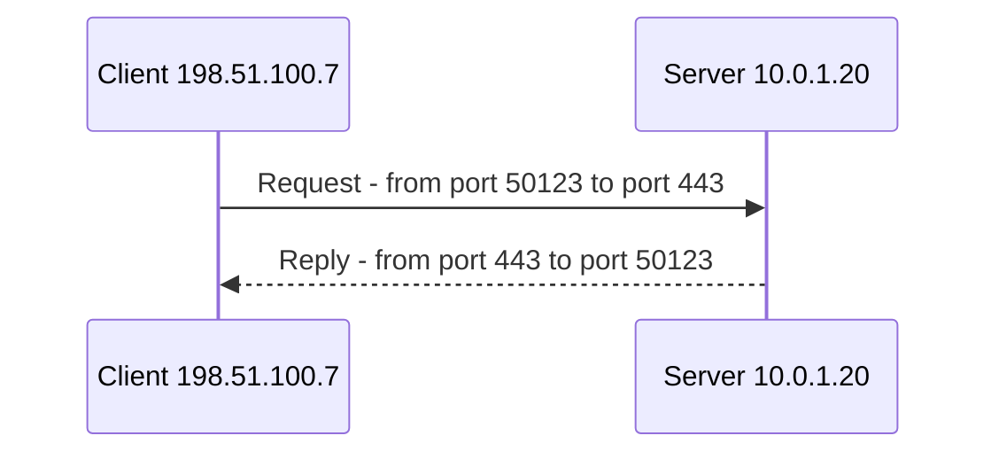
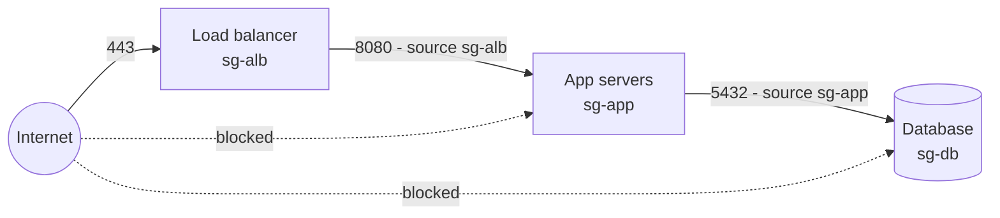

# Security groups versus network ACLs

## Before this lesson

Read [VPCs, CIDR planning, subnets, route tables and gateways](#/lesson/aws/vpc-basics): you need CIDR notation, subnets and route tables. You should also know that network services listen on numbered **ports** (web servers on 80 and 443, SSH on 22); the networking track's [TCP lesson](#/lesson/networking/udp-tcp-lifecycle) explains ports and connections in depth.

## In plain words

Routing decides where traffic *can* go. **Firewalls** decide which traffic is *allowed*. A VPC has two firewalls, at two different levels:

- A **security group** surrounds an individual resource — an instance, a database, a load balancer. Think of it as the **bouncer at the door of one room**, holding a guest list. If a guest is let in, the bouncer remembers them and lets them back out without checking again.
- A **network ACL** (access control list) guards a whole **subnet**. Think of it as the **guard at the entrance to a floor**, with a numbered rulebook that is read from the top until a rule matches. This guard has no memory: people are checked on the way in *and* on the way out, as if never seen before.

The difference between "remembers" and "does not remember" has a name — **stateful** versus **stateless** — and it is one of the most asked questions in AWS interviews and exams.

Why it matters for a job: security groups are the main network control you will configure every week. A wrong rule either blocks your own application or exposes a database to the world.

## Ports, protocols and connections

A network conversation is identified by five values: source address, source port, destination address, destination port, and protocol (**TCP** for reliable connections, **UDP** for single messages, **ICMP** for diagnostics like `ping`).

When your browser opens a page on a server:

- the **destination port** is well known — 443 for HTTPS;
- the **source port** is picked at random by the client's operating system from a high range. This is an **ephemeral port**. Linux typically uses 32768–60999; other systems use ranges within 1024–65535.



The reply travels *to the ephemeral port*. Keep that in mind: it is the key to understanding stateless rules.

## Security groups

A **security group** is a set of rules attached to an elastic network interface (in practice: to an instance, an RDS database, a load balancer, a Lambda function in a VPC, and so on).

Properties:

1. **Allow rules only.** There is no way to write "deny". Anything not allowed is denied.
2. **Stateful.** If an inbound request is allowed, the reply is allowed automatically, whatever the outbound rules say — and the other way round for outbound requests.
3. **All rules are evaluated together.** There is no order; if any rule allows the traffic, it passes.
4. **Defaults.** A new security group allows **no inbound** traffic and **all outbound** traffic.
5. A resource can have several security groups (five per interface by default); the rules are the union.
6. Changes take effect **immediately**.

A rule has a protocol, a port range, and a **source** (for inbound) or destination (for outbound). The source can be:

- a CIDR block (`203.0.113.0/24`, or `0.0.0.0/0` for anyone);
- **another security group**;
- a *prefix list* (a named set of CIDR blocks, including AWS-managed ones for services like S3 and CloudFront).

### Referencing a security group: the important trick

Using a security group as the source means "allow traffic from any resource that has that group attached", whatever its IP address. This is how tiers are chained without knowing addresses:

| Group | Inbound rule | Meaning |
|---|---|---|
| `sg-alb` (load balancer) | TCP 443 from `0.0.0.0/0` | The public may reach the load balancer |
| `sg-app` (application servers) | TCP 8080 from `sg-alb` | Only the load balancer may reach the app |
| `sg-db` (database) | TCP 5432 from `sg-app` | Only the app may reach the database |



When auto scaling adds a tenth application server it receives `sg-app` and is instantly allowed to reach the database. No IP lists to maintain.

## Network ACLs

A **network ACL (NACL)** is attached to subnets. Every subnet has exactly one; a NACL can serve many subnets.

Properties:

1. **Allow and deny rules.**
2. **Stateless.** Inbound and outbound traffic are checked independently. A reply is not recognised as a reply; it must be allowed by its own rule.
3. **Numbered rules, evaluated in ascending order; the first match wins** and evaluation stops. A final rule shown as `*` denies everything that matched nothing.
4. **Defaults.** The VPC's *default* NACL allows everything in and out. A *custom* NACL you create denies everything until you add rules.
5. Applies to traffic **crossing the subnet boundary**. Two instances in the same subnet talk without touching the NACL.

A typical NACL for a public web subnet:

**Inbound**

| Rule # | Protocol | Port range | Source | Action |
|---|---|---|---|---|
| 90 | TCP | all | 198.51.100.0/24 | DENY |
| 100 | TCP | 443 | 0.0.0.0/0 | ALLOW |
| 110 | TCP | 1024–65535 | 0.0.0.0/0 | ALLOW |
| * | all | all | 0.0.0.0/0 | DENY |

**Outbound**

| Rule # | Protocol | Port range | Destination | Action |
|---|---|---|---|---|
| 100 | TCP | 443 | 0.0.0.0/0 | ALLOW |
| 110 | TCP | 1024–65535 | 0.0.0.0/0 | ALLOW |
| * | all | all | 0.0.0.0/0 | DENY |

Reading it:

- Inbound rule 90 blocks one misbehaving network. It must have a **lower number** than rule 100, otherwise the allow would match first and the deny would never be reached.
- Inbound 100 admits HTTPS requests. **Outbound 110** lets the replies leave, addressed to clients' ephemeral ports. Without it the server receives requests and its answers are dropped — the classic stateless mistake.
- Outbound 100 lets the servers call HTTPS services themselves; **inbound 110** admits the replies to those calls.

Number rules in steps of 10 or 100 so that new ones can be inserted.

## Side by side

| | Security group | Network ACL |
|---|---|---|
| Attached to | A network interface (instance, database, load balancer…) | A subnet |
| Rule types | Allow only | Allow and deny |
| State | **Stateful**: replies automatic | **Stateless**: replies need their own rule |
| Evaluation | All rules, any match allows | Numbered order, first match decides |
| Default (new) | No inbound, all outbound | Default NACL: allow all. Custom NACL: deny all |
| Can reference | CIDR, security groups, prefix lists | CIDR only |
| Scope of effect | Only resources it is attached to | Everything in the subnet |
| Typical role | Primary, fine-grained control | Coarse second layer; blocking specific addresses |

Using both is an example of **defence in depth**: independent layers, so that a mistake in one is caught by another.

## Simulating stateful and stateless

The simulation sends a request to a web server through a NACL and a security group, then sends the reply back. Try removing the outbound ephemeral rule.

```python-run
import ipaddress

def in_cidr(ip, cidr):
    return ipaddress.ip_address(ip) in ipaddress.ip_network(cidr)

def nacl_allows(rules, port, ip):
    """Stateless: rules sorted by number, first match wins, default deny."""
    for number, lo, hi, cidr, action in sorted(rules):
        if lo <= port <= hi and in_cidr(ip, cidr):
            return action == "allow", number
    return False, "*"

def sg_allows(rules, port, ip):
    """Stateful firewall, allow rules only: any match allows."""
    return any(lo <= port <= hi and in_cidr(ip, cidr) for lo, hi, cidr in rules)

nacl_in  = [(100, 443, 443, "0.0.0.0/0", "allow")]
nacl_out = [(100, 443, 443, "0.0.0.0/0", "allow"),
            (110, 1024, 65535, "0.0.0.0/0", "allow")]   # <- delete this line and re-run
sg_in = [(443, 443, "0.0.0.0/0")]

client, client_port, server_port = "198.51.100.7", 50123, 443

ok, rule = nacl_allows(nacl_in, server_port, client)
print("1. request through inbound NACL :", "allow" if ok else "DENY", "(rule", rule, ")")
print("2. request through security group:", "allow" if sg_allows(sg_in, server_port, client) else "DENY")
print("3. reply through security group  : allow (stateful - it remembers the connection)")
ok, rule = nacl_allows(nacl_out, client_port, client)
print("4. reply through outbound NACL   :", "allow" if ok else "DENY", "(rule", rule, ")")
```

Line by line: `nacl_allows` sorts by rule number and returns at the first rule whose port range and address range both match; `sg_allows` returns true if any rule matches. Step 3 involves no rule lookup at all — that is what stateful means. Step 4 checks the reply against the **client's port, 50123**; with rule 110 deleted, the only outbound rule covers port 443 and the reply is denied by the `*` rule. The problem *Security Group and Network ACL Evaluation* asks you to implement this full path.

## Worked example: three tiers with security groups

```bash
VPC=vpc-0abc1234

# 1. One group per tier.
SG_ALB=$(aws ec2 create-security-group --vpc-id $VPC --group-name alb \
  --description "Public load balancer" --query GroupId --output text)
SG_APP=$(aws ec2 create-security-group --vpc-id $VPC --group-name app \
  --description "Application servers" --query GroupId --output text)
SG_DB=$(aws ec2 create-security-group --vpc-id $VPC --group-name db \
  --description "PostgreSQL" --query GroupId --output text)

# 2. Internet -> load balancer on HTTPS.
aws ec2 authorize-security-group-ingress --group-id $SG_ALB \
  --protocol tcp --port 443 --cidr 0.0.0.0/0

# 3. Load balancer -> app on 8080. The source is a security group, not an address.
aws ec2 authorize-security-group-ingress --group-id $SG_APP \
  --protocol tcp --port 8080 --source-group $SG_ALB

# 4. App -> database on 5432.
aws ec2 authorize-security-group-ingress --group-id $SG_DB \
  --protocol tcp --port 5432 --source-group $SG_APP
```

- `create-security-group` needs the VPC, a name and a description, and returns the group ID.
- `authorize-security-group-ingress` adds an inbound rule. `--cidr` and `--source-group` are the two kinds of source.
- No outbound rules were written: the default "allow all outbound" remains. Hardened environments replace it, for example allowing the app tier outbound only to `sg-db` on 5432 and to HTTPS.

```bash
# 5. Review a group's rules.
aws ec2 describe-security-group-rules --filters Name=group-id,Values=$SG_APP \
  --query "SecurityGroupRules[].[IsEgress,IpProtocol,FromPort,ToPort,CidrIpv4,ReferencedGroupInfo.GroupId]" \
  --output table
```

```
---------------------------------------------------------------
|               DescribeSecurityGroupRules                    |
+--------+------+-------+-------+------------+----------------+
|  False |  tcp |  8080 |  8080 |  None      |  sg-0a1b2c3d   |
|  True  |  -1  |  -1   |  -1   |  0.0.0.0/0 |  None          |
+--------+------+-------+-------+------------+----------------+
```

The first row is our inbound rule (source: the load balancer's group). The second is the default outbound rule: protocol `-1` means all protocols and all ports.

## Troubleshooting "it cannot connect"

Work outwards from the resource, one layer at a time:

1. **Is the service listening?** On the instance: `ss -ltnp` shows listening ports. Many "firewall problems" are a stopped process or a service bound to `127.0.0.1`.
2. **Security group** of the destination: is there an inbound rule for this port from this source?
3. **Security group** of the source, if its outbound rules were restricted.
4. **Network ACLs** of both subnets: request and reply directions, including ephemeral ports.
5. **Route tables**: does each side have a route to the other?
6. **Public IP and internet gateway**, if the source is the internet.
7. **VPC Flow Logs**: each record ends in `ACCEPT` or `REJECT`. A `REJECT` on the inbound record points at the destination's security group or NACL; an `ACCEPT` inbound followed by a `REJECT` on the return record points at a NACL, because security groups never block replies.

**VPC Reachability Analyzer** automates steps 2–6: you name a source and a destination and it reports the hop that blocks the path, without sending a packet.

A symptom guide: a connection that **times out** is being silently dropped (security group, NACL, routing). A connection **refused** immediately means the packet arrived and nothing was listening on that port.

## Beyond the two firewalls

Other network protections you will meet, each covered later:

- **AWS WAF** filters web requests by content (SQL injection patterns, rate limits) at a load balancer, API Gateway or CloudFront.
- **AWS Shield** absorbs distributed denial-of-service floods.
- **AWS Network Firewall** is a managed, stateful, inspecting firewall for a whole VPC — domain filtering, intrusion-prevention rules.
- **Firewall Manager** applies security-group, WAF and firewall policies across an organisation's accounts.

## Cost notes and free-tier warnings

- Security groups and network ACLs are **free**, with no performance penalty to speak of.
- The cost risk is indirect: an over-open group on a compromised instance can lead to data-transfer charges or misuse.
- VPC Flow Logs and Reachability Analyzer analyses are charged (per GB ingested, per analysis).

## Pitfalls

- **Forgetting ephemeral ports in a custom NACL**, so requests arrive and replies vanish.
- **Putting a NACL deny after a broader allow.** The lower number wins.
- **SSH (22) or RDP (3389) open to `0.0.0.0/0`.** Restrict to known addresses or use Session Manager.
- **Database ports open to the world**, or to the whole VPC CIDR when only the app tier needs them. Reference the app's security group.
- **Trying to block one IP address with a security group.** Groups cannot deny; use a NACL, or WAF for web traffic.
- **Expecting NACLs to filter traffic between two instances in the same subnet.** They do not; security groups do.
- **Deleting the default outbound rule** and then wondering why the instance cannot download updates.
- **One giant security group shared by everything**, which makes every rule apply everywhere.

> [!INTERVIEW]
> **"Explain the difference between a security group and a network ACL."** A security group is a stateful, allow-only firewall at the network-interface level: all rules are evaluated, return traffic is automatically permitted, and rules can reference other security groups. A network ACL is a stateless, ordered list of allow and deny rules at the subnet level: the lowest-numbered matching rule decides, and return traffic needs explicit rules, including the ephemeral port range. Security groups are the primary control; NACLs add a coarse second layer and are the tool for explicitly blocking addresses.
>
> **"Users can reach the web server, but the server cannot call an external API on port 443. Security-group outbound is open. Where do you look?"** At the subnet's NACL: outbound 443 must be allowed and, because NACLs are stateless, inbound ephemeral ports must be allowed for the replies. Then at routing — a private subnet needs a NAT gateway route.

## Cheat sheet

| Question | Answer |
|---|---|
| Which is stateful? | Security group |
| Which can deny? | Network ACL |
| Which evaluates in order? | Network ACL (lowest number first) |
| Block one IP range | NACL deny rule with a low number |
| Let tier A reach tier B | Inbound rule on B's security group with A's group as source |
| Reply traffic through a NACL | Allow ephemeral ports 1024–65535 in the opposite direction |
| New security group default | No inbound, all outbound |
| Custom NACL default | Deny everything |
| Timeout vs refused | Dropped by a firewall or route vs nothing listening |

## Summary

- Security groups protect individual resources; they are stateful, allow-only, unordered, and can reference each other to chain tiers.
- Network ACLs protect subnets; they are stateless, ordered, and can deny.
- Stateless filtering requires explicit rules for replies, which go to ephemeral ports.
- Use security groups for least-privilege access between tiers and NACLs as an extra layer or to block specific sources.
- Troubleshoot from the listening process outwards; Flow Logs and Reachability Analyzer show where traffic stops.

## Glossary

- **Defence in depth**: using several independent layers of protection.
- **Ephemeral port**: the temporary high-numbered port a client uses for one connection.
- **Network ACL (NACL)**: a stateless, ordered subnet-level firewall with allow and deny rules.
- **Port**: a number identifying a service on a machine.
- **Prefix list**: a named collection of CIDR blocks usable in rules and routes.
- **Reachability Analyzer**: a tool that analyses whether a network path is open.
- **Security group**: a stateful, allow-only firewall on a network interface.
- **Stateful**: remembering connections so that replies are allowed automatically.
- **Stateless**: evaluating every packet independently in each direction.
- **TCP / UDP / ICMP**: connection-oriented, connectionless and diagnostic network protocols.

```quiz
[
  {"q": "A custom network ACL allows inbound TCP 443 from 0.0.0.0/0 and has no outbound rules except the default deny. The security group allows 443. What do users see?",
   "options": ["The site works normally", "Requests reach the server but replies are dropped, so connections time out", "Connection refused immediately", "Only IPv6 users are affected"],
   "answer": 1,
   "explain": "NACLs are stateless: the reply to each client's ephemeral port must be allowed by an outbound rule (for example TCP 1024-65535)."},
  {"q": "A database should accept connections only from the application servers, whose number changes with auto scaling. What is the best inbound rule for the database's security group?",
   "options": ["TCP 5432 from 0.0.0.0/0", "TCP 5432 from the VPC CIDR", "TCP 5432 from the application servers' security group", "All traffic from the public subnet"],
   "answer": 2,
   "explain": "Referencing the app tier's security group admits exactly the instances carrying that group, however many there are and whatever their IPs."},
  {"q": "A NACL has inbound rules: #100 ALLOW TCP 80 from 0.0.0.0/0, #200 DENY TCP 80 from 203.0.113.0/24. Can 203.0.113.5 reach port 80?",
   "options": ["No, deny always wins", "Yes, rule 100 matches first and evaluation stops", "No, the default rule denies it", "Only over UDP"],
   "answer": 1,
   "explain": "NACL rules are evaluated in ascending number order and the first match decides. To block the range the deny must have a lower number than the allow."},
  {"q": "A security team needs to block all traffic from one malicious IP address to every instance in a subnet. Which tool?",
   "options": ["A deny rule in each security group", "A low-numbered deny rule in the subnet's network ACL", "Removing the route to the internet gateway", "An IAM policy"],
   "answer": 1,
   "explain": "Security groups cannot contain deny rules. A NACL deny with a low rule number blocks the address for the whole subnet."},
  {"q": "An instance's security group has no inbound rules and the default outbound rule. The instance runs 'curl https://example.com'. What happens?",
   "options": ["It fails because the reply is blocked by the missing inbound rule", "It succeeds because the security group is stateful and allows the reply", "It fails because outbound traffic needs an inbound rule first", "It succeeds only if port 443 inbound is added"],
   "answer": 1,
   "explain": "The outbound request is allowed by the default rule, and a stateful firewall automatically allows the response."},
  {"q": "Two instances in the same subnet cannot communicate on port 6379. The subnet's NACL denies port 6379. Is the NACL the cause?",
   "options": ["Yes, NACLs filter all traffic in the subnet", "No, NACLs only apply to traffic crossing the subnet boundary; check the security groups", "Yes, but only for TCP", "No, port 6379 is reserved by AWS"],
   "answer": 1,
   "explain": "Traffic between resources in the same subnet does not pass through the network ACL. Security groups apply to every interface regardless of subnet."},
  {"q": "A client's connection attempt to an instance returns 'connection refused' instantly. What does this suggest?",
   "options": ["A security group is dropping the packet", "A NACL is dropping the packet", "The packet arrived but no process is listening on that port", "The route table has no default route"],
   "answer": 2,
   "explain": "Firewalls and missing routes drop packets silently, producing timeouts. An immediate refusal comes from the host itself: the port is closed."}
]
```

> **Source:** AWS Certified Solutions Architect Official Study Guide, ch. 4 (security groups, network ACLs). Checked against https://docs.aws.amazon.com/vpc/latest/userguide/vpc-security-groups.html , https://docs.aws.amazon.com/vpc/latest/userguide/vpc-network-acls.html and https://docs.aws.amazon.com/vpc/latest/userguide/infrastructure-security.html
