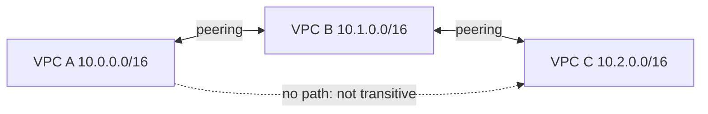
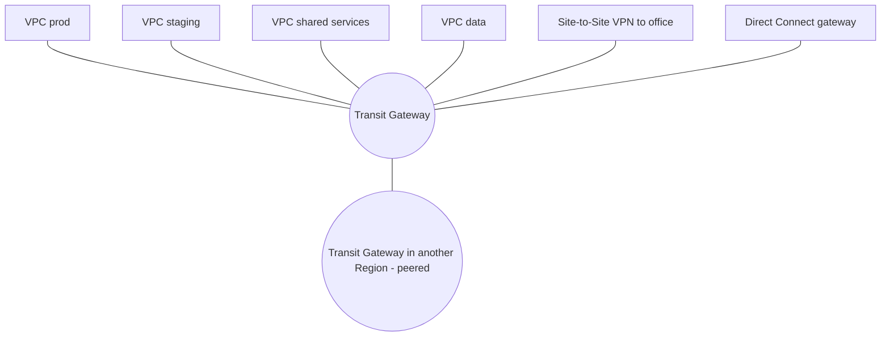
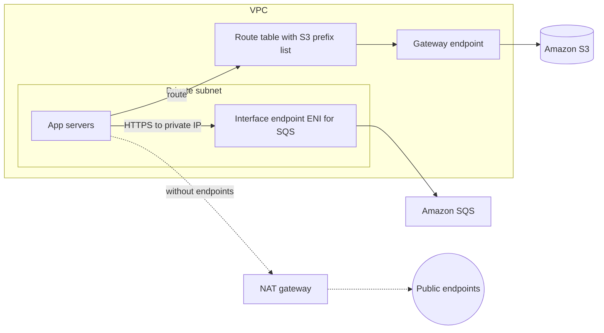
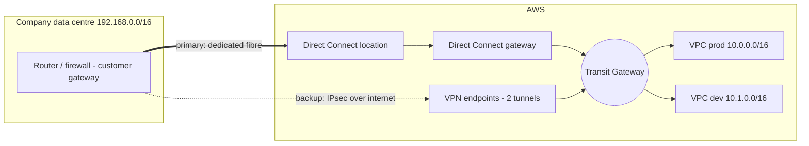

# Connecting networks: peering, Transit Gateway, endpoints, VPN and Direct Connect

## Before this lesson

You need [VPCs, CIDR planning, subnets, route tables and gateways](#/lesson/aws/vpc-basics) (route tables, NAT gateways, the no-overlap rule) and [Security groups versus network ACLs](#/lesson/aws/vpc-firewalls).

## In plain words

A single VPC is an island. Real companies have many islands — a VPC per team or environment, an office, an old data centre — and services such as S3 that live outside every VPC. This lesson is about the **bridges**:

- **VPC peering**: a private bridge between two VPCs.
- **Transit Gateway**: a roundabout that many VPCs and offices connect to, so that everyone can reach everyone through one hub.
- **VPC endpoints**: a private side door from your VPC to AWS services such as S3, so that traffic does not go out through the internet.
- **Site-to-Site VPN**: an encrypted tunnel across the public internet between your office and your VPC.
- **Direct Connect**: a private cable you rent between your building and AWS.

Why it matters for a job: "how do these two networks talk privately?" appears in every architecture review. The answers differ a great deal in cost, setup time and limits, and exam questions are built on exactly those differences.

## VPC peering

A **VPC peering connection** links two VPCs so that resources in each can reach the other using private IP addresses. The VPCs may be in different accounts and different Regions. Traffic stays on the AWS network and there is no gateway device to size or pay for by the hour.

Setting one up takes four steps, and forgetting the third or fourth is the usual mistake:

1. One side **requests** the peering.
2. The other side **accepts**.
3. **Both** sides add routes: "to reach the other VPC's CIDR, go to the peering connection".
4. Security groups on both sides allow the traffic. (Within one Region, a rule can even reference a security group of the peer VPC.)

```bash
# Request and accept (same account and Region here).
PCX=$(aws ec2 create-vpc-peering-connection --vpc-id vpc-0aaa --peer-vpc-id vpc-0bbb \
  --query VpcPeeringConnection.VpcPeeringConnectionId --output text)
aws ec2 accept-vpc-peering-connection --vpc-peering-connection-id "$PCX"

# Routes in BOTH directions. VPC A is 10.0.0.0/16, VPC B is 10.1.0.0/16.
aws ec2 create-route --route-table-id rtb-0aaa --destination-cidr-block 10.1.0.0/16 \
  --vpc-peering-connection-id "$PCX"
aws ec2 create-route --route-table-id rtb-0bbb --destination-cidr-block 10.0.0.0/16 \
  --vpc-peering-connection-id "$PCX"
```

- `create-vpc-peering-connection` names the requester and accepter VPCs.
- Each `create-route` tells one side's route table where the other side's addresses live. With only one of the two routes, packets arrive and replies have nowhere to go.

### The two limits of peering

**CIDR blocks must not overlap.** If both VPCs use `10.0.0.0/16`, a router cannot tell "mine" from "theirs".

**Peering is not transitive.** If A is peered with B, and B with C, A still cannot reach C through B. Every pair that must talk needs its own peering.



For the same reason a peer cannot use your internet gateway, NAT gateway or VPN connection ("no edge-to-edge routing").

Connecting *n* VPCs to each other with peering needs n × (n − 1) / 2 connections: 10 VPCs need 45, 50 VPCs need 1,225, each with routes on both sides. Past a handful, a hub is needed.

## Transit Gateway

A **Transit Gateway (TGW)** is a regional network hub. Each VPC, VPN or Direct Connect attaches to it **once**, and the gateway routes between attachments.



What it adds over peering:

- **Transitive routing**: any attachment can reach any other, subject to the gateway's route tables.
- **Scale**: thousands of attachments instead of a mesh.
- **Segmentation**: a Transit Gateway has its own **route tables**. Putting attachments in different tables keeps, say, production and development apart while both reach a shared-services VPC.
- **Shared on-premises connectivity**: one VPN or Direct Connect serves every attached VPC.
- **Inter-Region peering** between Transit Gateways, and sharing across accounts with AWS Resource Access Manager.

What it costs: an **hourly charge per attachment plus a per-gigabyte data-processing charge**, where peering charges only ordinary data transfer.

| | VPC peering | Transit Gateway |
|---|---|---|
| Topology | One-to-one | Hub and spoke |
| Transitive | No | Yes |
| Connections for 10 VPCs | 45 | 10 attachments |
| Shares VPN / Direct Connect | No | Yes |
| Cost | Data transfer only | Per attachment-hour + per GB |
| Best for | A few VPCs with heavy traffic | Many VPCs, hybrid networks, central inspection |

Related: **AWS Cloud WAN** builds a managed global network on the same ideas, and **VPC sharing** lets several accounts place resources in subnets of one central VPC, avoiding inter-VPC connectivity altogether.

## VPC endpoints

Services such as S3, DynamoDB, SQS or Secrets Manager have public API addresses. From a private subnet, reaching them normally means going out through a NAT gateway — paying per gigabyte and travelling via public addresses. A **VPC endpoint** gives a private path instead.

### Gateway endpoints

A **gateway endpoint** exists for exactly two services: **S3 and DynamoDB**. It is not a device; it is an entry in route tables. You select route tables, and AWS adds a route whose destination is the service's *prefix list* (the set of its IP ranges) and whose target is the endpoint.

- **Free.** No hourly charge, no data charge.
- Works only from inside the VPC (not from peered VPCs or on-premises).
- An **endpoint policy** can restrict which buckets or tables are reachable through it.

### Interface endpoints (AWS PrivateLink)

An **interface endpoint** places an elastic network interface with a private IP address in your subnets. It is available for well over a hundred AWS services and for third-party or your own services.

- With **private DNS** enabled, the service's normal name (for example `sqs.eu-west-1.amazonaws.com`) resolves to the private IPs inside your VPC, so applications need no change.
- Protected by a **security group**; must allow HTTPS (443) from clients.
- Reachable from peered VPCs and from on-premises over VPN or Direct Connect.
- **Charged per hour per Availability Zone plus per GB.**

The underlying technology is **AWS PrivateLink**. It also lets you publish *your* service — fronted by a Network Load Balancer — to other VPCs or customers as an endpoint, exposing one service without connecting whole networks and without caring about overlapping CIDR blocks.

| | Gateway endpoint | Interface endpoint |
|---|---|---|
| Services | S3, DynamoDB | Most AWS services, partner and custom services |
| Mechanism | Route-table entry with a prefix list | ENI with private IP + private DNS |
| Cost | Free | Hourly per AZ + per GB |
| From on-premises / peered VPC | No | Yes |
| Access control | Endpoint policy | Endpoint policy + security group |



A bucket policy can then insist on the private path, using the condition key `aws:SourceVpce`:

```json
{
  "Version": "2012-10-17",
  "Statement": [{
    "Sid": "OnlyThroughOurEndpoint",
    "Effect": "Deny",
    "Principal": "*",
    "Action": "s3:*",
    "Resource": ["arn:aws:s3:::tidewater-ledger", "arn:aws:s3:::tidewater-ledger/*"],
    "Condition": {"StringNotEquals": {"aws:SourceVpce": "vpce-0a1b2c3d4e5f"}}
  }]
}
```

Line by line: the statement **denies** every S3 action on the bucket and its objects to everyone **unless** the request arrived through the named endpoint (`StringNotEquals` is true for any other endpoint and when there is no endpoint at all). Stolen credentials used from the internet are therefore useless against this bucket. Be careful: the same rule locks out console access from your laptop.

> [!TIP]
> The first cost optimisation in most VPCs is a **gateway endpoint for S3** (and DynamoDB). It is free, takes one command, and removes S3 traffic from the NAT gateway's per-gigabyte meter.
>
> ```bash
> aws ec2 create-vpc-endpoint --vpc-id vpc-0aaa --service-name com.amazonaws.eu-west-1.s3 \
>   --route-table-ids rtb-0priv1 rtb-0priv2
> ```

## Connecting to your own premises

### Site-to-Site VPN

A **VPN** (virtual private network) is an encrypted tunnel over an untrusted network. An AWS **Site-to-Site VPN** connects a router or firewall in your building to AWS over the internet using the **IPsec** protocol.

The parts:

- **Customer gateway (CGW)**: the AWS resource that represents *your* device (its public IP and routing details).
- **Virtual private gateway (VGW)**: the AWS-side endpoint attached to one VPC — or a **Transit Gateway**, to serve many VPCs.
- **The VPN connection**: always **two tunnels**, ending in two different Availability Zones, for redundancy. Configure both on your device.
- **Routing**: *static* (you list the on-premises CIDR blocks) or *dynamic* with **BGP** (Border Gateway Protocol), where both sides advertise their networks automatically and fail over between tunnels.

Characteristics: set up in minutes to hours; each tunnel carries up to about 1.25 Gbit/s; performance varies because the path is the public internet; charged per connection-hour plus data transfer out.

A different product, **AWS Client VPN**, connects individual laptops to a VPC and should not be confused with Site-to-Site VPN.

### Direct Connect

**AWS Direct Connect (DX)** is a dedicated physical connection between your network and AWS that does not use the internet. You (or a partner) run a fibre *cross-connect* to an AWS router at a **Direct Connect location**, a co-location facility.

- **Dedicated connections** of 1, 10, 100 or 400 Gbit/s, or **hosted connections** from a partner starting at 50 Mbit/s.
- **Consistent** latency and throughput, and a lower per-GB data-transfer-out price than the internet.
- **Lead time of weeks to months** for a new dedicated connection — the decisive fact in many exam scenarios.
- **Not encrypted by default.** For encryption run a VPN over it or use MACsec on supported ports.
- **Not redundant by itself.** One cable is a single point of failure.

Over the physical link you create **virtual interfaces (VIFs)**:

| VIF type | Reaches |
|---|---|
| Private | One VPC's private addresses, via a virtual private gateway or a Direct Connect gateway |
| Public | AWS public service endpoints (S3, DynamoDB…) over the private link |
| Transit | A Transit Gateway, through a Direct Connect gateway |

A **Direct Connect gateway** is a global object that lets one connection reach VPCs in many Regions.

### Choosing and combining

| | Site-to-Site VPN | Direct Connect |
|---|---|---|
| Path | Internet, encrypted with IPsec | Private dedicated link |
| Time to set up | Minutes to hours | Weeks to months |
| Bandwidth | ~1.25 Gbit/s per tunnel | 50 Mbit/s to 400 Gbit/s |
| Latency | Variable | Consistent |
| Encryption | Built in | Add VPN or MACsec |
| Cost | Low | Port-hours + lower data-out rate |

Common resilient patterns, cheapest first:

1. **VPN only** — two tunnels; fine for small offices and for starting quickly.
2. **Direct Connect with a VPN backup** — the VPN takes over if the cable fails, at lower bandwidth.
3. **Two Direct Connect connections at two locations** — for critical workloads that cannot tolerate reduced capacity.



## Worked scenario: choose the connectivity

Tidewater Books now has three VPCs (prod, staging, shared tools), an office, and a warehouse system that must upload 2 TB nightly.

| Requirement | Choice | Reasoning |
|---|---|---|
| App servers in private subnets read and write S3 heavily | **Gateway endpoint for S3** | Free; removes NAT per-GB charges; stays on the AWS network |
| The same servers call Secrets Manager and SQS without internet access | **Interface endpoints** | Those services have no gateway endpoint |
| Staging must reach the shared tools VPC; so must prod; prod and staging must not reach each other | **Two peerings** (or a Transit Gateway with separate route tables) | Non-transitivity of peering gives the isolation for free |
| The number of VPCs is expected to reach twenty next year | **Transit Gateway** | A mesh of 190 peerings is unmanageable |
| The office needs access next week | **Site-to-Site VPN** | Ready in hours |
| The warehouse uploads 2 TB every night with a fixed window | **Direct Connect**, VPN as backup | 2 TB in six hours needs about 750 Mbit/s sustained, steadily — order the link now, use VPN meanwhile |
| A partner must call one internal API, and their network uses the same 10.0.0.0/16 range | **PrivateLink endpoint service** | Exposes one service; overlapping CIDRs do not matter |

The arithmetic in the sixth row: 2 TB ≈ 2 × 8 × 10¹² bits = 1.6 × 10¹³ bits; divided by 21,600 seconds (six hours) gives about 740 Mbit/s. Being able to do that estimate aloud is what interviewers look for.

## Cost notes and free-tier warnings

- **Peering**: no hourly charge; data transfer is free within the same Availability Zone and charged across zones or Regions.
- **Transit Gateway**: hourly per attachment and per GB processed — noticeable with many attachments and heavy traffic.
- **Gateway endpoints**: free. **Interface endpoints**: roughly a cent per hour per zone each, plus per GB; ten endpoints in three zones is a real monthly sum, so create only those you need.
- **Site-to-Site VPN**: hourly per connection. **Direct Connect**: port-hours plus reduced data-out rates, plus whatever the co-location and carrier charge.
- None of these has a free allowance. Delete test attachments, endpoints and VPN connections when finished.

## Pitfalls

- **Routes on one side only** of a peering or VPN.
- **Expecting transitive peering**, or expecting a peer to use your NAT gateway or VPN.
- **Overlapping CIDR blocks** discovered on the day two networks must be joined.
- **A gateway endpoint created but not associated with the private subnets' route tables.**
- **Interface endpoint without private DNS or with a security group that blocks 443**: the SDK still resolves the public address or times out.
- **Assuming Direct Connect is encrypted or redundant.**
- **Proposing Direct Connect when the requirement says "by next week".**
- **Only one VPN tunnel configured**, losing connectivity during AWS maintenance of that tunnel.

> [!INTERVIEW]
> **"How would you let instances in a private subnet reach S3 without internet access?"** Create a gateway VPC endpoint for S3 and associate it with the private subnets' route tables; optionally restrict it with an endpoint policy and make the bucket policy require `aws:SourceVpce`. It is free and keeps traffic on the AWS network.
>
> **"Peering or Transit Gateway?"** Peering for a small number of VPCs — it is simple and has no hourly or per-GB processing charge, but it is one-to-one and non-transitive. Transit Gateway when there are many VPCs, when on-premises connectivity must be shared, or when traffic must be segmented and inspected centrally; it costs per attachment and per gigabyte.

## Cheat sheet

| Need | Service |
|---|---|
| Two VPCs, private connectivity | VPC peering (routes both sides, no overlap, not transitive) |
| Many VPCs and sites through one hub | Transit Gateway |
| Private access to S3 or DynamoDB, free | Gateway endpoint |
| Private access to other AWS services | Interface endpoint (PrivateLink) |
| Expose one service to another VPC or customer | PrivateLink endpoint service behind an NLB |
| Office to VPC quickly, encrypted | Site-to-Site VPN (two tunnels) |
| High, consistent bandwidth to on-premises | Direct Connect (weeks to provision; add VPN for backup or encryption) |
| One DX to VPCs in several Regions | Direct Connect gateway |
| Individual remote users | Client VPN |

## Summary

- Peering links two non-overlapping VPCs privately; it needs routes on both sides and is never transitive.
- A Transit Gateway is a hub that scales to many VPCs and sites, with its own route tables for segmentation, at an hourly and per-GB price.
- Gateway endpoints (S3, DynamoDB) are free route-table entries; interface endpoints are private network interfaces for most other services, billed hourly.
- Site-to-Site VPN is quick, encrypted and internet-based; Direct Connect is private, consistent, slow to provision, and neither encrypted nor redundant by default.
- Combine them: endpoints to cut NAT traffic, VPN to start and as backup, Direct Connect for steady heavy flows.

## Glossary

- **BGP**: Border Gateway Protocol, used to exchange routes dynamically.
- **Customer gateway**: the AWS representation of your on-premises VPN device.
- **Direct Connect**: a dedicated private network link to AWS.
- **Direct Connect gateway**: a global object linking a Direct Connect to VPCs in several Regions.
- **Endpoint policy**: a policy limiting what can be done through a VPC endpoint.
- **Gateway endpoint**: a free route-based endpoint for S3 and DynamoDB.
- **Interface endpoint**: an ENI providing private access to a service through PrivateLink.
- **IPsec**: the protocol suite used to encrypt Site-to-Site VPN tunnels.
- **Non-transitive**: not passing traffic on to a third network.
- **PrivateLink**: the technology behind interface endpoints and endpoint services.
- **Transit Gateway**: a regional hub that routes between attached VPCs and on-premises links.
- **VIF**: virtual interface on a Direct Connect connection.
- **Virtual private gateway**: the VPC-side endpoint of a VPN or Direct Connect.
- **VPC peering**: a private one-to-one connection between two VPCs.

```quiz
[
  {"q": "VPC A is peered with VPC B, and B with VPC C. An instance in A cannot reach an instance in C. Routes and security groups for the existing peerings are correct. Why?",
   "options": ["Peering requires a NAT gateway", "Peering is not transitive; A and C need their own peering or a Transit Gateway", "Peering only works within one account", "C's CIDR must be a subset of B's"],
   "answer": 1,
   "explain": "Traffic cannot pass through an intermediate VPC over peering connections. Each pair needs a direct peering, or all attach to a Transit Gateway."},
  {"q": "A company's NAT gateway bill is dominated by gigabytes of traffic from private EC2 instances to S3. What is the cheapest fix?",
   "options": ["Add a second NAT gateway", "Create an S3 gateway endpoint associated with the private route tables", "Move the instances to public subnets with Elastic IPs", "Create an interface endpoint for EC2"],
   "answer": 1,
   "explain": "A gateway endpoint for S3 is free and routes S3 traffic privately, bypassing the NAT gateway's per-GB charge."},
  {"q": "A workload in a subnet with no internet route must call the Secrets Manager API. What is required?",
   "options": ["A gateway endpoint for Secrets Manager", "An interface endpoint for Secrets Manager with private DNS", "VPC peering with the Secrets Manager VPC", "An egress-only internet gateway"],
   "answer": 1,
   "explain": "Only S3 and DynamoDB have gateway endpoints. Other services are reached privately through interface endpoints (PrivateLink)."},
  {"q": "A firm needs encrypted connectivity between its office and a VPC by the end of the week, for light administrative traffic. Which option?",
   "options": ["A dedicated 10 Gbit/s Direct Connect", "Site-to-Site VPN", "VPC peering", "CloudFront"],
   "answer": 1,
   "explain": "A Site-to-Site VPN can be established in hours and is encrypted with IPsec. A new Direct Connect takes weeks to months."},
  {"q": "Which statement about Direct Connect is correct?",
   "options": ["Traffic is encrypted by default", "A single connection is highly available by default", "It provides consistent performance over a private link but needs a second connection or VPN for resilience", "It can be provisioned in minutes"],
   "answer": 2,
   "explain": "Direct Connect bypasses the internet for consistent bandwidth and latency, but it is neither encrypted nor redundant unless you add MACsec/VPN and a second link."},
  {"q": "An organisation has 30 VPCs across several accounts and two data centres, and wants every network to be able to reach a central inspection VPC. Which design scales best?",
   "options": ["A full mesh of VPC peerings", "A Transit Gateway with route tables for segmentation", "One giant VPC peering shared by all", "An internet gateway in each VPC"],
   "answer": 1,
   "explain": "A Transit Gateway provides hub-and-spoke, transitive routing with per-attachment route tables; a mesh of 30 VPCs would need 435 peerings."},
  {"q": "A software vendor wants customers to call its API privately from their own VPCs, even though many customers use the same 10.0.0.0/16 range as the vendor. Which approach?",
   "options": ["VPC peering with each customer", "A PrivateLink endpoint service in front of a Network Load Balancer", "A Site-to-Site VPN per customer", "Publishing the API on a public IP"],
   "answer": 1,
   "explain": "PrivateLink exposes a single service through an interface endpoint in each customer's VPC and is unaffected by overlapping address ranges, which would break peering."}
]
```

> **Source:** AWS Certified Solutions Architect Official Study Guide, ch. 4 (endpoints, peering, virtual private gateways, customer gateways and VPNs). Transit Gateway, interface endpoints and PrivateLink post-date the book; checked against https://docs.aws.amazon.com/vpc/latest/peering/what-is-vpc-peering.html , https://docs.aws.amazon.com/vpc/latest/tgw/what-is-transit-gateway.html , https://docs.aws.amazon.com/vpc/latest/privatelink/concepts.html , https://docs.aws.amazon.com/vpn/latest/s2svpn/VPC_VPN.html and https://docs.aws.amazon.com/directconnect/latest/UserGuide/Welcome.html
