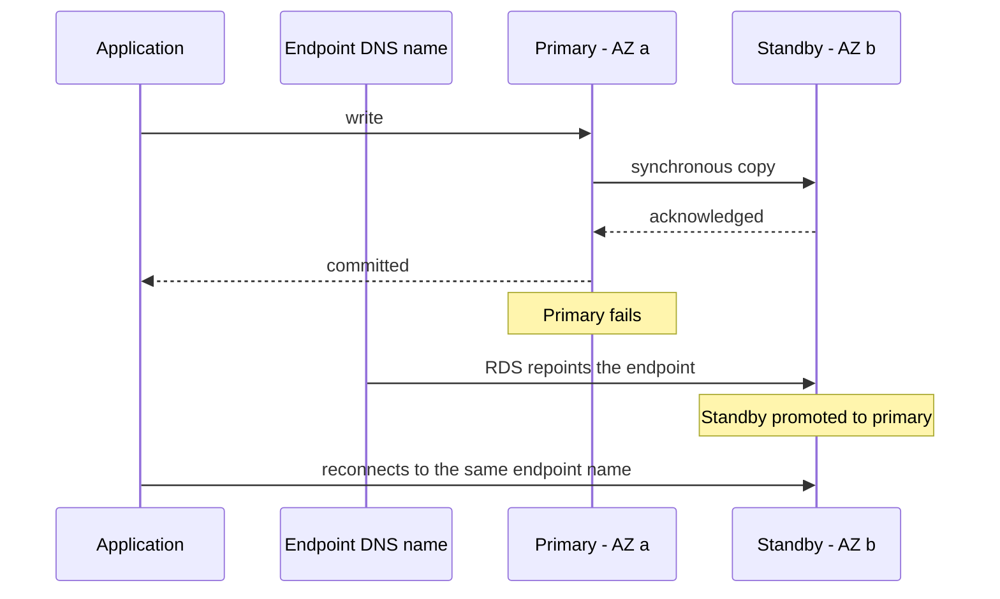
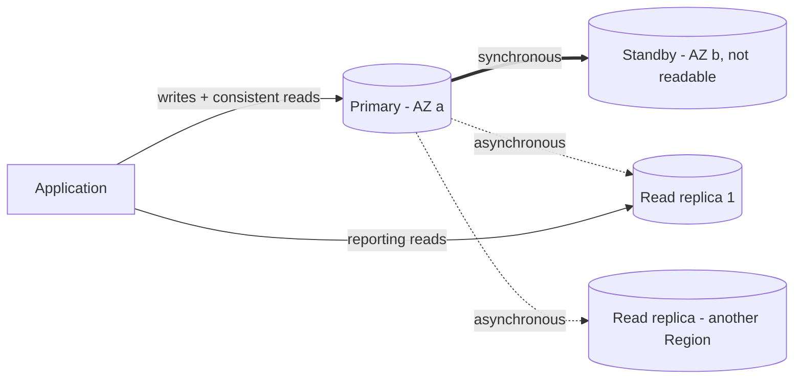
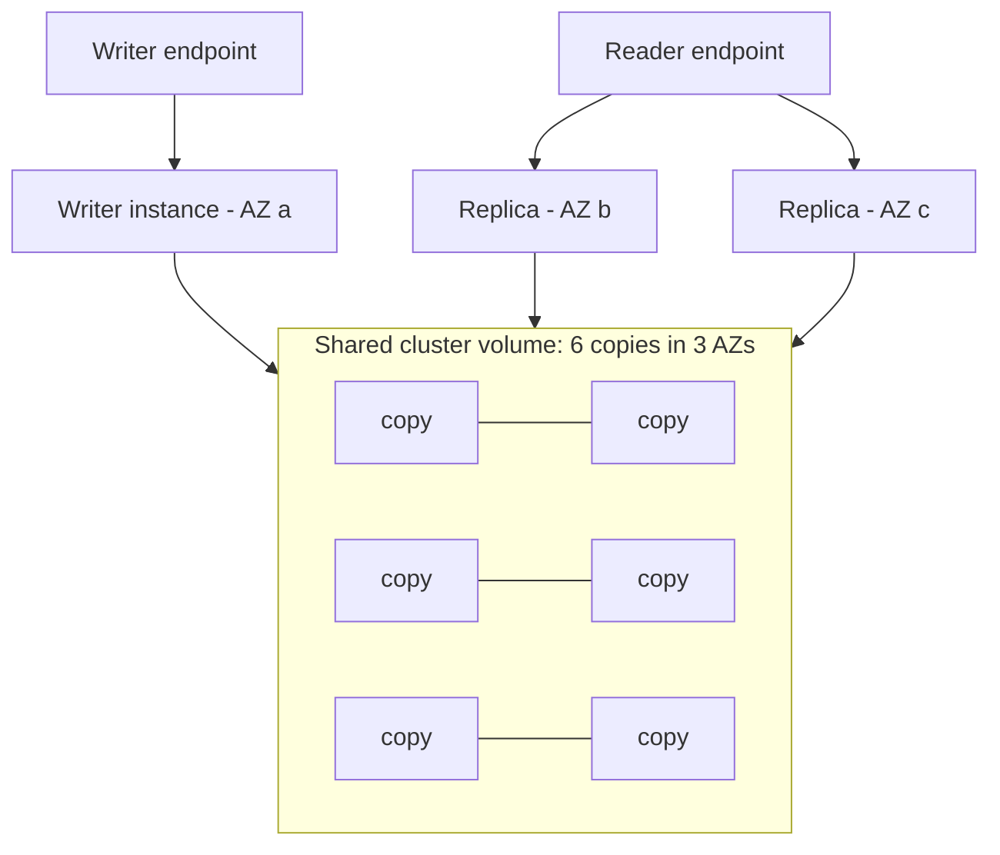

# RDS and Aurora: managed relational databases

## Before this lesson

You should know subnets and security groups ([VPC basics](#/lesson/aws/vpc-basics), [security groups versus network ACLs](#/lesson/aws/vpc-firewalls)) and EBS volume types ([EBS volumes](#/lesson/aws/ebs-storage)). A little SQL helps; the site's [SQL track](#/lesson/sql/what-is-a-database) starts from zero.

## In plain words

A **relational database** stores data in tables of rows and columns and lets you ask questions in **SQL** (Structured Query Language). Running one well is real work: installing it, applying security patches, taking backups and testing that they restore, keeping a spare copy ready in case the machine dies.

**Amazon RDS** (Relational Database Service) does that work for you. You choose a database engine and a size; AWS runs it, backs it up, patches it and can keep a hot standby in another data centre. You connect with the same tools and drivers as always.

An analogy: owning a car versus leasing one with a full service contract. In both cases you drive. With the contract, somebody else changes the oil, replaces worn parts and gives you a replacement car when yours breaks down.

**Amazon Aurora** is AWS's own database engine, compatible with MySQL and PostgreSQL, redesigned around a storage system that keeps six copies of the data across three data centres.

Why it matters for a job: almost every application has a relational database, and the two phrases **Multi-AZ** and **read replica** — what each is for, and why they are not the same thing — are among the most reliably asked questions in AWS interviews.

## A short database primer

- A **relational** database enforces a **schema** (the declared structure of tables) and supports **transactions**: groups of changes that either all happen or none do. The guarantees are summarised as **ACID** — atomic, consistent, isolated, durable.
- Workloads come in two shapes:
  - **OLTP** (online transaction processing): many small, fast reads and writes — placing an order, updating a balance. RDS, Aurora and DynamoDB serve OLTP.
  - **OLAP** (online analytical processing): few, large queries scanning millions of rows — "revenue by region per quarter for five years". A *data warehouse* such as Redshift serves OLAP.
- **NoSQL** databases give up some relational features (joins, flexible queries) for scale and speed on simple access patterns. DynamoDB is the next lesson.

## What RDS manages, and what stays yours

| AWS does | You do |
|---|---|
| Provisions hardware and storage | Choose engine, version, instance class, storage |
| Installs and patches the OS and the database software (in your maintenance window) | Design schemas and indexes; write queries |
| Automated backups and point-in-time restore | Decide retention; test restores |
| Failure detection and Multi-AZ failover | Enable Multi-AZ; make the application reconnect |
| Monitoring metrics | Watch them; tune parameters |
| — | Network placement and security groups; users and passwords |

You get no shell on the database host and no superuser: the price of management is that you cannot install arbitrary software on the server. (**RDS Custom** relaxes this for Oracle and SQL Server when a legacy application insists.)

### Engines

RDS offers **MySQL, MariaDB, PostgreSQL, Oracle, Microsoft SQL Server and Db2**, plus the two **Aurora** flavours. For Oracle and SQL Server you either pay a *licence-included* hourly price or *bring your own licence*.

### Instance classes and storage

A **DB instance** is the unit you run. Its **instance class** mirrors EC2 families: `db.t` (burstable, for small and development databases), `db.m` (general purpose), `db.r` and `db.x` (memory-optimised — databases love memory because data cached in RAM avoids disk reads).

Storage for non-Aurora engines is EBS underneath: **gp3** by default, **io2** for the heaviest transactional load. **Storage autoscaling** raises the allocation automatically when free space runs low.

### Network placement

A database is launched into a **DB subnet group**: a set of subnets in at least two Availability Zones, normally private ones. It gets a DNS **endpoint** such as `bookshop.c9akciq32.eu-west-1.rds.amazonaws.com`. Always connect to the endpoint name, never to an IP address — after a failover the name points at a different machine.

Access is controlled by a **security group** (allow the database port only from the application's security group) and by database users. *Publicly accessible* should be set to **No** for anything real.

## High availability: Multi-AZ

A **Multi-AZ deployment** keeps a **standby** copy of the database in a different Availability Zone. Every write is copied to the standby **synchronously**: the database does not confirm a transaction until the standby has it too. So the standby is never behind.

If the primary fails — hardware fault, zone outage, or even planned patching — RDS performs a **failover**: the standby is promoted and the endpoint's DNS record is switched to it, typically within **60 to 120 seconds**. The application sees dropped connections and must reconnect; nothing else changes.



Two variants exist:

- **Multi-AZ DB instance** (one standby): the classic form. **The standby cannot be used for reads.** It exists only to take over.
- **Multi-AZ DB cluster** (two readable standbys, for MySQL and PostgreSQL): failover is faster — usually under 35 seconds — and the standbys can serve read queries.

Multi-AZ is about **availability and durability**, not performance. It roughly doubles the price because there are two (or three) instances.

## Scaling reads: read replicas

A **read replica** is a separate copy of the database that receives changes from the primary **asynchronously** — a moment after they are committed. Applications send read-only queries to replicas to take load off the primary.

- Up to 15 replicas for MySQL, MariaDB and PostgreSQL (5 for some other engines).
- Each replica has **its own endpoint**; the application (or a proxy) must direct reads to it.
- Replicas can be in the same zone, another zone, or **another Region** (for local reads there, or as part of disaster recovery).
- A replica can be **promoted** to a standalone database — a manual action.
- Because replication is asynchronous there is **replica lag**: a replica may be milliseconds to seconds (or, when overloaded, minutes) behind. A user who saves a profile and immediately reloads from a replica may see the old value. Send "read your own write" queries to the primary.

### The comparison everyone asks for

| | Multi-AZ (instance) | Read replica |
|---|---|---|
| Purpose | **High availability** | **Read scalability** (and DR, cross-Region) |
| Replication | Synchronous | Asynchronous |
| Readable? | No | Yes |
| Failover | Automatic, same endpoint | Manual promotion, new endpoint |
| Data loss on failure | None | Up to the replica lag |
| Scope | Same Region, other AZ | Same AZ, other AZ or other Region |

They combine well: a Multi-AZ primary for safety, plus read replicas for scale. The problem *Multi-AZ Failover vs Read-Replica Promotion* makes you compute downtime and lost writes for each.



## Backups and restores

- **Automated backups**: a daily snapshot during a backup window plus continuous capture of the **transaction log**. Together they allow **point-in-time recovery (PITR)** to any second within the **retention period** (1 to 35 days), usually up to about the last five minutes.
- **Manual snapshots**: taken on demand; kept until you delete them, even after the database is deleted. Use them before risky changes and for long-term retention.
- **Restores always create a new DB instance** with a new endpoint. You cannot restore "in place"; the application must be pointed at the new instance.
- Snapshots can be **copied to other Regions** and **shared** with other accounts. **AWS Backup** manages this centrally.

> [!WARNING]
> Deleting a database also deletes its **automated backups** unless you choose to retain them or take a final snapshot. The CLI flag `--skip-final-snapshot` exists for tearing down test databases; make sure it never ends up in a production script. Turn on **deletion protection** for databases that matter.

## Encryption and access

- **At rest**: enabled at creation with a KMS key; covers storage, backups, snapshots and replicas. An existing unencrypted database is encrypted by the same route as EBS: snapshot → encrypted copy → restore.
- **In transit**: TLS; the engine can be configured to refuse unencrypted connections.
- **Credentials**: let RDS store and rotate the master password in **Secrets Manager**; applications can also use **IAM database authentication** (a short-lived token instead of a password) on MySQL, MariaDB and PostgreSQL.
- **RDS Proxy** sits between applications and the database and **pools connections**. It matters most for serverless functions, which open and close connections at a furious rate, and it keeps connections alive across a failover, shortening the interruption.

## Amazon Aurora

Aurora speaks the MySQL or PostgreSQL protocol, so existing applications work unchanged, but its storage is different.

- **Cluster volume**: one shared, distributed storage volume that keeps **six copies of the data across three Availability Zones**. It tolerates the loss of two copies without affecting writes and three without affecting reads, repairs itself, and grows automatically up to 128 TiB (higher in newer versions).
- **Instances**: one **writer** and up to **15 Aurora Replicas**, all attached to the same volume. Replicas do not hold a separate copy, so lag is typically tens of milliseconds, and any replica can take over as writer.
- **Failover** to a replica typically completes in well under a minute.
- **Endpoints**:
  - the **cluster (writer) endpoint** always points at the current writer;
  - the **reader endpoint** load-balances connections across replicas;
  - custom endpoints target a chosen subset (for example, large replicas for analytics).



Other Aurora features to recognise:

- **Aurora Serverless v2**: capacity measured in ACUs (Aurora capacity units) scales up and down in fine steps with load — and, in current versions, can pause to zero when idle. Suited to variable or unpredictable workloads and development databases.
- **Aurora Global Database**: one primary Region and up to several read-only secondary Regions with replication lag typically under a second; a secondary can be promoted in about a minute for disaster recovery.
- **Backtrack** (MySQL-compatible): rewind the cluster to an earlier time without restoring.
- **Cloning**: a copy-on-write clone of a database in minutes, for testing against production-sized data.

Choosing: standard RDS for a specific engine or version (Oracle, SQL Server, a particular PostgreSQL extension) or the lowest cost on small databases; Aurora when you want higher availability, fast failover, many low-lag replicas, automatic storage growth or global replication.

## Worked example: a Multi-AZ PostgreSQL database

> [!WARNING]
> A Multi-AZ database bills for two instances around the clock (even a small one is tens of US dollars per month). For practice, use `--no-multi-az` with a `db.t4g.micro` and delete it the same day.

```bash
# 1. Subnet group: private subnets in two zones.
aws rds create-db-subnet-group --db-subnet-group-name bookshop-db \
  --db-subnet-group-description "Private subnets for the bookshop database" \
  --subnet-ids subnet-0priva subnet-0privb

# 2. The database.
aws rds create-db-instance \
  --db-instance-identifier bookshop \
  --engine postgres --engine-version 16.4 \
  --db-instance-class db.t4g.medium \
  --allocated-storage 50 --storage-type gp3 --max-allocated-storage 200 \
  --multi-az \
  --db-subnet-group-name bookshop-db \
  --vpc-security-group-ids sg-0db \
  --no-publicly-accessible \
  --master-username bookadmin --manage-master-user-password \
  --backup-retention-period 7 \
  --storage-encrypted --deletion-protection
```

Option by option:

- `--engine` / `--engine-version`: which database software.
- `--allocated-storage 50` with `--max-allocated-storage 200`: start at 50 GiB and let storage autoscaling grow it to 200.
- `--multi-az`: create the synchronous standby in another zone.
- `--no-publicly-accessible`: no public IP.
- `--manage-master-user-password`: RDS generates the password and keeps it in Secrets Manager — nothing sensitive on the command line.
- `--backup-retention-period 7`: point-in-time recovery for the last seven days.
- `--storage-encrypted --deletion-protection`: encrypt at rest and refuse deletion until the flag is removed.

```bash
# 3. Find the endpoint once the status is "available".
aws rds wait db-instance-available --db-instance-identifier bookshop
aws rds describe-db-instances --db-instance-identifier bookshop \
  --query "DBInstances[0].[Endpoint.Address,MultiAZ,AvailabilityZone,SecondaryAvailabilityZone]" --output text
```

```
bookshop.c9akciq32.eu-west-1.rds.amazonaws.com   True   eu-west-1a   eu-west-1b
```

```bash
# 4. Add a read replica, then rehearse a failover.
aws rds create-db-instance-read-replica --db-instance-identifier bookshop-ro \
  --source-db-instance-identifier bookshop
aws rds reboot-db-instance --db-instance-identifier bookshop --force-failover
```

`--force-failover` makes RDS switch to the standby as it would in a real failure. Run it while a test script queries the database in a loop and time the gap: this is the only way to know your application reconnects properly.

```bash
# 5. Restore to a moment in time (creates a NEW instance).
aws rds restore-db-instance-to-point-in-time \
  --source-db-instance-identifier bookshop \
  --target-db-instance-identifier bookshop-before-bug \
  --restore-time 2026-11-21T09:59:00Z
```

## Monitoring

- **CloudWatch metrics**: `CPUUtilization`, `FreeableMemory`, `FreeStorageSpace`, `DatabaseConnections`, `ReadIOPS`/`WriteIOPS`, `ReplicaLag`.
- **Enhanced Monitoring**: operating-system metrics at up to one-second granularity.
- **Performance Insights / Database Insights**: which queries and waits are consuming the database's time — the first place to look for "the database is slow".
- **Event subscriptions**: notifications of failovers, backups and maintenance through SNS.

## Cost notes and free-tier warnings

- RDS bills **instance-hours** (doubled or tripled by Multi-AZ), **storage** per GB-month, provisioned IOPS if any, **backup storage** beyond the size of the database, and data transfer.
- A **stopped** database stops instance charges but still pays for storage — and RDS **starts it again automatically after seven days**.
- Each read replica is a full-price instance.
- Aurora bills instances (or ACU-hours for Serverless v2), storage per GB-month, and — on the standard configuration — I/O requests; the *I/O-Optimized* configuration drops the I/O charge for a higher instance and storage price and suits I/O-heavy workloads.
- **Reserved DB instances** discount steady databases by 30–60 %; Savings Plans do not cover standard RDS instances.
- Manual snapshots persist and bill after the database is gone.

## Pitfalls

- **Describing Multi-AZ as a way to scale reads** (the classic standby is not readable), or read replicas as high availability (promotion is manual and may lose recent writes).
- **Hard-coding the database IP address**, which breaks at failover.
- **Never testing a restore.** A backup that has not been restored is a hope, not a backup.
- **A publicly accessible database with a weak password.**
- **Reading your own writes from a lagging replica.**
- **Thousands of Lambda functions opening direct connections**, exhausting `max_connections`. Use RDS Proxy.
- **Long transactions or heavy reporting on the primary**; move reports to a replica.
- **Letting storage fill up**: at zero free space the database stops accepting writes. Enable storage autoscaling and alarm on `FreeStorageSpace`.

> [!INTERVIEW]
> **"What is the difference between Multi-AZ and a read replica?"** Multi-AZ is for availability: a synchronously replicated standby in another zone with automatic failover behind the same endpoint and no data loss; in the classic single-standby form it serves no traffic. A read replica is for read scaling: asynchronous replication, its own endpoint, readable, possibly in another Region, promoted manually and potentially behind by the replica lag.
>
> **"Why might you choose Aurora over RDS PostgreSQL?"** Shared six-copy storage across three zones, failover in seconds to a replica that shares the same data, up to fifteen low-lag replicas behind a reader endpoint, storage that grows by itself, plus Global Database and Serverless v2. RDS PostgreSQL remains right when a specific extension or version is needed or for the smallest budgets.

## Cheat sheet

| Need | Answer |
|---|---|
| Survive an AZ failure automatically | Multi-AZ |
| More read capacity | Read replicas (async, own endpoints) |
| Recover from a bad deployment at 09:59 | Point-in-time restore to a new instance |
| Keep a copy for years | Manual snapshot or AWS Backup |
| Fast failover, shared storage, 15 replicas | Aurora |
| Unpredictable or idle workloads | Aurora Serverless v2 |
| Sub-second cross-Region replication | Aurora Global Database |
| Too many short-lived connections | RDS Proxy |
| No passwords in code | Secrets Manager or IAM database authentication |
| Encrypt an existing database | Snapshot → encrypted copy → restore |

## Summary

- RDS runs MySQL, MariaDB, PostgreSQL, Oracle, SQL Server and Db2 as a managed service; you keep schema, queries, network access and credentials.
- Multi-AZ gives synchronous standby and automatic failover for availability; read replicas give asynchronous copies for read scaling and cross-Region copies.
- Automated backups plus transaction logs enable point-in-time recovery, always into a new instance.
- Aurora separates compute from a six-copy, three-zone storage volume, giving fast failover and many low-lag replicas, with serverless and global options.
- Connect through endpoints, keep databases private and encrypted, and rehearse failover and restore.

## Glossary

- **ACID**: atomicity, consistency, isolation, durability — transaction guarantees.
- **Aurora Replica**: a read instance sharing the Aurora cluster volume.
- **Cluster endpoint / reader endpoint**: Aurora names for the writer and for load-balanced readers.
- **DB subnet group**: the subnets a database may be placed in.
- **Endpoint**: the DNS name applications connect to.
- **Failover**: promotion of a standby to primary.
- **Multi-AZ**: a deployment with a synchronously replicated standby in another zone.
- **OLTP / OLAP**: transactional versus analytical workloads.
- **Point-in-time recovery**: restoring to any second within the retention period.
- **RDS Proxy**: a managed connection pool in front of RDS or Aurora.
- **Read replica**: an asynchronously updated, readable copy.
- **Replica lag**: how far a replica is behind its source.
- **Synchronous / asynchronous replication**: confirming a write after / before the copy has it.
- **Transaction log**: the ordered record of changes, used for recovery and replication.

```quiz
[
  {"q": "An application's primary RDS instance fails. The team wants automatic recovery with no lost transactions and no change to the connection string. Which feature provides this?",
   "options": ["A read replica in the same zone", "Multi-AZ deployment", "A manual snapshot every hour", "A larger instance class"],
   "answer": 1,
   "explain": "Multi-AZ replicates synchronously to a standby and fails over automatically behind the same endpoint. A read replica is asynchronous and must be promoted manually."},
  {"q": "A reporting dashboard runs heavy SELECT queries that slow down order processing on the same RDS MySQL database. What is the most suitable change?",
   "options": ["Enable Multi-AZ and point the dashboard at the standby", "Create a read replica and point the dashboard at its endpoint", "Increase the backup retention period", "Move the database to a public subnet"],
   "answer": 1,
   "explain": "Read replicas offload read-only work. The classic Multi-AZ standby cannot be queried."},
  {"q": "At 14:05 a faulty script deletes rows in a production table. Automated backups are enabled with 7-day retention. How is the data recovered?",
   "options": ["Reboot with failover", "Restore the instance in place to 14:04", "Use point-in-time restore to create a new instance at 14:04 and copy the data back or repoint the application", "Promote the Multi-AZ standby, which still has the rows"],
   "answer": 2,
   "explain": "Point-in-time recovery always creates a new instance. The synchronous standby received the delete as well, so it cannot help."},
  {"q": "A user updates their address and the next page, which reads from a read replica, shows the old address. What explains this?",
   "options": ["The write failed", "Replica lag: replication is asynchronous, so the replica may be briefly behind", "Read replicas cache pages for one hour", "Security groups delayed the packet"],
   "answer": 1,
   "explain": "Asynchronous replication means a replica can trail the primary. Reads that must reflect a just-made write should go to the primary."},
  {"q": "How does Aurora store data differently from standard RDS engines?",
   "options": ["On instance store volumes", "Six copies across three Availability Zones in a shared cluster volume used by the writer and all replicas", "One EBS volume per replica with nightly sync", "In S3 objects only"],
   "answer": 1,
   "explain": "Aurora's distributed storage keeps six copies in three zones and is shared by all instances, which is why replicas have low lag and can take over quickly."},
  {"q": "A serverless API built from thousands of concurrent Lambda invocations overwhelms a PostgreSQL database with connections. What helps most?",
   "options": ["RDS Proxy to pool and reuse connections", "A larger backup window", "Disabling Multi-AZ", "Storing the password in user data"],
   "answer": 0,
   "explain": "RDS Proxy maintains a pool of database connections shared by many clients and also smooths failovers."},
  {"q": "A team stops a development RDS instance to save money and finds it running again ten days later. Why?",
   "options": ["Someone must have started it", "RDS automatically starts a stopped instance after seven days", "Stopped instances restart at each backup window", "Multi-AZ forces a restart"],
   "answer": 1,
   "explain": "A stopped RDS instance stays stopped for at most seven days, then starts again so that maintenance can be applied. Storage is billed throughout."},
  {"q": "A company needs a relational database with a read-only copy in a second Region that lags by under a second and can be promoted within about a minute in a disaster. Which option fits best?",
   "options": ["RDS Multi-AZ instance", "Aurora Global Database", "DynamoDB global tables", "A nightly snapshot copy"],
   "answer": 1,
   "explain": "Aurora Global Database replicates storage across Regions with typically sub-second lag and supports fast promotion of a secondary Region."}
]
```

> **Source:** AWS Certified Solutions Architect Official Study Guide, ch. 7 (database primer, Amazon RDS). Aurora features, Multi-AZ DB clusters, RDS Proxy and Db2 post-date the book; checked against https://docs.aws.amazon.com/AmazonRDS/latest/UserGuide/Concepts.MultiAZ.html , https://docs.aws.amazon.com/AmazonRDS/latest/UserGuide/USER_ReadRepl.html , https://docs.aws.amazon.com/AmazonRDS/latest/UserGuide/USER_PIT.html and https://docs.aws.amazon.com/AmazonRDS/latest/AuroraUserGuide/Aurora.Overview.html
