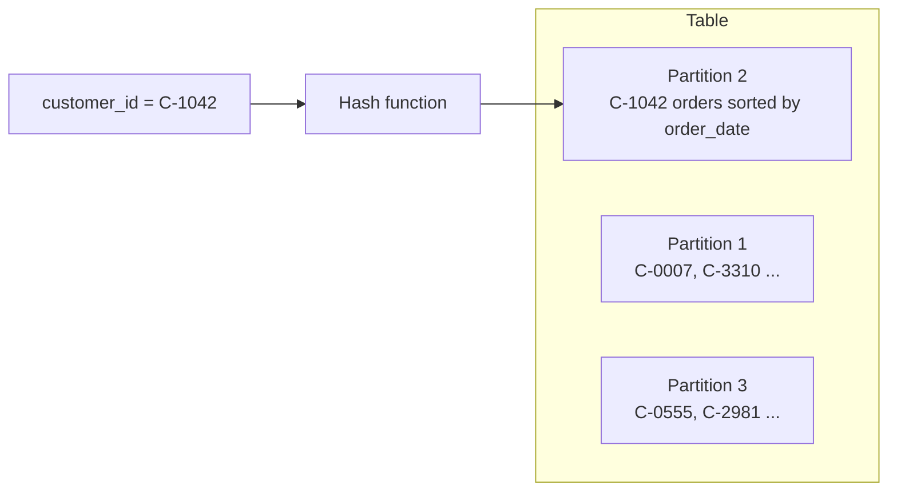
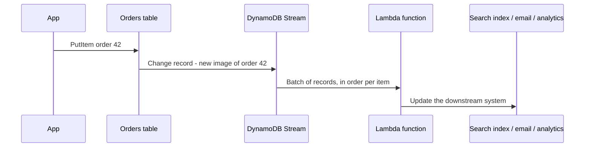

# DynamoDB: tables, keys, indexes, capacity and streams

## Before this lesson

Read [RDS and Aurora](#/lesson/aws/rds-aurora) for the relational baseline (tables, transactions, OLTP), and know what an IAM role is in outline ([EC2 instances](#/lesson/aws/ec2-instances) introduced them). No NoSQL background is assumed.

## In plain words

**Amazon DynamoDB** is a database where you store and fetch items **by key**, and it answers in a few milliseconds whether the table holds a hundred items or a hundred billion. There are no servers to choose, no disks to size, no version to patch. You create a table and start reading and writing.

Compare two ways of finding a book. In a **library with a catalogue** (a relational database) you can ask almost anything — "all books by French authors published after 1990 with more than 300 pages" — and a librarian works it out, more slowly as the library grows. A **cloakroom** (DynamoDB) answers only "give me the item for ticket 4172", but does it instantly however many coats are hanging there. DynamoDB is a cloakroom with a few clever extensions.

The price of that speed: **you must decide in advance how you will look things up.** In a relational database you design the tables first and write queries later. In DynamoDB you list the queries first and design the table around them.

Why it matters for a job: DynamoDB is the default database for serverless applications on AWS, and its concepts — partition key, sort key, secondary index, capacity units, hot partition — are asked about in detail.

## Tables, items, attributes

- A **table** is a collection of **items**.
- An **item** is a set of **attributes** (name/value pairs), up to **400 KB** in total.
- There is **no fixed schema** beyond the key: two items in the same table can have entirely different attributes.

Attribute types include strings, numbers, binary, booleans, null, lists, maps (nested objects) and sets.

```json
{
  "customer_id": "C-1042",
  "order_date": "2026-11-21T10:15:00Z",
  "total": 54.90,
  "status": "PAID",
  "items": [{"sku": "B-778", "qty": 1}, {"sku": "B-104", "qty": 2}]
}
```

## The primary key

Every item is identified by its **primary key**, fixed when the table is created. There are two kinds.

**Simple primary key — a partition key alone.** One attribute, unique per item. Example: a `users` table keyed by `user_id`. You can fetch exactly one item by its key.

**Composite primary key — a partition key plus a sort key.** Many items may share a partition key as long as their sort keys differ. Items with the same partition key are stored together, **ordered by sort key**. Example: an `orders` table with partition key `customer_id` and sort key `order_date`. You can then ask for "all orders of customer C-1042", "…between June and September", "…the latest five" — each in one efficient request.

The partition key is also called the **hash key** and the sort key the **range key**, names that describe what the database does with them.

### How partitioning works

DynamoDB feeds the partition key value through a **hash function** — a calculation that turns any value into a seemingly random number — and uses the result to pick one of many storage **partitions**. Each partition lives on its own servers, replicated across three Availability Zones.



Two consequences shape every design:

1. **A request that includes the partition key goes straight to one partition** — fast at any scale.
2. **Load is only spread evenly if requests are spread evenly over many partition key values.**

### Hot partitions

If one partition key value receives a large share of the traffic, its partition is overloaded while the others idle. This is a **hot partition** (or hot key), and it shows up as throttling errors even though the table as a whole has spare capacity.

| Partition key | Verdict | Why |
|---|---|---|
| `user_id`, `order_id`, `device_id` | Good | Many distinct values, accessed fairly evenly |
| `status` (PAID / PENDING) | Bad | Two values hold everything |
| `date` (2026-11-21) | Bad | All of today's writes hit one key |
| `tenant_id` when one tenant is 80 % of the load | Risky | Skewed access |

Remedies: choose a higher-**cardinality** key (one with more distinct values); combine attributes (`tenant_id#user_id`); or apply **write sharding** — append a suffix such as `#0` to `#9` to spread one logical key across ten physical ones, and read all ten when querying. DynamoDB's *adaptive capacity* softens moderate skew automatically, but it cannot rescue a key that receives most of the traffic. The problem *Hot Partition Key Detector* has you find such keys in a traffic sample.

## Reading and writing

| Operation | What it does | Cost profile |
|---|---|---|
| `PutItem` | Create or replace one item | By item size |
| `UpdateItem` | Change attributes of one item; can add to a counter atomically | By item size |
| `DeleteItem` | Remove one item | By item size |
| `GetItem` | Fetch one item by its **full** primary key | Cheapest read |
| `Query` | Fetch items with **one partition key**, optionally a condition on the sort key (`=`, `<`, `between`, `begins_with`) | By data in the matched range |
| `Scan` | Read **every item in the table** | By the size of the whole table |
| `BatchGetItem` / `BatchWriteItem` | Up to 100 gets / 25 writes per call | Sum of the parts |
| `TransactWriteItems` / `TransactGetItems` | All-or-nothing across up to 100 items | Double |

**Query versus Scan** is the distinction to burn in. A **Query** touches one partition and only the range you asked for. A **Scan** walks the entire table and is paid for accordingly. Both accept a **filter expression**, but a filter is applied *after* the items have been read: it trims the response, not the bill. A Scan with a filter that returns three items from a 50 GB table still reads 50 GB.

Writes can carry a **condition expression** ("only if the item does not exist", "only if `version` equals 7"); if the condition is false the write is rejected. This is how DynamoDB does **optimistic locking** without transactions.

### Consistency

Data is replicated to three Availability Zones. A read can be:

- **Eventually consistent** (the default): may return data that is a fraction of a second stale; costs half.
- **Strongly consistent** (`ConsistentRead=true`): reflects all writes acknowledged before the read; costs full price; not available on global secondary indexes.

## Secondary indexes

The primary key gives one way of finding items. A **secondary index** gives another, by maintaining a second copy of (part of) the data organised under different keys.

| | Global secondary index (GSI) | Local secondary index (LSI) |
|---|---|---|
| Partition key | **Any attribute** | Same as the table's |
| Sort key | Any attribute (optional) | A different attribute |
| When created | Any time | **Only at table creation** |
| Consistency | Eventually consistent only | Eventual or strong |
| Capacity | Its own | Shares the table's |
| Limit | 20 per table (default) | 5 per table |

Example: the `orders` table is keyed by `customer_id` + `order_date`. The warehouse needs "all orders with status PENDING, oldest first". Add a GSI with partition key `status` and sort key `order_date` — or, better, a **sparse** index on an attribute such as `pending_since` that only pending orders have; items lacking the index key are left out of the index, keeping it small.

### Projections

For each index you choose which attributes are copied into it — the **projection**:

- `KEYS_ONLY`: the index keys and the table's primary key;
- `INCLUDE`: those plus a list you name;
- `ALL`: everything (doubling storage and write cost for those items).

A query on a GSI can return **only projected attributes**; unlike an LSI it will not fetch the rest from the table for you. If you need more, either project it or do a follow-up `GetItem`. The problem *GSI Projection Check* drills this. Every write to the table that touches an indexed attribute also writes to the index, so each GSI adds write cost.

## Capacity modes and capacity units

You choose how to pay for throughput, per table, and can switch once every 24 hours.

**On-demand mode**: pay per request. No planning; the table accommodates whatever arrives (it absorbs up to double the previous peak instantly). Best for new, spiky or unpredictable workloads and for anything that sits idle much of the time.

**Provisioned mode**: you set **read capacity units (RCU)** and **write capacity units (WCU)** per second, optionally with **auto scaling** between a minimum and maximum. Cheaper per request for steady, predictable traffic, and eligible for reserved capacity. Requests beyond the provisioned rate are **throttled** (rejected with `ProvisionedThroughputExceededException`; SDKs retry with backoff).

The unit arithmetic is a favourite exam calculation:

| Operation | Costs |
|---|---|
| 1 strongly consistent read of an item ≤ 4 KB | 1 RCU |
| 1 eventually consistent read ≤ 4 KB | 0.5 RCU |
| 1 transactional read ≤ 4 KB | 2 RCU |
| 1 write of an item ≤ 1 KB | 1 WCU |
| 1 transactional write ≤ 1 KB | 2 WCU |

Larger items cost one more unit per started 4 KB (reads) or 1 KB (writes).

```python-run
import math

def units(item_kb, per_second, kind):
    """Capacity units for `per_second` operations on items of `item_kb` kilobytes."""
    if kind == "write":
        return per_second * math.ceil(item_kb / 1)          # 1 KB blocks
    blocks = math.ceil(item_kb / 4)                         # 4 KB blocks for reads
    if kind == "strong":
        return per_second * blocks
    if kind == "eventual":
        return math.ceil(per_second * blocks / 2)           # half price, round the total up
    raise ValueError(kind)

# A product page: 2.5 KB items, 600 reads/s (eventual), 40 writes/s.
print("RCU eventual:", units(2.5, 600, "eventual"))
print("RCU strong  :", units(2.5, 600, "strong"))
print("WCU         :", units(2.5, 40, "write"))

# The same traffic with fat 9 KB items.
print("RCU eventual, 9 KB:", units(9, 600, "eventual"))
print("WCU, 9 KB         :", units(9, 40, "write"))
```

Line by line: `math.ceil(item_kb / 4)` rounds each item up to whole 4 KB blocks; the rate multiplies it; eventual consistency halves the total. Result: 300 RCU eventual, 600 strong, 120 WCU; with 9 KB items the same traffic needs 900 RCU and 360 WCU. **Item size is a cost lever** — keep items small, and move large blobs to S3 with a pointer in the item. The problem *DynamoDB Capacity Units* asks for this function, and *Query vs Scan Read Cost* applies it to whole operations.

## Streams, TTL, global tables and DAX

- **DynamoDB Streams** records every change to a table — inserts, updates, deletes, with old and/or new values — as an ordered log kept for 24 hours. A Lambda function subscribed to the stream reacts to each change. This is the standard way to keep a search index in step, send a welcome email when a user item appears, or maintain aggregates. (Kinesis Data Streams can be used as the change stream instead, for longer retention and more consumers.) Reacting to data changes this way is called **change data capture**.



- **Time to Live (TTL)**: name an attribute holding an expiry timestamp (seconds since 1970) and DynamoDB deletes expired items in the background at no cost — typically within a day or two of expiry, so filter out expired items in queries if exactness matters. Ideal for sessions and temporary data.
- **Global tables**: the same table in several Regions, each accepting writes, replicated to the others usually within a second. Gives low-latency access worldwide and regional resilience; concurrent conflicting writes are resolved by "last writer wins".
- **Transactions**: ACID across up to 100 items and several tables, at double the capacity cost.
- **Backups**: on-demand backups and **point-in-time recovery** covering the last 35 days (restore creates a new table).
- **DAX** (DynamoDB Accelerator): an in-memory cache cluster that sits in front of a table and answers repeated reads in microseconds; covered in the next lesson.
- **Encryption** at rest is always on; access is controlled entirely with **IAM**, down to individual items and attributes with condition keys such as `dynamodb:LeadingKeys` (for example, "a user may only read items whose partition key equals their own user ID").

## Worked example: an orders table

> [!WARNING]
> An on-demand table with a handful of items costs fractions of a cent, and 25 GB of storage is always free. Delete the table at the end anyway.

```bash
# 1. Create the table: composite key, on-demand billing, one GSI.
aws dynamodb create-table \
  --table-name Orders \
  --attribute-definitions \
      AttributeName=customer_id,AttributeType=S \
      AttributeName=order_date,AttributeType=S \
      AttributeName=status,AttributeType=S \
  --key-schema AttributeName=customer_id,KeyType=HASH AttributeName=order_date,KeyType=RANGE \
  --billing-mode PAY_PER_REQUEST \
  --global-secondary-indexes '[{
      "IndexName": "status-date",
      "KeySchema": [{"AttributeName": "status", "KeyType": "HASH"},
                    {"AttributeName": "order_date", "KeyType": "RANGE"}],
      "Projection": {"ProjectionType": "INCLUDE", "NonKeyAttributes": ["total"]}
  }]'
```

- `--attribute-definitions` declares only the attributes used in keys (`S` = string). Other attributes need no declaration.
- `--key-schema`: `HASH` marks the partition key, `RANGE` the sort key.
- `PAY_PER_REQUEST` is on-demand mode.
- The GSI is keyed by `status` then `order_date` and carries `total` along.

```bash
# 2. Write an item, but only if it does not already exist.
aws dynamodb put-item --table-name Orders \
  --item '{"customer_id": {"S": "C-1042"}, "order_date": {"S": "2026-11-21T10:15:00Z"},
           "status": {"S": "PENDING"}, "total": {"N": "54.90"}}' \
  --condition-expression "attribute_not_exists(customer_id)"
```

The low-level format wraps each value in its type (`S` string, `N` number). The condition makes the write fail instead of silently overwriting an existing order.

```bash
# 3. Query: this customer's orders in November, newest first, at most 5.
aws dynamodb query --table-name Orders \
  --key-condition-expression "customer_id = :c AND begins_with(order_date, :m)" \
  --expression-attribute-values '{":c": {"S": "C-1042"}, ":m": {"S": "2026-11"}}' \
  --no-scan-index-forward --limit 5 \
  --return-consumed-capacity TOTAL \
  --query "{Count:Count,Capacity:ConsumedCapacity.CapacityUnits}"
```

```
{
    "Count": 1,
    "Capacity": 0.5
}
```

- `--key-condition-expression` must name the partition key with `=`; the sort-key part is optional. `:c` and `:m` are placeholders filled from `--expression-attribute-values`.
- `--no-scan-index-forward` reverses the sort order (newest first).
- The response shows 0.5 capacity units: one small eventually consistent read.

```bash
# 4. Query the index: all pending orders, oldest first.
aws dynamodb query --table-name Orders --index-name status-date \
  --key-condition-expression "#s = :s" \
  --expression-attribute-names '{"#s": "status"}' \
  --expression-attribute-values '{":s": {"S": "PENDING"}}'

# 5. Clean up.
aws dynamodb delete-table --table-name Orders
```

`status` is a reserved word in DynamoDB's expression language, so it is referred to through the alias `#s`.

## When to choose DynamoDB — and when not

| Choose DynamoDB when | Choose a relational database when |
|---|---|
| Access patterns are known and key-based | Queries are ad hoc or change often |
| Scale is large or unpredictable | Data is modest and joins are central |
| Single-digit-millisecond latency is required at any size | Complex transactions span many tables |
| You want zero server management and pay-per-request | You need rich SQL, reporting, or an existing engine |
| Items are small and self-contained | Many-to-many relationships dominate |

## Cost notes and free-tier warnings

- **On-demand** charges per million read and write request units; **provisioned** charges per RCU-hour and WCU-hour whether used or not.
- **Storage** per GB-month (25 GB always free in the standard table class; an *infrequent access* table class lowers storage price for rarely read tables).
- **Each GSI** stores its own copy and consumes its own write capacity.
- **Scans** on large tables are the usual cause of a shocking bill or of throttling everyone else.
- **Streams reads**, **global table replication**, **backups** and **DAX nodes** (hourly) are billed separately. TTL deletions are free.

## Pitfalls

- **Designing tables before listing access patterns.**
- **A low-cardinality or time-based partition key** creating hot partitions.
- **Using Scan with a filter** where a Query on a well-chosen key or index would do.
- **Expecting a filter expression to reduce cost.**
- **Assuming a GSI returns all attributes**, or that GSI reads can be strongly consistent.
- **Wanting an LSI after the table exists** — impossible; add a GSI or recreate the table.
- **Items growing towards 400 KB**; store large payloads in S3.
- **Relying on TTL for exact-time deletion.**
- **Provisioned mode with auto scaling for traffic that jumps tenfold in seconds**: scaling takes minutes; use on-demand.

> [!INTERVIEW]
> **"How do you choose a partition key?"** Pick an attribute with many distinct values that requests are spread evenly across, and that appears in your most frequent access pattern so it can be supplied on every read. Avoid status flags, dates and other skewed values; if a natural key is skewed, add a suffix (write sharding) or combine attributes.
>
> **"Query versus Scan?"** Query reads items from a single partition key, optionally narrowed by the sort key, and consumes capacity proportional to what it reads. Scan reads the whole table or index. Filters are applied after reading in both, so they do not reduce consumed capacity. Model the table and its indexes so that every routine access is a GetItem or a Query.

## Cheat sheet

| Fact | Value |
|---|---|
| Max item size | 400 KB |
| Primary key | Partition key, or partition + sort key |
| 1 RCU | 1 strong read/s up to 4 KB (2 eventual; half a transactional) |
| 1 WCU | 1 write/s up to 1 KB (transactional costs 2) |
| GSI | Any keys, any time, eventual only, own capacity |
| LSI | Same partition key, creation time only, can be strong |
| Query / Scan | One partition / whole table; filters do not cut cost |
| On-demand vs provisioned | Unpredictable or idle vs steady and predictable |
| Streams | Ordered change log, 24 h, triggers Lambda |
| TTL | Free background expiry, not exact |
| Global tables | Multi-Region, multi-writer, last writer wins |

## Summary

- DynamoDB is a serverless key-value and document database with consistent millisecond latency at any scale.
- The partition key decides where an item lives; a sort key orders items within a partition; choosing a well-distributed partition key avoids hot partitions.
- GetItem and Query are efficient; Scan reads everything and filters do not save capacity.
- GSIs and LSIs add alternative access paths; projections decide which attributes they can return.
- Pay per request (on-demand) or per provisioned capacity unit; item size drives unit consumption.
- Streams, TTL, global tables, transactions and point-in-time recovery round out the feature set.

## Glossary

- **Attribute**: a name/value pair in an item.
- **Cardinality**: the number of distinct values an attribute takes.
- **Change data capture**: reacting to a stream of data changes.
- **Condition expression**: a rule a write must satisfy to succeed.
- **Eventually / strongly consistent read**: possibly slightly stale / reflecting all acknowledged writes.
- **Filter expression**: a post-read condition that trims results.
- **GSI / LSI**: global / local secondary index.
- **Hash function**: a calculation mapping a value to a pseudo-random number.
- **Hot partition**: a partition receiving a disproportionate share of traffic.
- **Item**: one record in a table.
- **Partition key / sort key**: the attribute that selects the partition / orders items within it.
- **Projection**: the attributes copied into an index.
- **RCU / WCU**: read / write capacity units.
- **Throttling**: rejection of requests that exceed available capacity.
- **TTL**: time to live, automatic expiry of items.
- **Write sharding**: spreading one logical key over several suffixed keys.

```quiz
[
  {"q": "A table stores IoT readings with partition key 'reading_date' (for example 2026-11-21) and sort key 'timestamp'. Writes are throttled every day although total provisioned capacity is far above the total write rate. Why?",
   "options": ["The sort key is too long", "All of the day's writes target one partition key value, creating a hot partition", "On-demand mode is required for IoT", "Sort keys cannot be timestamps"],
   "answer": 1,
   "explain": "Capacity is spread across partitions. A date as partition key funnels all current writes into one partition. Keying by device_id, with timestamp as sort key, spreads the load."},
  {"q": "Items are 6 KB. An application needs 100 strongly consistent reads per second and 50 writes per second. How many RCU and WCU are required?",
   "options": ["100 RCU and 50 WCU", "200 RCU and 300 WCU", "150 RCU and 300 WCU", "200 RCU and 50 WCU"],
   "answer": 1,
   "explain": "Reads: 6 KB spans two 4 KB blocks, so 2 RCU each, 200 total. Writes: 6 blocks of 1 KB, so 6 WCU each, 300 total."},
  {"q": "A Scan with a filter expression returns 12 items from a table of 80 million. How much read capacity is consumed?",
   "options": ["Capacity for 12 items", "Capacity for all 80 million items read", "None; filters are free", "Capacity for one partition"],
   "answer": 1,
   "explain": "Filters are applied after the data is read. A Scan consumes capacity for everything it examines, regardless of how little it returns."},
  {"q": "An orders table is keyed by customer_id (partition) and order_date (sort). A new feature must list orders by 'warehouse_id'. The table already exists. What should be added?",
   "options": ["A local secondary index on warehouse_id", "A global secondary index with warehouse_id as partition key", "A filter expression on every query", "A second sort key"],
   "answer": 1,
   "explain": "A GSI can use any attribute as its partition key and can be created at any time. An LSI must share the table's partition key and can only be created with the table."},
  {"q": "A query on a GSI with KEYS_ONLY projection needs the 'total' attribute. What happens?",
   "options": ["DynamoDB fetches it from the base table automatically", "The attribute is not returned; project it into the index or fetch the item separately", "The query fails with a validation error at creation", "The index becomes strongly consistent"],
   "answer": 1,
   "explain": "GSI queries return only projected attributes. Either change the projection (INCLUDE or ALL) or issue a GetItem on the base table."},
  {"q": "A new mobile game cannot predict traffic: it may be idle for hours and then receive a huge spike after a promotion. Which capacity mode?",
   "options": ["Provisioned with a fixed high value", "Provisioned with auto scaling", "On-demand", "Reserved capacity"],
   "answer": 2,
   "explain": "On-demand charges per request, costs nothing when idle and absorbs sudden spikes without capacity planning. Auto scaling reacts in minutes and can throttle during sharp jumps."},
  {"q": "Whenever a user item is created, a welcome email must be sent, without the web application calling the email service itself. Which feature enables this?",
   "options": ["A local secondary index", "DynamoDB Streams triggering a Lambda function", "Time to Live", "Strongly consistent reads"],
   "answer": 1,
   "explain": "Streams emit a record for each change; a Lambda function subscribed to the stream reacts to inserts and sends the email."},
  {"q": "Session items should disappear roughly a day after their expiry time, at no extra cost and without a cleanup job. What should be used?",
   "options": ["A nightly Scan and BatchWriteItem", "TTL on an expiry timestamp attribute", "A transaction", "Global tables"],
   "answer": 1,
   "explain": "TTL deletes expired items in the background for free. Deletion is not instantaneous, so queries should ignore items already past their expiry."}
]
```

> **Source:** AWS Certified Solutions Architect Official Study Guide, ch. 7 (Amazon DynamoDB: data model, keys, provisioned capacity, secondary indexes, streams). On-demand mode, global tables, transactions and adaptive capacity post-date the book; checked against https://docs.aws.amazon.com/amazondynamodb/latest/developerguide/HowItWorks.CoreComponents.html , https://docs.aws.amazon.com/amazondynamodb/latest/developerguide/capacity-mode.html , https://docs.aws.amazon.com/amazondynamodb/latest/developerguide/SecondaryIndexes.html and https://docs.aws.amazon.com/amazondynamodb/latest/developerguide/Streams.html
