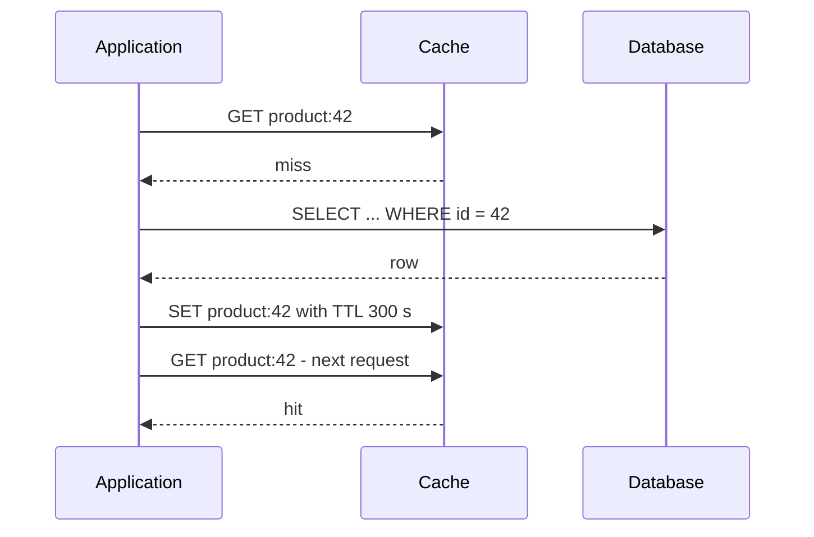
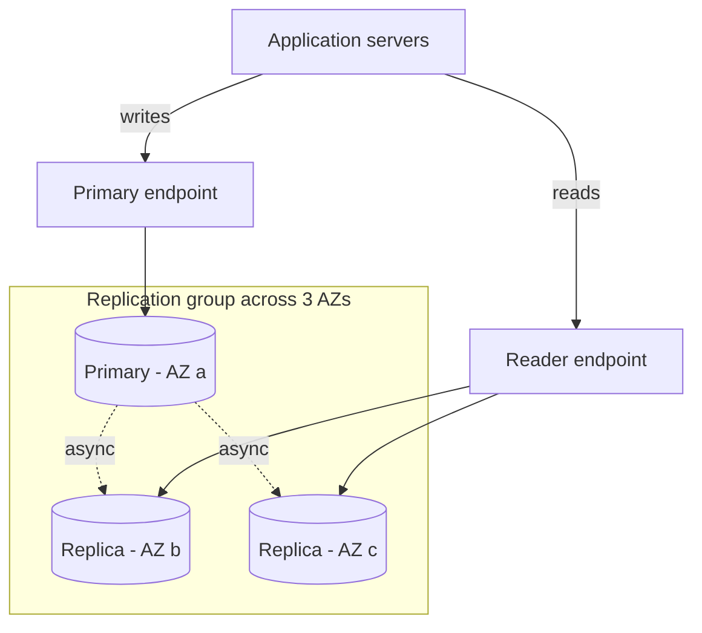
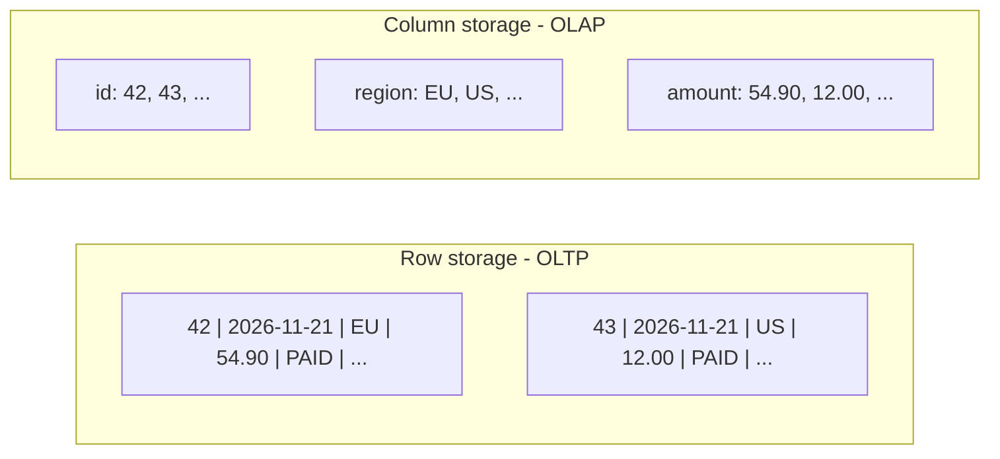

# ElastiCache, DAX and Redshift

## Before this lesson

You should know what RDS and read replicas are ([RDS and Aurora](#/lesson/aws/rds-aurora)) and the DynamoDB basics ([DynamoDB](#/lesson/aws/dynamodb)). The words OLTP and OLAP were defined in the RDS lesson.

## In plain words

This lesson covers two very different helpers that sit beside your main database.

A **cache** is a small, extremely fast store that keeps copies of answers you have already worked out, so that the next person asking the same question gets the answer instantly. Picture a busy café. The barista could grind beans for every cup (query the database every time), or keep a pot of the most popular filter coffee ready on the counter (the cache). The pot is quicker, but it goes stale and must be refreshed. **Amazon ElastiCache** is a managed cache; **DAX** is a cache made specifically for DynamoDB.

A **data warehouse** is a database built for the opposite job: not thousands of tiny requests per second, but a few enormous questions over years of history — "which products sold best in each region each quarter?". If the operational database is the till in the shop, the warehouse is the **head-office archive** where every receipt from every shop is filed for analysis. **Amazon Redshift** is AWS's data warehouse.

Why it matters for a job: "add a cache" and "move analytics out of the production database" are two of the most common performance fixes in practice, and both appear in nearly every system design interview.

## Why cache?

Reading from memory takes microseconds. Reading from a database over the network takes milliseconds, and far longer when the query joins large tables. Many applications read the same data again and again: a product page, a user profile, a leaderboard. Serving those reads from memory:

- makes responses faster;
- takes load off the database, postponing the day you need a bigger one;
- absorbs spikes — a thousand requests for the same headline become one database query.

What to cache: data that is **read often, changes rarely, and is expensive to compute**, where being a little out of date is acceptable. What not to cache: data that must always be exact (an account balance at the moment of payment), or data each user reads once.

## Caching strategies

The hard part of caching is keeping the copy reasonably fresh. Three patterns cover most designs.

### Lazy loading (cache-aside)

The application looks in the cache first. On a **hit** it returns the value. On a **miss** it reads the database, **stores the result in the cache**, and returns it.



- Only requested data is cached; a cache failure is survivable (everything becomes a miss).
- The first request for each key is slow, and data can be **stale** until it is refreshed.

### Write-through

Every time the application writes to the database it also writes the new value to the cache.

- Cached data is always current.
- Every write pays twice, and the cache fills with data nobody may ever read. A freshly added, empty cache node has nothing in it until values are written again, so write-through is normally combined with lazy loading.

### Time to live

A **TTL** (time to live) is an expiry time attached to a cached value. After, say, 300 seconds the cache drops it and the next request reloads it. TTL bounds staleness and frees memory. Adding a small random amount to each TTL (called **jitter**) prevents thousands of keys from expiring at the same instant and stampeding the database.

A fourth tactic, **explicit invalidation**, deletes the cached key whenever the underlying data changes. Combined with lazy loading and a TTL as a safety net, it is the most common real-world recipe.

When memory is full the cache must **evict** something. The usual policy is **LRU** — least recently used: discard what has gone longest without being read.

```python-run
import random
random.seed(7)

def simulate(ttl, requests=20_000, products=500, updates_per_tick=2):
    """Cache-aside with a TTL. Returns (hit ratio, share of stale reads)."""
    cache = {}                         # product -> (version seen, time stored)
    version = [0] * products           # the truth held by the database
    hits = stale = 0
    for now in range(requests):        # one request per tick
        for _ in range(updates_per_tick):                    # some products change
            version[random.randrange(products)] += 1
        p = min(int(random.paretovariate(1.2)) - 1, products - 1)   # popular items requested most
        entry = cache.get(p)
        if entry and now - entry[1] < ttl:      # present and not expired -> hit
            hits += 1
            if entry[0] != version[p]:          # the database has changed since
                stale += 1
        else:                                   # miss: read the database, fill the cache
            cache[p] = (version[p], now)
    return hits / requests, stale / requests

print(f"{'TTL':>6} {'hit ratio':>10} {'stale reads':>12}")
for ttl in (10, 100, 1000, 10000):
    h, s = simulate(ttl)
    print(f"{ttl:>6} {h:>10.1%} {s:>12.1%}")
```

Reading the simulation: each loop turn is one request; a few random products are updated in the "database"; requests favour popular products (a Pareto distribution, the mathematical form of "a few items get most of the traffic"); a hit happens when the product is cached and younger than the TTL; a hit is *stale* when the stored version differs from the truth. The table shows the trade-off that no setting escapes: **a longer TTL raises the hit ratio and the share of stale answers together**. Choosing a TTL is a business decision about how out of date a value may be.

## Amazon ElastiCache

**ElastiCache** runs in-memory data stores for you: provisioning, patching, failure detection and replacement, backups. It offers three engines.

| | Memcached | Valkey / Redis OSS |
|---|---|---|
| Data model | Plain key → value strings | Rich structures: strings, hashes, lists, sets, **sorted sets**, streams, geospatial |
| Replication and failover | None | Read replicas, **Multi-AZ automatic failover** |
| Persistence and backup | None | Snapshots, optional append-only log |
| Scaling | Add nodes; clients spread keys across them | Replicas for reads; **cluster mode** shards data for writes |
| Threads | Multi-threaded | Mostly single-threaded per shard |
| Extras | — | Publish/subscribe, transactions, Lua scripts, atomic counters |
| Choose it for | The simplest possible cache of independent objects | Almost everything else |

**Valkey** is the open-source continuation of Redis, created in 2024 after Redis changed its licence; ElastiCache supports both, with Valkey priced lower. For exam purposes read "Redis" and "Valkey" as the same family. Older material, including the edition this track follows, describes only Memcached and Redis.

Things the Redis/Valkey family makes easy:

- **Session store**: keep user sessions outside the web servers so that any server can handle any request and servers can be replaced freely.
- **Leaderboards**: a sorted set keeps members ordered by score; "top ten" and "my rank" are single commands.
- **Rate limiting and counters**: atomic increment with expiry.
- **Queues and publish/subscribe** for lightweight messaging.

### Deployment shapes

- **Node**: one cache server of a chosen type (`cache.t4g.micro`, `cache.r7g.large`…). Memory-optimised types are the norm.
- **Replication group** (cluster mode disabled): one **primary** node and up to five **replicas** in other Availability Zones. Writes go to the primary endpoint; reads can use the reader endpoint. With Multi-AZ enabled, a replica is promoted automatically if the primary fails. Replication is asynchronous, so a few most recent writes can be lost in a failover.
- **Cluster mode enabled**: data is split across several **shards**, each with its own primary and replicas, to scale writes and memory beyond one node.
- **ElastiCache Serverless**: no nodes to choose; capacity scales automatically and you pay for data stored and requests processed. The quickest way to start and a good fit for variable load.



### Security

Cache nodes live in **private subnets**, protected by security groups (port 6379 for Redis/Valkey, 11211 for Memcached) reachable only from the application tier. Enable **encryption in transit and at rest**, and require authentication — an AUTH token or, better, role-based access control with users and permissions. A cache holds copies of real data; treat it with the same care as the database.

### Worked example

> [!WARNING]
> Cache nodes bill per node-hour while they exist; a three-node group of small nodes is a few US dollars a day. Delete the group when you finish.

```bash
# A Multi-AZ replication group: 1 primary + 2 replicas, encrypted.
aws elasticache create-replication-group \
  --replication-group-id bookshop-cache \
  --replication-group-description "Product and session cache" \
  --engine valkey \
  --cache-node-type cache.t4g.small \
  --num-cache-clusters 3 \
  --automatic-failover-enabled --multi-az-enabled \
  --cache-subnet-group-name bookshop-private \
  --security-group-ids sg-0cache \
  --at-rest-encryption-enabled --transit-encryption-enabled
```

- `--num-cache-clusters 3` means three nodes in total: one primary and two replicas.
- `--automatic-failover-enabled --multi-az-enabled` places them in different zones and promotes a replica on failure.
- The subnet group lists private subnets; the security group admits port 6379 from the app tier only.

```bash
aws elasticache describe-replication-groups --replication-group-id bookshop-cache \
  --query "ReplicationGroups[0].NodeGroups[0].[PrimaryEndpoint.Address,ReaderEndpoint.Address]" --output text
```

```
master.bookshop-cache.x1y2z3.euw1.cache.amazonaws.com   replica.bookshop-cache.x1y2z3.euw1.cache.amazonaws.com
```

Application code for cache-aside, in outline:

```python
import json, redis                                # the redis client also talks to Valkey

r = redis.Redis(host=PRIMARY_ENDPOINT, port=6379, ssl=True)

def get_product(product_id):
    key = f"product:{product_id}"
    cached = r.get(key)                           # 1. look in the cache
    if cached is not None:
        return json.loads(cached)                 # 2. hit: done
    row = db_fetch_product(product_id)            # 3. miss: ask the database
    r.setex(key, 300, json.dumps(row))            # 4. store with a 300-second TTL
    return row

def update_price(product_id, price):
    db_update_price(product_id, price)            # write the source of truth first
    r.delete(f"product:{product_id}")             # then invalidate the cached copy
```

Each numbered comment is one step of the lazy-loading diagram; `setex` sets a value and its expiry in one command; `update_price` shows explicit invalidation.

A related service, **Amazon MemoryDB**, uses the same Valkey/Redis API but stores every write durably across zones, so it can serve as a primary database, not only a cache.

## DynamoDB Accelerator (DAX)

**DAX** is a managed, in-memory cache **specifically for DynamoDB**.

- It is **API-compatible**: you swap the DynamoDB client for the DAX client and existing `GetItem` and `Query` calls are cached with no other code change. It is a **write-through** cache — writes go through DAX to DynamoDB and update the item cache.
- Cached reads return in **microseconds**.
- It runs as a cluster of nodes in your VPC (three or more across zones for production), billed per node-hour.
- It serves **eventually consistent** reads; strongly consistent reads pass straight through to DynamoDB uncached.

Use DAX for read-heavy tables where the same items or queries are requested repeatedly — product catalogues, game state, real-time bidding. Skip it for write-heavy tables, for workloads needing strong consistency, or when reads are spread so evenly that nothing repeats. Choose **ElastiCache** instead when you want to cache things that are not DynamoDB items: computed results, HTML fragments, sessions, data from several sources.

## Amazon Redshift

A **data warehouse** collects data from many operational systems so that analysts can query history without touching — or slowing — production databases. **Redshift** is a managed warehouse that speaks PostgreSQL-style SQL and scales to petabytes.

### Why a warehouse is fast at analytics

Two design choices set it apart from an OLTP database.

**Columnar storage.** An OLTP database stores each row together, which is ideal for "fetch order 42 with all its fields". A warehouse stores each **column** together. A question like "sum of `amount` by `region`" then reads two columns and skips the other forty. Values in one column resemble each other, so they also **compress** very well.



**Massively parallel processing (MPP).** A Redshift cluster has a **leader node**, which receives SQL, plans the query and combines results, and several **compute nodes**, which each hold a slice of the data and work on the query at the same time.

### Table design levers

- **Distribution style** decides which compute node stores each row: `KEY` (rows with the same value of a chosen column live together, so joins on that column need no data movement), `EVEN` (round-robin), `ALL` (a full copy on every node, for small lookup tables) or `AUTO` (Redshift chooses, the sensible default).
- **Sort key** decides the physical order of rows. Queries filtering on that column — typically a date — skip whole blocks of data.

### Deployment options

- **Provisioned clusters** with **RA3** nodes, which separate compute from *managed storage* so each can scale independently. Clusters can be paused; **concurrency scaling** adds transient capacity at busy times.
- **Redshift Serverless**: no cluster to manage; capacity (measured in RPUs) scales with the queries and you pay for the seconds used. The natural choice for intermittent analytics.
- **Redshift Spectrum** queries files sitting in S3 directly from Redshift SQL, joining them with warehouse tables — your warehouse and your data lake in one query.
- **Zero-ETL integrations** replicate data continuously from Aurora, RDS and DynamoDB into Redshift without a pipeline to build.

*ETL* stands for extract, transform, load: the traditional process of copying data out of source systems, reshaping it, and loading it into the warehouse.

### Loading and operating

Bulk loading uses the `COPY` command, which reads many files from S3 in parallel:

```sql
COPY sales
FROM 's3://tidewater-lake/sales/2026/11/'
IAM_ROLE 'arn:aws:iam::111122223333:role/redshift-load'
FORMAT AS PARQUET;
```

- `COPY sales` names the target table; `FROM` is an S3 prefix (all files under it are loaded in parallel across compute nodes).
- `IAM_ROLE` is the role Redshift assumes to read the bucket — no access keys in SQL.
- `PARQUET` is a columnar file format widely used in data lakes.

Loading row by row with `INSERT` is the classic beginner mistake; it is orders of magnitude slower.

Redshift takes automatic snapshots to S3 and can copy them to another Region; a cluster can run across two Availability Zones (Multi-AZ) for higher availability. It encrypts data with KMS and sits in your VPC behind security groups.

### Where each database fits

| Workload | Service |
|---|---|
| Transactions with SQL and joins | RDS / Aurora |
| Key-based access at huge scale | DynamoDB |
| Microsecond reads of hot data, sessions, leaderboards | ElastiCache (or DAX for DynamoDB) |
| Analytical SQL over large history | Redshift |
| Ad hoc SQL directly on files in S3, pay per query | Athena (module 13) |
| Full-text search and log analytics | OpenSearch Service |
| Highly connected data (social graphs, fraud rings) | Neptune |
| MongoDB-compatible documents | DocumentDB |
| Time-stamped measurements | Timestream |

AWS's stance is **purpose-built databases**: choose the store that matches each access pattern, instead of forcing one database to do everything.

## Cost notes and free-tier warnings

- **ElastiCache**: per node-hour (replicas are full-price nodes) or, for Serverless, per GB-hour stored and per request unit. Reserved nodes discount steady clusters.
- **DAX**: per node-hour; at least three nodes for production.
- **Redshift provisioned**: per node-hour plus managed storage; pause clusters that are idle. **Redshift Serverless**: per RPU-second with a minimum charge per query, nothing while idle (storage aside).
- **Spectrum**: per terabyte of S3 data scanned — partition and compress files, and use columnar formats, to scan less.
- None of these has an always-free allowance worth relying on. Create, test, delete.

## Pitfalls

- **Caching without a TTL or invalidation**, serving stale data forever.
- **Treating the cache as the source of truth.** A cache may lose data at any time; always be able to rebuild from the database (unless you chose MemoryDB deliberately).
- **A cold-cache stampede**: after a restart, every request misses and hammers the database. Warm critical keys, add jitter, and scale the database for the miss path.
- **One cache node, no replica**: its failure empties the cache at the worst moment.
- **Choosing Memcached and later needing persistence, failover or sorted sets.**
- **Expecting DAX to serve strongly consistent reads** or to speed up writes.
- **Running analytics on the production OLTP database.** Use a replica at least, and a warehouse when it grows.
- **Using Redshift for OLTP**: single-row inserts and updates are slow by design.
- **Leaving a Redshift cluster or DAX cluster running** after a proof of concept.

> [!INTERVIEW]
> **"The database is the bottleneck for a read-heavy product page. What do you do?"** Measure first, then: add an in-memory cache with cache-aside and a TTL plus invalidation on write; cache at the edge with a CDN for content that is the same for everyone; add read replicas for queries that cannot be cached; and only then scale the database up. Discuss what staleness is acceptable and what happens when the cache is empty.
>
> **"Redis or Memcached?"** Memcached is a simple, multi-threaded key-value cache with no replication or persistence. Redis and Valkey add data structures, replication with Multi-AZ failover, persistence, pub/sub and clustering. Unless the requirement is the simplest possible object cache, choose Redis/Valkey.

## Cheat sheet

| Need | Choose |
|---|---|
| Cache database query results, sessions, leaderboards | ElastiCache for Valkey/Redis |
| Simplest multi-threaded object cache | ElastiCache for Memcached |
| Microsecond reads for DynamoDB without code changes | DAX |
| Durable Redis-compatible primary database | MemoryDB |
| Load data only when requested | Lazy loading (cache-aside) |
| Always-fresh cache | Write-through (+ lazy loading) |
| Bound staleness | TTL with jitter |
| Petabyte-scale SQL analytics | Redshift (columnar, MPP) |
| Intermittent analytics | Redshift Serverless |
| Query S3 files from the warehouse | Redshift Spectrum |
| Bulk load | `COPY` from S3 |

## Summary

- A cache trades freshness for speed; lazy loading, write-through, TTL and invalidation manage that trade.
- ElastiCache offers Memcached for simple caching and Valkey/Redis for rich data structures, replication, failover and clustering, with a serverless option.
- DAX is a drop-in, write-through cache for DynamoDB that serves eventually consistent reads in microseconds.
- Redshift is a columnar, massively parallel data warehouse for analytical SQL, with serverless capacity and the ability to query S3.
- Match each workload to a purpose-built store.

## Glossary

- **Cache-aside / lazy loading**: filling the cache only when a miss occurs.
- **Cache hit / miss**: finding / not finding the requested key in the cache.
- **Cluster mode**: sharding a Redis/Valkey data set across several primaries.
- **Columnar storage**: storing each column's values together.
- **Compute node / leader node**: Redshift nodes that hold data and run query steps / plan and coordinate.
- **DAX**: DynamoDB Accelerator, an in-memory cache for DynamoDB.
- **Data warehouse**: a database optimised for analytical queries over large history.
- **Distribution style**: how Redshift assigns rows to nodes.
- **ETL**: extract, transform, load.
- **Eviction / LRU**: removing entries when memory is full / least-recently-used first.
- **Jitter**: a small random variation added to a timer.
- **MPP**: massively parallel processing.
- **Replication group**: a primary cache node with its replicas.
- **Sort key (Redshift)**: the column that orders rows on disk.
- **TTL**: time to live, the lifetime of a cached entry.
- **Valkey**: the open-source fork of Redis.
- **Write-through**: updating the cache on every write.

```quiz
[
  {"q": "A news site shows the same front page to all visitors; the query behind it takes 400 ms and editors publish a few times per hour. Which approach gives the largest improvement with acceptable freshness?",
   "options": ["Cache the rendered result with a TTL of about a minute and invalidate on publish", "Enable Multi-AZ on the database", "Move the database to io2 storage", "Add a NAT gateway"],
   "answer": 0,
   "explain": "Identical, frequently requested, rarely changing data is the ideal cache candidate. A short TTL plus invalidation bounds staleness."},
  {"q": "A team needs a real-time leaderboard: update a player's score and fetch the top 100 and a player's rank with very low latency. Which engine fits best?",
   "options": ["Memcached", "Valkey/Redis sorted sets", "Redshift", "DAX"],
   "answer": 1,
   "explain": "Sorted sets keep members ordered by score with single-command rank and range operations. Memcached stores only opaque values."},
  {"q": "With lazy loading and no TTL, a product's price is updated in the database but customers keep seeing the old price. What is missing?",
   "options": ["Encryption in transit", "A TTL or explicit invalidation of the cached key on update", "A larger node type", "Cluster mode"],
   "answer": 1,
   "explain": "Lazy loading alone never refreshes a cached value. A TTL bounds staleness and deleting the key on write removes it immediately."},
  {"q": "A read-heavy DynamoDB table serves the same few thousand items repeatedly and the team wants microsecond reads with minimal code change. Eventual consistency is acceptable. What should they add?",
   "options": ["A global secondary index", "DAX", "Redshift Spectrum", "A second table"],
   "answer": 1,
   "explain": "DAX is API-compatible with DynamoDB and caches GetItem and Query results in memory. It serves eventually consistent reads."},
  {"q": "Analysts run queries that aggregate two columns over three years of sales with 60 columns per row. Why is a columnar warehouse much faster than the OLTP database for this?",
   "options": ["It has more indexes", "It reads only the needed columns, compresses them well, and processes them in parallel across nodes", "It disables transactions", "It keeps all data in memory"],
   "answer": 1,
   "explain": "Column storage avoids reading unused columns and compresses similar values; MPP spreads the work over compute nodes."},
  {"q": "An ElastiCache for Redis primary node fails. The group has two replicas in other zones with Multi-AZ automatic failover. What happens?",
   "options": ["The cache is lost and must be rebuilt by hand", "A replica is promoted automatically; a few of the most recent writes may be lost because replication is asynchronous", "Nothing; replicas accept writes at all times", "The primary endpoint is deleted"],
   "answer": 1,
   "explain": "Automatic failover promotes a replica and repoints the primary endpoint. Asynchronous replication means the newest writes might not have reached the replica."},
  {"q": "A company loads 200 GB of new data into Redshift every night using millions of single-row INSERT statements, and the load takes hours. What should change?",
   "options": ["Use COPY from files in S3", "Add more leader nodes", "Switch the distribution style to ALL for the fact table", "Enable DAX"],
   "answer": 0,
   "explain": "COPY loads files from S3 in parallel across compute nodes and is the intended bulk-load path. Row-by-row inserts are extremely slow in a warehouse."},
  {"q": "A finance team runs a handful of heavy reports on the first two days of each month and nothing otherwise. Which Redshift option minimises cost?",
   "options": ["A large provisioned cluster running all month", "Redshift Serverless", "Three-year reserved nodes", "DAX"],
   "answer": 1,
   "explain": "Serverless bills for capacity only while queries run, which suits intermittent workloads. A provisioned cluster would sit idle most of the month."}
]
```

> **Source:** AWS Certified Solutions Architect Official Study Guide, ch. 10 (Amazon ElastiCache: in-memory caching, Memcached and Redis, replication and Multi-AZ) and ch. 7 (Amazon Redshift). Valkey, ElastiCache Serverless, DAX, RA3 and Redshift Serverless post-date the book; checked against https://docs.aws.amazon.com/AmazonElastiCache/latest/dg/WhatIs.html , https://docs.aws.amazon.com/AmazonElastiCache/latest/dg/Strategies.html , https://docs.aws.amazon.com/amazondynamodb/latest/developerguide/DAX.html and https://docs.aws.amazon.com/redshift/latest/mgmt/welcome.html
