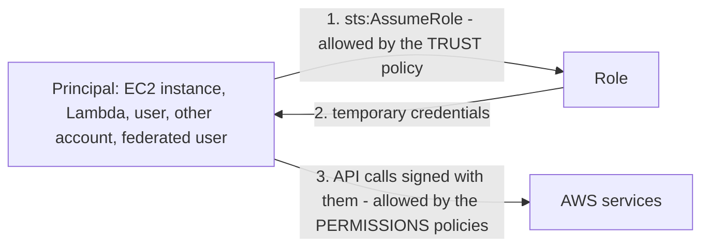

# IAM users, groups, roles and policies

## Before this lesson

You should have a secured account ([A safe first account](#/lesson/aws/account-and-billing)), know that every AWS action is a signed API call ([four ways to drive AWS](#/lesson/aws/responsibility-and-tools)), and have seen one bucket policy ([S3 access control](#/lesson/aws/s3-protection)). This lesson starts the topic from the beginning.

## In plain words

**IAM** (Identity and Access Management) is the part of AWS that answers two questions for every single request: **who are you?** and **are you allowed to do this?**

Think of a large office building with a security desk.

- A **user** is an employee with a personal badge.
- A **group** is a department: everyone in "Accounts" gets the same doors.
- A **role** is a **visitor pass or a hard hat hanging by the door**: it belongs to nobody in particular. Whoever is allowed to pick it up wears it for a few hours, gets its privileges, and hands it back.
- A **policy** is the written rule sheet saying which doors a badge, department or pass opens.

By default a badge opens **nothing**. Access exists only where a policy grants it.

Why it matters for a job: IAM touches every service. Misconfigured permissions are the root cause of most cloud security incidents, and "explain roles versus users" and "write a least-privilege policy" are standard interview tasks.

## Principals, authentication, authorisation

- A **principal** is anything that can make a request: a person, an application, an AWS service.
- **Authentication** establishes which principal is calling (password plus MFA in the console; a cryptographic signature made with access keys for API calls).
- **Authorisation** decides whether that principal may perform the requested **action** on the requested **resource**. IAM evaluates the applicable policies and answers Allow or Deny.

IAM is a **global** service: identities and policies are not tied to a Region. It is also free.

## Users

An **IAM user** is a long-lived identity inside one account, with a name and its own credentials:

- a **password** for the console (plus MFA);
- up to two **access keys** for programmatic access. An access key is an *access key ID* (starts with `AKIA`) and a *secret access key* shown once at creation.

Access keys never expire by themselves. That makes them the riskiest credentials in AWS: a key committed to a repository or left on an old laptop works until someone deletes it.

Modern guidance is therefore:

- **People** sign in through **IAM Identity Center** or another identity provider and receive temporary credentials — not IAM users.
- **Applications on AWS** use **roles** — not IAM users.
- IAM users with access keys remain only for the rare case that supports nothing else (a legacy tool outside AWS), with keys rotated regularly.

You still need to understand users: they appear in older accounts, in exam questions, and in the edition of the book this track follows, which predates Identity Center.

## Groups

An **IAM group** is a collection of users. Policies attached to the group apply to every member.

- A user can be in several groups (ten by default).
- Groups **cannot be nested** and **are not principals**: a policy cannot name a group in its `Principal` element, and a group cannot assume a role.
- Use them so that permissions are managed per job function, never per person: add Ana to `Developers` instead of attaching five policies to Ana.

## Roles

An **IAM role** is an identity with permissions but **no long-term credentials**. A principal that is allowed to do so **assumes** the role and receives **temporary security credentials** — an access key ID (starting with `ASIA`), a secret key and a session token — valid from 15 minutes to 12 hours. When they expire, they are useless.

A role has **two** policies of different kinds, and confusing them is the most common IAM misunderstanding:

1. The **trust policy** says **who may assume the role**.
2. The **permissions policies** say **what the role may do** once assumed.



Where roles are used:

| Situation | How the role is used |
|---|---|
| An application on **EC2** needs S3 | The role is attached to the instance through an *instance profile*; the SDK fetches credentials from the metadata service |
| A **Lambda function**, ECS task or other service acts on your behalf | An *execution role* or *service role* that the service assumes |
| **Cross-account** access | Account B's role trusts account A; users in A assume it |
| **Federation** | Employees authenticated by a corporate directory, or mobile users authenticated by a web identity provider, receive a role |
| **Elevated tasks** | An engineer assumes an admin role for an hour, leaving an audit record |
| **CI/CD pipelines** outside AWS | The pipeline's identity provider (for example GitHub's OIDC provider) is trusted by a role — no stored keys |

A trust policy for a role that EC2 instances may use:

```json
{
  "Version": "2012-10-17",
  "Statement": [{
    "Effect": "Allow",
    "Principal": {"Service": "ec2.amazonaws.com"},
    "Action": "sts:AssumeRole"
  }]
}
```

Line by line: the statement **allows** the principal *the EC2 service* to perform the single action `sts:AssumeRole` on this role. A trust policy is a resource-based policy attached to the role itself, which is why it has a `Principal` and no `Resource`.

### Users versus roles

| | IAM user | IAM role |
|---|---|---|
| Represents | One person or application | A set of permissions anyone trusted can take on |
| Credentials | Long-term password and access keys | Temporary, issued on assumption |
| Used by | That one identity | Services, users, other accounts, federated identities |
| Risk if leaked | Until manually revoked | Until expiry (minutes to hours) |
| Best for | Rare legacy cases | Almost everything |

## Policies

A **policy** is a JSON document listing permissions. Its building block is the **statement**.

```json
{
  "Version": "2012-10-17",
  "Statement": [
    {
      "Sid": "ListInvoiceBucket",
      "Effect": "Allow",
      "Action": "s3:ListBucket",
      "Resource": "arn:aws:s3:::tidewater-invoices",
      "Condition": {"StringLike": {"s3:prefix": "2026/*"}}
    },
    {
      "Sid": "ReadWriteInvoices",
      "Effect": "Allow",
      "Action": ["s3:GetObject", "s3:PutObject"],
      "Resource": "arn:aws:s3:::tidewater-invoices/2026/*"
    },
    {
      "Sid": "NeverDelete",
      "Effect": "Deny",
      "Action": "s3:DeleteObject",
      "Resource": "*"
    }
  ]
}
```

Element by element — remember them as **PARC** plus Effect: **P**rincipal, **A**ction, **R**esource, **C**ondition.

- `Version`: the policy language version. Always `"2012-10-17"`.
- `Sid`: an optional label for the statement.
- `Effect`: `Allow` or `Deny`.
- `Action`: one or more API operations, written `service:Operation`. Wildcards are allowed: `s3:Get*`, `ec2:Describe*`, `*`.
- `Resource`: the ARN or ARNs the statement applies to, with wildcards. `*` means every resource.
- `Condition`: optional tests on the request's context that must all be true.
- `Principal`: who the statement applies to. It appears **only in resource-based policies** (bucket policies, trust policies). In an identity-based policy the principal is implied: whoever the policy is attached to.

Reading the example: the first statement allows listing the bucket, but only keys under `2026/` (note the resource is the *bucket* ARN, because listing is a bucket-level action). The second allows reading and writing objects under that prefix (the resource is an *object* ARN pattern). The third denies deleting any object anywhere — and because **an explicit Deny always wins**, no other policy can re-enable it for this identity.

### ARN anatomy

```
arn:aws:s3:::tidewater-invoices/2026/*            (S3: no Region or account in the ARN)
arn:aws:ec2:eu-west-1:111122223333:instance/i-0abc123
arn:aws:iam::111122223333:role/app-server          (IAM: global, so no Region)
arn:aws:dynamodb:eu-west-1:111122223333:table/Orders
    |    |        |          |             |
 partition service region   account     resource
```

### Useful condition keys

| Condition | Meaning |
|---|---|
| `"Bool": {"aws:MultiFactorAuthPresent": "true"}` | The caller signed in with MFA |
| `"IpAddress": {"aws:SourceIp": "203.0.113.0/24"}` | The request came from this address range |
| `"StringEquals": {"aws:RequestedRegion": "eu-west-1"}` | The call targets this Region |
| `"Bool": {"aws:SecureTransport": "false"}` | The request did not use TLS (used with Deny) |
| `"StringEquals": {"aws:ResourceTag/Project": "bookshop"}` | The resource carries this tag |
| `"StringEquals": {"aws:PrincipalTag/Team": "data"}` | The caller carries this tag |
| `"StringEquals": {"aws:PrincipalOrgID": "o-abc123"}` | The caller belongs to this organisation |

Granting access by matching tags on the principal with tags on the resource is called **attribute-based access control (ABAC)**. One policy ("you may manage resources whose `Team` tag equals your `Team` tag") then serves every team.

### Kinds of policy

| Kind | Attached to | Notes |
|---|---|---|
| **Identity-based** | Users, groups, roles | The everyday kind |
| – AWS managed | — | Written and updated by AWS: `ReadOnlyAccess`, `AmazonS3ReadOnlyAccess`, `AdministratorAccess` |
| – Customer managed | — | Written by you, reusable, versioned |
| – Inline | One identity only | Embedded, not reusable; use sparingly |
| **Resource-based** | A resource: S3 bucket, SQS queue, KMS key, role (trust policy), Lambda function | Has a `Principal`; enables cross-account access |
| **Permissions boundary** | A user or role | A ceiling: the identity can never exceed it, whatever its policies say |
| **Service control policy (SCP)** | Accounts in an organisation | A ceiling for whole accounts (next lesson) |
| **Session policy** | A single assumed-role session | Narrows that session further |

Boundaries and SCPs **never grant** anything. They only limit what other policies can grant. The next lesson shows how all of these combine.

## Least privilege

The **principle of least privilege** says: grant exactly the permissions needed for the task, on exactly the resources needed, and nothing more. If the credentials are stolen or the code has a bug, the damage is limited to that small set — the **blast radius**.

A practical path to it:

1. **Start from the task**, not from the service. "Read objects under `reports/` in one bucket", not "S3 access".
2. **Name actions and resources explicitly.** Avoid `"Action": "*"`, `"s3:*"` and `"Resource": "*"` unless the action cannot be scoped.
3. **Add conditions** where they help: require MFA for destructive actions, restrict to a Region or network.
4. **Refine from evidence.** *IAM Access Analyzer* can generate a policy from the actions a role actually performed (recorded in CloudTrail) and flags unused permissions; the console shows *last accessed* information per service.
5. **Use temporary credentials** and roles.
6. **Review regularly.**

Compare:

```json
{"Effect": "Allow", "Action": "s3:*", "Resource": "*"}
```

with

```json
{"Effect": "Allow", "Action": "s3:GetObject",
 "Resource": "arn:aws:s3:::tidewater-reports/monthly/*"}
```

The first lets a compromised report viewer delete every bucket in the account. The second lets it read some reports. The problem *Least-Privilege Policy Audit* has you write a checker for exactly these smells.

> [!WARNING]
> The managed policy `AdministratorAccess` (`"Action": "*", "Resource": "*"`) attached to an application role or a CI pipeline is the most dangerous shortcut in AWS. It is tempting when something fails with *AccessDenied*; resist it. Read the error message — it names the missing action and resource — and add only that.

## Worked example: a role for a web server

Goal: instances of the bookshop application may read objects from one bucket and write logs. Nothing else.

```bash
# 1. Create the role with a trust policy that lets EC2 assume it.
aws iam create-role --role-name bookshop-app \
  --assume-role-policy-document file://trust-ec2.json

# 2. Create a customer managed permissions policy.
aws iam create-policy --policy-name bookshop-app-s3-read \
  --policy-document '{
    "Version": "2012-10-17",
    "Statement": [
      {"Effect": "Allow", "Action": "s3:ListBucket",
       "Resource": "arn:aws:s3:::tidewater-assets"},
      {"Effect": "Allow", "Action": "s3:GetObject",
       "Resource": "arn:aws:s3:::tidewater-assets/*"}
    ]}'

# 3. Attach it, and the AWS managed policy for Session Manager and CloudWatch agent basics.
aws iam attach-role-policy --role-name bookshop-app \
  --policy-arn arn:aws:iam::111122223333:policy/bookshop-app-s3-read
aws iam attach-role-policy --role-name bookshop-app \
  --policy-arn arn:aws:iam::aws:policy/AmazonSSMManagedInstanceCore

# 4. Wrap the role in an instance profile and give it to an instance.
aws iam create-instance-profile --instance-profile-name bookshop-app
aws iam add-role-to-instance-profile --instance-profile-name bookshop-app --role-name bookshop-app
aws ec2 associate-iam-instance-profile --instance-id i-0a1b2c3d4e5f67890 \
  --iam-instance-profile Name=bookshop-app
```

- Step 1 uses the trust policy shown earlier (saved as `trust-ec2.json`).
- Step 2's policy has one statement for the bucket and one for its objects — the two-ARN pattern again.
- Step 3 attaches two managed policies; a role can have up to ten by default.
- Step 4: EC2 does not attach roles directly; the **instance profile** is the adapter.

```bash
# 5. On the instance: no keys configured, yet this works.
aws sts get-caller-identity
aws s3 ls s3://tidewater-assets/
aws s3 rm s3://tidewater-assets/logo.png
```

```
{ "Arn": "arn:aws:sts::111122223333:assumed-role/bookshop-app/i-0a1b2c3d4e5f67890", ... }
2026-11-21 10:15:02      18234 logo.png
delete failed: ... An error occurred (AccessDenied) when calling the DeleteObject operation:
User: arn:aws:sts::111122223333:assumed-role/bookshop-app/i-0a1b... is not authorized to perform:
s3:DeleteObject on resource: "arn:aws:s3:::tidewater-assets/logo.png" because no identity-based policy allows the s3:DeleteObject action
```

The identity is an *assumed-role session*, named after the instance. Listing works; deleting fails, and the error message states the principal, the action, the resource and the reason — everything needed to fix a policy correctly.

### Testing before deploying

```bash
aws iam simulate-principal-policy \
  --policy-source-arn arn:aws:iam::111122223333:role/bookshop-app \
  --action-names s3:GetObject s3:DeleteObject \
  --resource-arns arn:aws:s3:::tidewater-assets/logo.png \
  --query "EvaluationResults[].[EvalActionName,EvalDecision]" --output table
```

```
+-------------------+----------------+
|  s3:GetObject     |  allowed       |
|  s3:DeleteObject  |  implicitDeny  |
+-------------------+----------------+
```

The **policy simulator** evaluates policies without making real calls. `implicitDeny` means "nothing allowed it" — as opposed to `explicitDeny`, which means a Deny statement matched.

## IAM hygiene

- **Password policy**: minimum length, complexity, no reuse — for any IAM users that remain.
- **MFA** for every human, mandatory for privileged ones.
- **Credential report**: a downloadable list of all users with the age and last use of their passwords and keys. Delete what is unused.
- **Access Analyzer**: finds resources shared outside the account or organisation, unused roles and keys, and validates policy syntax.
- **`iam:PassRole`**: the permission to hand a role to a service (for example to launch an instance with a role). Without restricting it, a user who may launch instances could give an instance an administrator role and use it — a well-known privilege-escalation path.

## Cost notes and free-tier warnings

- IAM, IAM Identity Center, roles, policies and STS are **free**.
- The cost of IAM mistakes is indirect and can be enormous: leaked administrator keys are typically used to launch fleets of expensive instances within minutes.
- Access Analyzer's external-access findings are free; unused-access analysis is charged per identity analysed.

## Pitfalls

- **Confusing the trust policy with the permissions policy.** "Who can wear the hat" versus "what the hat allows".
- **Attaching policies to individual users** instead of groups or roles.
- **Wildcards on both Action and Resource.**
- **Forgetting the bucket-versus-object ARN distinction.**
- **Long-lived access keys** in code, images, user data or CI variables.
- **Believing a group can be a principal** or can be nested.
- **Unrestricted `iam:PassRole`.**
- **Expecting changes to take a while**: IAM changes apply within seconds worldwide (it is eventually consistent, so allow a moment in scripts).

> [!INTERVIEW]
> **"What is the difference between an IAM user and an IAM role?"** A user is a permanent identity for one person or application with long-term credentials. A role has no credentials of its own; trusted principals assume it and receive temporary credentials. Roles are preferred for applications on AWS, for cross-account access and for federated users because nothing long-lived can leak.
>
> **"How does an EC2 instance get permission to read an S3 bucket?"** An IAM role with an S3 read policy and a trust policy for `ec2.amazonaws.com`, attached through an instance profile. The SDK retrieves rotating temporary credentials from the instance metadata service.

## Cheat sheet

| Concept | One line |
|---|---|
| User | Long-term identity; avoid for apps and, where possible, for people |
| Group | Collection of users; not a principal; no nesting |
| Role | Assumable identity with temporary credentials |
| Trust policy | Who may assume the role |
| Permissions policy | What the identity may do |
| Statement | Effect + Action + Resource (+ Condition, + Principal in resource policies) |
| Default | Everything is denied until allowed |
| Explicit Deny | Always wins |
| Boundary / SCP | Limit, never grant |
| Least privilege | Specific actions, specific resources, conditions, temporary credentials |
| Tools | Policy simulator, Access Analyzer, credential report |

## Summary

- IAM authenticates principals and authorises each request against policies; the default is deny.
- Users hold long-term credentials; groups organise users; roles are assumed for temporary credentials and are the preferred mechanism for workloads, cross-account access and federation.
- A role combines a trust policy (who) with permissions policies (what).
- Policies are JSON statements of Effect, Action, Resource and Condition; resource-based policies add a Principal.
- Least privilege keeps the blast radius small; tools such as Access Analyzer and the policy simulator make it achievable.

## Glossary

- **ABAC**: attribute-based access control, granting access by matching tags.
- **Access key**: long-term programmatic credentials of an IAM user.
- **Assume (a role)**: to obtain the role's temporary credentials.
- **Blast radius**: how much damage a compromised identity can do.
- **Customer managed / AWS managed / inline policy**: reusable policy written by you / by AWS / embedded in one identity.
- **Federation**: accepting identities authenticated by an external provider.
- **Identity-based / resource-based policy**: attached to an identity / to a resource.
- **Instance profile**: the container that attaches a role to an EC2 instance.
- **Least privilege**: granting only what is required.
- **Permissions boundary**: a maximum-permissions limit on a user or role.
- **Policy**: a JSON document of permission statements.
- **Principal**: an entity that can make requests.
- **Role**: an identity with permissions and no long-term credentials.
- **Temporary security credentials**: short-lived keys plus a session token.
- **Trust policy**: the resource-based policy on a role stating who may assume it.

```quiz
[
  {"q": "An application on EC2 must upload files to S3. Which approach follows best practice?",
   "options": ["Create an IAM user, generate access keys and store them in a config file on the instance", "Attach an IAM role with the needed S3 permissions to the instance via an instance profile", "Use the root user's access keys", "Make the bucket public for writes"],
   "answer": 1,
   "explain": "A role gives the instance automatically rotated temporary credentials with nothing stored on disk. Long-term keys on a server are a standing leak risk."},
  {"q": "A role's permissions policy grants full S3 access, yet a Lambda function cannot use the role at all. What is most likely wrong?",
   "options": ["The trust policy does not list lambda.amazonaws.com as a principal allowed to assume the role", "S3 does not support roles", "The role has too many policies", "Lambda needs an access key"],
   "answer": 0,
   "explain": "The trust policy controls who may assume a role. Without the Lambda service as a trusted principal, the function cannot obtain credentials for it, whatever the permissions say."},
  {"q": "An identity policy has two statements: Allow s3:* on all resources, and Deny s3:DeleteBucket on all resources. Can the identity delete a bucket?",
   "options": ["Yes, the Allow is broader", "Yes, the first statement wins", "No, an explicit Deny overrides any Allow", "Only with MFA"],
   "answer": 2,
   "explain": "Order and breadth do not matter: a matching explicit Deny always takes precedence."},
  {"q": "A policy allows s3:GetObject on 'arn:aws:s3:::reports'. Downloads of 'reports/q1.csv' fail with AccessDenied. Why?",
   "options": ["GetObject is an object-level action and needs the resource 'arn:aws:s3:::reports/*'", "The bucket must be public", "GetObject requires a Condition", "ARNs for S3 need a Region"],
   "answer": 0,
   "explain": "The bucket ARN matches only the bucket itself. Objects are matched by 'bucket/*'."},
  {"q": "Which statement about IAM groups is correct?",
   "options": ["A group can assume a role", "A group can be named as the Principal of a bucket policy", "A group is a way to attach the same policies to several users", "Groups can contain other groups"],
   "answer": 2,
   "explain": "Groups only organise users for policy attachment. They are not principals and cannot be nested."},
  {"q": "Engineers in account A must occasionally administer resources in account B without having separate users there. What is the standard design?",
   "options": ["Share account B's root password", "Create a role in B whose trust policy allows principals from A, and let A's engineers assume it", "Copy access keys from B to A", "Peer the two VPCs"],
   "answer": 1,
   "explain": "Cross-account roles provide temporary, audited access. The role's trust policy names account A; A's identities need permission to call sts:AssumeRole on it."},
  {"q": "A deploy pipeline role has 'Action': '*', 'Resource': '*'. Which principle does this violate, and what is the practical risk?",
   "options": ["High availability; the pipeline might be slow", "Least privilege; a compromise of the pipeline compromises the whole account", "Elasticity; costs will not scale down", "Idempotency; deployments may repeat"],
   "answer": 1,
   "explain": "Least privilege limits the blast radius. An administrator-level pipeline role turns any pipeline flaw into full account takeover."},
  {"q": "A developer can launch EC2 instances and has an unrestricted iam:PassRole permission. Why is this dangerous?",
   "options": ["PassRole deletes roles", "They can launch an instance with a more powerful role than their own and use its credentials", "PassRole exposes passwords", "It is not dangerous; PassRole is read-only"],
   "answer": 1,
   "explain": "iam:PassRole lets a principal hand any permitted role to a service. Unrestricted, it is a privilege-escalation path; scope it to specific roles."}
]
```

> **Source:** AWS Certified Solutions Architect Official Study Guide, ch. 6 (IAM: principals, authentication, authorization, policies, roles, federation). IAM Identity Center, Access Analyzer and permissions boundaries post-date the book; checked against https://docs.aws.amazon.com/IAM/latest/UserGuide/introduction.html , https://docs.aws.amazon.com/IAM/latest/UserGuide/id_roles.html , https://docs.aws.amazon.com/IAM/latest/UserGuide/access_policies.html and https://docs.aws.amazon.com/IAM/latest/UserGuide/best-practices.html
