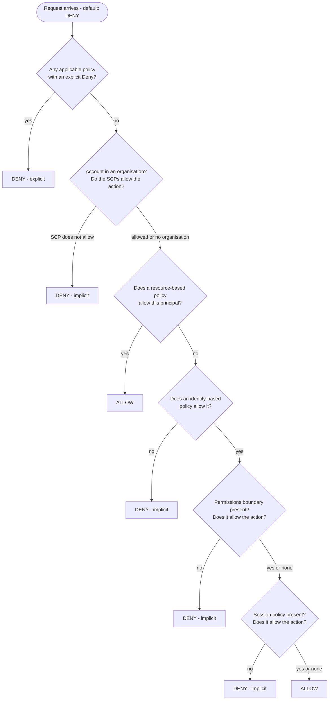
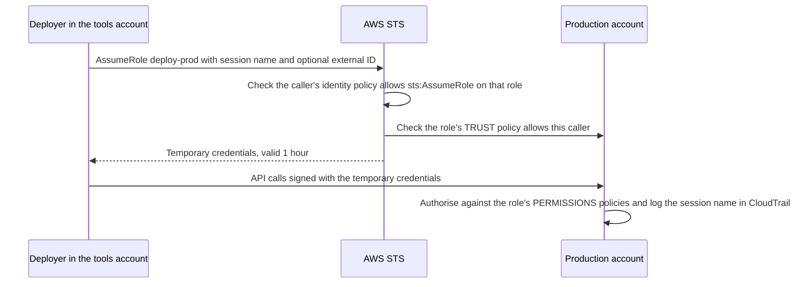
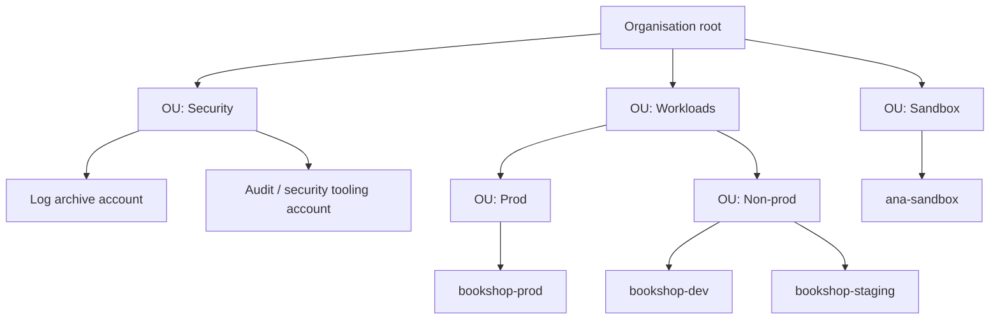

# Policy evaluation, STS, Organizations and SCPs

## Before this lesson

Read [IAM users, groups, roles and policies](#/lesson/aws/iam-identities) first. You need to be comfortable with statements (Effect, Action, Resource, Condition), with the difference between identity-based and resource-based policies, and with the idea of assuming a role.

## In plain words

The previous lesson introduced the pieces. This one explains **how AWS combines them into a yes or a no**, and how permissions are managed across many accounts.

Imagine getting into a concert. Several people must agree before you reach your seat: the **venue's rules** (no entry to the backstage area for anyone — an organisation-wide guardrail), the **ticket** you hold (your own permissions), and for some doors a **guest list** kept at that door (the resource's own policy). If any rule says "this person is banned", nothing else matters. If no rule says yes, the answer is no. Only when every layer that applies agrees do you get in.

AWS does the same for every API call:

1. everything starts as **denied**;
2. any applicable **explicit Deny** ends the discussion;
3. otherwise the request must be **allowed** by the right policies and **not limited** by any guardrail.

Why it matters for a job: when a request fails with *AccessDenied* (or, worse, succeeds when it should not), fixing it requires knowing this logic. "Walk me through IAM policy evaluation" is a classic senior-level interview question.

## The evaluation logic within one account

For a principal and a resource in the **same account**:



Three rules summarise the chart:

1. **Explicit Deny beats everything.** One matching `"Effect": "Deny"` in *any* policy type — identity, resource, boundary, SCP, session — and the request is refused.
2. **Guardrails must all agree.** SCPs, permissions boundaries and session policies never grant anything. Each one that is present must *also* allow the action, or the result is an implicit deny.
3. **Then one grant is enough** (same account): an Allow in an identity-based policy **or** in a resource-based policy.

An **implicit deny** means "nothing said yes". An **explicit deny** means "something said no". The distinction matters when fixing things: an implicit deny is cured by adding an Allow; an explicit deny can only be cured by changing or removing the Deny.

The order of statements, and the order of policies, never matters.

### Cross-account requests need two yeses

When the principal is in account A and the resource in account B, **both accounts must allow**:

- A's identity-based policy must allow the principal to perform the action on B's resource; **and**
- B's resource-based policy must allow that principal (or account A).

Neither side can grant access alone. This is why sharing a bucket with a partner needs a bucket policy on your side *and* an IAM policy on theirs.

| Scenario | Identity policy | Resource policy | Result |
|---|---|---|---|
| Same account | Allow | (none) | Allow |
| Same account | (none) | Allow for this principal | Allow |
| Same account | Allow | Deny | **Deny** |
| Cross-account | Allow | (none) | **Deny** |
| Cross-account | (none) | Allow | **Deny** |
| Cross-account | Allow | Allow | Allow |

### Simulate it

The simulation below implements the same-account logic. Change the request or the policies and re-run.

```python-run
import fnmatch

def matches(statement, action, resource):
    """A statement matches when one action pattern and one resource pattern match."""
    return (any(fnmatch.fnmatchcase(action.lower(), a.lower()) for a in statement["Action"])
            and any(fnmatch.fnmatchcase(resource, r) for r in statement["Resource"]))

def effects(policy, action, resource):
    return {s["Effect"] for s in policy if matches(s, action, resource)}

def evaluate(action, resource, identity, resource_policy=(), scps=(), boundary=None):
    layers = [identity, resource_policy, *scps] + ([boundary] if boundary is not None else [])
    if any("Deny" in effects(p, action, resource) for p in layers):
        return "explicit DENY"
    if any("Allow" not in effects(scp, action, resource) for scp in scps):
        return "implicit deny (SCP does not allow)"
    if "Allow" in effects(resource_policy, action, resource):
        return "ALLOW (resource policy)"
    if "Allow" not in effects(identity, action, resource):
        return "implicit deny (no identity policy allows)"
    if boundary is not None and "Allow" not in effects(boundary, action, resource):
        return "implicit deny (outside the permissions boundary)"
    return "ALLOW"

identity = [
    {"Effect": "Allow", "Action": ["s3:*"], "Resource": ["*"]},
    {"Effect": "Deny",  "Action": ["s3:Delete*"], "Resource": ["arn:aws:s3:::ledger/*"]},
]
scp_no_ec2 = [{"Effect": "Allow", "Action": ["s3:*", "dynamodb:*"], "Resource": ["*"]}]
boundary = [{"Effect": "Allow", "Action": ["s3:Get*", "s3:List*", "s3:Put*"], "Resource": ["*"]}]

tests = [
    ("s3:GetObject",    "arn:aws:s3:::ledger/2026.csv", {}),
    ("s3:DeleteObject", "arn:aws:s3:::ledger/2026.csv", {}),
    ("s3:DeleteObject", "arn:aws:s3:::scratch/tmp.csv", {}),
    ("s3:DeleteObject", "arn:aws:s3:::scratch/tmp.csv", {"boundary": boundary}),
    ("ec2:RunInstances", "arn:aws:ec2:eu-west-1:1:instance/*", {"scps": [scp_no_ec2]}),
    ("s3:GetObject",    "arn:aws:s3:::ledger/2026.csv", {"scps": [scp_no_ec2], "boundary": boundary}),
]
for action, resource, extra in tests:
    print(f"{action:18s} {resource.split(':::')[-1][:22]:22s} -> {evaluate(action, resource, identity, **extra)}")
```

Line by line: `matches` uses shell-style wildcard matching, case-insensitively for actions; `effects` collects the effects of all matching statements in one policy; `evaluate` applies the rules in order — any Deny in any layer, then each SCP must allow, then a resource-policy grant, then the identity grant limited by the boundary. Study the fourth and fifth results: the identity policy says `s3:*`, yet the delete is refused because the boundary does not include it, and `ec2:RunInstances` is refused because the SCP does not list EC2 — **guardrails limit even a principal whose own policy would allow the action**. The problem *IAM Policy Evaluation* asks you to build a fuller version with conditions and principals.

## Permissions boundaries

A **permissions boundary** is a managed policy attached to a user or role that sets the **maximum** permissions that identity can ever have. Effective permissions are the **intersection** of the identity policies and the boundary.

Their main use is safe delegation. A platform team wants developers to create roles for their own applications, but a developer who may create roles could create an administrator role and assume it. The fix: allow developers `iam:CreateRole` **only if** the new role carries a specific boundary (a condition on `iam:PermissionsBoundary`). Whatever policy the developer attaches, the role cannot exceed the boundary.

## STS: temporary credentials

The **AWS Security Token Service (STS)** issues temporary credentials. Every role assumption goes through it.

| API | Used for |
|---|---|
| `AssumeRole` | An IAM principal takes on a role, in the same or another account |
| `AssumeRoleWithSAML` | Users authenticated by a corporate identity provider using the SAML 2.0 standard |
| `AssumeRoleWithWebIdentity` | Identities authenticated by an OpenID Connect (OIDC) provider — for example a CI system or a Kubernetes service account |
| `GetSessionToken` | An IAM user obtains temporary credentials, typically to prove MFA |
| `GetCallerIdentity` | "Who am I?" — always allowed |

Temporary credentials consist of an access key ID, a secret key and a **session token**, and carry an expiry time. They cannot be revoked individually, but all sessions of a role issued before a given moment can be invalidated by adding a deny with a date condition (the console's *Revoke active sessions* button does this).

### A cross-account role, step by step

Account `111122223333` (tools) must deploy into account `444455556666` (production).



The trust policy on the production role:

```json
{
  "Version": "2012-10-17",
  "Statement": [{
    "Effect": "Allow",
    "Principal": {"AWS": "arn:aws:iam::111122223333:role/ci-deployer"},
    "Action": "sts:AssumeRole",
    "Condition": {"StringEquals": {"sts:ExternalId": "tidewater-7f3a"}}
  }]
}
```

- `Principal` names the single role in the tools account that may assume this role. Naming the whole account (`…:root`) would delegate the decision to that account's administrators.
- The `sts:ExternalId` condition requires the caller to present an agreed value. It defends against the **confused deputy problem**: a third-party service that holds access to many customers' accounts being tricked into using *your* role on behalf of another customer. Each customer gives the third party a different external ID, so one customer cannot point the service at another's role.

```bash
aws sts assume-role \
  --role-arn arn:aws:iam::444455556666:role/deploy-prod \
  --role-session-name release-2026-11-21 \
  --external-id tidewater-7f3a \
  --duration-seconds 3600
```

```
{
    "Credentials": {
        "AccessKeyId": "ASIAEXAMPLEEXAMPLE",
        "SecretAccessKey": "wJalr...",
        "SessionToken": "IQoJb3JpZ2luX2VjE...",
        "Expiration": "2026-11-21T11:15:00+00:00"
    },
    "AssumedRoleUser": {
        "Arn": "arn:aws:sts::444455556666:assumed-role/deploy-prod/release-2026-11-21"
    }
}
```

`--role-session-name` appears in CloudTrail, tying each action to a release or a person. In daily use you rarely call this by hand: a CLI profile with `role_arn` and `source_profile` assumes the role automatically.

### Federation

**Federation** lets people use identities managed elsewhere instead of IAM users:

- **Workforce** (employees): **IAM Identity Center**, connected to a directory such as Microsoft Entra ID, Okta or its own built-in store. Users see a portal listing the accounts and *permission sets* (roles) they may use.
- **Customers of your application**: **Amazon Cognito** — user pools handle sign-up and sign-in; identity pools exchange a login for temporary AWS credentials with a limited role.
- **Workloads outside AWS**: OIDC federation (for example GitHub Actions) or **IAM Roles Anywhere** (certificates), replacing stored access keys.

## AWS Organizations

One account is fine for learning. Companies use many: the account boundary is the strongest isolation AWS has, and it separates bills, limits and blast radius. **AWS Organizations** manages them as one.

- The **management account** creates the organisation and pays the **consolidated bill**. Keep workloads out of it.
- **Member accounts** hold the workloads.
- **Organisational units (OUs)** group accounts in a tree under the **root**. Policies attached to an OU are inherited by everything below.



Benefits: one bill with pooled volume discounts and shared Savings Plans; central guardrails; services that work organisation-wide (CloudTrail, Config, GuardDuty, Backup); programmatic account creation. **AWS Control Tower** sets up a recommended multi-account layout (a *landing zone*) with these pieces preconfigured.

## Service control policies

A **service control policy (SCP)** is an organisation policy attached to the root, an OU or an account. It defines the **maximum available permissions** for every principal in the affected accounts — **including each account's root user**.

Facts that exams probe:

- SCPs **never grant** permissions. An identity still needs its own Allow.
- They do **not affect the management account**, and do not restrict *service-linked roles*.
- Effective permissions are the intersection of the SCPs on **every level of the path** (root, each OU, account) and the identity's policies.
- Two styles: a **deny list** (keep the default `FullAWSAccess` SCP and add specific denies — the common approach) or an **allow list** (replace `FullAWSAccess` with a list of permitted services).

A typical guardrail SCP:

```json
{
  "Version": "2012-10-17",
  "Statement": [
    {
      "Sid": "DenyOutsideApprovedRegions",
      "Effect": "Deny",
      "NotAction": ["iam:*", "organizations:*", "route53:*", "cloudfront:*", "support:*", "sts:*"],
      "Resource": "*",
      "Condition": {"StringNotEquals": {"aws:RequestedRegion": ["eu-west-1", "eu-central-1"]}}
    },
    {
      "Sid": "ProtectAuditTrail",
      "Effect": "Deny",
      "Action": ["cloudtrail:StopLogging", "cloudtrail:DeleteTrail", "guardduty:DeleteDetector"],
      "Resource": "*"
    },
    {
      "Sid": "NoLeavingTheOrganisation",
      "Effect": "Deny",
      "Action": "organizations:LeaveOrganization",
      "Resource": "*"
    }
  ]
}
```

- The first statement denies every action **except** the listed global services (`NotAction` means "all actions other than these") when the target Region is not one of two approved ones. Global services must be exempted because their API calls are served from `us-east-1`.
- The second prevents anyone — even an account administrator — from switching off logging and threat detection.
- The third stops an account from detaching itself and escaping the guardrails.

Related organisation policies: **resource control policies (RCPs)**, which cap what *resources* in your accounts can be accessed by anyone (for example "our buckets may only be accessed by principals in our organisation"), plus tag policies, backup policies and declarative policies.

### All the layers together

| Layer | Grants? | Scope | Typical owner |
|---|---|---|---|
| SCP / RCP | No — limits | Accounts, OUs | Central cloud team |
| Permissions boundary | No — limits | One user or role | Platform team |
| Identity-based policy | Yes | User, group, role | Application team |
| Resource-based policy | Yes | One resource | Resource owner |
| Session policy | No — limits | One session | Caller |

## Troubleshooting AccessDenied

1. **Read the message.** It names the principal, action, resource and usually the policy type responsible: "no identity-based policy allows", "explicit deny in a service control policy", "no resource-based policy allows" and so on.
2. **Confirm who you are**: `aws sts get-caller-identity`. Many puzzles end here — the wrong profile or role.
3. **Explicit deny?** Find and change the Deny: an SCP, a boundary, a bucket policy condition (TLS, VPC endpoint, IP).
4. **Implicit deny?** Add the missing Allow, with the right resource ARN.
5. **Cross-account?** Check both sides.
6. **Encrypted resource?** The principal also needs permission on the KMS key.
7. **Use the tools**: the IAM policy simulator, Access Analyzer's policy checks, and CloudTrail, where the failed event records the error.

## Cost notes and free-tier warnings

- STS, Organizations, SCPs and Identity Center are **free**.
- A well-designed organisation saves money: consolidated billing pools usage for volume tiers and shares commitment discounts across accounts.
- Sandbox OUs with an SCP that denies expensive instance types and unapproved Regions are an effective protection against accidental spend.

## Pitfalls

- **Thinking an SCP grants access.** It only filters.
- **Running workloads in the management account**, where SCPs do not apply.
- **Testing an SCP on the root of the organisation first.** Attach it to a test OU; a wrong SCP can lock every account out at once.
- **Forgetting global services in a Region-restriction SCP**, breaking IAM and billing.
- **Granting cross-account access on one side only.**
- **Trusting a whole external account without an external ID** when a third party is involved.
- **Fixing an explicit deny by adding more Allows** — it will never work.
- **Forgetting KMS**: S3 allows the read, the key does not, and the error still says AccessDenied.

> [!INTERVIEW]
> **"Explain how AWS decides whether a request is allowed."** Start from an implicit deny. If any applicable policy has an explicit Deny, deny. Otherwise, organisation SCPs must allow the action; then, within one account, an Allow in either an identity-based or a resource-based policy is needed, and any permissions boundary or session policy must also allow it. Across accounts, both the identity policy in the caller's account and the resource policy in the owner's account must allow.
>
> **"What is the confused deputy problem and how does AWS address it?"** A trusted intermediary with access to several parties is tricked into acting for the wrong one. For third-party role assumption the defence is a unique `sts:ExternalId` in the trust policy; for AWS services acting on your resources, conditions on `aws:SourceArn` and `aws:SourceAccount`.

## Cheat sheet

| Rule | Detail |
|---|---|
| Default | Implicit deny |
| Explicit Deny | Wins over any Allow, in any policy type |
| Same account | Identity policy **or** resource policy may grant |
| Cross-account | Identity policy **and** resource policy must grant |
| SCP | Caps accounts, including root; not the management account; grants nothing |
| Permissions boundary | Caps one user or role; grants nothing |
| STS AssumeRole | Returns key ID, secret, session token, expiry |
| External ID | Protects third-party role assumption |
| Federation | Identity Center (workforce), Cognito (app users), OIDC (CI/CD) |
| Organizations | Management account, OUs, consolidated billing, SCPs |

## Summary

- Evaluation starts from deny; an explicit Deny anywhere is final; guardrail policies must all permit; then one grant suffices in the same account and two are needed across accounts.
- Permissions boundaries cap individual identities and make delegated role creation safe.
- STS issues the temporary credentials behind roles, cross-account access and federation; an external ID guards third-party access.
- AWS Organizations groups accounts into OUs with consolidated billing; SCPs set the outer limit of what any principal in those accounts can do.
- Diagnose AccessDenied by distinguishing implicit from explicit denies and checking each layer.

## Glossary

- **Confused deputy**: a trusted service misled into misusing its access for another party.
- **Consolidated billing**: one bill for all accounts of an organisation.
- **Explicit deny / implicit deny**: refused by a Deny statement / refused because nothing allowed it.
- **External ID**: a shared value required when a third party assumes a role.
- **Landing zone**: a preconfigured multi-account environment.
- **Management account**: the account that owns the organisation.
- **OIDC / SAML**: federation standards for web identities and enterprise directories.
- **Organisational unit (OU)**: a group of accounts in the organisation tree.
- **Permission set**: an Identity Center template that becomes a role in each assigned account.
- **Permissions boundary**: the maximum permissions of one user or role.
- **SCP**: service control policy, the maximum permissions of accounts.
- **Session token**: the third part of temporary credentials.
- **STS**: Security Token Service, issuer of temporary credentials.

```quiz
[
  {"q": "A user's identity policy allows s3:GetObject on a bucket in the same account. The bucket policy contains a Deny for all principals unless the request comes through a specific VPC endpoint. The user calls from their laptop. Result?",
   "options": ["Allowed, identity policies take precedence", "Denied, an explicit Deny in any applicable policy overrides the Allow", "Allowed, because both policies are in the same account", "Denied only for write actions"],
   "answer": 1,
   "explain": "An explicit Deny always wins. The condition is satisfied (the request did not use the endpoint), so the Deny applies."},
  {"q": "An account sits in an OU whose SCP allows only S3 and DynamoDB. An IAM administrator in that account has AdministratorAccess. Can they launch an EC2 instance?",
   "options": ["Yes, AdministratorAccess allows everything", "No, the SCP does not allow EC2, so it is implicitly denied regardless of identity policies", "Yes, SCPs do not apply to administrators", "Only as the root user"],
   "answer": 1,
   "explain": "SCPs cap every principal in member accounts, including root. Effective permissions are the intersection of the SCPs and the identity's policies."},
  {"q": "A role in account A has a policy allowing s3:PutObject on a bucket owned by account B. The bucket has no bucket policy. Uploads fail. Why?",
   "options": ["Cross-account access requires an Allow on both sides; B's bucket policy must also allow the role", "Buckets cannot be shared across accounts", "PutObject needs MFA", "The role needs a permissions boundary"],
   "answer": 0,
   "explain": "Within one account a single grant suffices, but across accounts both the caller's identity policy and the resource owner's resource-based policy must allow."},
  {"q": "A role has an identity policy allowing dynamodb:* and a permissions boundary allowing only dynamodb:GetItem and dynamodb:Query. What can the role do in DynamoDB?",
   "options": ["Everything", "Nothing", "Only GetItem and Query", "Everything except GetItem and Query"],
   "answer": 2,
   "explain": "Effective permissions are the intersection of the identity policies and the boundary."},
  {"q": "A monitoring vendor asks you to create a role in your account that their AWS account can assume. What should the trust policy include to prevent the confused deputy problem?",
   "options": ["A condition requiring a unique sts:ExternalId", "A wildcard principal", "The vendor's root password", "An SCP"],
   "answer": 0,
   "explain": "The external ID is unique per customer, so another customer cannot direct the vendor's system to assume your role."},
  {"q": "Which statement about service control policies is true?",
   "options": ["They grant permissions to OU members", "They apply to the management account as well", "They limit the maximum permissions of member accounts and never grant access by themselves", "They replace IAM policies"],
   "answer": 2,
   "explain": "SCPs are guardrails: they restrict what identity and resource policies in member accounts can effectively allow. They do not affect the management account."},
  {"q": "An error reads: '...is not authorized to perform: s3:DeleteObject ... with an explicit deny in a service control policy'. What is the correct fix?",
   "options": ["Attach an Allow for s3:DeleteObject to the user", "Add the user to an administrators group", "Change or remove the Deny in the SCP (or move the account), because no Allow can override it", "Enable MFA"],
   "answer": 2,
   "explain": "An explicit deny can only be removed at its source. Adding Allows elsewhere has no effect."},
  {"q": "A GitHub Actions workflow must deploy to AWS without storing long-lived access keys. Which mechanism is appropriate?",
   "options": ["An IAM user with keys stored as repository secrets", "OIDC federation: a role whose trust policy accepts tokens from GitHub's identity provider, assumed with AssumeRoleWithWebIdentity", "The root user's keys", "A security group rule"],
   "answer": 1,
   "explain": "OIDC federation lets the workflow exchange a short-lived token for temporary credentials, with trust-policy conditions restricting which repository and branch may assume the role."}
]
```

> **Source:** AWS Certified Solutions Architect Official Study Guide, ch. 6 (authorization, policy evaluation, STS, federation, cross-account access) and ch. 12 (account security features). Organizations, SCPs, permissions boundaries and Identity Center post-date the book; checked against https://docs.aws.amazon.com/IAM/latest/UserGuide/reference_policies_evaluation-logic.html , https://docs.aws.amazon.com/STS/latest/APIReference/welcome.html , https://docs.aws.amazon.com/organizations/latest/userguide/orgs_manage_policies_scps.html and https://docs.aws.amazon.com/IAM/latest/UserGuide/confused-deputy.html
