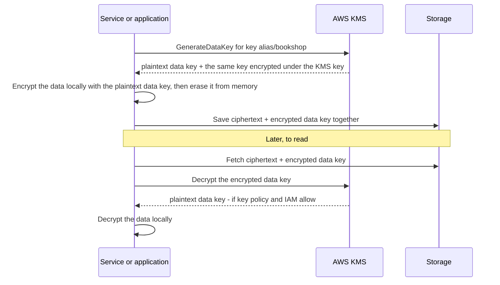
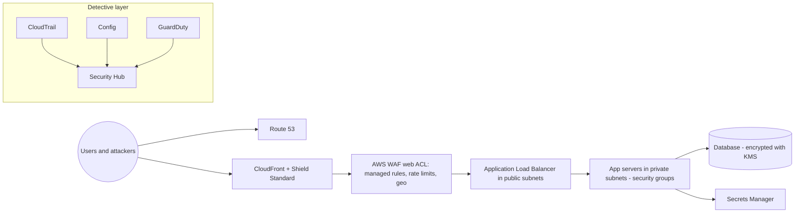

# KMS, Secrets Manager and the detective and protective services

## Before this lesson

You need IAM policies and roles ([IAM users, groups, roles and policies](#/lesson/aws/iam-identities)), the evaluation logic ([Policy evaluation, STS, Organizations and SCPs](#/lesson/aws/iam-evaluation)) and the shared responsibility model ([Shared responsibility](#/lesson/aws/responsibility-and-tools)). S3 encryption options were introduced in [S3 protection](#/lesson/aws/s3-protection).

## In plain words

IAM decides who may do what. A secure system needs four more things, and AWS has a service for each:

1. **Keep data unreadable to anyone without the key** — encryption, with keys looked after by **AWS KMS**.
2. **Keep passwords and API keys out of code** — **Secrets Manager** and **Parameter Store**.
3. **Know what happened and notice trouble** — **CloudTrail** (who did what), **AWS Config** (what changed), **GuardDuty** (is something behaving like an attack?).
4. **Stop attacks at the door** — **AWS WAF** (bad web requests) and **AWS Shield** (floods).

A bank branch is a fair picture. Valuables sit in a vault whose keys are held by a key custodian (KMS). Staff do not write the alarm code on a sticky note; it is kept in a sealed, logged cabinet (Secrets Manager). Cameras record every action (CloudTrail), an inventory clerk notes every change to the building (Config), and an alarm company watches for suspicious patterns (GuardDuty). At the entrance, a guard turns away known troublemakers (WAF) and crowd barriers stop a mob from blocking the doors (Shield).

Why it matters for a job: these services appear in every security review and in a large share of certification questions, usually as "which service would you use to…?". Knowing the one-line purpose of each, and the difference between look-alikes, is most of the battle.

## Encryption in sixty seconds

**Encryption** turns readable data (*plaintext*) into unreadable data (*ciphertext*) using a **key**. Only someone with the right key can reverse it.

- **Symmetric** encryption uses one key for both directions. Fast; used for data at rest. The standard algorithm is AES-256.
- **Asymmetric** encryption uses a pair: a public key and a private key. Used for signatures and for exchanging keys.
- **At rest** means stored on disk; **in transit** means moving over a network (protected by TLS).

Encryption moves the problem: instead of protecting the data, you must now protect the key. That is what KMS is for.

## AWS KMS

**AWS Key Management Service (KMS)** creates and guards encryption keys and performs cryptographic operations with them. The crucial property: **key material never leaves KMS unencrypted.** You cannot download a KMS key. You send data to KMS, or ask KMS for something encrypted under the key, and every use is checked against policy and logged.

### Kinds of key

| Kind | Who creates and manages | Visible to you | Rotation | Cost |
|---|---|---|---|---|
| **AWS owned keys** | AWS, shared across customers | No | AWS's choice | Free |
| **AWS managed keys** (aliases like `aws/s3`, `aws/rds`) | AWS, one per service in your account | Yes, read-only | Yearly, automatic | Free to hold; requests charged |
| **Customer managed keys** | You | Full control of policy, grants, rotation, deletion | Optional automatic rotation (yearly by default, configurable) or on demand | Monthly fee per key + requests |

Choose a **customer managed key** when you need to control who may use the key, share encrypted data across accounts, audit use in detail, or be able to disable the key. The AWS managed key's policy cannot be edited, which is why data encrypted with `aws/s3` or `aws/ebs` cannot be shared with another account.

### Envelope encryption

KMS can encrypt at most 4 KB directly, and sending gigabytes to a remote service would be slow. So services use **envelope encryption**: encrypt the data with a **data key**, and encrypt the data key with the KMS key.



Consequences worth understanding:

- Bulk data never travels to KMS; only a tiny key does.
- Reading the data requires **`kms:Decrypt` on the KMS key** in addition to permission on the storage. Two independent locks.
- **Disable the KMS key and all data under it becomes unreadable at once** — a powerful emergency switch, and a serious risk if done by mistake. Scheduled key deletion therefore has a mandatory waiting period of 7 to 30 days.

### Key policies and grants

Every KMS key has a **key policy**, a resource-based policy. Unlike most resources, a KMS key is governed by its key policy first: IAM policies only work if the key policy delegates to IAM (the default key policy does, by allowing the account's root principal).

```json
{
  "Sid": "AllowAppToUseTheKey",
  "Effect": "Allow",
  "Principal": {"AWS": "arn:aws:iam::111122223333:role/bookshop-app"},
  "Action": ["kms:Decrypt", "kms:GenerateDataKey"],
  "Resource": "*",
  "Condition": {"StringEquals": {"kms:ViaService": "s3.eu-west-1.amazonaws.com"}}
}
```

Reading it: the application role may decrypt and generate data keys with this key — but only when the request comes *through S3 in eu-west-1* (`kms:ViaService`). The role cannot call KMS directly to decrypt arbitrary data. Good key policies also separate **key administrators** (who manage the key but cannot use it) from **key users**.

A **grant** is a lightweight, revocable delegation used mainly by AWS services to use a key on your behalf for one resource.

Other things to recognise:

- **Automatic rotation** creates new key material on schedule while keeping the old material for decrypting existing data; the key ID does not change and nothing needs re-encrypting.
- **Multi-Region keys** are replicas of a key in several Regions with the same key material, so data encrypted in one Region can be decrypted in another without a cross-Region call.
- Keys are **regional**; copying an encrypted snapshot to another Region re-encrypts it under a key there.
- **AWS CloudHSM** provides dedicated, single-tenant hardware security modules that you control exclusively, for regulations that demand it or for cryptographic standards KMS does not expose. KMS can use a CloudHSM cluster as a *custom key store*.

```bash
# Create a customer managed key with rotation, and give it a friendly alias.
KEY=$(aws kms create-key --description "Bookshop data" --query KeyMetadata.KeyId --output text)
aws kms enable-key-rotation --key-id "$KEY"
aws kms create-alias --alias-name alias/bookshop --target-key-id "$KEY"

# Encrypt a small secret directly (under 4 KB) and decrypt it again.
aws kms encrypt --key-id alias/bookshop --plaintext fileb://note.txt \
  --query CiphertextBlob --output text | base64 -d > note.enc
aws kms decrypt --ciphertext-blob fileb://note.enc --query Plaintext --output text | base64 -d
```

- `create-key` returns metadata including the key ID; an **alias** is a name you can repoint.
- `encrypt` returns Base64 text; decoding it gives the binary ciphertext.
- `decrypt` needs no key ID for symmetric keys: the ciphertext records which key was used.

## Secrets Manager and Parameter Store

A **secret** is any value that grants access: a database password, an API token, a private key. Secrets must never live in source code, container images, user data or plain environment files. Two services hold them.

| | **Secrets Manager** | **Systems Manager Parameter Store** |
|---|---|---|
| Purpose | Secrets with lifecycle management | Configuration values and simple secrets |
| Encryption | Always, with KMS | Optional (`SecureString` type uses KMS) |
| **Automatic rotation** | Built in (native for RDS, Aurora, Redshift, DocumentDB; Lambda for others) | No |
| Cross-Region replication | Yes | No |
| Random password generation | Yes | No |
| Cost | Per secret per month + per 10,000 API calls | Standard parameters free; advanced charged |
| Use it for | Database credentials, anything that should rotate | Feature flags, endpoints, AMI IDs, low-churn secrets |

```bash
# Store a secret, then read it as an application would.
aws secretsmanager create-secret --name bookshop/db \
  --secret-string '{"username":"bookapp","password":"N0t-a-real-one"}'
aws secretsmanager get-secret-value --secret-id bookshop/db --query SecretString --output text
```

```
{"username":"bookapp","password":"N0t-a-real-one"}
```

The application's IAM role needs `secretsmanager:GetSecretValue` on that one secret's ARN (and `kms:Decrypt` if a customer managed key is used). **Rotation** changes the password in the database and in the secret on a schedule; applications that fetch the secret at connection time (and cache it briefly) pick up the new value without redeployment.

**AWS Certificate Manager (ACM)** issues and automatically renews public TLS certificates for free, for use with load balancers, CloudFront and API Gateway — one more class of secret you no longer handle by hand.

## Detective services: knowing what happened

### CloudTrail

**AWS CloudTrail** records API calls: who made the call, when, from which IP address, with which parameters, and whether it succeeded.

- **Event history**: the last 90 days of *management events* are viewable in every account, free, with no setup.
- A **trail** delivers events continuously to an S3 bucket (and optionally CloudWatch Logs) for long-term retention. Create one **organisation trail** covering **all Regions**, writing to a bucket in a separate log-archive account.
- **Management events** are control-plane operations (create, delete, modify, sign-in). **Data events** are high-volume operations on the contents of resources — S3 object reads and writes, Lambda invocations, DynamoDB item access — and are **off by default** and charged when enabled.
- **Log file integrity validation** adds signed digests so that tampering can be detected.
- **CloudTrail Lake** stores events in a queryable form for SQL investigation.

```bash
# Who terminated instances in the last day?
aws cloudtrail lookup-events \
  --lookup-attributes AttributeKey=EventName,AttributeValue=TerminateInstances \
  --max-results 3 \
  --query "Events[].[EventTime,Username,Resources[0].ResourceName]" --output table
```

```
+---------------------------+----------------+-----------------------+
|  2026-11-21T09:42:13+00:00|  ana           |  i-0a1b2c3d4e5f67890  |
+---------------------------+----------------+-----------------------+
```

### AWS Config

**AWS Config** records the **configuration of resources over time** and checks it against rules.

- A **configuration item** captures a resource's settings and relationships each time it changes: "this security group gained an inbound rule for port 22 from anywhere at 09:40".
- **Config rules** evaluate compliance continuously: *S3 buckets must not be public*, *EBS volumes must be encrypted*, *root user must have MFA*. Managed rules cover common cases; custom rules use Lambda or a policy language.
- **Remediation** actions can fix non-compliant resources automatically.
- **Conformance packs** bundle rules for a standard; an **aggregator** collects results across accounts.

**CloudTrail versus Config** — a classic confusion: CloudTrail answers *"who made which API call?"*; Config answers *"what did this resource look like at that time, and is it compliant?"*. An investigation normally uses both.

### GuardDuty and friends

**Amazon GuardDuty** is managed **threat detection**. Switch it on and it analyses CloudTrail events, VPC Flow Logs and DNS query logs (and, optionally, S3 data events, EKS audit logs, runtime behaviour, and malware scans) using threat intelligence and machine learning. It raises **findings** such as an instance talking to a known cryptocurrency-mining pool, credentials used from an unusual country, or an attempt to disable logging. No agents and no log plumbing are required for the core data sources.

| Service | One-line job |
|---|---|
| **GuardDuty** | Detect threats from account and network activity |
| **Amazon Inspector** | Scan EC2 instances, container images and Lambda functions for known software vulnerabilities and unintended network exposure |
| **Amazon Macie** | Discover sensitive data (personal data, credentials) in S3 |
| **AWS Security Hub** | Aggregate findings from all of the above and check against security standards; one dashboard |
| **Amazon Detective** | Investigate a finding by graphing related activity |
| **IAM Access Analyzer** | Find resources shared outside your account or organisation |
| **AWS Trusted Advisor** | Best-practice checks: security, cost, limits, performance, resilience |

Findings are also emitted as events, so automation can react: an EventBridge rule can isolate an instance or notify the on-call engineer within seconds (module 7).

## Protective services at the edge

### AWS WAF

A **web application firewall (WAF)** inspects HTTP requests and blocks malicious ones before they reach the application. **AWS WAF** attaches to **CloudFront, Application Load Balancers, API Gateway**, AppSync and a few other services.

You build a **web ACL** from rules:

- **Managed rule groups** maintained by AWS or vendors: common exploits such as **SQL injection** and **cross-site scripting**, known bad inputs, bot control, IP reputation lists.
- **Rate-based rules**: block an IP address that sends more than N requests in a time window.
- **Custom rules**: match on IP sets, country (**geo match**), headers, URI, body patterns.

Each rule can allow, block, count (observe without blocking — use this first for new rules) or present a challenge/CAPTCHA.

Do not confuse the layers: **security groups and NACLs** filter by address and port; **WAF** understands the content of web requests.

### AWS Shield

A **distributed denial-of-service (DDoS)** attack floods a service with traffic from many sources so that real users cannot get through.

- **Shield Standard** is automatic and free for every customer and absorbs the common network- and transport-layer floods.
- **Shield Advanced** is a paid subscription adding detection tuned to your applications, protection for application-layer attacks together with WAF, access to the AWS DDoS response team, and **cost protection** for scaling charges caused by an attack.

Architecture is itself a defence: serving through **CloudFront and Route 53** (which sit at the globally distributed edge), keeping origins private, and using auto scaling let an application absorb attacks that would topple a single exposed server.

**AWS Firewall Manager** applies WAF rules, Shield Advanced protections, security groups and Network Firewall policies across all accounts of an organisation.



## Compliance

Regulated companies must show that their systems meet standards such as ISO 27001, SOC 2, PCI DSS (payment cards), HIPAA (US health data) or GDPR (EU personal data). Under the shared responsibility model this splits in two:

- **AWS's part**: independent auditors assess the infrastructure. The reports and certificates are downloadable from **AWS Artifact**. Customers inherit the physical and environmental controls.
- **Your part**: configuring and operating your workloads compliantly. Config rules and conformance packs, Security Hub standards, and **AWS Audit Manager** (which gathers evidence continuously) help demonstrate it.

A service being "in scope" for a standard (for instance *HIPAA eligible*) means it *can* be used in a compliant design, not that your use of it is automatically compliant.

## A baseline for every account

1. Organisation-wide **CloudTrail** to a locked, versioned bucket in a log-archive account.
2. **GuardDuty**, **Config** and **Security Hub** enabled in every Region in use, administered from a security account.
3. **Encryption by default** for EBS and customer managed KMS keys for sensitive data.
4. **Secrets** in Secrets Manager with rotation; none in code.
5. **Block Public Access** for S3 at account level.
6. **SCPs** that prevent disabling any of the above.
7. **WAF** in front of public web endpoints; origins not directly reachable.

## Cost notes and free-tier warnings

- **KMS**: customer managed keys cost about USD 1 per month each plus a small charge per 10,000 requests; S3 Bucket Keys cut request volume sharply.
- **Secrets Manager**: about USD 0.40 per secret per month plus API calls — trivial per secret, noticeable with thousands.
- **CloudTrail**: the first copy of management events delivered to S3 is free; data events and additional trails are charged.
- **Config**: charged per configuration item recorded and per rule evaluation; busy accounts with many short-lived resources can run up a surprising bill — limit the recorded resource types if needed.
- **GuardDuty, Inspector, Macie, Security Hub**: priced by volume analysed, each with a 30-day free trial that also estimates your steady cost.
- **WAF**: per web ACL, per rule and per million requests. **Shield Advanced**: USD 3,000 per month with a one-year commitment — never enable it to "have a look".

## Pitfalls

- **Scheduling deletion of a KMS key** that still protects data. After deletion the data is gone for good.
- **Using the AWS managed key and later needing cross-account access.**
- **Granting S3 access but not `kms:Decrypt`**, and chasing an AccessDenied in the wrong policy.
- **Secrets in environment variables committed to Git, in user data or in container images.**
- **Assuming CloudTrail logs S3 object reads by default.** Data events must be enabled.
- **A trail in one Region only**, missing activity elsewhere.
- **Confusing CloudTrail (API activity) with Config (resource state) and with CloudWatch (metrics and logs).**
- **Putting WAF rules straight into block mode** and blocking legitimate users; start in count mode.
- **Thinking WAF protects EC2 instances directly.** It attaches to CloudFront, load balancers and API gateways.

> [!INTERVIEW]
> **"How does envelope encryption work and why is it used?"** Data is encrypted locally with a data key; the data key is encrypted with a KMS key and stored beside the ciphertext. To decrypt, the service asks KMS to decrypt the data key, subject to key policy and IAM, then decrypts the data locally. It avoids sending large data to KMS, lets one KMS key protect unlimited data, and gives a single point of access control and audit.
>
> **"An S3 bucket was made public last Tuesday. How do you find out who did it and prevent a repeat?"** Query CloudTrail for `PutBucketPolicy`, `PutBucketAcl` and `PutPublicAccessBlock` on that bucket to identify the principal and time; use Config's timeline to see the before and after configuration. Prevent recurrence with account-level Block Public Access, an SCP denying changes to it, a Config rule with auto-remediation, and Access Analyzer alerts.

## Cheat sheet

| Question | Service |
|---|---|
| Create and control encryption keys | KMS (customer managed key) |
| Dedicated hardware key storage | CloudHSM |
| Store and auto-rotate database passwords | Secrets Manager |
| Store configuration values cheaply | Parameter Store |
| Free public TLS certificates | ACM |
| Who called which API, when? | CloudTrail |
| What was the resource's configuration, and is it compliant? | Config |
| Is something behaving maliciously? | GuardDuty |
| Which software has known vulnerabilities? | Inspector |
| Where is personal data in S3? | Macie |
| One view of all findings | Security Hub |
| Block SQL injection, bots, rate-limit | WAF |
| DDoS protection | Shield (Standard free, Advanced paid) |
| AWS's compliance reports | Artifact |

## Summary

- KMS keeps keys inside a managed, audited service; envelope encryption protects any amount of data with data keys wrapped by a KMS key, and key policies add a second lock on every read.
- Secrets Manager stores and rotates credentials; Parameter Store holds configuration and simple secrets.
- CloudTrail records API activity, Config records resource state and compliance, GuardDuty detects threats; Security Hub brings findings together.
- WAF filters web requests at CloudFront, load balancers and API gateways; Shield defends against DDoS.
- Compliance is shared: AWS's evidence comes from Artifact, yours from how you configure and monitor workloads.

## Glossary

- **Alias**: a friendly, repointable name for a KMS key.
- **Ciphertext / plaintext**: encrypted / readable data.
- **Configuration item**: Config's record of a resource's state at a point in time.
- **Customer managed key**: a KMS key you create and control.
- **Data event / management event**: CloudTrail records of data-plane / control-plane operations.
- **Data key**: the key that encrypts the data in envelope encryption.
- **DDoS**: distributed denial of service.
- **Envelope encryption**: encrypting data with a data key and the data key with a master key.
- **Finding**: a reported security issue or suspicious activity.
- **Grant**: a revocable delegation of permission to use a KMS key.
- **HSM**: hardware security module, a tamper-resistant device for keys.
- **Key policy**: the resource-based policy on a KMS key.
- **Rotation**: periodic replacement of a secret or key material.
- **Trail**: a CloudTrail configuration delivering events to S3.
- **Web ACL**: the set of WAF rules attached to a resource.

```quiz
[
  {"q": "A role has s3:GetObject on a bucket whose objects are encrypted with SSE-KMS using a customer managed key. Reads fail with AccessDenied. What is the most likely missing permission?",
   "options": ["s3:ListAllMyBuckets", "kms:Decrypt on the KMS key", "iam:PassRole", "ec2:DescribeInstances"],
   "answer": 1,
   "explain": "With SSE-KMS, S3 must ask KMS to decrypt the object's data key on behalf of the caller, which requires kms:Decrypt on that key."},
  {"q": "Why do AWS services use envelope encryption instead of sending all data to KMS?",
   "options": ["KMS keys are asymmetric only", "KMS encrypts at most 4 KB per call; encrypting data locally with a data key that KMS wraps is fast and scales to any size", "It avoids the need for IAM", "It makes data public"],
   "answer": 1,
   "explain": "Only the small data key travels to KMS. The bulk data is encrypted where it lives, and access is still controlled through the KMS key."},
  {"q": "A database password must change every 30 days without redeploying the application. Which service provides this natively for RDS?",
   "options": ["Parameter Store standard parameters", "AWS Secrets Manager with rotation", "KMS key rotation", "AWS Config"],
   "answer": 1,
   "explain": "Secrets Manager rotates RDS credentials on a schedule and applications fetch the current value at runtime. KMS rotation concerns key material, not passwords."},
  {"q": "A security engineer needs to know which IAM principal deleted an S3 bucket last week. Where should they look?",
   "options": ["CloudWatch metrics", "AWS CloudTrail", "Amazon Inspector", "VPC Flow Logs"],
   "answer": 1,
   "explain": "CloudTrail records management API calls such as DeleteBucket with the caller's identity, time and source IP."},
  {"q": "Auditors want continuous evidence that all EBS volumes are encrypted, with a history of when any volume became non-compliant. Which service?",
   "options": ["AWS Config with a managed rule", "GuardDuty", "AWS Shield", "Secrets Manager"],
   "answer": 0,
   "explain": "Config records resource configuration over time and evaluates rules such as 'encrypted-volumes', showing a compliance timeline."},
  {"q": "GuardDuty reports that an EC2 instance is communicating with a known cryptocurrency-mining domain. What kind of service produced this, and from what data?",
   "options": ["A vulnerability scanner using an agent", "A threat-detection service analysing DNS logs, VPC Flow Logs and CloudTrail events", "A web application firewall inspecting HTTP bodies", "A compliance report from Artifact"],
   "answer": 1,
   "explain": "GuardDuty analyses account and network telemetry against threat intelligence without agents. Vulnerability scanning is Inspector's job."},
  {"q": "A public API behind an Application Load Balancer is being probed with SQL injection attempts and scraped by a few aggressive IP addresses. Which control addresses both?",
   "options": ["A network ACL", "AWS WAF with managed SQL-injection rules and a rate-based rule", "Shield Standard alone", "A larger instance type"],
   "answer": 1,
   "explain": "WAF inspects request content and can rate-limit by IP. NACLs filter only by address and port and cannot see SQL in a request."},
  {"q": "An administrator schedules deletion of a customer managed KMS key that still encrypts production EBS volumes and S3 objects. What will happen when the waiting period ends?",
   "options": ["AWS re-encrypts the data with a new key", "The data becomes permanently undecryptable", "Nothing; KMS keeps a backup for a year", "Only new writes are affected"],
   "answer": 1,
   "explain": "Deleting a KMS key destroys the key material. Everything encrypted under it is unrecoverable, which is why deletion has a mandatory 7 to 30 day waiting period."}
]
```

> **Source:** AWS Certified Solutions Architect Official Study Guide, ch. 11 (KMS, CloudHSM, CloudTrail, Config, Trusted Advisor), ch. 12 (Security on AWS: account security features, service-specific security) and ch. 13 (AWS Risk and Compliance). Secrets Manager, GuardDuty, Security Hub, Macie and current WAF/Shield post-date the book; checked against https://docs.aws.amazon.com/kms/latest/developerguide/concepts.html , https://docs.aws.amazon.com/secretsmanager/latest/userguide/intro.html , https://docs.aws.amazon.com/awscloudtrail/latest/userguide/cloudtrail-concepts.html , https://docs.aws.amazon.com/guardduty/latest/ug/what-is-guardduty.html and https://docs.aws.amazon.com/waf/latest/developerguide/waf-chapter.html
